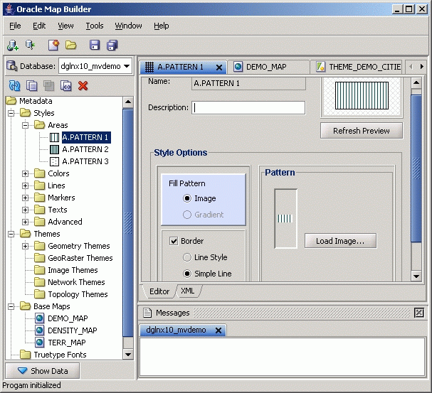

This chapter briefly describes the map visualization component Map Builder tool, also referred to as Oracle Map Builder. It does not provide detailed information about the tool's interface; for that you should use see online help available when you use Oracle Map Builder.

Oracle Map Builder is a standalone application that lets you create and manage the mapping metadata (about styles, themes, and base maps) that is stored in the database. For example, use this tool to create a style or to modify the definition of a style. Besides handling the metadata, the tool provides interfaces to preview the metadata (for example, to see how a line style will appear on a map) and also spatial information.

Whenever possible, you should use Oracle Map Builder instead of directly modifying map visualization component metadata views to create, modify, and delete information about styles, themes, and maps. For any modifications made outside Oracle Map Builder, such as with SQL statements, you should refresh the database connection in Oracle Map Builder to get the current items.

To use Oracle Map Builder effectively, you must understand the map visualization component concepts explained in [Map Visualization Concepts](map-visualization-concepts.md) and the information about map requests in [Map Visualization Servers](map-visualization-servers.md).

- Running Oracle Map Builder
  Oracle Map Builder is shipped as a JAR file (`mapbuilder.jar`).
- Oracle Map Builder User Interface
  Oracle Map Builder generally uses the left side for navigation to find and select objects, and the right side to display information about selected objects.

### 5.1 Running Oracle Map Builder

Oracle Map Builder is shipped as a JAR file (`mapbuilder.jar`).

You can run it as a standalone Java application in a Java Development Kit (J2SE SDK) 1.5 or later environment, as follows:

    % java –jar mapbuilder.jar [Options]

Options:

`-cache ``<cache_size>` specifies the size of the in-memory geometry cache. Example: -`cache 64M`

`-config ``<config-file>` specifies the location of the file containing Map Builder configuration and preference information. If you do not specify this option, Map Builder looks for a file named oasmapbuilder.xml in your home Java directory. For more information about the configuration and preference file, see [Configuring the Map Visualization Component](introduction-to-map-visualization-component.md).

`-connect` causes Map Builder at startup to register connections for all data sources specified in the `oasmapbuilder.xml` preferences file or the file specified with the `-config` option, and it automatically connects to the first available data source. This option increases the application startup time. If this option is not defined, startup is faster, but you must then use the File menu or an icon to connect to any data sources that you want to use (see Oracle Map Builder User Interface).

`-help` displays information about the available options.

- Java Libraries for Theme Creation with GDAL and Teradata

**Parent topic:** Oracle Map Builder Tool

#### 5.1.1 Java Libraries for Theme Creation with GDAL and Teradata

To create themes in Map Builder with GDAL-OGR (version 1.8 or later) or Teradata (version 13 or later), Map Builder must be started with GDAL-OGR (`gdal.jar`) and/or Teradata (`terajdbc4.jar` and `tdgssconfig.jar`) jar files on the class path. These Java libraries can be found in the GDAL installation on your system and on the Teradata website. (For GDAL, see the GDAL website for more information.)

The following example commands start Map Builder with additional libraries in the class path.

Windows: `java -Xmx512M -cp .\mapbuilder.jar;.\gdal.jar;.\terajdbc4.jar;.\tdgssconfig.jar oracle.mapviewer.builder.MapBuilder`

Linux: `java -Xmx512M -cp ./mapbuilder.jar:./gdal.jar:./terajdbc4.jar:./tdgssconfig.jar oracle.mapviewer.builder.MapBuilder`

**Parent topic:** Running Oracle Map Builder

### 5.2 Oracle Map Builder User Interface

Oracle Map Builder generally uses the left side for navigation to find and select objects, and the right side to display information about selected objects.

Figure 5-1 shows the main window of Oracle Map Builder, with the metadata navigation tree on the left and a detail pane for a selected area style on the right.

Figure 5-1 Oracle Map Builder Main Window

[Description of "Figure 5-1 Oracle Map Builder Main Window"](img_text/mapbuilder_ui.md)

The menus at the top contain standard entries, plus entries for features specific to Oracle Map Builder.

You can use shortcut keys to access menus and menu items: for example Alt+F for the File menu and Alt+E for the Edit menu; or Alt+H, then Alt+A for Help, then About.

Icons under the menus perform the following actions:

- Add new connection creates a new database connection for Oracle Map Builder to use.

- Load/Add/Remove connection loads or adds database connection for Oracle Map Builder to use, or removes a database connection from the available connections that Oracle Map Builder can use.

- Create new metadata creates a new base map, theme, or style.

- Open opens a base map, theme, or style.

- Save saves any changes to the currently selected object.

- Save All saves any changes to all open objects.

The left side of the Oracle Map Builder window has the Metadata navigator, including a database connection selector, icons for performing actions, and a hierarchical tree display for the map visualization component metadata objects (categorized by object type) accessible to the currently selected database connection. To select an object, expand the appropriate tree node or nodes, then double-click the object.

The right side of the Oracle Map Builder window has tabs and panes for detail views of objects that you select or open

To switch among objects, click the desired tabs; to close a tab, click the X in the tab. If you make changes to an object and click the X, you are asked if you want to save the changes.

The Messages area is used for feedback information as appropriate (for example, results of an action, or error or warning messages).

Detailed help is available within the Oracle Map Builder interface. See the online help for more information about Oracle Map Builder, including information about specific panes and dialog boxes.

**Parent topic:** Oracle Map Builder Tool
