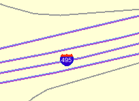
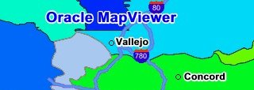
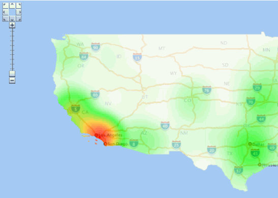

This appendix describes the XML format for defining style, themes, and base maps using the map visualization component metadata views.

These metadata views are described in [Map Visualization Component Metadata Views](map-visualization-concepts.md).

The metadata views for map visualization component styles (USER_SDO_STYLES and related views) contain a column named DEFINITION. For each style, the DEFINITION column contains an XML document that defines the style to the rendering engine.

Each style is defined using a syntax that is similar to SVG (scalable vector graphics). In the map visualization component syntax, each style's XML document must contain a single `<g>` element, which must have a `class` attribute that indicates the type or class of the style. For example, the following defines a color style with a filling color component:

    <?xml version="1.0" standalone="yes"?>
       <svg width="1in" height="1in">
           <desc> red </desc>
               <g class="color" style="fill:#ff1100"/>
       </svg>

The map visualization component XML parser looks only for the `<g>` element in a style definition; other attributes such as the `<desc>` element are merely informational and are ignored.

**Note:**

You can make the size of a style scalable by specifying a unit other than the default pixel (`px`) -- for example, `width:15.0km` or `stroke-width:10.0m`. For information about using scalable styles, see [Scaling the Size of a Style (Scalable Styles)](map-visualization-concepts.md).

The metadata views for map visualization component themes (USER_SDO_THEMES and related views) contain a column named STYLING_RULES. For each theme in these views, the STYLING_RULES column contains an XML document (a CLOB value) that defines the styling rules of the theme.

The metadata views for MapViewer base maps (USER_SDO_MAPS and related views) contain a column named DEFINITION. For each base map in these views, the DEFINITION column contains an XML document (a CLOB value) that defines the base map.

The following sections describe the XML syntax for each type of mapping metadata.

- Color Styles
  A color style has a fill color, a stroke color, or both.
- Marker Styles
  A marker style represents a marker to be placed on point features or on label points of area and linear features.
- Line Styles
  A line style is applicable only to a linear feature, such as a road, railway track, or political boundary.
- Area Styles
  An area style defines a pattern to be used to fill an area feature.
- Text Styles
  A text style defines the font and color to be used in labeling spatial features.
- Advanced Styles
  Advanced styles are structured styles made from simple styles.
- Themes: Styling Rules
  A theme definition contains one `<styling_rules>` element, which may have several other elements depending on the theme type.
- Base Maps
  A base map definition consists of one or more themes.
- Map Tile Layers
  An Oracle Maps map tile layer which assembles and displays pregenerated map image tiles from the map tile server,

### A.1 Color Styles

A color style has a fill color, a stroke color, or both.

When applied to a shape or geometry, the fill color (if present) is used to fill the interior of the shape, and the stroke color (if present) is used to draw the boundaries of the shape. Either color can also have an alpha value, which controls the transparency of that color.

For color styles, the `class` attribute of the `<g>` element must be set to `"color"`. The `<g>` element must have a `style` attribute, which specifies the color components and their optional alpha value. For example:

- `<g class="color" style="fill:#ff0000">` specifies a color style with only a fill color (whose RGB value is \#ff0000).

- `<g class="color" style="fill:#ff0000;stroke:blue">` specifies a color style with a fill color and a stroke color (blue).

You can specify a color value using either a hexadecimal string (such as \#00ff00) or a color name from the following list: black, blue, cyan, darkGray, gray, green, lightGray, magenta, orange, pink, red, white, yellow.

To specify transparency for a color style, you can specify `fill-opacity` and `stroke-opacity` values from 0 (completely transparent) to 255 (opaque). The following example specifies a fill component with half transparency:

    <g class="color" style="fill:#ff00ff;fill-opacity:128">

The following example specifies both stroke and fill opacity:

    <g class="color" style= "stroke:red;stroke-opacity:70;
                              fill:#ff00aa;fill-opacity:129">

The syntax for the `style` attribute is a string composed of one or more `name:value` pairs delimited by semicolons. (This basic syntax is used in other types of styles as well.)

For stroke colors, you can define a stroke width. The default stroke width when drawing a shape boundary is 1 pixel. To change that, add a `stroke-width:``value` pair to the `style` attribute string. The following example specifies a stroke width of 3 pixels:

    <g class="color" style="stroke:red;stroke-width:3">

**Parent topic:** XML Format for Styles, Themes, Base Maps, and Map Tile Layers

### A.2 Marker Styles

A marker style represents a marker to be placed on point features or on label points of area and linear features.

A marker can be either a vector marker or raster image marker. A marker can also have optional notational text. For a vector marker, the coordinates of the vector elements must be defined in its XML document. For a marker based on a raster image, the XML document for the style indicates that the style is based on an external image.

The marker XML document specifies the preferred display size: the preferred width and height are defined by the `width:``value``;height:``value` pairs in the `style` attribute of the `<g>` element. The `class` attribute must be set to `"marker"`. Some markers must be overlaid with some notational text, such as a U.S. interstate highway shield marker, which, when rendered, must also have a route number plotted on top of it. The style for such notational text is a style attribute with one or more of the following name-value pairs: `font-family:``value`, `font-style:``value`, `font-size:``value`, and `font-weight:``value`.

The following example defines an image-based marker that specifies font attributes (shown in bold) for any label text that may be drawn on top of the marker:

    <?xml version="1.0" standalone="yes"?>
    <svg width="1in" height="1in">
    <desc></desc>
    <g class="marker"
      style="width:20;height:18;font-family:sans-serif;font-size:9pt;fill:#ffffff">
        <image x="0" y="0" width="9999" height="9999" type="gif"
               href="dummy.gif"/>
    </g>
    </svg>

In the preceding example, when the marker is applied to a point feature with a labeling text, the label text is drawn centered on top of the marker, using the specified font family and size, and with the fill color (white in this case) as the text foreground. The label text (`495`) in Figure A-1 in Using Marker Styles on Lines has the text attributes specified in this example.

- Vector Marker Styles
- Image Marker Styles
- TrueType Font-Based Marker Styles
- Using Marker Styles on Lines

**Parent topic:** XML Format for Styles, Themes, Base Maps, and Map Tile Layers

#### A.2.1 Vector Marker Styles

A vector marker can be a simple polygon, an optimized rectangle (defined using two points), a single polyline, or a circle, but not any combination of them. For each type of vector marker, its `<g>` element must contain a corresponding subelement that specifies the geometric information (coordinates for the polygon, optimized rectangle, or polyline, or radius for the circle):

- A polygon definition uses a `<polygon>` element with a `points` attribute that specifies a list of comma-delimited coordinates. For example:

      <g class="marker">
         <polygon points="100,20,40,50,60,80,100,20"/>
      </g>

- An optimized rectangle definition uses a `<rect>` element with a `points` attribute that specifies a list of comma-delimited coordinates. For example:

      <g class="marker">
        <rect points="0,0, 120,120"/>
      </g>

- A polyline definition uses a `<polyline>` element with a `points` attribute that specifies a list of comma-delimited coordinates. For example:

      <g class="marker">
         <polyline points="100,20,40,50,60,80"/>
      </g>

- A circle definition uses a `<circle>` element with an `r` attribute that specifies the radius of the circle. For example:

      <g class="marker">
         <circle r="50"/>
      </g>

You can specify a stroke or fill color, or both, for any vector-based marker. The syntax is the same as for the style attribute for a color style. The following example defines a triangle marker that has a black border and that is filled with a half-transparent yellow:

    <?xml version="1.0" standalone="yes"?>
    <svg width="1in" height="1in">
    <g class="marker"  style="stroke:#000000;fill:#ffff00;fill-opacity:128">
         <polygon points="201.0,200.0, 0.0,200.0, 101.0,0.0"/>
    </g>
    </svg>

If a marker is scalable, you can set the marker's maximum size in pixels on a map by using the `max_size_in_px` attribute. Setting this attribute to an appropriate value will prevent the marker from getting so large as to block other map features when the user zooms in to view fine map details. The following example sets the marker's maximum size to 64 pixels:

    <?xml version="1.0" standalone="yes"?>
    <svg width="1in" height="1in">
        <g class="marker" max_size_in_px="64" style="stroke:#0000BB;fill:#0033FF;width:3.0mile;height:3.0mile;font-family:Dialog;font-size:12;font-fill:#FF0000">
            <polygon points="0.0,0.0,0.0,100.0,100.0,100.0,100.0,0.0,0.0,0.0"/>
        </g>
    </svg>

**Parent topic:** Marker Styles

#### A.2.2 Image Marker Styles

For an image marker, its XML document contains an `<image>` element that identifies the marker as based on an image. The image must be in GIF format, and is stored in the IMAGE column in the styles metadata views.

The following example is an XML document for an image marker:

    <?xml version="1.0" standalone="yes"?>
    <svg>
       <g class="marker"
                 style="width:20;height:18;font-family:sansserif;font-size:9pt">
         <image x="0" y="0" width="9999" height="9999" type="gif" href="dummy.gif"/>
       </g>
    </svg>

Note that in the preceding example, it would be acceptable to leave the `<image>` element empty (that is, `<image/>`) to create a valid definition with the image to be specified later.

**Parent topic:** Marker Styles

#### A.2.3 TrueType Font-Based Marker Styles

For a TrueType font-based marker, its marker symbol is stored in a TrueType font file, which has the .ttf file extension and which typically contains many individual symbols or glyphs. Many GIS software packages come with TrueType font files that contain symbols useful for mapping.

Before the map visualization component can use a symbol in a TrueType font file, you must do the following:

1.  Import the TrueType font file into the database, preferably by using the Map Builder tool (described in [Oracle Map Builder Tool](oracle-map-builder-tool.md)), which causes the symbols in the font file to be inserted into a single row in the system view USER_SDO_STYLES. In this new row, the TYPE column contains the string TTF, and the IMAGE column contains the contents of the TrueType font file. After the import operation, you can use the Map Builder tool to view all the glyphs or symbols contained inside the TrueType font file. Also, because the font file is now physically stored inside a database, it can be shared by all the map visualization component users.

2.  Create a map visualization component marker style based on a glyph or symbol inside an imported TrueType font, preferably using the Map Builder tool.

The following example shows the use of a TrueType font-based marker (with TrueType-specific material in bold):

    <?xml version="1.0" standalone="yes"?>
    <svg width="1in" height="1in">
    <g class="marker"  style="fill:#ff0000;width:25;height:25">
      <ttfSymbol fontName="ERS_INCIDENTS" charCode="118" />
    </g>
    </svg>

**Parent topic:** Marker Styles

#### A.2.4 Using Marker Styles on Lines

Marker styles are usually applied to point features, in which case the marker style is rendered on the point location that represents the feature. However, with line (line string) features such as highways, the marker must be placed at some point along the line to denote some information about the feature, such as its route number. For example, on maps in the United States, a shield symbol is often placed on top of a highway, with a route number inside the symbol, as shown with Route 495 in Figure A-1.

Figure A-1 Shield Symbol Marker for a Highway

[Description of "Figure A-1 Shield Symbol Marker for a Highway"](img_text/shield.md)

To achieve the result shown in Figure A-1, you must do the following:

1.  Choose a marker style, and add a text style definition (font family, font size, fill color, and so on), as shown in the example in Marker Styles.

2.  Specify the marker style as the labeling style in the styling rules for the theme. The following example shows the XML document with the styling rules for a theme to show highways. A marker style (shown in bold in the example) is specified. The label text (`495` in Figure A-1) is a value from the label column, which is named LABEL in this example.

        <?xml version="1.0" standalone="yes"?>
        <styling_rules theme_type="political">
        <rule>
           <features style="L.PH"> (name_class = 'I' and TOLL=0) </features>
           <label column="label" style="M.SHIELD1">1</label>
        </rule>
        <styling_rules>

The map visualization component automatically determines the optimal position on the line for placement of the marker style (the shield in this example).

**Parent topic:** Marker Styles

### A.3 Line Styles

A line style is applicable only to a linear feature, such as a road, railway track, or political boundary.

In other words, line styles can be applied only to Oracle Spatial and Graph geometries with an SDO_GTYPE value ending in 2 (line) or 6 (multiline). (For information about the SDO_GEOMETRY object type and SDO_GTYPE values, see [Oracle Spatial and Graph Developer's Guide](../spatl/spatial-datatypes-metadata.md).)

When the map visualization component draws a linear feature, a line style tells the rendering engine the color, dash pattern, and stroke width to use. A line style can have a base line element which, if defined, coincides with the original linear geometry. It can also define two edges parallel to the base line. Parallel line elements can have their own color, dash pattern, and stroke width. If parallel lines are used, they must be located to each side of the base line, with equal offsets to it.

To draw railroad-like lines, you need to define a third type of line element in a line style called hashmark. For a `<line>` element of class `hashmark`, the first value in the dash array indicates the gap between two hash marks, and the second value indicates the length of the hash mark to either side of the line. The following example defines a hash mark line with a gap of 8.5 screen units and a length of 3 screen units at each side of the base line:

    <line class="hashmark" style="fill:#003333"  dash="8.5,3.0"/>

The following example defines a complete line style.

    <?xml version="1.0" standalone="yes"?>
    <svg width="1in" height="1in">
       <g class="line" style="fill:#ffff00;stroke-width:5">
          <line class="parallel" style="fill:#ff0000;stroke-width:1.0"/>
          <line class="base" style="fill:black;stroke-width:1.0" dash="10.0,4.0"/>
       </g>
    </svg>

In the preceding example, `class="line"` identifies the style as a line style. The overall fill color (#ffff00) is used to fill any space between the parallel lines and the base line. The overall line width (5 pixels) limits the maximum width that the style can occupy (including that of the parallel lines).

The line style in the preceding example has both base line and parallel line elements. The parallel line element (`class="parallel"`) is defined by the first `<line>` element, which defines its color and width. (Because the definition does not provide a dash pattern, the parallel lines or edges will be solid.) The base line element (`class="base"`) is defined by the second `<line>` element, which defines its color, width, and dash pattern.

A marker (such as a direction marker) can be defined for a line style. The `marker-name` parameter specifies the name of a marker style, the `marker-position` parameter specifies the proportion (from 0 to 1) of the distance along the line from the start point at which to place the marker, and the `marker-size` parameter specifies the number of display units for the marker size. The marker orientation follows the orientation of the line segment on which the marker is placed.

The following example defines a line style with direction marker:

    <?xml version="1.0" standalone="yes"?>
    <svg width="1in" height="1in">
      <g class="line" style="fill:#33a9ff;stroke-width:4;
          marker-name:M.IMAGE105_BW;marker-position:0.15;marker-size=8">
        <line class="parallel" style="fill:red;stroke-width:1.0"/>
      </g>
    </svg>

To get multiple markers, add the `multiple-marker` attribute to the style definition. In this case the marker-position will define the position for the first marker and the space in between markers. The following example defines a line style with a direction marker that starts at position 0.15 and that is repeated continually with a space of 0.15 between each occurrence.

    <?xml version="1.0" standalone="yes"?>
    <svg width="1in" height="1in">
     <g class="line" style="fill:#33a9ff;stroke-width:4;
         marker-name:M.IMAGE105_BW; marker-position:0.15;
         marker-size=8; multiple-marker=true">
       <line class="parallel" style="fill:red;stroke-width:1.0"/>
     </g>
    </svg>

**Parent topic:** XML Format for Styles, Themes, Base Maps, and Map Tile Layers

### A.4 Area Styles

An area style defines a pattern to be used to fill an area feature.

In the current release, area styles must be image-based. That is, when you apply an area style to a geometry, the image defining the style is plotted repeatedly until the geometry is completely filled.

The definition of an area style is similar to that of an image marker style, which is described in Image Marker Styles.

The following example defines an area style:

    <?xml version="1.0" standalone="yes"?>
    <svg width="1in" height="1in">
       <g class="area"  style="stroke:#000000">
          <image/>
       </g>
    </svg>

In the preceding example, `class="area"` identifies the style as an area style. The stroke color (`style="stroke:#000000"`) is the color used to draw the geometry boundary. If no stroke color is defined, the geometry has no visible boundary, although its interior is filled with the pattern image.

You can also specify any line style to be used as the boundary for an area style. The following area style definition uses the `line-style` keyword (shown in bold in the example) to specify a line style to be used for the borders of features:

    <?xml version="1.0" standalone="yes"?>
    <svg width="1in" height="1in">
      <g class="area" style="line-style:L.DPH">
        <image x="0" y="0" width="9999" height="9999" type="gif" href="dummy.gif"/>
      </g>
    </svg>

As with the image marker style, the image for an area style must be stored in a separate column (identified in the IMAGE column in the USER_SDO_STYLES and ALL_SDO_STYLES metadata views, which are described in [xxx_SDO_STYLES Views](map-visualization-concepts.md)).

**Parent topic:** XML Format for Styles, Themes, Base Maps, and Map Tile Layers

### A.5 Text Styles

A text style defines the font and color to be used in labeling spatial features.

The `class` attribute must have the value `"text"`. For the font, you can specify its style (plain, italic, and so on), font family, size, and weight. To specify the foreground color, you use the `fill` attribute.

The following example defines a text style:

    <?xml version="1.0" standalone="yes"?>
    <svg width="1in" height="1in">
       <g class="text" style="font-style:plain; font-family:Dialog; font-size:14pt;
                 font-weight:bold; fill:#0000ff">
        Hello World!
       </g>
    </svg>

In the preceding example, the text "Hello World!" is displayed only when the style itself is being previewed in a style creation tool, such as the Map Builder tool. When the style is applied to a map, it is always supplied with an actual text label that the map visualization component obtains from a theme.

A text style can provide a floating white background around the rendered text, to make the labels easier to read on a map that has many features. Figure A-2 shows the label Vallejo with a white background wrapping tightly around the letters.

Figure A-2 Text Style with White Background

[Description of "Figure A-2 Text Style with White Background"](img_text/halotext.md)

To achieve the result shown in Figure A-2, you must specify the `float-width` attribute in the `<g>` element of the text style definition. The following example uses the `float-width` attribute (shown in bold in the example) to specify a white background that extends 3.5 pixels from the boundary of each letter. (The Hello World! text is ignored when the style is applied to the display of labels.)

    <?xml version="1.0" standalone="yes"?>
    <svg width="1in" height="1in">
    <desc></desc>
    <g class="text"  float-width="3.5"
       style="font-style:plain; font-family:Dialog; font-size:12pt; font-weight:bold;
         fill:#000000">
     Hello World!
    </g>
    </svg>

**Parent topic:** XML Format for Styles, Themes, Base Maps, and Map Tile Layers

### A.6 Advanced Styles

Advanced styles are structured styles made from simple styles.

Advanced styles are used primarily for thematic mapping. The core advanced style is the bucket style (`BucketStyle`), and every advanced style is a form of bucket style. A bucket style is a one-to-one mapping between a set of primitive styles and a set of buckets. Each bucket contains one or more attribute values of features to be plotted. For each feature, one of its attributes is used to determine which bucket it falls into or is contained within, and then the style assigned to that bucket is applied to the feature.

Two special types of bucket styles are also provided: color scheme (described in Color Scheme Styles) and variable (graduated) marker (described in Variable Marker Styles).

Other advanced styles are dot density (described in Dot Density Marker Styles), bar chart (described in Bar Chart Marker Styles), collection (described in Collection Styles), and variable pie chart (described in Variable Pie Chart Styles).

- Bucket Styles
- Color Scheme Styles
- Variable Marker Styles
- Dot Density Marker Styles
- Bar Chart Marker Styles
- Collection Styles
- Variable Pie Chart Styles
- Heat Map Styles

**Parent topic:** XML Format for Styles, Themes, Base Maps, and Map Tile Layers

#### A.6.1 Bucket Styles

A bucket style defines a set of buckets, and assigns one primitive style to each bucket. The content of a bucket can be either of the following:

- A collection of discrete values (for example, a bucket for all counties with a hurricane risk code of 1 or 2, a bucket for all counties with a hurricane risk code of 3, and so on).

- A continuous range of values (for example, a bucket for all counties with average family income less than \$30,000, a bucket for all counties with average family income from \$30,000 through \$39,999, and so on). In this case, the ranges of a series of buckets can be individually defined (each defined by an upper-bound value and lower-bound value) or equally divided among a master range.

The following code excerpt shows the basic format of a bucket style:

    <?xml version="1.0" ?>
    <AdvancedStyle>
      <BucketStyle>
        <Buckets>
        . . .
        </Buckets>
      </BucketStyle>
    </AdvancedStyle>

In contrast with the other (primitive) styles, an advanced style always has a root element identified by the `<AdvancedStyle>` tag.

For bucket styles, a `<BucketStyle>` element is the only child of the `<AdvancedStyle>` element. Each `<BucketStyle>` element has one or more `<Buckets>` child elements, whose contents vary depending on the type of buckets.

- Collection-Based Buckets with Discrete Values
- Individual Range-Based Buckets
- Equal-Ranged Buckets

**Parent topic:** Advanced Styles

##### A.6.1.1 Collection-Based Buckets with Discrete Values

If each bucket of a bucket style contains a collection of discrete values, use a `<CollectionBucket>` element to represent each bucket. Each bucket contains one or more values. The values for each bucket are listed as the content of the `<CollectionBucket>` element, with multiple values delimited by commas. The following example defines three buckets.

    <?xml version="1.0" ?>
      <AdvancedStyle>
        <BucketStyle>
          <Buckets>
            <CollectionBucket  seq="0" label="commercial"
                style="10015">commercial</CollectionBucket>
            <CollectionBucket  seq="1" label="residential"
                style="10031">residential, rural</CollectionBucket>
            <CollectionBucket  seq="2" label="industrial"
                style="10045">industrial, mining, agriculture</CollectionBucket>
        </Buckets>
      </BucketStyle>
    </AdvancedStyle>

In the preceding example:

- The values for each bucket are one or more strings; however, the values can also be numbers.

- The name of the style associated with each bucket is given.

- The label attribute for each `<CollectionBucket>` element (commercial, residential, or industrial) is used only in a label that is compiled for the advanced style.

- The order of the `<CollectionBucket>` elements is significant. However, the values in the `seq` (sequence) attributes are informational only; the map visualization component determines sequence only by the order in which elements appear in a definition.

Although not shown in this example, if you want a bucket for all other values (if any other values are possible), you can create a `<CollectionBucket>` element with `#DEFAULT#` as its attribute value. It should be placed after all other `<CollectionBucket>` elements, so that its style will be rendered last.

To apply label styles to collection-based buckets with discrete values, see [Specifying a Label Style for a Bucket](map-visualization-concepts.md).

**Parent topic:** Bucket Styles

##### A.6.1.2 Individual Range-Based Buckets

If each bucket of a bucket style contains a value range that is defined by two values, use a `<RangedBucket>` element to represent each bucket. Each bucket contains a range of values. The following example defines four buckets.

    <?xml version="1.0" ?>
     <AdvancedStyle>
       <BucketStyle>
         <Buckets>
              <RangedBucket high="10" style="10015"/>
              <RangedBucket low="10" high="40" style="10024"/>
              <RangedBucket low="40" high="50" style="10025"/>
              <RangedBucket low="50" style="10029"/>
         </Buckets>
       </BucketStyle>
    </AdvancedStyle>

For individual range-based buckets, the lower-bound value is inclusive, while the upper-bound value is exclusive (except for the range that has values greater than any value in the other ranges; its upper-bound value is inclusive). No range is allowed to have a range of values that overlaps values in other ranges.

For example, the second bucket in this example (`low="10" high="40"`) will contain any values that are exactly 10, as well as values up to but not including 40 (such as 39 and 39.99). Any values that are exactly 40 will be included in the third bucket.

As with the `<CollectionBucket>` element, the style associated with each `<RangedBucket>` element is specified as an attribute.

To apply label styles to individual range-based buckets, see [Specifying a Label Style for a Bucket](map-visualization-concepts.md).

**Parent topic:** Bucket Styles

##### A.6.1.3 Equal-Ranged Buckets

If a bucket style contains a series of buckets that contain an equally divided range of a master range, you can omit the use of `<RangedBucket>` elements, and instead specify in the `<Buckets>` element the master upper-bound value and lower-bound value for the overall range, the number of buckets in which to divide the range, and a list of style names (with one for each bucket). The following example defines five buckets (`nbuckets=5`) of equal range between 0 and 29:

    <?xml version="1.0" ?>
    <AdvancedStyle>
       <BucketStyle>
          <Buckets low="0" high="29" nbuckets="5"
              styles="10015,10017,10019,10021,10023"/>
       </BucketStyle>
     </AdvancedStyle>

In the preceding example:

- If all values are integers, the five buckets hold values in the following ranges: 0 to 5, 6 to 11, 12 to 17, 18 to 23, and 24 to 29.

- The first bucket is associated with the style named `10015`, the second bucket is associated with the style named `10017`, and so on.

The number of style names specified must be the same as the value of the `nbuckets` attribute. The buckets are arranged in ascending order, and the styles are assigned in their specified order to each bucket.

**Parent topic:** Bucket Styles

#### A.6.2 Color Scheme Styles

A color scheme style automatically generates individual color styles of varying brightness for each bucket based on a base color. The brightness is equally spaced between full brightness and total darkness. Usually, the first bucket is assigned the brightest shade of the base color and the last bucket is assigned the darkest shade.

You can include a stroke color to be used by the color style for each bucket. The stroke color is not part of the brightness calculation. So, for example, if a set of polygonal features is rendered using a color scheme style, the interior of each polygon is filled with the color (shade of the base color) for each corresponding bucket, but the boundaries of all polygons are drawn using the same stroke color.

You can include an opacity value (0 to 255, for transparent to opaque) for the base color (using the `basecolor_opacity` attribute) and for the stroke color (using the `strokecolor_opacity` attribute).

The following example defines a color scheme style with a black stroke color and four buckets associated with varying shades of the base color of blue.

    <?xml version="1.0" ?>
    <AdvancedStyle>
     <ColorSchemeStyle basecolor="blue" strokecolor="black">
       <Buckets>
            <RangedBucket label="&lt;10"  high="10"/>
            <RangedBucket label="10 - 20" low="10" high="20"/>
            <RangedBucket label="20 - 30" low="20" high="30"/>
            <RangedBucket label="&gt;=30" low="30"/>
       </Buckets>
      </ColorSchemeStyle>
    </AdvancedStyle>

**Note:**

For the following special characters, use escape sequences instead.

For `<`, use: `&lt`

For `>`, use: `&gt;`

For `&`, use: `&amp;`

**Parent topic:** Advanced Styles

#### A.6.3 Variable Marker Styles

A variable marker style generates a series of marker styles of varying sizes for each bucket. You specify the number of buckets, the start (smallest) size for the marker, and the size increment between two consecutive markers.

Variable marker styles are conceptually similar to color scheme styles in that both base buckets on variations from a common object: with a color scheme style the brightness of the base color varies, and with a variable marker style the size of the marker varies.

The following example creates a variable marker style with four buckets, each associated with different sizes (in increments of 4) of a marker (`m.circle`). The marker for the first bucket has a radius of 10 display units, the marker for the second bucket has a radius of 14 display units, and so on. This example assumes that the marker named `m.circle` has already been defined.

     <?xml version="1.0" ?>
    <AdvancedStyle>
      <VariableMarkerStyle basemarker="m.circle" startsize="10" increment="4">
         <Buckets>
             <RangedBucket label="&lt;10"  high="10"/>
             <RangedBucket label="10 - 20" low="10" high="20"/>
             <RangedBucket label="20 - 30" low="20" high="30"/>
             <RangedBucket label="&gt;=30"   low="30"/>
         </Buckets>
      </VariableMarkerStyle>
    </AdvancedStyle>

**Parent topic:** Advanced Styles

#### A.6.4 Dot Density Marker Styles

A dot density advanced marker style, when applied to an area feature such as states or counties, randomly draws a set of dots inside the area. The number of dots drawn inside each area is determined by the count value associated with the area. When you define a dot density style, you must specify a marker style that will be used for each of the dots.

The following example shows the XML definition of a simple dot density style:

    <?xml version="1.0" ?>
    <AdvancedStyle>
            <DotDensityStyle MarkerStyle="M.STAR" DotWidth="8" DotHeight="8">
            </DotDensityStyle>
    </AdvancedStyle>

In the preceding example, the marker style M.STAR is used for each dot, and the size of each dot is 8 pixels wide and high.

When you use a dot density style, you should "scale" the count value to a proper range. For example, if you want to apply a dot density style based on the population count for each county, you would not want to use the population count directly (one dot for each person), because this will result in an unacceptable number of drawn dots (for example, if a county has 15,000 people). Instead, supply a scaled down value or expression, such as `population/1000`, when you define the styling rules for the theme. (The map visualization component does not perform any scaling-down internally, so you must do it at the SQL query level.)

**Parent topic:** Advanced Styles

#### A.6.5 Bar Chart Marker Styles

A bar chart advanced marker style is similar to a pie chart style, except that it draws a bar graph for each feature to which it is applied. The following example shows the XML definition of a bar chart style:

    <?xml version="1.0" ?>
    <AdvancedStyle>
       <BarChartStyle width="30" height="25" show_x_axis="true">
           <Bar name="1990" color="#FF0000" />
           <Bar name="1995" color="#FFC800" />
           <Bar name="1998" color="#0000FF" />
           <Bar name="2000" color="#00FF00" />
           <Bar name="2002" color="#00FFFF" />
       </BarChartStyle>
    </AdvancedStyle>

In the preceding example, width and height specify the overall size of the bar chart, including all individuals bars within it.

When a bar chart is drawn on a feature based on a set of values associated with that feature, the height of each bar can be determined by either of two approaches: locally scaled or globally scaled. A locally scaled bar chart determines the height of each bar only from the associated values for that feature; and thus, for example, you cannot compare the second bar of one chart to the second bar on another chart on the same theme. A globally scaled bar chart uses the same bar scale for all charts on the map; and thus, for example, you can compare the second bar of one chart to the second bar on another chart on the same theme.

So, if you want to compare bars not only within the same chart, but also among all the charts showing on the map, you must use globally scaled bar chart style by specifying `share_scale="true"` in the definition of the bar chart style, as shown in the following example:

    <?xml version="1.0" ?>
    <AdvancedStyle>
       <BarChartStyle width="40" height="30" share_scale="true"
          min_value="0.0" max_value="100">
           <Bar name="1990" color="#FF0000" />
           <Bar name="1995" color="#FFC800" />
           <Bar name="1998" color="#0000FF" />
           <Bar name="2000" color="#00FF00" />
           <Bar name="2002" color="#00FFFF" />
       </BarChartStyle>
    </AdvancedStyle>

When the bar chart style in the preceding example is applied to a theme, the map visualization component considers the global range of values of all features in that theme, and then determines the height of each bar based on where a specific value falls in the global range from the minimum value to the maximum value.

**Parent topic:** Advanced Styles

#### A.6.6 Collection Styles

A collection advanced style is simply a collection of other types of styles that are applied together to a feature. This can result in faster rendering of a collection theme compared to using multiple themes based on different styles.

For example, a bar chart style, when applied to a county, draws only the bar chart somewhere inside the county, but the county itself (its boundary and interior area) is not drawn. However, you probably want to see the underlying boundaries of the counties, to see which bar chart belongs to which county. To do this without a collection style, you would have to define a second theme in which each county is being associated with a color or area style. This approach would result in two rendering passes (because two themes are involved) for essentially the same group of features.

However, by using a collection style in this example, you can define a single style that refers to both the bar chart and the color or area style, and then apply the collection style to the theme for the counties. This theme, when rendered by the map visualization component, will show both the bar charts and the boundaries on the map.

Another typical use of a collection style is for rendering collection type topology features, each of which can contain multiple types of geometries, such as polygons (areas), points, and lines. In such cases, a collection style can include styles that are most appropriate for each type of geometry in a collection topology feature.

The following example shows the XML definition of a collection style:

    <?xml version="1.0" standalone="yes"?>
     <AdvancedStyle>
       <CollectionStyle>
         
        </rendering>
      </rule>
    </styling_rules>

For more information about using the \<rendering\> element to apply multiple rendering styles in a single styling rule, see [Applying Multiple Rendering Styles in a Single Styling Rule](map-visualization-concepts.md).

The `<hidden_info>` element specifies the list of attributes from the base table to be displayed when the user moves the mouse over the theme's features. The attributes are specified by a list of `<field>` elements.

Each `<field>` element must have a `column` attribute, which specifies the name of the column from the base table, and it can have a `name` attribute, which specifies the display name of the column. (The `name` attribute is useful if you want a text string other than the column name to be displayed.)

The `<join_table>` element specifies the table name and its one or two columns for the measurements. It may contain one measure column for features of point type or two measure columns for features of line string type. The measure column or columns are used for the linear referencing process when joining with a LRS table, which has an LRS geometry column.

The `<join_columns>` element specifies one column of the LRS table (which has a LRS geometry column), and one column from the join table (which has one or two measure columns). These two columns are used to join the LRS table and the join table.

The `<operations>` element specifies the list of image processing operations to be applied on a GeoRaster theme. The operations are specified by a list of `<operation>` elements.

The `<operation>` element specifies the image processing operator and its parameters to be applied on a GeoRaster theme. Each `<operation>` element may have a list of `<parameters>` elements.

The `<parameters>` element defines a list of parameters to be used on a specific task. The parameters are specified by a list of `<parameter>` elements.

The `<parameter>` element must have the `name` and `value` attributes defined.

The `<bitmap_masks>` element defines the image mask attributes to be used with a GeoRaster theme. The bitmap masks are specified by a list of `<mask>` elements.

The `<mask>` element specifies a bitmap mask to be applied on a GeoRaster object. The `raster_id`, `raster_table`, and `layers` attributes must be defined, while the `zeromapping` and `onemapping` attributes are optional.

See [Styling Rules in Predefined Spatial Geometry Themes](map-visualization-concepts.md) for more information about styling rules and for an example.

**Parent topic:** XML Format for Styles, Themes, Base Maps, and Map Tile Layers

### A.8 Base Maps

A base map definition consists of one or more themes.

The XML definition of a base map is specified in the DEFINITION column of the USER_SDO_MAPS metadata view, using the following DTD:

    <!ELEMENT map_definition (theme+)>

    <!ELEMENT theme EMPTY>
    <!ATTLIST theme name CDATA #REQUIRED
        name                  CDATA #REQUIRED
        datasource            CDATA #IMPLIED
        template_theme        CDATA #IMPLIED
        max_scale             CDATA #IMPLIED
        min_scale             CDATA #IMPLIED
        label_always_on       (TRUE|FALSE) "FALSE"
        fast_unpickle         (TRUE|FALSE) "TRUE"
        mode                  CDATA #IMPLIED
        min_dist              CDATA #IMPLIED
        fixed_svglabel        (TRUE|FALSE) "FALSE"
        visible_in_svg        (TRUE|FALSE) "TRUE"
        selectable_in_svg     (TRUE|FALSE) "FALSE"
        part_of_basemap       (TRUE|FALSE) "FALSE"
        simplify_shapes       (TRUE|FALSE) "TRUE"
        transparency          CDATA #IMPLIED
        minimum_pixels        CDATA #IMPLIED
        onclick               CDATA #IMPLIED
        onmousemove           CDATA #IMPLIED
        onmouseover           CDATA #IMPLIED
        onmouseout            CDATA #IMPLIED
        workspace_name        CDATA #IMPLIED
        workspace_savepoint   CDATA #IMPLIED
        workspace_date        CDATA #IMPLIED
        workspace_date_format CDATA #IMPLIED
        fetch_size            CDATA #IMPLIED
        timeout               CDATA #IMPLIED
    >

The `<map_definition>` element contains one or more `<theme>` elements. Themes are rendered on a map on top of each other, in the order in which they are specified in the definition.

See [Maps](map-visualization-concepts.md) for more information about defining base maps and for an example.

**Parent topic:** XML Format for Styles, Themes, Base Maps, and Map Tile Layers

### A.9 Map Tile Layers

An Oracle Maps map tile layer which assembles and displays pregenerated map image tiles from the map tile server,

Tis rpocess is described in [Map Tile Layer Configuration](map-visualization-servers.md). The XML configuration settings of a map tile layer is defined using the following DTD:

    <!ELEMENT map_tile_layer ((internal_map_source|external_map_source), tile_storage, coordinate_system, tile_image, , tile_dpi?, tile_meters_per_unit?, zoom_levels, auto_update?, themes?)>
    <!ATTLIST map_tile_layer
              name CDATA #REQUIRED
              image_format CDATA #IMPLIED
              http_header_expires CDATA #IMPLIED
              utfgrid (TRUE|FALSE) "FALSE"
              utfgrid_resolution CDATA #IMPLIED
              concurrent_fetching_threads CDATA #IMPLIED
              fetch_larger_tile (TRUE|FALSE) "TRUE"
              persistent_tiles (TRUE|FALSE) "TRUE">

    <!ELEMENT internal_map_source EMPTY>
    <!ATTLIST internal_map_source
              data_source CDATA #REQUIRED
              base_map CDATA #REQUIRED
              bgcolor CDATA #IMPLIED
              out_of_bounds_color CDATA #IMPLIED
              antialias (TRUE|FALSE) "TRUE">

    <!ELEMENT external_map_source (properties?)>
    <!ATTLIST external_map_source
              url CDATA #REQUIRED
              request_method CDATA #REQUIRED
              timeout CDATA #IMPLIED
              adapter_class CDATA #REQUIRED
              proxy_host CDATA #IMPLIED
              proxy_port CDATA #IMPLIED
              clipping_buffer CDATA #IMPLIED>

    <!ELEMENT properties (property+) >

    <!ELEMENT property EMPTY >
    <!ATTLIST property
              name CDATA #REQUIRED
              value CDATA #REQUIRED>

    <!ELEMENT tile_storage EMPTY >
    <!ATTLIST tile_storage
              root_path CDATA #REQUIRED
              xyz_storage_scheme (TRUE|FALSE) "FALSE">

    <!ELEMENT coordinate_system EMPTY >
    <!ATTLIST coordinate_system
              srid CDATA #REQUIRED
              minX CDATA #REQUIRED
              minY CDATA #REQUIRED
              maxX CDATA #REQUIRED
              maxY CDATA #REQUIRED>

    <!ELEMENT tile_bound (coordinates)>
    <!ELEMENT coordinates (#PCDATA)>

    <!ELEMENT tile_image EMPTY >
    <!ATTLIST tile_image
              width CDATA #REQUIRED
              height CDATA #REQUIRED>

    <!ELEMENT tile_dpi EMPTY >
    <!ATTLIST tile_dpi
              value CDATA #REQUIRED>

    <!ELEMENT tile_meters_per_unit EMPTY >
    <!ATTLIST tile_meters_per_unit
              value CDATA #REQUIRED>

    <!ELEMENT zoom_levels (zoom_level+)>
    <!ATTLIST zoom_levels
              levels CDATA #REQUIRED
              min_scale CDATA #IMPLIED
              max_scale CDATA #IMPLIED
              min_tile_width CDATA #IMPLIED
              min_tile_height CDATA #IMPLIED>

    <!ELEMENT zoom_level (tile_bound?)>
    <!ATTLIST zoom_level
              level CDATA #REQUIRED
              level_name CDATA #IMPLIED
              description CDATA #IMPLIED
              scale CDATA #REQUIRED
              tile_width CDATA #REQUIRED
              tile_height CDATA #REQUIRED>

    <!ELEMENT auto_update (dirty_mbr_table_name,logtable_name)>
    <!ATTLIST auto_update
              finest_level_to_refresh CDATA #REQUIRED
              dirty_mbr_batch CDATA #REQUIRED
              dirty_mbr_cap CDATA #REQUIRED>

    <!ELEMENT dirty_mbr_table_name EMPTY>
    <!ATTLIST dirty_mbr_table_name
              name CDATA #REQUIRED>

    <!ELEMENT logtable_name EMPTY>
    <!ATTLIST logtable_name
              name CDATA #REQUIRED>

    <!ELEMENT themes (theme)>
    <!ATTLIST auto_update
              finest_level_to_refresh CDATA #REQUIRED
              dirty_mbr_batch CDATA #REQUIRED
              dirty_mbr_cap CDATA #REQUIRED>

    <!ELEMENT theme EMPTY>
    <!ATTLIST theme
              name CDATA #REQUIRED
              from_level CDATA #REQUIRED
              to_level CDATA #REQUIRED>

**Parent topic:** XML Format for Styles, Themes, Base Maps, and Map Tile Layers
