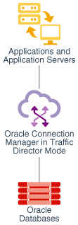

This chapter discusses the compatibility of Oracle Java Database Connectivity (JDBC) driver versions, database versions, and Java Development Kit (JDK) versions.

It also describes the basics of testing a client installation and configuration and running a simple application. This chapter contains the following sections:

- Version Compatibility for Oracle JDBC Drivers

- Verifying a JDBC Client Installation

- Basic Steps in JDBC

- Sample: Connecting\_ Querying\_ and Processing the Results

- Support for Invisible Columns

- Support for Verifying JSON Data

- Support for Implicit Results

- Support for Lightweight Connection Validation

- Support for Deprioritization of Database Nodes

- Support for Oracle Connection Manager in Traffic Director Mode

- Support for Memoptimized Rowstore Fast Ingest

- Stored Procedure Calls in JDBC Programs

- About Processing SQL Exceptions

### 2.1 Version Compatibility for Oracle JDBC Drivers

This section discusses the general JDBC version compatibility issues.

The following table describes the JDBC and Oracle Database interoperability matrix or the certification matrix:

| JDBC Driver Version | Database 19.x | Database 18.3 | Database 12.2 and 12.1 | Database 11.2.0.4 |
|:--------------------|:--------------|:--------------|:-----------------------|:------------------|
| JDBC 19.x           | Yes           | Yes           | Yes                    | Yes               |
| JDBC 18.3           | Yes           | Yes           | Yes                    | Yes               |
| JDBC 12.2 and 12.1  | Yes           | Yes           | Yes                    | Yes               |
| JDBC 11.2.0.4       | Yes           | Yes           | Yes                    | Yes               |

Oracle JDBC Drivers are always compliant to the latest JDK version for every new release. For some versions, JDBC drivers support multiple JDK versions. The following table describes the release-specific JDBC JAR files and supported JDK versions for various Oracle Database versions:

| Oracle Database Version | Release-Specific JDBC JAR File with Supported JDK Version                   |
|:------------------------|:----------------------------------------------------------------------------|
| 19.x                    | `ojdbc10.jar` with JDK 10, JDK 11 `ojdbc8.jar` with JDK 8, JDK 9, JDK 11 |
| 18.3                    | `ojdbc8.jar` with JDK 8, JDK 9, JDK 10, JDK 11                              |
| 12.2 or 12cR2           | `ojdbc8.jar` with JDK 8                                                     |
| 12.1 or 12cR1           | `ojdbc7.jar` with JDK 7, JDK 8 `ojdbc6.jar` with JDK 6                   |
| 11.2 or 11gR2           | `ojdbc6.jar` with JDK 6, JDK 7, JDK 8 `ojdbc5.jar` with JDK 5            |

**Related Topics**

- [Oracle Universal Connection Pool Developer’s Guide](../jjucp/fast-connection-failover.md)
- <http://www.oracle.com/technetwork/database/enterprise-edition/jdbc-faq-090281.html>

### 2.2 Verifying a JDBC Client Installation

To verify a JDBC client installation, you must do all of the following:

- Checking the Installed Directories and Files

- Checking the Environment Variables

- Ensuring that the Java Code Can Be Compiled and Run

- Determining the Version of the JDBC Driver

- Testing the JDBC and Database Connection

This section describes the steps for verifying an Oracle client installation of the JDBC drivers, assuming that you have already installed the driver of your choice. Installation of an Oracle JDBC driver is platform-specific. You must follow the installation instructions for the driver you want to install in your platform-specific documentation.

If you use the JDBC Thin driver, then there is no additional installation on the client computer. If you use the JDBC Oracle Call Interface (OCI) driver, then you must also install the Oracle client software. This includes Oracle Net and the OCI libraries.

**Note:**

The JDBC Thin driver requires a TCP/IP listener to be running on the computer where the database is installed.

#### 2.2.1 Checking the Installed Directories and Files

Installing the Oracle Java products creates the directories described in this section, among other things.

- `ORACLE_HOME``/jdbc`

- `ORACLE_HOME` `/jlib`

Check whether or not the following directories and files have been created and populated in the `ORACLE_HOME``/jdbc` directory:

- `doc`

  This directory contains the `javadoc.zip` file, which is the Oracle JDBC application programming interface (API) documentation.

- `lib`

  The `lib` directory contains the following required Java classes:

  - `ojdbc10.jar` and `ojdbc10_g.jar`

    Contain the JDBC driver classes for use with JDK 8, JDK 9, and JDK 11

  - `ojdbc8.jar` and `ojdbc8_g.jar`

    Contain the JDBC driver classes for use with JDK 8

- `orai18n.jar` and `orai18n-mapping.jar`

  Contain classes for globalization and multibyte character sets support

<!-- -->

- `Readme.txt`

  This file contains late-breaking and release-specific information about the drivers, which may not have been included in other documentation on the product.

Check whether or not the following directories have been created and populated in the `ORACLE_HOME` `/jlib` directory:

- `jta.jar` and `jndi.jar`

  These files contain classes for the Java Transaction API (JTA) and the Java Naming and Directory Interface (JNDI). These are required only if you are using JTA features for distributed transaction management or JNDI features for naming services.

- `ons.jar`

  This JAR file contains classes for Oracle RAC Fast Application Notification. It is also required for Universal Connection Pool (UCP) features like Fast Connection Failover, Run-time Load Balancing, Web Session Affinity, and Transaction Affinity.

**Related Topics**

- [Oracle RAC Fast Application Notification](Oracle-RAC-FAN-API.md)
- [jta.jar](http://www.oracle.com/technetwork/java/javaee/jta/)
- [jndi.jar](http://www.oracle.com/technetwork/java/jndi/index.html)
- [Oracle Universal Connection Pool Developer’s Guide](../jjucp/using-Oracle-RAC-features.md)

#### 2.2.2 Checking the Environment Variables

This section describes the environment variables that you must set for the JDBC OCI driver and the JDBC Thin driver on Solaris, Linux, and Microsoft Windows platforms.

You must set the `CLASSPATH` environment variable for JDBC OCI or Thin driver. Include the following in the `CLASSPATH` environment variable:

    ORACLE_HOME/jdbc/lib/ojdbc10.jar
    ORACLE_HOME/jdbc/lib/ojdbc8.jar
    ORACLE_HOME/jlib/orai18n.jar

**Note:**

If you use the JTA features and the JNDI features, then you must specify `jta.jar` and `jndi.jar` in your `CLASSPATH` environment variable.

##### JDBC OCI Driver

To use the JDBC OCI driver, you must also set the following value for the library path environment variable:

- On Solaris or Linux, set the `LD_LIBRARY_PATH` environment variable as follows:

      ORACLE_HOME/lib

  This directory contains the `libocijdbc19.so` shared object library.

- On Microsoft Windows, set the `PATH` environment variable as follows:

      ORACLE_HOME\bin

  This directory contains the `ocijdbc19.dll` dynamic link library.

All of the JDBC OCI demonstration programs can be run in the Instant Client mode by including the JDBC OCI Instant Client data shared library on the library path environment variable.

##### JDBC Thin Driver

To use the JDBC Thin driver, you do not have to set any other environment variables. However, to use the JDBC server-side Thin driver, you need to set permission.

##### Setting Permission for the Server-Side Thin Driver

The JDBC server-side Thin driver opens a socket for its connection to the database. As Oracle Database enforces the Java security model, a check is performed for a `SocketPermission` object.

To use the JDBC server-side Thin driver, the connecting user must be granted the appropriate permission. The following is an example of how the permission can be granted for the user `HR`:

    CREATE ROLE jdbcthin;
    CALL dbms_java.grant_permission('JDBCTHIN', 'java.net.SocketPermission', '*', 'connect');
    GRANT jdbcthin TO HR;

Note that `JDBCTHIN` in the `grant_permission` call must be in uppercase. The asterisk (`*`) is a pattern. You can restrict the user by granting permission to connect to only specific computers or ports.

**Related Topics**

- [Features Specific to JDBC OCI Driver](JDBC-OCI-features.md)
- [Oracle Database Java Developer’s Guide](../jjdev/DBMS-JAVA-package.md)

#### 2.2.3 Ensuring that the Java Code Can Be Compiled and Run

To further ensure that Java is set up properly on your client system, go to the `samples` directory under the `ORACLE_HOME``/jdbc/demo` directory. Now, type the following commands on the command line, one after the other, to see if the Java compiler and the Java interpreter run without error:

    javac

    java

Each of the preceding commands should display a list of options and parameters and then exit. Ideally, verify that you can compile and run a simple test program, such as `jdbc/demo/samples/generic/SelectExample`.

#### 2.2.4 Determining the Version of the JDBC Driver

To determine the version of the JDBC driver, call the `getDriverVersion` method of the `OracleDatabaseMetaData` class as shown in the following sample code:

    import java.sql.*;
    import oracle.jdbc.*;
    import oracle.jdbc.pool.OracleDataSource;

    class JDBCVersion
    {
      public static void main (String args[]) throws SQLException
      {
        OracleDataSource ods = new OracleDataSource();
        ods.setURL("jdbc:oracle:thin:HR/hr@<host>:<port>:<service>");
        Connection conn = ods.getConnection();

        // Create Oracle DatabaseMetaData object
        DatabaseMetaData meta = conn.getMetaData();

        // gets driver info:
        System.out.println("JDBC driver version is " + meta.getDriverVersion());
      }
    }

You can also determine the version of the JDBC driver by executing the following commands:

- `java -jar ojdbc8.jar`

- `java -jar ojdbc10.jar`

#### 2.2.5 Testing the JDBC and Database Connection

The `samples` directory contains sample programs for a particular Oracle JDBC driver. One of the programs, `JdbcCheckup.java`, is designed to test JDBC and the database connection. The program queries for the user name, password, and the name of the database to which you want to connect. The program connects to the database, queries for the string "`Hello World`", and prints it to the screen.

Go to the `samples` directory, and compile and run the `JdbcCheckup.java` program. If the results of the query print without error, then your Java and JDBC installations are correct.

Although `JdbcCheckup.java` is a simple program, it demonstrates several important functions by performing the following:

- Imports the necessary Java classes, including JDBC classes

- Creates a `DataSource` instance

- Connects to the database

- Runs a simple query

- Prints the query results to your screen

The `JdbcCheckup.java` program, which uses the JDBC OCI driver, is as follows:

    /*
     * This sample can be used to check the JDBC installation.
     * Just run it and provide the connect information. It will select
     * "Hello World" from the database.
     */

    // You need to import the java.sql and JDBC packages to use JDBC
    import java.sql.*;
    import oracle.jdbc.*;
    import oracle.jdbc.pool.OracleDataSource;

    // We import java.io to be able to read from the command line
    import java.io.*;

    class JdbcCheckup
    {
      public static void main(String args[]) throws SQLException, IOException
      {

        // Prompt the user for connect information
        System.out.println("Please enter information to test connection to
                              the database");
        String user;
        String password;
        String database;

        user = readEntry("user: ");
        int slash_index = user.indexOf('/');
        if (slash_index != -1)
        {
          password = user.substring(slash_index + 1);
          user = user.substring(0, slash_index);
        }
        else
          password = readEntry("password: ");
        database = readEntry("database(a TNSNAME entry): ");

        System.out.print("Connecting to the database...");
        System.out.flush();
        System.out.println("Connecting...");
        // Open an OracleDataSource and get a connection
        OracleDataSource ods = new OracleDataSource();
        ods.setURL("jdbc:oracle:oci:@" + database);
        ods.setUser(user);
        ods.setPassword(password);
        Connection conn = ods.getConnection();
        System.out.println("connected.");

        // Create a statement
        Statement stmt = conn.createStatement();

        // Do the SQL "Hello World" thing
        ResultSet rset = stmt.executeQuery("select 'Hello World' from dual");

        while (rset.next())
          System.out.println(rset.getString(1));
        // close the result set, the statement and the connection
        rset.close();
        stmt.close();
        conn.close();
        System.out.println("Your JDBC installation is correct.");
      }

      // Utility function to read a line from standard input
      static String readEntry(String prompt)
      {
        try
        {
          StringBuffer buffer = new StringBuffer();
          System.out.print(prompt);
          System.out.flush();
          int c = System.in.read();
          while (c != '\n' && c != -1)
          {
            buffer.append((char)c);
            c = System.in.read();
          }
          return buffer.toString().trim();
        }
        catch(IOException e)
        {
          return "";
        }
      }
    }

### 2.3 Basic Steps in JDBC

After verifying the JDBC client installation, you can start creating your JDBC applications. When using Oracle JDBC drivers, you must include certain driver-specific information in your programs. This section describes, in the form of a tutorial, where and how to add the information. The tutorial guides you through the steps to create code that connects to and queries a database from the client.

You must write code to perform the following tasks:

1.  Importing Packages
2.  Opening a Connection to a Database
3.  Creating a Statement Object
4.  Running a Query and Retrieving a Result Set Object
5.  Processing the Result Set Object
6.  Closing the Result Set and Statement Objects
7.  Making Changes to the Database
8.  About Committing Changes
9.  Closing the Connection

**Note:**

You must supply Oracle driver-specific information for the first three tasks that enable your program to use the JDBC application programming interface (API) to access a database. For the other tasks, you can use standard JDBC Java code, as you would for any Java application.

#### 2.3.1 Importing Packages

Regardless of which Oracle JDBC driver you use, include the `import` statements shown in Table 2-1 at the beginning of your program using the following syntax:

    import <package_name>;

Table 2-1 Import Statements for JDBC Driver

| Import statement                                                                  | Provides                                                                                                                            |
|:----------------------------------------------------------------------------------|:------------------------------------------------------------------------------------------------------------------------------------|
| `import java.sql.*;`                                                              | Standard JDBC packages.                                                                                                             |
| `import java.math.*;`                                                             | The `BigDecimal` and `BigInteger` classes. You can omit this package if you are not going to use these classes in your application. |
| `import oracle.jdbc.*;` `import oracle.jdbc.pool.*;` `import oracle.sql.*;` | Oracle extensions to JDBC. This is optional. `OracleDataSource`. Oracle type extensions. This is optional.                    |

The Oracle packages listed as optional provide access to the extended functionality provided by Oracle JDBC drivers, but are not required for the example presented in this section.

**Note:**

It is better to import only the classes your application needs, rather than using the wildcard asterisk (`*`). This guide uses the asterisk (\*) for simplicity, but this is not the recommended way of importing classes and interfaces.

#### 2.3.2 Opening a Connection to a Database

First, you must create an `OracleDataSource` instance. Then, open a connection to the database using the `OracleDataSource.getConnection` method. The properties of the retrieved connection are derived from the `OracleDataSource` instance. If you set the URL connection property, then all other properties, including `TNSEntryName`, `DatabaseName`, `ServiceName`, `ServerName`, `PortNumber`, `Network Protocol`, and driver type are ignored.

##### Specifying a Database URL, User Name, and Password

The following code sets the URL, user name, and password for a data source:

    OracleDataSource ods = new OracleDataSource();
    ods.setURL(url);
    ods.setUser(user);
    ods.setPassword(password);

The following example connects user `HR` with password `hr` to a database with service `orcl` through port 5221 of the host `myhost`, using the JDBC Thin driver:

    OracleDataSource ods = new OracleDataSource();
    String url = "jdbc:oracle:thin:@//myhost:5221/orcl";
    ods.setURL(url);
    ods.setUser("HR");
    ods.setPassword("hr");
    Connection conn = ods.getConnection();

**Note:**

The user name and password specified in the arguments override any user name and password specified in the URL.

##### Specifying a Database URL that Includes User Name and Password

The following example connects user `HR` with password `hr` to a database host whose Transparent Network Substrate (TNS) entry is `myTNSEntry`, using the JDBC Oracle Call Interface (OCI) driver. In this case, the URL includes the user name and password and is the only input parameter.

    String url = "jdbc:oracle:oci:HR/hr@myTNSEntry");
    ods.setURL(url);
    Connection conn = ods.getConnection();

If you want to connect using the Thin driver, then you must specify the port number. For example, if you want to connect to the database on the host `myhost` that has a TCP/IP listener on port 5221 and the service identifier is `orcl`, then provide the following code:

    String URL = "jdbc:oracle:thin:HR/hr@//myhost:5221/orcl");
    ods.setURL(URL);
    Connection conn = ods.getConnection();

**Related Topics**

- [Data Sources and URLs](data-sources-and-URLs.md)
- [Data Sources and URLs](data-sources-and-URLs.md)

#### 2.3.3 Creating a Statement Object

Once you connect to the database and, in the process, create a `Connection` object, the next step is to create a `Statement` object. The `createStatement` method of the JDBC `Connection` object returns an object of the JDBC `Statement` type. To continue the example from the previous section, where the `Connection` object `conn` was created, here is an example of how to create the `Statement` object:

    Statement stmt = conn.createStatement();

#### 2.3.4 Running a Query and Retrieving a Result Set Object

To query the database, use the `executeQuery` method of the `Statement` object. This method takes a SQL statement as input and returns a JDBC `ResultSet` object.

**Note:**

- The method used to execute a `Statement` object depends on the type of SQL statement being executed. If the `Statement` object represents a SQL query returning a `ResultSet` object, the `executeQuery` method should be used. If the SQL is known to be a DDL statement or a DML statement returning an update count, the `executeUpdate` method should be used. If the type of the SQL statement is not known, the `execute` method should be used.

- In case of a standard JDBC driver, if the SQL string being executed does not return a `ResultSet` object, then the `executeQuery` method throws a `SQLException` exception. In case of an Oracle JDBC driver, the `executeQuery` method does not throw a `SQLException` exception even if the SQL string being executed does not return a `ResultSet` object.

To continue the example, once you create the `Statement` object `stmt`, the next step is to run a query that returns a `ResultSet` object with the contents of the `first_name` column of a table of employees named `EMPLOYEES`:

    ResultSet rset = stmt.executeQuery ("SELECT first_name FROM employees");

#### 2.3.5 Processing the Result Set Object

Once you run your query, use the `next()` method of the `ResultSet` object to iterate through the results. This method steps through the result set row by row, detecting the end of the result set when it is reached.

To pull data out of the result set as you iterate through it, use the appropriate `get``XXX` methods of the `ResultSet` object, where `XXX` corresponds to a Java data type.

For example, the following code will iterate through the `ResultSet` object, `rset`, from the previous section and will retrieve and print each employee name:

    while (rset.next())
       System.out.println (rset.getString(1));

The `next()` method returns `false` when it reaches the end of the result set. The employee names are materialized as Java `String` values.

#### 2.3.6 Closing the Result Set and Statement Objects

You must explicitly close the `ResultSet` and `Statement` objects after you finish using them. This applies to all `ResultSet` and `Statement` objects you create when using Oracle JDBC drivers. The drivers do not have finalizer methods. The cleanup routines are performed by the `close` method of the `ResultSet` and `Statement` classes. If you do not explicitly close the `ResultSet` and `Statement` objects, serious memory leaks could occur. You could also run out of cursors in the database. Closing both the result set and the statement releases the corresponding cursor in the database. If you close only the result set, then the cursor is not released.

For example, if your `ResultSet` object is `rset` and your `Statement` object is `stmt`, then close the result set and statement with the following lines of code:

    rset.close();
    stmt.close();

When you close a `Statement` object that a given `Connection` object creates, the connection itself remains open.

**Note:**

Typically, you should put `close` statements in a `finally` clause.

#### 2.3.7 Making Changes to the Database

##### DML Operations

To perform DML (Data Manipulation Language) operations, such as INSERT or UPDATE operations, you can create either a `Statement` object or a `PreparedStatement` object. `PreparedStatement` objects enable you to run a statement with varying sets of input parameters. The `prepareStatement` method of the JDBC `Connection` object lets you define a statement that takes variable bind parameters and returns a JDBC `PreparedStatement` object with your statement definition.

Use the `set``XXX` methods on the `PreparedStatement` object to bind data to the prepared statement to be sent to the database.

The following example shows how to use a prepared statement to run `INSERT` operations that add two rows to the `EMPLOYEES` table.

        // Prepare to insert new names in the EMPLOYEES table
    PreparedStatement pstmt = null;
    try{
        pstmt = conn.prepareStatement ("insert into EMPLOYEES (EMPLOYEE_ID, FIRST_NAME) values (?, ?)");

        // Add LESLIE as employee number 1500
        pstmt.setInt (1, 1500);          // The first ? is for EMPLOYEE_ID
        pstmt.setString (2, "LESLIE");   // The second ? is for FIRST_NAME
        // Do the insertion
        pstmt.execute();

        // Add MARSHA as employee number 507
        pstmt.setInt (1, 507);           // The first ? is for EMPLOYEE_ID
        pstmt.setString (2, "MARSHA");   // The second ? is for FIRST_NAME
        // Do the insertion
        pstmt.execute();
    }

    finally{
            if(pstmt!=null)

        // Close the statement
        pstmt.close();
    }

##### DDL Operations

To perform data definition language (DDL) operations, you must create a `Statement` object. The following example shows how to create a table in the database:

    //create table EMPLOYEES with columns EMPLOYEE_ID and FIRST_NAME
    String query;
    Statement stmt=null;

    try{
        query="create table EMPLOYEES " +
              "(EMPLOYEE_ID int, " +
              "FIRST_NAME varchar(50))";
        stmt = conn.createStatement();
        stmt.executeUpdate(query);
        }
    finally{
         //close the Statement object
         stmt.close();
        }

**Note:**

You can also use a `PreparedStatement` object to perform DDL operations. However, you should not use a `PreparedStatement` object because the useful part of such an object is that it can have parameters and a DDL operation does not have any parameters.

Also, due to a Database limitation, if you use a `PreparedStatement` object for a DDL operation, then it only works for the first time it is executed. So, you should use only `Statement` objects for DDL operations.

The following example shows how to prepare your DDL statements before any reexecution:

    //
    Statement stmt = null;
    PreparedStatement pstmt = null;
    try{
        pstmt = conn.prepareStatement ("insert into EMPLOYEES (EMPLOYEE_ID, FIRST_NAME) values (?, ?)");
        stmt = conn.createStatement("truncate table EMPLOYEES");

        // Add LESLIE as employee number 1500
        pstmt.setInt (1, 1500);          // The first ? is for EMPLOYEE_ID
        pstmt.setString (2, "LESLIE");   // The second ? is for FIRST_NAME
        pstmt.execute();
        stmt.executeUpdate();

        // Add MARSHA as employee number 507
        pstmt.setInt (1, 507);           // The first ? is for EMPLOYEE_ID
        pstmt.setString (2, "MARSHA");   // The second ? is for FIRST_NAME
        pstmt.execute();
        stmt.executeUpdate();
        }
    finally{
    if(pstmt!=null)

        // Close the statement
         pstmt.close();
    }

**Related Topics**

- [The setObject and setOracleObject Methods](accessing-and-manipulating-Oracle-data.md)
- [Other setXXX Methods](accessing-and-manipulating-Oracle-data.md)

#### 2.3.8 About Committing Changes

By default, data manipulation language (DML) operations are committed automatically as soon as they are run. This is known as the auto-commit mode. If auto-commit mode is on and you perform a `COMMIT` or `ROLLBACK` operation using the `commit` or `rollback` method on a connection object, then you get the following error messages:

Table 2-2 Error Messages for Operations Performed When Auto-Commit Mode is ON

| Operation  | Error Messages                               |
|:-----------|:---------------------------------------------|
| `COMMIT`   | `Could not commit with auto-commit set on`   |
| `ROLLBACK` | `Could not rollback with auto-commit set on` |

If a SQLException is raised during a `COMMIT` or `ROLLBACK` operation with the error messages as mentioned in the preceding table, then check the auto-commit status of the connection because you get an exception when these operations are performed on a connection that has auto-commit value set to `true`.

This exception is raised for any one of the following cases:

- When auto-commit status is set to `true` and `commit` or `rollback` method is called

- When the default status of auto-commit is not changed and `commit` or `rollback` method is called

- When the value of the `COMMIT_ON_ACCEPT_CHANGES` property is `true` and `commit` or `rollback` method is called after calling the `acceptChanges` method on a rowset

However, you can disable auto-commit mode with the following method call on the `Connection` object:

    conn.setAutoCommit(false);

If you disable the auto-commit mode, then you must manually commit or roll back changes with the appropriate method call on the `Connection` object:

    conn.commit();

or:

    conn.rollback();

A `COMMIT` or `ROLLBACK` operation affects all DML statements run since the last `COMMIT` or `ROLLBACK`.

**Note:**

- If the auto-commit mode is disabled and you close the connection without explicitly committing or rolling back your last changes, then an implicit `COMMIT` operation is run.

- Any data definition language (DDL) operation always causes an implicit `COMMIT`. If the auto-commit mode is disabled, then this implicit `COMMIT` will commit any pending DML operations that had not yet been explicitly committed or rolled back.

**Related Topics**

- [Disabling Auto-Commit Mode](JDBC-coding-tips.md)

##### 2.3.8.1 Changing Commit Behavior

When a transaction updates the database, it generates a redo entry corresponding to this update. Oracle Database buffers this redo in memory until the completion of the transaction. When you commit the transaction, the Log Writer (LGWR) process writes the redo entry for the commit to disk, along with the accumulated redo entries of all changes in the transaction. By default, Oracle Database writes the redo to disk before the call returns to the client. This behavior introduces latency in the commit because the application must wait for the redo entry to be persisted on disk.

If your application requires very high transaction throughput and you are willing to trade commit durability for lower commit latency, then you can change the behavior of the default `COMMIT` operation, depending on the needs of your application. You can change the behavior of the `COMMIT` operation with the following options:

- `WAIT`

- `NOWAIT`

- `WRITEBATCH`

- `WRITEIMMED`

These options let you control two different aspects of the commit phase:

- Whether the `COMMIT` call should wait for the server to process it or not. This is achieved by using the `WAIT` or `NOWAIT` option.

- Whether the Log Writer should batch the call or not. This is achieved by using the `WRITEIMMED` or `WRITEBATCH` option.

You can also combine different options together. For example, if you want the `COMMIT` call to return without waiting for the server to process it and also the log writer to process the commits in batch, then you can use the `NOWAIT` and `WRITEBATCH` options together. For example:

    ((OracleConnection)conn).commit(
        EnumSet.of(
          OracleConnection.CommitOption.WRITEBATCH,
          OracleConnection.CommitOption.NOWAIT));

**Note:**

you cannot use the `WAIT` and `NOWAIT` options together because they have opposite meanings. If you do so, then the JDBC driver will throw an exception. The same applies to the `WRITEIMMED` and `WRITEBATCH` options.

#### 2.3.9 Closing the Connection

You must close the connection to the database after you have performed all the required operations and no longer require the connection. You can close the connection by using the `close` method of the `Connection` object, as follows:

    conn.close();

**Note:**

Typically, you should put `close` statements in a `finally` clause.

### 2.4 Sample: Connecting, Querying, and Processing the Results

The steps in the preceding sections are illustrated in the following example, which uses the Oracle JDBC Thin driver to create a data source, connects to the database, creates a `Statement` object, runs a query, and processes the result set.

Note that the code for creating the `Statement` object, running the query, returning and processing the `ResultSet` object, and closing the statement and connection uses the standard JDBC API.

    import java.sql.Connection;
    import java.sql.ResultSet;
    import java.sql.Statement;
    import java.sql.SQLException;
    import oracle.jdbc.pool.OracleDataSource;

    class JdbcTest
    {
       public static void main (String args []) throws SQLException
       {

    OracleDataSource ods = null;
    Connection conn = null;
    Statement stmt = null;
    ResultSet rset = null;

          // Create DataSource and connect to the local database
          ods = new OracleDataSource();
          ods.setURL("jdbc:oracle:thin:@//localhost:5221/orcl");
          ods.setUser("HR");
          ods.setPassword("hr");
          conn = ods.getConnection();

    try
    {
          // Query the employee names
          stmt = conn.createStatement ();
          rset = stmt.executeQuery ("SELECT first_name FROM employees");

          // Print the name out
          while (rset.next ())
             System.out.println (rset.getString (1));
        }

          //Close the result set, statement, and the connection

    finally{
          if(rset!=null) rset.close();
          if(stmt!=null) stmt.close();
          if(conn!=null) conn.close();
    }
       }
    }

If you want to adapt the code for the OCI driver, then replace the call to the `OracleDataSource.setURL` method with the following:

    ods.setURL("jdbc:oracle:oci:@MyHostString");

where, `MyHostString` is an entry in the `TNSNAMES.ORA` file.

### 2.5 Support for Invisible Columns

Starting from this release, Oracle Database supports invisible columns. Using this feature, you can add a column to the table in hidden mode and make it visible later. JDBC provides APIs to retrieve information about invisible columns. To get information about whether a column is invisible or not, you can use the `isColumnInvisible` method available in the `oracle.jdbc.OracleResultSetMetaData` interface in the following way:

#### Example

    ...
    Connection conn = DriverManager.getConnection(jdbcURL, user, password);
    Statement stmt = conn.createStatement ();
    stmt.executeQuery ("create table hiddenColsTable (a varchar(20), b int invisible)");
    stmt.executeUpdate("insert into hiddenColsTable (a,b ) values('somedata',1)");
    stmt.executeUpdate("insert into hiddenColsTable (a,b) values('newdata',2)");

    System.out.println ("Invisible columns information");
    try
    {
          ResultSet rset = stmt.executeQuery("SELECT a, b FROM hiddenColsTable");
          OracleResultSetMetaData rsmd = (OracleResultSetMetaData)rset.getMetaData();
          while (rset.next())
          {
            System.out.println("column1 value:" + rset.getString(1));
            System.out.println("Visibility:" + rsmd.isColumnInvisible(1));
            System.out.println("column2 value:" + rset.getInt(2));
            System.out.println("Visibility:" + rsmd.isColumnInvisible(2));
          }
    }
    catch (Exception ex)
    {
           System.out.println("Exception :" + ex);
           ex.printStackTrace();
    }

Alternatively, you can also use the `getColumns` method available in the `oracle.jdbc.OracleDatabaseMetaData` class to retrieve information about invisible columns.

#### Example

    ...
    Connection conn = DriverManager.getConnection(jdbcURL, user, password);
    Statement stmt = conn.createStatement ();
    stmt.executeQuery ("create table hiddenColsTable (a varchar(20), b int invisible)");
    stmt.executeUpdate("insert into hiddenColsTable (a,b ) values('somedata',1)");
    stmt.executeUpdate("insert into hiddenColsTable (a,b) values('newdata',2)");

     System.out.println ("getColumns for table with invisible columns");
     try
     {
          DatabaseMetaData dbmd = conn.getMetaData();
          ResultSet rs = dbmd.getColumns(null, "HR", "hiddenColsTable", null);
          OracleResultSetMetaData rsmd = (OracleResultSetMetaData)rs.getMetaData();
          int colCount = rsmd.getColumnCount();
          System.out.println("colCount: " + colCount);
          String[] columnNames = new String [colCount];

          for (int i = 0; i < colCount; ++i)
          {
            columnNames[i] = rsmd.getColumnName (i + 1);
          }

          while (rs.next())
          {
            for (int i = 0; i < colCount; ++i)
               System.out.println(columnNames[i] +":" +rs.getString (columnNames[i]));
          }
     }
     catch (Exception ex)
     {
          System.out.println("Exception: " + ex);
          ex.printStackTrace();
     }

**Note:**

The server-side internal driver, `kprb` does not support fetching information about invisible columns.

### 2.6 Support for Verifying JSON Data

Starting from Oracle Database Release 18c, JDBC drivers can verify whether a column returned in the `ResultSet` is a JSON column or not. To get information about whether a column is JSON or not, you can use the `isColumnJSON` method available in the `oracle.jdbc.OracleResultSetMetaData` interface in the following way:

Example 2-1 Example

      ...
      public void test(Connection conn)
          throws Exception{

        try {
          show ("tkpjb26776242 - start");
          createTable(conn);

          String sql = "SELECT col1, col2, col3, col4, col5, col6, col7, col8 FROM tkpjb26776242_tab";
          Statement stmt = conn.createStatement();
          ResultSet rs = stmt.executeQuery(sql);
          ResultSetMetaData rsmd = rs.getMetaData();

          OracleResultSetMetaData orsmd   = (OracleResultSetMetaData)rsmd;

          int colCnt = orsmd.getColumnCount();
          show("Table has " + colCnt + " columns.");
          for (int i = 1; i <= colCnt; i++) {
            String columnName = orsmd.getColumnName(i);
            String typeName = orsmd.getColumnTypeName(i);
            boolean invisible = orsmd.isColumnInvisible(i);
            boolean json = orsmd.isColumnJSON(i);
            show(columnName + "  " + typeName + (invisible?"   INVISIBLE":"") + (json?"   JSON":""));
          }

          rs.close();
          stmt.close();

          show ("tkpjb26776242 - end");
        }
        finally {
          dropTable(conn);
        }
      }

      private void createTable(Connection conn) throws Exception{
        String sql = " create table tkpjb26776242_tab ( "
                     + "  col1 clob, "
                     + " col2 clob , "
                     + " col3 clob INVISIBLE, "
                     + " col4 clob INVISIBLE, "
                     + " col5 varchar2(200), "
                     + " col6 varchar2(200), "
                     + " col7 varchar2(200) INVISIBLE, "
                     + " col8 varchar2(200) INVISIBLE, "
                     + " check (col2 IS JSON), "
                     + " check (col4 IS JSON), "
                     + " check (col6 IS JSON), "
                     + " check (col8 IS JSON))";

        Util.doSQL(conn, sql);
      }

      private void dropTable(Connection conn) throws Exception{
        String sql = " drop table tkpjb26776242_tab";

        Util.trySQL(conn, sql);
      }
        ...

### 2.7 Support for Implicit Results

Starting from this release, Oracle Database supports results of SQL statements executed in a stored procedure to be returned implicitly to the client applications without the need to explicitly use a `REF CURSOR`. You can use the following methods to retrieve and process the implicit results returned by PL/SQL procedures or blocks:

| Method                | Description                                                                                                                                                                                                                                                 |
|:----------------------|:------------------------------------------------------------------------------------------------------------------------------------------------------------------------------------------------------------------------------------------------------------|
| `getMoreResults`      | Checks if there are more results available in the result set                                                                                                                                                                                                |
| `getMoreResults(int)` | Checks if there are more results available in the result set, like the overloaded method. This method accepts an `int` parameter that can have one of the following values: • `KEEP_CURRENT_RESULT` • `CLOSE_ALL_RESULTS` • `CLOSE_CURRENT_RESULT` |
| `getResultSet`        | Iteratively retrieves each implicit result from an executed PL/SQL statement                                                                                                                                                                                |

**Note:**

- The server-side internal driver, `kprb` does not support fetching information about implicit results.

- Only SELECT queries can be returned implicitly.

- Applications retrieve each result set sequentially, but can fetch rows from any result set independent of the sequence.

Suppose you have a procedure called `foo` as the following:

     create procedure foo as
      c1 sys_refcursor;
      c2 sys_refcursor;
    begin
      open c1 for select * from hr.employees;
      dbms_sql.return_result(c1); --return to client
      -- open 1 more cursor
      open c2 for select * from hr.departments;
      dbms_sql.return_result (c2); --return to client
    end;

The following code snippet demonstrates how to retrieve the implicit results returned by PL/SQL procedures using the `getMoreResults` methods:

#### Example 1

    String sql = "begin foo; end;";
    ...
    Connection conn = DriverManager.getConnection(jdbcURL, user, password);
     try {
            Statement stmt = conn.createStatement ();
            stmt.executeQuery (sql);

            while (stmt.getMoreResults())
            {
                  ResultSet rs = stmt.getResultSet();
                  System.out.println("ResultSet");
                  while (rs.next())
                 {
                       /* get results */
                 }
             }
          }

Suppose you have another procedure called `foo` as the following:

    create or replace procedure foo asc1 sys_refcursor; c2 sys_refcursor; c3 sys_refcursor; begin   open c1 for 'select * from hr.employees';
    dbms_sql.return_result (c1);-- cursor 2open c2 for 'select * from hr.departments';
    dbms_sql.return_result (c2);-- cursor 3open c3 for 'select first_name from hr.employees';
    dbms_sql.return_result (c3); end;

The following code snippet demonstrates how to retrieve the implicit results returned by PL/SQL procedures using the `getMoreResults(int)` methods:

#### Example 2

    String sql = "begin foo; end;";
    ...
    Connection conn = DriverManager.getConnection(jdbcURL, user, password);

    try {
            Statement stmt = conn.createStatement ();
            stmt.executeQuery (sql);
            ResultSet rs = null;

            boolean retval = stmt.getMoreResults(Statement.KEEP_CURRENT_RESULT))
            if (retval)
            {
                rs = stmt.getResultSet();
                System.out.println("ResultSet");
                while (rs.next())
                {
                    /* get results */
                }
            }

            /* closes open results */
            retval = stmt.getMoreResults(Statement.CLOSE_ALL_RESULTS);

            if (retval)
            {
                System.out.println("More ResultSet available");
                rs = stmt.getResultSet();
                System.out.println("ResultSet");
                while (rs.next())
                {
                    /* get results */
                }
            }

            /* close current result set */
            retval = stmt.getMoreResults(Statement.CLOSE_CURRENT_RESULT);

            if(retval)
            {
                System.out.println("More ResultSet available");
                rs = stmt.getResultSet();
                while (rs.next())
                {
                    /* get Results */

                }
            }
        }

### 2.8 Support for Lightweight Connection Validation

Starting from Oracle Database Release 18c, JDBC Thin driver supports lightweight connection validation. Lightweight connection validation enables JDBC applications to verify connection validity by sending a zero length NS data packet that does not require a round-trip to the database. For the earlier releases of Oracle Database, when you call the `isValid(timeout)` method to test the validity of a connection, Oracle JDBC driver uses a ping-pong protocol, which is an expensive operation as it makes a full round-trip to the database. In Oracle Database Release 18c, the `isValid(timeout)` method instead sends an empty packet to the database and does not wait to receive it back. So, connection validation is faster, which results in better application performance.

Lightweight connection validation is disabled by default. To enable this feature, you must set the `oracle.jdbc.defaultConnectionValidation` connection property value to `SOCKET`. If this property is set, then the JDBC driver performs lightweight connection validation, when you call the `isValid(timeout)` method.

**Note:**

- Lightweight connection validation checks only the underlying socket health. When the `isValid(timeout)` method returns `true`, that is, if a connection is termed as valid, this validation only guarantees that the server is not unreachable (dead socket). It does not provide any status about the server processes, like whether they are running or not. However, by default, that is, when lightweight connection validation is not enabled, the `isValid(timeout)` method does check whether the network between the client and the server is intact or not.

- Only the JDBC Thin driver supports this feature.

New APIs for Lightweight Connection Validation

- `oracle.jdbc.defaultConnectionValidation`

  This connection property specifies the level of connection validation. The possible values for this property are: `NONE`, `LOCAL`, `SOCKET`, `NETWORK`, `SERVER`, and `COMPLETE`. These values are case-sensitive, and setting any value other than these values throws an exception. The default value is `NETWORK`.

- `public boolean isValid(ConnectionValidation validation_level, int timeout) throws SQLException`

  The new variation of the existing `isValid(timeout)` method accepts two parameters: level of validation (`validation_level`) and `timeout`. The first parameter specifies the level of connection validation.

Example 2-2 Example of Lightweight Connection Validation

The following code snippet demonstrates how to implement lightweight connection mechanism:

        ...
        OracleDataSource ods = new OracleDataSource();
        ods.setURL(url);
        ods.setUser(user);
        ods.setPassword(password);
        Connection conn = ods.getConnection();
        try{
              boolean isValid = ((OracleConnection)conn).
                                    isValid(ConnectionValidation.SOCKET,timeout);
              System.out.println("Connection isValid = "+isValid);
        }
        catch (Exception ex)
       {
             System.out.println("Exception :" + ex);
             ex.printStackTrace();
        }
        ...    ...

### 2.9 Support for Deprioritization of Database Nodes

Starting from Oracle Database 12c Release 2 (12.2.0.1), JDBC drivers support deprioritization of database nodes. When a node fails, JDBC deprioritizes it for the next 10 minutes, which is the default expiry time. For example, if there are three nodes A, B, C, and node A is down, then connections are allocated first from nodes B and C, and then from node A. After the default expiry time, node A is no longer deprioritized, that is, connections are allocated from all the three nodes on availability basis. Also, during the default expiry time, if a connection attempt to node A succeeds, then node A is no longer considered to be a deprioritized node. You can specify the default expiry time for deprioritization using the `oracle.net.DOWN_HOSTS_TIMEOUT` system property.

For example, in the following URL, `scan_listener0` has `ip1`, `ip2`, and `ip3` IP addresses configured, after retrieving its IP addresses. Now, if `ip1` is deprioritized, then the order of trying IP addresses will be `ip2`, `ip3`, and then `ip1`. If all IP addresses are unavailable, then the whole host is tried last, after trying `node_1` and `node_2`.

    (DESCRIPTION_LIST=
        (DESCRIPTION=
            (ADDRESS_LIST=
                (ADDRESS=(PROTOCOL=tcp)(HOST=scan_listener0)(PORT=1521))
                (ADDRESS=(PROTOCOL=tcp)(HOST=node_1)(PORT=1528))
                (ADDRESS=(PROTOCOL=sdp)(HOST=node_2)(PORT=1527))
            )
            (ADDRESS_LIST=
                (ADDRESS=(PROTOCOL=tcp)(HOST=node_3)(PORT=1528))
            )
            (CONNECT_DATA=(SERVICE_NAME=cdb3))
        )
        (DESCRIPTION=
            (ADDRESS=(PROTOCOL=tcp)(HOST=node_0)(PORT=1528))
            (CONNECT_DATA=(SERVICE_NAME=cdb3))
        )
    )

### 2.10 Support for Oracle Connection Manager in Traffic Director Mode

Oracle Database Release 18c JDBC Drivers support Oracle Connection Manager in Traffic Director Mode, which is a proxy placed between the database clients and the database instances. A JDBC client can connect to the Oracle Connection Manager in Traffic Director Mode, which in turn connects to the target Oracle Database. The Two-Task Common (TTC) messages, which are sent from the clients, are intercepted by Oracle Connection Manager in Traffic Director Mode. It parses the incoming TTC messages and relays the request to the appropriate destination database. Once the responses are received, Oracle Connection Manager in Traffic Director Mode transfers the results back from the destination database to the clients through TTC responses.

The following image illustrates the architecture of Oracle Connection Manager in Traffic Director Mode:

Figure 2-1 Architecture of Oracle Connection Manager in Traffic Director Mode

[Description of "Figure 2-1 Architecture of Oracle Connection Manager in Traffic Director Mode"](img_text/cmantraffdrmode.md)

**See Also:**

- [Oracle Database Net Services Administrator's Guide](../netag/configuring-oracle-connection-manager.md) for more information about configuring the `cman.ora` file to set up Oracle Connection Manager in Traffic Director Mode

- [Oracle Database Net Services Reference](../netrf/oracle-connection-manager-parameters.md) for more information about Oracle Connection Manager in Traffic Director Mode parameters

#### 2.10.1 Modes of Running Oracle Connection Manager in Traffic Director Mode

You can run Oracle Connection Manager in Traffic Director Mode in the following modes:

- Pooled connection mode

  The pooled connection mode uses a new feature called Proxy Resident Connection Pooling, which is a proxy-enabled mode of Database Resident Connection Pooling. The Proxy Resident Connection Pooling reduces the connection load on the database as it multiplexes a large number of client connections over a fewer number of database connections. Any application using Oracle Database 12c Release 1 (12.1) JDBC drivers and later can use this connection mode.

  **Note:**

  This feature can best be used with clients using DRCP-aware connection pools.

- Nonpooled or dedicated connection mode

  You can use the Nonpooled or dedicated connection mode with applications using Oracle Database 11g Release 2 (11.2.0.4) JDBC drivers and later. However, some capabilities such as connection multiplexing are not available in this mode.

**Related Topics**

- [Overview of Database Resident Connection Pooling](database-resident-connection-pooling.md)

**See Also:**

- [Database Admin Guide](../admin/managing-processes.md)

- [Universal Connection Pool Developer's Guide](../jjucp/intro.md)

#### 2.10.2 Benefits of Oracle Connection Manager in Traffic Director Mode

Oracle Connection Manager in Traffic Director Mode provides the following benefits:

- Transparent performance enhancements and connection multiplexing, which includes:
  - Statement caching, rows prefetching, and result set caching are auto-enabled for all modes of operation.

  - Database session multiplexing (pooled mode only) using the proxy resident connection pool (PRCP), where PRCP is a proxy mode of Database Resident Connection Pooling (DRCP). Applications get transparent connection-time load balancing and run-time load balancing between Oracle Connection Manager in Traffic Director Mode and the database.

  - For multiple Oracle Connection Manager in Traffic Director Mode instances, applications get increased scalability through client-side connection-time load balancing or with a load balancer (BIG-IP, NGINX, and others)
- Zero application downtime
  - Planned database maintenance or pluggable database (PDB) relocation
    - Pooled mode

      Oracle Connection Manager in Traffic Director Mode responds to Oracle Notification Service (ONS) events for planned outages and redirects work. Connections are drained from the pool on Oracle Connection Manager in Traffic Director Mode when the request completes. Service relocation is supported for Oracle Database 11g release 2 (11.2.0.4) and later.

      For PDB relocation, Oracle Connection Manager in Traffic Director Mode responds to in-band notifications when a PDB is relocated, that is even when ONS is not configured (for Oracle Database release 18c and later server only) 

    - Non-pooled or dedicated mode

      When there is no request boundary information from the client, Oracle Connection Manager in Traffic Director Mode supports planned outage for many applications (as long as only simple session state and cursor state need to be preserved across the request or transaction boundaries). This support includes:
      - Stop service or PDB at the transaction boundary, or it leverages Oracle Database release 18c continuous application availability to stop the service at the request boundary

      - Oracle Connection Manager in Traffic Director Mode leverages Transparent Application Failover (TAF) failover restore to reconnect and restore simple states.

  - Unplanned database outages for read-mostly workloads
- High Availability of Oracle Connection Manager in Traffic Director Mode to avoid a single point of failure. This is supported by:
  - Multiple instances of Oracle Connection Manager in Traffic Director Mode using a load balancer or client side load balancing/failover in the connection string

  - Rolling upgrade of Oracle Connection Manager in Traffic Director Mode instances

  - Graceful close of existing connections from client to Oracle Connection Manager in Traffic Director Mode for planned outages

  - In-band notifications to Oracle Database release 18c and later clients

  - For older clients, notifications are sent with the response of the current request
- For security and isolation, Oracle Connection Manager in Traffic Director Mode furnishes:
  - Database Proxy supporting transmission control protocol/transmission control protocol secure (TCP/TCPS) and protocol conversion

  - Firewall based on the IP address, service name, and secure socket layer/transport layer security (SSL/TLS) wallets

  - Tenant isolation in a multi-tenant environment

  - Protection against denial-of-service and fuzzing attacks

  - Secure tunneling of database traffic across Oracle Database on-premises and Oracle Cloud

#### 2.10.3 Restrictions for Oracle Connection Manager in Traffic Director Mode

The following functionalities are not supported with Oracle Connection Manager in Traffic Director Mode:

- Distributed Transactions

- Advanced Queuing (AQ)

- Database Startup or Database Shutdown calls

- Database Sharding

- XML coding

- SQL Translation

- Proxy Authentication and TLS External Authentication, such as Distinguished Names (DNs) used in LDAP

- Object REF

- Session switching

- Scrollable Cursor

- Per Iteration DML Row Counts

- Implicit Results

- Continuous Query Notification (CQN)

- Client Result Cache

- PL/SQL Callback for Session State Fix Up in Database Resident Connection Pooling (DRCP)

- Multiple tagging in Database Resident Connection Pooling (DRCP)

- Application Continuity

- Authentication such as SYSDBA, SYSOPER and so on

- Real Application Security

- Data types such as PL/SQL Indexed Table Binds

- Bulk Copy (ODP.Net only)

- Self-Tuning (ODP.Net only)

- ASO encryption and supported algorithms (ASO only)

### 2.11 Support for Memoptimized Rowstore Fast Ingest

The Memoptimized Rowstore enables high performance data streaming for applications, such as Internet of Things (IoT).

The Memoptimized Rowstore provides the following functionality:

- Fast ingest that optimizes the processing of high-frequency, single-row data inserts into a database.
- Fast lookup that enables fast retrieval of data from a database for high-frequency queries.

**See Also:**

[Enabling High Performance Data Streaming with the Memoptimized Rowstore](../tgdba/tuning-system-global-area.md)

For using this feature, create a table similar to the following:

     CREATE TABLE customers (
     id NUMBER(20,0),
     name VARCHAR2(90 BYTE),
     region VARCHAR2(10 BYTE)
     )
     segment creation immediate
     memoptimize for write
     ;

Then invoke an INSERT statement with a hint from your Java or JDBC application:

     INSERT /*+ MEMOPTIMIZE_WRITE */ INTO CUSTOMERS VALUES (2, 'DOS', 'NORTH');

### 2.12 Stored Procedure Calls in JDBC Programs

This section describes how Oracle JDBC drivers support the following kinds of stored procedures:

- PL/SQL Stored Procedures

- Java Stored Procedures

#### 2.12.1 PL/SQL Stored Procedures

JDBC supports the invocation of PL/SQL procedures/functions and anonymous blocks, using either JDBC escape syntax or PL/SQL block syntax. The following PL/SQL calls would work with any Oracle JDBC driver:

    // JDBC escape syntax
    CallableStatement cs1 = conn.prepareCall
                           ( "{call proc (?,?)}" ) ; // stored proc
    CallableStatement cs2 = conn.prepareCall
                           ( "{? = call func (?,?)}" ) ; // stored func
    // PL/SQL block syntax
    CallableStatement cs3 = conn.prepareCall
                           ( "begin proc (?,?); end;" ) ; // stored proc
    CallableStatement cs4 = conn.prepareCall
                           ( "begin ? := func(?,?); end;" ) ; // stored func

As an example of using the Oracle syntax, here is a PL/SQL code snippet that creates a stored function. The PL/SQL function gets a character sequence and concatenates a suffix to it:

    create or replace function foo (val1 char)
    return char as
    begin
       return val1 || 'suffix';
    end;

The function invocation in your JDBC program should look like the following:

    OracleDataSource ods = new OracleDataSource();
    ods.setURL("jdbc:oracle:oci:@<hoststring>");
    ods.setUser("HR");
    ods.setPassword("hr");
    Connection conn = ods.getConnection();

    CallableStatement cs = conn.prepareCall ("begin ? := foo(?); end;");
    cs.registerOutParameter(1,Types.CHAR);
    cs.setString(2, "aa");
    cs.execute();
    String result = cs.getString(1);

#### 2.12.2 Java Stored Procedures

You can use JDBC to call Java stored procedures through the SQL interface. The syntax for calling Java stored procedures is the same as the syntax for calling PL/SQL stored procedures, presuming they have been properly published. That is, you have written call specifications to publish them to the Oracle data dictionary. Applications can call Java stored procedures using the Native Java Interface for direct invocation of `static` Java methods.

### 2.13 About Processing SQL Exceptions

To handle error conditions, Oracle JDBC drivers throw SQL exceptions, producing instances of the `java.sql.SQLException` class or its subclass. Errors can originate either in the JDBC driver or in the database itself. Resulting messages describe the error and identify the method that threw the error. Additional run-time information can also be appended.

JDBC 3.0 defines only a single exception, `SQLException`. However, there are large categories of errors and it is useful to distinguish them. Therefore, in JDBC 4.0, a set of subclasses of the `SQLException` exception is introduced to identify the different categories of errors.

Basic exception handling can include retrieving the error message, retrieving the error code, retrieving the SQL state, and printing the stack trace. The `SQLException` class includes functionality to retrieve all of this information, when available.

#### Retrieving Error Information

You can retrieve basic error information with the following methods of the `SQLException` class:

- `getMessage` class includes functionality to retrieve all of this information, when available.

- `getErrorCode` class includes functionality to retrieve all of this information, when available.

- `getSQLState` class includes functionality to retrieve all of this information, when available.

The following example prints output from a `getMessage` method call:

    catch(SQLException e)
    {
       System.out.println("exception: " + e.getMessage());
    }

This would print the output, such as the following, for an error originating in the JDBC driver:

    exception: Invalid column type

**Note:**

Error message text is available in alternative languages and character sets supported by Oracle.

#### Printing the Stack Trace

The `SQLException` class provides the `printStackTrace()` method for printing a stack trace. This method prints the stack trace of the `Throwable` object to the standard error stream. You can also specify a `java.io.PrintStream` object or `java.io.PrintWriter` object for output.

The following code fragment illustrates how you can catch SQL exceptions and print the stack trace.

    try { <some code> }
    catch(SQLException e) { e.printStackTrace (); }

To illustrate how the JDBC drivers handle errors, assume the following code uses an incorrect column index:

    // Iterate through the result and print the employee names
    // of the code

    try {
      while (rset.next ())
          System.out.println (rset.getString (5));  // incorrect column index
    }
    catch(SQLException e) { e.printStackTrace (); }

Assuming the column index is incorrect, running the program would produce the following error text:

    java.sql.SQLException: Invalid column index
    at oracle.jdbc.OracleDriver.OracleResultSetImpl.getDate(OracleResultSetImpl.java:1556)
    at Employee.main(Employee.java:41)

**Related Topics**

- [JDBC Error Messages](JDBC-error-messages.md)
- [Oracle Database Error Messages Reference](../errmg/using-messages.md)
