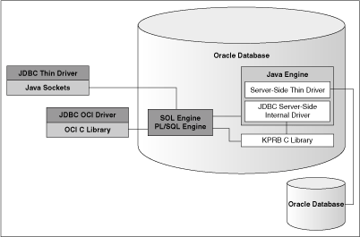

Java Database Connectivity (JDBC) is a Java standard that provides the interface for connecting from Java to relational databases. The JDBC standard is defined and implemented through the standard `java.sql` interfaces. This enables individual providers to implement and extend the standard with their own JDBC drivers. JDBC is based on the X/Open SQL Call Level Interface (CLI). JDBC 4.0 complies with the SQL 2003 standard.

This chapter provides an overview of the Oracle implementation of JDBC, covering the following topics:

- Overview of Oracle JDBC Drivers

- Choosing the Appropriate Driver

- Feature Differences Between JDBC OCI and Thin Drivers

- Environments and Support

- Feature List

### 1.1 Overview of Oracle JDBC Drivers

In addition to supporting the standard JDBC application programming interfaces (APIs), Oracle drivers have extensions to support Oracle-specific data types and to enhance performance.

Oracle provides the following JDBC drivers:

- Thin driver

  The JDBC Thin driver is a pure Java, Type IV driver that can be used in applications. It is platform-independent and does not require any additional Oracle software on the client-side. The JDBC Thin driver communicates with the server using Oracle Net Services to access Oracle Database.

  The JDBC Thin driver enables a direct connection to the database by providing an implementation of Oracle Net Services on top of Java sockets. The driver supports the TCP/IP protocol and requires a TNS listener on the TCP/IP sockets on the database server.

  **Note:**

  Oracle recommends you to use the Thin driver unless you have a feature that is supported only by a specific driver.

- Oracle Call Interface (OCI) driver

  It is used on the client-side with an Oracle client installation. It can be used only with applications.

  The JDBC OCI driver is a Type II driver used with Java applications. It requires platform-specific OCI libraries. It supports all installed Oracle Net adapters, including interprocess communication (IPC), named pipes, TCP/IP, and Internetwork Packet Exchange/Sequenced Packet Exchange (IPX/SPX).

  The JDBC OCI driver, written in a combination of Java and C, converts JDBC invocations to calls to OCI, using native methods to call C-entry points. These calls communicate with the database using Oracle Net Services.

  The JDBC OCI driver uses the OCI libraries, C-entry points, Oracle Net, core libraries, and other necessary files on the client computer where it is installed.

  OCI is an API that enables you to create applications that use the native procedures or function calls of a third-generation language to access Oracle Database and control all phases of the SQL statement processing.

- Server-side Thin driver

  It is functionally similar to the client-side Thin driver. However, it is used for code that runs on the database server and needs to access another session either on the same server or on a remote server on any tier.

  The JDBC server-side Thin driver offers the same functionality as the JDBC Thin driver that runs on the client-side. However, the JDBC server-side Thin driver runs inside Oracle Database and accesses a remote database or a different session on the same database for use with Java in the database.

  This driver is useful in the following scenarios:

  - Accessing a remote database server from an Oracle Database instance acting as a middle tier

  - Accessing an Oracle Database session from inside another, such as from a Java stored procedure

  The use of JDBC Thin driver from a client application or from inside a server does not affect the code.

- Server-side internal driver

  It is used for code that runs on the database server and accesses the same session. That is, the code runs and accesses data from a single Oracle session.

  The JDBC server-side internal driver supports any Java code that runs inside Oracle Database, such as in a Java stored procedure, and accesses the same database. It lets the Oracle Java Virtual Machine (Oracle JVM) to communicate directly with the SQL engine for use with Java in the database.

  The JDBC server-side internal driver, the Oracle JVM, the database, and the SQL engine all run within the same address space, and therefore, the issue of network round-trips is irrelevant. The programs access the SQL engine by using function calls.

  **Note:**

  The server-side internal driver does not support the `cancel` and `setQueryTimeout` methods of the `Statement` class.

  The JDBC server-side internal driver is fully consistent with the client-side drivers and supports the same features and extensions.

The following figure illustrates the architecture of Oracle JDBC drivers and Oracle Database.

Figure 1-1 Architecture of Oracle JDBC Drivers and Oracle Database

[Description of "Figure 1-1 Architecture of Oracle JDBC Drivers and Oracle Database"](img_text/dbarch.md)

**Related Topics**

- [Features Specific to JDBC Thin](JDBC-Thin-features.md)
- [Features Specific to JDBC OCI Driver](JDBC-OCI-features.md)
- [Server-Side Internal Driver](server-side-internal-driver.md)

### 1.2 Choosing the Appropriate Driver

Consider the following when choosing a JDBC driver for your application or applet:

- In general, unless you need OCI-specific features, such as support for non-TCP/IP networks, use the JDBC Thin driver.

- If you want maximum portability and performance, then use the JDBC Thin driver. You can connect to Oracle Database from an application using the JDBC Thin driver.

- If you want to use Lightweight Directory Access Protocol (LDAP) over Secure Sockets Layer (SSL)/Transport Layer Security (TLS), then use the JDBC Thin driver.

- If you are writing a client application for an Oracle client environment and need OCI-driver-specific features, such as support for non-TCP/IP networks, then use the JDBC OCI driver.

- For code that runs in the database server and needs to access a remote database or another session within the same database instance, use the JDBC server-side Thin driver.

- If your code runs inside the database server and needs to access data locally within the session, then use the JDBC server-side internal driver to access that server.

### 1.3 Feature Differences Between JDBC OCI and Thin Drivers

Table 1-1 lists the features that are specific either to the JDBC OCI or JDBC Thin driver in Oracle Database Release 18c.

Table 1-1 Feature Differences Between JDBC OCI and JDBC Thin Drivers

| JDBC OCI Driver                             | JDBC Thin Driver                                                  |
|:--------------------------------------------|:------------------------------------------------------------------|
| OCI connection pooling                      | NA                                                                |
| NA                                          | Default support for Native XA                                     |
| Transparent Application Failover (TAF)      | NA                                                                |
| NA                                          | Application Continuity                                            |
| NA                                          | Transaction Guard                                                 |
| NA                                          | Support for row count per iteration for array DML                 |
| NA                                          | SHA-2 Support in Oracle Advanced Security                         |
| `oraaccess.xml` configuration file settings | NA                                                                |
| NA                                          | Oracle Advanced Queuing                                           |
| NA                                          | Continuous Query Notification                                     |
| NA                                          | Support for the `O7L_MR` client ability                           |
| NA                                          | Support for promoting a local transaction to a global transaction |

**Note:**

- The OCI optimized fetch feature is internal to the JDBC OCI driver and not applicable to the JDBC Thin driver.

- Some JDBC OCI driver features, inherited from the OCI library, are not available in the Thin JDBC driver.

### 1.4 Environments and Support

This section provides a brief discussion of the following topics:

- Supported JDK and JDBC Versions

- JNI and Java Environments

- JDBC and IDEs

#### 1.4.1 Supported JDK and JDBC Versions

In Oracle Database 19c, all the JDBC drivers are compatible with JDK 10. Support for JDK 10 is provided through the `ojdbc10.jar`file.

**Related Topics**

- [Version Compatibility for Oracle JDBC Drivers](JDBC-getting-started.md)
- [Version Compatibility for Oracle JDBC Drivers](JDBC-getting-started.md)

#### 1.4.2 JNI and Java Environments

The JDBC OCI driver uses the standard Java Native Interface (JNI) to call OCI C libraries. You can use the JDBC OCI driver with Java Virtual Machines (JVMs), in particular, with Microsoft and IBM JVMs.

#### 1.4.3 JDBC and IDEs

The Oracle JDeveloper Suite provides developers with a single, integrated set of products to build, debug, and deploy component-based database applications for the Internet. The Oracle JDeveloper environment contains integrated support for JDBC, including the JDBC Thin driver and the native OCI driver. The database component of Oracle JDeveloper uses the JDBC drivers to manage the connection between the application running on the client and the server.

### 1.5 Feature List

The following table lists the features and the versions in which they were first supported for each of the three Oracle JDBC drivers: server-side internal driver, JDBC OCI driver, and JDBC Thin driver.

Table 1-2 Feature List

| Feature                                                        | Server-Side Internal | JDBC OCI   | JDBC Thin  |
|:---------------------------------------------------------------|:---------------------|:-----------|:-----------|
| JDK 1.0                                                        |                      | 7.2.2      | 7.2.2      |
| JDBC 1.0.2                                                     |                      | 7.2.2      | 7.2.2      |
| JDK 1.1.1                                                      |                      | 8.0.6      | 8.0.6      |
| JDBC 1.22 (No new features; just minor revisions)              |                      | 8.0.6      | 8.0.6      |
| defineColumnTypeFoot 1                              |                      | 8.0.6      | 8.0.6      |
| Row Prefetch                                                   |                      | 8.0.6      | 8.0.6      |
| Java Native Interface                                          |                      | 8.1.6      |            |
| JDK 1.2                                                        | 9.0.1                | 8.1.6      | 8.1.6      |
| JDBC 2.0 SQL3 Types (`BLOB`, `CLOB`, `Struct`, `Array`, `REF`) | 8.1.5                | 8.1.5      | 8.1.5      |
| Native LOB                                                     |                      | 8.1.6      | 9.2.0      |
| Associative ArraysFoot 2                            | 10.2.0               | 8.1.6      | 10.1.0     |
| JDBC 2.0 Scrollable Result Sets                                | 8.1.6                | 8.1.6      | 8.1.6      |
| JDBC 2.0 Updatable Result Sets                                 | 8.1.6                | 8.1.6      | 8.1.6      |
| JDBC 2.0 Standard Batching                                     | 8.1.6                | 8.1.6      | 8.1.6      |
| JDBC 2.0 Connection Pooling                                    | NA                   | 8.1.6      | 8.1.6      |
| JDBC 2.0 XA                                                    | 8.1.6                | 8.1.6      | 8.1.6      |
| Server-side Thin driver                                        | 8.1.6                | NA         | NA         |
| JDBC 2.0 RowSets                                               |                      | 9.0.1      | 9.0.1      |
| Implicit Statement Caching                                     | 8.1.7                | 8.1.7      | 8.1.7      |
| Explicit Statement Caching                                     | 8.1.7                | 8.1.7      | 8.1.7      |
| Temporary LOBs                                                 | 9.0.1                | 9.0.1      | 9.0.1      |
| Object Type Inheritance                                        | 9.0.1                | 9.0.1      | 9.0.1      |
| Multilevel Collections                                         | 9.0.1                | 9.0.1      | 9.0.1      |
| `oracle.jdbc` Interfaces                                       | 9.0.1                | 9.0.1      | 9.0.1      |
| Native XA                                                      |                      | 9.0.1      | 10.1.0     |
| OCI Connection Pooling                                         | NA                   | 9.0.1      | NA         |
| TAF                                                            | NA                   | 9.0.1      | NA         |
| NLS Support                                                    | 9.0.1                | 9.0.1      | 9.0.1      |
| JDK 1.3                                                        | 9.2.0                | 9.2.0      | 9.2.0      |
| JDK 1.4                                                        | 10.1.0               | 9.2.0      | 9.2.0      |
| JDBC 3.0 Savepoints                                            | 9.2.0                | 9.2.0      | 9.2.0      |
| New Statement Caching API                                      | 9.2.0                | 9.2.0      | 9.2.0      |
| ConnectionCacheImpl connection cache                           | NA                   | 8.1.7      | 8.1.7      |
| Implicit Connection Cache                                      | NA                   | 10.1.0     | 10.1.0     |
| Fast Connection Failover                                       |                      | 10.1.0.3   | 10.1.0.3   |
| Connection Wrapping                                            |                      | 9.2.0      | 9.2.0      |
| DMS                                                            |                      | 9.2.0      | 9.2.0      |
| Service Names in URLs                                          |                      | 9.2.0      | 10.2.0     |
| JDBC 3.0 Connection Pooling Properties                         | NA                   | 10.1.0     | 10.1.0     |
| JDBC 3.0 Updatable BLOB, CLOB, REF                             | 10.1.0               | 10.1.0     | 10.1.0     |
| JDBC 3.0 Multiple Open Result Sets                             | 10.1.0               | 10.1.0     | 10.1.0     |
| JDBC 3.0 Parameter Metadata                                    | 10.1.0               | 10.1.0     | 10.1.0     |
| JDBC 3.0 Set/Get Stored Procedures Parameters by Name          | 10.1.0               | 10.1.0     | 10.1.0     |
| JDBC 3.0 Statement Pooling                                     | 10.1.0               | 10.1.0     | 10.1.0     |
| Set Statement Parameters by Name                               | 10.1.0               | 10.1.0     | 10.1.0     |
| End-to-End Tracing                                             |                      | 10.1.0     | 10.1.0     |
| Web RowSet                                                     | 11.1                 | 10.1.0     | 10.1.0     |
| Proxy Authentication                                           |                      | 10.2.0     | 10.1.0     |
| JDBC 3.0 Auto Generated Keys                                   |                      | 10.2.0     | 10.2.0     |
| JDBC 3.0 Holdable Cursors                                      | 10.2.0               | 10.2.0     | 10.2.0     |
| JDBC 3.0 Local/Global Transaction Switching                    | 9.2.0                | 9.2.0      | 9.2.0      |
| Run-time Connection Load Balancing                             | NA                   | 10.2.0     | 10.2.0     |
| Extended `set``XXX` and `get``XXX` for LOBs                    |                      | 10.2.0     | 10.2.0     |
| XA Connection Cache                                            | NA                   | 10.2.0     | 10.2.0     |
| DML Returning                                                  |                      | 10.2.0     | 10.2.0     |
| JSR 114 RowSets                                                |                      | 10.2.0     | 10.2.0     |
| SSL/TLS Encryption                                             |                      | 9.2.0      | 10.2.0     |
| SSL/TLS Authentication                                         |                      | 9.2.0      | 11.1       |
| JDK 5.0                                                        | 11.1                 | 11.1       | 11.1       |
| JDK 6                                                          |                      | 11.1       | 11.1       |
| JDBC 4.0                                                       |                      | 11.1       | 11.1       |
| AES Encryption                                                 |                      |            | 11.1       |
| SHA1 Hash                                                      |                      |            | 11.1       |
| Radius Authentication                                          |                      | 10.2.0     | 11.1       |
| Kerberos Authentication                                        |                      |            | 11.1       |
| ANYDATA and ANYTYPE types                                      |                      | 11.1       | 11.1       |
| Native AQ                                                      |                      |            | 11.1       |
| Query Change Notification                                      |                      |            | 11.1       |
| Database startup and shutdown                                  | NA                   | 11.1       | 11.1       |
| Factory methods for data types                                 | 11.1                 | 11.1       | 11.1       |
| Buffer Cache                                                   | 11.1                 | 11.1       | 11.1       |
| Secure Files                                                   | 11.1                 | 11.1       | 11.1       |
| Diagnosability                                                 | 11.1                 | 11.1       | 11.1       |
| Client Result Cache                                            |                      | 11.1.0     | 18.1       |
| Server Result Cache                                            | 11.1                 | 11.1.0     | 11.1.0     |
| Universal Connection Pool                                      |                      | 11.1.0.7.0 | 11.1.0.7.0 |
| TimeZone Patching                                              |                      | 11.2       | 11.2       |
| Secure Lob Support                                             |                      | 11.2       | 11.2       |
| Lob prefetch Support                                           |                      | 11.2       | 11.2       |
| Network Connection Pool                                        |                      |            | 11.2       |
| Column Security Support                                        |                      |            | 11.2       |
| XMLType Queue Support (AQ)                                     |                      |            | 11.2       |
| Notification Grouping (AQ and DCN)                             |                      |            | 11.2       |
| SimpleFAN                                                      |                      | 11.2       | 11.2       |
| Application Continuity                                         |                      |            | 12.1       |
| Transaction Guard                                              |                      |            | 12.1       |
| SQL Statement Translation                                      |                      |            | 12.1       |
| Database Resident Connection Pooling                           |                      | 12.1       | 12.1       |
| Latest JDBC Standard Support                                   |                      | 12.1       | 12.1       |
| SHA-2 Support in Oracle Advanced Security                      |                      |            | 12.1       |
| Invisible Columns Support                                      |                      | 12.1       | 12.1       |
| Support for PL/SQL Package Types as Parameters                 |                      | 12.1       | 12.1       |
| Support for Monitoring of Database Operations                  |                      | 12.1       | 12.1       |
| Support for Increased Length Limit for Various Data Types      |                      | 12.1       | 12.1       |
| Implicit Results Support                                       |                      | 12.1       | 12.1       |
| Support for row count per iteration for array DML              |                      |            | 12.1       |
| `oraaccess.xml` configuration file settings                    |                      | 12.1       |            |

Footnote 1

Starting from Oracle Database 12c Release 1 (12.1), most of the variants of this method have been deprecated. The current versions only enable to perform LOB to LONG conversions and configure the LOB prefetch size.

Footnote 2

Associative Arrays were previously known as index-by tables.

**Note:**

- In the table, NA means that the feature is not applicable for the corresponding Oracle JDBC driver.

- The `ConnectionCacheImpl` connection cache feature is deprecated since Oracle Database 10g.

- The Implicit Connection Cache feature is desupported from this release.
