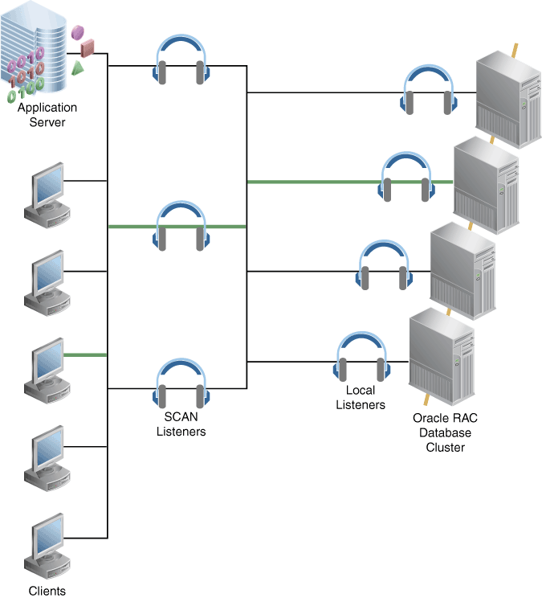

Single Client Access Name (SCAN) is an Oracle Real Application Clusters (Oracle RAC) feature that provides a single name for clients to access Oracle Databases running in a cluster. This chapter discusses the following concepts related to the SCAN:

- Overview of Single Client Access Name

- About Configuring the Database Using the SCAN

- Using the SCAN in a Maximum Availability Architecture Environment

- Using the SCAN With Oracle Connection Manager

### 31.1 Overview of Single Client Access Name

The SCAN is a domain name registered to at least one and up to three IP addresses, either in Domain Naming Service (DNS) or Grid Naming Service (GNS). When you use GNS and Dynamic Host Configuration Protocol (DHCP), Oracle Clusterware configures the Virtual IP (VIP) addresses for the SCAN name that is provided during cluster configuration. The node VIP and the three SCAN VIPs are obtained from the DHCP server when you use GNS.

**See Also:**

[Oracle Clusterware Administration and Deployment Guide](../cwadd/oracle-clusterware-administration.md) for more information about GNS

If a new server joins the cluster, then Oracle Clusterware dynamically obtains the required VIP address from the DHCP server, updates the cluster resource, and makes the server accessible through GNS. The benefit of using the SCAN is that the connection information of the client does not need to change if you add or remove nodes in the cluster. Having a single name to access the cluster enables the client to use the EZConnect client and the simple JDBC thin URL to access any Database running in the cluster, independent of the active servers in the cluster. The SCAN provides load balancing and failover for client connections to the Database. The SCAN works as a cluster alias for Databases in the cluster.

### 31.2 About Configuring the Database Using the SCAN

The SCAN is an essential part of Database configuration. So, by default, the `REMOTE_LISTENER` parameter is set to the SCAN, assuming that the Database is created using standard Oracle tools. This enables the instances to register with the SCAN Listeners as remote listeners to provide information on what services are being provided by the instance, the current load, and a recommendation on how many incoming connections should be directed to the instance.

In this context, you must set the `LOCAL_LISTENER` parameter to the node-VIP. If you need fully qualified domain names, then ensure that the `LOCAL_LISTENER` parameter is set to the fully qualified domain name. By default, a node listener is created on each node in the cluster during cluster configuration. With Oracle Grid Infrastructure, the node listener runs out of the Oracle Grid Infrastructure home and listens on the node-VIP using the specified port. The default port is 1521.

Unlike in earlier Database versions, Oracle does not recommend to set your `REMOTE_LISTENER` parameter to a server side `TNSNAMES` alias that resolves the host to the SCAN in the address list entry, for example, `HOST=sales1-scan`. Instead, you must use the simplified `SCAN:port` syntax as shown in the following table that shows typical setting for a `LOCAL_LISTENER` and `REMOTE_LISTENER`:

| Name              | Type   | Value                                                                              |
|:------------------|:-------|:-----------------------------------------------------------------------------------|
| `LOCAL_LISTENER`  | string | `(DESCRIPTION=(ADDRESS_LIST=(ADDRESS=(PROTOCOL=TCP)(HOST=localhost)(PORT=5221))))` |
| `REMOTE_LISTENER` | string | `example.us.oracle.com:5221`                                                       |

**Note:**

If you are using the easy connect naming method, you may need to modify the `SQLNET.ORA` file to ensure that `EZCONNECT` is in the list when you specify the order of the naming methods used for the client name resolution lookups.

### 31.3 How Connection Load Balancing Works Using the SCAN

For clients connecting using Oracle SQL\*Net, three IP addresses are received by the client by resolving the SCAN name through DNS. The client then goes through the list that it receives from the DNS and tries connecting through one of the IP addresses in the list. If the client receives an error, then it tries connecting to the other addresses before returning an error to the user or application. This is similar to how client connection failover works in earlier Database releases, when an address list is provided in the client connection string.

When a SCAN Listener receives a connection request, the SCAN Listener checks for the least loaded instance providing the requested service. It then re-directs the connection request to the local listener on the node where the least loaded instance is running. Subsequently, the client is given the address of the local listener. The local listener then finally creates the connection to the Database instance.

Figure 31-1 Connection Load Balancing Using the SCAN

#### Example

This example assumes an Oracle client using a default `TNSNAMES.ora` file:

    ORCLservice =(DESCRIPTION =(ADDRESS = (PROTOCOL = TCP)(HOST = sales1-scan.example.com)(PORT = 1521))(CONNECT_DATA =(SERVER = DEDICATED)(SERVICE_NAME = MyORCLservice)))

### 31.4 Version and Backward Compatibility

To successfully use the SCAN to connect to an Oracle RAC Database in the cluster depends on the following two factors:

- Ability of the client to understand and use the SCAN

- The correct configuration of the `REMOTE_LISTENER` parameter setting in the Database

If the version of the Oracle Client connecting to the Database and the Oracle Database version used are both Oracle Database 11g Release 2, and the default configuration is used as described in the preceding sections, then typically you do not need to make any change to the system.

If both the Oracle Client version and the version of the Oracle Database that the client is connecting to are earlier than Oracle Database 11g Release 2, then typically you do not need to make any change to the system. In this case, the client uses a TNS connect descriptor that resolves to the node-VIPs of the cluster, while Oracle Database uses a `REMOTE_LISTENER` entry pointing to the node-VIPs. The disadvantage of this configuration is that the SCAN is not used and therefore every time the cluster changes in the back end, the clients are exposed to changes.

If you are using Oracle Database 11g Release 2, but the clients are on an earlier version of the Database, then you must change the Oracle client, or the Oracle Database `REMOTE_LISTENER` parameter settings, or both accordingly. You must consider the following cases in such a scenario:

Table 31-1 Oracle Client and Oracle Database Version Compatibility for the SCAN

| Oracle Client Version                                              | Oracle Database Version                                            | Comment                                                                                                                                                                                                                                                                              |
|:-------------------------------------------------------------------|:-------------------------------------------------------------------|:-------------------------------------------------------------------------------------------------------------------------------------------------------------------------------------------------------------------------------------------------------------------------------------|
| Oracle Database 11g Release 2                                      | Oracle Database 11g Release 2                                      | No change is required                                                                                                                                                                                                                                                                |
| Oracle Database 11g Release 2                                      | Oracle Database Version earlier than Oracle Database 11g Release 2 | Add the SCAN VIPs as hosts to the `REMOTE_LISTENER` parameter.                                                                                                                                                                                                                       |
| Oracle Database Version earlier than Oracle Database 11g Release 2 | Oracle Database 11g Release 2                                      | Update the client `TNSNAMES.ora` file to include the SCAN VIPs. If the Database is upgraded using the Database Upgrade Assistant (DBUA) from a Database earlier than 11g Release 2, then the DBUA configures the `REMOTE_LISTENER` parameter to point to the node-VIPs and the SCAN. |
| Oracle Database Version earlier than Oracle Database 11g Release 2 | Oracle Database Version earlier than Oracle Database 11g Release 2 | If you want to make use of the SCAN (recommended), then add the SCAN VIPs as hosts to the `REMOTE_LISTENER` parameter and update the client `TNSNAMES.ora` file to include the SCAN VIPs. Otherwise, no change required.                                                             |

If you are using a client earlier than Oracle Database 11g Release 2, then you cannot fully benefit from the advantages of the SCAN because the Oracle Client cannot handle a set of three IP addresses returned by the DNS for the SCAN. Instead, it tries to connect to only the first address returned in the list and ignores the other two addresses. If the SCAN Listener listening on this specific IP address is not available or the IP address itself is not available, then the connection fails. To ensure load balancing and connection failover with clients earlier than Oracle Database 11g Release 2, you must update the `TNSNAMES.ora` file of the client, so that it uses three address lines, where each address line resolves to one of the SCAN VIPs. The following example shows a sample `TNSNAMES.ora` file for a client earlier than Oracle Database 11g Release 2:

    sales.example.com =(DESCRIPTION=
    (ADDRESS_LIST= (LOAD_BALANCE=on)(FAILOVER=ON)
    (ADDRESS=(PROTOCOL=tcp)(HOST=133.22.67.192)(PORT=1521))
    (ADDRESS=(PROTOCOL=tcp)(HOST=133.22.67.193)(PORT=1521))
    (ADDRESS=(PROTOCOL=tcp)(HOST=133.22.67.194)(PORT=1521)))
    (CONNECT_DATA=(SERVICE_NAME= salesservice.example.com)))

### 31.5 Using the SCAN in a Maximum Availability Architecture Environment

If you have a Maximum Availability Architecture (MAA) environment implemented, in which you use Oracle RAC for both your primary and standby Databases that are synchronized using Oracle Data Guard, then using the SCAN provides a simplified `TNSNAMES` configuration that a client can use to connect to the Database, independent of whether the primary or standby Database is the currently active Database.

To use this simplified configuration, Oracle Database 11g Release 2 introduced the following two SQL\*Net parameters that can be used for connection strings of individual clients:

- The `CONNECT_TIMEOUT` parameter

  It specifies the timeout duration in seconds for a client to establish an Oracle Net connection to an Oracle Database. This parameter overrides the `SQLNET.OUTBOUT_CONNECT_TIMEOUT` parameter in the `SQLNET.ORA` file.

- The `RETRY_COUNT` parameter

  It specifies the number of times an `ADDRESS_LIST` is traversed before the connection attempt is terminated.

Using these two parameters, both the SCANs, the one on the primary site and the one on the standby site, can be used in the client connection strings. Also, if the randomly selected address points to the site that is not currently active, then the timeout enables the connection request to failover before the client waits for an unreasonably long time. The following example shows a sample `TNSNAMES.ORA` entry for a MAA environment:

    sales.example.com =(DESCRIPTION= (CONNECT_TIMEOUT=10)(RETRY_COUNT=3)
    (ADDRESS_LIST= (LOAD_BALANCE=on)(FAILOVER=ON)
    (ADDRESS=(PROTOCOL=tcp)(HOST=sales1-scan)(PORT=1521))
    (ADDRESS=(PROTOCOL=tcp)(HOST=sales2-scan)(PORT=1521)))
    (CONNECT_DATA=(SERVICE_NAME= salesservice.example.com)))

### 31.6 Using the SCAN With Oracle Connection Manager

If you use Oracle Connection Manager (CMAN) with your Oracle RAC Database, then the `REMOTE_LISTENER` parameter for the Oracle RAC instances must include the CMAN server, so that the CMAN server receives load balancing related information and can load balance connections across the available instances. The easiest way to achieve this is to add the CMAN server as an entry to the `REMOTE_LISTENER` parameter of the Databases that clients want to connect to through CMAN. You must also remove the SCAN from the `TNSNAMES` connect descriptor of the clients and configure the CMAN server. The following example shows a server-side `TNSNAMES.ora` example entry when you use CMAN:

    SQL> show parameters listener
    NAME                TYPE         VALUE
    -------------------------- ----------- ------------------------------
    listener_networks   string
    local_listener      string      (DESCRIPTION=(ADDRESS_LIST=
                                    (ADDRESS=(PROTOCOL=TCP)
                                    (HOST=148.87.58.109)(PORT=1521))))
    remote_listener     string      stscan3.oracle.com:1521,(DESCRIPTION=
                                    (ADDRESS_LIST=(ADDRESS=(PROTOCOL=TCP)
                                    (HOST=CMANserver)(PORT=1521))))

**See Also:**

[Oracle Database Net Services Reference](../netrf/index.md) for more information about configuring the CMAN server
