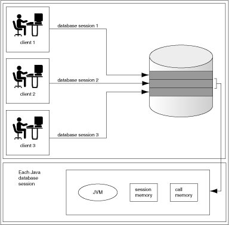

In the Java-integrated Oracle Database, your Java applications exist within the context of a database session. Oracle JVM sessions are entirely analogous to traditional Oracle sessions. Each Oracle JVM session maintains the state of the Java applications accessed by the client across calls within the session.

Figure 2-1 illustrates how each Java client starts a database session as the environment for running Java applications within the database. Each Java database session has a separate garbage collector, session memory, and call memory.

Figure 2-1 Java Environment Within Each Database Session

[Description of "Figure 2-1 Java Environment Within Each Database Session"](img_text/au_over.md)

Within the context of a session, the client performs the following:

1.  Connects to the database and opens a session.

2.  Runs Java within the database. This is referred to as a call.

3.  Continues to work within the session, performing as many calls as required.

4.  Ends the session.

Within a session, the client has its own Java environment. It appears to the client as if a separate, individual JVM was started for each session, although the implementation is more efficient than this seems to imply. Within a session, Oracle JVM manages the scalability of applications. Every call from a single client is managed within its own session, and calls from each client is handled separately. Oracle JVM maximizes sharing read-only data between clients and emphasizes a minimum amount of per-session incremental footprint, to maximize performance for multiple clients.

The underlying server environment hides the details associated with session, network, state, and other shared resource management issues from the Java code. Fields defined as `static` are local to the client. No client can access the `static` fields of other clients, because the memory is not available across session boundaries. Because each client runs the Java application calls within its own session, activities of each client are separate from any other client. During a call, you can store objects in `static` fields of different classes, which will be available in the next call. The entire state of your Java program is private and exists for your entire session.

Oracle JVM manages the following within the session:

- All the objects referenced by `static` Java fields, all the objects referred to by these objects, and so on, till their transitive closure

- Garbage collection for the client that created the session

- Session memory for `static` fields and across call memory needs

- Call memory for fields that exist within a call
