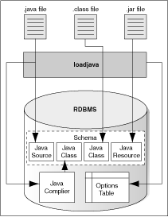

If you are not using the command-line interface, you must load Java files into the database as schema objects, to make them available to Oracle JVM. The `loadjava` tool can call the Java compiler of Oracle JVM, which compiles source files into standard class files.

The following figure shows that the `loadjava` tool can set the values of options stored in a system database table. Among other things, these options affect the processing of Java source files.

Figure 2-2 Loading Java into Oracle Database

[Description of "Figure 2-2 Loading Java into Oracle Database"](img_text/loading_java.md)

Each Java class is stored as a schema object. The name of the object is derived from the fully qualified name of the class, which includes the names of containing packages. For example, the full name of the class `Handle` is:

    oracle.aurora.rdbms.Handle

In the Java schema object name, slashes replace periods, so the full name of the class becomes:

    oracle/aurora/rdbms/Handle

Oracle Database accepts Java names up to 4000 characters long. However, the names of Java schema objects cannot be longer than 128 characters. Therefore, if a schema object name is longer than 128 characters, then the system generates a short name, or alias, for the schema object. Otherwise, the fully qualified name, also called full name, is used. You can specify the full name in any context that requires it. When needed, name mapping is handled by Oracle Database.

**Related Topics**

- [About Using the Command-Line Interface](invoking-Java-methods.md)
- [Shortened Class Names](shortened-class-names.md)
- [System Classes](Oracle-JVM-components.md)
