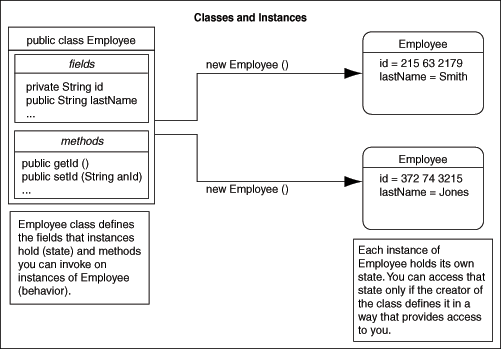
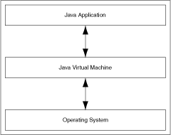
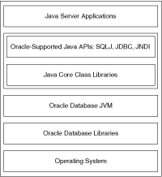
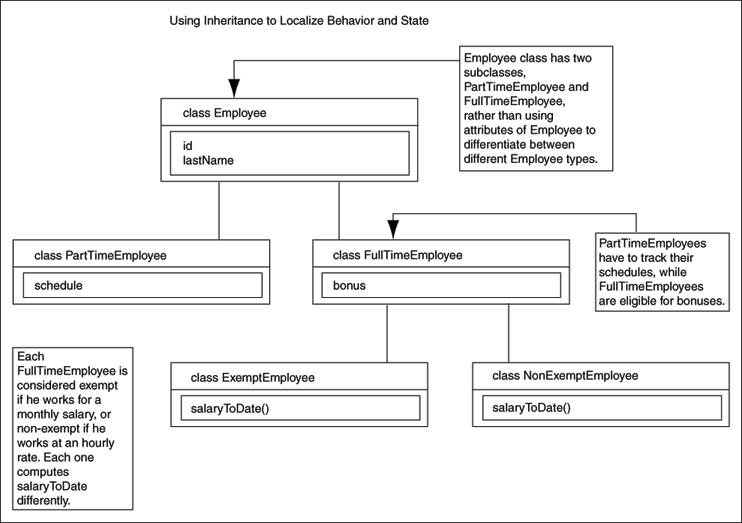

Java has emerged as the object-oriented programming language of choice. Some of the important concepts of Java include:

- A Java virtual machine (JVM), which provides the fundamental basis for platform independence

- Automated storage management techniques, such as garbage collection

- Language syntax that is similar to that of the C language

The result is a language that is object-oriented and efficient for application programming.

This section covers the following topics:

- Java and Object-Oriented Programming Terminology

- Key Features of the Java Language

- Java Virtual Machine

- Java Class Hierarchy

### 1.1.1 Java and Object-Oriented Programming Terminology

The following terms are common in Java application development in Oracle Database environment:

- Classes

- Objects

- Interfaces

- Encapsulation

- Inheritance

- Polymorphism

#### 1.1.1.1 Classes

All object-oriented programming languages support the concept of a class. As with a table definition, a class provides a template for objects that share common characteristics. Each class can define the following:

- Fields

  Fields are variables that are present in each object or instance of a particular class, or are variables that are global and common to all instances. Instance fields are analogous to the columns of a relational table row. The class defines the fields and the type of each field.

  You can declare fields in Java as static. Fields of a class that are declared as static are global and common to all instances of that class. There is only one value at any given time for a static field within a given instantiation of a Java runtime. Fields that are not declared as static are created as distinct values within each instance of the class.

  The `public`, `private`, `protected`, and default access modifiers define the scope of the field in the application. The Java Language Specification (JLS) defines the rules of visibility of data for all fields. These rules define under what circumstances you can access the data in these fields.

  In the example illustrated in Figure 1-1, the employee identifier is defined as `private`, indicating that other objects cannot access this field directly. In the example, objects can access the `id` field by calling the `getId()` method.

- Methods

  Methods are procedures associated with a class. Like a field, a method can be declared as `static`, in which case it can be called globally. If a method is not declared as static, it means that the method is an instance method and can be called only as an operation on an object, where the object is an instance of the class.

  Similar to fields, methods can be declared as `public`, `private`, `protected`, or default access. This declaration defines the scope in which the method can be called.

#### 1.1.1.2 Objects

A Java object is an instance of a class and is analogous to a relational table row. Objects are collections of data values, the individual elements of which are described by the non-static field definitions of the class.

Figure 1-1 shows an example of an `Employee` class defined with two fields, `id`, which is the employee identifier, and `lastName`, which is the last name of the employee, and the `getId()` and `setId(String anId)` methods. The `id` field is `private`, and the `lastName` field, the `getId()` method and the `setId(String anId)` method are `public`.

Figure 1-1 Classes and Instances

[Description of "Figure 1-1 Classes and Instances"](img_text/intra01.md)

When you create an instance, the fields store individual and private information relevant only to the employee. That is, the information contained within an employee instance is known only to that particular employee. The example in Figure 1-1 shows two instances of the `Employee` class, one for the employee Smith and one for Jones. Each instance contains information relevant to the individual employee.

#### 1.1.1.3 Inheritance

Inheritance is an important feature of object-oriented programming languages. It enables classes to include properties of other classes. The class that inherits the properties is called a child class or subclass, and the class from which the properties are inherited is called a parent class or superclass. This feature also helps in reusing already defined code.

In the example illustrated in Figure 1-1, you can create a `FullTimeEmployee` class that inherits the properties of the `Employee` class. The properties inherited depend on the access modifiers declared for each field and method of the superclass.

#### 1.1.1.4 Interfaces

Java supports only single inheritance, that is, each class can inherit fields and methods of only one class. If you need to inherit properties from more than one source, then Java provides the concept of interfaces, which is a form of multiple inheritance. Interfaces are similar to classes. However, they define only the signature of the methods and not their implementations. The methods that are declared in the interface are implemented in the classes. Multiple inheritance occurs when a class implements multiple interfaces.

#### 1.1.1.5 Encapsulation

Encapsulation describes the ability of an object to hide its data and methods from the rest of the world and is one of the fundamental principles of object-oriented programming. In Java, a class encapsulates the fields, which hold the state of an object, and the methods, which define the actions of the object. Encapsulation enables you to write reusable programs. It also enables you to restrict access only to those features of an object that are declared `public`. All other fields and methods are `private` and can be used for internal object processing.

In the example illustrated in Figure 1-1, the `id` field is `private`, and access to it is restricted to the object that defines it. Other objects can access this field using the `getId()` method. Using encapsulation, you can deny access to the `id` field either by declaring the `getId()` method as `private` or by not defining the `getId()` method.

#### 1.1.1.6 Polymorphism

Polymorphism is the ability for different objects to respond differently to the same message. In object-oriented programming languages, you can define one or more methods with the same name. These methods can perform different actions and return different values.

In the example in Figure 1-1, assume that the different types of employees must be able to respond with their compensation to date. Compensation is computed differently for different types of employees:

- Full-time employees are eligible for a bonus.

- Non-exempt employees get overtime pay.

In procedural languages, you write a `switch` statement, with the different possible cases defined, as follows:

    switch: (employee.type)
    {
      case: Employee
            return employee.salaryToDate;
      case: FullTimeEmployee
            return employee.salaryToDate + employee.bonusToDate
      ...
    }

If you add a new type of employee, then you must update the `switch` statement. In addition, if you modify the data structure, then you must modify all `switch` statements that use it. In an object-oriented language, such as Java, you can implement a method, `compensationToDate()`, for each subclass of the `Employee` class, if it contains information beyond what is already defined in the `Employee` class. For example, you could implement the `compensationToDate()` method for a non-exempt employee, as follows:

    public float compensationToDate()
    {
      return (super.compensationToDate() + this.overtimeToDate());
    }

For a full-time employee, the `compensationToDate()` method can be implemented as follows:

    public float compensationToDate()
    {
      return (super.compensationToDate() + this.bonusToDate());
    }

This common use of the method name enables you to call methods of different classes and obtain the required results, without specifying the type of the employee. You do not have to write specific methods to handle full-time employees and part-time employees.

In addition, you can create a `Contractor` class that does not inherit properties from `Employee` and implements a `compensationToDate()` method in it. A program that calculates total payroll to date would iterate over all people on payroll, regardless of whether they were full-time or part-time employees or contractors, and add up the values returned from calling the `compensationToDate()` method on each. You can safely make changes to the individual `compensationToDate()` methods or the classes, and know that callers of the methods will work correctly.

### 1.1.2 Key Features of the Java Language

The Java language provides certain key features that make it ideal for developing server applications. These features include:

- Simplicity

  Java is simpler than most other languages that are used to create server applications, because of its consistent enforcement of the object model. The large, standard set of class libraries brings powerful tools to Java developers on all platforms.

- Portability

  Java is portable across platforms. It is possible to write platform-dependent code in Java, and it is also simple to write programs that move seamlessly across systems.

  **See Also:**

  " Java Virtual Machine"

- Automatic storage management

  A JVM automatically performs all memory allocation and deallocation while the program is running. Java programmers cannot explicitly allocate memory for new objects or free memory for objects that are no longer referenced. Instead, they depend on a JVM to perform these operations. The process of freeing memory is known as garbage collection.

- Strong typing

  Before you use a field, you must declare the type of the field. Strong typing in Java makes it possible to provide a reasonable and safe solution to interlanguage calls between Java and PL/SQL applications, and to integrate Java and SQL calls within the same application.

- No pointers

  Although Java is quite similar to C in its syntax, it does not support direct pointers or pointer manipulation. You pass all parameters, except primitive types, by reference and not by value. As a result, the object identity is preserved. Java does not provide low level, direct access to pointers, thereby eliminating any possibility of memory corruption and leaks.

- Exception handling

  Java exceptions are objects. Java requires developers to declare which exceptions can be thrown by methods in any particular class.

- Flexible namespace

  Java defines classes and places them within a hierarchical structure that mirrors the domain namespace of the Internet. You can distribute Java applications and avoid name collisions. Java extensions, such as the Java Naming and Directory Interface (JNDI), provide a framework for multiple name services to be federated. The namespace approach of Java is flexible enough for Oracle to incorporate the concept of a schema for resolving class names in full compliance with the JLS.

- Security

  The design of Java bytecodes and JVM specification allow for built-in mechanisms to verify the security of Java binary code. Oracle Database is installed with an instance of Security Manager that, when combined with Oracle Database security, determines who can call any Java methods.

- Standards for connectivity to relational databases

  Java Database Connectivity (JDBC) and SQLJ enable Java code to access and manipulate data in relational databases. Oracle provides drivers that allow vendor-independent, portable Java code to access the relational database.

### 1.1.3  Java Virtual Machine

As with other high-level computer languages, the Java source compiles to low-level machine instructions. In Java, these instructions are known as bytecodes, because each instruction has a uniform size of one byte. Most other languages, such as C, compile to machine-specific instructions, such as instructions specific to an Intel or HP processor.

When compiled, the Java code gets converted to a standard, platform-independent set of bytecodes, which are executed by a Java Virtual Machine (JVM). A JVM is a separate program that is optimized for the specific platform on which you run your Java code.

Figure 1-2 illustrates how Java can maintain platform independence. Each platform has a JVM installed that is specific to the operating system. The Java bytecodes get interpreted through the JVM into the appropriate platform dependent actions.

Figure 1-2 Java Component Structure

[Description of "Figure 1-2 Java Component Structure"](img_text/jvmlayer.md)

When you develop a Java application, you use predefined core class libraries written in the Java language. The Java core class libraries are logically divided into packages that provide commonly used functionality. Basic language support is provided by the `java.lang` package, I/O support is provided by the `java.io` package, and network access is provided by the `java.net` package. Together, a JVM and the core class libraries provide a platform on which Java programmers can develop applications, which will run successfully on any operating system that supports Java. This concept is what drives the "write once, run anywhere" idea of Java.

Figure 1-3 illustrates how Oracle Java applications reside on top of the Java core class libraries, which reside on top of the JVM. Because the Oracle Java support system is located within the database, the JVM interacts with Oracle Database libraries, instead of directly interacting with the operating system.

Figure 1-3 Oracle Database Java Component Structure

[Description of "Figure 1-3 Oracle Database Java Component Structure"](img_text/vmlayercake.md)

To know more about Java and JVM, you can refer to the Java Language Specification (JLS) and the JVM specification. The JLS defines the syntax and semantics, and the JVM specification defines the necessary low-level actions for the system that runs the application. In addition, there is also a compatibility test suite for JVM implementors to determine if they have complied with the specifications. This test suite is known as the Java Compatibility Kit (JCK). Oracle JVM implementation complies fully with JCK. Part of the overall Java strategy is that an openly specified standard, together with a simple way to verify compliance with that standard, allows vendors to offer uniform support for Java across all platforms.

### 1.1.4 Java Class Hierarchy

Java defines classes within a large hierarchy of classes. At the top of the hierarchy is the `Object` class. All classes in Java inherit from the `Object` class at some level, as you walk up through the inheritance chain of superclasses. When we say Class B inherits from Class A, each instance of Class B contains all the fields defined in class B, as well as all the fields defined in Class A.

Figure 1-4 illustrates a generic Java class hierarchy. The `FullTimeEmployee` class contains the `id` and `lastName` fields defined in the `Employee` class, because it inherits from the `Employee` class. In addition, the `FullTimeEmployee` class adds another field, `bonus`, which is contained only within `FullTimeEmployee`.

You can call any method on an instance of Class B that was defined in either Class A or Class B. In the example, the `FullTimeEmployee` instance can call methods defined only in the `FullTimeEmployee` class and methods defined in the `Employee` class.

Figure 1-4 Class Hierarchy

[Description of "Figure 1-4 Class Hierarchy"](img_text/intra2_01.md)

Instances of Class B can be substituted for instances of Class A, which makes inheritance another powerful construct of object-oriented languages for improving code reuse. You can create classes that define behavior and state where it makes sense in the hierarchy, yet make use of preexisting functionality in class libraries.
