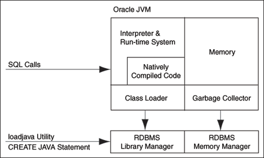

This section briefly describes the main components of an Oracle JVM and some of the facilities they provide.

The Oracle JVM is a complete, Java 2-compliant environment for running Java applications. It runs in the same process space and address space as the database kernel by sharing its memory heaps and directly accessing its relational data. This design optimizes memory use and increases throughput.

The Oracle JVM provides a run-time environment for Java objects. It fully supports Java data structures, method dispatch, exception handling, and language-level threads. It also supports all the core Java class libraries, including `java.lang`, `java.io`, `java.net`, `java.math`, and `java.util`.

Figure 1-8 shows the main components of an Oracle JVM.

Figure 1-8 Main Components of an Oracle JVM

[Description of "Figure 1-8 Main Components of an Oracle JVM"](img_text/jvm_components.md)

The Oracle JVM embeds the standard Java namespace in the database schemas. This feature lets Java programs access Java objects stored in Oracle Database and application servers across the enterprise.

In addition, the Oracle JVM is tightly integrated with the scalable, shared memory architecture of the database. Java programs use call, session, and object lifetimes efficiently without user intervention. As a result, the Oracle JVM and middle-tier Java business objects can be scaled, even when they have session-long state.

The following sections provide an overview of some of the components of the Oracle JVM and the JDBC driver and the SQLJ translator:

- Library Manager

- Compiler

- Interpreter

- Class Loader

- Verifier

- Server-Side JDBC Internal Driver

- Server-Side SQLJ Translator

- System Classes

### 1.5.1 Library Manager

To store Java classes in Oracle Database, you use the `loadjava` command-line tool, which uses the SQL `CREATE JAVA` statements to do its work. When called by the `CREATE JAVA {SOURCE | CLASS | RESOURCE}` statement, the library manager loads Java source, class, or resource files into the database. These Java schema objects are not accessed directly, and only an Oracle JVM uses them.

### 1.5.2 Compiler

The Oracle JVM includes a standard Java compiler. When the `CREATE JAVA SOURCE` statement is run, it translates Java source files into architecture-neutral, one-byte instructions known as bytecodes. Each bytecode consists of an opcode followed by its operands. The resulting Java class files, which conform fully to the Java standard, are submitted to the interpreter at run time.

### 1.5.3 Interpreter

To run Java programs, the Oracle JVM includes a standard Java 2 bytecode interpreter. The interpreter and the associated Java run-time system run standard Java class files. The run-time system supports native methods and call-in and call-out from the host environment.

**Note:**

You can also compile your Java code to improve performance. The Oracle JVM uses natively compiled versions of the core Java class libraries, SQLJ translator, and JDBC drivers.

### 1.5.4 Class Loader

In response to requests from the run-time system, the Java class loader locates, loads, and initializes Java classes stored in the database. The class loader reads the class and generates the data structures needed to run it. Immutable data and metadata are loaded into initialize-once shared memory. As a result, less memory is required for each session. The class loader attempts to resolve external references when necessary. In addition, if the source files are available, then the class loader calls the Java compiler automatically when Java class files must be recompiled.

### 1.5.5 Verifier

Java class files are fully portable and conform to a well-defined format. The verifier prevents the inadvertent use of spoofed Java class files, which might alter program flow or violate access restrictions. Oracle security and Java security work with the verifier to protect your applications and data.

### 1.5.6 Server-Side JDBC Internal Driver

JDBC is a standard and defines a set of Java classes providing vendor-independent access to relational data. The JDBC classes are modeled after ODBC and the X/Open SQL Call Level Interface (CLI) and provide standard features, such as simultaneous connections to several databases, transaction management, simple queries, calls to stored procedures, and streaming access to `LONG` column data.

Using low-level entry points, a specially tuned JDBC driver runs directly inside Oracle Database, providing fast access to Oracle data from Java stored procedures. The server-side JDBC internal driver complies fully with the standard JDBC specification. Tightly integrated with the database, the JDBC driver supports Oracle-specific data types, globalization character sets, and stored procedures. In addition, the client-side and server-side JDBC APIs are the same, which makes it easy to partition applications.

### 1.5.7 Server-Side SQLJ Translator

SQLJ enables you to embed SQL statements in Java programs. It is more concise than JDBC and more responsive to static analysis and type checking. The SQLJ preprocessor, which itself is a Java program, takes as input a Java source file in which SQLJ clauses are embedded. Then, it translates the SQLJ clauses into Java class definitions that implement the specified SQL statements. The Java type system ensures that objects of those classes are called with the correct arguments.

A highly optimized SQLJ translator runs directly inside the database, where it provides run-time access to Oracle data using the server-side internal JDBC driver. SQLJ forms can include queries, data manipulation language (DML) statements, data definition language (DDL) statements, transaction control statements, and calls to stored procedures. The client-side and server-side SQLJ APIs are identical, making it easy to partition applications.

### 1.5.8 System Classes

A set of classes that constitute a significant portion of the implementation of Java in Oracle Database environment is known as the System classes. These classes are defined in the `SYS` schema and exported for all users by public synonym. A class with the same name as one of the System classes can be defined in a schema other than the `SYS` schemaFoot 1. But, this is a bad practice because the alternate version of the class may behave in a manner that violates assumptions about the semantics of that class that are present in other System classes or in the underlying implementation of Java Virtual Machine. Oracle strongly discourages this practice.

------------------------------------------------------------------------

Footnote Legend

Footnote 1:

You cannot always define a class with the same name as one of the System classes. For the classes present in some packages, for example, `java.lang`, such definitions are explicitly prohibited by the code.
