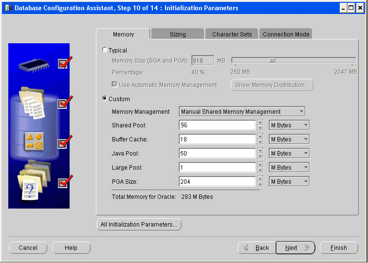

The typical and custom database installation process furnishes a database that has been configured for reasonable Java usage during development. However, run-time use of Java should be determined by the usage of system resources for a given deployed application. Resources you use during development can vary widely, depending on your activity. The following sections describe how you can configure memory, how to tell how much System Global Area (SGA) memory you are using, and what errors denote a Java memory issue:

- Configuring Memory Initialization Parameters

- About Java Pool Memory

- Displaying Used Amounts of Java Pool Memory

- Correcting Out of Memory Errors

- Displaying Java Call and Session Heap Statistics

### 9.2.1 Configuring Memory Initialization Parameters

You can modify the following database initialization parameters to tune your memory usage to reflect your application needs more accurately:

- `SHARED_POOL_SIZE`

  Shared pool memory is used by the class loader within the JVM. The class loader, on an average, uses about 8 KB of memory for each loaded class. Shared pool memory is used when loading and resolving classes into the database. It is also used when compiling the source in the database or when using Java resource objects in the database.

  The memory specified in `SHARED_POOL_SIZE` is consumed transiently when you use the `loadjava` tool. The database initialization process requires `SHARED_POOL_SIZE` to be set to 96 MB because it loads the Java binaries for approximately 8,000 classes and resolves them. The `SHARED_POOL_SIZE` resource is also consumed when you create call specifications and as the system tracks dynamically loaded Java classes at run time.

- `JAVA_POOL_SIZE`

  Oracle JVM memory manager uses `JAVA_POOL_SIZE` mainly for in-memory representation of Java method and class definitions, and static Java states that are migrated to session space at end-of-call in shared server mode. In the first case, you will be sharing the memory cost with all Java users. In the second case, the value of `JAVA_POOL_SIZE` varies according to the actual amount of state held in static variables for each session. But, Oracle recommends the minimum value as 50 MB.

- `JAVA_SOFT_SESSIONSPACE_LIMIT`

  This parameter lets you specify a soft limit on Java memory usage in a session, which will warn you if you must increase your Java memory limits. Every time memory is allocated, the total memory allocated is checked against this limit.

  When a user's session Java state exceeds this size, Oracle JVM generates a warning that is written into the trace files. Although this warning is an informational message and has no impact on your application, you should understand and manage the memory requirements of your deployed classes, especially as they relate to usage of session space.

  **Note:**

  This parameter is applicable only to a shared-server environment.

- `JAVA_MAX_SESSIONSPACE_SIZE`

  If a Java program, which can be called by a user, running in the server can be used in a way that is not self-limiting in its memory usage, then this setting may be useful to place a hard limit on the amount of session space made available to it. The default is 4 GB. This limit is purposely set extremely high to be usually invisible.

  When a user's session Java state attempts to exceeds this size, the application can receive an out-of-memory failure.

  **Note:**

  This parameter is applicable only to a shared-server environment.

#### 9.2.1.1 Initializing Pool Sizes within Database Templates

You can set the defaults for the following parameters in the database installation template:

- `JAVA_POOL_SIZE`

- `SHARED_POOL_SIZE`

Figure 9-1 illustrates how the Database Configuration Assistant enables you to modify these values in the Memory section.

Figure 9-1 Configuring Oracle JVM Memory Parameters

[Description of "Figure 9-1 Configuring Oracle JVM Memory Parameters"](img_text/dbca_poolnew.md)

### 9.2.2 About Java Pool Memory

Java pool memory is a subset of SGA, which is used exclusively by Java for memory that must be aligned pagewise. This includes the majority, but, not all of the memory used for the shared definitions of Java classes. Other uses of Java pool memory depend on the mode in which the Oracle Database server runs.

#### Java Pool Memory Used within a Dedicated Server

The following is what constitutes the Java pool memory used within a dedicated server:

- Most of the shared part of each Java class in use.

  This includes read-only memory, such as code vectors, and methods. In total, this can average about 4 KB to 8 KB for each class.

- None of the per-session Java state of each session.

  For a dedicated server, this is stored in the User Global Area (UGA) within the Program Global Area (PGA), and not within the SGA.

Under dedicated servers, the total required Java pool memory depends on the applications running and usually ranges between 10 and 50 MB.

#### Java Pool Memory Used within a Shared Server

The following constitutes the Java pool memory used within a shared server:

- Most of the shared part of each Java class in use

  This includes read-only memory, such as vectors and methods. In total, this memory usually averages to be about 4 KB to 8 KB for each class.

- Some of the UGA for per session memory

  In particular, the memory for objects that remain in use across Database calls is always allocated from Java pool.

  Because the Java pool memory size is limited, you must estimate the total requirement for your applications and multiply by the number of concurrent sessions the applications want to create, to calculate the total amount of necessary Java pool memory. Each UGA grows and shrinks as necessary. However, all UGAs combined must be able to fit within the entire fixed Java pool space.

Under shared servers, Java pool could be large. Java-intensive, multiuser applications could require more than 100 MB.

**Note:**

If you are compiling code on the server, rather than compiling on the client and loading to the server, then you might need a bigger `JAVA_POOL_SIZE` than the default 20 MB.

#### Reducing the Number of Java-Enabled Sessions

The top-level invocation of Java in the database is issued by a client-side application or utility. If each client has a dedicated server, then large-scale deployment involves significant consumption of resources on the database server and also leads to resource wastage. You can use Client-side connection pools or Database Resident Connection Pool (DRCP) to reduce the number of database processes and sessions.

**See Also:**

[Oracle Database JDBC Developer's Guide](../jjdbc/database-resident-connection-pooling.md) for more information about DRCP

### 9.2.3 Displaying Used Amounts of Java Pool Memory

You can find out how much of Java pool memory is being used by viewing the `V$SGASTAT` table. Its rows include pool, name, and bytes. Specifically, the last two rows show the amount of Java pool memory used and how much is free. The total of these two items equals the number of bytes that you configured in the database initialization file.

    SVRMGR> select * from v$sgastat;

    POOL        NAME                            BYTES
    ----------- -------------------------- ----------
                fixed_sga                       69424
                db_block_buffers              2048000
                log_buffer                     524288
    shared pool free memory                  22887532
    shared pool miscellaneous                  559420
    shared pool character set object            64080
    shared pool State objects                   98504
    shared pool message pool freequeue         231152
    shared pool PL/SQL DIANA                  2275264
    shared pool db_files                        72496
    shared pool session heap                    59492
    shared pool joxlod: init P                   7108
    shared pool PLS non-lib hp                   2096
    shared pool joxlod: in ehe                4367524
    shared pool VIRTUAL CIRCUITS               162576
    shared pool joxlod: in phe                2726452
    shared pool long op statistics array        44000
    shared pool table definiti                    160
    shared pool KGK heap                         4372
    shared pool table columns                  148336
    shared pool db_block_hash_buckets           48792
    shared pool dictionary cache              1948756
    shared pool fixed allocation callback         320
    shared pool SYSTEM PARAMETERS               63392
    shared pool joxlod: init s                   7020
    shared pool KQLS heap                     1570992
    shared pool library cache                 6201988
    shared pool trigger inform                  32876
    shared pool sql area                      7015432
    shared pool sessions                       211200
    shared pool KGFF heap                        1320
    shared pool joxs heap init                   4248
    shared pool PL/SQL MPCODE                  405388
    shared pool event statistics per sess      339200
    shared pool db_block_buffers               136000
    java pool   free memory                  30261248
    java pool   memory in use                19742720
    37 rows selected.

### 9.2.4 Correcting Out of Memory Errors

If you run out of memory while loading classes, then it can fail silently, leaving invalid classes in the database. Later, if you try to call or resolve any invalid classes, then a `ClassNotFoundException` or `NoClassDefFoundException` instance will be thrown at run time. You would get the same exceptions if you were to load corrupted class files. You should perform the following:

- Verify that the class was actually included in the set you are loading to the server.

- Use the `loadjava -force` option to force the new class being loaded to replace the class already resident in the server.

- Use the `loadjava -resolve` option to attempt resolution of a class during the load process. This enables you to catch missing classes at load time, rather than at run time.

- Double check the status of the newly loaded class by connecting to the database in the schema containing the class, and run the following:

      SELECT * FROM user_objects WHERE object_name = dbms_java.shortname('');

  The `STATUS` field should be `VALID`. If the `loadjava` tool complains about memory problems or failures, such as lost connection, then increase `SHARED_POOL_SIZE` and `JAVA_POOL_SIZE`, and try again.

### 9.2.5 Displaying Java Call and Session Heap Statistics

Database performance view `v$sesstat` records a number of Java memory usage statistics. These statistics are updated often during Java calls. The following example shows the Java call return and session heap statistics for the database session with SID=102.

    SQL> select s.sid, n.name p_name, st.value from v$session s, v$sesstat st, v$statname n where s.sid=102
     and s.sid=st.sid and n.statistic# = st.statistic# and n.name like 'java%';

     SID P_NAME                                        VALUE
       ---------- ---------------------------------------- ----------
              102 java call heap total size                   6815744
              102 java call heap total size max               6815744
              102 java call heap used size                     668904
              102 java call heap used size max                 846920
              102 java call heap live size                     667112
              102 java call heap live size max                 704312
              102 java call heap object count                   13959
              102 java call heap object count max               17173
              102 java call heap live object count              13907
              102 java call heap live object count max          14916
              102 java call heap gc count                      432433
              102 java call heap collected count            123196423
              102 java call heap collected bytes           5425972216
              102 java session heap used size                  444416
              102 java session heap used size max              444416
              102 java session heap live size                  444416
              102 java session heap live size max              444416
              102 java session heap object count                    0
              102 java session heap object count max                0
              102 java session heap live object count               0
              102 java session heap live object count max           0
              102 java session heap gc count                        0
              102 java session heap collected count                 0
              102 java session heap collected bytes                 0

       24 rows selected.
