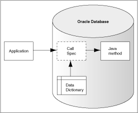

To publish Java methods, you write call specifications. For a given Java method, you declare a function or procedure call specification using the SQL `CREATE FUNCTION` or `CREATE PROCEDURE` statement. Inside a PL/SQL package or SQL object type, you use similar declarations.

You publish Java methods that return a value as functions and `void` Java methods as procedures. The function or procedure body contains the `LANGUAGE JAVA` clause. This clause records information about the Java method including its full name, its parameter types, and its return type. Mismatches are detected only at run time.

The following figure shows applications calling the Java method through its call specification, that is, by referencing the name of the call specification. The run-time system looks up the call specification definition in the Oracle data dictionary and runs the corresponding Java method.

Figure 6-1 Calling a Java Method

[Description of "Figure 6-1 Calling a Java Method"](img_text/call_spec_rev.md)

As an alternative, you can use the native Java interface to directly call Java methods in the database from a Java client.

**Related Topics**

- [Overview of Using the Client-Side Stub](invoking-Java-methods.md)
