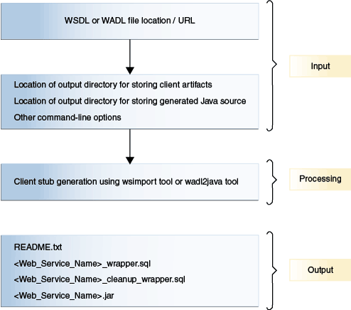
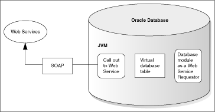

You can extend the storage, indexing, and searching capabilities of a relational database to include semistructured and nonstructured data, including Web services, in addition to enabling federated data. By calling Web services, the database can track, aggregate, refresh, and query dynamic data produced on-demand, such as stock prices, currency exchange rates, and weather information.

An example of using Oracle Database as a service consumer would be to call external Web services from a predefined database job to retrieve inventory information from multiple suppliers, and then update your local inventory database. Another example is that of a Web crawler, where a database job can be scheduled to collate product and price information from a number of sources.

This section covers the following topics:

- How to use the Oracle JVM Web Services Call-Out Utility

- Web Service Data Sources (Virtual Table Support)

- Features of Oracle Database as a Web Service Consumer

### 13.2.1 About Using Oracle JVM Web Services Call-Out Utility

Starting from Oracle Database 12c Release 2 (12.2.0.1), you can use the Oracle JVM Web Services Call-Out Utility to call the operations from the Web services running in the network, from Oracle Database. This utility accepts the SOAP Web services specified in WSDL format or REST Web services specified in WADL format.

Perform the following before using this utility:

- Set the `JAVA_HOME` environment variable.

- Use the following command to create the `OJVMWCU_INSTALL` schema:

      create user OJVMWCU_INSTALL identified by <ANY_PASSWROD>

  **Note:**

  - You must create the `OJVMWCU_INSTALL` schema before running the `install_ojvmwcu.sql` script. The `install_ojvmwcu.sql` script checks whether the `OJVMWCU_INSTALL` schema is present in the database or not. If not, then it displays a message that the schema is not present and stops running.

  - The `OJVMWCU_INSTALL` schema is created only for using the Oracle JVM Web Services Call-Out Utility and should not be used for any other purpose.

- Run the `install_ojvmwcu.sql` script, followed by the `grant_ojvmwcu.sql` script. Both the script files are present in the `ORACLE_HOME/javavm/ojvmwcu/install` directory.

  The `grant_ojvmwcu.sql` script takes user name as argument, and it must be invoked as `SYSDBA`. For example: `sqlplus / as sysdba @ grant_ojvmwcu.sql scott`

The following sections describe this utility in details:

- Architecture of Oracle JVM Web Services Call-Out Utility

- Input to Oracle JVM Web Services Call-Out Utility

- Output of the Oracle JVM Web Services Call-Out Utility

- Calling Secure Web Service from Oracle JVM Web Services Call-Out Utility

#### 13.2.1.1 Architecture of Oracle JVM Web Services Call-Out Utility

The Oracle JVM Web services Call-Out utility consists of the following two phases:

- Client Stub Generation

- Oracle JVM-specific Artifact Generation

The following figure illustrates the architecture of the Oracle JVM Web Services Call-Out Utility.

Figure 13-1 Oracle JVM Web Services Call-Out Utility Architecture

[Description of "Figure 13-1 Oracle JVM Web Services Call-Out Utility Architecture"](img_text/ojvmwcu_final.md)

##### Client Stub Generation

The Oracle JVM Web Services Call-Out Utility uses the JAX-WS library and generates Java client stubs from the input specified in the “Input of Oracle JVM Web Services Call-Out Utility” section for accessing SOAP Web services. For REST services, the Oracle JVM Web Services Call-Out Utility uses the Third Party Tool `wadl2java`, which you must download separately.

**Note:**

If you use REST services, then after downloading the `wadl2java` tool, you must perform either of the following:

- Set the `WADL_HOME` environment variable to the path of the `wadl2java` tool directory

- Use the `–t` command-line option to specify the path of the `wadl2java` tool directory

##### Oracle JVM-Specific Artifact Generation

For accessing the web services from PL/SQL, you need a static Java method and a PL/SQL wrapper function for each of the operations supported by the Web service. The Oracle JVM Web Services Call-Out Utility creates a static method for each of the supported operations in the Web service and extracts the details of the operations from the generated client classes by interpreting the different annotations. The extracted information includes WebService, Webmethods, WebServiceClient, and WebEndpoint. Using this information, the utility generates corresponding static methods in such a way that each of the operation has the same input parameters and return types as the corresponding operation in the published Web service. Then it adds all the static methods, corresponding to each of the supported operations, to a Java class.

The Oracle JVM Web services Call-Out utility then creates PL/SQL wrapper functions corresponding to each of the static methods in the generated Java class and packs the functions into a PL/SQL package with the name of the Web service. It also generates the PL/SQL wrapper for granting and revoking the basic permissions for running the Java Class in Oracle JVM.

#### 13.2.1.2 Input to Oracle JVM Web Services Call-Out Utility

#####

The input to the Oracle JVM Web Services Call-Out Utility mainly includes the WSDL or WADL file location, output directory to store the client artifacts, output directory to store the generated Java sources, if required, and the verbose mode. This utility reports any missing mandatory arguments and adds default values for the optional arguments. The following table describes the command-line arguments of the Oracle JVM Web Services Call-Out Utility.

Table 13-1 Input to Oracle JVM Web Services Call-Out Utility

| Argument                               | Argument Type | Description                                                                                                                                                                                                                                      |
|:---------------------------------------|:--------------|:-------------------------------------------------------------------------------------------------------------------------------------------------------------------------------------------------------------------------------------------------|
| `—i <command-line options file>`       | Web Service   | Specifies the file where other command-line options are stored.                                                                                                                                                                                  |
| `—out <output directory>`              | Web Service   | Specifies the directory where the output files are stored. The default value is the current directory.                                                                                                                                           |
| `-p`                                   | Web Service   | Specifies the package name for the generated Client Stubs. The default value is `ojvm.webservice`.                                                                                                                                               |
| `—keepsrc`                             | Web Service   | Indicates to store the generated sources to the output directory.                                                                                                                                                                                |
| `—v`                                   | Web Service   | Enables verbose mode for detailed description.                                                                                                                                                                                                   |
| `—Xauthfile`                           | Web Service   | Indicates the name of the file that contains authorization information in the format `http://username:password@_web-service URL_?wsdl`.                                                                                                          |
| `—name`                                | Web Service   | Specifies the name for the Web Service. The operations of the Web Service are put under a PL/SQL package specified with this value. The default value is `defaultWebService`.                                                                    |
| `-log`                                 | Web Service   | Specifies the log file to store the output stream of Oracle JVM Web Services Call-Out Utility. If you do not provide this value, then the output stream is displayed on `System.out`.                                                            |
| `-wsdl <WSDL location>`                | Web Service   | Specifies the hosted location of the WSDL file. This option is mutually exclusive with the `-WADL` option.                                                                                                                                       |
| `-wadl <WADL location>`                | Web Service   | Specifies the hosted location of the WADL file. This option is mutually exclusive with the `-WSDL` option.                                                                                                                                       |
| `-t <wadl2java tool location>`         | Web Service   | Specifies the location of the `wadl2java` tool directory. By default, the `WADL_HOME` environment variable that points to `wadl2java` tool Home directory is checked. If this environment variable is not set properly, then an error is thrown. |
| `-cp <additional classpath>`           | Web Service   | Specifies the class path that is used to compile the Java source files. You can either use the value of the `CLASSPATH` variable or specify the value using this option.                                                                         |
| `-auto`                                | Web Service   | Automatically loads the generated classes to the specified database. For this option to work, the following fields are mandatory: • `-user` • `-orasid`/`-oraserv`                                                                         |
| `-ts <trust_store path>`               | Web Service   | Specifies the path to the trustore in which the SSL certificate is imported.                                                                                                                                                                     |
| `-user`                                | Auto Mode     | Specifies the user who is supposed to invoke the Web Service.                                                                                                                                                                                    |
| `-dbhost <host_name>`                  | Database      | Specifies the host name where Oracle Database is installed. This field is used when auto mode is specified. The default value is `localhost`.                                                                                                    |
| `-dbport <port_number>`                | Database      | Specifies the port number in which Oracle Database runs. This field is used when auto mode is specified. The default value is 1521.                                                                                                              |
| `-orasid <Oracle SID>`                 | Database      | Specifies the SID of the Oracle Database registered to the listener. This field is used when auto mode is specified.                                                                                                                             |
| `-oraserv <name of corresponding CDB>` | Database      | Specifies the name of the CDB (container database) to which the classes should be loaded. This field is used when auto mode is specified.                                                                                                        |

#### 13.2.1.3 Output of the Oracle JVM Web Services Call-Out Utility

#####

The following table describes the output of the Oracle JVM Web Services Call-Out Utility.

Table 13-2 Output of the Oracle JVM Web Services Call-Out Utility

| File Name                        | Description                                                                                        |
|:---------------------------------|:---------------------------------------------------------------------------------------------------|
| README.txt                       | This file contains instructions to manually load the classes, grant the permissions, and run them. |
| `<Web_Service_Name>_wrapper.sql` | This SQL file is used to create PL/SQL wrappers for each operations in the specified Web service.  |
| `<Web_Service_Name>.jar`         | This JAR file contains the client stub classes for the Web services.                               |

**Note:**

With REST Web services, all Web method wrappers return Web response in String format. Though `GenericType` is supported with Jersey-Client, Oracle JVM Web Services Call-Out Utility does not support it.

#### 13.2.1.4 Calling Secure Web Service from Oracle JVM Web Services Call-Out Utility

The Oracle JVM Web Services Call-Out Utility provides support for SSL based Web services. This utility also provides support for Web services secured with basic HTTP authentication. If you are using an SSL based Web service, then you must add SSL certificate to Keystore before running this utility or use the `-ts` command-line option to pass truststore path. Before the Web call out, you must use the `grabAndSaveCertificate``<WebServiceName>``(host, port)` procedure from `wrappers.sql` file for setting the path to key store path. If you are using Web services secured with basic authentication, then use the `-Xauthfile<auth_file>` command-line option with this utility. The `auth_file` argument contains authorization information in the following format:

    http://username:password@<web-serviceURL>?wsdl

Before the Web call out, you must use `setwsCred<WebServiceName>(usr,pwd)` from `wrappers.sql` file for setting the Web service credentials.

### 13.2.2 Web Service Data Sources (Virtual Table Support)

To access data that is returned from single or multiple Web service invocations, create a virtual table using a Web service data source. This table lets you query a set of returned rows as though it were a table.

The client calls a Web service and the results are stored in a virtual table in the database. You can pass result sets from function to function. This enables you to set up a sequence of transformation without a table holding intermediate results. To reduce memory usage, you can return the result set rows, a few at a time, within a function.

By using Web services with the table function, you can manipulate a range of input values from single or multiple Web services as a real table. In the following example, the inner `SELECT` statement creates rows whose columns are used as arguments for calling the `CALL_WS` Web service call-out.

    SELECT column1, cloumn2, ...
    FROM TABLE(WS_TABFUN(CURSOR(SELECT s FROM table_name)))
    WHERE ...

The table expression in the preceding example can be used in other SQL queries, for constructing views, and so on.

Figure 13-2 illustrates the support for virtual table.

Figure 13-2 Storing Results from Request in a Virtual Table

[Description of "Figure 13-2 Storing Results from Request in a Virtual Table"](img_text/storing_results_virtual.md)

### 13.2.3 Features of Oracle Database as a Web Service Consumer

Using Oracle Database as a Web service consumer provides the following features:

- Consuming Web services from Java

  Provides an easy-to-use interface for Web services call-outs, thereby insulating developers from low-level SOAP programming. Java classes running in the database can directly call external Web services by using the previously loaded Java proxy class or through dynamic invocation.

- Consuming Web services from SQL and PL/SQL

  Enables any SQL-enabled tool or application to transparently and easily consume dynamic data from external Web services. After exposing Web services methods as Java stored procedures, a PL/SQL wrapper on top of a Java stored procedure hides all Java and SOAP programming details from the SQL client.

- Using Web services data source

  Enables application and data integration by turning external Web service into a SQL data source, making the external Web service appear as regular SQL table. This table function represents the output of calling external Web services and can be used in a SQL query.
