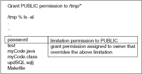

Once you are connected to the database, you must have the appropriate Java 2 security permissions and database privileges to access the resources stored within the database. These resources include:

- Database resources, such as tables and PL/SQL packages

- Operating system resources, such as files and sockets

- Oracle JVM classes

- User-loaded classes

These resources can be protected by the following methods:

| Resource Security          | Description                                                                                                                                                                                                                                                                                                                                                                                                                 |
|:---------------------------|:----------------------------------------------------------------------------------------------------------------------------------------------------------------------------------------------------------------------------------------------------------------------------------------------------------------------------------------------------------------------------------------------------------------------------|
| Database Resource Security | Authorization for database resources requires that database privileges, which are not the same as the Java 2 security permissions, are granted to resources. For example, database resources include tables, classes, and PL/SQL packages. All user-defined classes are secured against users from other schemas. You can grant execution permission to other users or schemas through an option on the `loadjava` tool. |
| JVM Security               | Oracle JVM uses Java 2 security, which uses `Permission` objects to protect operating system resources. Java 2 security is automatically installed upon startup and protects all operating system resources and Oracle JVM classes from all users, except `JAVA_ADMIN`. The `JAVA_ADMIN` user can grant permission to other users to access these classes.                                                                  |

**Note:**

- The Oracle JVM is shipped with strong but limited encryption as included in JDK1.5 and JDK 6. If you want to have unlimited encryption strength in your application, then you must download and install the appropriate version-specific files from the following Web site

  [`http://www.oracle.com/technetwork/indexes/downloads/index.html`](http://www.oracle.com/technetwork/indexes/downloads/index.html)

- The Oracle JVM classes used for granting or revoking permissions can run only on a server.

This section covers the following topics:

- Overview of Java 2 Security Features

- Overview of Setting Permissions

- Debugging Permissions

- Permission for Loading Classes

- Customizing the Default java.security Resource

**See Also:**

[Oracle Database Development Guide](../adfns/index.md)

### 10.2.1 Overview of Java 2 Security Features

Each user or schema must be assigned the proper permissions to access operating system resources, such as sockets, files, and system properties.

Java 2 security provides a flexible and configurable security for Java applications. With Java 2 security, you can define exactly what permissions on each loaded object that a schema or role will have. In Oracle8i Database release 8.1.5, the following secure roles are available:

- `JAVAUSERPRIV`

  Few permissions, including examining properties

- `JAVASYSPRIV`

  Major permissions, including updating Oracle JVM-protected packages

**Note:**

Both roles still exist within this release for backward compatibility. However, Oracle recommends that you specify each permission explicitly, rather than utilize these roles.

Because Oracle JVM security is based on Java 2 security, you assign permissions on a class-by-class basis. These permissions are assigned through database management tools. Each permission is encapsulated in a `Permission` object and is stored within a `Permission` table. `Permission` contains the `target` and `action` attributes, which take `String` values.

Java 2 security was created for the non-database world. When you apply the Java 2 security model within the database, certain differences manifest themselves. For example, Java 2 security defines that all applets are implicitly untrusted and all classes within the `CLASSPATH` are trusted. In Oracle Database, all classes are loaded within a secure database. As a result, no classes are trusted.

The following table describes the differences between the standard Java 2 security and Oracle Database security implementation:

| Java 2 Security Standard                                                                                                                                                                                                                                                                   | Oracle Database Security Implementation                                                                                                                                                                                                                                                                                                  |
|:-------------------------------------------------------------------------------------------------------------------------------------------------------------------------------------------------------------------------------------------------------------------------------------------|:-----------------------------------------------------------------------------------------------------------------------------------------------------------------------------------------------------------------------------------------------------------------------------------------------------------------------------------------|
| Java classes located within the `CLASSPATH` are trusted.                                                                                                                                                                                                                                   | All Java classes are loaded within the database. Classes are trusted on a class-by-class basis according to the permission granted.                                                                                                                                                                                                      |
| You can specify the policy using the `-usepolicy` flag on the `java` command.                                                                                                                                                                                                              | You must specify the policy within `PolicyTable`.                                                                                                                                                                                                                                                                                        |
| You can write your own `SecurityManager` or use the Launcher.                                                                                                                                                                                                                              | You can write your own `SecurityManager`. However, Oracle recommends that you use only Oracle Database `SecurityManager` or that you extend it. If you want to modify the behavior, then you should not define a `SecurityManager`. Instead, you should extend `oracle.aurora.rdbms. SecurityManagerImpl` and override specific methods. |
| `SecurityManager` is not initialized by default. You must initialize `SecurityManager`.                                                                                                                                                                                                    | Oracle JVM always initializes `SecurityManager` at startup.                                                                                                                                                                                                                                                                              |
| Permissions are determined by the location or the URL, where the application or applet is loaded, or keycode, that is, signed code.                                                                                                                                                        | Permissions are determined by the schema in which the class is loaded. Oracle Database does not support signed code.                                                                                                                                                                                                                     |
| The security policy is defined in a file.                                                                                                                                                                                                                                                  | The `PolicyTable` definition is contained in a secure database table.                                                                                                                                                                                                                                                                    |
| You can update the security policy file using a text editor or a tool, if you have the appropriate permissions.                                                                                                                                                                            | You can update `PolicyTable` through `DBMS_JAVA` procedures. After initialization, only `JAVA_ADMIN` has permission to modify `PolicyTable`. `JAVA_ADMIN` must grant you the right to modify `PolicyTable` so that you can grant permissions to others.                                                                                  |
| Permissions are assigned to a protection domain, which classes can belong to.                                                                                                                                                                                                              | All classes within the same schema are in the same protection domain.                                                                                                                                                                                                                                                                    |
| You can use the `CodeSource` class for identifying code. • The `equals()` method returns `true` if the URL and certificates are equal. • The `implies()` method returns `true` if the first `CodeSource` is a generic representation that includes the specific `CodeSource` object. | You can use the `CodeSource` class for identifying schema. • The `equals()` method returns `true` if the schemas are the same. • The `implies()` method returns `true` if the schemas are the same.                                                                                                                                |
| Supports positive permissions only, that is, `grant`.                                                                                                                                                                                                                                      | Supports both positive and limitation permissions, that is, `grant` and `restrict`.                                                                                                                                                                                                                                                      |

### 10.2.2 Overview of Setting Permissions

As with Java 2 security, Oracle Database supports the security classes. Typically, you set the permissions for the code base either using a tool or by editing the security policy file. In Oracle Database, you set the permissions dynamically using `DBMS_JAVA` procedures, which modify a policy table in the database.

Two views have been created for you to view the policy table, `USER_JAVA_POLICY` and `DBA_JAVA_POLICY`. Both views contain information about granted and limitation permissions. The `DBA_JAVA_POLICY` view can see all rows within the policy table. The `USER_JAVA_POLICY` view can see only permissions relevant to the current user. The following is a description of the rows within each view:

| Table Column      | Description                                                                                                                                                                                                              |
|:------------------|:-------------------------------------------------------------------------------------------------------------------------------------------------------------------------------------------------------------------------|
| Kind              | `GRANT` or `RESTRICT`. Shows whether this permission is a positive or a limitation permission.                                                                                                                           |
| Grantee           | The name of the user, schema, or role to which the `Permission` object is assigned.                                                                                                                                      |
| Permission_schema | The schema in which the `Permission` object is loaded.                                                                                                                                                                   |
| Permission_type   | The `Permission` class type, which is designated by a string containing the full class name, such as, `java.io.FilePermission`.                                                                                          |
| Permission_name   | The `target` attribute of the `Permission` object. You use this when defining the permission. When defining the target for a `Permission` object of type `PolicyTablePermission`, the name can become quite complicated. |
| Permission_action | The `action` attribute of the `Permission` object. Many permissions expect a null value if no action is appropriate for the permission.                                                                                  |
| Status            | `ENABLED` and `DISABLED`. After creating a row for a `Permission` object, you can disable or reenable it. This column shows whether the permission is enabled or disabled.                                               |
| Key               | Sequence number you use to identify this row. This number should be supplied when disabling, enabling, or deleting a permission.                                                                                         |

There are two ways to set permissions:

- Fine-Grain Definition for Each Permission

- Assigning General Permission Definition to Roles

**Note:**

For absolute certainty about the security settings, implement the fine-grain definition. The general definition is easy to implement, but you may not get the exact security settings you require.

#### 10.2.2.1 Fine-Grain Definition for Each Permission

Using fine-grain definition, you can grant each permission individually to specific users or roles. If you do not grant a permission for access, then the schema will be denied access. To set individual permissions within the policy table, you must provide the following information:

| Parameter         | Description                                                                                                                                                                                                                                                                                                                                                                                                                                                |
|:------------------|:-----------------------------------------------------------------------------------------------------------------------------------------------------------------------------------------------------------------------------------------------------------------------------------------------------------------------------------------------------------------------------------------------------------------------------------------------------------|
| Grantee           | The name of the user, schema, or role to which you want the grant to apply. `PUBLIC` specifies that the row applies to all users.                                                                                                                                                                                                                                                                                                                          |
| Permission type   | The `Permission` class on which you are granting permission. For example, if you were defining access to a file, the permission type would be `FilePermission`. This parameter requires a fully-qualified name of a class that extends `java.lang.security.Permission`. If the class is not within `SYS`, then the name should be prefixed by `schema``:`. For example, `mySchema:myPackage.MyPermission` is a valid name for a user-generated permission. |
| Permission name   | The meaning of the target attribute as defined by the `Permission` class. Examine the appropriate `Permission` class for the relevant name.                                                                                                                                                                                                                                                                                                                |
| Permission action | The type of action that you can specify. This can vary according to the permission type. For example, `FilePermission` can have the action, read or write.                                                                                                                                                                                                                                                                                                 |
| Key               | Number returned from grant or limit to use on enable, disable, or delete methods.                                                                                                                                                                                                                                                                                                                                                                          |

##### 10.2.2.1.1 Granting and Limiting Permissions

You can grant permissions using either SQL or Java. Each version returns a row key identifier that identifies the row within the permission table. In the Java version of `DBMS_JAVA`, each method returns the row key identifier, either as a returned parameter or as an `OUT` variable in the parameter list. In the PL/SQL `DBMS_JAVA` package, the row key is returned only in the procedure that defines the `key OUT` parameter. This key is used to enable and disable specific permissions.

After running the grant, if a row already exists for the exact permission, then no update occurs, but the key for that row is returned. If the row was disabled, then running the grant enables the existing row.

**Note:**

If you are granting `FilePermission`, then you must provide the physical name of the directory or file, such as `/private/oracle`. You cannot provide either an environment variable, such as `$ORACLE_HOME`, or a symbolic link. To denote all files within a directory, provide the `*` symbol, as follows:

    /private/oracle/*

To denote all directories and files within a directory, provide the `-` symbol, as follows:

    /private/oracle/-

You can grant permissions using the `DBMS_JAVA` package, as follows:

    procedure grant_permission ( grantee varchar2, permission_type varchar2, permission_name varchar2,
    permission_action varchar2 )

    procedure grant_permission ( grantee varchar2, permission_type varchar2, permission_name varchar2,
    permission_action varchar2, key OUT number)

You can grant permissions using Java, as follows:

    long oracle.aurora.rdbms.security.PolicyTableManager.grant ( java.lang.String grantee,
    java.lang.String permission_type, java.lang.String permission_name, java.lang.String permission_action);

    void oracle.aurora.rdbms.security.PolicyTableManager.grant ( java.lang.String grantee,
    java.lang.String permission_type, java.lang.String permission_name, java.lang.String permission_action, long[] key);

You can limit permissions using the `DBMS_JAVA` package, as follows:

    procedure restrict_permission ( grantee varchar2, permission_type varchar2, permission_name varchar2,
    permission_action varchar2)

    procedure restrict_permission ( grantee varchar2, permission_type varchar2, permission_name varchar2,
    permission_action varchar2, key OUT number)

You can limit permissions using Java, as follows:

    long oracle.aurora.rdbms.security.PolicyTableManager.restrict ( java.lang.String grantee,
    java.lang.String permission_type, java.lang.String permission_name, java.lang.String permission_action);

    void oracle.aurora.rdbms.security.PolicyTableManager.restrict ( java.lang.String grantee,
    java.lang.String permission_type, java.lang.String permission_name, java.lang.String permission_action, long[] key);

Example 10-2 shows how to use the `grant_permission()` method to grant permissions. Example 10-3 shows how to limit permissions using the `restrict()` method.

The following examples perform the following actions:

1.  Grants everyone read and write permission to all files in `/tmp`.

2.  Limits everyone from reading or writing only the `password` file in `/tmp`.

3.  Grants only `Larry` explicit permission to read and write the `password` file.

Example 10-2 Granting Permissions

Assuming that you have appropriate permissions to modify the policy table, you can use the `grant_permission()` method, which is in the `DBMS_JAVA` package, to modify `PolicyTable` to allow user access to the indicated file. In this example, the user, `Larry`, has modification permission on `PolicyTable`. Within a SQL package, `Larry` can grant permission to `Dave` to read and write a file, as follows:

    connect larry
    Enter password: password

    REM Grant DAVE permission to read and write the Test1 file.
    call dbms_java.grant_permission('DAVE', 'java.io.FilePermission', '/test/Test1',  'read,write');

    REM commit the changes to PolicyTable
    commit;

Example 10-3 Limiting Permissions

You can use the `restrict()` method to specify a limitation or exception to general rules. A general rule is a rule where, in most cases, the permission is true or granted. However, there may be exceptions to this rule. For these exceptions, you specify a limitation permission.

If you have defined a general rule that no one can read or write an entire directory, then you can define a limitation on an aspect of this rule through the `restrict()` method. For example, if you want to allow access to all files within the `/tmp` directory, except for your password file that exists in that directory, then you would grant permission for read and write to all files within `/tmp` and limit read and write access to the password file.

If you want to specify an exception to the limitation, then you must create an explicit grant permission to override the limitation permission. In the previously mentioned scenario, if you want the file owner to still be able to modify the password file, then you can grant a more explicit permission to allow access to one user, which will override the limitation. Oracle JVM security combines all rules to understand who really has access to the password file. This is demonstrated in the following diagram:

Figure 10-1 The List of Files in the /tmp Directory

[Description of "Figure 10-1 The List of Files in the /tmp Directory"](img_text/limitper.md)

The explicit rule is as follows:

If the limitation permission implies the request, then for a grant permission to be effective, the limitation permission must also imply the grant.

The following code implements this example:

    connect larry
    Enter password: password

    REM Grant permission to all users (PUBLIC) to be able to read and write
    REM all files in /tmp.
    call dbms_java.grant_permission('PUBLIC', 'java.io.FilePermission', '/tmp/*', 'read,write');

    REM Limit permission to all users (PUBLIC) from reading or writing the
    REM password file in /tmp.
    call dbms_java.restrict_permission('PUBLIC', 'java.io.FilePermission', '/tmp/password', 'read,write');

    REM By providing a more specific rule that overrides the limitation,
    REM Larry can read and write /tmp/password.
    call dbms_java.grant_permission('LARRY', 'java.io.FilePermission', '/tmp/password', 'read,write');

    commit;

##### 10.2.2.1.2 Acquiring Administrative Permission to Update Policy Table

All permissions are rows in `PolicyTable`. Because it is a table in the database, you need appropriate permissions to modify it. Specifically, the `PolicyTablePermission` object is required to modify the table. After initializing Oracle JVM, only a single role, `JAVA_ADMIN`, is granted `PolicyTablePermission` to modify `PolicyTable`. The `JAVA_ADMIN` role is immediately assigned to the database administrator (DBA). Therefore, if you are assigned to the DBA group, then you will automatically take on all `JAVA_ADMIN` permissions.

If you need to add permissions as rows to this table, `JAVA_ADMIN` must grant your schema update rights using `PolicyTablePermission`. This permission defines that your schema can add rows to the table. Each `PolicyTablePermission` is for a specific type of permission. For example, to add a permission that controls access to a file, you must have `PolicyTablePermission` that lets you grant or limit a permission on `FilePermission`. Once this occurs, you have administrative permission for `FilePermission`.

An administrator can grant and limit `PolicyTablePermission` in the same manner as other permissions, but the syntax is complicated. For ease of use, you can use the `grant_policy_permission()` or `grantPolicyPermission()` method to grant administrative permissions.

You can grant policy table administrative permission using `DBMS_JAVA`, as follows:

    procedure grant_policy_permission ( grantee varchar2, permission_schema varchar2,
    permission_type varchar2, permission_name varchar2 )

    procedure grant_policy_permission ( grantee varchar2, permission_schema varchar2,
    permission_type varchar2, permission_name varchar2, key OUT number )

You can grant policy table administrative permission using Java, as follows:

    long oracle.aurora.rdbms.security.PolicyTableManager.grantPolicyPermission (java.lang.String grantee, java.lang.String permission_schema,
     java.lang.String permission_type, java.lang.String permission_name);

    void oracle.aurora.rdbms.security.PolicyTableManager.grantPolicyPermission (java.lang.String grantee, java.lang.String permission_schema,
    java.lang.String permission_type, java.lang.String permission_name, long[] key);

| Parameter         | Description                                                                                                                                                                                                                                                                                                                                                                                                                                           |
|:------------------|:------------------------------------------------------------------------------------------------------------------------------------------------------------------------------------------------------------------------------------------------------------------------------------------------------------------------------------------------------------------------------------------------------------------------------------------------------|
| Grantee           | The name of the user, schema, or role to which you want the grant to apply. `PUBLIC` specifies that the row applies to all users.                                                                                                                                                                                                                                                                                                                     |
| Permission_schema | The schema where the `Permission` class is loaded.                                                                                                                                                                                                                                                                                                                                                                                                    |
| Permission_type   | The `Permission` class on which you are granting permission. For example, if you were defining access to a file, the permission type would be `FilePermission`. This parameter requires a fully-qualified name of a class that extends `java.lang.security.Permission`. If the class is not within `SYS`, the name should be prefixed by `schema``:`. For example, `mySchema:myPackage.MyPermission` is a valid name for a user-generated permission. |
| Permission_name   | The meaning of the `target` attribute as defined by the `Permission` class. Examine the appropriate `Permission` class for the relevant name.                                                                                                                                                                                                                                                                                                         |
| Row\_ number      | Number returned from grant or limitation to use on enable, disable, or delete methods.                                                                                                                                                                                                                                                                                                                                                                |

**Note:**

When looking at the policy table, the name in the `PolicyTablePermission` rows contains both the permission type and the permission name, which are separated by a `#`. For example, to grant a user administrative rights for reading a file, the name in the row contains `java.io.FilePermission#read`. The `#` separates the `Permission` class from the permission name.

Example 10-4 shows how you can modify `PolicyTable`.

Example 10-4 Granting PolicyTable Permission

This example shows `SYS`, which has the `JAVA_ADMIN` role assigned, giving `Larry` permission to update `PolicyTable` for `FilePermission`. Once this permission is granted, `Larry` can grant permissions to other users for reading, writing, and deleting files.

    REM Connect as SYS, which is assigned JAVA_ADMIN role, to give Larry permission
    REM to modify the PolicyTable
    connect SYS as SYSDBA
    Enter password: password

    REM SYS grants Larry the right to administer permissions for
    REM FilePermission
    call dbms_java.grant_policy_permission('LARRY', 'SYS', 'java.io.FilePermission', '*');

##### 10.2.2.1.3 Creating Permissions

You can create your own permission type by performing the following steps:

1.  Create and load the user permission
    Create your own permission by extending the `java.security.Permission` class. Any user-defined permission must extend `Permission`. The following example creates `MyPermission`, which extends `BasicPermission`, which, in turn, extends `Permission`.

        package test.larry;
        import java.security.Permission;
        import java.security.BasicPermission;

        public class MyPermission extends BasicPermission
        {

          public MyPermission(String name)
          {
            super(name);
          }

          public boolean implies(Permission p)
          {
            boolean result = super.implies(p);
            return result;
          }
        }
2.  Grant administrative and action permissions to specified users
    When you create a permission, you are designated as the owner of that permission. The owner is implicitly granted administrative permission. This means that the owner can be an administrator for this permission and can run `grant_policy_permission()`. Administrative permission enable the user to update the policy table for the user-defined permission.

    For example, if `LARRY` creates a permission, `MyPermission`, then only he can call `grant_policy_permission()` for himself or another user. This method updates `PolicyTable` on who can grant rights to `MyPermission`. The following code demonstrates this:

        REM Since Larry is the user that owns MyPermission, Larry connects to
        REW the database to assign permissions for MyPermission.

        connect larry
        Enter password: password

        REM As the owner of MyPermission, Larry grants himself the right to
        REM administer permissions for test.larry.MyPermission within the JVM
        REM security PolicyTable. Only the owner of the user-defined permission
        REM can grant administrative rights.
        call dbms_java.grant_policy_permission ('LARRY', 'LARRY', 'test.larry.MyPermission', '*');

        REM commit the changes to PolicyTable
        commit;

    Once you have granted administrative rights, you can grant action permissions for the created permission. For example, the following SQL statements grant `LARRY` the permission to run anything within `MyPermission` and `DAVE` the permission to run only actions that start with "`act.`".

        REM Since Larry is the user that creates MyPermission, Larry connects to
        REW the database to assign permissions for MyPermission.

        connect larry
        Enter password: password

        REM Once able to modify PolicyTable for MyPermission, Larry grants himself
        REM full permission for MyPermission. Notice that the Permission is prefixed
        REM with its owner schema.
        call dbms_java.grant_permission( 'LARRY', 'LARRY:test.larry.MyPermission', '*', null);

        REM Larry grants Dave permission to do any actions that start with 'act.*'.
        call dbms_java.grant_permission
         ('DAVE', 'LARRY:test.larry.MyPermission', 'act.*', null);

        REM commit the changes to PolicyTable
        commit;
3.  Implement security checks using the permission
    Once you have created, loaded, and assigned permissions for `MyPermission`, you must implement the call to `SecurityManager` to have the permission checked. There are four methods in the following example: `sensitive()`, `act()`, `print()`, and `hello()`. Because of the permissions granted using SQL in the preceding steps, the following users can run methods within the example class:

    - `LARRY` can run any of the methods.

    - `DAVE` is given permission to run only the `act()` method.

    - Anyone can run the `print()` and `hello()` methods. The `print()` method does not check any permissions. As a result, anyone can run it. The `hello()` method runs `AccessController.doPrivileged()`, which means that the method runs with the permissions assigned to `LARRY`. This is referred to as the definer's rights.

    <!-- -->

        package test.larry;
        import java.security.AccessController;
        import java.security.Permission;
        import java.security.PrivilegedAction;

        import java.sql.Connection;
        import java.sql.SQLException;

        /**
        * MyActions is a class with a variety of public methods that
        * have some security risks associated with them. We will rely
        * on the Java security mechanisms to ensure that they are
        * performed only by code that is authorized to do so.
        */

        public class Larry {

          private static String secret = "Larry's secret";
          MyPermission sensitivePermission = new MyPermission("sensitive");

        /**
        * This is a security sensitive operation. That is it can
        * compromise our security if it is executed by a "bad guy".
        * Only larry has permission to execute sensitive.
        */
          public void sensitive()
          {
            checkPermission(sensitivePermission);
            print();
          }

        /**
        * Will display a message from Larry. You must be
        * careful about who is allowed to do this
        * because messages from Larry may have extra impact.
        * Both larry and dave have permission to execute act.
        */
          public void act(String message)
          {
            MyPermission p = new MyPermission("act." + message);
            checkPermission(p);
            System.out.println("Larry says: " + message);
          }

        /**
        * display secret key
        * No permission check is made; anyone can execute print.
        */
          private void print()
          {
            System.out.println(secret);
          }

        /**
        * Display "Hello"
        * This method invokes doPrivileged, which makes the method run
        * under definer's rights. So, this method runs under Larry's
        * rights, so anyone can execute hello. Only Larry can execute hello
        */
          public void hello()
          {
            AccessController.doPrivileged(new PrivilegedAction() {
              public Object run() { act("hello"); return null; }
            });
          }

        /**
        * If a security manager is installed ask it to check permission
        * otherwise use the AccessController directly
        */
          void checkPermission(Permission permission)
          {
            SecurityManager sm = System.getSecurityManager();
            sm.checkPermission(permission);
          }
        }

##### 10.2.2.1.4 Enabling or Disabling Permissions

Once you have created a row that defines a permission, you can disable it so that it no longer applies. However, if you decide that you want the row action again, then you can enable the row. You can delete the row from the table if you believe that it will never be used again. To delete, you must first disable the row. If you do not disable the row, then the deletion will not occur.

To disable rows, you can use either of the following methods:

- `revoke_permission()`

  This method accepts parameters similar to the `grant()` and `restrict()` methods. It searches the entire policy table for all rows that match the parameters provided.

- `disable_permission()`

  This method disables only a single row within the policy table. To do this, it accepts the policy table key as parameter. This key is also necessary to enable or delete a permission. To retrieve the permission key number, perform one of the following:

  - Save the key when it is returned on the grant or limit calls. If you do not foresee a need to ever enable or disable the permission, then you can use the grant and limit calls that do not return the permission number.

  - Look up `DBA_JAVA_POLICY` or `USER_JAVA_POLICY` for the appropriate permission key number.

You can disable permissions using `DBMS_JAVA`, as follows:

    procedure revoke_permission (grantee varchar2, permission_type varchar2, permission_name varchar2, permission_action varchar2)

    procedure disable_permission (key number)

You can disable permissions using Java, as follows:

    void oracle.aurora.rdbms.security.PolicyTableManager.revoke (java.lang.String grantee, java.lang.String permission_type,
     java.lang.String permission_name, java.lang.String permission_action_type);

    void oracle.aurora.rdbms.security.PolicyTableManager.disable (long key);

You can enable permissions using `DBMS_JAVA`, as follows:

    procedure enable_permission (key number)

You can enable permissions using Java, as follows:

    void oracle.aurora.rdbms.security.PolicyTableManager.enable (long key);

You can delete permissions using `DBMS_JAVA`, as follows:

    procedure delete_permission (key number)

You can delete permissions using Java, as follows:

    void oracle.aurora.rdbms.security.PolicyTableManager.delete (long key);

##### 10.2.2.1.5 About Permission Types

Whenever you want to grant or limit a permission, you must provide the permission type. The permission types with which you control access are the following:

- Java 2 permission types

- Oracle-specific permission types

- User-defined permission types that extend `java.security.Permission`

Table 10-1 lists the installed permission types.

Table 10-1 Predefined Permissions

| Type            | Permissions                                                                                                                                                                                                                                                                               |
|:----------------|:------------------------------------------------------------------------------------------------------------------------------------------------------------------------------------------------------------------------------------------------------------------------------------------|
| Java 2          | • `java.util.PropertyPermission` • `java.io.SerializablePermission` • `java.io.FilePermission` • `java.net.NetPermission` • `java.net.SocketPermission` • `java.lang.RuntimePermission` • `java.lang.reflect.ReflectPermission` • `java.security.SecurityPermission` |
| Oracle specific | • `oracle.aurora.rdbms.security.PolicyTablePermission` • `oracle.aurora.security.JServerPermission`                                                                                                                                                                                    |

**Note:**

`SYS` is granted permission to load libraries that come with Oracle Database. However, Oracle JVM does not support other users loading libraries, because loading C libraries within the database is insecure. As a result, you are not allowed to grant `RuntimePermission` for `loadLibrary.*`.

The Oracle-specific permissions are:

- `oracle.aurora.rdbms.security.PolicyTablePermission`

  This permission controls who can update the policy table. Once granted the right to update the policy table for a certain permission type, you can control the access to few resources.

  After the initialization of Oracle JVM, only the `JAVA_ADMIN` role can grant administrative rights for the policy table through `PolicyTablePermission`. Once it grants this right to other users, these users can, in turn, update the policy table with their own grant and limitation permissions.

  To grant policy table updates, you can use the `grant_policy_permission()` method, which is in the `DBMS_JAVA` package. Once you have updated the table, you can view either the `DBA_JAVA_POLICY` or `USER_JAVA_POLICY` view to see who has been granted permissions.

- `oracle.aurora.security.JServerPermission`

  This permission is used to grant and limit access to Oracle JVM resources. The `JServerPermission` extends `BasicPermission`. The following table lists the permission names for which `JServerPermission` grants access:

  | Permission Name                     | Description                                                                                             |
  |:------------------------------------|:--------------------------------------------------------------------------------------------------------|
  | `LoadClassInPackage.``package_name` | Grants the ability to load a class within the specified package                                         |
  | `Verifier`                          | Grants the ability to turn the bytecode verifier on or off                                              |
  | `Debug`                             | Grants the ability for debuggers to connect to a session                                                |
  | `JRIExtensions`                     | Grants the use of MEMSTAT                                                                               |
  | `Memory.Call`                       | Grants rights to call certain methods in `oracle.aurora.vm.OracleRuntime` on call settings              |
  | `Memory.Stack`                      | Grants rights to call certain methods in `oracle.aurora.vm.OracleRuntime` on stack settings             |
  | `Memory.SGAIntern`                  | Grants rights to call certain methods in `oracle.aurora.vm.OracleRuntime` on SGA settings               |
  | `Memory.GC`                         | Grants rights to call certain methods in `oracle.aurora.vm.OracleRuntime` on garbage collector settings |

  Table 10-2 JServerPermission Description

  | Grantee         | Permission Type                                | Permission Name                             | Permission Granted or Restricted | Action |
  |:----------------|:-----------------------------------------------|:--------------------------------------------|:---------------------------------|:-------|
  | `JAVADEBUGPRIV` | `SYS:oracle.aurora.security.JServerPermission` | `Debug`                                     | Granted                          | null   |
  | `SYS`           | `SYS:oracle.aurora.security.JServerPermission` | `*`                                         | Granted                          | null   |
  | `SYS`           | `SYS:oracle.aurora.security.JServerPermission` | `LoadClassInPackage.java.*`                 | Granted                          | null   |
  | `SYS`           | `SYS:oracle.aurora.security.JServerPermission` | `LoadClassInPackage.oracle.aurora.*`        | Granted                          | null   |
  | `SYS`           | `SYS:oracle.aurora.security.JServerPermission` | `LoadClassInPackage.oracle.jdbc.*`          | Granted                          | null   |
  | `PUBLIC`        | `SYS:oracle.aurora.security.JServerPermission` | `LoadClassInPackage.*`                      | Granted                          | null   |
  | `PUBLIC`        | `SYS:oracle.aurora.security.JServerPermission` | `LoadClassInPackage.java.*`                 | Restricted                       | null   |
  | `PUBLIC`        | `SYS:oracle.aurora.security.JServerPermission` | `LoadClassInPackage.oracle.aurora.*`        | Restricted                       | null   |
  | `PUBLIC`        | `SYS:oracle.aurora.security.JServerPermission` | `LoadClassInPackage.oracle.jdbc.*`          | Restricted                       | null   |
  | `JAVA_DEPLOY`   | `SYS:oracle.aurora.security.JServerPermission` | `LoadClassInPackage.oracle.aurora.deploy.*` | Granted                          | null   |
  | `JAVA_DEPLOY`   | `SYS:oracle.aurora.security.JServerPermission` | `Deploy`                                    | Granted                          | null   |

##### 10.2.2.1.6 About Initial Permission Grants

When you first initialize Oracle JVM, several roles are populated with certain permission grants. The following tables show these roles and their initial Permissions:

- Table 10-3

- Table 10-4

- Table 10-5

- Table 10-6

- Table 10-7

The `JAVA_ADMIN` role is given access to modify the policy table for all permissions. All DBAs, including `SYS`, are granted `JAVA_ADMIN`. Full administrative rights to update the policy table are granted for the permissions listed in Table 10-1. In addition to the `JAVA_ADMIN` permissions, `SYS` is granted some additional permissions that are needed to support the standard JDK functionality and Oracle JVM specifics.

Table 10-3 lists some of the additional permissions granted to `SYS`.

Table 10-3 SYS Initial Permissions

| Permission Type                                       | Permission Name                                        | Action |
|:------------------------------------------------------|:-------------------------------------------------------|:-------|
| `oracle.aurora.rdbms.security. PolicyTablePermission` | `oracle.aurora.rdbms.security.PolicyTablePermission#*` | null   |
| `oracle.aurora.security.JServerPermission`            | `*`                                                    | null   |
| `java.net.NetPermission`                              | `*`                                                    | null   |
| `java.security.SecurityPermission`                    | `*`                                                    | null   |
| `java.util.PropertyPermission`                        | `*`                                                    | write  |
| `java.lang.reflect.ReflectPermission`                 | `*`                                                    | null   |
| `java.lang.RuntimePermission`                         | `*`                                                    | null   |
| `java.lang.RuntimePermission`                         | `loadLibrary.xaNative`                                 | null   |
| `java.lang.RuntimePermission`                         | `loadLibrary.corejava`                                 | null   |
| `java.lang.RuntimePermission`                         | `loadLibrary.corejava_d`                               | null   |

Table 10-4 lists permissions initially granted or restricted to all users.

Table 10-4 PUBLIC Default Permissions

| Permission Type                                       | Permission Name                                                                                                                             | Permission Granted or Restricted | Action |
|:------------------------------------------------------|:--------------------------------------------------------------------------------------------------------------------------------------------|:---------------------------------|:-------|
| `oracle.aurora.rdbms.security. PolicyTablePermission` | `java.lang.RuntimePermission#loadLibrary.*`                                                                                                 | Restricted                       | null   |
| `java.util.PropertyPermission`                        | `*`                                                                                                                                         | Granted                          | read   |
| `java.util.PropertyPermission`                        | `user.language`                                                                                                                             | Granted                          | write  |
| `java.util.PropertyPermission`                        | `oracle.net.tns_admin`                                                                                                                      | Granted                          | write  |
| `java.lang.RuntimePermission`                         | `exitVM`                                                                                                                                    | Granted                          | null   |
| `java.lang.RuntimePermission`                         | `createSecurityManager`                                                                                                                     | Granted                          | null   |
| `java.lang.RuntimePermission`                         | `modifyThread`                                                                                                                              | Granted                          | null   |
| `java.lang.RuntimePermission`                         | `modifyThreadGroup`                                                                                                                         | Granted                          | null   |
| `java.lang.RuntimePermission`                         | `getenv.ORACLE_HOME`                                                                                                                        | Granted                          | null   |
| `java.lang.RuntimePermission`                         | `getenv.TNS_ADMIN`                                                                                                                          | Granted                          | null   |
| `java.lang.RuntimePermission`                         | `preferences`                                                                                                                               | Granted                          | null   |
| `java.lang.RuntimePermission`                         | `loadLibrary.*`                                                                                                                             | Restricted                       | null   |
| `oracle.aurora.security. JServerPermission`           | `LoadClassInPackage.*` except for `LoadClassInPackage.java.*`, `LoadClassInPackage.oracle.aurora.*`, and `LoadClassInPackage.oracle.jdbc.*` | Granted                          | null   |

Table 10-5 lists permissions initially granted to the `JAVAUSERPRIV` role.

Table 10-5 JAVAUSERPRIV Permissions

| Permission Type               | Permission Name          | Action           |
|:------------------------------|:-------------------------|:-----------------|
| `java.net.SocketPermission`   | `*`                      | connect, resolve |
| `java.io.FilePermission`      | `<<ALL FILES>>`          | read             |
| `java.lang.RuntimePermission` | `stopThread`             | null             |
| `java.lang.RuntimePermission` | `getProtectionDomain`    | null             |
| `java.lang.RuntimePermission` | `accessClassInPackage.*` | null             |
| `java.lang.RuntimePermission` | `defineClassInPackage.*` | null             |

Table 10-6 lists permissions initially granted to the `JAVASYSPRIV` role.

Table 10-6 JAVASYSPRIV Permissions

| Permission Type                  | Permission Name         | Action                           |
|:---------------------------------|:------------------------|:---------------------------------|
| `java.io.SerializablePermission` | `*`                     | no applicable action             |
| `java.io.FilePermission`         | `<<ALL FILES>>`         | read, write, execute, delete     |
| `java.net.SocketPermission`      | `*`                     | accept, connect, listen, resolve |
| `java.sql.SQLPermission`         | `setLog`                | null                             |
| `java.lang.RuntimePermission`    | `createClassLoader`     | null                             |
| `java.lang.RuntimePermission`    | `getClassLoader`        | null                             |
| `java.lang.RuntimePermission`    | `setContextClassLoader` | null                             |
| `java.lang.RuntimePermission`    | `setFactory`            | null                             |
| `java.lang.RuntimePermission`    | `setIO`                 | null                             |
| `java.lang.RuntimePermission`    | `setFileDescriptor`     | null                             |
| `java.lang.RuntimePermission`    | `readFileDescriptor`    | null                             |
| `java.lang.RuntimePermission`    | `writeFileDescriptor`   | null                             |

Table 10-7 lists permissions initially granted to the `JAVADEBUGPRIV` role.

Table 10-7 JAVADEBUGPRIV Permissions

| Permission Type                            | Permission Name | Action |
|:-------------------------------------------|:----------------|:-------|
| `oracle.aurora.security.JServerPermission` | `Debug`         | null   |

#### 10.2.2.2 Assigning General Permission Definition to Roles

In Oracle8i Database release 8.1.5, Oracle JVM security was controlled by granting the `JAVASYSPRIV`, `JAVAUSERPRIV`, or `JAVADEBUGPRIV` role to schemas. In Oracle Database 12c Release 1 (12.1), these roles still exist as permission groups. You can set up and define your own collection of permissions. Once defined, you can grant any collection of permissions to any user or role. That user will then have the same permissions that exist within the role. In addition, if you need additional permissions, then you can add individual permissions to either your specified user or role. Permissions defined within the policy table have a cumulative effect.

**Note:**

The ability to write to properties, granted through the write action on `PropertyPermission`, is no longer granted to all users. Instead, you must have either `JAVA_ADMIN` grant this permission to you or you can receive it by being granted the `JAVASYSPRIV` role.

The following example gives Larry and Dave the following permissions:

- Larry receives `JAVASYSPRIV` permissions.

- Dave receives `JAVADEBUGPRIV` permissions and the ability to read and write all files on the system.

<!-- -->

    REM Granting Larry the same permissions as those existing within JAVASYSPRIV
    grant javasyspriv to larry;

    REM Granting Dave the ability to debug
    grant javadebugpriv to dave;

    commit;

    REM I also want Dave to be able to read and write all files on the system
    call dbms_java.grant_permission('DAVE', 'SYS:java.io.FilePermission',
     '<<ALL FILES>>', 'read,write', null);

**Related Topics**

- Fine-Grain Definition for Each Permission

### 10.2.3 Debugging Permissions

A debug role, `JAVADEBUGPRIV`, was created to grant permissions for running the debugger. The permissions assigned to this role are listed in Table 10-7. To receive permission to call the debug agent, the caller must have been granted `JAVADEBUGPRIV` or the debug `JServerPermission` as follows:

    REM Granting Dave the ability to debug
    grant javadebugpriv to dave;

    REM Larry grants himself permission to start the debug agent.
    call dbms_java.grant_permission(
      'LARRY', 'oracle.aurora.security.JServerPermission', 'Debug', null);

Although a debugger provides extensive access to both code and data on the server, its use should be limited to development environments.

### 10.2.4 Permission for Loading Classes

To load classes, you must have the following permission:

    JServerPermission("LoadClassInPackage." + class_name)

where, `class_name` is the fully qualified name of the class that you are loading.

This excludes loading into System packages or replacing any System classes. Even if you are granted permission to load a System class, Oracle Database prevents you from performing the load. System classes are classes that are installed by Oracle Database using the `CREATE JAVA SYSTEM` statement. The following error is thrown if you try to replace a System class:

    ORA-01031 "Insufficient privileges"

The following describes what each user can do after database installation:

- `SYS` can load any class except for System classes.

- Any user can load classes in its own schema that do not start with the following patterns: `java.*`, `oracle.aurora.*`, and `oracle.jdbc.*`. If the user wants to load such classes into another schema, then it must be granted the `JServerPermission(LoadClassInPackage.``class``)` permission.

  The following example shows how to grant `HR` permission to load classes into the `oracle.aurora.tools.*` package:

      dbms_java.grant_permission('HR','SYS:oracle.aurora.security.JServerPermission','LoadClassInPackage.oracle.aurora.tools.*',null);

### 10.2.5 Customizing the Default java.security Resource

If you want to add a security provider or change the order of the security providers listed in the default `java.security` resource, then you can create an alternate resource and add it to the Database. This change affects all new Oracle JVM sessions that start after the resource is loaded. Perform the following steps to configure the default `java.security` resource:

1.  Create the following file:
    `$ORACLE_HOME/javavm/lib/security/java.security.alt`
2.  Use the following command to copy the contents of the file `$ORACLE_HOME/javavm/lib/security/java.security` into the file created in step 1:
        cp $ORACLE_HOME/javavm/lib/security/java.security $ORACLE_HOME/javavm/lib/security/java.security.alt
3.  Edit the `$ORACLE_HOME/javavm/lib/security/java.security.alt` file and make the necessary changes as necessary.
    **Caution:**

    If you make a mistake in specifying the order of the service providers or defined devices, then some features may become unusable.
4.  Use the following commands to load the `java.security.alt` file:
    **Note:**

    You must be able to login as `SYS` to load the `lib/security/java.security.alt` file.

        cd $ORACLE_HOME/javavm
        loadjava -u sys/<sys_pwd> -v -g public lib/security/java.security.alt

This security setting affects every future Oracle JVM session started from the Database. However, the changes in the security settings are not in effect for the loading session.

**Caution:**

You must have knowledge about the security parameters before configuring them. Incorrect settings can lead to abnormal operations.

**See Also:**

[`http://docs.oracle.com/javase/7/docs/technotes/guides/security/index.html`](http://docs.oracle.com/javase/7/docs/technotes/guides/security/index.html) for more information about this security setting

Example 10-5 Creating or Replacing Java System

You must now perform a Create or Replace Java System, for `java.security.alt` to provide a different set of security parameters to the OJVM. Before this, all system sessions should be re-started using:

    sqlplus / as sysdba
    shutdown

    sqlplus / as sysdba
    startup

Create Java System is performed in the following way:

    sqlplus / as sysdba
    create or replace java system

For Linux.X64 databases, the Create Java System will not work. In that case, use the following command:

    sqlplus / as sysdba
    call javavm_sys.rehotload();

Example 10-6 Restoring the Security Settings

You can restore the original security settings in either of the two following ways:

- Use the following commands:

      cd $ORACLE_HOME/javavm
      dropjava -u sys/<sys_pwd> -v lib/security/java.security.alt

- Use the following commands:

      sqlplus sys/<sys_pwd> as sysdba
      SQL> drop java resource "lib/security/java.security.alt";
