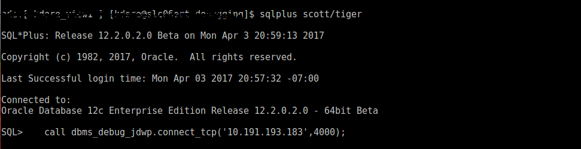
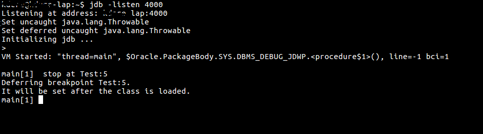

Oracle Database provides the Java Debug Wire Protocol (JDWP) interface for debugging Java stored procedures. JDWP is supported by Java Development Kit (JDK) 1.3 and later versions.

Following are a few features that the JDWP interface supports:

- Listening for connections

- Changing the values of variables while debugging

- Evaluating arbitrary Java expressions, including method evaluations

- Setting or clearing breakpoints on a line or in a method

- Stepping through the code

- Setting or clearing field access or modification watchpoints

**Note:**

Oracle JDeveloper provides a user-friendly integration with these debugging features. Other independent Integrated Development Environment (IDE) vendors can also integrate their own debuggers with Oracle Database.

This section discusses the following topics:

- Prerequisites for Debugging Java Stored Procedures

- Debugging Java Stored Procedures Using the jdb Debugger

- Debugging Java Stored Procedures Using JDeveloper

### 5.4.1 Prerequisites for Debugging Java Stored Procedures

Ensure that the following prerequisites are met before debugging a Java stored procedure:

- The Java code must be deployed to the database and can be optionally compiled with debug information.

- Your database user account must have the following privileges:

  - The `DEBUG CONNECT SESSION` privilege

  - The `DEBUG CONNECT ANY` privilege

  - The `DEBUG CONNECT ON USER <user>` privilege

  - The `DEBUG` object privilege on the stored procedure to be debugged

- You must add the `jdwp` privilege to the Access Control List (ACL) in the following way:

            SQL> begin
            2    DBMS_NETWORK_ACL_ADMIN.APPEND_HOST_ACE(
            3      host => <host_name>,
            4      ace  => xs$ace_type(privilege_list => xs$name_list('jdwp'),
            5                          principal_name => <user_name>,
            6                          principal_type => xs_acl.ptype_db));
            7  end;
            8  /

**See Also:**

[Oracle Database Security Guide](../dbseg/managing-fine-grained-access-in-pl-sql-packages-and-types.md) for more information about adding privileges to an Access Control List

### 5.4.2 Debugging Java Stored Procedures Using the jdb Debugger

A `jdb` session can be started with the `-listen <port>` command. If you start the session in this way, then `jdb` waits for a running Virtual Machine (VM) to connect at the specified port, using the standard connector.

**Note:**

While debugging a Java stored procedure, `jdb` cannot launch a JVM session and only waits for the VM to connect.

Perform the following steps to debug a Java program running in Oracle JVM:

1.  Run the following command in the debugging terminal:

        jdb -listen 4000

    The following image shows the debugging terminal starting the `jdb` session:

    
    [Description of the illustration start_jdb.png](img_text/start_jdb.md)

2.  Use an Oracle client such as SQL\*Plus to issue the command for connecting to the debugger. You can connect in the following two ways:

    - Issue the debugger connection command from the same session that executes your Java stored procedure. For example, if you are using SQL\*Plus, then issue the following command to open a TCP/IP connection to the designated machine and port for the JDWP session:

                EXEC DBMS_DEBUG_JDWP.CONNECT_TCP(<host_ip>, <port>)

      The following image shows the client terminal running the command for connecting to the debugging terminal:

      
      [Description of the illustration debug_1.png](img_text/debug_1.md)

      After the debugger accepts the connection, issue the breakpoint in the debugger session and invoke the Java stored procedure in the Oracle client. The debugger will now halt at the first breakpoint that you specified.

    - Issue the debugger connection command in another session and specify two additional parameters as shown in the following example:

                EXEC DBMS_DEBUG_JDWP.CONNECT_TCP(<host_ip>, <port>, <session_id>, <session_serial>)

      In the preceding command, `session_id` and `session_serial` identify the database session, where the Java stored procedure is executed, which the user wants to connect to the debugger. To connect another session to the debugger, the user must have either `DEBUG CONNECT` user privilege on the logon user of that session, or the `DEBUG CONNECT ANY` system privilege.

3.  Once connection is established successfully, you can add breakpoints in the debugging terminal using the following syntax:

        stop at <ClassName>:<LineNumber>

    The following image shows how to add breakpoints to the debugging terminal:

    
    [Description of the illustration addbreakpoint.png](img_text/addbreakpoint.md)

4.  In the Oracle client used in step 2, call the SQL wrapper for the Java program in the following way:

        call <SQLWrapperName>.<MethodName>

5.  Following are a few `jdb` commands that you can use to debug the code in the debugging terminal:

    - For Going one step at a time: `step`

    - To check the value of a variable value: `print<ClassName>:<VariableName>`

    - To continue: `cont`

    - To clear break points: `clear`

### 5.4.3 Debugging Java Stored Procedures Using JDeveloper

You can debug Java stored procedures and PL/SQL programs seamlessly using JDeveloper. When you debug PL/SQL programs and Java stored procedures locally, then the call to initiate debugging is made directly from JDeveloper. JDeveloper performs the following activities:

1.  It automatically launches the program that you want to debug (also called debuggee)
2.  It attaches the debugger to that program.

The main difference between remote debugging and local debugging PL/SQL programs and Java stored procedures is how you start the debugging session. For remote debugging, you must manually launch the program that you want to debug with an Oracle client such as SQL\*Plus, jobs created using the `DBMS_SCHEDULER` package, an OCI program, or a trigger firing. Then, you must establish the connection from the database program that you want to debug (debuggee) to the JDeveloper debugger. After the debuggee is launched and the JDeveloper debugger is attached to it, remote debugging is very similar to local debugging.

**Note:**

You can optionally turn off JIT for better debugging experience.

**See Also:**

For more information about using JDeveloper for debugging Java stored procedures, visit the following page

<http://docs.oracle.com/cd/E16162_01/user.1112/e17455/dev_stored_proc.htm#BEJEJIHD>
