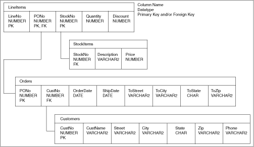

The objective of this example is to develop a simple system for managing customer purchase orders. To do this, you must devise a database schema plan. First, identify the business entities involved and their relationships. In this example, the basic entities are customers, purchase orders, line items, and stock items. So, you can have the following tables in the schema:

- `Customers`

- `Orders`

- `LineItems`

- `StockItems`

The `Customers` table has a one-to-many relationship with the `Orders` table because a customer can place one or many orders, but a given purchase order can be placed by only one customer. The relationship is optional because zero customers may place a given order. For example, an order may be placed by someone previously not defined as a customer.

The `Orders` table has a many-to-many relationship with the `StockItems` table because a purchase order can refer to many stock items, and a stock item can be referred to by many purchase orders. However, you do not know which purchase orders refer to which stock items. As a result, you introduce the notion of a line item. The `Orders` table has a one-to-many relationship with the `LineItems` table because a purchase order can list many line items, but a given line item can be listed by only one purchase order.

The `LineItems` table has a many-to-one relationship with the `StockItems` table because a line item can refer to only one stock item, but a given stock item can be referred to by many line items. The relationship is optional because zero line items may refer to a given stock item.

Figure 8-1 depicts the relationships between tables. In the schema plan, you establish these relationships using primary and foreign keys.

A primary key is a column or combination of columns whose values uniquely identify each row in a table. A foreign key is a column or combination of columns whose values match the primary key in some other table. For example, the `PONo` column in the `LineItems` table is a foreign key matching the primary key in the `Orders` table. Every purchase order number in the `LineItems.PONo` column must also appear in the `Orders.PONo` column.

Figure 8-1 Schema Plan for Purchase Order Application

[Description of "Figure 8-1 Schema Plan for Purchase Order Application"](img_text/schema_plan.md)
