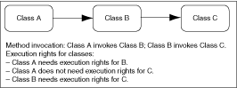
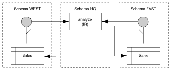
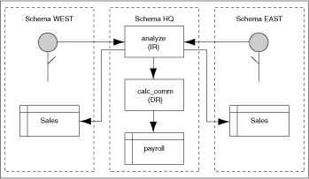

To ensure that your Java methods run, you must do the following:

1.  Decide when the Java source code is going to be compiled.
2.  Decide if you are going to use the default resolver or another resolver for locating supporting Java classes within the database.
3.  Load the classes into the database. If you do not wish to use the default resolver for your classes, then you should specify a separate resolver with the load command.
4.  Publish your class or method.

This sections covers the following topics:

- Compiling Java Classes

- Overview of Resolving Class Dependencies

- Overview of Loading Classes Using the loadjava Tool

- Overview of Granting Execute Rights

- Overview of Controlling the Current User

- Overview of Checking Java Uploads

- About Publishing Java Methods Loaded in the Database

- Overview of Auditing Java Classes Loaded in the Database

### 2.5.1 Compiling Java Classes

Compilation of the Java source code can be done in one of the following ways:

- You can compile the source explicitly on a client system before loading it into the database, through a Java compiler, such as `javac`.

- You can ask the database to compile the source during the loading process, which is managed by the `loadjava` tool.

- You can force the compilation to occur dynamically at run time.

**Note:**

If you decide to compile through the `loadjava` tool, then you can specify the compiler options.

This section includes the following topics:

- Compiling Source Through javac

- Compiling Source Through the loadjava Tool

- Compiling Source at Run Time

- Specifying Compiler Options

- Recompiling Source Programs Automatically

**Related Topics**

- Specifying Compiler Options

#### 2.5.1.1 Compiling Source Through javac

You can compile Java source code with a conventional Java compiler as shown in the following example:

    javac <file_name>.java

After compilation, you load the compiled binary into the database, rather than the source itself. This is a better option, because it is usually easier to debug the Java code on your own system, rather than debugging it on the database.

#### 2.5.1.2 Compiling Source Through the loadjava Tool

When you specify the `-resolve` option with the `loadjava` tool for a source file, the following occurs:

1.  The source file is loaded as a source schema object.
2.  The source file is compiled.
3.  Class schema objects are created for each class defined in the compiled `.java` file.
4.  The compiled code is stored in the class schema objects.

Oracle Database writes all compilation errors to the log file of the `loadjava` tool as well as the `USER_ERRORS` view.

#### 2.5.1.3 Compiling Source at Run Time

When you load the Java source into the database without the `-resolve` option, for example:

    loadjava <file_name>.java

Then, Oracle Database compiles the source automatically when the class is needed during run time. The source file is loaded into a source schema object. Oracle Database writes all compilation errors to the log file of the `loadjava` tool as well as the `USER_ERRORS` view.

#### 2.5.1.4 Specifying Compiler Options

You can specify the compiler options in the following ways:

- Specify compiler options on the command line with the `loadjava` tool. You can also specify the encoding option with the `loadjava` tool.

- Specify persistent compiler options in the `JAVA$OPTIONS` table. The `JAVA$OPTIONS` table exists for each schema. Every time you compile, the compiler uses these options. However, any compiler options specified with the `loadjava` tool override the options defined in this table. You must create this table yourself if you wish to specify compiler options in this manner.

##### 2.5.1.4.1 Specifying Default Compiler Options

When compiling a source schema object for which neither a `JAVA$OPTIONS` entry exists nor a command-line value for any option is specified, the compiler assumes a default value as follows:

- `encoding=System.getProperty("file.encoding");`

- `online=true`

  This option applies only to Java sources that contain SQLJ constructs.

- `debug=true`

  This option is equivalent to:

      javac -g

##### 2.5.1.4.2 Specifying Compiler Options on the Command Line

The `encoding` compiler option specified with the `loadjava` tool identifies the encoding of the `.java` file. This option overrides any matching value in the `JAVA$OPTIONS` table. The values are identical to:

    javac -encoding

This option is relevant only when loading a source file.

##### 2.5.1.4.3 Specifying Compiler Options Specified in a Database Table

Each `JAVA$OPTIONS` entry contains the names of source schema objects to which an option setting applies. You can use multiple rows to set the options differently for different source schema objects.

You can set `JAVA$OPTIONS` entries by using the following procedures and functions, which are defined in the database package `DBMS_JAVA`:

    PROCEDURE set_compiler_option(name VARCHAR2, option VARCHAR2, value VARCHAR2);

    FUNCTION get_compiler_option(name VARCHAR2, option VARCHAR2) RETURNS VARCHAR2;

    PROCEDURE reset_compiler_option(name VARCHAR2, option VARCHAR2);

##### 2.5.1.4.4 Details About Specifying Compiler Options Specified in the Database Table

The following table describes the parameters for the methods described in the preceding section.

Table 2-2 Definitions for the Name and Option Parameters

| Parameter | Description                                                                                                                                                                                                                                                                                                                                                                                            |
|:----------|:-------------------------------------------------------------------------------------------------------------------------------------------------------------------------------------------------------------------------------------------------------------------------------------------------------------------------------------------------------------------------------------------------------|
| name      | This is a Java package name, a fully qualified class name, or an empty string. When the compiler searches the `JAVA$OPTIONS` table for the options to use for compiling a Java source schema object, it uses the row that has a value for `name` that most closely matches the fully qualified class name of a schema object. A `name` whose value is the empty string matches any schema object name. |
| option    | The `option` parameter is either `online`, `encoding`, or `debug`.                                                                                                                                                                                                                                                                                                                                     |

Initially, a schema does not have a `JAVA$OPTIONS` table. To create a `JAVA$OPTIONS` table, use the `java.set_compiler_option` procedure from the `DBMS_JAVA` package to set a value. The procedure will create the table, if it does not exist. Specify parameters in single quotes. For example:

    SQL> execute dbms_java.set_compiler_option('x.y', 'online', 'false');

The following table represents a hypothetical `JAVA$OPTIONS` database table. The pattern match rule is to match as much of the schema name against the table entry as possible. The schema name with a higher resolution for the pattern match is the entry that applies. Because the table has no entry for the `encoding` option, the compiler uses the default or the value specified on the command line. The `online` option shown in the table matches schema object names as follows:

- The name `a.b.c.d` matches class and package names beginning with `a.b.c.d`. The packages and classes are compiled with `online=true`.

- The name `a.b` matches class and package names beginning with `a.b`. The name `a.b` does not match `a.b.c.d`. The packages and classes are compiled with `online=false`.

- All other packages and classes match the empty string entry and are compiled with `online=true`.

Table 2-3 Example JAVA\$OPTIONS Table

| Name         | Option   | Value   | Match Examples                                                                                                                                                                     |
|:-------------|:---------|:--------|:-----------------------------------------------------------------------------------------------------------------------------------------------------------------------------------|
| a.b.c.d      | `online` | `true`  | • `a.b.c.d` • Matches the pattern exactly. • `a.b.c.d.e` • First part matches the pattern exactly. No other rule matches the full qualified name.                         |
| a.b          | `online` | `false` | • `a.b` • Matches the pattern exactly • `a.b.c.x` • First part matches the pattern exactly. No other rule matches beyond this rule.                                       |
| Empty string | `online` | `true`  | • `a.c` • No pattern match with any defined name. Defaults to the empty string rule. • `x.y` • No pattern match with any defined name. Defaults to the empty string rule. |

#### 2.5.1.5 Recompiling Source Programs Automatically

Oracle Database provides a dependency management and automatic build facility that transparently recompiles source programs when you make changes to the source or binary programs upon which they depend. Consider the following example:

    public class A
    {
      B b;
      public void assignB()
      {
        b = new B()
      }
    }
    public class B
    {
      C c;
      public void assignC()
      {
        c = new C()
      }
    }
    public class C
    {
      A a;
      public void assignA()
      {
        a = new A()
      }
    }

The system tracks dependencies at a class level of granularity. In the preceding example, you can see that classes `A`, `B`, and `C` depend on one another, because `A` holds an instance of `B`, `B` holds an instance of `C`, and `C` holds an instance of `A`. If you change the definition of class `A` by adding a new field to it, then the dependency mechanism in Oracle Database flags classes `B` and `C` as invalid. Before you use any of these classes again, Oracle Database attempts to resolve them and recompile, if necessary. Note that classes can be recompiled only if the source file is present on the server.

The dependency system enables you to rely on Oracle Database to manage dependencies between classes, to recompile, and to resolve automatically. You must force compilation and resolution yourself only if you are developing and you want to find problems early. The `loadjava` tool also provides the facilities for forcing compilation and resolution if you do not want the dependency management facilities to perform this for you.

### 2.5.2 Overview of Resolving Class Dependencies

Many Java classes contain references to other classes, which is the essence of reusing code. A conventional JVM searches for `.class`, `.zip`, and `.jar` files within the directories specified in `CLASSPATH`. In contrast, Oracle JVM searches database schemas for class objects. In Oracle Database, because you load all Java classes into the database, you may need to specify where to find the dependent classes for your Java class within the database.

All classes loaded within the database are referred to as class schema objects and are loaded within certain schemas. All predefined Java application programming interfaces (APIs), such as `java.lang.*` , are loaded within the `PUBLIC` schema. If your classes depend on other classes you have defined, then you will probably load them all within your own schema. For example, if your schema is `HR`, then the database resolver searches the `HR` schema before searching the `PUBLIC` schema. The listing of schemas to search is known as a resolver specification. Resolver specifications are defined for each class. This is in contrast to a classic JVM, where `CLASSPATH` is global to all classes.

When locating and resolving the interclass dependencies for classes, the resolver marks each class as valid or invalid, depending on whether all interdependent classes are located. If the class that you load contains a reference to a class that is not found within the appropriate schemas, then the class is listed as invalid. Unsuccessful resolution at run time produces a `ClassNotFound` exception. Also, run-time resolution can fail for lack of database resources, if the tree of classes is very large.

**Note:**

As with the Java compiler, the `loadjava` tool resolves references to classes, but not to resources. Ensure that you correctly load the resource files that your classes require.

For each interclass reference in a class, the resolver searches the schemas specified by the resolver specification for a valid class schema object that satisfies the reference. If all references are resolved, then the resolver marks the class valid. A class that has never been resolved, or has been resolved unsuccessfully, is marked invalid. A class that depends on a schema object that becomes invalid is also marked invalid.

To make searching for dependent classes easier, Oracle Database provides a default resolver and resolver specification that searches the definer's schema first and then searches the `PUBLIC` schema. This covers most of the classes loaded within the database. However, if you are accessing classes within a schema other than your own or `PUBLIC`, you must define your own resolver specification.

Classes can be resolved in the following ways:

- Loading using the default resolver, which searches the definer's schema and `PUBLIC`:

      loadjava -resolve

- Loading using your own resolver specification definition:

      loadjava-resolve -resolver "((* HR)(* OTHER)(* PUBLIC))"

  In the preceding example, the resolver specification definition includes the `HR` schema, `OTHER` schema, and `PUBLIC`.

The `-resolver` option specifies the objects to search within the schemas defined. In the preceding example, all class schema objects are searched within `HR`, `OTHER`, and `PUBLIC`. However, if you want to search for only a certain class or group of classes within the schema, then you could narrow the scope for the search. For example, to search only for the `my/gui/*` classes within the `OTHER` schema, you would define the resolver specification as follows:

    loadjava -resolve -resolver '((* HR) ("my/gui/*" OTHER) (* PUBLIC))'

The first parameter within the resolver specification is for the class schema object, and the second parameter defines the schema within which to search for these class schema objects.

#### 2.5.2.1 Allowing References to Nonexistent Classes

You can specify a special option within a resolver specification that allows an unresolved reference to a nonexistent class. Sometimes, internal classes are never used within a product. In a standard Java environment, this is not a problem, because as long as the methods are not called, JVM ignores them. However, when resolving a class, Oracle JVM tries to resolve all names referenced by that class, including names that may never be used. If Oracle JVM cannot find a matching class for each such names referenced by that class, then the class being resolved is marked as invalid and cannot be run.

To ignore references, you can specify the wildcard, minus sign (`-`), within the resolver specification. The following example specifies that any references to classes within `my/gui` are to be allowed, even if it is not present within the resolver specification schema list.

    loadjava -resolve -resolver '((* HR) (* PUBLIC) ("my/gui/*" -))'

Without the wildcard, if a dependent class is not found within one of the schemas, your class is listed as invalid and cannot be run.

In addition, you can define that all classes not found are to be ignored. However, this is dangerous, because a class that has a dependent class will be marked as valid, even if the dependent class does not exist. However, the class can never run without the dependent class. In this case, you will receive an exception at run time.

To ignore all classes not found within `HR` or `PUBLIC`, specify the following resolver specification:

    loadjava -resolve -resolver "((* HR) (* PUBLIC) (* -))"

If you later intend to load the nonexistent classes that required you to use such a resolver, then you should not use a resolver containing the minus sign (-) wildcard. Instead, include all referenced classes in the schema before resolving.

Even when a minus sign (-) wildcard is used, the super class of a class can never be nonexistent. If the super class is not found, then the class will be invalid regardless of the use of a minus sign (-) wildcard in the resolver.

**Note:**

An alternative mechanism for dealing with nonexistent classes is using the `-gemissing` option of the `loadjava` tool. This option causes the `loadjava` tool to create and load definitions of classes that are referenced, but not defined.

#### 2.5.2.2 Bytecode Verifier

According to JVM specification, `.class` files are subject to verification before the class they define is available in a JVM. In Oracle JVM, the verification process occurs at class resolution.

The following table describes the problems the resolver may find and the appropriate Oracle error code issued.

Table 2-4 ORA Errors

| Error Code  | Description                                                                                                                                                                                                                                                                                                                                                                                                                                                                                                                     |
|:------------|:--------------------------------------------------------------------------------------------------------------------------------------------------------------------------------------------------------------------------------------------------------------------------------------------------------------------------------------------------------------------------------------------------------------------------------------------------------------------------------------------------------------------------------|
| `ORA-29545` | If the resolver determines that the class is malformed, then the resolver does not mark it valid. When the resolver rejects a class, it issues an `ORA-29545` error. The `loadjava` tool reports the error. For example, this error is thrown if the contents of a `.class` file are not the result of a Java compilation or if the file has been corrupted. The `ORA-29545` error may also show up if you used the minus sign (-) wild card expression with the resolver and the validity of some classes was not verified. |
| `ORA-29552` | In some situations, the resolver allows a class to be marked valid, but will replace bytecodes in the class to throw an exception at run time. In these cases, the resolver issues an `ORA-29552` warning that the `loadjava` tool reports. The `loadjava` tool issues this warning when the Java Language Specification (JLS) requires an `IncompatibleClassChangeError` to be thrown. Oracle JVM relies on the resolver to detect these situations, supporting the proper run-time behavior that the JLS requires.            |

A resolver with the minus sign (`-`) wildcard marks your class valid, regardless of whether classes referenced by your class are present. Because of inheritance and interfaces, you may want to write valid Java methods that use an instance of a class as if it were an instance of a superclass or of a specific interface. When the method being verified uses a reference to class `A` as if it were a reference to class `B`, the resolver must check that `A` either extends or implements `B`. For example, consider the following potentially valid method, whose signature implies a return of an instance of `B`, but whose body returns an instance of `A`:

    B myMethod(A a)
    {
      return a;
    }

The method is valid only if `A` extends the class `B` or `A` implements the interface `B`. If `A` or `B` have been resolved using the minus sign (-) wildcard, then the resolver does not know that this method is safe. In this case, the resolver replaces the bytecodes of `myMethod` with bytecodes that throw an exception if `myMethod` is called.

A resolver without the minus sign (`-)` wildcard ensures that the class definitions of `A` and `B` are found and resolved properly if they are present in the schemas they specifically identify. The only time you may consider using the alternative resolver is if you must load an existing JAR file containing classes that reference other nonsystem classes, which are not included in the JAR file.

**Related Topics**

- [Schema Objects and Oracle JVM Utilities](schema-objects-and-Oracle-JVM-utilities.md)

### 2.5.3 Logging in Oracle JVM

Oracle JVM extends the JDK Java Logging API in the area of logging properties lookup to enhance security of logging configuration management and to support logging configurations on a user basis.

**See Also:**

For more information about Java Logging APIs, visit the following site:

[`http://docs.oracle.com/javase/7/docs/`](http://docs.oracle.com/javase/7/docs/)

You must activate the `LogManager` in the session to initialize the logging properties in Oracle JVM. The logging properties are initialized once per session with the `LogManager` API that is extended with the database resident resource lookup.

Oracle JVM performs the following steps to configure logging options:

1.  If the `java.util.logging.config.class` property is set, then the logging behavior is the same as in standard JDK.
2.  If the `java.util.logging.config.class` property is not set, then Oracle JVM inspects the availability of the `javavm/lib/logging.properties` resource in the current user schema.
    If available, this resource is used as the configuration setting for the `LogManager` and the `java.util.logging.config.file` property is set.
3.  If both the above conditions do not hold true, then the `java.util.logging.config.file` property is inspected and if specified, it is used as described in `LogManager` API.
4.  If none of the conditions in step 1, 2, and 3 holds true, then the `javavm/lib/logging.properties` resource in the `SYS` schema is used. This resource is a copy of the `$(java.home)/lib/logging.properties` file that is loaded into the `SYS` schema at database creation time. This means, by default, the `LogManager` behaves as if it is configured as per the `$(java.home)/javavm/lib/logging.properties` file. However, altering this file has no effect until the database is re-created

If you are not satisfied with the default settings in the `javavm/lib/logging.properties` file, then prepare a different set of properties and load them in your schema using the `loadjava` command. For example, if your schema is `HR` and your current file directory is `mydir`, then create a directory `javavm/lib/` under `mydir` and specify the required properties in the `logging.properties` file under the `mydir/javavm/lib/` directory. Then, invoke the `loadjava` command from `mydir` as follows:

    mydir% loadjava -u HR -v -r javavm/lib/logging.properties
    password:<password>

After invoking the `loadjava` command, you can delete the `mydir/javavm/lib/logging.properties` file. Any session running as `HR` and performing activation of `LogManager` will have the `LogManager` configured with properties coming from this database resident resource private to `HR`.

**Note:**

Oracle JVM always runs with a security manager. So, `HR` must be granted logging permissions, regardless of the logging configuration method used. In most cases, the following call issued by a privileged user is sufficient to grant these permissions:

    call dbms_java.grant_permission( 'HR',  'SYS:java.util.logging.LoggingPermission', 'control', '' );

### 2.5.4 Overview of Loading Classes Using the loadjava Tool

You can use the `loadjava` tool to create schema objects from files and load the schema objects to different schemas. For example,

    loadjava -u HR -schema TEST MyClass.java
    Password: password

**Note:**

You do not have to load the classes to the database as schema objects if you use the command-line interface. For example,

    C:\oraclehome\bin>loadjava -u HR MyClass.java
    Password: password

You can also run the `loadjava` tool from within SQL commands. Unlike a conventional JVM, which compiles and loads from files, Oracle JVM compiles and loads from database schema objects.

The following t able describes database schema objects that correspond to the files used by a conventional JVM.

Table 2-5 Description of Java Files

| Java File Types                                                             | Description                                |
|:----------------------------------------------------------------------------|:-------------------------------------------|
| `.java` source files or `.sqlj` source files                                | correspond to Java source schema objects   |
| `.class` compiled Java files                                                | correspond to Java class schema objects    |
| `.properties` Java resource files, `.ser` SQLJ profile files, or data files | correspond to Java resource schema objects |

You must load all classes or resources into the database to be used by other classes within the database. In addition, at load time, you define who can run your classes within the database.

The following table describes the activities the `loadjava` tool performs for each type of file.

Table 2-6 loadjava Operations on Schema Objects

| Schema Object                     | loadjava Operations on Objects                                                                                                                                                                                                                                                                                                                                                                                                                                                              |
|:----------------------------------|:--------------------------------------------------------------------------------------------------------------------------------------------------------------------------------------------------------------------------------------------------------------------------------------------------------------------------------------------------------------------------------------------------------------------------------------------------------------------------------------------|
| `.java` source files              | 1. Creates a Java source schema object in the definer's schema unless another schema is specified. 2. Loads the contents of the source file into a schema object. 3. Creates a class schema object for all classes defined in the source file. 4. If `-resolve` is requested, compiles the source schema object and resolves the class and its dependencies. It then stores the compiled class into a class schema object.                                                         |
| `.sqlj` source files              | 1. Creates a source schema object in the definer's schema unless another schema is specified. 2. Loads contents of the source file into the schema object. 3. Creates a class schema object for all classes and resources defined in the source file. 4. If `-resolve` is requested, translates and compiles the source schema object and stores the compiled class into a class schema object. It then stores the profile into a `.ser` resource schema object and customizes it. |
| `.class` compiled Java files      | 1. Creates a class schema object in the definer's schema unless another schema is specified. 2. Loads the class file into the schema object. 3. Resolves and verifies the class and its dependencies if `-resolve` is specified.                                                                                                                                                                                                                                                      |
| `.properties` Java resource files | 1. Creates a resource schema object in the definer's schema unless another schema is specified. 2. Loads a resource file into a schema object.                                                                                                                                                                                                                                                                                                                                           |
| `.ser` SQLJ profile               | 1. Creates a resource schema object in the definer's schema unless another schema is specified. 2. Loads the `.ser` resource file into a schema object and customizes it.                                                                                                                                                                                                                                                                                                                |

**Note:**

The `dropjava` tool performs the reverse of the `loadjava` tool. It deletes schema objects that correspond to Java files. Always use the `dropjava` tool to delete a Java schema object created with the `loadjava` tool. For example,

    dropjava -u HR -schema TEST MyClass.java
    Password: password

Dropping with SQL data definition language (DDL) commands will not update the auxiliary data maintained by the `loadjava` tool and the `dropjava` tool. You can also run the `dropjava` tool from within SQL commands.

After loading the classes and resources, you can access the `USER_OBJECTS` view in your database schema to verify whether your classes and resources have been loaded properly.

**Related Topics**

- [Schema Objects and Oracle JVM Utilities](schema-objects-and-Oracle-JVM-utilities.md)
- [About Using the Command-Line Interface](invoking-Java-methods.md)

#### 2.5.4.1 About Sharing of Metadata for User Classloaded Classes

Classes loaded by the built-in mechanism for loading database resident classes are known as system classloaded, whereas those loaded by other means are called user classloaded. When you load a class into the database, a representation of the class is created in memory, part of which is referred to here as the class metadata. The class metadata is the same for any session using the class and is potentially sharable. Earlier, such sharing was available only for system classloaded classes. Since Oracle Database 11g, you can also share class metadata of user classloaded classes, at the discretion of the system administrator.

**Related Topics**

- [Classpath Extensions and User Classloaded Metadata](classpath-extensions-user-classes-metadata.md)

#### 2.5.4.2 Defining the Same Class Twice

You cannot have two class objects with the same name in the same schema. This rule affects you in two ways:

**Note:**

An exception to this rule is when you use the `-prependjarnames` option for database resident JARs. If you use this option, then you can have two classes with the same class name in the same schema.

- You can load either a particular Java `.class` file or its `.java` file, but not both.

  Oracle Database tracks whether you loaded a class file or a source file. If you want to update the class, then you must load the same type of file that you originally loaded. If you want to update the other type, then you must drop the first before loading the second. For example, if you loaded `x.java` as the source for class `y`, then to load `x.class`, you must first drop `x.java`.

- You cannot define the same class within two different schema objects in the same schema. For example, suppose `x.java` defines class `y` and you want to move the definition of `y` to `z.java`. If `x.java` has already been loaded, then the `loadjava` tool rejects any attempt to load `z.java`, which also defines `y`. Instead, do either of the following:

  - Drop `x.java`, load `z.java`, which defines `y`, and then load the new `x.java`, which does not define `y`.

  - Load the new `x.java`, which does not define `y`, and then load `z.java`, which defines `y`.

**Related Topics**

- Database Resident JARs

#### 2.5.4.3 About Designating Database Privileges and JVM Permissions

You must have the following SQL database privileges to load classes:

- `CREATE PROCEDURE` and `CREATE TABLE` privileges to load into your schema.

- `CREATE ANY PROCEDURE` and `CREATE ANY TABLE` privileges to load into another schema.

- `oracle.aurora.security.JServerPermission.loadLibraryInClass.` `classname`.

**Related Topics**

- [Permission for Loading Classes](database-contents-Oracle-JVM-security.md)

#### 2.5.4.4 About Loading JAR or ZIP Files

The `loadjava` tool accepts `.class`, `.java`, `.properties`, `.sqlj`, `.ser`, `.jar`, or `.zip` files. The JAR or ZIP files can contain source, class, and data files. When you pass a JAR or ZIP file to the `loadjava` tool, it opens the archive and loads the members of the archive individually. There is no JAR or ZIP schema object. If the JAR or ZIP content has not changed since the last time it was loaded, then it is not reloaded. Therefore, there is little performance penalty for loading JAR or ZIP files. In fact, loading JAR or ZIP files is the simplest way to use the `loadjava` tool.

**Note:**

Oracle Database does not reload a class if it has not changed since the last load. However, you can force a class to be reloaded using the `-force` option.

#### 2.5.4.5 Database Resident JARs

Starting with 11g release 1 (11.1), when you load the contents of a JAR into the database, you have the option of creating a database object representing the JAR itself. In this way, you can retain an association between this JAR object and the class, resource, and source objects loaded from the JAR. This enables you to:

- Use signed JARs and JAR namespace segregation in the same way as you use them in standard JVM.

- Manage the classes that you have derived from a JAR while loading it into the database as a single unit. This helps you to prevent individual redefinition of the classes loaded from the JAR. It also enables you to drop the whole set of classes loaded from the JAR, irrespective of the contents or the continued existence of the JAR on the external file system, at the time of dropping it.

In order to load a JAR into the database, you have the following options of the `loadjava` tool:

- `-jarsasdbobjects`

- `-prependjarnames`

**Related Topics**

- [The loadjava Tool](loadjava-tool.md)

### 2.5.5 Overview of Granting Execute Rights

If you load all classes within your own schema and do not reference any class outside your schema, then you already have rights to run the classes. You have the privileges necessary for your objects to call other objects loaded in the same schema. That is, the ability for class `A` to call class `B`. Class `A` must be given the right to call class `B`.

The classes that define a Java application are stored within Oracle Database under the SQL schema of their owner. By default, classes that reside in one user's schema cannot be run by other users, because of security concerns. You can provide other users the right to run your class in the following ways:

- Using the `loadjava -grant` option

- Using the following command:

      SQL> grant execute on myclass to HR;

  where, `myclass` is the name of the underlying Java class.

**Note:**

Prior to Oracle Database 11g release 1 (11.1), granting execute right to a stored procedure meant granting execute right to both the stored procedure and the Java class referred by the stored procedure. Since Oracle Database 11g release, if you want to grant execute right on the underlying Java class as well, then you must grant execute right on the class explicitly. This is implemented for better security.

The following figure illustrates the rights required to run classes.

Figure 2-3 Rights to Run Classes

[Description of "Figure 2-3 Rights to Run Classes"](img_text/exeright.md)

**Related Topics**

- [The loadjava Tool](loadjava-tool.md)
- [Oracle Database Java Application Performance](Java-application-performance.md)

### 2.5.6 Overview of Controlling the Current User

During the execution of PL/SQL code, there is always a current user. The same concept is used for the execution of Java code. Initially, the current user is the user, who creates the session that invokes the Java code. A Java method is called from SQL or PL/SQL through a corresponding wrapper. Java wrappers are special PL/SQL entities, which expose Java methods to SQL and PL/SQL as PL/SQL stored procedures or functions. Such a wrapper might change the current effective user. The wrappers that change the current effective user to the owner of the wrapper are called definer's rights wrappers. If a wrapper does not change the current effective user, then the effective user remains unchanged.

By default, Java wrappers are definer's rights wrappers. If you want to override this, then create the wrapper using the `AUTHID CURRENT_USER` option.

At any time during the execution of Java code, a Java call stack is maintained. The stack contains frames corresponding to Java methods entered, with the innermost frame corresponding to the currently executing method. By default, Java methods execute on the stack without changing the current user, that is, with the privileges of their current effective invoker, not their definer.

You can load a Java class to the database with the `loadjava -definer` option. Any method of a class having the definer attribute marked, becomes a definer's rights method. When such a method is entered, a special kind of frame called a definer's frame is created onto the Java stack. This frame switches the current effective user to the owner (definer) of such a class. A new user ID remains effective for all inner frames until either the definer's frame is popped off the stack or a nested definer's frame is entered.

Thus, at any given time during the execution of a Java method that is called from SQL or PL/SQL through its wrapper, the effective user is one of the following:

- The innermost definer's frame on the Java stack

- Either the owner of the PL/SQL wrapper of the topmost Java method, if it is definer's rights, or the user who called the wrapper.

Consider a company that uses a definer's rights procedure to analyze sales. To provide local sales statistics, the procedure `analyze` must access `sales` tables that reside at each regional site. To do this, the procedure must also reside at each regional site. This causes a maintenance problem. To solve the problem, the company installs an invoker's rights version of the procedure `analyze` at headquarters.

The following figure shows how all regional sites can use the same procedure to query their own `sales` tables.

Figure 2-4 Invoker's rights Solution

[Description of "Figure 2-4 Invoker's rights Solution"](img_text/invoker_rights_solution.md)

Occasionally, you may want to override the default invoker's rights behavior. Suppose headquarters wants the `analyze` procedure to calculate sales commissions and update a central `payroll` table. This presents a problem, because invokers of `analyze` should not have direct access to the `payroll` table, which stores employee salaries and other sensitive data.

The following figure illustrates the solution, where the `analyze` procedure call the definer's rights procedure, `calcComm`, which in turn updates the `payroll` table.

Figure 2-5 Indirect Access

[Description of "Figure 2-5 Indirect Access"](img_text/controlled_access.md)

**Related Topics**

- [Writing Top-Level Call Specifications](writing-top-level-call-specifications.md)

### 2.5.7 Overview of Checking Java Uploads

You can query the `USER_OBJECTS` database view to obtain information about schema objects that you own, including Java sources, classes, and resources. This enables you, for example, to verify whether sources, classes, or resources that you load are properly stored in schema objects.

The following table lists the key columns in `USER_OBJECTS` and their description.

Table 2-7 Key USER_OBJECT Columns

| Name          | Description                                                                                                    |
|:--------------|:---------------------------------------------------------------------------------------------------------------|
| `OBJECT_NAME` | Name of the object                                                                                             |
| `OBJECT_TYPE` | Type of the object, such as `JAVA SOURCE`, `JAVA CLASS`, or `JAVA RESOURCE`.                                   |
| `STATUS`      | Status of the object. The values can be either `VALID` or `INVALID`. It is always `VALID` for `JAVA RESOURCE`. |

#### Object Name and Type

An `OBJECT_NAME` in `USER_OBJECTS` is the alias. The fully qualified name is stored as an alias if it exceeds 30 characters.

If the server uses an alias for a schema object, then you can use the `LONGNAME()` function of the `DBMS_JAVA` package to receive it from a query as a fully qualified name, without having to know the alias or the conversion rules.

    SQL> SELECT dbms_java.longname(object_name) FROM user_objects WHERE object_type='JAVA SOURCE';

This statement displays the fully qualified name of the Java source schema objects. Where no alias is used, no conversion occurs.

**Note:**

SQL and PL/SQL are not case-sensitive.

You can use the `SHORTNAME()` function of the `DBMS_JAVA` package to use a fully qualified name as a query criterion, without having to know whether it was converted to an alias in the database.

    SQL*Plus> SELECT object_type FROM user_objects WHERE object_name=dbms_java.shortname('known_fullname');

This statement displays the `OBJECT_TYPE` of the schema object with the specified fully qualified name. This presumes that the fully qualified name is representable in the database character set.

    SQL> select * from javasnm;
    SHORT LONGNAME
    ----------------------------------------------------------------------
    /78e6d350_BinaryExceptionHandl sun/tools/java/BinaryExceptionHandler
    /b6c774bb_ClassDeclaration sun/tools/java/ClassDeclaration
    /af5a8ef3_JarVerifierStream1 sun/tools/jar/JarVerifierStream$1

This statement displays all the data stored in the `javasnm` view.

#### Status

`STATUS` is a character string that indicates the validity of a Java schema object. A Java source schema object is `VALID` if it compiled successfully, and a Java class schema object is `VALID` if it was resolved successfully. A Java resource schema object is always `VALID`, because resources are not resolved.

#### Example: Accessing USER_OBJECTS

The following SQL\*Plus script accesses the `USER_OBJECTS` view to display information about uploaded Java sources, classes, and resources:

    COL object_name format a30
    COL object_type format a15
    SELECT object_name, object_type, status
           FROM user_objects
           WHERE object_type IN ('JAVA SOURCE', 'JAVA CLASS', 'JAVA RESOURCE')
           ORDER BY object_type, object_name;

You can optionally use wildcards in querying `USER_OBJECTS`, as in the following example:

    SELECT object_name, object_type, status
           FROM user_objects
           WHERE object_name LIKE '%Alerter';

The preceding statement finds any `OBJECT_NAME` entries that end with the characters `Alerter`.

**Related Topics**

- [Shortened Class Names](shortened-class-names.md)

### 2.5.8 About Publishing Java Methods Loaded in the Database

Oracle Database enables clients and SQL to call Java methods that are loaded in the database after they are published. You publish either the object itself or individual methods. If you write a Java stored procedure that you intend to call with a trigger, directly or indirectly in SQL data manipulation language (DML) or in PL/SQL, then you must publish individual methods in the class. Using a call specification, specify how to access the method. Java programs consist of many methods in many classes. However, only a few `static` methods are typically exposed with call specifications.

**Related Topics**

- [Publishing Java Classes With Call Specifications](publishing-Java-classes.md)

### 2.5.9 Overview of Auditing Java Classes Loaded in the Database

In releases prior to Oracle Database 10g release 2 (10.2), Java classes in the database cannot be audited directly. However, you can audit the PL/SQL wrapper. Typically, all Java stored procedures are started from some wrappers. Therefore, all Java stored procedures can be audited, though not directly.

Since Oracle Database 10g release 2 (10.2), you can audit DDL statements for creating, altering, or dropping Java source, class, and resource schema objects, as with any other DDL statement. Oracle Database provides auditing options for auditing Java activities easily and directly. You can also audit any modification of Java sources, classes, and resources.

You can audit database activities related to Java schema objects at two different levels, statement level and object level. At the statement level you can audit all activities related to a special pattern of statements.

Table 2-8 lists the statement auditing options and the corresponding SQL statements related to Java schema objects.

Table 2-8 Statement Auditing Options Related to Java Schema Objects

| Statement Option       | SQL Statements                                              |
|:-----------------------|:------------------------------------------------------------|
| `CREATE JAVA SOURCE`   | `CREATE JAVA SOURCE` `CREATE OR REPLACE JAVA SOURCE`     |
| `ALTER JAVA SOURCE`    | `ALTER JAVA SOURCE`                                         |
| `DROP JAVA SOURCE`     | `DROP JAVA SOURCE`                                          |
| `CREATE JAVA CLASS`    | `CREATE JAVA CLASS` `CREATE OR REPLACE JAVA CLASS`       |
| `ALTER JAVA CLASS`     | `ALTER JAVA CLASS`                                          |
| `DROP JAVA CLASS`      | `DROP JAVA CLASS`                                           |
| `CREATE JAVA RESOURCE` | `CREATE JAVA RESOURCE` `CREATE OR REPLACE JAVA RESOURCE` |
| `ALTER JAVA RESOURCE`  | `ALTER JAVA RESOURCE`                                       |
| `DROP JAVA RESOURCE`   | `DROP JAVA RESOURCE`                                        |

For example, if you want to audit the `ALTER JAVA SOURCE` DDL statement, then enter the following statement at the SQL prompt:

    AUDIT ALTER JAVA SOURCE

Object level auditing provides finer granularity. It enables you to identify specific problems by zooming into specific objects.

Table 2-9 lists the object auditing options for each Java schema object. The entry X in a cell indicates that the corresponding SQL command can be audited for that Java schema object. The entry NA indicates that the corresponding SQL command is not applicable for that Java schema object.

Table 2-9 Object Auditing Options Related to Java Schema Options

| Object Option | Java Source | Java Resource | Java Class |
|:--------------|:------------|:--------------|:-----------|
| `ALTER`       | X           | NA            | X          |
| `EXECUTE`     | NA          | NA            | X          |
| `AUDIT`       | X           | X             | X          |
| `GRANT`       | X           | X             | X          |

**See Also:**

- [Oracle Database Security Guide](../dbseg/part_6.md)

- [Oracle Database SQL Language Reference](../sqlrf/AUDIT-Traditional-Auditing.md)
