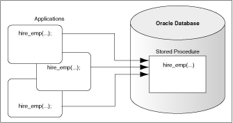

Stored procedures are Java methods published to SQL and stored in the database for general use. To publish Java methods, you write call specifications, which map Java method names, parameter types, and return types to their SQL counterparts.

Unlike a wrapper, which adds another layer of execution, a call specification publishes the existence of a Java method. As a result, when you call the method through its call specification, the run-time system dispatches the call with minimal overhead.

When called by client applications, a stored procedure can accept arguments, reference Java classes, and return Java result values.

Figure 5-1 shows a stored procedure being called by various applications.

Figure 5-1 Calling a Stored Procedure

[Description of "Figure 5-1 Calling a Stored Procedure"](img_text/call_stored_proc.md)

Except for graphical user interface (GUI) methods, Oracle JVM can run any Java method as a stored procedure. The run-time contexts are:

- Functions and Procedures

- Database Triggers

- Object-Relational Methods

### 5.1.1 Functions and Procedures

Functions and procedures are named blocks that encapsulate a sequence of statements. They are building blocks that you can use to construct modular, maintainable applications.

Generally, you use a procedure to perform an action and a function to compute a value. Therefore, you use procedure call specifications for `void` Java methods and function call specifications for value-returning methods.

Only top-level and package-level PL/SQL functions and procedures can be used as call specifications. When you define them using the SQL `CREATE FUNCTION`, `CREATE PROCEDURE`, or `CREATE PACKAGE` statement, they are stored in the database, where they are available for general use.

Java methods published as functions and procedures must be invoked explicitly. They can accept arguments and are callable from:

- SQL data manipulation language (DML) statements

- SQL `CALL` statements

- PL/SQL blocks, subprograms, and packages

### 5.1.2 Database Triggers

A database trigger is a stored procedure that is associated with a specific table or view. Oracle Database calls the trigger automatically whenever a given DML operation modifies the table or view.

A trigger has the following parts:

- A triggering event, which is generally a DML operation

- An optional trigger constraint

- A trigger action

When the event occurs, the trigger is called. A `CALL` statement in the trigger calls a Java method through the call specification of the method, to perform the action.

Database triggers are used to enforce complex business rules, derive column values automatically, prevent invalid transactions, log events transparently, audit transactions, and gather statistics.

### 5.1.3 Object-Relational Methods

A SQL object type is a user-defined composite data type that encapsulates a set of variables, called attributes, with a set of operations, called methods, which can be written in Java. The data structure formed by the set of attributes is `public`. However, as a good programming practice, you must ensure that your application does not manipulate these attributes directly and uses the set of methods provided.

You can create an abstract template for some real-world object as a SQL object type. The template specifies only those attributes and methods that the object will need in the application environment. At run time, when you fill the data structure with values, you create an instance of the object type. You can create as many instances as required.

Typically, an object type corresponds to some business entity, such as a purchase order. To accommodate a variable number of items, object types can use a `VARRAY`, a nested table, or both.

For example, the purchase order object type can contain a variable number of line items.
