This section contain the following topics:

- Overview of JMX

- Enabling and Starting JMX in a Session

- Setting Oracle JVM JMX Defaults and Configurability

- Examples of SQL calls to dbms_java.start_jmx_agent

- Using JConsole to Monitor and Control Oracle JVM

- Important Security Notes

- Shared Server Limitations for JMX

### 2.11.1 Overview of JMX

JMX (Java Management Extensions) is a Java technology that supplies tools for managing and monitoring applications, system objects, devices, service-oriented networks, and JVM (Java Virtual Machine). This API allows its classes to be dynamically constructed and changed. So, you can use this technology to monitor and manage resources as they are created, installed, and implemented. The JMX API also includes remote access, so a remote management program can interact with a running application for these purposes.

In JMX, a given resource is instrumented by one or more Java objects known as MBeans (Managed Beans). These MBeans are registered in a core managed object server, known as an MBean server, that acts as a management agent and can run on most devices enabled for the Java programming language. A JMX agent consists of an MBean server, in which MBeans are registered, and a set of services for handling MBeans.

**See Also:**

- [`http://www.oracle.com/technetwork/java/javase/tech/javamanagement-140525.html`](http://www.oracle.com/technetwork/java/javase/tech/javamanagement-140525.html)

- [`http://docs.oracle.com/javase/7/docs/technotes/guides/security/jsse/JSSERefGuide.html`](http://docs.oracle.com/javase/7/docs/technotes/guides/security/jsse/JSSERefGuide.html)

### 2.11.2 Enabling and Starting JMX in a Session

To help in enabling and running JMX services in sessions running Java, the `JMXSERVER` role and the `dbms_java.start_jmx_agent` procedure are provided. The `JMXSERVER` role is granted specific Java permissions that enable you to start and run MBeanServer and JMX agent in a session. The procedure `dbms_java.start_jmx_agent` starts the agent in a specific session that generally remains active for the duration of the session. Perform the following to enable and start JMX:

1.  Obtain `JMXSERVER` from `SYS `or `SYSTEM`:
        SQL> grant jmxserver to HR;

    where, `HR` is the user name.
2.  Invoke the procedure `dbms_java.start_jmx_agent` to startup JMX in the session. The `dbms_java.start_jmx_agent` procedure can be invoked with the following arguments:
    `port`: the port for the JMX listener. The value of this parameter sets the Java property `com.sun.management.jmxremote.port`.

    `ssl`: sets the value for the Java property `com.sun.management.jmxremote.ssl`. Case for `true` and `false` values is ignored.

    `auth`: the value for the property `com.sun.management.jmxremote.authenticate`, otherwise a semicolon-separated list of Java Authentication and Authorization Service (JAAS) credentials. The value is not case-sensitive.

    Each of these arguments can be `null` or omitted, with `null` as the default value. when an argument is `null`, it does not alter the previously present value of the corresponding property in the session.

    **Note:**

    The Java properties corresponding to the parameters of `dbms_java.start_jmx_agent` are from the set of Java properties specified in standard Java 5.0 JMX documentation. For the full list of Java JMX properties please refer to

    [`http://www.oracle.com/technetwork/java/javase/tech/javamanagement-140525.html`](http://www.oracle.com/technetwork/java/javase/tech/javamanagement-140525.html)

    The `dbms_java.start_jmx_agent` procedure starts an agent activating OJVM JMX server and a listener. The JMX server runs as one or more daemon threads in the current session and in general is available for the duration of the session. Once JMX Agent is started in a session, Java code running in the session can be monitored.

    The `dbms_java.start_jmx_agent` procedure is a PL/SQL wrapper for the Java method `oracle.aurora.rdbms.JMXAgent.startOJVMAgent`, which by itself can also be called programmatically from Java stored procedures. The `startOJVMAgent` method starts the JMX Server and the JMX connectivity daemon threads, and then exits. On dedicated servers, these threads may remain active for the duration of the session, but go into an inert state for the time intervals between calls. When these intervals are short, then the same socket connections resume transparently. This enables clients such as JConsole to remain connected across multiple calls.

    A different mode of JMX monitoring is possible with the `EXIT_CALL_WHEN_ALL_THREADS_TERMINATE` policy. By setting the call exit policy to `OracleRuntime.EXIT_CALL_WHEN_ALL_THREADS_TERMINATE`, you can configure the session to run JMX server continuously in a call that invokes the `startOJVMAgent` method till the Java call is exited programmatically. This mode is convenient when various Java tasks are fired up from a JMX client as operations of specific MBeans. This way, continuous JMX management and monitoring is driven by these operations. Please refer to the JVM JMX demo for such a bean, for example, `jmxserv.Load`.

**Related Topics**

- Shared Server Limitations for JMX

### 2.11.3 Setting Oracle JVM JMX Defaults and Configurability

When `dbms_java.start_jmx_agent` is activated, the property `com.sun.management.jmxremote` is set to `true`. Before invoking `start_jmx_agent`, a JMXSERVER-privileged user can preset various management properties in the following ways:

- Using the PL/SQL function `dbms_java.set_property`

- Invoking method `java.lang.System.setProperty`

The `JMXSERVER` role user can also preset the properties in database resident Java resource specified by Java property `com.sun.management.config.file`. The default name for this resource, tried when `com.sun.management.config.file` is not set, is `lib.management.management.properties`. This resource mechanism is Oracle JVM extension of standard file-based JMX configuration management. This mechanism is superior for Oracle JVM as it provides more security and per-schema management. When the resource does not exist in schema, a file-read is attempted as a fall-back. The default file path, tried when `com.sun.management.config.file` is not set, is `$(java.home)/lib/management/management.properties`. In Oracle Database 19c, this file contains the following presets:

    com.sun.management.jmxremote.ssl.need.client.auth = true
    com.sun.management.jmxremote.authenticate = false

The property `com.sun.management.jmxremote.ssl.need.client.auth` in conjunction with `com.sun.management.jmxremote.ssl`, sets JMX for two-way encrypted SSL authentication with client and server certificates. The default value of `com.sun.management.jmxremote.ssl` is `true`. This configuration is the default and is preferred over JAAS password authentication.

**Note:**

For more information visit the following:

- [`http://www.oracle.com/technetwork/java/javase/tech/javamanagement-140525.html`](http://www.oracle.com/technetwork/java/javase/tech/javamanagement-140525.html)

- [`http://docs.oracle.com/javase/7/docs/technotes/guides/security/jsse/JSSERefGuide.html`](http://docs.oracle.com/javase/7/docs/technotes/guides/security/jsse/JSSERefGuide.html)

**Note:**

The default JMX Login Module providing file-based store for passwords is not supported in Oracle JVM for security reasons. So, if JAAS password authentication must be used instead of SSL client authentication, then pass transient JAAS credentials securely as the `auth` parameter to `dbms_java.start_jmx_agent` as illustrated in this section, or configure JMX to use a secure custom LDAP login module.

### 2.11.4 Examples of SQL calls to dbms_java.start_jmx_agent

Following are some examples of starting the JMX server:

- Starts the JMX server and the listener using the default settings as described in the preceding sections or the values set earlier in the same session:

      call dbms_java.start_jmx_agent();

- Starts the JMX server and the listener using the default settings as described in the preceding sections or the values set earlier in the same session:

      call dbms_java.start_jmx_agent(null, null, null);

- Starts the JMX server and the listener on port 9999 with the other JMX settings having the default values or the values set earlier in the same session:

      call dbms_java.start_jmx_agent('9999');

- Starts the JMX server and the listener on port 9999 with the other JMX settings having the default values or the values set earlier in the same session:

      call dbms_java.start_jmx_agent('9999', null, null);

- Starts the JMX server and the listener with the JMX settings having the default values or the values set earlier in the same session and with JAAS credentials `monitorRole/1z2x` and `controlRole/2p3o`:

      call dbms_java.start_jmx_agent(null, null, 'monitorRole/1z2x;controlRole/2p3o');

  These credentials are transient. The property `com.sun.management.jmxremote.authenticate` is set to `true`.

- Starts JMX listener on port 9999 with no SSL and no JAAS authentication. Used only for development or demonstration.

      call dbms_java.start_jmx_agent('9999', 'false', 'false');

**Related Topics**

- Important Security Notes

### 2.11.5 Using JConsole to Monitor and Control Oracle JVM

This section describes how to use JConsole, a standard JMX client tool, for monitoring and controlling Oracle JVM. JConsole is a part of standard Java JDK.

This section discusses the following topics:

- Using the jconsole Command

- About Using the JConsole interface

- The OracleRuntime MBean

- Memory Thresholds

**Note:**

To monitor Java in the database with JConsole, you should have a server-side Java session running JMX Agent.

**Related Topics**

- Enabling and Starting JMX in a Session

#### 2.11.5.1 Using the jconsole Command

Use the `jconsole` command syntax to start JConsole. The simplest format to start the JConsole tool is the following:

    jconsole [hostName:portNum]

where:

- `hostname` is the name of the system running the application

- `portNum` is the port number of the JMX listener

In the following examples, we connect to a host with name `example.com` through default port 9999. This mode assumes no authentication and encryption. This mode is adequate only for demo or testing, and can be used to connect to Oracle JVM JMX sessions that are started with the following command:

    call dbms_java.start_jmx_agent(portNum, false, false);

Remember that you can connect to and interact with Oracle JVM from JConsole, only when the daemon threads of the server are running and are not dormant. This means that there should be an active Java call in the session, which is running the JMX server on the specified port. During the time interval between subsequent Java calls, JMX server preserves its state and statistics, but is unable to communicate with JConsole.

**Related Topics**

- Important Security Notes

#### 2.11.5.2 About Using the JConsole interface

The JConsole interface consists of the following tabs:

- Summary tab

  It displays summary information on Oracle JVM and the values monitored by JMX.

- Memory tab

  It displays information on memory usage.

- Threads tab

  It displays information on thread usage.

- Classes tab

  It displays information on class loading.

- MBeans tab

  It displays information on MBeans.

- VM tab

  It displays information on Oracle JVM.

**Note:**

In Oracle Database 12c Release 1 (12.1), the data collected and passed to JConsole is limited to the Oracle JVM session that runs the JMX agent. This data does not include the attributes of other sessions that may be running in Oracle JVM. One exception is the `OracleRuntime` MBean that provides information about many WholeJVM\_ Attributes and operations of Oracle JVM.

**Related Topics**

- The OracleRuntime MBean

#### 2.11.5.3 About Viewing Oracle JVM Summary Information

You can use the Summary tab of the JConsole interface to view Oracle JVM Summary Information. This tab displays key monitoring information on thread usage, memory consumption, class loading, and other VM and operating system specifics.

If JConsole successfully connects to an Oracle JVM session running a JMX Agent, then the Overview Tab looks the following image:

Figure 2-6 The Overview Tab of the JConsole Interface

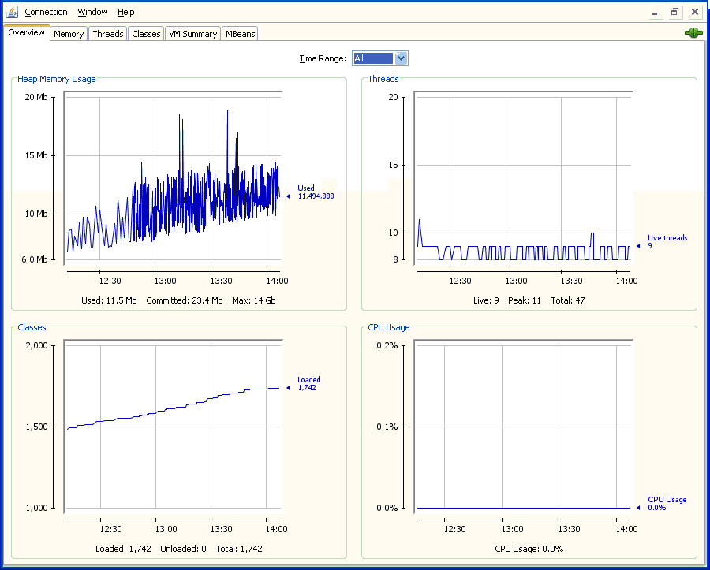
[Description of "Figure 2-6 The Overview Tab of the JConsole Interface"](img_text/summary_tab.md)

Table 2-10 provides description of the fields present in the Overview tab.

Table 2-10 Description of the Overview Tab Fields in JConsole Interface

| Field                            | Description                                                                                                                                        |
|:---------------------------------|:---------------------------------------------------------------------------------------------------------------------------------------------------|
| Uptime                           | The duration for which the Oracle JVM session has been running.                                                                                    |
| Process CPU time                 | This information is not gathered for Oracle JVM sessions in Oracle Database 12c Release 1 (12.1).                                                  |
| Live threads                     | The current number of live daemon and non-daemon threads.                                                                                          |
| Peak                             | Highest number of live threads since Oracle JVM started.                                                                                           |
| Daemon threads                   | Current number of live daemon threads.                                                                                                             |
| Total started                    | Total number of threads started since Oracle JVM started. It includes daemon, non-daemon, and terminated threads.                                  |
| Current heap size                | Number of kilobytes currently occupied by the heap.                                                                                                |
| Committed memory                 | Total amount of memory allocated for use by the heap.                                                                                              |
| Maximum heap size                | Maximum number of kilobytes occupied by the heap.                                                                                                  |
| Objects pending for finalization | Number of objects pending for finalization.                                                                                                        |
| Garbage collector information    | Information about the garbage collector, which includes name, number of collections performed, and total time spent performing garbage collection. |
| Current classes loaded           | Number of classes currently loaded into memory for execution.                                                                                      |
| Total classes loaded             | Total number of classes loaded into session memory since the session started.                                                                      |
| Total classes unloaded           | Number of classes unloaded from memory. Typically this is zero for Oracle Database 12c Release 1 (12.1).                                           |
| Total physical memory            | This information is not gathered for Oracle JVM sessions in Oracle Database 12c Release 1 (12.1). So, the value displayed is zero.                 |
| Free physical memory             | This information is not gathered for Oracle JVM sessions in Oracle Database 12c Release 1 (12.1). So, the value displayed is zero.                 |
| Committed virtual memory         | This information is not gathered for Oracle JVM sessions in Oracle Database 12c Release 1 (12.1). So, the value displayed is zero.                 |

#### 2.11.5.4 About Monitoring Memory Consumption

You can use the Memory tab of the JConsole interface to monitor memory consumption. This tab provides information on memory consumption and memory pools. Figure 2–7 shows the Memory tab.

Figure 2-7 The Memory Tab of the JConsole Interface

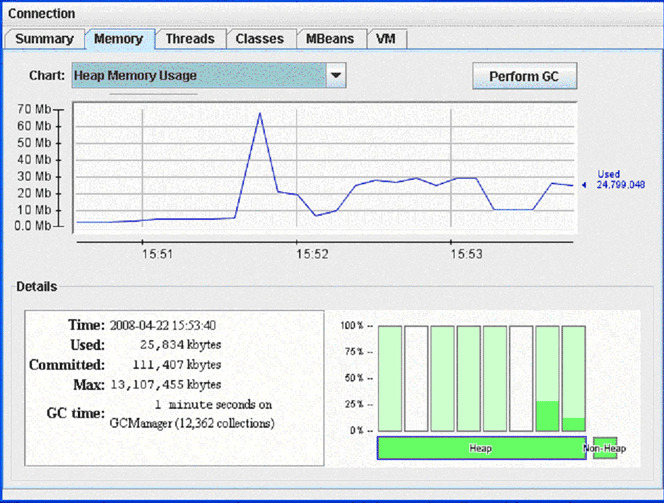
[Description of "Figure 2-7 The Memory Tab of the JConsole Interface"](img_text/memory_tab.md)

The chart on the Memory tab shows Oracle JVM memory usages versus time, for the whole memory space and also for specific memory pools. The memory pools available for Oracle JVM reflect the internal organization of Oracle JVM and correspond to object memories of Oracle JVM Memory Manager. The available memory pools in this release of Oracle Database are:

- New Generation Space

  This is the memory pool from which memory is initially allocated for most objects. This pool is also referred to as the Eden Space.

- Old Generation Space

  This memory pool contains objects that have survived the garbage collection process in Eden Space. This pool is also referred to as the Survival Space.

- Malloc/Free Space

  This memory pool contains objects for which memory is allocated and freed in malloc/free fashion.

- End of Migration Space

  This memory pool contains objects surviving end-of-session migration.

- Dedicated Session Space

  This memory pool is used to allocate memory to session objects in Oracle Dedicated Sessions mode.

- Paged Session Space

  This memory pool is used to allocate memory to session objects that are big and paged.

- Run space

  This memory pool is used to allocate memory to temporary and auxiliary objects.

- Stack space

  This memory pool is used to allocate memory to temporary objects for which memory is allocated and freed in stack-like fashion.

The Details area in the Memory tab displays current memory matrixes that include the following:

- Used

  This matrix indicates the amount of memory currently used by the process running the session.

- Committed

  This matrix indicates the amount of memory guaranteed to be available for use by Oracle JVM, as if the memory has already been allocated. The amount of Committed memory may change over time. But Committed memory will always be greater than or equal to Used memory.

- Max

  This matrix indicates the maximum amount of memory that can be used for memory management. It usually corresponds to the initial configuration of Oracle JVM.

The bar chart at the lower right corner of the Memory tab shows memory consumed by the individual memory pools. The bar turns red when the memory used exceeds the memory usage threshold. You can set the memory usage threshold through an attribute of the `MemoryMXBean`.

**Related Topics**

- Memory Thresholds

#### 2.11.5.5 About Monitoring Thread Use

You can use the Threads tab of the JConsole interface to monitor thread usage.

Figure 2-8 The Threads Tab of the JConsole Interface

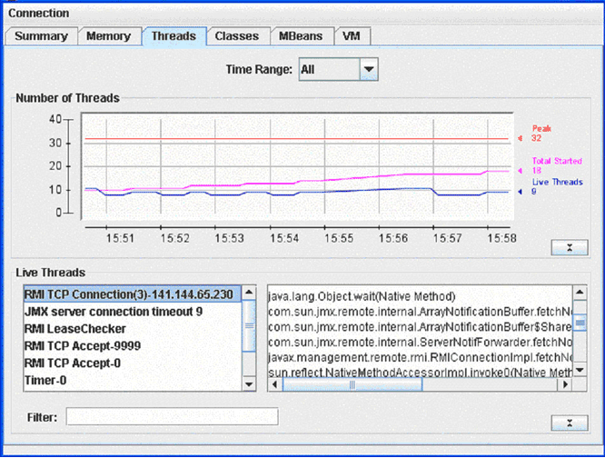
[Description of "Figure 2-8 The Threads Tab of the JConsole Interface"](img_text/thread_tab.md)

The chart on the Threads tab displays the number of live threads versus time, with a particular color representing a particular type of thread:

- Magenta signifies total number of threads

- Red signifies peak number of threads

- Blue signifies number of live threads

The list of threads on this tab displays the active threads. Select a thread in the list to display information about that thread on the right pane. This information includes name, state, and stack trace of the thread.

The Filter field helps to narrow the threads.

#### 2.11.5.6 About Monitoring Class Loading

You can use the Classes tab of the JConsole interface to monitor class loading. The chart on this tab plots the number of classes loaded versus time.

Figure 2-9 The Classes tab of the JConsole interface

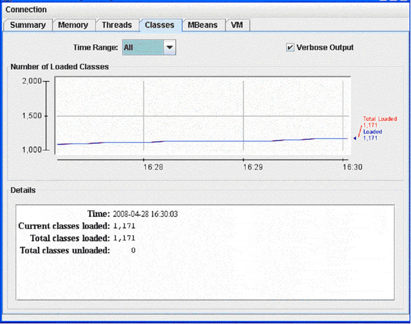
[Description of "Figure 2-9 The Classes tab of the JConsole interface"](img_text/classes_tab.md)

#### 2.11.5.7 About Monitoring and Managing MBeans

You can use the MBeans tab to monitor and manage MBeans. This tab displays information on all the MBeans registered with the platform MBean server.

The tree on the left pane of the MBean tab is called the MBean tree and it shows all the MBeans, organized according to their object Names. When you select an MBean in the MBean tree, then its attributes, operations, notifications, and other information are displayed on the right pane. For example, in Figure 2-10, we have selected the `Old Generation` MemoryPool MBean in the MBean tree on the left and the attributes of the `Old Generation` MemoryPool MBean are displayed on the right.

Figure 2-10 Displaying the Attributes of an MBean

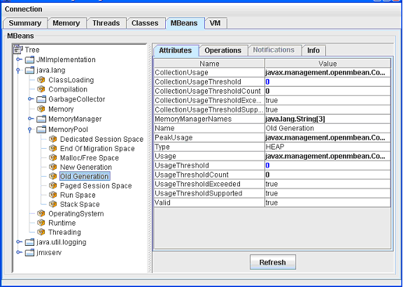
[Description of "Figure 2-10 Displaying the Attributes of an MBean"](img_text/mbeans_tab.md)

You can set the values of an attribute, if it is writeable. The writeable values are displayed in blue color. For example, in Figure 2-10, the attributes `CollectionUaageThreshold` and `UsageThreshold` are writable.

You can also display a chart of the values of an attribute versus time, by double-clicking on the attribute value. For example, if you click on the value of the `CollectionTime` property of the `GCManager` MBean, then you will see a chart similar to Figure 2-11:

Figure 2-11 Displaying a Chart of the Values of an Attribute

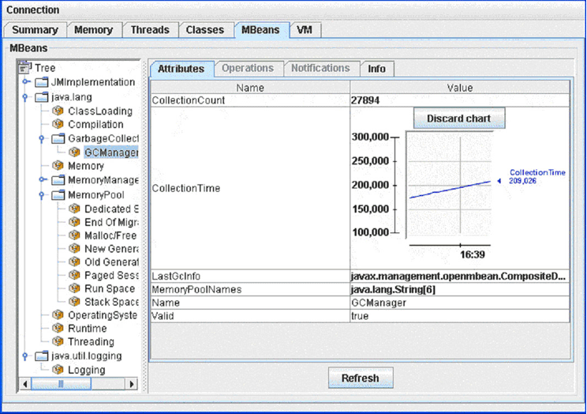
[Description of "Figure 2-11 Displaying a Chart of the Values of an Attribute"](img_text/chart.md)

You can display the details of a complex attribute by clicking on the attribute. For example, you can display the details of `Usage` and `PeakUsage` attributes of the Memory Pools as shown in Figure 2-12:

Figure 2-12 Displaying Details of a Complex Attribute in the MBeans Tab

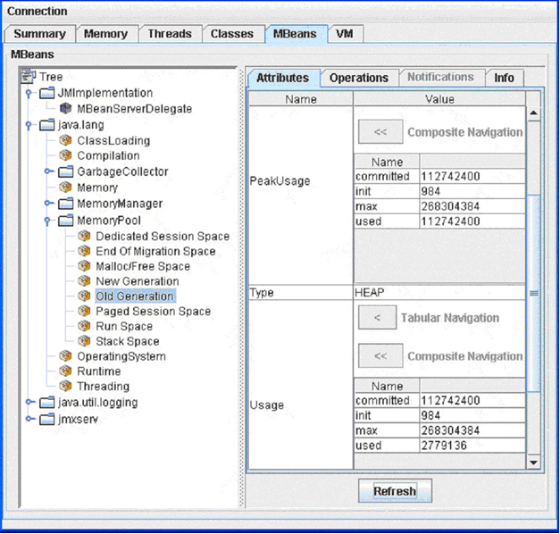
[Description of "Figure 2-12 Displaying Details of a Complex Attribute in the MBeans Tab"](img_text/complex_attr.md)

The Operations tab of an MBean provides manageability interface. For example, garbage collection can be invoked on a Memory Pool or Memory Manager by clicking Perform Garbage Collection. The JMX demo of Oracle JVM, namely, `javavm/demo/jmx/`, provides several additional custom MBeans that are loaded into Oracle JVM. Here is an example shows the result of the `getProp` operation of the `DBProps` Mbean:

Figure 2-13 Operations Tab of the MBeans Tab of the JConsole Interface

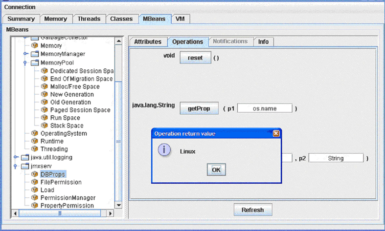
[Description of "Figure 2-13 Operations Tab of the MBeans Tab of the JConsole Interface"](img_text/operations.md)

#### 2.11.5.8 About Viewing VM Information

You can use the VM tab of the JConsole interface to view VM information.

Figure 2-14 The VM Tab of the JConsole Interface

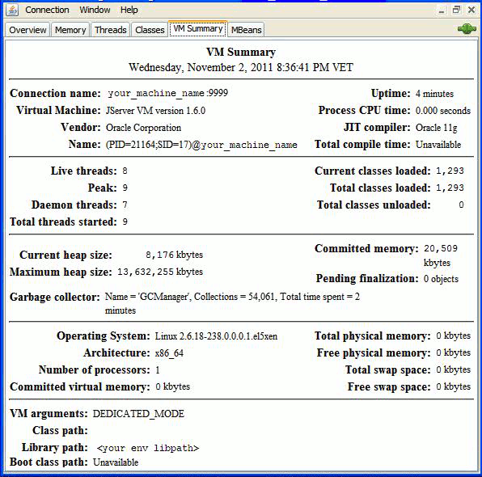
[Description of "Figure 2-14 The VM Tab of the JConsole Interface"](img_text/vm_tab.md)

#### 2.11.5.9 The OracleRuntime MBean

Starting from Oracle Database 11g Release 2 (11.2), a new MBean, `OracleRuntime` is added to the list of Oracle JVM platform MBeans, when the `dbms_java.start_jmx_agent` procedure is called. This MBean is specific to Oracle JVM.

The Attributes Tab of the `OracleRuntime` MBean exposes most of the parameters manipulated by the `oracle.aurora.vm.OracleRuntime` class. Figure 2-15 shows the Attributes tab of the `OracleRuntime` MBean.

Figure 2-15 Attributes Tab of the OracleRuntime MBean

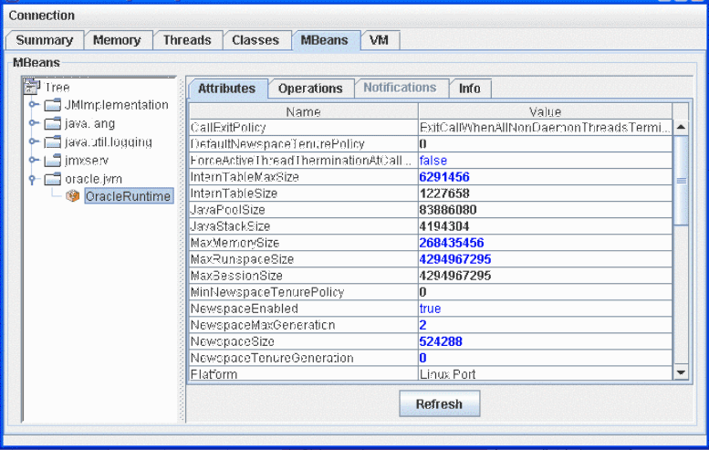
[Description of "Figure 2-15 Attributes Tab of the OracleRuntime MBean"](img_text/oracleruntimembean1.md)

The parameters displayed in black color are read-only and cannot be modified. For example, `JavaPoolSize`, `Platform`, and so on. Values in blue color are read/write, which means you can modify them. Most of the attributes of the `OracleRuntime` MBean are local to the current session.

The `WholeJVM_` attributes of the `OracleRuntime` MBean are global. These attributes reflect the totals of Oracle JVM memory usage statistics across all Java-enabled sessions in the Database instance, as gathered from the `v$session` and `v$sesstat` performance views. Figure 2-16 displays the `WholeJVM_` attributes of the `OracleRuntime` MBean.

Figure 2-16 OracleRuntime MBean

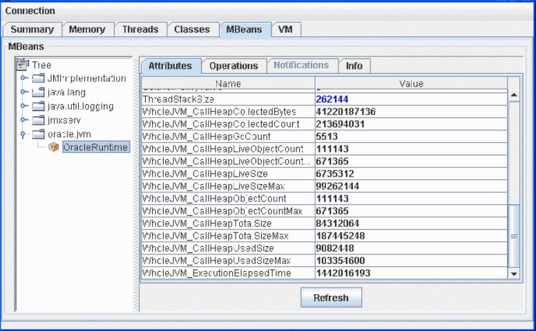
[Description of "Figure 2-16 OracleRuntime MBean"](img_text/oracleruntimembean2.md)

The Operations Tab of the `OracleRuntime` MBean exposes many of the operations of the `oracle.aurora.vm.OracleRuntime` class.

In addition, individual memory consumption statistics of a specific Java-active Database session can be monitored using the `sessionsRunningJava` and `sessionDetailsBySID` operations as shown in Figure 2-17 and Figure 2-18.

Figure 2-17 Operation sessionsRunningJava

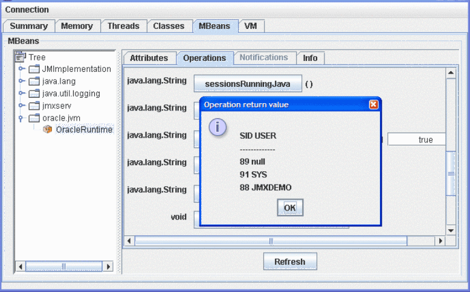
[Description of "Figure 2-17 Operation sessionsRunningJava"](img_text/oracleruntimembean3.md)

Figure 2-18 Operation sessionDetailsBySID

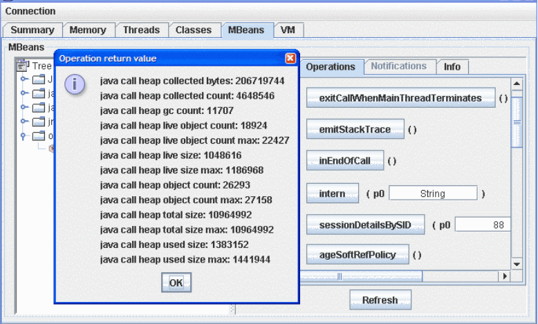
[Description of "Figure 2-18 Operation sessionDetailsBySID"](img_text/oracleruntimembean4.md)

#### 2.11.5.10 Memory Thresholds

The usage threshold is a manageable attribute of the memory pools. Collection usage threshold is a manageable attribute of some of the garbage-collected memory pools. You can set each of these to a positive value to enable corresponding threshold checking for a pool. Setting a threshold to zero disables the threshold checking for the memory pool. By default, threshold checking for all Oracle JVM pools is disabled.

The usage threshold and the collection usage threshold are set in the MBeans tab. For example, if you select the Old Generation memory pool from the tree on the left pane, and set the usage threshold of this memory pool to 20 megabytes and the collection threshold to 1 megabyte, then after a while, the threshold counts will show the number of threshold crossing events as shown in Figure 2-19:

Figure 2-19 Setting the Usage Threshold and Collection Usage Threshold in the MBeans Tab

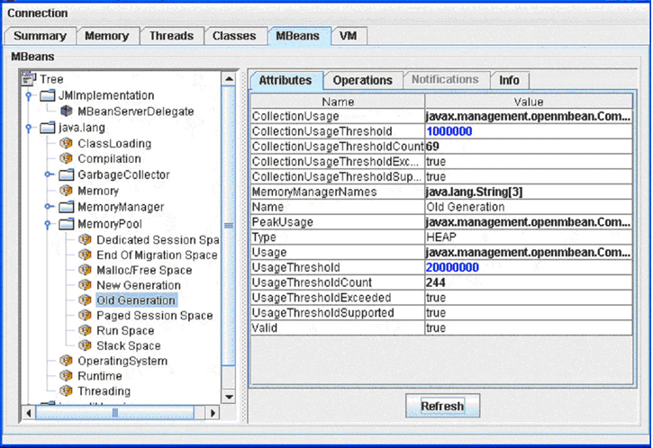
[Description of "Figure 2-19 Setting the Usage Threshold and Collection Usage Threshold in the MBeans Tab"](img_text/memory_threshold.md)

When the memory usage of the Old Generation memory pool exceeds 20 megabytes, then part of the bar representing the Old Generation memory pool in the JConsole interface turns red. The red portion indicates the portion of used memory that exceeds the usage threshold. The bar representing the heap memory also turns red as shown in Figure 2-20:

Figure 2-20 Memory Tab of the JConsole Interface When Used Memory Exceeds the Usage Threshold

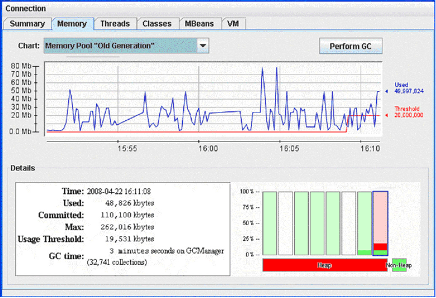
[Description of "Figure 2-20 Memory Tab of the JConsole Interface When Used Memory Exceeds the Usage Threshold"](img_text/exceed_usage.md)

### 2.11.6 Important Security Notes

By starting the remote listener with disabled SSL and authentication you violate the general security guidelines and hence make server vulnerable to attacks. Therefore, it is always advisable not to use such mode in production environment. This mode is supported for compatibility with JDK and for development; any production use of JMX in Oracle JVM must use secure JMX connections.

When supplying security-related property values to `dbms_java.set_property`, `System.setProperty`, or `dbms_java.start_jmx_agent`, use a non-echo listener or invoke these through an encrypted JDBC connection from a secure application layer, such as Oracle Application Server. Do not store passwords in clear-text files. Use Oracle Wallet to create and manage certificates. Use client certificates for SSL authentication for better security.

**See Also:**

[Oracle Database Security Guide](../dbseg/introduction-to-oracle-database-security.md)

### 2.11.7 Shared Server Limitations for JMX

On dedicated mode servers, JMX connectivity is supported for the duration of a session. Shared server JMX connectivity is typically limited to a single call. The main factor causing this limitation is the fact that JMX connectivity intrinsically depends on operating system resources such as threads and sockets. These resources do not survive shared server call boundaries. As the result, JMX connectivity is fully supported only for the duration of a single call.

**Note:**

This restriction only affects agent connectivity and not the state of the MBeanSrver and Mbeans registered in it. The state of the MBeanSrver and Mbeans, and in particular, the statistics, are persevered across shared server call boundaries.

If using dedicated server mode is not feasible, you can still establish JMX connectivity and monitor shared servers by following these guidelines:

- Plan for all JMX management and monitoring activities to happen within a single Java call.

- Do not set the `com.sun.management.jmxremote.port` property by calling the `DBMS_JAVA.set_property` function and do not use the `DBMS_JAVA.start_jmx_agent` method because these calls activate JMX and introduce a shared server call boundary. Instead, start the JMX agent by calling the `oracle.aurora.rdbms.JMXAgent.startOJVMAgent` method directly from the Java code to be monitored. The value for the `com.sun.management.jmxremote.port` property should be passed to the `startOJVMAgent` method. JMX-related properties other than the `com.sun.management.jmxremote.port` property do not wake up a JMX Agent and can be set using any means.

**Related Topics**

- [Shared Servers Considerations](shared-server-consideration.md)
