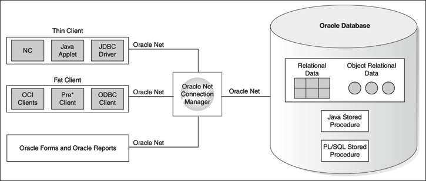
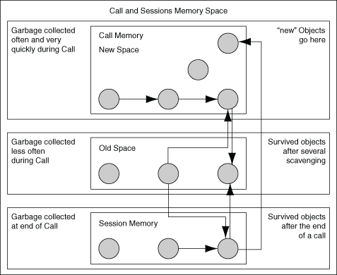
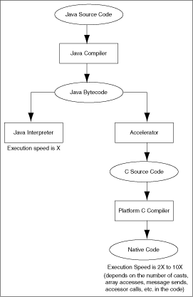

You can write and load Java applications within the database because it is a safe language with a lot of security features. Java has been developed to prevent anyone from tampering with the operating system where the Java code resides in. Some languages, such as C, can introduce security problems within the database. However, Java, because of its design, is a robust language that can be used within the database.

Although the Java language presents many advantages to developers, providing an implementation of a JVM that supports Java server applications in a scalable manner is a challenge. This section discusses the following challenges:

- Java and RDBMS: A Robust Combination

- About Multithreading

- Memory Spaces Management

- Footprint

- Performance of an Oracle JVM

- Dynamic Class Loading

### 1.2.1 Java and RDBMS: A Robust Combination

Oracle Database provides Java applications with a dynamic data-processing engine that supports complex queries and different views of the same data. All client requests are assembled as data queries for immediate processing, and query results are generated dynamically.

The combination of Java and Oracle Database helps you to create component-based, network-centric applications that can be easily updated as business needs change. In addition, you can move applications and data stores off the desktop and onto intelligent networks and network-centric servers. More important, you can access those applications and data stores from any client device.

Figure 1-5 shows a traditional two-tier, client/server configuration in which clients call Java stored procedures the same way they call PL/SQL stored procedures. The figure also shows how Oracle Net Services Connection Manager can combine many network connections into a single database connection. This enables Oracle Database to support a large number of concurrent users.

Figure 1-5 Two-Tier Client/Server Configuration

[Description of "Figure 1-5 Two-Tier Client/Server Configuration"](img_text/two_tier_config.md)

### 1.2.2 About Multithreading

Multithreading is one of the key scalability features of the Java language. The Java language and class libraries make it simpler to write multithreaded applications in Java than many other languages, but it is still a daunting task in any language to write reliable, scalable multithreaded code.

Oracle Database server efficiently schedules work for thousands of users. The Oracle JVM takes advantage of the session architecture of Oracle database to concurrently run Java applications for hundreds to thousands of users. Although Oracle Database supports Java language-level threads required by the JLS and JCK, scalability will not increase by using threads within the scope of the database. By using the embedded scalability of the database, the need for writing multithreaded Java servers is eliminated.

You should use the facilities of Oracle Database for scheduling users by writing single-threaded Java applications. The database can schedule processes between each application, and thus, you achieve scalability without having to manage threads. You can still write multithreaded Java applications, but multiple Java threads will not increase the performance of the server.

One complication multithreading creates is the interaction of threads and automated storage management or garbage collection. The garbage collector running in a generic JVM has no knowledge of which Java language threads are running or how the underlying operating system schedules them. The difference between a non-Oracle Database model and an Oracle JVM model is as follows:

- Non-Oracle Database model

  A single user maps to a single Java thread and a single garbage collector manages all garbage from all users. Different techniques typically deal with allocation and collection of objects of varying lifetimes and sizes. The result in a heavily multithreaded application is, at best, dependent upon operating system support for native threads, which can be unreliable and limited in scalability. High levels of scalability for such implementations have not been convincingly demonstrated.

- Oracle JVM model

  Even when thousands of users connect to the server and run the same Java code, each user experiences it as if he or she is running his or her own Java code on his or her own JVM. The responsibility of an Oracle JVM is to make use of operating system processes and threads and the scalable approach of Oracle Database. As a result of this approach, the garbage collector of the Oracle JVM is more reliable and efficient because it never collects garbage from more than one user at any time.

  **See Also:**

  "[Overview of Threading in Oracle Database](threading-in-database.md)"

### 1.2.3 Memory Spaces Management

Garbage collection is a major function of the automated storage management feature of Java, eliminating the need for Java developers to allocate and free memory explicitly. Consequently, this eliminates a large source of memory leaks that are commonly found in C and C++ programs. However, garbage collection contributes to the overhead of program execution speed and footprint.

Garbage collection imposes a challenge to the JVM developer seeking to supply a highly scalable and fast Java platform. An Oracle JVM meets these challenges in the following ways:

- The Oracle JVM uses Oracle Database scheduling facilities, which can manage multiple users efficiently.

- Garbage collection is performed consistently for multiple users, because garbage collection is focused on a single user within a single session. The Oracle JVM has an advantage, because the burden and complexity of the job of the memory manager does not increase as the number of users increases. The memory manager performs the allocation and collection of objects within a single session, which typically translates to the activity of a single user.

- The Oracle JVM uses different garbage collection techniques depending on the type of memory used. These techniques provide high efficiency and low overhead.

The two types of memory space are call space and session space.

| Memory space  | Description                                                                                                                                                                                                                                                               |
|:--------------|:--------------------------------------------------------------------------------------------------------------------------------------------------------------------------------------------------------------------------------------------------------------------------|
| Call space    | It is a fast and inexpensive type of memory. It primarily exists for the length of a call. Call memory space is divided into new and old segments. All new objects are created within new memory. Objects that have survived several scavenges are moved into old memory. |
| Session space | It is an expensive, performance-wise memory. It primarily exists for the length of a session. All `static` fields and any objects that exist beyond the lifetime of a call exist here.                                                                                    |

Figure 1-6 illustrates the different actions performed by the garbage collector.

Figure 1-6 Garbage Collection

[Description of "Figure 1-6 Garbage Collection"](img_text/entapa_02.md)

Garbage collection algorithms within an Oracle JVM adhere to the following rules:

1.  New objects are created within a new call space.

2.  Scavenging occurs at a set interval. Some programmers create objects frequently for only a short duration. These types of objects are created and garbage-collected quickly within the new call space. This is known as scavenging.

3.  Any objects that have survived several iterations of scavenging are considered to be objects that can exist for a while. These objects are moved out of new call space into old call space. During the move, they are also compacted. Old call space is scavenged or garbage collected less often and, therefore, provides better performance.

4.  At the end of the call, any objects that are to exist beyond the call are moved into session space.

Figure 1-6 illustrates the steps listed in the preceding text. This approach applies sophisticated allocation and collection schemes tuned to the types and lifetimes of objects. For example, new objects are allocated in fast and inexpensive call memory, designed for quick allocation and access. Objects held in Java `static` fields are migrated to the more precious and expensive session space.

### 1.2.4 Footprint

The footprint of a running Java program is affected by many factors:

- Size of the program

  The size of the program depends on the number of classes and methods and how much code they contain.

- Complexity of the program

  The complexity of the program depends on the number of core class libraries that the Oracle JVM uses as the program runs, as opposed to the program itself.

- Amount of space the JVM uses

  The amount of space the JVM uses depends on the number of objects the JVM allocates, how large these objects are, and how many objects must be retained across calls.

- Ability of the garbage collector and memory manager to deal with the demands of the program running

  This can not be determined often. The speed with which objects are allocated and the way they are held on to by other objects influences the importance of this factor.

From a scalability perspective, the key to supporting multiple clients concurrently is a minimum per-user session footprint. The Oracle JVM keeps the per-user session footprint to a minimum by placing all read-only data for users, such as Java bytecodes, in shared memory. Appropriate garbage collection algorithms are applied against call and session memories to maintain a small footprint for the user's session. The Oracle JVM uses the following types of garbage collection algorithms to maintain the user's session memory:

- Generational scavenging for short-lived objects

- Mark and lazy sweep collection for objects that exist for the life of a single call

- Copying collector for long-lived objects, that is, objects that live across calls within a session

### 1.2.5 Performance of an Oracle JVM

The performance of an Oracle JVM is enhanced by the embedding of an innovative Just-In-Time compiler similar to HotSpot on standard JVM. The platform-independent Java bytecodes run on top of a JVM, and the JVM interacts with the specific hardware platform. Any time you add levels within software, the performance is degraded. Because Java requires going through an intermediary to interpret the bytecodes, a degree of inefficiency exists for Java applications as compared to applications developed using a platform-dependent language, such as C. To address this issue, several JVM suppliers create native compilers. Native compilers translate Java bytecodes into platform-dependent native code, which eliminates the interpreter step and improves performance.

The following table describes two methods for native compilation:

| Compiler                       | Description                                                                                                                                                                                                                                                                                                                                                                                                                                             |
|:-------------------------------|:--------------------------------------------------------------------------------------------------------------------------------------------------------------------------------------------------------------------------------------------------------------------------------------------------------------------------------------------------------------------------------------------------------------------------------------------------------|
| Just-In-Time (JIT) Compilation | JIT compilers quickly compile Java bytecodes to platform-specific, or native, machine code during run time. These compilers do not produce an executable file to be run on the platform. Instead, they provide platform-dependent code from Java bytecodes that is run directly after it is translated. JIT compilers should be used for Java code that is run frequently and at speeds closer to that of code developed in other languages, such as C. |
| Ahead-of-Time Compilation      | This compilation translates Java bytecodes to platform-independent C code before run time. Then a standard C compiler compiles the C code into an executable file for the target platform. This approach is more suitable for Java applications that are not modified frequently. This approach takes advantage of the mature and efficient platform-specific compilation technology found in modern C compilers.                                       |

Oracle Database uses Just-In-Time (JIT) compilation to deliver its core Java class libraries, such as JDBC code, in natively compiled form. The JIT compiler is enabled without the support of any plug-ins and it is applicable across all the platforms that Oracle supports.

The following figure illustrates how natively compiled code runs up to 10 times faster than interpreted code. As a result, the more native code your program uses, the faster it runs.

Figure 1-7 Interpreter versus Accelerator

[Description of "Figure 1-7 Interpreter versus Accelerator"](img_text/interpreter_vs_accelerator.md)

**Related Topics**

- [Oracle JVM Just-in-Time Compiler (JIT)](Oracle-JVM-JIT.md)

### 1.2.6 Dynamic Class Loading

Another strong feature of Java is dynamic class loading. The class loader loads classes from the disk and places them in the JVM-specific memory structures necessary for interpretation. The class loader locates the classes in `CLASSPATH` and loads them only when they are used while the program is running. This approach, which works well for applets, poses the following problems in a server environment:

| Problem        | Description                                                                                                                                                                                                                                                                                                                                                                                                                                                                          | Solution                                                                                                                                                                                                                                                                                                                                                                                                                                                                             |
|:---------------|:-------------------------------------------------------------------------------------------------------------------------------------------------------------------------------------------------------------------------------------------------------------------------------------------------------------------------------------------------------------------------------------------------------------------------------------------------------------------------------------|:-------------------------------------------------------------------------------------------------------------------------------------------------------------------------------------------------------------------------------------------------------------------------------------------------------------------------------------------------------------------------------------------------------------------------------------------------------------------------------------|
| Predictability | The class loading operation places a severe penalty when the program is run for the first time. A simple program can cause an Oracle JVM to load many core classes to support its needs. A programmer cannot easily predict or determine the number of classes loaded.                                                                                                                                                                                                               | The Oracle JVM loads classes dynamically, just as with any other JVM. The same one-time class loading speed hit is encountered. However, because the classes are loaded into shared memory, no other users of those classes will cause the classes to load again, and they will use the same preloaded classes.                                                                                                                                                                      |
| Reliability    | A benefit of dynamic class loading is that it supports program updating. For example, you would update classes on a server, and clients, who download the program and load it dynamically, see the update whenever they next use the program. Server programs tend to emphasize reliability. As a developer, you must know that every client runs a specific program configuration. You do not want clients to inadvertently load some classes that you did not intend them to load. | Oracle Database separates the upload and resolve operation from the class loading operation at run time. You upload Java code you developed to the server using the `loadjava` tool. Instead of using `CLASSPATH`, you specify a resolver at installation time. The resolver is analogous to `CLASSPATH`, but enables you to specify the schemas in which the classes reside. This separation of resolution from class loading ensures that you always know what programs users run. |
