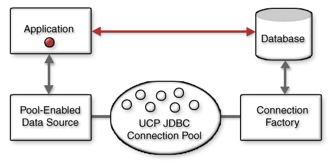

The following sections are included in this chapter:

- Overview of Connection Pool

- Overview of Universal Connection Pool

### 1.1 Overview of Connection Pool

A connection pool is a cache of database connection objects. The objects represent physical database connections that can be used by an application to connect to a database. At run time, the application requests a connection from the pool. If the pool contains a connection that can satisfy the request, it returns the connection to the application. If no connections are found, a new connection is created and returned to the application. The application uses the connection to perform some work on the database and then returns the object back to the pool. The connection is then available for the next connection request.

Connection pools promote the reuse of connection objects and reduce the number of times that connection objects are created. Connection pools significantly improve performance for database-intensive applications because creating connection objects is costly both in terms of time and resources. Tasks such as network communication, reading connection strings, authentication, transaction enlistment, and memory allocation all contribute to the amount of time and resources it takes to create a connection object. In addition, because the connections are already created, the application waits less time to get the connection.

Connection pools often provide properties that are used to optimize the performance of a pool. The properties control behaviors such as the minimum and maximum number of connections allowed in the pool or the amount of time a connection can remain idle before it is returned to the pool. The best configured connection pools balance quick response times with the memory spent maintaining connections in the pool. It is often necessary to try different settings until the best balance is achieved for a specific application.

### 1.2 Benefits of Using a Connection Pool

Applications that are database-intensive, generally benefit the most from connection pools. As a policy, applications should use a connection pool whenever database usage is known to affect application performance.

A connection pool provides the following benefits:

- Reduces the number of times new connection objects are created.

- Promotes connection object reuse.

- Quickens the process of getting a connection.

- Reduces the amount of effort required to manually manage connection objects.

- Minimizes the number of stale connections.

- Controls the amount of resources spent on maintaining connections.

### 1.3 Overview of Universal Connection Pool

UCP provides a connection pool implementation for caching JDBC connections. Java applications that are database-intensive use the connection pool to improve performance and better utilize system resources.

A UCP JDBC connection pool can use any JDBC driver to create physical connections that are then maintained by the pool. The pool can be configured and provides a full set of properties that are used to optimize pool behavior based on the performance and availability requirements of an application. For more advanced applications, UCP provides a pool manager that can be used to manage a pool instance.

The pool also leverages many high availability and performance features available through an Oracle Real Application Clusters (Oracle RAC) database. These features include Fast Connection Failover (FCF), Run-time connection Load Balancing (RLB), and Connection Affinity.

**Note:**

Starting from Oracle Database 11g Release 2, FCF is also supported by Oracle Restart on a single instance database. Oracle Restart is also known as Oracle Grid Infrastructure for Independent Servers.

**See Also:**

[Oracle Database Administrator’s Guide](../admin/configuring-automatic-restart-of-an-oracle-database.md) for more information about Oracle Restart.

#### 1.3.1 Conceptual Architecture

Applications use a UCP pool-enabled data source to get connections from a UCP JDBC connection pool instance. The `PoolDataSource` data source is used for getting regular connections (`java.sql.Connection`), and the `PoolXADataSource` data source is used for getting XA (eXtended API) connections (`javax.sql.XAConnection`). The same pool features are included in both XA and non-XA UCP JDBC connection pools.

The pool-enabled data source relies on a connection factory class to create the physical connections that are maintained by the pool. An application can choose to use any factory class that is capable of creating `Connection` or `XAConnection` objects. The pool-enabled data sources provide a method for setting the connection factory class, as well as methods for setting the database URL and database credentials that are used by the factory class to connect to a database.

Applications borrow a connection handle from the pool to perform work on a database. Once the work is completed, the connection is closed and the connection handle is returned to pool and is available to be used again. The following figure shows the conceptual view of the interaction between an application and a UCP JDBC connection pool.

Figure 1-1 Conceptual View of a UCP JDBC Connection Pool

**Related Topics**

- [Getting Database Connections in UCP](getting-database-connections.md)

#### 1.3.2 Connection Pool Properties

UCP JDBC Connection pool properties are configured through methods available on the pool-enabled data source. The pool properties are used to control the pool size, handle stale connections, and make autonomous decisions about how long connections can remain borrowed before they are returned to the pool. The optimal settings for the pool properties depend on the application and hardware resources. Typically, there is a trade-off between the time it takes for an application to get a connection versus the amount of memory it takes to maintain a certain pool size. In many cases, experimentation is required to find the optimal balance to achieve the desired performance for a specific application.

**Related Topics**

- [Optimizing Universal Connection Pool Behavior](optimizing-ucp-behavior.md)

#### 1.3.3 Connection Pool Manager

UCP includes a connection pool manager that is used by applications that require administrative control over a connection pool. The manager is used to explicitly control the life cycle of a pool and to perform maintenance on a pool. The manager also provides the opportunity for an application to expose the pool and its manageability through an administrative console.

**Related Topics**

- [Using the Connection Pool Manager](using-ucp-manager.md)

#### 1.3.4 High Availability and Performance Scenarios

A UCP JDBC connection pool provides many features that are used to ensure high connection availability and performance. Many of these features, such as refreshing a pool or validating connections, are generic and work across driver and database implementations. Some of these features, such as run-time connection load balancing, and connection affinity, require the use of an Oracle JDBC driver and an Oracle RAC database.

**Related Topics**

- [Using Oracle RAC Features](using-Oracle-RAC-features.md)

#### 1.3.5 Support for Java library for Reactive Streams Ingestion

Oracle Database Release 19c introduces a Java library that provides support for reactive streams ingestion, which enables customers to efficiently stream data into Oracle Database. The new Java library enables Java applications to continuously receive and ingest data from a large group of clients. Using the direct path load method of Oracle Database for inserting data, it makes the ingestion process nonblocking and extremely fast.

This Java library uses an extension of the existing UCP APIs, which enables the ingestion process to furnish several high-availability and scalability features of the database, like support for table partitions, Oracle RAC connection affinity, and sharding.

**See Also:**

[Overview of Java library for Reactive Streams Ingestion](../jjdbc/index.md)
