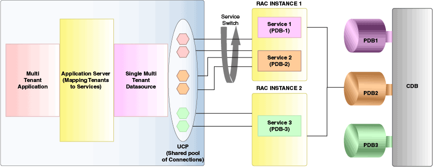
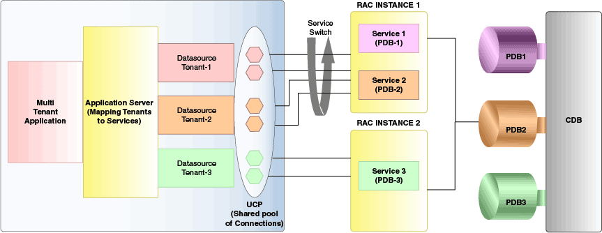

Starting from Oracle Database 12c Release 2 (12.2.0.1), multiple data sources of multitenant data sources can share a common pool of connections in UCP and repurpose connections in the common connection pool, whenever needed. This section describes the following concepts related to new Shared Pool feature:

**Note:**

- Only the JDBC Thin driver supports the Shared Pool feature, and not the JDBC OCI driver.

- For using this feature, you must use an XML configuration file.

<!-- -->

- Overview of Shared Pool Support

- Prerequisites for Supporting Shared Pool

- Configuring the Shared Pool

- APIs for Shared Pool Support

- Sample XML Configuration File for Shared Pool

**Related Topics**

- Sample XML Configuration File for Shared Pool

### 8.1 Overview of Shared Pool Support

In UCP, the pool instances have a one-to-one mapping with the data sources. Every data source creates its own connection pool instance and that instance is not accessible or shared by another data source, even if they internally create and cache connections to the same database and service. In this architecture, a lot of isolated connection pools are created, which causes a scalability problem because a database can scale up to only a certain number of connections.

Starting from Oracle Database 12c Release 2 (12.2.0.1), UCP supports multiple data sources, connected to the same database, to share the same connection pool. This common connection pool is called as Shared Pool. The Shared Pool optimizes system resources for a scalable deployment of multitenant Java applications in Oracle Database Multitenant environment. This feature provides more flexibility in situations when there is an uneven load on each data source. When individual pool per data sources are created, then it is impossible to move around idle resources from an idle connection pool to a loaded one. However, when a Shared Pool is used, connections can be utilized in an efficient way by sharing and repurposing connections between the data sources. So, this feature reduces the total number of database connections, and improves resource usage, diagnosability, manageability, and scaling at the database servers.

Following are the two scenarios in which this feature can be implemented:

- Single Multitenant Data Source Using Shared Pool

- One Data Source per Tenant Using Shared Pool

#### Single Multitenant Data Source Using Shared Pool

With this configuration, multiple tenants use the common data source and a common pool to serve connections with different services applicable to each of the tenants, as illustrated in the following diagram:

Figure 8-1 Single Multitenant Data Source Using Shared Pool

[Description of "Figure 8-1 Single Multitenant Data Source Using Shared Pool"](img_text/singlemtds.md)

The following code snippet explains how this feature works:

        PoolDataSource multiTenantDS = PoolDataSourceFactory.getPoolDataSource();

        //common user for the CDB
        multiTenantDS.setUser("c##common_user");
        multiTenantDS.setPassword("password");

        //Points to the root service of the CDB
        multiTenantDS.setURL("jdbc:oracle:thin:@(DESCRIPTION=(ADDRESS=(PROTOCOL=tcp)"
            + "(HOST=myhost)(PORT=5521))(CONNECT_DATA=(SERVICE_NAME=root.oracle.com)))");

        // password enabled role for tenant-1
        Properties tenant1Roles = new Properties();
        tenant1Roles.put("tenant1-role", "tenant1-password");

        //Create Connection to Tenant-1 and apply the tenant specific PDB roles.
        Connection tenant1Connection =
            multiTenantDS.createConnectionBuilder()
                         .serviceName("tenant1Svc.oracle.com")
                         .pdbRoles(tenant1Roles)
                         .build();

        // password enabled role for tenant-2
        Properties tenant2Roles = new Properties();
        tenant1Roles.put("tenant2-role", "tenant2-password");

        //Create Connection to Tenant-2 and apply the tenant specific PDB roles.
        Connection tenant2Connection =
            multiTenantDS.createConnectionBuilder()
                         .serviceName("tenant2Svc.oracle.com")
                         .pdbRoles(tenant2Roles)
                         .build();

Refer to the “UCP APIs for Shared Pool Support” section for more information about the new APIs.

#### One Data Source per Tenant Using Shared Pool

With this configuration, multitenant applications have separate data sources per tenant and a common Shared Pool for connections. This results in the individual data sources being configured with tenant specific service information and sharing a common pool, as illustrated in the following diagram:

Figure 8-2 One Data Source per Tenant Using Shared Pool

[Description of "Figure 8-2 One Data Source per Tenant Using Shared Pool"](img_text/onedspertenant.md)

The following code snippet explains how this feature works:

        // UCP XML configuration file path in case of Unix
        String file_URI = "file:/user/app/sharedpool/initial-shared-pool-config.xml";

        // UCP XML configuration file path in case of Windows
        String file_URI = "file:/D:/user/app/sharedpool/initial-shared-pool-config.xml";

        // Java system property to specify XML configuration file location
        System.setProperty("oracle.ucp.jdbc.xmlConfigFile",<file_URI>);

        // Get the datasource instance, named as "pds1" in XML configuration file(initial-shared-pool-config.xml)
        PoolDataSource pds1 = PoolDataSourceFactory.getPoolDataSource("pds1");
        Connection pds1Conn = pds1.getConnection();

        // Get the datasource instance, named as "pds2" in XML configuration file(initial-shared-pool-config.xml)
        PoolDataSource pds2 = PoolDataSourceFactory.getPoolDataSource("pds2");
        Connection pds2Conn = pds2.getConnection();

        // Reconfigure datasource(pds1) using the new properties
        Properties newProps = new Properties();
        newProps.put("serviceName", <newServiceName>);
        pds1.reconfigureDataSource(newProps);

        // Configure a new datasource(pds3) to running pool using the new data source properties
        Properties dataSourceProps = new Properties();
        dataSourceProps.put("serviceName", <serviceName>);
        dataSourceProps.put("connectionPoolName", <poolName>);
        dataSourceProps.put("dataSourceName", <dataSourceName>);
        PoolDataSource pds3 = PoolDataSourceFactory.getPoolDataSource(dataSourceProps);

        // Reconfigure connection pool("pool1") using the new properties

        Properties newPoolProps = new Properties();
        newPoolProps.put("initialPoolSize", <newInitialPoolSizeValue>);
        newPoolProps.put("maxPoolSize", <newMaxPoolSizeValue>);
        UniversalConnectionPoolManager ucpMgr = UniversalConnectionPoolManagerImpl.getUniversalConnectionPoolManager();
        ucpMgr.reconfigureConnectionPool("pool1", newPoolProps);

**Note:**

- UCP uses a service switch for implementing this feature. However, the service switch in Shared Pools is supported only for homogenous services. There is no support for heterogeneous services (heterogeneity in terms of service attributes like Transaction Guard and Application Continuity) in Shared Pools.

- For the XML configuration file used in the code snippets, refer to the “XML Configuration File Required for Shared Pool Support” section.

### 8.2 Prerequisites for Supporting Shared Pool

Following are the prerequisites for multitenant data sources to use the Shared Pool:

- You must provide the initial configuration of Shared Pools through an XML configuration file. You can specify the initial XML configuration file for UCP through the system property `oracle.ucp.jdbc.xmlConfigFile`. The location of the initial XML configuration file should be specified as a URI. For example, `file:/user_directory/ucp.xml`.

  The `configuration.xsd` schema file is included in the `ucp.jar` file for reference. Refer to this file while creating a UCP XML configuration file.

- During the reconfiguration of a shared pool, updated pool properties should be provided through reconfiguration APIs.

- Always use application service for the services used for Shared Pool, and for the individual tenant data source specific services. Connections are not repurposed or reused when an Administrative service or default PDB services are used.

- The various services accessed through the Shared Pool must be homogenous, that is, they should have similar properties with respect to Application Continuity (AC), DRCP (Database Resident Connection Pool), and so on.

- The Shared Pool must be configured with a single user, and this user should be a common user configured on the CDB. The common user should have the following privileges - `CREATE SESSION`, `ALTER SESSION`, and `SET CONTAINER`. The common user should also have the execute permission on the `DBMS_SERVICE_PRVT` package.

  **Note:**

  - If the common user needs specific roles or password-enabled roles per tenant, then these roles should be specified in the respective tenant data source properties.

  - The advantage of the `SET CONTAINER` statement is that the pool does not have to create a new connection to a PDB, if there is an existing connection to a different PDB. The pool can use the existing connection and can connect to the desired PDB through the `SET CONTAINER` statement.

- Connection repurposing among various tenant connections in the Shared Pool happens only when the total number of the connections in the pool reaches the connection repurpose threshold (if configured on the pool) and the minimum pool size.

- The URL specified for the Shared Pool in the XML configuration file must have the LONG format, with service name explicitly specified. Short format or Easy Connection URL is not supported.

### 8.3 Configuring the Shared Pool

The following sections describe the Shared Pool configuration:

- Initial Configuration of the Pool

- Reconfiguration of the Pool

#### Initial Configuration of the Pool

For the initial configuration of the pool, get a data source instance by using the XML configuration file and then, using that data source, get a connection from a Shared Pool.

        // Get the data source instance, named as "pds1" in the XML configuration file(initial-shared-pool-config.xml)
        PoolDataSource pds1 = PoolDataSourceFactory.getPoolDataSource("pds1");
        Connection pds1Conn = pds1.getConnection();

#### Reconfiguration of the Pool

- The following code snippet shows how to reconfigure the data source that you obtained during the initial configuration of the pool:

       // Reconfigure datasource(pds1) using the new propertries for reconfiguration

      Properties newProps = new Properties();
      newProps.put("serviceName",<newServiceName>);
      pds1.reconfigureDataSource(newProps);

- The following code snippet shows how to add a new data source to an already running Shared Pool:

      // Configure a new datasource(pds3) to the running pool using the new data source properties

      Properties dataSourceProps = new Properties();
      dataSourceProps.put("serviceName", <serviceName>);
      dataSourceProps.put("connectionPoolName", <poolName>);
      dataSourceProps.put("dataSourceName", <dataSourceName>);
      PoolDataSource pds3 = PoolDataSourceFactory.getPoolDataSource(dataSourceProps);

- The following code snippet shows how to reconfigure the connection pool:

      // Reconfigure connection pool("pool1") using the new properties

      Properties newPoolProps = new Properties();
      newPoolProps.put("initialPoolSize", <newInitialPoolSizeValue>);
      newPoolProps.put("maxPoolSize", <newMaxPoolSizeValue>);
      UniversalConnectionPoolManager ucpMgr = UniversalConnectionPoolManagerImpl.getUniversalConnectionPoolManager();
      ucpMgr.reconfigureConnectionPool("pool1", newPoolProps);

### 8.4 UCP APIs for Shared Pool Support

#### New Methods in PoolDataSource Interface

The following methods have been introduced in the `oracle.ucp.jdbc.PoolDataSource` interface:

- `reconfigureDataSource(Properties configuration)`

- `getMaxConnectionsPerService()`

- `getServiceName()`

- `getPdbRoles()`

- `getConnectionRepurposeThreshold()`

- `setConnectionRepurposeThreshold(int threshold)`

#### New Methods in PoolDataSourceFactory Class

The following methods have been introduced in the `oracle.ucp.jdbc.PoolDataSourceFactory` class:

- `getPoolDataSource(String dataSourceName)`

- `getPoolDataSource(Properties configuration)`

- `getPoolXADataSource(String dataSourceName)`

- `getPoolXADataSource(Properties configuration)`

#### New Method in oracle.ucp.admin.UniversalConnectionPoolManager Interface

The following method has been introduced in the `oracle.ucp.admin.UniversalConnectionPoolManager` interface:

    reconfigureConnectionPool(String poolName , Properties configuration)

#### New Method in oracle.ucp.admin.UniversalConnectionPool Interface

The following method has been introduced in the `oracle.ucp.admin.UniversalConnectionPool` interface:

- `isShareable()`

- `getMaxConnectionsPerService()`

- `setMaxConnectionsPerService(int maxConnectionsPerService)`

**See Also:**

[Oracle Universal Connection Pool Java API Reference](../jjuar/index.md) for more information about these methods.

### 8.5 Sample XML Configuration File for Shared Pool

#### initial-shared-pool-config.xml

    <?xml version="1.0" encoding="UTF-8"?>
    <ucp-properties>
        <connection-pool
            connection-pool-name="pool1"
            connection-factory-class-name="oracle.jdbc.pool.OracleDataSource"
            url="jdbc:oracle:thin:@(DESCRIPTION=(ADDRESS=(HOST=host_name)(PORT=1521)(PROTOCOL=tcp))( CONNECT_DATA=(SERVICE_NAME=myorcldbservicename)))"
            user="C##CommonUser"
            password=password
            initial-pool-size="10"
            min-pool-size="5"
            max-pool-size="20"
            connection-repurpose-threshold="13"
            max-connections-per-service="15"
            validate-connection-on-borrow="true"
            sql-for-validate-connection="select 1 from dual"
            shared="true"
        >

            <connection-property name="oracle.jdbc.ReadTimeout" value="2000"/>
            <connection-property name="oracle.net.OUTBOUND_CONNECT_TIMEOUT" value="2000"/>

            <data-source
                data-source-name="pds1"
                service=pdb1_service_name
                description="pdb1 data source"/>

            <data-source
                data-source-name="pds2"
                service=pdb2_service_name
                description="pdb2 data source"/>

        </connection-pool>
    </ucp-properties>
