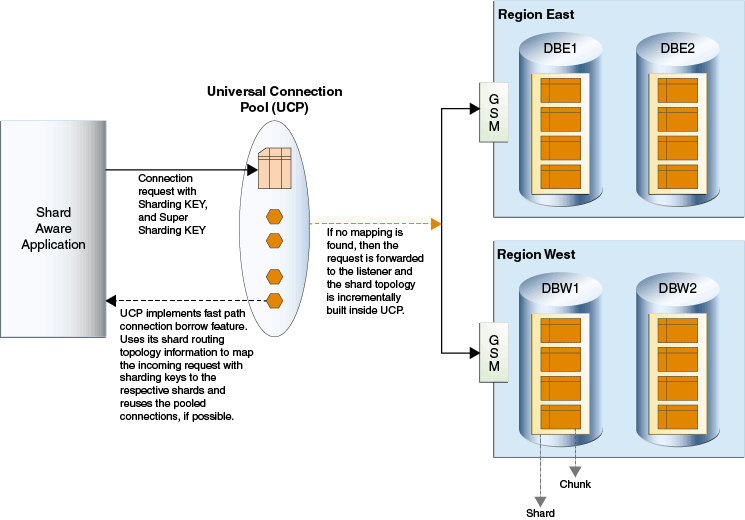

Starting from Oracle Database 12c Release 2 (12.2.0.1), Universal Connection Pool (UCP) supports database sharding. UCP recognizes the sharding keys specified and connects to the specific shard. Sharding uses Global Data Services (GDS), where GDS routes a client request to an appropriate database, based on various parameters such as availability, load, network latency, and replication lag.

**See Also:**

- [Oracle Database JDBC Developer’s Guide](../jjdbc/database-sharding.md)

- [Oracle Database Administrator’s Guide](../shard/sharding-overview.md)

### Use Case of UCP Shared Pool for Database Sharding

This section describes a use case of UCP Shared Pool for database sharding. In the use case, the applications connecting to sharded database use UCP to store connections to different shards and chunks of the sharded GDS database within the same Shared Pool. The applications must provide the sharding key to UCP during the connection request. Based on the sharding key, the pool routes the connection request to the correct shard. The data distribution across the shards and chunks in the database is transparent to the user. UCP transparently handles resharding and chunk movements, minimizing the impact on the end users.

The following diagram illustrates this use case:

Figure 11-1 Universal Connection Pool (UCP) Using Sharded Database Architecture

[Description of "Figure 11-1 Universal Connection Pool (UCP) Using Sharded Database Architecture"](img_text/sharding0109.md)

**Related Topics**

- [Global Data Services](global-data-services.md)
