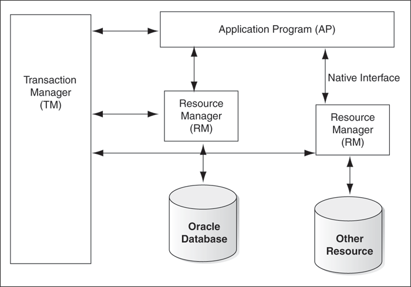

This chapter discusses advanced SQLJ language features for use in coding your application. For more basic topics, refer to [Basic Language Features](basic-language-features.md).

The following topics are discussed:

- Connection Contexts

- Execution Contexts

- Multithreading in SQLJ

- Iterator Class Implementation and Advanced Functionality

- Advanced Transaction Control

- SQLJ and JDBC Interoperability

- Support for Dynamic SQL

- Using Stored Outlines

- Using Plan Baselines

### 8.1 Connection Contexts

SQLJ supports the concept of connection contexts, allowing strongly typed connections for use with different sets of SQL entities. You can think of a connection context as being associated with a particular set of SQL entities, such as tables, views, and stored procedures. SQLJ lets you declare additional connection context classes so that you can use each class for connections that use a particular set of SQL entities. Different instances of a single connection context class are not required to use the same physical entities or connect to the same schema, but will at least use sets of entities with the same names and data types.

**See Also:**

"[Connection Considerations](key-programming-considerations.md)" for an overview of connection basics, focusing on situations where you are using just a single set of SQL entities and a single connection context class.

This section covers the following topics:

- Connection Context Concepts

- Connection Context Logistics

- Declaring and Using a Connection Context Class

- Example of Multiple Connection Contexts

- Implementation and Functionality of Connection Context Classes

- Using the IMPLEMENTS Clause in Connection Context Declarations

- Semantics-Checking of Your Connection Context Usage

- Standard Data Source Support

- SQLJ-Specific Data Sources

- SQLJ-Specific Connection JavaBeans for JavaServer Pages

- SQLJ Support for Global Transactions

- Connecting to PDBs

#### 8.1.1 Connection Context Concepts

If your application uses different sets of SQL entities, then you will typically want to declare and use one or more additional connection context classes, as discussed in "[Overview of SQLJ Declarations](basic-language-features.md)". Each connection context class can be used for a particular set of interrelated SQL entities, meaning that all the connections you define using a particular connection context class will use tables, views, stored procedures, and so on, which have the same names and use the same data types.

An example of a set of SQL entities is the set of tables and stored procedures used by the Human Resources (HR) department. Perhaps they use the `EMPLOYEES` and `DEPARTMENTS` tables and the `CHANGE_DEPT` and `UPDATE_HEALTH_PLAN` stored procedures. Another set of SQL entities might be the set of tables and procedures used by the Payroll department, perhaps consisting of the `EMPS` table (another table of employees, but different than the one used by HR) and the `GIVE_RAISE` and `CHANGE_WITHHOLDING` stored procedures.

The advantage in tailoring connection context classes to sets of SQL entities is in the degree of online semantics-checking that this allows. Online checking verifies that all the SQL entities appearing in SQLJ statements that use a given connection context class match SQL entities found in the exemplar schema used during translation. An exemplar schema is a database account that SQLJ connects to for online checking of all the SQLJ statements that use a particular connection context class. You provide exemplar schemas to the translator through the SQLJ command-line `-user`, `-password`, and `-url` options. An exemplar schema may or may not be the same account your application will use at run time.

**See Also:**

"[Connection Options](translator-command-line-and-options.md)"

If you have SQLJ statements that use a broad and perhaps unrelated group of SQL entities, but you use only a single connection context class for these statements, then the exemplar schema you provide must be very general. It must contain all the tables, views, and stored procedures used throughout all the statements. Alternatively, if all the SQLJ statements using a given connection context class use a tight, presumably interrelated, set of SQL entities, then you can provide a more specific exemplar schema that enables more thorough and meaningful semantics-checking.

**Note:**

- Be aware that a connection context class declaration does not define a set of SQL entities to be used with the declared connection context class, and it is permissible to use the same connection context class for connections that use disparate and unrelated sets of entities. How you use your connection context classes is at your discretion. All that limits the SQL entities you can use with a particular connection context class are the set of entities available in the exemplar schema, if you use online semantics-checking during translation, and the set of entities available in the schema you connect to at run time, using instances of the connection context class.

- If you use qualified SQL names in your application, such as `HR.EMPLOYEES`, which specifies the schema where the entity resides, then the exemplar schema, if you use online checking, and run-time schema must have permission to access resources by these fully qualified names.

- It is possible to use a single connection context class, even for connections to databases from different vendors, as long as each schema you connect to has entities that are accessible by the same names and that use compatible data types.

#### 8.1.2 Connection Context Logistics

Declaring a connection context class results in the SQLJ translator defining a class for you in the translator-generated code. In addition to any connection context classes that you declare, there is always the default connection context class:

    sqlj.runtime.ref.DefaultContext

When you construct a connection context instance, specify a particular schema and a particular session and transaction in which SQL operations will execute. You typically accomplish this by specifying a user name, password, and database URL as input to the constructor of the connection context class. The connection context instance manages the set of SQL operations performed during the session.

In each SQLJ statement, you can specify a connection context instance to use. The following example shows basic declaration and use of a connection context class, `MyContext`, to connect to two different schemas. For typical usage, assume these schemas include a set of SQL entities with common names and data types.

    #sql context MyContext;

    ...
    MyContext mctx1 = new MyContext
      ("jdbc:oracle:thin:@localhost:5221/myservice", "HR", "hr", false);
    MyContext mctx2 =  new MyContext
      ("jdbc:oracle:thin@localhost:5221/myservice", "brian", "mypasswd", false);

Note that connection context class constructors specify a boolean auto-commit parameter. In addition, note that you can connect to the same schema with different connection context instances. In the preceding example, both `mctx1` and `mctx2` can specify `HR/hr` if desired. However, during run time, one connection context instance would not see changes to the database made from the other until the changes are committed. The only exception to this would be if both connection context instances were created from the same underlying Java Database Connectivity (JDBC) connection instance. One of the constructors of any connection context class takes a JDBC connection instance as input.

#### 8.1.3 Declaring and Using a Connection Context Class

This section gives a detailed example of how to declare a connection context class, then define a database connection using an instance of the class.

A connection context class has constructors for opening a connection to a database schema that take any of the following input parameter sets (as with the `DefaultContext` class):

- URL (`String`), user name (`String`), password (`String`), auto-commit (`boolean`)

- URL (`String`), `java.util.Properties` object, auto-commit (`boolean`)

- URL (`String` fully specifying connection and including user name and password), auto-commit setting (`boolean`)

- JDBC connection object (`Connection`)

- SQLJ connection context object

**Note:**

- When using the constructor that takes a JDBC connection object, do not initialize the connection context instance with a null JDBC connection.

- The auto-commit setting determines whether SQL operations are automatically committed. For more information, refer to "[Basic Transaction Control](key-programming-considerations.md)".

- If a connection context class is declared with a data source `with` clause, then it incorporates a different set of constructors. Refer to "Standard Data Source Support" for more information.

##### Declaring the Connection Context Class

The following declaration creates a connection context class:

    #sql context OrderEntryCtx <implements_clause> <with_clause>;

This results in the SQLJ translator generating a class that implements the `sqlj.runtime.ConnectionContext` interface and extends some base class, probably an abstract class, that also implements the `ConnectionContext` interface. This base class would be a feature of the particular SQLJ implementation you are using. The `implements` clause and `with` clause are optional, specifying additional interfaces to implement and variables to define and initialize, respectively.

**See Also:**

"[Declaration IMPLEMENTS Clause](basic-language-features.md)" and "[Declaration WITH Clause](basic-language-features.md)"

The following is an example of what the SQLJ translator generates (with method implementations omitted):

    class OrderEntryCtx implements sqlj.runtime.ConnectionContext
          extends ...
    {
       public OrderEntryCtx(String url, Properties info, boolean autocommit)
              throws SQLException {...}
       public OrderEntryCtx(String url, boolean autocommit)
              throws SQLException {...}
       public OrderEntryCtx(String url, String user, String password,
              boolean autocommit) throws SQLException {...}
       public OrderEntryCtx(Connection conn) throws SQLException {...}
       public OrderEntryCtx(ConnectionContext other) throws SQLException {...}

       public static OrderEntryCtx getDefaultContext() {...}
       public static void setDefaultContext(OrderEntryCtx ctx) {...}
    }

##### Creating a Connection Context Instance

Continuing the preceding example, instantiate the `OrderEntryCtx` class with the following syntax:

    OrderEntryCtx myOrderConn = new OrderEntryCtx
                                (url, username, password, autocommit);

For example:

    OrderEntryCtx myOrderConn = new OrderEntryCtx
      ("jdbc:oracle:thin:@localhost:5221/myservice", "HR", "hr", true);

This is accomplished in the same way as instantiating the `DefaultContext` class. All connection context classes, including `DefaultContext`, have the same constructor signatures.

**Note:**

- You typically must register your JDBC driver prior to constructing a connection context instance. Refer to "[Driver Selection and Registration for Run Time](key-programming-considerations.md)".

- If a connection context class is declared with a data source `with` clause, then it incorporates a different set of constructors. Refer to "Standard Data Source Support" for more information.

##### Specifying a Connection Context Instance for a SQLJ Clause

Recall that the basic SQLJ statement syntax is as follows:

    #sql <[<conn><, ><exec>]> { SQL operation };

Specify the connection context instance inside square brackets following the `#sql` token. For example, in the following SQLJ statement, the connection context instance is `myOrderConn` from the previous example:

    #sql [myOrderConn] { UPDATE TAB2 SET COL1 = :w WHERE :v < COL2 };

In this way, you can specify an instance of either the `DefaultContext` class or any declared connection context class.

##### Closing a Connection Context Instance

It is advisable to close all connection context instances when you are done. Each connection context class includes a `close()` method, as discussed for the `DefaultContext` class in "[Closing Connections](key-programming-considerations.md)".

In closing a connection context instance that shares the underlying connection with another connection instance, you might want to keep the underlying connection open.

#### 8.1.4 Example of Multiple Connection Contexts

The following is an example of a SQLJ application using multiple connection contexts. It implicitly uses an instance of the `DefaultContext` class for one set of SQL entities and an instance of the declared `DeptContext` connection context class for another set of SQL entities.

This example uses the static `Oracle.connect()` method to establish a default connection, then constructs an additional connection by using the static `Oracle.getConnection()` method to pass another `DefaultContext` instance to the `DeptContext` constructor. As previously mentioned, this is just one of several ways you can construct a SQLJ connection context instance.

    import java.sql.SQLException;
    import oracle.sqlj.runtime.Oracle;

    // declare a new context class for obtaining departments
    #sql context DeptContext;

    #sql iterator Employees (String ename, int deptno);

    class MultiSchemaDemo
    {
      public static void main(String[] args) throws SQLException
      {
        // set the default connection to the URL, user, and password
        // specified in your connect.properties file
        Oracle.connect(MultiSchemaDemo.class, "connect.properties");

        // create a context for querying department info using
        // a second connection
        DeptContext deptCtx =
          new DeptContext(Oracle.getConnection(MultiSchemaDemo.class,
                         "connect.properties"));

        new MultiSchemaDemo().printEmployees(deptCtx);
        deptCtx.close();
      }

      // performs a join on deptno field of two tables accessed from
      // different connections.
      void printEmployees(DeptContext deptCtx) throws SQLException
      {
        // obtain the employees from the default context
        Employees emps;
        #sql emps = { SELECT first_name, department_id FROM employees };

        // for each employee, obtain the department name
        // using the dept table connection context
        while (emps.next()) {
          String dname;
          int deptno = emps.deptno();
          #sql [deptCtx] {
            SELECT dname INTO :dname FROM departments WHERE department_id = :deptno
          };
          System.out.println("employee: " +emps.ename() +
                             ", department: " + dname);
        }
        emps.close();
      }
    }

#### 8.1.5 Implementation and Functionality of Connection Context Classes

This section discusses how SQLJ implements connection context classes, including the `DefaultContext` class, and what noteworthy methods they contain. As mentioned earlier, the `DefaultContext` class and all generated connection context classes implement the `ConnectionContext` interface.

**Note:**

Extending connection context classes is not permitted in the SQLJ specification and is not supported by the Oracle SQLJ implementation.

##### ConnectionContext Interface

Each connection context class implements the `sqlj.runtime.ConnectionContext` interface.

Basic methods specified by this interface include the following:

- `close(boolean CLOSE_CONNECTION/KEEP_CONNECTION)`: Releases all resources used in maintaining this connection and closes any open connected profiles. It may close the underlying JDBC connection, depending on whether `CLOSE_CONNECTION` or `KEEP_CONNECTION` is specified. These are static boolean constants of the `ConnectionContext` interface.

- `getConnection()`: Returns the underlying JDBC connection object for this connection context instance.

- `getExecutionContext()`: Returns the default `ExecutionContext` instance for this connection context instance.

  **See Also:**

  "Execution Contexts"

##### Additional Connection Context Class Methods

In addition to the methods specified and defined in the `ConnectionContext` interface, each connection context class defines the following methods:

- `YourCtxClass`` getDefaultContext()`: This is a static method that returns the default connection context instance for a given connection context class.

- `setDefaultContext(``YourCtxClass`` ``connctxinstance``)`: This is a static method that defines the given connection context instance as the default connection context instance for its class.

Although it is true that you can use an instance of only the `DefaultContext` class as your default connection, it might still be useful to designate an instance of a declared connection context class as the default context for that class, using the `setDefaultContext()` method. Then you could conveniently retrieve it using the `getDefaultContext()` method of the particular class. This would enable you, for example, to specify a connection context instance for a SQLJ executable statement as follows:

    #sql context MyContext;

    ...
    MyContext myctx1 = new MyContext(url, user, password, autocommit);
    ...
    MyContext.setDefaultContext(myctx1);
    ...
    #sql [MyContext.getDefaultContext()] { SQL operations };
    ...

Additionally, each connection context class defines methods for control of SQLJ statement caching. The following are the static methods:

- `setDefaultStmtCacheSize(int)`

- `int getDefaultStmtCacheSize()`

The following are the instance methods:

- `setStmtCacheSize(int)`

- `int getStmtCacheSize()`

By default, statement caching is enabled.

#### 8.1.6 Using the IMPLEMENTS Clause in Connection Context Declarations

There may be situations where it is useful to implement an interface in your connection context declarations. For example, you may want to define an interface that exposes just a subset of the functionality of a connection context class. More specifically, you may want a class that has the `getConnection()` functionality, but does not have other functionality of a connection context class.

You can create an interface called `HasConnection`, for example, that specifies a `getConnection()` method, but does not specify other methods found in a connection context class. You can then declare a connection context class but expose only the `getConnection()` functionality by assigning a connection context instance to a variable of the `HasConnection` type, instead of to a variable that has the type of your declared connection context class.

Assuming `HasConnection` is in the `mypackage` package, the declaration will be as follows:

    #sql public context MyContext implements mypackage.HasConnection;

You can then instantiate a connection instance as follows:

    HasConnection myConn = new MyContext (url, username, password, autocommit);

For example:

    HasConnection myConn = new MyContext
       ("jdbc:oracle:thin:@localhost:5221/myservice", "HR", "hr", true);

#### 8.1.7 Semantics-Checking of Your Connection Context Usage

A significant feature of SQLJ is strong typing of connections, with each connection context class typically used for operations on a particular set of interrelated SQL entities. This does not mean that all the connection instances of a single class use the same physical entities. Instead, they use entities that have the same properties, such as names and privileges associated with tables and views, data types of their rows, and names and definitions of stored procedures. This strong typing allows SQLJ semantics-checking to verify during translation that you are using your SQL operations correctly, with respect to your database connections.

To use online semantics-checking during translation, provide a sample schema, which includes an appropriate set of SQL entities, for each connection context class. These sample schemas are referred to as exemplar schemas. Provide exemplar schemas through an appropriate combination of the SQLJ `-user`, `-password`, and `-url` options. Following are two examples, one for the `DefaultContext` class and one for a declared connection context class, where the user, password, and URL are all specified through the `-user` option:

    -user=HR/hr@jdbc:oracle:oci:@
    -user@MyContext=HR/hr@jdbc:oracle:oci:@

During semantics-checking, the translator connects to the specified exemplar schema for a particular connection context class and accomplishes the following:

- It examines each SQLJ statement in your code that specifies an instance of the connection context class and checks its SQL operations, such as what tables you access and what stored procedures you use.

- It verifies that entities in the SQL operations match the set of entities existing in the exemplar schema.

It is your responsibility to pick an exemplar schema that represents the run-time schema in appropriate ways. For example, it must have tables, views, stored functions, and stored procedures with names and data types that match what are used in your SQL operations, and with privileges set appropriately.

If no appropriate exemplar schema is available during translation for one of your connection context classes, then it is not necessary to specify SQLJ translator options for that particular connection context class. In that case, SQLJ statements specifying connection objects of that connection context class are semantically checked only to the extent possible.

**Note:**

Remember that the exemplar schema you specify in your translator option settings does not specify the schema to be used at run time. The exemplar schema furnishes the translator only with a set of SQL entities to compare against the entities you use in your SQLJ executable statements.

#### 8.1.8 Standard Data Source Support

The JDBC 2.0 extended application programming interface (API) specifies the use of data sources and Java Naming and Directory Interface (JNDI) as a portable alternative to the `DriverManager` mechanism for obtaining JDBC connections. It permits database connections to be established through a JNDI name lookup. This name is bound to a particular database and schema prior to program run time through a `javax.sql.DataSource` object, typically installed through a graphical user interface (GUI) JavaBeans deployment tool. The name can be bound to different physical connections without any source code changes simply by rebinding the name in the directory service.

SQLJ uses the same mechanism to create connection context instances in a flexible and portable way. Data sources can also be implemented using a connection pool or distributed transaction service, as defined by the JDBC 2.0 extended API.

**See Also:**

[Oracle Database JDBC Developer’s Guide](../jjdbc/data-sources-and-URLs.md)

##### Associating a Connection Context with a Data Source

In SQLJ it is natural to associate a connection context class with a logical schema, in much the same way that a data source name serves as a symbolic name for a JDBC connection. Combine both concepts by adding the data source name to the connection context declaration. For example:

    #sql context EmpCtx with (dataSource="jdbc/EmpDB");

Any connection context class that you declare with a `dataSource` property provides additional constructors. To continue the `EmpCtx` example, the following constructors are provided:

- `EmpCtx()`: Looks up the data source for `jdbc/EmpDB` and then calls the `getConnection()` method on the data source to obtain a connection.

- `EmpCtx(String user, String password)`: Looks up the data source for `jdbc/EmpDB` and calls the `getConnection(user,password)` method on the data source to obtain a connection.

- `EmpCtx(ConnectionContext ctx)`: Delegates to `ctx` to obtain a connection.

Any connection context class declared with a `dataSource` property also omits a number of `DriverManager`-based constructors. Continuing the `EmpCtx` example, the following constructors are omitted:

- `EmpCtx(Connection conn)`

- `EmpCtx(String url, String user, String password, boolean autoCommit)`

- `EmpCtx(String url, boolean autoCommit)`

- `EmpCtx(String url, java.util.Properties info, boolean autoCommit)`

- `EmpCtx(String url, boolean autoCommit)`

##### Auto-Commit Mode for Data Source Connections

The constructors based on data source, unlike those base on `DriverManager`, do not include an explicit auto-commit parameter. They always use the auto-commit mode defined by the data source.

Data sources are configured to have a default auto-commit mode depending on the deployment scenario. For example, data sources in the server and middle tier typically have auto-commit off. Those on the client may have it on. However, it is also possible to configure data sources with a specific auto-commit setting. This permits data sources to be configured for a particular application and deployment scenario. Contrast this with JDBC URLs that may specify only a single database/driver configuration.

Programs can verify and possibly override the current auto-commit setting with the JDBC connection that underlies their connection context instance.

**Note:**

Be aware of the following points related to the auto-commit status of the connections you establish:

- If you use the `Oracle` class, then auto-commit is off unless you turn it on explicitly.

- If you use `DefaultContext` or a connection context class with `DriverManager`-style constructors, then the auto-commit setting must always be specified explicitly.

- If you use the data source mechanism, then the auto-commit setting is inherited from the underlying data source. In most environments, the data source object originates from JDBC and the auto-commit option is on. To avoid unexpected behavior, always check the auto-commit setting.

##### Associating a Data Source with the Default Context

If a SQLJ program accesses the default connection context, and the default context has not yet been set, then the SQLJ run time will use the SQLJ default data source to establish its connection. The SQLJ default data source is bound to the JNDI name, `jdbc/defaultDataSource`.

This mechanism provides a portable means to define and install a default JDBC connection for the default SQLJ connection context.

##### Data Source Support Requirements

For your program to use data sources, you must supply the `javax.sql.*` and `javax.naming.*` packages and an `InitialContext` provider in your Java environment. The latter is required to obtain the JNDI context in which the SQLJ run time can look up the data source object.

All SQLJ run-time libraries provided by Oracle support data sources. However, if you use the `runtime12ee` library you must have `javax.sql.*` and `javax.naming.*` in your classpath in order for the run time to load. By contrast, the other run-time libraries use reflection to retrieve `DataSource` objects.

#### 8.1.9 SQLJ-Specific Data Sources

The Oracle SQLJ implementation provides SQLJ-specific data source support in the `runtime12ee` library. Currently, SQLJ-specific data sources can be used in client-side or middle-tier applications, but not inside the server.

SQLJ-specific data sources extend JDBC data source functionality with methods that return SQLJ connection context instances. This enables a SQLJ developer to manage connection contexts just as a JDBC developer manages connections. In general, each SQLJ-specific data source interface or class is based on a corresponding standard JDBC data source interface or Oracle data source class.

##### SQLJ Data Source Interfaces

The `sqlj.runtime.ConnectionContextFactory` interface acts as a base interface for SQLJ data source functionality. It is implemented by a set of more specialized Oracle data source interfaces that add support for features such as connection pooling, connection caching, or distributed transactions.

The `ConnectionContextFactory` interface specifies the following methods to return SQLJ connection context instances:

- `DefaultContext getDefaultContext()`

- `DefaultContext getDefaultContext(boolean autoCommit)`

- `DefaultContext getDefaultContext(String user, String password)`

- `DefaultContext getDefaultContext(String user, String password, boolean autoCommit)`

- `ConnectionContext getContext(Class aContextClass)`

- `ConnectionContext getContext(Class aContextClass, boolean autoCommit)`

- `ConnectionContext getContext(Class aContextClass, String user, String password)`

- `ConnectionContext getContext(Class aContextClass, String user, String password, boolean autoCommit)`

The `getDefaultContext` methods return a `sqlj.runtime.ref.DefaultContext` instance for the SQLJ default context. The `getContext()` methods return a `sqlj.runtime.ConnectionContext` instance. Specifically, it returns an instance of a user-declared connection context class that is specified in the method call.

For both `getDefaultContext()` and `getContext()`, there are signatures that enable you to specify connection parameters for the JDBC connection that underlies the connection context instance: the auto-commit setting, user and password settings, or all three. If you do not specify the user and password, then they are obtained from the underlying data source that generates the connection. If you do not specify an auto-commit setting, then the default is `false` unless it was explicitly set to `true` for the underlying data source.

Each Oracle data source interface that implements `ConnectionContextFactory` also implements a standard JDBC data source interface to specify methods for the appropriate functionality, such as for basic data sources, connection pooling data sources, or distributed transaction (XA) data sources. Oracle has implemented the `SqljDataSource`, `SqljConnectionPoolDataSource`, and `SqljXADataSource` interfaces, located in the `sqlj.runtime` package and specified as follows:

- `interface SqljDataSource extends javax.sql.DataSource, ConnectionContextFactory { }`

- `interface SqljDataSource extends javax.sql.ConnectionPoolDataSource, ConnectionContextFactory { }`

- `interface SqljXADataSource extends javax.sql.XADataSource, ConnectionContextFactory { }`

##### SQLJ Data Source Classes

Oracle provides SQLJ-specific counterparts for the following JDBC data source classes: `OracleDataSource`, `OracleConnectionPoolDataSource`, `OracleXADataSource`, `OracleConnectionCacheImpl`, `OracleXAConnectionCacheImpl`, and `OracleOCIConnectionPool`.

**See Also:**

[Oracle Database JDBC Developer's Guide](../jjdbc/JDBC-support-Oracle-FAN.md)

Oracle SQLJ-specific data source classes are located in two packages: `oracle.sqlj.runtime` and `oracle.sqlj.runtime.client`.

The `oracle.sqlj.runtime` package includes the following:

- `class OracleSqljDataSource extends oracle.jdbc.pool.OracleDataSource implements ConnectionContextFactory`

**Note:**

The `OracleSqljDataSource` class implements the `java.io.Serializable` interface. It is therefore serializable and can be used in clustered environments, such as Oracle9i Application Server Containers for J2EE (OC4J).

- `class OracleSqljConnectionPoolDataSource extends oracle.jdbc.pool.OracleConnectionPoolDataSource implements ConnectionContextFactory`

- `abstract class OracleSqljXADataSource extends oracle.jdbc.xa.OracleXADataSource implements ConnectionContextFactory`

- `class OracleSqljConnectionCacheImpl extends oracle.jdbc.pool.OracleConnectonCacheImpl implements ConnectionContextFactory`

- `class OracleSqljXAConnectionCacheImpl extends oracle.jdbc.pool.OracleXAConnectonCacheImpl implements ConnectionContextFactory`

- `class OracleSqljOCIConnectionPool extends oracle.jdbc.pool.OracleOCIConnectionPool implements ConnectionContextFactory`

**Note:**

- If you are using `OracleSqljConnectionCacheImpl`, then you need to replace it with `OracleSqljDataSource`.

- If you are using `OracleSqljXAConnectionCacheImpl`, then you need to replace it with `OracleSqljXADataSource`.

The `oracle.sqlj.runtime.client` package includes the following:

- `class OracleSqljXADataSource extends oracle.jdbc.xa.client.OracleXADataSource implements ConnectionContextFactory`

You can use these classes in place of the corresponding JDBC classes that they extend. They include the `getDefaultContext()` and `getContext()` methods. When you call these methods, the following steps take place for you:

1.  A new logical JDBC connection is acquired from the present data source.

2.  A connection context instance is created from the logical connection and returned.

##### Examples: Using SQLJ Data Sources

When used in middle-tier environments, SQLJ-specific data sources, like JDBC data sources, are bound to JNDI locations. You can do the binding explicitly, as in the following example:

    //Initialize the data source
    SqljXADataSource sqljDS = new OracleSqljXADataSource();
    sqljDS.setUser("HR");
    sqljDS.setPassword("hr");
    sqljDS.setServerName("myserver");
    sqljDS.setDatabaseName("orcl");
    sqljDS.setDataSourceName("jdbc/OracleSqljXADS");

    //Bind the data source to JNDI
    Context ctx = new InitialContext();
    ctx.bind("jdbc/OracleSqljXADS");

In a middle-tier OC4J environment, another alternative is to instantiate data sources and bind them to JNDI through settings in the `j2ee/home/config/data-sources.xml` file. For example, the following `<data-source>` element in that file creates an `OracleSqljXADataSource` instance and binds it to the JNDI location, `jdbc/OracleSqljXADS`:

    <data-source
         class="oracle.sqlj.runtime.OracleSqljXADataSource"
         name="jdbc/OracleSqljXADS"
         location="jdbc/OracleSqljXADS"
         xa-location="jdbc/OracleSqljXADS/xa"
         username="HR"
         password="hr"
         url="jdbc:oracle:thin:@myhost:5221/myservice"
    />

A SQLJ-specific data source bound to a JNDI location can be looked up and used in creating connection context instances. The following code segment uses information from the preceding `<data-source>` element to create connection context instances, a `DefaultContext` instance and an instance of a user-declared `MyCtx` class, respectively:

    sqlj.runtime.SqljDataSource sqljDS;
    InitialContext initCtx = new InitialContext();
    sqljDS = (sqlj.runtime.SqljDataSource)initCtx.lookup("jdbc/OracleSqljXADS");
    // getDefaultContext
    DefaultContext ctx = sqljDS.getDefaultContext();
    // getContext
    /* Declare MyCtx connection context class. You could optionally use a "with"
       clause to specify  any desired connection parameters not available
       through the underlying data source.
    */
    #sql public static context MyCtx;
    MyCtx ctx = (MyCtx) sqljDS.getContext(MyCtx.class);

#### 8.1.10 SQLJ-Specific Connection JavaBeans for JavaServer Pages

Oracle has implemented a set of JavaBeans for database connections from within Java Server Pages (JSP) pages.

The Oracle SQLJ implementation provides the following extensions of these JavaBeans in the `runtime12ee` library for use in SQLJ JSP pages:

- `oracle.sqlj.runtime.SqljConnBean`

- `oracle.sqlj.runtime.SqljConnCacheBean`

`ConnBean` and `ConnCacheBean` include methods that return JDBC connection objects. `SqljConnBean` and `SqljConnCacheBean` extend this functionality to support a bean property called `ContextClass` of type `String` and to return SQLJ connection context instances.

**Note:**

The `SqljConnBean` class implements the `java.io.Serializable` interface. It is therefore serializable and can be used in clustered environments, such as OC4J.

`SqljConnBean` and `SqljConnCacheBean` provide the following methods:

- `void setContextClass(String contextClassName)`

- `String getContextClass()`

- `DefaultContext getDefaultContext()`

- `ConnectionContext getContext()`

The `ContextClass` property specifies the name of a user-declared connection context class, if you are not using `DefaultContext`. You can set this property through the `setContextClass()` method.

To retrieve a connection context instance, use `getDefaultContext()` or `getContext()`, as appropriate. The former returns a `sqlj.runtime.ref.DefaultContext` instance, and the latter returns a `sqlj.runtime.ConnectionContext` instance, specifically, an instance of the class specified in the `ContextClass` property (by default, `DefaultContext`).

However, note that the `getDefaultContext()` and `getContext()` methods are implemented differently between `SqljConnBean` and `SqljConnCacheBean`.

##### Behavior of SqljConnBean (Simple Connections)

A `SqljConnBean` instance can wrap only one logical JDBC connection and one SQLJ connection context instance at any given time.

The first `getDefaultContext()` or `getContext()` method call will create and return a connection context instance based on the underlying JDBC connection. This connection context instance will also be stored in the `SqljConnBean` instance.

Once a connection context instance has been created and stored, the behavior of subsequent `getDefaultContext()` or `getContext()` calls will depend on the type of the stored connection context and, for `getContext()`, on the connection context type specified in the `ContextClass` property, as follows:

- For subsequent `getDefaultContext()` calls:

  - If the stored connection context instance is a `DefaultContext` instance: The method will keep returning that instance.

  - If the stored connection context instance is not a `DefaultContext` instance: The method will close the stored connection context instance and reuse the underlying JDBC connection to create and return a new connection context as a `DefaultContext` instance (regardless of the previous connection context type). This becomes the new connection context instance stored in the `SqljConnBean` instance.

- For subsequent `getContext()` calls:

  - If the stored connection context instance is of the same type as that specified by the `ContextClass` property: The method will keep returning that instance.

  - If the stored connection context instance is not of the same type as that specified by `ContextClass`: The method will close the stored connection context instance and reuse the underlying JDBC connection to create and return a new connection context instance, an instance of what is specified in `ContextClass`. This becomes the new connection context instance stored in the `SqljConnBean` instance.

**Note:**

When `SqljConnBean` closes a connection context instance, it does so with the `KEEP_CONNECTION` setting, leaving the underlying JDBC connection intact.

##### Behavior of SqljConnCacheBean (Connection Caching)

Unlike with `SqljConnBean`, the `SqljConnCacheBean` JavaBean creates and returns a new connection context instance, based on a new logical JDBC connection, for each invocation of `getDefaultContext()` or `getContext()`. The connection context type will be `DefaultContext` for a `getDefaultContext()` call or the type specified in the `ContextClass` property for a `getContext()` call.

`SqljConnCacheBean` does not store the connection context instances it creates.

##### Example: SQLJ JSP Page Using SqljConnCacheBean

The following program, `SQLJSelectInto.sqljsp`, demonstrates the use of `SqljConnCacheBean`, its `ContextClass` bean property, and its `getContext()` method:

    <%@ page language="sqlj"
             import="java.sql.*, oracle.sqlj.runtime.SqljConnCacheBean" %>
    <jsp:useBean id="cbean" class="oracle.sqlj.runtime.SqljConnCacheBean"
                 scope="session">
         <jsp:setProperty name="cbean" property="User" value="HR"/>
         <jsp:setProperty name="cbean" property="Password" value="hr"/>
         <jsp:setProperty name="cbean" property="URL"
                          value="jdbc:oracle:thin:@myhost:5221/myservice"/>
         <jsp:setProperty name="cbean" property="ContextClass"
                          value="sqlj.runtime.ref.DefaultContext"/>
    </jsp:useBean>
    <HTML>
    <HEAD> <TITLE> The SQLJSelectInto JSP  </TITLE> </HEAD>
    <BODY BGCOLOR=white>
    <% String empno = request.getParameter("employee_id");
       if (empno != null) { %>
          <H3> Employee # <%=empno %> Details: </H3>
          <% String ename = null;  double sal = 0.0;  String hireDate = null;
             StringBuffer sb = new StringBuffer();
             sqlj.runtime.ref.DefaultContext ctx=null;
             try {
               // Make the Connection
               ctx = (sqlj.runtime.ref.DefaultContext) cbean.getContext();
             } catch (SQLException e) {
             }
              try {
                 #sql [ctx] { SELECT first_name, salary, TO_CHAR(hire_date, 'DD-MON-YYYY')
                               INTO :ename, :sal, :hireDate
                               FROM HR.employees WHERE UPPER(employee_id) = UPPER(:empno)
                 };
                 sb.append("<BLOCKQUOTE><BIG><B><PRE>\n");
                 sb.append("Name       : " + ename + "\n");
                 sb.append("Salary     : " + sal + "\n");
                 sb.append("Date hired : " + hireDate);
                 sb.append("</PRE></B></BIG></BLOCKQUOTE>");
              } catch (java.sql.SQLException e) {
                  sb.append("
 SQL error: <PRE> " + e + " </PRE> 
\n");
              } finally {
                  if (ctx!= null) ctx.close();
              }
          %>
         <H3><%=sb.toString()%></H3>
    <%}
    %>
    <B>Enter an employee number:</B>
    <FORM METHOD=get>
    <INPUT TYPE="text" NAME="empno" SIZE=10>
    <INPUT TYPE="submit" VALUE="Ask Oracle");
    </FORM>
    </BODY>
    </HTML>

**Note:**

This example uses the `ContextClass` property for illustrative purposes. However, be aware that `DefaultContext` is the default value anyway and if you want to use `DefaultContext`, then the value of `ContextClass` is irrelevant, if you use `getDefaultContext()` instead of `getContext()`.

#### 8.1.11 SQLJ Support for Global Transactions

A distributed transaction, sometimes referred to as a global transaction, is a set of two or more related transactions that must be managed in a coordinated way. The transactions that constitute a distributed transaction might be in the same database, but more typically are in different databases and often in different locations. Each individual transaction of a distributed transaction is referred to as a transaction branch.

The X/Open Distributed Transaction Processing (DTP) architecture defines a standard architecture that enables multiple but related transactions belonging to the same resource manager or different resource managers to work as a single unit. It coordinates the work between an application program (AP) and a resource manager (RM) into global transactions. Either all the transactions are committed or rolled back.

The Oracle XA library is an external interface that enables transaction managers other than Oracle server to coordinate global transactions. XA library use supports non-Oracle resource managers, in distributed transactions. This is particularly useful in transactions between several databases and resources. The implementation of the Oracle XA library conforms to the X/Open Distributed Transaction Processing (DTP) software architecture's XA interface specification. The Oracle XA Library is installed as part of Oracle Database Enterprise Edition.

**Note:**

- JDBC provides several classes and interfaces to support XA. The OracleXADataSource implements the `XADataSource` interface. The OracleXADatasource is a factory for XA connections. For more information refer to Oracle Database JDBC Developer’s Guide.

- This document clearly specifies the methods supported by SQLJ to form a Connection Context in a XA application. To form the connection context, SQLJ uses the JDBC connection formed from the OracleXADataSource.

Figure 8-1 Global Transaction

[Description of "Figure 8-1 Global Transaction"](img_text/connection_context.md)

Following is an example of Distributed Transaction Processing (DTP) model:

The transaction manager is an external middle tier component residing outside Oracle Database. It provides an API for specifying the boundaries of the transaction and manages commit and recovery. The TM implements a two-phase commit engine to provide an all-or-none semantics across distributed RMs.

A resource manager controls a shared, recoverable resource that can be returned to a consistent state after a failure. For example, Oracle is a resource manager.

The `javax.sql.XADataSource` interface outlines standard functionality of XA data sources. An XA data source is a factory for XA connections. Oracle JDBC implements the `XADataSource` interface though the OracleXADatasource class. The `getConnection( )` method of the OracleXADatasource class returns an XA connection to the underlying data source. In SQLJ, connections to the database can be obtained through the `DefaultContext` class or the `ConnectionContext` class. For multiple connections that use different SQL entities, it is advantageous to use connection context declarations to define additional connection context classes.

The code snippet shows how to create an `XADatasource` first and then a JDBC connection from the datasource through the following steps:

- Start XA Resource1

- Start XA Resource2

- Perform DML operations with the first Connection object

- End XA Resource1

- End XA Resource2

- Prepare Resource1

- Prepare Resource2

- Commit 1

- Commit 2

**Note:**

The following is not a complete example and contains only relevant codes to create and use an `XADatasource`.

##### Example: Creating an XADatasource and using it to create a JDBC connection

    import javax.sql.*;
    import javax.transaction.*;
    import javax.transaction.xa.*;
    ...
    import oracle.jdbc.driver.*;
    import oracle.jdbc.xa.OracleXid;
    import oracle.jdbc.xa.OracleXAException;
    import oracle.jdbc.xa.client.*;
    …………
    #sql context MyContext;
    #sql iterator Iterator2 (String job_id, String job_title);
    #sql iterator Iterator3 (String region_id, String region_name);
    …………
    class XA3mod{
    public static void main (String args [])throws SQLException{
    try{
    /*create an XADataSource instance*/
    OracleXADataSource oxds = new OracleXADataSource();
    oxds.setURL(url);
    oxds.setUser("hr");
    oxds.setPassword("hr");
    /*get an XA connection to the underlying data source*/
    javax.sql.XAConnection pc1  = oxds.getXAConnection();
    /*use the same data source */
    javax.sql.XAConnection pc2  = oxds.getXAConnection();
    /*get the Physical Connections*/
    java.sql.Connection conn1 = pc1.getConnection();
    java.sql.Connection conn2 = pc2.getConnection();
    /*an application may access data through multiple database connections. Each database connection is enlisted
    with the transaction manager as a transactional resource. The transaction manager obtains an XAResource
     for each connection participating in a global transaction */
    XAResource oxar1 = pc1.getXAResource();
    XAResource oxar2 = pc2.getXAResource();
    /*create the Xids With the Same Global Ids. The Xid interface is a Java mapping of the X/Open transaction
    identifier XID structure*/
    Xid xid1 = createXid(1);
    Xid xid2 = createXid(2);
    /*start the Resources. This would start work on behalf of a transaction branch specified in xid1 and xid2.
    The transaction manager uses the start method to associate the global transaction with the resource,
    and it uses the end method to disassociate the transaction from the resource */
    oxar1.start (xid1, XAResource.TMNOFLAGS);
    oxar2.start (xid2, XAResource.TMNOFLAGS);
    /*Do something with conn1 */
    DoSomeWork (conn1);
    /*END both the branches */
    xar1.end(xid1, XAResource.TMSUCCESS);
    xar2.end(xid2, XAResource.TMSUCCESS);
    /*Prepare the RMs. The Oracle XA library interface follows the two-phase commit protocol. Preparing the transactions
    is the first step in this protocol. The two phase commit protocol is explained in detail in the glossary section. */
    int prp1 =  oxar1.prepare (xid1);
    int prp2 =  oxar2.prepare (xid2);
    boolean do_commit = true;
    if(!((prp1==XAResource.XA_OK)||(prp1==XAResource.XA_RDONLY)))
                do_commit = false;
    if(!((prp2==XAResource.XA_OK)||(prp2==XAResource.XA_RDONLY)))
                do_commit = false;
    /*issue a commit on all transactions only if all the transactions completed without and errors. Rollback even
    if a single transaction failed.*/
    if (prp1 == XAResource.XA_OK)
               if (do_commit)
               oxar1.commit (xid1, false);
               else
                  oxar1.rollback (xid1);
    if (prp2 == XAResource.XA_OK)
               if (do_commit)
                  oxar2.commit (xid2, false);
               else
                  oxar2.rollback (xid2);
    /* close connections */
    conn1.close(); conn1 = null;
    conn2.close(); conn2 = null;
    pc1.close();   pc1 = null;
    pc2.close();   pc2 = null;
    } catch (XAException xae){
    if (xae instanceof OracleXAException) {
    System.out.println("XA Error is " + ((OracleXAException)xae).getXAError());
    System.out.println("SQL Error is " +((OracleXAException)xae).getOracleError());
    }
    }
    } //end class

The following examples explain the different SQLJ methods that can accept a JDBC connection obtained from an OracleXADatasource.

##### Using Oracle.connect( ) method with a JDBC connection obtained from an XA Datasource:

    private static void DoSomeWork (java.sql.Connection conn) throws SQLException{
    String chr = "XA_CERT";
    Oracle.connect(conn);
    #sql  {insert into xa_test values (1,:chr)};
    try{
         Iterator3 iter = null;
         #sql iter = {SELECT id,name FROM xa_test};
         while (iter.next( )){
         System.out.print(iter.id());
         System.out.print(" ");
         System.out.println(iter.name());
         }
    }
    catch (Exception e){
         System.out.println(e);
         e.printStackTrace();
         }
    }

##### Using Oracle.getConnection( ) method with a JDBC connection obtained from an XA Datasource

    private static void DoSomeWork (java.sql.Connection conn) throws SQLException{
    String chr = "XA_CERT";
    DefaultContext  ctx = Oracle.getConnection(conn);
    #sql [ctx]  {insert into xa_test values (1,:chr)};
    try{
        Iterator3 iter = null;
        #sql [ctx] iter = {SELECT id,name FROM xa_test};
        while (iter.next( )){
        System.out.print(iter.id());
        System.out.print(" ");
        System.out.println(iter.name());
        }
    }
    catch (Exception e){
        System.out.println(e);
        e.printStackTrace();
    }
    }

##### Using DefaultContext Constructor with a JDBC connection obtained from an XA Datasource

    private static void DoSomeWork (java.sql.Connection conn) throws SQLException{
    String chr = "XA_CERT";
    DefaultContext  ctx = new DefaultContext(conn)
    #sql [ctx]  {insert into xa_test values (1,:chr)};
    try{
    Iterator3 iter = null;
    #sql [ctx] iter = {SELECT id,name FROM xa_test};
    while (iter.next( )){
    System.out.print(iter.id());
    System.out.print(" ");
    System.out.println(iter.name());
    }
    }
    catch (Exception e){
    System.out.println(e);
    e.printStackTrace();
    }
    }

##### Using DefaultContext Constructor by passing a ConnectionContext to it. The ConnectionContext is created through the JDBC connection obtained from an XA Datasource

    private static void DoSomeWork (java.sql.Connection conn) throws SQLException{
    String chr = "XA_CERT";
    MyContext myctx1= new MyContext (conn);
    DefaultContext  ctx = new DefaultContext(myctx1);
    #sql [ctx]  {insert into xa_test values (1,:chr)};
    try{
        Iterator3 iter = null;
        #sql [ctx] iter = {SELECT id,name FROM xa_test};
        while (iter.next( )){
        System.out.print(iter.id());
        System.out.print(" ");
        System.out.println(iter.name());
        }
    }
    catch (Exception e){
        System.out.println(e);
        e.printStackTrace();
    }
    }

##### Using Oracle.connect( ) method by passing a ConnectionContext to it. The ConnectionContext is created through the JDBC connection obtained from an XA Datasource

    private static void DoSomeWork (java.sql.Connection conn) throws SQLException{
    String chr = "XA_CERT";
    MyContext myctx1= new MyContext (conn);
    Oracle.connect(myctx1);
    #sql {insert into xa_test values (1,:chr)};
    try{
        Iterator3 iter = null;
        #sql iter = {SELECT id,name FROM xa_test};
        while (iter.next( )){
        System.out.print(iter.id());
        System.out.print(" ");
        System.out.println(iter.name());
        }
    }
    catch (Exception e){
        System.out.println(e);
        e.printStackTrace();
        }
    }

##### Using Oracle. getConnection( ) method by passing a ConnectionContext to it. The ConnectionContext is created through the JDBC connection obtained from an XA Datasource

    private static void DoSomeWork (java.sql.Connection conn) throws SQLException{
    String chr = "XA_CERT";
    MyContext myctx1= new MyContext (conn);
    DefaultContext  ctx = Oracle.getConnection(myctx1);
    #sql [ctx]  {insert into xa_test values (1,:chr)};
    try{
        Iterator3 iter = null;
        #sql [ctx] iter = {SELECT id,name FROM xa_test};
        while (iter.next( )){
        System.out.print(iter.id());
        System.out.print(" ");
        System.out.println(iter.name());
        }
    }
    catch (Exception e){
        System.out.println(e);
        e.printStackTrace();
    }
    }

##### The setDefaultContext( ) method of the DefaultContext class can also be used to set a context which was created through the JDBC connection obtained from an XA Datasource

    DefaultContext.setDefaultContext(ctx);

##### Using the ConnectionContext constructor by passing a JDBC connection obtained from an XA Datasource

    private static void DoSomeWork (java.sql.Connection conn) throws SQLException{
    String chr = "XA_CERT";
                MyContext myctx1= new MyContext (conn);
    #sql [myctx1]  {insert into xa_test values (1,:chr)};
    try{
        Iterator3 iter = null;
        #sql [myctx1] iter = {SELECT id,name FROM xa_test};
        while (iter.next( )){
        System.out.print(iter.id());
        System.out.print(" ");
        System.out.println(iter.name());
        }
    }
    catch (Exception e){
        System.out.println(e);
        e.printStackTrace();
    }
    }

##### Using the ConnectionContext constructor by passing a ConnectionContext to it. The ConnectionContext is created through the JDBC connection obtained from an XA Datasource

    private static void DoSomeWork (java.sql.Connection conn) throws SQLException{
    String chr = "XA_CERT";
    MyContext myctx= new MyContext (conn);
    MyContext myctx1= new MyContext (myctx);
    #sql [myctx1]  {insert into xa_test values (1,:chr)};
    try{
        Iterator3 iter = null;
        #sql [myctx1] iter = {SELECT id,name FROM xa_test};
        while (iter.next( )){
        System.out.print(iter.id());
        System.out.print(" ");
        System.out.println(iter.name());
        }
    }
    catch (Exception e){
        System.out.println(e);
        e.printStackTrace();
    }
    }

#### 8.1.12 Connecting to PDBs

A pluggable database (PDB) enables an Oracle Database to contain a portable collection of schemas, schema objects, and nonschema objects that appears to an Oracle client as a separate database. A multitenant container database (CDB) is an Oracle Database that includes one or more PDBs. SQLJ applications can connect to a PDB using a service, whose `PLUGGABLE DATABASE` property is set to the relevant PDB.

**See Also:**

[Oracle Database Backup and Recovery User’s Guide](../bradv/glossary.md) for more information about configuring the services to connect to various pluggable databases

### 8.2 Execution Contexts

An execution context is an instance of the `sqlj.runtime.ExecutionContext` class and provides a context in which SQL operations are executed. An execution context instance is associated either implicitly or explicitly with each SQL operation in your SQLJ application.

The `ExecutionContext` class contains methods for the following features:

- Execution control operations modify the semantics of subsequent SQL operations.

- Execution status operations describe the results of the most recent SQL operation.

- Execution cancellation operations terminate the SQL operation that is currently executing.

- Update-batching operations enable and disable update batching, set the batch limit, and get update counts.

- Savepoint operations set a savepoint, roll back to a savepoint, and release a savepoint.

- Closure operations close the execution context instance to avoid resource leakage.

**Note:**

There is only one execution context class, unlike connection context classes where you declare additional classes as desired. Every execution context is an instance of the `ExecutionContext` class. So while the term connection context usually refers to a class that you have declared, the term execution context always refers to an instance of the `ExecutionContext` class. This document specifies connection context class, connection context instance, and execution context instance to avoid confusion.

This section covers the following topics:

- Relation of Execution Contexts to Connection Contexts

- Creating and Specifying Execution Context Instances

- Execution Context Synchronization

- Execution Context Methods

- Relation of Execution Contexts to Multithreading

#### 8.2.1 Relation of Execution Contexts to Connection Contexts

Each connection context instance implicitly has its own default execution context instance, which you can retrieve by using the `getExecutionContext()` method of the connection context instance.

A single execution context instance will be sufficient for a connection context instance except in the following circumstances:

- You are using multiple threads with a single connection context instance.

  When using multithreading, each thread must have its own execution context instance.

- You want to use different SQL execution control operations on different SQLJ statements that use the same connection context instance.

- You want to retain different sets of SQL status information from multiple SQL operations that use the same connection context instance.

  As you execute successive SQL operations that use the same execution context instance, the status information from each operation overwrites the status information from the previous operation.

Although execution context instances might appear to be associated with connection context instances (given that each connection context instance has a default execution context instance, and you can specify a connection context instance and an execution context instance together for a particular SQLJ statement), they actually operate independently. You can use different execution context instances in statements that use the same connection context instance, and vice versa.

For example, it is useful to use multiple execution context instances with a single connection context instance if you use multithreading, with a separate execution context instance for each thread. And you can use multiple connection context instances with a single explicit execution context instance if your program is single-threaded and you want the same set of SQL control parameters to apply to all the connection context instances.

**See Also:**

"Execution Context Methods"

To use different execution context instances with a single connection context instance, you must create additional instances of the `ExecutionContext` class and specify them appropriately with your SQLJ statements.

#### 8.2.2 Creating and Specifying Execution Context Instances

To use an execution context instance other than the default with a given connection context instance, you must construct another execution context instance. There are no input parameters for the `ExectionContext` constructor. For example:

    ExecutionContext myExecCtx = new ExecutionContext();

You can then specify this execution context instance for use with any particular SQLJ statement, much as you would specify a connection context instance. The general syntax is as follows:

    #sql [<conn_context><, ><exec_context>] { SQL operation };

For example, if you also declare and instantiate a connection context class, `MyConnCtxClass`, and create an instance, `myConnCtx`, then you can use the following statement:

    #sql [myConnCtx, myExecCtx] { DELETE FROM employees WHERE salary > 30000 };

You can subsequently use different execution context instances with `myConnCtx` or different connection context instances with `myExecCtx`.

You can optionally specify an execution context instance while using the default connection context instance, as follows:

    #sql [myExecCtx] { DELETE FROM employees WHERE salary > 30000 };

**Note:**

- If you specify a connection context instance without an execution context instance, then the default execution context instance of that connection context instance is used.

- If you specify an execution context instance without a connection context instance, then the execution context instance is used with the default connection context instance of your application.

- If you specify no connection context instance and no execution context instance, then SQLJ uses the default connection and its default execution context instance.

#### 8.2.3 Execution Context Synchronization

`ExecutionContext` methods are all `synchronized` methods. Therefore, for ISO standard code generation, anytime a statement tries to use an execution context instance already in use, the second statement will be blocked until the first statement completes.

In a client application, this typically involves multithreading situations. A thread that tries to use an execution context instance currently in use by another thread will be blocked. To avoid such blockage, you must specify a separate execution context instance for each thread that you use.

**See Also:**

"Multithreading in SQLJ"

The preceding discussion does not apply for default Oracle-specific code generation. For performance reasons, SQLJ performs no additional synchronization against `ExecutionContext` instances for Oracle-specific generated code. Therefore, you are responsible for ensuring that the same execution context instance will not be used by more than one thread. If multiple threads use the same execution context, then your application, rather than blocking, will experience errors such as incorrect results or `NullPointer` exceptions.

Another exception to the discussion is for recursion, which is encountered only in the server. Multiple SQLJ statements in the same thread are allowed to simultaneously use the same execution context instance if this situation results from recursive calls. An example of this is where a SQLJ stored procedure or function has a call to another SQLJ stored procedure or function. If both use the default execution context instance, as is typical, then the SQLJ statements in the second procedure will use this execution context while the SQLJ call statement from the first procedure is also still using it. This is allowed.

#### 8.2.4 Execution Context Methods

The following sections list public methods of the `ExecutionContext` class and provide an example:

- Status Methods

- Control Methods

- Cancellation Method

- Update Batching Methods

- Savepoint Methods

- Close Method

- Example: Using ExecutionContext Methods

##### 8.2.4.1 Status Methods

Use the following methods of an execution context instance to obtain status information about the most recent SQL operation that completed using that instance:

- `SQLWarning getWarnings()`: Returns a `java.sql.SQLWarning` object containing the first warning reported by the most recent SQL operation that completed using this execution context instance. Warnings are returned in a chain. Use the `getWarnings()` method of the execution context instance to get the first warning, then use the `getNextWarning()` method of each `SQLWarning` object to get the next warning. The chain contains all warnings generated during the execution of the SQL operation.

- `int getUpdateCount()`: Except when update batching is enabled, this returns an `int` value specifying the number of rows updated by the last SQL operation that completed using this execution context instance. Zero (`0`) is returned if the last SQL operation was not a data manipulation language (DML) statement. The `QUERY_COUNT` constant is returned, if the last SQL operation produced an iterator or result set. The `EXCEPTION_COUNT` constant is returned, if the last SQL operation terminated before completing execution or if no operation has yet been attempted using this execution context instance.

  For batch-enabled applications, the value returned by `getUpdateCount()` would be one of several batch-related constant values: `NEW_BATCH_COUNT`, `ADD_BATCH_COUNT`, or `EXEC_BATCH_COUNT`.

  **See Also:**

  "[Execution Context Update Counts](performance-and-debugging.md)"

##### 8.2.4.2 Control Methods

Use the following methods of an execution context instance to control the operation of future SQL operations executed using that instance (operations that have not yet started):

- `int getMaxFieldSize()`: Returns an `int` value specifying the maximum amount of data (in bytes) that would be returned from a SQL operation subsequently, using this execution context instance. This applies only to columns of the `BINARY`, `VARBINARY`, `LONGVARBINARY`, `CHAR`, `VARCHAR`, or `LONGVARCHAR` type.

  By default this parameter is set to `0`, meaning there is no size limit.

- `setMaxFieldSize(int)`: Takes an `int` value as input to modify the maximum field-size.

- `int getMaxRows()`: Returns an `int` value specifying the maximum number of rows that can be contained by any SQLJ iterator or JDBC result set created using this execution context instance. If the limit is exceeded, then the excess rows are silently dropped without any error report or warning.

  By default, this parameter is set to `0`, meaning there is no row limit.

- `setMaxRows(int)`: Takes an `int` value as input to modify the maximum row value.

- `int getQueryTimeout()`: Returns an `int` value specifying the timeout interval, in seconds, for any SQL operation that uses this execution context instance. If a SQL operation exceeds this limit, then a SQL exception is thrown.

  By default, this parameter is set to `0`, meaning there is no query timeout limit.

- `setQueryTimeout(int)`: Takes an `int` value as input to modify the query timeout limit.

- `int getFetchSize()`: Retrieves the number of rows that is the current fetch size for iterator objects generated from this `ExecutionContext` object. If this `ExecutionContext` object has not set a fetch size by calling `setFetchSize()`, then the value returned is `0`. If this `ExecutionContext` object has set a non-negative fetch size by calling the method `setFetchSize()`, then the return value is the fetch size specified on `setFetchSize()`.

- `setFetchSize(int)`: Gives the SQLJ run time a hint as to the number of rows that should be fetched when more rows are needed. The number of rows specified affects only iterator objects created using this `ExecutionContext` object. Specifying zero means that an implementation-dependent default value will be used for the fetch size.

- `int getFetchDirection()`: Retrieves the default direction for fetching data, for scrollable iterator objects that are generated from this `ExecutionContext` object. If this `ExecutionContext` object has not set a fetch direction by calling the method `setFetchDirection()`, then the return value is `FETCH_FORWARD`.

- `setFetchDirection(int)`: Gives the SQLJ run time a hint as to the direction in which rows of scrollable iterator objects are processed. The hint applies only to scrollable iterator objects that are created using this `ExecutionContext` object. The default value is:

      sqlj.runtime.ResultSetIterator.FETCH_FORWARD.

  This method throws a `SQLException` if the given direction is not one of `FETCH_FORWARD`, `FETCH_REVERSE`, or `FETCH_UNKNOWN` (`int` constants).

##### 8.2.4.3 Cancellation Method

Use the following method to cancel SQL operations in a multithreading environment or to cancel a pending statement batch if update batching is enabled:

- `cancel()`: In a multithreading environment, use this method in one thread to cancel a SQL operation currently executing in another thread. It cancels the most recent operation that has started but not completed, using this execution context instance. This method has no effect if no statement is currently being executed using this execution context instance.

  In a batch-enabled environment, use this to cancel a pending statement batch. The batch is emptied, and none of the statements in the batch are executed. After you cancel a batch, the next batchable statement encountered will be added to a new batch.

  **See Also:**

  "[Canceling a Batch](performance-and-debugging.md)"

##### 8.2.4.4 Update Batching Methods

Use the following methods to control update batching if you want your application to use that performance enhancement feature:

- `int[] executeBatch()`: Executes the pending statement batch, returning an array of `int` update counts.

- `int getBatchLimit()`: Returns an `int` value indicating the current batch limit. If there is a batch limit, then a pending batch is implicitly executed once it contains that number of statements.

  By default, the batch limit is set to the `ExecutionContext` static constant value `UNLIMITED_BATCH`, meaning there is no batch limit.

- `int[] getBatchUpdateCounts()`: Returns an array of `int` update counts for the last batch executed. This method is useful in situations where the batch was executed implicitly.

- `boolean isBatching()`: Returns a boolean value indicating whether update batching is enabled.

  This does not indicate whether there is currently a pending batch, but you can use the `getUpdateCount()` method to see whether a batch has been newly created, added to, or executed.

- `setBatching(boolean)`: Takes a boolean value to enable update batching.

  Update batching is disabled by default.

- `setBatchLimit(int)`: Takes a positive, nonzero `int` value as input to set the current batch limit. Two special values you can assign are `UNLIMITED_BATCH`, which means there is no limit, and `AUTO_BATCH`, which lets the SQLJ run time to dynamically determine a batch limit.

**See Also:**

[Oracle Database JDBC Developer’s Guide](../jjdbc/performance-extensions.md)

##### 8.2.4.5 Savepoint Methods

The Oracle SQLJ implementation supports JDBC 3.0 savepoints. Savepoints are stored in the `ExecutionContext` instance, and the following public methods exist to support the SQLJ savepoint statements:

- `Object oracleSetSavepoint(ConnectionContextImpl, String)`

  Register a savepoint and return the savepoint as an `Object` instance. This method takes the connection context as an instance of the `sqlj.runtime.ref.ConnectionContextImpl` class and a string that specifies the savepoint name.

  The Oracle SQLJ implementation instantiates a savepoint as an instance of the `oracle.jdbc.OracleSavepoint` class, which extends the `java.sql.Savepoint` interface.

- `void oracleRollbackToSavepoint (ConnectionContextImpl, Object)`

  Roll back changes to the specified savepoint. This method takes the connection context as an instance of `ConnectionContextImpl` and the savepoint as an `Object` instance.

- `void oracleReleaseSavepoint(ConnectionContextImpl, Object)`

  Release the specified savepoint. This method takes the connection context as an instance of `ConnectionContextImpl` and the savepoint as an `Object` instance.

You will generally use SQLJ savepoint statements instead of using these methods directly.

##### 8.2.4.6 Close Method

The Oracle SQLJ implementation provides extended functionality with a `close()` method for the `ExecutionContext` class:

- `close()`: To avoid resource leakage, use this method if the following circumstances are all true:

  - You are using the Oracle-specific code generation.

  - You explicitly created and used the `ExecutionContext` instance, instead of using the default instance available through the connection context instance.

  - You are not issuing SQLJ rollback or commit statements explicitly using the `ExecutionContext` instance:

        #sql [ec] { COMMIT };
        #sql [ec] { ROLLBACK };

  - You are not calling `executeBatch()` on the `ExecutionContext` instance.

  Under this set of circumstances, a batchable statement might remain open on the `ExecutionContext` instance and over time you may run out of database cursors. To avoid this, use the `close()` method as in the following example:

      Execution Context ec = new ExecutionContext();
      ...
      try {
         ...
         #sql [ec] { SQL operation };
         ...
      } finally { ec.close(); }

**Note:**

When an execution context instance is associated with a connection context instance, instead of being declared explicitly, then closing the connection context instance, with or without closing the underlying JDBC connection, will automatically close any statement remaining on the execution context instance.

##### 8.2.4.7 Example: Using ExecutionContext Methods

The following code demonstrates the use of some `ExecutionContext` methods:

    ExecutionContext execCtx =
       DefaultContext.getDefaultContext().getExecutionContext();

    // Wait only 3 seconds for operations to complete
    execCtx.setQueryTimeout(3);

    // delete using execution context of default connection context
    #sql { DELETE FROM employees WHERE salary > 10000 };

    System.out.println
         ("removed " + execCtx.getUpdateCount() + " employees");

#### 8.2.5 Relation of Execution Contexts to Multithreading

Do not use multiple threads with a single execution context. If you do, and two SQLJ statements try to use the same execution context simultaneously, then the second statement will be blocked until the first statement completes. Furthermore, status information from the first operation will likely be overwritten before it can be retrieved.

Therefore, if you are using multiple threads with a single connection context instance, then you should take the following steps:

1.  Instantiate a unique execution context instance for use with each thread.

2.  Specify execution contexts with your `#sql` statements so that each thread uses its own execution context.

If you are using a different connection context instance with each thread, then no instantiation and specification of execution context instances is necessary, because each connection context instance implicitly has its own default execution context instance.

**Note:**

For performance reasons, SQLJ performs no additional synchronization against `ExecutionContext` instances for Oracle-specific generated code. Therefore, you are responsible for ensuring that the same execution context instance will not be used by more than one thread. If multiple threads use the same execution context, then your application, rather than blocking, will experience errors such as incorrect results or `NullPointer` exceptions.

### 8.3 Multithreading in SQLJ

This section discusses SQLJ support and requirements for multithreading and the relation between multithreading and execution context instances.

You can use SQLJ in writing multithreaded applications. However, any use of multithreading in your SQLJ application is subject to the limitations of your JDBC driver or proprietary database access vehicle. This includes any synchronization limitations.

You are required to use a different execution context instance for each thread. You can accomplish this in one of two ways:

- Specify connection context instances for your SQLJ statements such that a different connection context instance is used for each thread. Each connection context instance automatically has its own default execution context instance.

- If you are using the same connection context instance with multiple threads, then declare additional execution context instances and specify execution context instances for your SQLJ statements such that a different execution context instance is used for each thread.

**See Also:**

"[Specifying Connection Context Instances and Execution Context Instances](basic-language-features.md)"

If you are using one of Oracle JDBC drivers, then multiple threads can use the same connection context instance, if desired, as long as different execution context instances are specified and there are no synchronization requirements directly visible to you. However, note that data access is sequential. Only one thread is accessing data at any given time. Synchronization refers to the control flow of the various stages of the SQL operations executing through your threads. For example, each statement can bind input parameters, then execute, and then bind output parameters. With some JDBC drivers, special care must be taken not to intermingle these stages.

For ISO standard code generation, if a thread attempts to execute a SQL operation that uses an execution context that is in use by another operation, then the thread is blocked until the current operation completes. If an execution context were shared between threads, then the results of a SQL operation performed by one thread would be visible in the other thread. If both threads were executing SQL operations, then a race condition might occur. The results of an execution in one thread might be overwritten by the results of an execution in the other thread before the first thread had processed the original results. This is why multiple threads are not allowed to share an execution context instance.

**Note:**

The preceding paragraph does not apply if you use default Oracle-specific code generation. For performance reasons, SQLJ performs no additional synchronization against `ExecutionContext` instances for Oracle-specific generated code. Therefore, you are responsible for ensuring that the same execution context instance will not be used by more than one thread. If multiple threads use the same execution context, then your application, rather than blocking, will experience errors such as incorrect results or `NullPointer` exceptions.

#### Multithreading: MultiThreadDemo.sqlj

The following is an example of a SQLJ application using multithreading. A `ROLLBACK` operation is executed before closing the connection, so the data is not permanently altered.

    import java.sql.SQLException;
    import java.util.Random;
    import sqlj.runtime.ExecutionContext;
    import oracle.sqlj.runtime.Oracle;
    /**
      Each instance of MultiThreadDemo is a thread that gives all employees
      a raise of some ammount when run.  The main program creates two such
      instances and computes the net raise after both threads have completed.
      **/
    class MultiThreadDemo extends Thread
    {
      double raise;
      static Random randomizer = new Random();

      public static void main (String args[])
      {
        try {
          // set the default connection to the URL, user, and password
          // specified in your connect.properties file
          Oracle.connect(MultiThreadDemo.class, "connect.properties");
          double avgStart = calcAvgSal();
          MultiThreadDemo t1 = new MultiThreadDemo(250.50);
          MultiThreadDemo t2 = new MultiThreadDemo(150.50);
          t1.start();
          t2.start();
          t1.join();
          t2.join();
          double avgEnd = calcAvgSal();
          System.out.println("average salary change: " + (avgEnd - avgStart));
        } catch (Exception e) {
          System.err.println("Error running the example: " + e);
        }
        try { #sql { ROLLBACK }; Oracle.close(); } catch (SQLException e) { }
      }
      static double calcAvgSal() throws SQLException
      {
        double avg;
        #sql { SELECT AVG(salary) INTO :avg FROM employees };
        return avg;
      }
      MultiThreadDemo(double raise)
      {
        this.raise = raise;
      }
      public void run()
      {
        // Since all threads will be using the same default connection
        // context, each run uses an explicit execution context instance to
        // avoid conflict during execution
        try {
          delay();
          ExecutionContext execCtx = new ExecutionContext();
          #sql [execCtx] { UPDATE EMPLOYEES SET salary = salary + :raise };
          int updateCount = execCtx.getUpdateCount();
          System.out.println("Gave raise of " + raise + " to " +
                              updateCount + " employees");
        } catch (SQLException e) {
          System.err.println("error updating employees: " + e);
        }
      }
      // delay is used to introduce some randomness into the execution order
      private void delay()
      {
        try {
          sleep((long)Math.abs(randomizer.nextInt()/10000000));
        } catch (InterruptedException e) {}
      }
    }

### 8.4 Iterator Class Implementation and Advanced Functionality

This section discusses how iterator classes are implemented and what additional functionality is available beyond the essential methods. The following topics are covered:

- Implementation and Functionality of Iterator Classes

- Using the IMPLEMENTS Clause in Iterator Declarations

- Support for Extending Iterator Classes

- Result Set Iterators

- Scrollable Iterators

#### 8.4.1 Implementation and Functionality of Iterator Classes

Any named iterator class you declare will be generated by the SQLJ translator to implement the `sqlj.runtime.NamedIterator` interface. Classes implementing the `NamedIterator` interface have functionality that maps iterator columns to database columns by name, not by position.

Any positional iterator class you declare will be generated by the SQLJ translator to implement the `sqlj.runtime.PositionedIterator` interface. Classes implementing the `PositionedIterator` interface have functionality that maps iterator columns to database columns by position, not by name.

Both the `NamedIterator` interface and the `PositionedIterator` interface, and therefore all generated SQLJ iterator classes as well, implement or extend the `sqlj.runtime.ResultSetIterator` interface.

The `ResultSetIterator` interface specifies the following methods for all SQLJ iterators:

- `close()`: Closes the iterator.

- `ResultSet getResultSet()`: Extracts the underlying JDBC result set from the iterator.

- `boolean isClosed()`: Determines if the iterator has been closed.

- `boolean next()`: Moves to the next row of the iterator, returning `true` if there is a valid next row to go to.

The `PositionedIterator` interface adds the following method specification for positional iterators:

- `boolean endFetch()`: Determines if you have reached the last row of a positional iterator.

Use the `next()` method to advance through the rows of a named iterator and accessor methods to retrieve the data. The SQLJ generation of a named iterator class defines an accessor method for each iterator column, where each method name is identical to the corresponding column name. For example, if you declare a `name` column, then a `name()` method will be generated.

Use a `FETCH INTO` statement together with the `endFetch()` method to advance through the rows of a positional iterator and retrieve the data. A `FETCH INTO` statement implicitly calls the `next()` method. Do not explicitly use the `next()` method in a positional iterator unless you are using the special `FETCH CURRENT` syntax. The `FETCH INTO` statement also implicitly calls accessor methods that are named according to iterator column numbers. The SQLJ generation of a positional iterator class defines an accessor method for each iterator column, where each method name corresponds to the column position.

**See Also:**

\\

Use the `close()` method to close any iterator once you are done with it. The `getResultSet()` method is central to SQLJ-JDBC interoperability.

**See Also:**

[Oracle Database JDBC Developer’s Guide](../jjdbc/resultset.md)

**Note:**

Alternatively, you can use a `ResultSetIterator` instance or a `ScrollableResultSetIterator` instance directly as a weakly typed iterator. (`ScrollableResultSetIterator` extends `ResultSetIterator`.) This is convenient if you are interested only in converting it to a JDBC result set and you do not need named or positional iterator functionality. You can also access it through SQLJ `FETCH CURRENT` syntax.

#### 8.4.2 Using the IMPLEMENTS Clause in Iterator Declarations

There may be situations where it will be useful to implement an interface in your iterator declaration. For example, you may have an iterator class where you want to restrict access to one or more columns. A named iterator class generated by SQLJ has an accessor method for each column in the iterator. If you want to restrict access to certain columns, you can create an interface with only a subset of the accessor methods, then expose instances of the interface type to the user instead of exposing instances of the iterator class type.

For example, assume you are creating a named iterator of employee data, with columns `ENAME` (employee name), `EMPNO` (employee number), and `SAL` (salary). Accomplish this as follows:

    #sql iterator EmpIter (String ename, int empno, float sal);

This generates a class `EmpIter` with `ename()`, `empno()`, and `sal()` accessor methods.

Assume, though, that you want to prevent access to the `SAL` column. You can create an `EmpIterIntfc` interface that has `ename()` and `empno()` methods, but no `sal()` method. Then you can use the following iterator declaration instead of the preceding declaration (presuming `EmpIterIntfc` is in the `mypackage` package):

    #sql iterator EmpIter implements mypackage.EmpIterIntfc
         (String emame, int empno, float sal);

Then if you code your application so that users can access data only through `EmpIterIntfc` instances, then they will not have access to the `SAL` column.

#### 8.4.3 Support for Extending Iterator Classes

SQLJ supports the ability to extend iterator classes. This feature can be very useful in allowing you to add functionality to your queries and query results.

The one key requirement of an iterator subclass is that you must supply a public constructor that takes an instance of `sqlj.runtime.RTResultSet` as input. The SQLJ run time will call this constructor in assigning query results to an instance of your subclass. Beyond that, you provide functionality as you choose.

You can continue to use functionality of the original iterator class (the superclass of your subclass). For example, you can advance through query results by calling the `super.next()` method.

#### 8.4.4 Result Set Iterators

You may have situations where you do not require the strongly typed functionality of a SQLJ iterator.

For such circumstances, you can directly use instances of the `sqlj.runtime.ResultSetIterator` type to receive query data, so that you are not required to declare a named or positional iterator class. Alternatively, you can use the `sqlj.runtime.ScrollableResultSetIterator` type, which extends `ResultSetIterator`. This enables you to use SQLJ scrollable iterator functionality. In using a result set iterator instead of a strongly typed iterator, you are trading the strong type-checking of the SQLJ `SELECT` operation for the convenience of not having to declare an iterator class.

The `ResultSetIterator` interface underlies all named and positional iterator classes and specifies the `getResultSet()` and `close()` methods. If you want to use SQLJ to process a result set iterator instance, then use a `ScrollableResultSetIterator` instance and the `FETCH CURRENT` syntax.

If you want to use JDBC to process a result set iterator instance, you can use its `getResultSet()` method and then process the underlying result set that you retrieve. If you process a result set iterator through its underlying result set, you should close the result set iterator, not the result set, when you are finished. Closing the result set iterator will also close the result set, but closing the result set will not close the result set iterator.

**Note:**

The Oracle SQLJ implementation supports result set iterators for use as host expressions and to represent cursors in `FETCH` statements. This functionality was not supported prior to Oracle9i Database.

#### 8.4.5 Scrollable Iterators

The ISO standard for SQLJ supports scrollable iterators, with functionality being patterned after the JDBC 2.0 specification for scrollable JDBC result sets. The Oracle SQLJ implementation supports this functionality.

**See Also:**

[Oracle Database JDBC Developer's Guide](../jjdbc/resultset.md)

##### Declaring Scrollable Iterators

To characterize an iterator as scrollable, add the following clause to the iterator declaration:

    implements sqlj.runtime.Scrollable

This instructs the SQLJ translator to generate an iterator that implements the `Scrollable` interface. Following is an example of a declaration of a named, scrollable iterator:

    #sql public static MyScrIter implements sqlj.runtime.Scrollable
                                 (String ename, int empno);

The code that the SQLJ translator generates for the `MyScrIter` class will automatically support all the methods of the `Scrollable` interface.

##### Scrollable Iterator Sensitivity

You can declare scrollable iterators, like scrollable result sets, to have sensitivity to changes to the underlying data. By default, scrollable iterators in the Oracle SQLJ implementation have a `sensitivity` setting of `INSENSITIVE`, meaning they do not detect any such changes in the underlying data. However, you can use a `with` clause to alter this setting. The following example expands an earlier example to specify sensitivity:

    #sql public static MyScrIter implements sqlj.runtime.Scrollable
                                 with (sensitivity=SENSITIVE)
                                 (String ename, int empno);

**Note:**

The `implements` clause must precede the `with` clause.

The SQLJ standard also allows a setting of `ASENSITIVE`, which means accepting the default `sensitivity` of the Database. But, in Oracle, if you set `sensitivity` to `ASENSITIVE`, then it results in the default setting `INSENSITIVE` being used.

Given the preceding declaration, `MyScrIter` instances will be sensitive to data changes, subject to factors such as the fetch size window.

**See Also:**

[Oracle Database JDBC Developer's Guide](../jjdbc/resultset.md) for information about scrollable result sets

##### The Scrollable Interface

This section documents some key methods of the `sqlj.runtime.Scrollable` interface.

You can provide hints about the fetch direction to scrollable iterators. The following methods are defined on scrollable iterators as well as on execution contexts. Use an `ExecutionContext` instance to provide the default direction to be used in creation of scrollable iterators.

- `setFetchDirection(int)`: Gives the SQLJ run time a hint as to the direction in which rows are processed. The direction should be one of `sqlj.runtime.ResultSetIterator.FETCH_FORWARD`, `FETCH_REVERSE`, or `FETCH_UNKNOWN`.

  If you do not specify a value for the direction on the `ExecutionContext`, then `FETCH_FORWARD` will be used as a default.

- `int getFetchDirection()`: Retrieves the current direction for fetching rows of data (one of the integer constants described in the previous point).

There are also a number of scrollable iterator methods that will return information about the current position of the iterator object in the underlying result set. All these methods will return `false` whenever the result set underlying the iterator contains no rows:

- `boolean isBeforeFirst()`: Indicates whether the iterator object is before the first row in the result set.

- `boolean isFirst()`: Indicates whether the iterator object is on the first row of the result set.

- `boolean isLast()`: Indicates whether the iterator object is on the last row of the result set. Note that calling the `isLast()` method may be expensive, because the JDBC driver may have to fetch ahead one row to determine whether the current row is the last row in the result set.

- `boolean isAfterLast()`: Indicates whether the iterator object is after the last row in the result set.

**Note:**

Additional methods for navigation, also defined in the `Scrollable` interface, are available as well.

##### Scrollable Named Iterators

Named iterators use navigation methods, defined in the `Scrollable` interface, to move through the rows of a result set. As described earlier in this manual, nonscrollable iterators have only the following method for navigation:

- `boolean next()`: Moves the iterator object to the next row in the result set.

**See Also:**

"[Using Named Iterators](basic-language-features.md)"

Additional navigation methods are available for scrollable named iterators. These methods function similarly to the `next()` method. In that they try to position the iterator on an actual row of the result set. They return `true` if the iterator ends up on a valid row and `false` if it does not. Additionally, if you attempt to position the iterator object before the first row or after the last row in the result set, this leaves the iterator object in the "before first" or "after last" position, respectively.

The following methods are supported:

- `boolean previous()`: Moves the iterator object to the previous row in the result set.

- `boolean first()`: Moves the iterator object to the first row in the result set.

- `boolean last()`: Moves the iterator object to the last row in the result set.

- `boolean absolute(int)`: Moves the iterator object to the given row number in the result set. The first row is row 1, the second is row 2, and so on. If the given row number is negative, then the iterator object moves to a row position relative to the end of the result set. For example, calling `absolute(-1)` positions the iterator object on the last row, `absolute(-2)` indicates the next-to-last row, and so on.

- `boolean relative(int)`: Moves the iterator object a relative number of rows, either positive or negative from the current position. Calling `relative(0)` is valid, but does not change the iterator position.

- `void beforeFirst()`: Moves the iterator object to the front of the result set, before the first row. This has no effect if the result set contains no rows.

- `void afterLast()`: Moves the iterator object to the end of the result set, after the last row. This has no effect if the result set contains no rows.

**Note:**

The `beforeFirst()` and `afterLast()` methods return `void`, because they never place the iterator object on an actual row of the result set.

##### Scrollable Positional Iterators

General `FETCH` syntax for positional iterators was described earlier, in "[Using Positional Iterators](basic-language-features.md)". For example:

    #sql { FETCH :iter INTO :x, :y, :z };

This is actually an abbreviated version of the following syntax:

    #sql { FETCH NEXT FROM :iter INTO :x, :y, :z  };

This suggests the pattern for alternatively moving to the previous, first, or last row in the result set. Unfortunately, JDBC 2.0, after which the movement methods were modeled, uses `previous()`. The `FETCH` syntax, which is patterned after SQL, employs `PRIOR`. In case you forget this inconsistency, the Oracle Database 12c Release 1 (12.1) SQLJ translator will also accept `FETCH PREVIOUS`.

The syntax are:

    #sql { FETCH PRIOR FROM :iter INTO :x, :y, :z  };
    #sql { FETCH FIRST FROM :iter INTO :x, :y, :z  };
    #sql { FETCH LAST FROM :iter INTO :x, :y, :z  };

There is also syntax to pass a numeric value for absolute or relative movements, to move to a particular (absolute) row, or to move forward or backward from the current position. The syntax are:

    #sql { FETCH ABSOLUTE :n FROM :iter INTO :x, :y, :z  };
    #sql { FETCH RELATIVE :n FROM :iter INTO :x, :y, :z  };

**Note:**

In all of the preceding cases, the iterator `endFetch()` method returns `true` whenever the `FETCH` fails to move to a valid row and retrieve values.

Note that you must use a host expression to specify the movement. You cannot simply use a constant for the numeric value. Thus, instead of the following:

    #sql { FETCH RELATIVE 0 FROM :iter INTO :x, :y, :z };

You must write the following:

    #sql { FETCH RELATIVE :(0) FROM :iter INTO :x, :y, :z  };

Incidentally, this command leaves the position of the iterator unchanged. If the iterator is on a valid row, then the command just populates the variables.

**Note:**

Alternatively, you can navigate through a scrollable positional iterator through a combination of the navigation methods and the `FETCH CURRENT` syntax.

##### FETCH CURRENT Syntax: from JDBC Result Sets to SQLJ Iterators

Consider a situation where you have an existing JDBC program that you want to rewrite in SQLJ with as little modification as possible.

Your JDBC result set will use only movement methods, such as `next()`, `previous()`, `absolute()`, and so on. You can immediately model this in SQLJ through a named iterator. However, this also implies that all columns of the SQL result set must have a proper name. In practice, many columns of the result set, if not all, will require introduction of alias names. This is unacceptable if the query text is to remain untouched.

The alternative, to avoid change to the query source, is to define a positional iterator type for the result set. However, this approach forces changes to the control-flow logic of the program. Consider the following JDBC code sample:

    ResultSet rs = ... // execute ...query...;
    while (rs.next()) {
       x := rs.getXxx(1); y:=rs.getXxx(2);
       ...process...
    }

This translates along the following lines to SQLJ:

    MyIter iter;
    #sql iter = { ...query... };
    while(true) {
       #sql { FETCH :iter INTO :x, :y };
       if (iter.endFetch()) break;
       ...process...
    }

The transformations to the program logic will become even more difficult when considering arbitrary movements on scrollable iterators. Because positional iterators implement all the movement commands of named iterators, it is possible to exploit this and use `RELATIVE :(0)` to populate variables from the iterator:

    MyIter iter;
    #sql iter = { ...query... };
    while (iter.next()) {
       #sql { FETCH RELATIVE :(0) FROM :iter INTO :x, :y };
       ...process...
    }

Now, you can preserve both the original query and the original program logic. Unfortunately, there still is one drawback to this approach. The `MyIter` iterator type must implement the `Scrollable` interface, even if this property is not really needed. To address this, the Oracle SQLJ implementation supports the following syntax extension:

    #sql { FETCH CURRENT FROM :iter INTO :x, :y, :z  };

Given this syntax, you can rewrite the JDBC example in SQLJ for scrollable as well as nonscrollable iterators:

    AnyIterator ai;
    #sql ai = { ...query... };
    while (ai.next()) {
       #sql { FETCH CURRENT FROM :ai INTO :x, :y };
       ...process...
    }

##### Scrollable Result Set Iterators

Support in the Oracle SQLJ implementation for weakly typed result set iterators includes a scrollable result set iterator type:

    package sqlj.runtime;
    public interface ScrollableResultSetIterator
                     extends ResultSetIterator
                     implements Scrollable
    { }

Because this type extends `sqlj.runtime.ResultSetIterator`, it supports the methods described in "Result Set Iterators".

Because it also implements the `sqlj.runtime.Scrollable` interface, it supports the methods described in "Scrollable Iterators" and "Scrollable Iterators".

Furthermore, scrollable result set iterators support the `FETCH CURRENT` syntax described in "Scrollable Iterators".

Consider the following JDBC code:

    Statement st = conn.createStatement("SELECT first_name, employee_id FROM employees");
    ResultSet rs = st.executeQuery();
    while (rs.next()) {
       x = rs.getString(1);
       y = rs.getInt(2);
    }
    rs.close();

You can use a SQLJ result set iterator in writing equivalent code, as follows:

    sqlj.runtime.ResultSetIterator rsi;
    #sql rsi = { SELECT first_name, employee_id FROM employees };
    while (rsi.next()) {
       #sql { FETCH CURRENT FROM :rsi INTO :x, :y };
    }
    rsi.close();

To take advantage of scrollability features, you could also write the following code:

    sqlj.runtime.ScrollableResultSetIterator srsi;
    #sql srsi = { SELECT first_name, employee_id FROM employees };
    srsi.afterLast();
    while (srsi.previous()) {
       #sql { FETCH CURRENT FROM :srsi INTO :x, :y };
    }
    srsi.close();

### 8.5 Advanced Transaction Control

SQLJ supports the SQL `SET TRANSACTION` statement to specify the access mode and isolation level of any given transaction. Standard SQLJ supports `READ ONLY` and `READ WRITE` access mode settings, but the Oracle JDBC implementation does not support `READ ONLY`. However, you can set permissions to have the same effect. Supported settings for isolation level are `SERIALIZABLE`, `READ COMMITTED`, `READ UNCOMMITTED`, and `REPEATABLE READ`. However, the Oracle SQL implementation does not support `READ UNCOMMITTED` or `REPEATABLE READ`.

`READ WRITE` is the default access mode in both standard SQL and the Oracle SQL implementation. `READ COMMITTED` is the default isolation level in the Oracle SQL implementation. `SERIALIZABLE` is the default in standard SQL.

The following sections provide details:

- SET TRANSACTION Syntax

- Access Mode Settings

- Isolation Level Settings

- Using JDBC Connection Class Methods

**See Also:**

"[Basic Transaction Control](key-programming-considerations.md)"

#### 8.5.1 SET TRANSACTION Syntax

The SQLJ `SET TRANSACTION` statement has the following syntax:

    #sql { SET TRANSACTION <access_mode>, <ISOLATION LEVEL isolation_level> };

If you do not specify a connection context instance, then the statement applies to the default connection. If you use `SET TRANSACTION`, then it must be the first statement in a transaction, preceding any DML statements. In other words, the first statement since your connection to the database or your most recent `COMMIT` or `ROLLBACK`.

In standard SQLJ, any access mode or isolation level you set will remain in effect across transactions until you explicitly reset it at the beginning of a subsequent transaction. In a standard SQLJ `SET TRANSACTION` statement, you can optionally specify the isolation level first or only the access mode or only the isolation level. Following are some examples:

    #sql { SET TRANSACTION READ WRITE };

    #sql { SET TRANSACTION ISOLATION LEVEL SERIALIZABLE };

    #sql { SET TRANSACTION READ WRITE, ISOLATION LEVEL SERIALIZABLE };

    #sql { SET TRANSACTION ISOLATION LEVEL READ COMMITTED, READ WRITE };

You can also specify a particular connection context instance for a `SET TRANSACTION` statement, as opposed to having it apply to the default connection:

    #sql [myCtxt] { SET TRANSACTION ISOLATION LEVEL SERIALIZABLE };

Note that in SQLJ, both the access mode and the isolation level can be set in a single `SET TRANSACTION` statement. This is not true in other Oracle SQL tools, such as Server Manager or SQL\*Plus, where a single statement can set one or the other, but not both.

#### 8.5.2 Access Mode Settings

The `READ WRITE` and `READ ONLY` access mode settings, where supported, have the following functionality:

- `READ WRITE` (default): In a `READ WRITE` transaction, you are not allowed to update the database. `SELECT`, `INSERT`, `UPDATE`, and `DELETE` are all legal.

- `READ ONLY` (also supported by the Oracle JDBC implementation): In a `READ ONLY` transaction, you are not allowed to update the database. `SELECT` is legal, but `INSERT`, `UPDATE`, `DELETE`, and `SELECT FOR UPDATE` are not.

#### 8.5.3 Isolation Level Settings

The `READ COMMITTED`, `SERIALIZABLE`, `READ UNCOMMITTED`, and `REPEATABLE READ` isolation level settings, where supported, have the following functionality:

- `READ UNCOMMITTED`: Dirty reads, nonrepeatable reads, and phantom reads are all allowed.

- `READ COMMITTED` (default): Dirty reads are prevented, and nonrepeatable reads and phantom reads are allowed. If the transaction contains DML statements that require row locks held by other transactions, then any of the statements will block until the row lock it needs is released by the other transaction.

- `REPEATABLE READ`: Dirty reads and nonrepeatable reads are prevented, and phantom reads are allowed.

- `SERIALIZABLE`: Dirty reads, nonrepeatable reads, and phantom reads are all prevented. Any DML statements in the transaction cannot update any resource that might have had changes committed after the transaction began. Such DML statements will fail.

A dirty read occurs when transaction B accesses a row that was updated by transaction A, but transaction A later rolls back the updates. As a result, transaction B sees data that was never actually committed to the database.

A nonrepeatable read occurs when transaction A retrieves a row, transaction B subsequently updates the row, and transaction A later retrieves the same row again. Transaction A retrieves the same row twice but sees different data.

A phantom read occurs when transaction A retrieves a set of rows satisfying a given condition, transaction B subsequently inserts or updates a row such that the row now meets the condition in transaction A, and transaction A later repeats the conditional retrieval. Transaction A now sees an additional row. This row is referred to as a phantom.

You can think of the four isolation level settings being in a progression:

    SERIALIZABLE > REPEATABLE READ > READ COMMITTED > READ UNCOMMITTED

If a desired setting is unavailable to you, such as `REPEATABLE READ` or `READ UNCOMMITTED` if you use Oracle Database 12c Release 1 (12.1), use a greater setting (one further to the left) to ensure having at least the level of isolation that you want.

**See Also:**

[Oracle Database Development Guide](../adfns/sql-processing-for-application-developers.md)

#### 8.5.4 Using JDBC Connection Class Methods

You can optionally access and set the access mode and isolation level of a transaction, using methods of the underlying JDBC connection instance of your connection context instance. SQLJ code using these JDBC methods is not portable, however.

Following are the `Connection` class methods for access mode and isolation level settings:

- `abstract int getTransactionIsolation()`: Returns the current transaction isolation level as one of the following constant values:

  `TRANSACTION_NONE TRANSACTION_READ_COMMITTED TRANSACTION_SERIALIZABLE TRANSACTION_READ_UNCOMMITTED TRANSACTION_REPEATABLE_READ`

- `abstract void setTransactionIsolation(int)`: Sets the transaction isolation level, taking as input one of the preceding constant values.

- `abstract boolean isReadOnly()`: Returns `true` if the transaction is `READ ONLY`. Returns `false` if the transaction is `READ WRITE`.

- `abstract void setReadOnly(boolean)`: Sets the transaction access mode to `READ ONLY` if `true` is input. Sets the access mode to `READ WRITE` if `false` is input.

### 8.6 SQLJ and JDBC Interoperability

SQLJ statements are typically used for static SQL operations. Oracle Database 12c Release 1 (12.1) has extensions to support dynamic SQL as well, but another alternative is to use JDBC code within your SQLJ application for dynamic operations, which would be more portable. And there might be additional scenarios where using JDBC code in your SQLJ application might be useful or even required. Because of this, SQLJ enables you to use SQLJ and JDBC statements concurrently and provides interoperability between SQLJ and JDBC constructs.

Two kinds of interactions between SQLJ and JDBC are particularly useful:

- Between SQLJ connection contexts and JDBC connections

- Between SQLJ iterators and JDBC result sets

**See Also:**

[Oracle Database JDBC Developer's Guide](../jjdbc/JDBC-getting-started.md)

This section covers the following topics:

- SQLJ Connection Context and JDBC Connection Interoperability

- SQLJ Iterator and JDBC Result Set Interoperability

#### 8.6.1 SQLJ Connection Context and JDBC Connection Interoperability

SQLJ enables you to convert, in either direction, between SQLJ connection context instances and JDBC connection instances.

**Note:**

When converting between a SQLJ connection context and a JDBC connection, bear in mind that the two objects are sharing the same underlying physical connection.

##### Converting from Connection Contexts to JDBC Connections

If you want to perform a JDBC operation through a database connection that you have established in SQLJ (for example, if your application calls a library routine that returns a JDBC connection object), then you must convert the SQLJ connection context instance to a JDBC connection instance.

Any connection context instance in a SQLJ application, whether an instance of the `sqlj.runtime.ref.DefaultContext` class or of a declared connection context class, contains an underlying JDBC connection instance and a `getConnection()` method that returns that JDBC connection instance. Use the JDBC connection instance to create JDBC statement objects if you want to use JDBC operations.

Following is an example of how to use the `getConnection()` method.

    import java.sql.*;

    ...
    DefaultContext ctx = new DefaultContext
          ("jdbc:oracle:thin:@localhost:5221/myservice", "HR", "hr", true);
    ...
    (SQLJ operations through SQLJ ctx connection context instance)
    ...
    Connection conn = ctx.getConnection();
    ...
    (JDBC operations through JDBC conn connection instance)
    ...

The connection context instance can be an instance of the `DefaultContext` class or of any connection context class that you have declared.

To retrieve the underlying JDBC connection of your default SQLJ connection, you can use `getConnection()` directly from a `DefaultContext.getDefaultContext()` call, where `getDefaultContext()` returns a `DefaultContext` instance that you had previously initialized as your default connection and `getConnection()` returns its underlying JDBC connection instance. In this case, because you do not have to use the `DefaultContext` instance explicitly, you can also use the `Oracle.connect()` method. This method implicitly creates the instance and makes it the default connection.

**See Also:**

"[Connection Considerations](key-programming-considerations.md)" and "[More About the Oracle Class](key-programming-considerations.md)"

Following is an example:

    import java.sql.*;

    ...
    Connection conn = Oracle.connect
       ("jdbc:oracle:thin:@localhost:5221/myservice",
        "HR", "hr").getConnection();
    ...
    (JDBC operations through JDBC conn connection instance)
    ...

##### Example: JDBC and SQLJ Connection Interoperability for Dynamic SQL

Following is a sample method that uses the underlying JDBC connection instance of the default SQLJ connection context instance to perform dynamic SQL operations in JDBC. The dynamic operations are performed using JDBC `java.sql.Connection`, `java.sql.PreparedStatement`, and `java.sql.ResultSet` objects. Alternatively, you can use Oracle SQLJ extensions for dynamic SQL operations.

**See Also:**

[Oracle Database JDBC Developer's Guide](../jjdbc/overview-of-JDBC.md) and "Support for Dynamic SQL"

    import java.sql.*;

    public static void projectsDue(boolean dueThisMonth) throws SQLException {

       // Get JDBC connection from previously initialized SQLJ DefaultContext.
       Connection conn = DefaultContext.getDefaultContext().getConnection();

       String query = "SELECT name, start_date + duration " +
                      "FROM projects WHERE start_date + duration >= sysdate";
       if (dueThisMonth)
          query += " AND to_char(start_date + duration, 'fmMonth') " +
                   " = to_char(sysdate, 'fmMonth') ";

       PreparedStatement pstmt = conn.prepareStatement(query);
       ResultSet rs = pstmt.executeQuery();
       while (rs.next()) {
          System.out.println("Project: " + rs.getString(1) + " Deadline: " +
                             rs.getDate(2));
       }
       rs.close();
       pstmt.close();
    }

##### Converting from JDBC Connections to Connection Contexts

If you initiate a connection as a JDBC `Connection` instance but later want to use it as a SQLJ connection context instance (for example, if you want to use it in a context expression to specify the connection to use for a SQLJ executable statement), you can convert the JDBC connection instance to a SQLJ connection context instance.

The `DefaultContext` class and all declared connection context classes have a constructor that takes a JDBC connection instance as input and constructs a SQLJ connection context instance.

For example, presume you instantiated and defined the JDBC connection instance `conn` and want to use the same connection for an instance of a declared SQLJ connection context class `MyContext`. You can do this as follows:

    ...
    #sql context MyContext;
    ...
    MyContext myctx = new MyContext(conn);
    ...

##### About Shared Connections

A SQLJ connection context instance and the associated JDBC connection instance share the same underlying physical connection. As a result, the following is true:

- When you get a JDBC connection instance from a SQLJ connection context instance (using the connection context `getConnection()` method), the `Connection` instance inherits the state of the connection context instance. Among other things, the `Connection` instance will retain the auto-commit setting of the connection context instance.

- When you construct a SQLJ connection context instance from a JDBC connection instance (using the connection context constructor that takes a connection instance as input), the connection context instance inherits the state of the `Connection` instance. Among other things, the connection context instance will retain the auto-commit setting of the `Connection` instance. By default, a JDBC connection instance has an auto-commit setting of `true`, but you can alter this through the `setAutoCommit()` method of the `Connection` instance.

- Given a SQLJ connection context instance and associated JDBC connection instance, calls to methods that alter session state in one instance will also affect the other instance, because it is actually the underlying shared session that is being altered.

- Because there is just a single underlying physical connection, there is also a single underlying set of transactions. A `COMMIT` or `ROLLBACK` operation in one connection instance will affect any other connection instances that share the same underlying connection.

**Note:**

It is also possible for multiple SQLJ connection context instances to be created from the same JDBC connection instance and, therefore, to share the same underlying physical connection. This might be useful, for example, if you want to share the same set of transactions between program modules. The preceding notes apply to this situation as well.

##### Closing Shared Connections

When you get a JDBC connection instance from a SQLJ connection context instance (using the `getConnection()` method) or you create a SQLJ connection context instance from a JDBC connection instance (using the connection context constructor), you must close only the connection context instance. By default, calling the `close()` method of a connection context instance closes the associated JDBC connection instance and the underlying physical connection, thereby freeing all resources associated with the connection.

If you want to close a SQLJ connection context instance without closing the associated JDBC connection instance (if, for example, the `Connection` instance is being used elsewhere, either directly or by another connection context instance), then you can specify the boolean constant `KEEP_CONNECTION` to the `close()` method, as follows (assume a connection context instance `ctx`):

    ctx.close(ConnectionContext.KEEP_CONNECTION);

If you do not specify `KEEP_CONNECTION`, then the associated JDBC connection instance is closed by default. You can also specify this explicitly:

    ctx.close(ConnectionContext.CLOSE_CONNECTION);

`KEEP_CONNECTION` and `CLOSE_CONNECTION` are static constants of the `sqlj.runtime.ConnectionContext` interface.

If you close only the JDBC connection instance, this will not close the associated SQLJ connection context instance. The underlying physical connection would be closed, but the resources of the connection context instance would not be freed until garbage collection.

**Note:**

- If the same underlying JDBC connection is shared by multiple connection context instances, then use `KEEP_CONNECTION` when closing all but the last remaining open connection context instance.

- An error message will be issued if you try to close a connection context instance whose underlying JDBC connection has already been closed, or if you try to close the underlying connection when it has already been closed. If you encounter this, then verify that the JDBC connection is not being closed independently by JDBC code and all preceding `close()` calls on SQLJ connection context instances that use the underlying connection use the `KEEP_CONNECTION` parameter.

#### 8.6.2 SQLJ Iterator and JDBC Result Set Interoperability

SQLJ enables you to convert in either direction between SQLJ iterators and JDBC result sets. For situations where you are selecting data in a SQLJ statement but do not care about strongly typed iterator functionality, SQLJ also supports a weakly typed iterator, which you can convert to a JDBC result set.

##### Converting from Result Sets to Named or Positional Iterators

There are a number of situations where you might find yourself manipulating JDBC result sets. For example, another package might be implemented in JDBC and provide access to data only through result sets or might require `ResultSetMetaData` information because it is a routine written generically for any type of result set. Or your SQLJ application might invoke a stored procedure that returns a JDBC result set.

If the dynamic result set has a known structure, it is typically desirable to manipulate it as an iterator to use the strongly typed paradigm that iterators offer.

In SQLJ, you can populate a named or positional iterator object by converting an existing JDBC result set object. This can be thought of as casting a result set to an iterator, and the syntax reflects this as follows:

    #sql iter = { CAST :rs };

This binds the result set object, `rs`, into the SQLJ executable statement, converts the result set, and populates the iterator, `iter`, with the result set data.

Following is an example. Assume `myEmpQuery()` is a static Java function in a class called `RSClass`, with a predefined query that returns a JDBC result set object:

    import java.sql.*;
    ...
    #sql public iterator MyIterator (String ename, float sal);
    ...
    ResultSet rs;
    MyIterator iter;
    ...
    rs = RSClass.myEmpQuery();
    #sql iter = { CAST :rs };
    ...
    (process iterator)
    ...
    iter.close();
    ...

This example could have used a positional iterator instead of a named iterator. The functionality is identical.

The following rules apply when converting a JDBC result set to a SQLJ iterator and processing the data:

- To convert to a positional iterator, the result set and iterator must have the same number of columns and the types must map correctly.

- To convert to a named iterator, the result set must have at least as many columns as the iterator and all columns of the iterator must be matched by name and type. If the result set and iterator do not have the same number of columns, then the SQLJ translator will generate a warning unless you use the `-warn=nostrict` option setting.

- The result set being cast must implement the `java.sql.ResultSet` interface. The class `oracle.jdbc.OracleResultSet` implements this interface, as does any standard result set class.

- The iterator receiving the cast must be an instance of an iterator class that was declared as `public`.

- Do not access data from the result set, either before or after the conversion. Access data from the iterator only.

- When you are finished, close the iterator, not the result set. Closing the iterator will also close the result set, but closing the result set will not close the iterator. When interoperating with JDBC, always close the SQLJ entity.

##### Converting from Named or Positional Iterators to Result Sets

You might also encounter situations where you want to define a query using SQLJ but ultimately need a result set.

**Note:**

SQLJ offers more natural and concise syntax, but perhaps you want to do dynamic processing of the results, or perhaps you want to use an existing Java method that takes a result set as input.

So that you can convert iterators to result sets, every SQLJ iterator class, whether named or positional, is generated with a `getResultSet()` method. This method can be used to return the underlying JDBC result set object of an iterator object.

Following is an example showing use of the `getResultSet()` method:

    import java.sql.*;

    #sql public iterator MyIterator (String ename, float sal);

    ...
    MyIterator iter;
    ...
    #sql iter = { SELECT * FROM employees };
    ResultSet rs = iter.getResultSet();
    ...
    (process result set)
    ...
    iter.close();
    ...

The following rules apply when converting a SQLJ iterator to a JDBC result set and processing the data.

- When writing iterator data to a result set, you should access data only through the result set. Do not attempt to directly access the iterator, either before or after the conversion.

- When you finish, close the original iterator, not the result set. Closing the iterator will also close the result set, but closing the result set will not close the iterator. When interoperating with JDBC, always close the SQLJ entity.

##### Using and Converting Weakly Typed Iterators (ResultSetIterator)

You might have a situation similar to what is discussed in "SQLJ Iterator and JDBC Result Set Interoperability", but where you do not require the strongly typed functionality of the iterator. In such a case, you should be able to use SQLJ syntax for the query and then processing the data dynamically from a result set. For such circumstances, you can directly use the `sqlj.runtime.ResultSetIterator` type to receive query data.

In using SQLJ statements and `ResultSetIterator` functionality instead of using JDBC statements and standard result set functionality, you enable yourself to use the more concise `SELECT` syntax of SQLJ.

Following is an example of how to use and convert a weakly typed result set iterator:

    import sqlj.runtime.*;
    import java.sql.*;

    ...
    ResultSetIterator rsiter;
    ...
    #sql rsiter = { SELECT * FROM table };
    ResultSet rs = rsiter.getResultSet();
    ...
    (process result set)
    ...
    rsiter.close();
    ...

**Note:**

The Oracle SQLJ implementation permits navigation through a result set iterator using the `next()` method and `FETCH CURRENT` syntax. Furthermore, for scrollable result set iterators, additional navigation methods are supported.

### 8.7 Support for Dynamic SQL

The Oracle SQLJ implementation includes extensions to support dynamic SQL, operations that are not predefined and can change in real time. Dynamic SQL expressions embedded in SQLJ statements are referred to as meta bind expressions.

**Note:**

Using JDBC code is still an option for dynamic SQL in Oracle Database 12c Release 1 (12.1) and might be preferable if code portability is a concern, but SQLJ support for dynamic SQL permits use of SQLJ as a single, simplified API for data access.

This section covers the following topics:

- Meta Bind Expressions

- SQLJ Dynamic SQL Examples

#### 8.7.1 Meta Bind Expressions

Meta bind expressions are used for dynamic SQL in SQLJ statements, where otherwise static SQL clauses would appear. A meta bind expression contains a Java identifier of `String` type or a string-valued Java expression that is interpreted at run time. In addition, so that SQLJ can perform online semantics-checking, a meta bind expression can optionally include static SQL replacement code to be used for checking during translation.

##### Meta Bind Expressions: General Usage and Restrictions

You can use a meta bind expression in place of any of the following:

- Table name

- Column name in a `SELECT` statement (without the column alias, if specified)

- All or part of a `WHERE` clause condition

- Role, schema, catalog, or package name in a data definition language (DDL) or DML statement

- SQL literal value or SQL expression

Be aware of the following restrictions on meta bind expressions, enforced to ensure that the SQLJ translator can properly determine the nature of the SQL operation and can perform syntactic analysis of the SQLJ statement as a whole:

- A meta bind expression cannot be the first noncomment of the SQL operation within a SQLJ statement.

- A meta bind expression cannot contain the `INTO` token of a SQLJ `SELECT INTO` statement and cannot expand to become the `INTO`-list of a `SELECT INTO` statement.

- A meta bind expression cannot appear in any of the following kinds of SQL/SQLJ instructions or clauses: `CALL`, `VALUES`, `PSM SET`, `COMMIT`, `ROLLBACK`, `FETCH INTO`, or `CAST`.

##### Meta Bind Expressions: Syntax and Behavior

Following is the general syntax for meta bind expressions:

    :{ Java_bind_expression }

or:

    :{ Java_bind_expression :: SQL_replacement_code }

Note that spaces are optional. There can be multiple meta bind expressions within the SQL instructions of a SQLJ statement.

##### Java Bind Expression

A Java bind expression can be either of the following:

- Java identifier of the `String` type

- Java expression that evaluates to a character string

Java bind expressions within meta bind expressions are subject to standard Java lexing rules and have syntax similar to that of SQLJ host expressions. However, unlike host expressions, Java bind expressions within meta bind expressions are not enclosed within parentheses. This is because, if there is SQL replacement code, then the `::` token acts as a separator between the Java bind expression and the SQL code. If there is no SQL replacement code, then the closing braces (}) acts as a terminator. In either case, there is no ambiguity.

**Note:**

There can be no mode specifiers, `IN`, `OUT`, or `INOUT`, within a Java bind expression or between `:` and `{` of the meta bind expression.

##### SQL Replacement Code

A SQL replacement code clause consists of a sequence of zero or more SQL tokens, with the following requirements and restrictions:

- It is subject to SQL lexing rules.

- Braces ({ }) must occur in matching pairs (with the exception of those that are part of a SQL comment, constant, or identifier).

- There can be no SQLJ host expressions or nested meta bind expressions within the SQL instructions.

**Note:**

It is permissible for the SQL replacement code to be empty.

##### Translation-Time Behavior

Whenever there is SQL replacement code (even if only an empty string) in a meta bind expression, then the meta bind expression is replaced by the SQL code during translation. The purpose of SQL replacement code is to enable the SQLJ translator to perform online semantics-checking.

If any meta bind expression within a SQLJ statement has no SQL replacement code clause, then the SQLJ translator cannot perform online semantics-checking on the statement. It is only checked syntactically.

##### Run-Time Behavior

At run time, each meta bind expression is replaced by the evaluation of its Java bind expression. If a Java bind expression evaluates to `null`, then the dynamic SQL statement as a whole becomes undefined.

#### 8.7.2 SQLJ Dynamic SQL Examples

This section provides examples of dynamic SQL usage in SQLJ code.

##### Example 1

    ...
    int x = 10;
    int y = x + 10;
    int z = y + 10;
    String table = "new_Emp";
    #sql { INSERT INTO :{table :: emp} VALUES (:x, :y, :z) };
    ...

During translation, the SQL operation becomes:

    INSERT INTO emp VALUES (10, 20, 30);

SQLJ can perform online semantics-checking against a schema that has an `emp` table. Perhaps `new_Emp` only exists in the run-time schema and is not created until the application executes.

During run time, the SQL operation becomes:

    INSERT INTO new_Emp VALUES (10, 20, 30);

##### Example 2

    ...
    String table = "new_Emp";
    String query = "ename LIKE 'S%' AND sal>1000";
    #sql myIter = { SELECT * FROM :{table :: emp2}
                             WHERE :{query :: ename='HR'} };
    ...

During translation, the SQL operation becomes:

    SELECT * FROM emp2 WHERE ename='HR';

SQLJ can perform online semantics-checking against a schema that has an `emp2` table.

During run time, the SQL operation becomes:

    SELECT * FROM new_Emp WHERE ename LIKE 'S%' AND sal>1000;

##### Example 3

    ...
    double raise = 1.12;
    String col = "comm";
    String whereQuery = "WHERE "+col+" IS NOT null";
    for (int i=0; i<5; i++)
    {
       #sql { UPDATE :{"emp"+i :: emp}
              SET :{col :: sal} = :{col :: sal} * :raise :{whereQuery ::} };
    }
    ...

During translation, the SQL operation becomes:

    UPDATE emp SET sal = sal * 1.12;

SQLJ can perform online semantics-checking against a schema that has an `emp` table. There is no `WHERE` clause during translation, because the SQL replacement code is empty.

During run time, the SQL operation is executed five times, becoming:

    UPDATE emp0 SET comm = comm * 1.12 WHERE comm IS NOT null;
    UPDATE emp1 SET comm = comm * 1.12 WHERE comm IS NOT null;
    UPDATE emp2 SET comm = comm * 1.12 WHERE comm IS NOT null;
    UPDATE emp3 SET comm = comm * 1.12 WHERE comm IS NOT null;
    UPDATE emp4 SET comm = comm * 1.12 WHERE comm IS NOT null;

##### Example 4

    ...
    double raise = 1.12;
    String col = "comm";
    String whereQuery = "WHERE "+col+" IS NOT null";
    for (int i=0; i<10; i++)
    {
       #sql { UPDATE :{"emp"+i}
              SET :{col :: sal} = :{col :: sal} * :raise :{whereQuery ::} };
    }
    ...

The run-time behaviors of Example 3 and Example 4 are identical. However, a difference occurs during translation, where SQLJ cannot perform online semantics-checking for Example 4, because there is no SQL replacement code for the first meta bind expression, `:{"emp"+i}`.

##### Example 5: Dynamic SQL with FETCH from Result Set Iterator

This example is a rework of "Example: JDBC and SQLJ Connection Interoperability for Dynamic SQL", using SQLJ statements instead of JDBC statements. This example also uses `FETCH CURRENT` functionality from a result set iterator.

    import java.sql.*;

    public static void projectsDue(boolean dueThisMonth) throws SQLException {

       ResultSetIterator rsi;
       String andClause = (dueThisMonth) ?
                           " AND to_char(start_date + duration, 'fmMonth' ) "
                           + " = to_char(sysdate, 'fmMonth') "
                           : "";
       #sql rsi = { SELECT name, start_date + duration FROM projects
                    WHERE start_date + duration >= sysdate :{andClause :: } };
       while (rsi.next())
       {
          String name = null;
          java.sql.Date deadline = null;
          #sql { FETCH CURRENT FROM :rsi INTO :name, :deadline };
          System.out.println("Project: " + name + "Deadline: " + deadline);
       }
       rsi.close();
    }

### 8.8 Using Stored Outlines

**Note:**

Starting from Oracle Database 12c Release 2 (12.2), this feature is deprecated, and replaced with SQL Plan Management (SPM). Oracle recommends that you take advantage of the new feature, which is more powerful and offers better performance. For more information about SPM, refer to "Using Plan Baselines".

If you run the risk of any performance changes in the application due to change in the environment, then you may use the outline feature of Oracle. An outline is implemented as a set of optimizer hints that are associated with the SQL statement. If the use of the outline is enabled for the statement, Oracle automatically considers the stored hints and tries to generate an execution plan in accordance with those hints. You can group outlines into categories, that is, whether they are default or as specified by the client, and control the category of outlines Oracle uses to simplify outline administration and deployment. The hints in the outlines are used during the execution of respective statements if you have set `USE_STORED_OUTLINES` to the category name or to `TRUE.`

**See Also:**

[Oracle Database SQL Language Reference](../sqlrf/CREATE-OUTLINE.md)for more information about outlines.

When you translate the file with the new outline option set to `true` or the category name, then:

1.  A separate SQL file is created containing the `CREATE OUTLINE` statements for all the SQL statements present in the input SQLJ file.

2.  A log file containing the SQL statements, outline name, outline SQL statement, outline category, and status information is generated.

3.  If you specify the `-runoutline option`, then the SQL file generated is run at the end of successful translation of the input file.

SQL statements that can be used to create outlines are:

- SELECT

- DELETE

- UPDATE

- INSERT ... SELECT

- CREATE TABLE ... AS SELECT

You have the following restrictions on creating outlines:

- You cannot create outlines on MERGE statements.

- You cannot create outlines on a multi-table INSERT statement.

- The SQL statement in the outline cannot include any DML operation on a remote object.

#### Options to Generate Outlines

**Note:**

The outline options are valid only if online checking is done.

Consider the SQLJ program `abc.sqlj` contains the following code snippet:

    {
    #sql iter = {SELECT * FROM employees WHERE employee_id=:var;}
    #sql iter1 = {SELECT * FROM departments};
    }

Compile the SQLJ program as:

    %sqlj -url=jdbc:oracle:oci8:@ -user=HR -outline=abccat abc.sqlj
    Password: password

The generated SQL file `abc_sqlj.sql` for the above SQLJ code snippet looks as follows:

    CREATE OR REPLACE OUTLINE abccat_abc_sqlj_0001 FOR CATEGORY abccat ON SELECT * FROM employees WHERE employee_id=:B1
    /* abccat_abc_sqlj_0001 */;

    CREATE OR REPLACE OUTLINE abccat_abc_sqlj_0002 FOR CATEGORY abccat ON SELECT * FROM departments
    /* abccat_abc_sqlj_0002 */;

**Note:**

The filename is not included in the outline name or comment when a prefix is given. In this section, you will see examples with and without using prefix. For more information on prefix, refer to "sqlj.outlineprefix".

The option `-outline` generates two files at the end of successful translation: a SQL file and a LOG file. The generated SQL file name has the following format:

    <filename>_<filetype>.sql

For example, the generated SQL file for filename `abc.sqlj` is `abc_sqlj.sql.`

The format of the unique identifier used as outline name and comment is:

    <categoryname >_<filename>_<filetype>_<sequence no.>

where, the sequence number is a four-digit sequence number ranging from 0001 to 9999. If the SQLJ program contains more than 9999 SQL statements, then you get the "`Max sequence number exceeded for outlines`" error. For example, the format of the unique identifier generated for `abc.sqlj` is `abccat_abc_sqlj_0001`, where, `abccat` is the name of the category.

**Note:**

The same comment is added to the SQLs in the generated java or class file that is used at runtime.

If you set outline to `true`, then the default category will be used to store the outlines:

    %sqlj -user=HR -url=jdbc:oracle:oci8:@ -outline=true abc.sqlj
    Password: password

In this case, the generated SQL file `abc_sqlj.sql` looks as follows:

    CREATE OR REPLACE OUTLINE default_abc_sqlj_0001 ON SELECT * FROM employees WHERE employee_id=:B1 /* default_abc_sqlj_0001 */;

    CREATE OR REPLACE OUTLINE default_abc_sqlj_0002 ON SELECT * FROM departments /* default_abc_sqlj_0002 */;

You can use the following command to set the outline name to a particular prefix:

    %sqlj -user=HR -url=jdbc:oracle:oci8:@ -outline=abccat -outlineprefix=pref1 abc.sqlj
    Password: password

In this case, the generated SQL file `abc_sqlj.sql` looks as follows:

    CREATE OR REPLACE OUTLINE pref1_0001 FOR CATEGORY abccat ON SELECT * FROM employees WHERE employee_id=:B1 /* pref1_0001 */';

    CREATE OR REPLACE OUTLINE pref1_0002 FOR CATEGORY abccat ON SELECT * FROM departments /* pref1_0002 */';

**Note:**

If you set the `-outlineprefix` option, then you can pass only one SQLJ file to the translator.

**Note:**

To translate multiple files with the `outlineprefix` option, you can do the following:

    %sqlj -outline=abccat -outlineprefix=pref1,pref2,pref3 abc.sqlj def.sqlj fgh.sqlj

Currently, the upper limit on the length of the outline name is 30 bytes. Hence, if the generated outline name exceeds 30 bytes, a SQLJ error "`Outline name exceeds maximum limit. Use -outlineprefix option`" is thrown. In such cases, if you want to use the `-outline` option, you need to call `-outlineprefix` option as shown in the preceding example. If you want database server to generate the outline names instead of the SQLJ generated outline names, then you can set the `-outlineprefix` option to `none.` For example:

    %sqlj -user=HR -url=jdbc:oracle:oci8:@ -outline=abccat -outlineprefix=none abc.sqlj
    Password: password

In this case, the generated SQL file `abc_sqlj.sql` looks as follows:

    CREATE OR REPLACE OUTLINE FOR CATEGORY abccat ON SELECT * FROM employees WHERE employee_id=:B1 /* abccat_abc_sqlj_0001 */';

    CREATE OR REPLACE OUTLINE FOR CATEGORY abccat ON SELECT * FROM departments /* abccat_abc_sqlj_0002 */';

If you want to translate multiple files with the `-outlineprefix` option, then you can use the following command:

    %sqlj -user=HR -url=jdbc:oracle:oci8:@ -outline=abccat -outlineprefix=pref1,pref2 abc.sqlj def.sqlj
    Password: password

If the SQLJ file is part of a package and you have not specified the `-outlineprefix` option, then the package name is appended to the outline name and is added to the comment. For example, if `abc.sqlj` is part of `xyz.def.fgh` package, then generated SQL file `abc_sqlj.sql`, for the command `%sqlj -url=jdbc:oracle:oci8:@ -user=HR/``password`` -outline=abccat abc.sqlj` looks as follows:

    CREATE OR REPLACE OUTLINE abccat_xyz$def$fgh$abc_sqlj_0001 FOR CATEGORY abccat ON SELECT * FROM employees WHERE employee_id=:B1
    /* abccat_xyz$def$fgh$abc_sqlj_0001 */;

    CREATE OR REPLACE OUTLINE abccat_xyz$def$fgh$abc_sqlj_0002 FOR CATEGORY abccat ON SELECT * FROM departments
    /* abccat_xyz$def$fgh$abc_sqlj_0002 */;

If you want the generated SQL file to be executed by the translator at the end of successful translation, then you can set the `runoutline` option to `true`. By default it is `false.` For example:

    %sqlj -user=HR -url=jdbc:oracle:oci8:@ -outline=default -runoutline=true abc.sqlj
    Password: password

Now, if you want to retrieve the outline name for exporting or for modifying the plan of the SQL code, then you can retrieve the same from the `OL$` table, either manually or by using a tool. You can use the comment in the SQL query to search for the appropriate SQL statement to identify the outline name because the comment uniquely identifies the SQL statement.

Table 8-1 shows all the options and values you can pass to the translator for generating outlines.

Table 8-1 Table showing the options and values for generating outlines

| Option Name      | Option Value                                                    |
|:-----------------|:----------------------------------------------------------------|
| `-outline`       | `true`\<category name\>                                         |
| `-outlineprefix` | `none`\<prefix name\>\|`none`\<prefix name 1, prefix name 2,…\> |
| `-runoutline`    | `true`\|`false`                                                 |

**See Also:**

[Oracle Database Reference](../refrn/DBA_OUTLINES.md) for more information about outlines.

#### Generated LOG File Name

The format of the generated file name is:

    <filename>_<filetype>.log

For example, on translating `abc.sqlj`, the generated log file is `abc_sqlj.log.`

#### Generated LOG File Format

Suppose, you have the following code snippet:

    #sql iter = {SELECT * FROM employees WHERE employee_id=:var };
    #sql iter1 = {SELECT * FROM departments };

The generated log file for the preceding code snippet is as follows:

    CATERGORY abccat
    Source SQL_1
    SELECT * FROM employees WHERE employee_id=:B1
    OUTLINE NAME
    abccat_abc_sqlj_0001
    OUTLINE SQL_1
    CREATE OR REPLACE OUTLINE abccat_abc_sqlj_0001 FOR CATEGORY abccat ON SELECT * FROM employees WHERE employee_id = :B1
    /* abccat_abc_sqlj_0001 */
    STATUS success
    Source SQL_2
    SELECT * FROM departments
    OUTLINE NAME
    abccat_abc_sqlj_0002
    OUTLINE SQL_2
    CREATE OR REPLACE OUTLINE abccat_abc_sqlj_2 FOR abccat ON SELECT * FROM departments
    /* abccat_abc_sqlj_2 */
    STATUS fail

In the preceding example of the generated log file format:

- Category means the category of the outline to be generated

- Source means the SQL statements for which outline is to be generated

- Outline Name is the name of the outline to be generated

- Status is the execution status of the SQL statements used as the source. If the execution is successful, then status is `success.` Otherwise, it is `fail.`

#### Configuration Files

You can set the different command-line options in the configuration file as follows:

#### sqlj.outline

- Parameter Name: `outline`

- Parameter Type: String

- Allowable Values: {true\|category_name}

- Default Value: true

- Description: Indicates that outline SQL file needs to be generated for the SQL statements and it should be in:

  - DEFAULT category if the value is default, that is, `true`

  - The category name if category_name is mentioned

  Outline SQL file is not generated if this option is not used.

- Dependency on other parameters: Online check should be full when this option is turned on

#### sqlj.runoutline

- Parameter Name: `runoutline`

- Parameter Type: boolean

- Allowable Values: {true\|false}

- Default Value: false

- Description: If `runoutline=true` then the generated SQL file should be executed by the translator at the end of successful translation.

- Dependency on other parameters: Online check should be full when this option is turned on, and the outline option should be set.

#### sqlj.outlineprefix

- Parameter Name: `outlineprefix`

- Parameter Type: String

- Allowable Values: {prefix name}, none

- Description: If this option is set, the outline name in the generated SQL is set to `<prefix>_<seqno>`. When this option is set to any value apart from `none` in the properties file, only one SQLJ file may be passed to the translator. If the option is set to `none`, outline name is generated by the system when the `create outline` statement is executed in the server. Also, you may pass multiple files to the translator when `–outlineprefix` is set to none.

- Dependency on other parameters: Online check should be full when this option is turned on, and the outline option should be set.

### 8.9 Using Plan Baselines

Starting from Oracle Database 12c Release 2 (12.2), SQLJ supports the creation of plan baselines using Oracle Database SQL Plan Management (SPM). You can generate plan baselines at the time of translating the SQLJ files. The necessary SQL statements to create the plan baselines are generated in the `.sql` files. You can review, tune, and fix the plan baselines before deploying the SQLJ application.

**See Also:**

[Oracle Database SQL Tuning Guide](../tgsql/glossary.md) for more information about plan baselines

This section contains the following topics:

- Generating Plan Baselines

- Command-Line and Property File Options

#### 8.9.1 Generating Plan Baselines

You can generate plan baselines for all the SQL statements that are supported by SPM. The generated log file reports the unsupported statements, if any.

##### Parameters

When specifying plan baseline options, SQLJ generates SQL files with calls to the `dbms_spm_internal.create_sql_plan_baseline` procedure. This procedure has the following parameters:

| Parameter        | Description                                                                                                                                       |
|:-----------------|:--------------------------------------------------------------------------------------------------------------------------------------------------|
| `SQL_TEXT`       | Specifies the SQL text for which the plan baseline needs to be created.                                                                           |
| `PARSING_SCHEMA` | Specifies the schema that is used for semantic checking of the SQL text passed.                                                                   |
| `PLAN_NAME`      | Specifies the name of the plan baseline. This parameter is optional. If this parameter is not specified, then the default plan name is `default.` |
| `ENABLED`        | Specifies whether the plan is to be enabled or not. Default value is `yes`.                                                                       |
| `FIXED`          | Specifies whether the plan will be a fixed plan or not. Default value is `no`.                                                                    |

**Note:**

- To generate and execute the plan baseline SQL statements, you must have the `Execute` privilege on the `DBMS_SPM_INTERNAL` package and the `Administer` `SQL` `Management` `Object` privilege.

- The plan baseline options are valid only if online semantic checking is done. If you specify these options with offline semantic checking, then the options are ignored and a warning is thrown informing that the options should be used with online semantic checking only.

#### 8.9.2 Command-Line and Property File Options

Use the following command-line options for generating plan baseline SQL statements:

- plan_baseline

- plan_prefix

- plan_run

- plan_fixed

- plan_enabled

**Note:**

The generated files specify the appropriate user to run the files. For example, the following statements in a generated file specify that `HR` can run the file:

    var ORA_SPM_PARSE_SCHEMA varchar2(30);
    exec :ORA_SPM_PARSE_SCHEMA:='HR';

##### 8.9.2.1 plan_baseline

Use the `plan_baseline` option to specify whether baseline plans should be generated for all the SQL statements in the SQL file or not. If you set this option to `true`, then `default` is used as the baseline name. The baseline name is the equivalent to the category name when you use outlines. The value you provide for this option is used as the module name when running the SQL file.

The name of the SQL file is translated with a sequence number and the combination is used to uniquely identify each SQL statement in the SQL file. This combination is also used as the name of the plan. The sequence number can vary from 0 to 9999. The format of the plan name is as follows:

    <filename>_<filetype>_<sequence_no>

##### Syntax

In command-line, the `plan_baseline` option is specified as the following:

    -plan_baseline= <true/false/module_name>

In the property file, the `plan_baseline` option is specified as the following:

    sqlj.plan_baseline=<true/false/module_name>

##### Default Value

The default value for the `plan_baseline` option is `false`, in which case the plan baselines are not generated. If you specify the value `true` for this option, the module name is `default.`

##### Example

    sqlj test.sqlj –plan_baseline=true -user=HR/hr

If the `test.sqlj` is a part of a package named `mypackage` and contains only the following two SQL statements:

    Select first_name from employees;
    Select employee_id from employees;

Then, the content of the generated SQL file is:

    var ORA_SPM_PARSE_SCHEMA varchar2(30);
    exec :ORA_SPM_PARSE_SCHEMA:='HR';
    begin
        dbms_application_info.set_module(‘default','');
    end;

    BEGIN
      BEGIN
        d := SYS.DBMS_SPM.DROP_SQL_PLAN_BASELINE( PLAN_NAME => 'mypackage_test_sqlj_0000') ;
        EXCEPTION
        WHEN OTHERS THEN NULL;
      END;
      c:=SYS.DBMS_SPM_INTERNAL.CREATE_SQL_PLAN_BASELINE(
       'Select first_name from employees /*mypackage_test_sqlj_0000*/',
       :ORA_SPM_PARSE_SCHEMA,
       'mypackage_test_sqlj_0000',
       'no',
       'no');
    END ;
    /
    BEGIN
      BEGIN
        d := SYS.DBMS_SPM.DROP_SQL_PLAN_BASELINE( PLAN_NAME => 'mypackage_test_sqlj_0001') ;
        EXCEPTION
        WHEN OTHERS THEN NULL;
      END;
      c:=SYS.DBMS_SPM_INTERNAL.CREATE_SQL_PLAN_BASELINE(
       'Select employee_id from employees /*mypackage_test_sqlj_0001*/',
       :ORA_SPM_PARSE_SCHEMA,
       'mypackage_test_sqlj_0001',
       'no',
       'no');
    END ;
    /

If the `test.sqlj` contains only the following two SQL statements:

    Select first_name from employees;
    Select employee_id from employees;

And you provide an SPM plan name as the following:

    sqlj –plan_name=mybaseline -user=HR/hr test.sqlj

Then, the content of the generated SQL file is:

    var ORA_SPM_PARSE_SCHEMA varchar2(30) ;
    exec :ORA_SPM_PARSE_SCHEMA:='HR';
    begin
        dbms_application_info.set_module(‘mybaseline,'');
    end;

    BEGIN
      BEGIN
        d := SYS.DBMS_SPM.DROP_SQL_PLAN_BASELINE( PLAN_NAME => 'mypackage_test_sqlj_0000') ;
        EXCEPTION
        WHEN OTHERS THEN NULL;
      END;
      c:=SYS.DBMS_SPM_INTERNAL.CREATE_SQL_PLAN_BASELINE(
       'Select first_name from employees /*mypackage_test_sqlj_0000*/',
       :ORA_SPM_PARSE_SCHEMA,
       'mypackage_test_sqlj_0000',
       'no',
       'no');
    END ;
    /
    BEGIN
      BEGIN
        d := SYS.DBMS_SPM.DROP_SQL_PLAN_BASELINE( PLAN_NAME => 'mypackage_test_sqlj_0001') ;
        EXCEPTION
        WHEN OTHERS THEN NULL;
      END;
      c:=SYS.DBMS_SPM_INTERNAL.CREATE_SQL_PLAN_BASELINE(
       'Select employee_id from employees /*mypackage_test_sqlj_0001*/',
       :ORA_SPM_PARSE_SCHEMA,
       'mypackage_test_sqlj_0001',
       'no',
       'no');
    END ;
    /

##### 8.9.2.2 plan_prefix

Use the `plan_prefix` option to specify a name for the plan. This corresponds to the `PLAN_NAME` argument of the `create_sql_plan_baseline` procedure. If you do not use this option, then a plan name is generated automatically.

##### Syntax

In command-line, the `plan_prefix` option is specified as the following:

    -plan_prefix=<name>

In the property file, the `plan_prefix` option is specified as the following:

    sqlj.plan_prefix=<name>

##### Default Value

The value for the `plan_prefix` option is `none`. If you specify any other value for this option, then the format of the plan name becomes the following:

    <name>_<sequence_no>

##### Example

`sqlj test.sqlj –plan_baseline=mybaseline true -user=HR/hr –plan_prefix=myprefix`

Suppose, `test.sqlj` contains only the following two SQL statements:

    Select first_name from employees;
    Select employee_id from employees;

Then, the content of the generated SQL file is:

    var ORA_SPM_PARSE_SCHEMA varchar2(30);
    exec :ORA_SPM_PARSE_SCHEMA:='HR';
    begin
        dbms_application_info.set_module(‘default','');
    end;
    BEGIN
      BEGIN
        d := SYS.DBMS_SPM.DROP_SQL_PLAN_BASELINE( PLAN_NAME => 'myprefix_0000') ;
        EXCEPTION
        WHEN OTHERS THEN NULL;
      END;
      c:=SYS.DBMS_SPM_INTERNAL.CREATE_SQL_PLAN_BASELINE(
       'Select first_name from employees /*myprefix_0000*/',
       :ORA_SPM_PARSE_SCHEMA,
       'myprefix_0000',
       'no',
       'no');
    END ;
    /
    BEGIN
      BEGIN
        d := SYS.DBMS_SPM.DROP_SQL_PLAN_BASELINE( PLAN_NAME => 'myprefix_0001') ;
        EXCEPTION
        WHEN OTHERS THEN NULL;
      END;
      c:=SYS.DBMS_SPM_INTERNAL.CREATE_SQL_PLAN_BASELINE(
       'Select employee_id from employees /*myprefix_0001*/',
       :ORA_SPM_PARSE_SCHEMA,
       'myprefix_0001',
       'no',
       'no');
    END ;

##### 8.9.2.3 plan_run

Use the `plan_run` option to specify if you want SQLJ to execute the generated SQL file at the end of translation.

**Note:**

You must have the following privileges to execute the generated SQL file:

- Execute privilege on the `DBMS_SPM_INTERNAL` package

- Administer SQL Management Object privilege

##### Syntax

In command-line, the `plan_run` option is specified as the following:

    -plan_run=<yes|no>

In the property file, the `plan_run` option is specified as the following:

    sqlj.plan_run=<yes|no>

##### Default Value

This default value for the `plan_run` option is `yes`.

##### 8.9.2.4 plan_fixed

Use the `plan_fixed` option to specify whether the generated baseline should be fixed or not.

##### Syntax

In command-line, the `plan_fixed` option is specified as the following:

    -plan_fixed = <yes|no>

In the property file, the `plan_fixed` option is specified as the following:

    sqlj.plan_fixed=<yes|no>

##### Default Value

This default value for this option is `yes`.

##### 8.9.2.5 plan_enabled

Use the `plan_enabled` option to specify whether the generated baseline should be enabled or not.

##### Syntax

In command-line, the `plan_enabled` option is specified as the following:

    -plan_enabled = <yes|no>

In the property file, the `plan_enabled` option is specified as the following:

    sqlj.plan_enabled=<yes|no>

##### Default Value

This default value for this option is `yes`.

#### 8.9.3 Generated SQL File

At the end of precompilation of the SQLJ file with options described in Command-Line and Property File Options, a SQL file is generated. This SQL file contains the SQL statements for creating SPM plans for each SQL statement in the SQLJ file.

This section contains the following topics:

- Generated SQL File Name

- Generated SQL File Format

##### 8.9.3.1 Generated SQL File Name

The name of the generated SQL file is in the following format:

    <filename>_<filetype>_bln.sql

For SQLJ, the file type is always `.sqlj`. So, the name of the SQL file is always in the following format:

    <filename>_sqlj_bln.sql

##### 8.9.3.2 Generated SQL File Format

Suppose, the `test.sqlj` file is a part of the package `mypackage` and it contains the following SQL statements:

    #sql  {select * from employees };
    #sql  {select manager_id from employees };

If you precompile the file with the following command:

    sqlj test.sqlj –plan_baseline=mybaseline –plan_prefix=myprefix -userid=HR/hr

Then the content of the generated SQL file `mypackage_test_sqlj_bln.sql` is:

    var ORA_SPM_PARSE_SCHEMA varchar2(30) ;
    exec :ORA_SPM_PARSE_SCHEMA:='HR';
    begin
        dbms_application_info.set_module(‘default','');
    end;
    BEGIN
      BEGIN
        d := SYS.DBMS_SPM.DROP_SQL_PLAN_BASELINE( PLAN_NAME => 'myprefix_0000') ;
        EXCEPTION
        WHEN OTHERS THEN NULL;
      END;
      c:=SYS.DBMS_SPM_INTERNAL.CREATE_SQL_PLAN_BASELINE(
       'Select first_name from employees /*myprefix_0000*/',
       :ORA_SPM_PARSE_SCHEMA,
       'myprefix_0000',
       'no',
       'no');
    END ;
    /
    BEGIN
      BEGIN
        d := SYS.DBMS_SPM.DROP_SQL_PLAN_BASELINE( PLAN_NAME => 'myprefix_0001') ;
        EXCEPTION
        WHEN OTHERS THEN NULL;
      END;
      c:=SYS.DBMS_SPM_INTERNAL.CREATE_SQL_PLAN_BASELINE(
       'Select employee_id from employees /*myprefix_0001*/',
       :ORA_SPM_PARSE_SCHEMA,
       'myprefix_0001',
       'no',
       'no');
    END ;

**Note:**

- The sequence number 0000 and 0001 are used to uniquely identify the plan name for each SQL statement.

- If you specify a value other than `none` with the `plan_prefix` option, then the prefix value is used instead of the value that is specified with the `–plan_baseline` option.

#### 8.9.4 Generated Log File

At the end of precompilation a SQL file is generated. This section describes the following details of the log file:

- Generated Log File Name

- Generated Log File Format

##### 8.9.4.1 Generated Log File Name

The name of the generated log file is in the following format:

    <filename>_<filetype>_bln.log

For SQLJ, the file type is always `.sqlj`. So, the name of the SQL file is always in the following format:

    <filename>_sqlj_bln.log

##### 8.9.4.2 Generated Log File Format

Suppose, the `test.sqlj` file is a part of the package `mypackage` and it contains the following SQL statements:

    #sql  {select * from employees };
    #sql  {select manager_id from employees };

If you precompile the file with the following command:

    sqlj test.sqlj –plan_baseline=true userid=HR/hr

Then the content of the generated log file is:

    MODULE default
        SOURCE SQL_0
           select * from employees;
        PLAN NAME
           mypackage_test_sqlj_0000
        STATUS Success

    /******************************************/
    /******************************************/
    MODULE default
        SOURCE SQL_1
           select manager_id from employees
        PLAN NAME
           mypackage_test_sqlj_0001
        STATUS Success

    /******************************************/

If you precompile the file with the following command:

    sqlj test.sqlj –plan_baseline=true  userid=HR/hr –plan_prefix=myprefix

Then the content of the generated log file is:

    MODULE default
        SOURCE SQL_0
           select * from employees;
        PLAN NAME
           myprefix_0000
        STATUS Success

    /******************************************/
    /******************************************/
    MODULE default
        SOURCE SQL_1
           select manager_id from employees
        PLAN NAME
           myprefix_0001
        STATUS Success

    /******************************************/

#### 8.9.5 Generated Java File

At the end of precompilation a Java file is generated.

Suppose, the `test.sqlj` file is a part of the package `mypackage` and it contains the following SQL statements:

    #sql {select * from employees };

If you precompile the file with the following command:

    sqlj test.sqlj –plan_baseline=mybaseline –plan_prefix=myprefix -userid=HR/hr

Then the generated Java file has an identifier appended to the SQL statement as follows:

    try {
       String theSqlTS = "select first_name from employees  /*mybaseline_test_sqlj_0001*/";
       __sJT_st = __sJT_ec.prepareOracleStatement(__sJT_cc,"0Select",theSqlTS);
       // execute query
       iter = new Iter(new sqlj.runtime.ref.OraRTResultSet(__sJT_ec.oracleExecuteQuery(),__sJT_st,"0Select",null));
      } finally { __sJT_ec.oracleCloseQuery(); }
