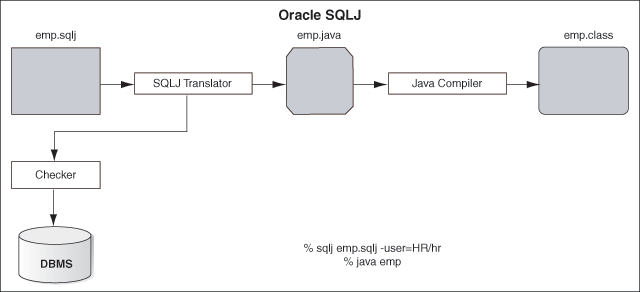

This chapter provides a general overview of SQLJ features and scenarios. The following topics are discussed:

- Overview of SQLJ

- Overview of SQLJ Components

- Overview of Oracle Extensions to the SQLJ Standard

- Basic Translation Steps and Run-Time Processing

- SQLJ Sample Code

- Alternative Deployment Scenarios

- Alternative Development Scenarios

### 3.1 Overview of SQLJ

This section introduces the basic concepts of SQLJ and discusses the complementary relationship between Java and PL/SQL in Oracle Database applications.

SQLJ enables applications programmers to embed SQL statements in Java code in a way that is compatible with the Java design philosophy. A SQLJ program is a Java program containing embedded SQL statements that comply with the International Organization for Standardization (ISO) standard SQLJ Language Reference syntax. The Oracle SQLJ implementation supports the ISO SQLJ standard. The standard covers only static SQL operations, which are predefined SQL operations that do not change in real time while a user runs the application. The Oracle SQLJ implementation also offers extensions to support dynamic SQL operations, which are not predefined and the operations can change in real time. It is also possible to use dynamic SQL operations through Java Database Connectivity (JDBC) code or PL/SQL code within a SQLJ application. Typical applications contain more static SQL operations than dynamic SQL operations.

SQLJ consists of a translator and a run-time component and is smoothly integrated into your development environment. You can run the translator to translate, compile, and customize the code in a single step using the `sqlj` front-end utility. The translation process replaces embedded SQL statements with calls to the SQLJ run time, which processes the SQL statements. In ISO SQLJ standard this is typically, but not necessarily, performed through calls to a JDBC driver. To access Oracle Database, you would typically use an Oracle JDBC driver. When you run the SQLJ application, the run time is started to handle the SQL operations.

The SQLJ translator is conceptually similar to other Oracle precompilers and enables you to check SQL syntax, verify SQL operations against what is available in the schema, and check the compatibility of Java types with corresponding database types. In this way, you can catch errors during development rather than a user catching the errors at run time. The translator checks the following:

- Syntax of the embedded SQL statements

- SQL constructs, against a specified database schema to ensure consistency within a particular set of SQL entities (optional)

  For example, it verifies table names and column names.

- Data types, to ensure that the data exchanged between Java and SQL have compatible types and proper type conversions

The SQLJ methodology of embedding SQL statements directly in Java code is very convenient and concise in a way that it reduces development and maintenance costs in Java programs that require database connectivity.

Java programs can call PL/SQL stored procedures and anonymous blocks through JDBC or SQLJ. In particular, SQLJ provides syntax for calling stored procedures and functions from within a SQLJ statement and also supports embedded PL/SQL anonymous blocks within a SQLJ statement.

**Note:**

Using PL/SQL anonymous blocks within SQLJ statements is one way to support dynamic SQL operations in a SQLJ application. However, the Oracle SQLJ implementation includes extensions to support dynamic SQL directly.

### 3.2 Overview of SQLJ Components

This section introduces the main two major SQLJ components in Oracle SQLJ implementation. It covers the following topics:

- SQLJ Translator Functionality

- SQLJ Run Time

#### 3.2.1 SQLJ Translator Functionality

This component is a precompiler that you run after creating SQLJ source code.

The translator, which is written in pure Java, supports a programming syntax that enables you to embed SQL statements in SQLJ executable statements. SQLJ executable statements and SQLJ declarations are preceded by the `#sql` token and can be interspersed with Java statements in a SQLJ source code file. SQLJ source code file names must have the `.sqlj` extension. The following is a sample SQLJ statement:

    #sql { INSERT INTO employees (first_name, salary) VALUES ('Joe', 43000) };

The translator produces a `.java` file.

You can invoke the translator using the `sqlj` command-line utility. On the command line, specify the files that need to be translated and any desired SQLJ option settings.

**See Also:**

[Translator Command Line and Options](translator-command-line-and-options.md)

#### 3.2.2 SQLJ Run Time

This component is also written in pure Java and is invoked automatically each time you run a SQLJ application.

Oracle JDBC calls are generated directly into the translated code and the SQLJ run time plays a much smaller role.

**See Also:**

"[SQLJ Run Time](translator-run-time-functionality.md)"

**Note:**

Since Oracle Database 10g Release 1, only Oracle JDBC drivers are supported with SQLJ.

### 3.3 Overview of Oracle Extensions to the SQLJ Standard

The Oracle SQLJ implementation supports the ISO SQLJ standard. Using the ISO SQLJ standard features requires a Java Development Kit (JDK) 6 or later environment that complies with Java2 Platform, Enterprise Edition (J2EE). The SQLJ translator accepts a broader range of SQL syntax than the ISO SQLJ standard specifies.

**Note:**

Oracle SQLJ implementation requires the run-time environment of JDK 6 or JDK 7.

The ISO SQLJ standard addresses not only the SQL-92 Entry level dialect of SQL, but also enables extension beyond that. The Oracle SQLJ implementation supports the Oracle SQL dialect, which is a superset of SQL-92 Entry level. If you need to create SQLJ programs that work with other databases, then avoid using SQL syntax and SQL types that are not in the Entry level of SQL-92 and, therefore, may not be supported in other environments.

This section covers the following topics:

- SQLJ Type Extensions

- SQLJ Functionality Extensions

**See Also:**

[Type Support](type-support.md), and [Objects\_ Collections\_ and OPAQUE Types](objects-collections-and-OPAQUE-types.md) for information about SQLJ extensions provided by Oracle Database

#### 3.3.1 SQLJ Type Extensions

The Oracle SQLJ implementation supports the following Java types as extensions to the SQLJ standard:

- Instances of `oracle.sql.*` classes as wrappers for SQL data.

  **See Also:**

  "[Support for JDBC 2.0 LOB Types and Oracle Type Extensions](type-support.md)"

- Custom Java classes, object references, and collections. For example, classes that implement the `oracle.sql.ORAData` interface or the JDBC standard `java.sql.SQLdata` interface.

  **Note:**

  The `SQLData` interface is standard. Classes that implement it are supported by JDBC drivers and databases of other vendors.

  **See Also:**

  "[Custom Java Classes](objects-collections-and-OPAQUE-types.md)"

- Stream instances: `BinaryStream` and `CharacterStream`, the latter of which replaces the deprecated `AsciiStream` and `UnicodeStream`, used as output parameters.

  **See Also:**

  "[Support for Streams](type-support.md)"

- Iterator and result set instances as input or output parameters. The SQLJ standard specifies them only in result expressions or cast statements.

  **See Also:**

  "[Using Iterators and Result Sets as Host Variables](basic-language-features.md)" and "[Using Iterators and Result Sets as Stored Function Returns](basic-language-features.md)"

- Unicode character types: `NString`, `NCHAR`, `NCLOB`, and `NcharCharacterStream`, the latter of which replaces the deprecated `NcharAsciiStream` and `NcharUnicodeStream`.

  **See Also:**

  "[SQLJ Extended Globalization Support](translator-run-time-functionality.md)"

Using any of these extensions requires Oracle-specific code generation or Oracle customization during translation, as well as Oracle SQLJ run time and an Oracle JDBC driver when your application runs. Do not use these or other types if you want to use your code in other environments. To ensure that your application is portable, use the SQLJ `-warn=portable` flag.

**See Also:**

See " [Translator Command Line and Options](translator-command-line-and-options.md)"

#### 3.3.2 SQLJ Functionality Extensions

The Oracle SQLJ implementation also supports the following extended functionality:

- Oracle-specific code generation

  This generates JDBC code directly. Much of the SQLJ run-time functionality is bypassed during program execution.

  **See Also:**

  "[Oracle-Specific Code Generation (No Profiles)](key-programming-considerations.md)"

- Dynamic SQL in SQLJ statements

  **See Also:**

  "[Support for Dynamic SQL](advanced-language-features.md)"

- Scrollable result set iterators with additional navigation methods, and `FETCH `syntax from result set iterators and scrollable result set iterators

  **See Also:**

  "[Scrollable Iterators](advanced-language-features.md)"

- Optimization flags for column and parameter size definitions

  **See Also:**

  "[Column Definitions](performance-and-debugging.md)", "[Parameter Size Definitions](performance-and-debugging.md)", and "[Options for Code Generation\_ Optimizations\_ and CHAR Comparisons](translator-command-line-and-options.md)"

- Flags for modified translator behavior, such as for binding host expressions by identifier or accounting for blank padding in `CHAR` comparisons for `WHERE` clauses

- SQLJ statement caching on connection contexts

  **See Also:**

  "[Statement Caching](performance-and-debugging.md)"

### 3.4 Basic Translation Steps and Run-Time Processing

SQLJ source code contains a mixture of standard Java source together with SQLJ class declarations and SQLJ executable statements containing embedded SQL statements. SQLJ source files have the `.sqlj` file name extension. The file name must be a legal Java identifier. If the source file declares a public class, then the file name must match the name of this class. If the source file does not declare a public class, then the file name should match the name of the first defined class.

This section covers the following topics:

- SQLJ Translation Steps

- Summary of Translator Input and Output

- SQLJ Run-Time Processing

#### 3.4.1 SQLJ Translation Steps

After you have written your `.sqlj` file, you must run SQLJ to process the files. The following example shows SQLJ being run in its simplest form with no command-line options for the `Foo.sqlj` source file with the public class `Foo`:

    % sqlj Foo.sqlj

This command runs a front-end script or utility depending on the platform. The script or utility reads the command line, invokes a Java virtual machine (JVM), and passes arguments to it. The JVM invokes the SQLJ translator and acts as a front end.

Figure 3-1 Flow of Control

[Description of "Figure 3-1 Flow of Control"](img_text/flow_of_control.md)

The following sequence of events occurs, presuming each step completes without error:

1.  The JVM invokes the SQLJ translator.

2.  The translator parses the SQLJ and Java code in the `.sqlj` file, checking for proper SQLJ syntax and looking for type mismatches between the declared SQL data types and corresponding Java host variables. Host variables are Java local variables that are used as input or output parameters in SQL operations.

    **See Also:**

    "[Java Host\_ Context\_ and Result Expressions](basic-language-features.md)"

3.  Depending on the SQLJ option settings, the translator invokes the online semantics-checker, the offline parser, neither, or both. This is to verify syntax of embedded SQL and PL/SQL statements and to check the use of database elements in the code against an appropriate database schema, for online checking. Even when neither is specified, some basic level of checking is performed.

    When online checking is specified, SQLJ will connect to a specified database schema to verify that the database supports all the database tables, stored procedures, and SQL syntax that the application uses. It also verifies that the host variable types in the SQLJ application are compatible with data types of corresponding database columns.

4.  For Oracle-specific SQLJ code generation (`-codegen=oracle`, which is default), SQL operations are converted directly into Oracle JDBC calls.

    **See Also:**

    "[Oracle-Specific Code Generation (No Profiles)](key-programming-considerations.md)"

    Generated Java code is put into a `.java` output file containing the following:

    - Any class definitions and Java code from the `.sqlj` source file

    - Class definitions created as a result of the SQLJ iterator and connection context declarations

      **See Also:**

      "[Overview of SQLJ Declarations](basic-language-features.md)"

    - Calls to Oracle JDBC drivers to implement the actions of the embedded SQL operations

5.  The JVM invokes the Java compiler, which is usually, but not necessarily, the standard `javac` provided with the Sun Microsystems JDK.

6.  The compiler compiles the Java source file generated in Step 4 and produces Java `.class` files as appropriate. This will include a `.class` file for each class that is defined, each of the SQLJ declarations.

**See Also:**

"[Internal Translator Operations](translator-run-time-functionality.md)"

##### General SQLJ Notes

Consider the following when translating and running SQLJ applications:

- The preceding is a very generic example. It is also possible to specify existing `.java` files on the command line to be compiled and to be available for type resolution as well.

  **See Also:**

  "[Translator Command Line and Properties Files](translator-command-line-and-options.md)"

- Your application requires an Oracle JDBC driver when it runs, even if your code does not use Oracle-specific features.

#### 3.4.2 Summary of Translator Input and Output

This section summarizes what the SQLJ translator takes as input, what it produces as output, and where it places its output. This section covers the following topics:

- Translator Input

- Translator Output

- Output File Locations

**Note:**

This discussion mentions iterator class and connection context class declarations. Iterators are similar to JDBC result sets and connection contexts are used for database connections.

##### 3.4.2.1 Translator Input

The SQLJ translator takes one or more `.sqlj` source files as input, which can be specified on the command line. The name of the main `.sqlj` file is based on the public class it defines, if any, else on the first class it defines.

If the main `.sqlj` file defines the `MyClass` class, then the source file name must be:

    MyClass.sqlj

This must also be the file name if there are no public class definitions, but `MyClass` is the first class defined. You must define each public class in separate`.sqlj` files. When you run SQLJ, you can also specify numerous SQLJ options on the command line or in the properties files.

**See Also:**

"[Translator Command Line and Properties Files](translator-command-line-and-options.md)"

##### 3.4.2.2 Translator Output

The translation step produces a Java source file for each `.sqlj` file in the application, presuming the source code uses SQLJ executable statements.

SQLJ generates Java source files as follows:

- Java source files are `.java` files with the same base names as the `.sqlj` files.

  For example, the translator produces `MyClass.java` corresponding to `MyClass.sqlj`, which defines the `MyClass` class. The output `.java` file also contains class definitions for any iterators or connection context classes declared in the `.sqlj` file.

The compilation step compiles the Java source file into multiple class files. One `.class` file is generated for each class defined in the `.sqlj` source file. Additional `.class` files are produced if you declared any SQLJ iterators or connection contexts. Also, separate `.class` files will be produced for any inner classes or anonymous classes in the code.

**See Also:**

"[Overview of SQLJ Declarations](basic-language-features.md)"

The `.class` files are named as follows:

- The class file for each class defined consists of the name of the class with the `.class` extension. For example, the translator output file `MyClass.java` is compiled into the `MyClass.class` class file.

- The translator names iterator classes and connection context classes according to how you declare them. For example, if you declare an iterator `MyIter`, then the compiler will generate a corresponding `MyIter.class` class file.

##### 3.4.2.3 Output File Locations

By default, SQLJ places the generated `.java` files in the same directory as the `.sqlj `file. You can specify a different `.java` file location using the SQLJ `-dir` option.

By default, SQLJ places the generated `.class` and `.ser` files in the same directory as the generated `.java` files. You can specify a different location for `.class` and `.ser` files using the SQLJ `-d` option. This option setting is passed to the Java compiler so that `.class` files and `.ser` files will be in the same location.

For both the `-d` and `-dir` option, you must specify a directory that already exists.

**See Also:**

"[Options for Output Files and Directories](translator-command-line-and-options.md)"

#### 3.4.3 SQLJ Run-Time Processing

This section discusses run-time processing during program execution.

When you translate with the default `-codegen=oracle` setting, your program performs the following at run time:

- Executes Oracle-specific application programming interfaces (APIs) that ensure batching support and proper creation and closing of Oracle JDBC statements

- Directly calls Oracle JDBC APIs for registering, passing, and retrieving parameters and result sets

**See Also:**

"[Oracle-Specific Code Generation (No Profiles)](key-programming-considerations.md)"

### 3.5 SQLJ Sample Code

This section presents a side-by-side comparison of two versions of the same sample code, where one version is written in SQLJ and the other in JDBC. The objective of this section is to point out the differences in coding requirements between SQLJ and JDBC. This section covers:

- SQLJ Version of the Sample Code

- JDBC Version of the Sample Code

**Note:**

The particulars of SQLJ statements and features used here are described later in this manual, but this example is still useful here to give you a general idea in comparing and contrasting SQLJ and JDBC. You can look at it again when you are more familiar with SQLJ concepts and features.

In the sample, two methods are defined: `getEmployeeAddress()`, which selects and returns an employee's address from a table based on the employee's number, and `updateAddress()`, which takes the retrieved address, calls a stored procedure, and returns the updated address to the database.

In both versions of the sample code, the following assumptions are made:

- A SQL script has been run to create the schema in the database and populate the tables. Both versions of the sample code refer to objects and tables created by this script.

- The `UPDATE_ADDRESS()` PL/SQL stored function exists, and it updates a given address.

- The `Connection` object (for JDBC) and default connection context (for SQLJ) have been created previously by the caller.

- Exceptions are handled by the caller.

- The value of the address argument, `addr`, passed to the `updateAddress()` method can be `null`.

  **Note:**

  The JDBC and SQLJ versions of the sample code are only partial samples and cannot run independently. There is no `main()` method in either.

#### 3.5.1 SQLJ Version of the Sample Code

The SQLJ version of the sample code that defines methods to retrieve an employee's address from the database, update the address, and return it to the database is as follows:

    import java.sql.*;

    /**
      This is what you have to do in SQLJ
      **/
    public class SimpleDemoSQLJ                                  // line 6
    {
      //TO DO: make a main that calls this

      public Address getEmployeeAddress(int empno)              // line 10
        throws SQLException
      {
        Address addr;                                           // line 13
        #sql { SELECT office_addr INTO :addr FROM employees
               WHERE empnumber = :empno };
        return addr;
      }
                                                                // line 18
      public Address updateAddress(Address addr)
        throws SQLException
      {
        #sql addr = { VALUES(UPDATE_ADDRESS(:addr)) };          // line 22
        return addr;
      }
    }

##### Line 10

The `getEmployeeAddress()` method does not require an explicit `Connection` object. SQLJ can use a default connection context instance, which should be initialized somewhere earlier in the application.

##### Lines 13-15

The `getEmployeeAddress()` method retrieves an employee address according to the employee number. Use standard SQLJ `SELECT` `INTO` syntax to select an employee's address from the `employee` table if the employee number matches the one (`empno`) passed in to `getEmployeeAddress()`. This requires a declaration of the `Address` object (`addr`) that will receive the data. The `empno` and `addr` variables are used as input host variables.

##### Line 16

The `getEmployeeAddress()` method returns the `addr` object.

##### Line 19

The `updateAddress()` method also uses the default connection context instance.

##### Lines 19-22

The address is passed to the `updateAddress()` method, which passes it to the database. The database updates the address and passes it back. The actual updating of the address is performed by the `UPDATE_ADDRESS()` stored function. Use standard SQLJ function-call syntax to receive the `addr` address object returned by `UPDATE_ADDRESS()`.

##### Line 23

The `updateAddress()` method returns the `addr` object.

##### Specific Features of the SQLJ Version of the Code

Note the following features of the SQLJ version of the sample code:

- An explicit connection is not required. SQLJ can use a default connection context that has been initialized previously in the application.

- No data type casting is required.

- SQLJ does not require knowledge of `_SQL_TYPECODE`, `_SQL_NAME`, or factories.

- `NULL` value data is processed implicitly.

- No explicit code for resource management (for example, closing statements or results sets) is required.

- SQLJ embeds host variables, in contrast to JDBC, which uses parameter markers.

- String concatenation for long SQL statements is not required.

- You do not have to register output parameters.

- SQLJ syntax is simpler. For example, `SELECT INTO` statements are supported and ODBC-style escapes are not used.

- You do not have to implement your own statement cache. By default, SQLJ will automatically cache `#sql` statements. This results in improved performance, for example, if you repeatedly call `getEmployeeAddress()` and `updateAddress()`.

#### 3.5.2 JDBC Version of the Sample Code

If you are familiar with JDBC, then you can check the following the JDBC version of the sample code, which defines methods to retrieve an employee's address from the database, update the address, and return it to the database.

**Note:**

- SQLJ automatically closes any cursors that it opens implicitly. When rewriting your SQLJ code in JDBC, you must explicitly close the statement (for example, `PreparedStatement` or `CallableStatement`) objects and the `ResultSet` object, as shown in the code included in this section.
- The `TO` `DO` items in the comment lines indicate where you may have to add additional code to increase the usefulness of the code sample.

<!-- -->

    import java.sql.*;
    import oracle.jdbc.*;

    /**
      This is what you have to do in JDBC
      **/
    public class SimpleDemoJDBC                                  // line 7
    {

    //TO DO: make a main that calls this

      public Address getEmployeeAddress(int empno, Connection conn)
        throws SQLException                                     // line 13
      {
        Address addr;
        PreparedStatement pstmt =                               // line 16
          conn.prepareStatement("SELECT office_addr FROM employees" +
           " WHERE empnumber = ?");
        pstmt.setInt(1, empno);
        OracleResultSet rs = (OracleResultSet)pstmt.executeQuery();
        rs.next();                                              // line 21
         //TO DO: what if false (result set contains no data)?
        addr = (Address)rs.getORAData(1, Address.getORADataFactory());
        //TO DO: what if additional rows?
        rs.close();                                             // line 25
        pstmt.close();
        return addr;                                            // line 27
      }
      public Address updateAddress(Address addr, Connection conn)
        throws SQLException                                     // line 30

      {
        OracleCallableStatement cstmt = (OracleCallableStatement)
          conn.prepareCall("{ ? = call UPDATE_ADDRESS(?) }");   //line 34
        cstmt.registerOutParameter(1, Address._SQL_TYPECODE, Address._SQL_NAME);
                                                                // line 36
        if (addr == null) {
          cstmt.setNull(2, Address._SQL_TYPECODE, Address._SQL_NAME);
        } else {
          cstmt.setORAData(2, addr);
        }

        cstmt.executeUpdate();                                  // line 43
        addr = (Address)cstmt.getORAData(1, Address.getORADataFactory());
        cstmt.close();                                          // line 45
        return addr;
      }
    }

### 3.6 Alternative Deployment Scenarios

Although this manual mainly discusses writing for client-side SQLJ applications, you may find it useful to run SQLJ code from an applet.

#### 3.6.1 Running SQLJ in Applets

Because the SQLJ run time is pure Java, you can use SQLJ source code in applets as well as applications. However, there are a few considerations.

**See Also:**

[Oracle Database JDBC Developer’s Guide](../jjdbc/index.md)

This section covers the following topics:

- General Development and Deployment Considerations

- General End User Considerations

- Java Environment and the Java Plug-In

##### 3.6.1.1 General Development and Deployment Considerations

The following general considerations apply to the use of SQLJ in applets:

- You must package all the SQLJ run-time packages with your applet. The packages are:

      sqlj.runtime
      sqlj.runtime.ref
      sqlj.runtime.error

  Also package the following if you used Oracle customization:

      oracle.sqlj.runtime
      oracle.sqlj.runtime.error

  These packages are included with your Oracle installation in one of several run-time libraries in the `ORACLE_HOME``/lib` directory.

  **See Also:**

  "[Requirements for Using the Oracle SQLJ Implementation](getting-started.md)"

- You must specify a pure Java JDBC driver, such as Oracle JDBC Thin driver, for your database connection.

- You must explicitly specify a connection context instance for each SQLJ executable statement in an applet. This is a requirement because you could conceivably run two SQLJ applets in a single browser and, thus, in the same JVM.

  **See Also:**

  "[Connection Considerations](key-programming-considerations.md)"

- The default translator setting `-codegen=oracle` generates Oracle-specific code. This will eliminate the use of Java reflection at run time and, thus, increase portability across different browser environments.

##### 3.6.1.2 General End User Considerations

When end users run your SQLJ applet, classes in their `CLASSPATH` may conflict with classes that are downloaded with the applet. Therefore, Oracle recommends that end users clear their `CLASSPATH` before running the applet.

##### 3.6.1.3 Java Environment and the Java Plug-In

The following are some additional considerations regarding the Java environment and use of Oracle-specific features:

- SQLJ requires the run-time environment of JDK 6 or JDK 7. Users cannot run SQLJ applets in browsers using earlier JDK versions, without a plug-in. One option is to use a Java plug-in offered by Sun Microsystems. For information, refer to the following:

  [`http://www.oracle.com/technetwork/java/index.html`](http://www.oracle.com/technetwork/java/index.html)

- Applets using Oracle-specific features require Oracle SQLJ run time to work. Oracle SQLJ run time consists of the classes in the SQLJ run-time library file under `oracle.sqlj.*`. Oracle SQLJ `runtime.jar` library requires the Java Reflection API, `java.lang.reflect.*`. Most browsers do not support the Reflection API or impose security restrictions, but the Sun Microsystems Java plug-in provides support for the Reflection API.

  **Note:**

  The term "Oracle-specific features" refers to the use of Oracle type extensions (discussed in [Type Support](type-support.md)) and the use of SQLJ features that require Oracle-specific code generation or, for ISO SQLJ standard code generation, require your application to be customized to work against Oracle Database instance. (For example, this is true of the `SET` statement, discussed in [Basic Language Features](basic-language-features.md).)

The preceding issues can be summarized as follows, focusing on users with Internet Explorer and Netscape browsers:

- The SQLJ and JDBC versions should match. For example, to use the SQLJ 9.0.0 run time, you must have an Oracle 9.0.0 or earlier JDBC driver.

  **See Also:**

  "[Requirements for Using the Oracle SQLJ Implementation](getting-started.md)"

- If you use object types, JDBC 2.0 types, REF CURSORs, or the `CAST` statement in your SQLJ statements, then you must adhere to your choice of the following:

  - Use the default `-codegen=oracle` setting when you translate your applet.

  - Ensure that the browser that you use supports JDK 6 and permits reflection.

  - Run your applet through a browser Java plug-in.

### 3.7 Alternative Development Scenarios

The discussion in this book assumes that you are coding manually on a UNIX environment for English-language deployment. However, you can use SQLJ on other platforms and with integrated development environments (IDEs). There is also globalization support for deployment to other languages. This section covers the following topics:

- SQLJ Globalization Support

- SQLJ in Oracle JDeveloper 10g and Other IDEs

- Windows Considerations

#### 3.7.1 SQLJ Globalization Support

Support for native languages and character encodings by the Oracle SQLJ implementation is based on Java built-in globalization support capabilities.

The standard `user.language` and `file.encoding` properties of the JVM determine appropriate language and encoding for translator and run-time messages. The SQLJ `-encoding` option determines encoding for interpreting and generating source files during translation.

**See Also:**

"[Globalization Support in the Translator and Run Time](translator-run-time-functionality.md)"

#### 3.7.2 SQLJ in Oracle JDeveloper 10g and Other IDEs

The Oracle SQLJ implementation includes a programmatic API so that it can be embedded in IDEs, such as Oracle JDeveloper 10g. The IDE takes on a role similar to that of the front-end `sqlj` script, invoking the translator, semantics-checker, compiler, and customizer (as applicable).

JDeveloper is a Jave-based, cross-platform visual development environment for Java programming. The JDeveloper Suite enables developers to build multitier, scalable Internet applications using Java across the Oracle Internet Platform. The core product of the suite, the JDeveloper IDE, excels in creating, debugging, and deploying component-based applications.

Oracle JDBC OCI and Thin drivers are included with JDeveloper. The compilation functionality of JDeveloper includes an integrated SQLJ translator so that your SQLJ application is translated automatically as it is compiled.

#### 3.7.3 Windows Considerations

Note the following if you are using a Microsoft Windows environment instead of a UNIX environment:

- This manual uses UNIX syntax. Use platform-specific file names and directory separators, such as "\\ on Microsoft Windows, that are appropriate for your platform, because your JVM expects file names and paths in the platform-specific format. This is true even if you are using a shell, such as `ksh`, that permits a different file name syntax.

- For UNIX, the Oracle SQLJ implementation provides a front-end script, `sqlj`, that you use to invoke the SQLJ translator. On Microsoft Windows, Oracle instead provides an executable file, `sqlj.exe`. Using a script is not feasible on Microsoft Windows because `.bat` files on these platforms do not support embedded equals signs (=) in arguments, string operations on arguments, or wildcard characters in file name arguments.

- How to set environment variables is specific to the operating system. There may also be OS-specific restrictions. In Windows 95, use the `Environment` tab in the `System` control panel. Additionally, because Windows 95 does not support the "=" character in variable settings, SQLJ supports the use of "#" instead of "=" in setting `SQLJ_OPTIONS`, an environment variable that SQLJ can use for option settings. Consult your operating system documentation regarding settings and syntax for environment variables, and be aware of any size limitations.

- As with any operating system and environment you use, be aware of specific limitations. In particular, the complete, expanded SQLJ command line must not exceed the maximum command-line size, which is 250 characters for Windows 95 and 4000 characters for Windows NT. Consult your operating system documentation.

Refer to the release notes for Windows for additional information.
