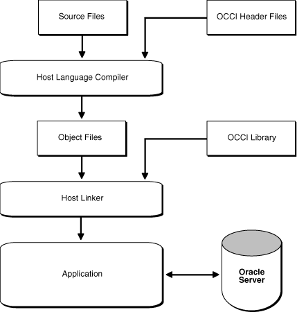

This chapter provides an overview of Oracle C++ Call Interface (OCCI) and introduces terminology used in discussing OCCI. You are provided with the background information needed to develop C++ applications that run in an Oracle environment.

This chapter contains these topics:

- Overview of OCCI

- About Processing SQL Statements

- Overview of PL/SQL

- About Special OCCI/SQL Terms

- About Object Support

- About Additional Support

### 1.1 Overview of OCCI

Oracle C++ Call Interface (OCCI) is an Application Programming Interface (API) that provides C++ applications access to data in an Oracle database. OCCI enables C++ programmers to use the full range of Oracle database operations, including SQL statement processing and object manipulation.

OCCI provides for:

- High performance applications through the efficient use of system memory and network connectivity

- Scalable applications that can service an increasing number of users and requests

- Comprehensive support for application development by using Oracle database objects, including client-side access to Oracle database objects

- Simplified user authentication and password management

- n-tiered authentication

- Consistent interfaces for dynamic connection management and transaction management in two-tier client/server environments or multitiered environments

- Encapsulated and opaque interfaces

OCCI provides a library of standard database access and retrieval functions in the form of a dynamic run-time library (OCCI classes) that can be linked in a C++ application at run time. This eliminates the requirement to embed SQL or PL/SQL within third-generation language (3GL) programs.

This section discusses the following topics:

- About Benefits of OCCI

- About Building a C++ Application with OCCI

- About Functionality of OCCI

- About Procedural and Nonprocedural Elements

#### 1.1.1 About Benefits of OCCI

OCCI provides these significant advantages over other methods of accessing an Oracle database:

- Leverages C++ and the Object Oriented Programming paradigm

- Is easy to use

- Is easy to learn for those familiar with JDBC

- Has a navigational interface to manipulate database objects of user-defined types as C++ class instances

Note that OCCI does not support nonblocking mode.

#### 1.1.2 About Building a C++ Application with OCCI

As Figure 1-1 shows, you compile and link an OCCI program in the same way that you compile and link an application that does not use the database.

Figure 1-1 The OCCI Development Process

[Description of "Figure 1-1 The OCCI Development Process"](img_text/occi_development_process.md)

Oracle supports most popular third-party compilers. The details of linking an OCCI program vary from system to system. On some platforms, it may be necessary to include other libraries, in addition to the OCCI library, to properly link your OCCI programs.

**See Also:**

Your operating system-specific Oracle documentation and the Oracle Database Installation Guide for more information about compiling and linking an OCCI application for your specific platform

#### 1.1.3 About Functionality of OCCI

OCCI provides the following functionality:

- APIs to design scalable, multithreaded applications that can support large numbers of users securely

- SQL access functions, for managing database access, processing SQL statements, and manipulating objects retrieved from an Oracle database server

- Data type mapping and manipulation functions, for manipulating data attributes of Oracle types

- Advanced Queuing for message management

- XA compliance for distributed transaction support

- Statement caching of SQL and PL/SQL queries

- Connection pooling for managing multiple connections

- Globalization and Unicode support to customize applications for international and regional language requirement

- Object Type Translator Utility

- Transparent Application Failover support

#### 1.1.4 About Procedural and Nonprocedural Elements

Oracle C++ Call Interface (OCCI) enables you to develop scalable, multithreaded applications on multitiered architectures that combine nonprocedural data access power of structured query language (SQL) with procedural capabilities of C++.

In a nonprocedural language program, the set of data to be operated on is specified, but what operations may performed, or how the operations can be carried out, is not specified. The nonprocedural nature of SQL makes it an easy language to learn and use to perform database transactions. It is also the standard language used to access and manipulate data in modern relational and object-relational database systems.

In a procedural language program, the execution of most statements depends on previous or subsequent statements and on control structures, such as loops or conditional branches, which are not available in SQL. The procedural nature of these languages makes them more complex than SQL, but it also makes them very flexible and powerful.

The combination of both nonprocedural and procedural language elements in an OCCI program provides easy access to an Oracle database in a structured programming environment.

OCCI supports all SQL data definition, data manipulation, query, and transaction control facilities that are available through an Oracle database server. For example, an OCCI program can run a query against an Oracle database. The queries can require the program to supply data to the database by using input (bind) variables, as follows:

    SELECT name FROM employees WHERE employee_id = :empnum

In this SQL statement, `empnum` is a placeholder for a value that is supplied by the application.

In an OCCI application, you can also take advantage of PL/SQL, Oracle's procedural extension to SQL. The applications you develop can be more powerful and flexible than applications written in SQL alone. OCCI also provides facilities for accessing and manipulating objects in an Oracle database server.

### 1.2 About Processing SQL Statements

One of the main tasks of an OCCI application is to process SQL statements. Different types of SQL statements require different processing steps in your program. It is important to take this into account when coding your OCCI application. Oracle recognizes several types of SQL statements:

- About Data Definition Language Statements

- About Control Statements

- About Data Manipulation Language Statements

- About Queries

#### 1.2.1 About Data Definition Language Statements

Data Definition Language (DDL) statements manage schema objects in the database. These statements create new tables, drop old tables, and establish other schema objects. They also control access to schema objects. Example 1-1 illustrates how to create a table, and Example 1-2 shows how to grant and revoke privileges on this table.

DDL statements also allow you to work with objects in the Oracle database, as in Example 1-3, which illustrates how to create an object table.

Example 1-1 Creating a Table

    CREATE TABLE employee_information (
       employee_id NUMBER(6),
       ssn NUMBER(9),
       dependents NUMBER(1),
       mail_address VARCHAR(60))

Example 1-2 Specifying Access to a Table

    GRANT UPDATE, INSERT, DELETE ON employee_information TO donna
    REVOKE UPDATE ON employee_information FROM jamie

Example 1-3 Creating an Object Table

    CREATE TYPE person_info_type AS OBJECT (
       employee_id NUMBER(6),
       ssn NUMBER(9),
       dependents NUMBER(1),
       mail_address VARCHAR(60))

    CREATE TABLE person_info_table OF person_info_type

#### 1.2.2 About Control Statements

OCCI applications treat transaction control, connection control, and system control statements (for example, DML statements).

**See Also:**

[Oracle Database SQL Language Reference](../sqlrf/Types-of-SQL-Statements.md) for information about control statements.

#### 1.2.3 About Data Manipulation Language Statements

Data Manipulation Language (DML) statements can change data in database tables. For example, DML statements insert new rows into a table, update column values in existing rows, delete rows from a table, lock a table in the database, and explain the execution plan for a SQL statement.

DML statements may require an application to supply data to the database by using input bind variables, as in Example 1-4. This statement can be executed several times with different bind values, or several rows can be added through array insert in a single round-trip to the server.

DML statements also enable you to work with objects in the Oracle Database, as in Example 1-5, which shows the insertion of an instance of a type into an object table.

Example 1-4 Inserting Data Through Input Bind Variables

    INSERT INTO departments VALUES(:1,:2,:3)

Example 1-5 Inserting Objects into the Oracle Database

    INSERT INTO person_info_table
    VALUES (person_info_type('450987','123456789','3','146 Winfield Street'))

#### 1.2.4 About Queries

Queries are statements that retrieve data from tables in a database. A query can return zero, one, or many rows of data. All queries begin with the SQL keyword `SELECT`, as in Example 1-6:

Queries can require the program to supply data to the database server by using input bind variables, as in Example 1-7:

In this SQL statement, `emp_id` is a placeholder for a value that is supplied by the application.

Example 1-6 Using the Simple SELECT Statement

    SELECT department_name FROM departments
       WHERE department_id = 30

Example 1-7 Using the SELECT Statement with Input Variables

    SELECT first_name, last_name
       FROM employees
       WHERE employee_id = :emp_id

### 1.3 Overview of PL/SQL

PL/SQL is Oracle's procedural extension to the SQL language. PL/SQL processes tasks that are more complicated than simple queries and SQL data manipulation language statements. PL/SQL allows several constructs to be grouped into a single block and executed as a unit. Among these are the following constructs:

- One or more SQL statements

- Variable declarations

- Assignment statements

- Procedural control statements (`IF` `...` `THEN` `...` `ELSE` statements and loops)

- Exception handling

In addition to calling PL/SQL stored procedures from an OCCI program, you can use PL/SQL blocks in your OCCI program to perform the following tasks:

- Call other PL/SQL stored procedures and stored functions.

- Combine procedural control statements with several SQL statements, to be executed as a unit.

- Access special PL/SQL features such as records, tables, cursor FOR loops, and exception handling.

- Use cursor variables.

- Access and manipulate objects in an Oracle database.

A PL/SQL procedure or function can also return an output variable. This is called an out bind variable, as in Example 1-8:

Here, the first parameter is an input variable that provides the ID number of an employee. The second parameter, or the out bind variable, contains the return value of employee name.

PL/SQL can also be used to issue a SQL statement to retrieve values from a table of employees, given a particular employee number. Example 1-9 demonstrates the use of placeholders in PL/SQL statements.

Note that the placeholders in this statement are not PL/SQL variables. They represent input and output parameters passed to and from the database server when the statement is processed. These placeholders must be specified in your program.

Example 1-8 Using PL/SQL to Obtain an Output Variable

    GET_EMPLOYEE_NAME(:1, :2);

Example 1-9 Using PL/SQL to Insert Partial Records into Placeholders

    SELECT last_name, first_name, salary, commission_pct
       INTO :emp_last, :emp_first, :sal, :comm
       FROM employees
       WHERE employee_id = :emp_id;

### 1.4 About Special OCCI/SQL Terms

This guide uses special terms to refer to the different parts of a SQL statement. Consider Example 1-10:

This example contains these parts:

- A SQL command: `SELECT`

- Three select-list items: `first_name`, `last_name`, and `email`

- A table name in the `FROM` clause: `employees`

- Two column names in the `WHERE` clause: `department_id` and `commission_pct`

- A numeric input value in the `WHERE` clause: `40`

- A placeholder for an input bind variable in the `WHERE` clause: `:base`

When you develop your OCCI application, you call routines that specify to the database server the value of, or reference to, input and output variables in your program. In this guide, specifying the placeholder variable for data is called a bind operation. For input variables, this is called an in bind operation. For output variables, this is called an out bind operation.

Example 1-10 Using SQL to Extract Partial Records

    SELECT first_name, last_name, email
       FROM employees
       WHERE department_id = 80
       AND commission_pct > :base;

### 1.5 About Object Support

OCCI has facilities for working with object types and objects. An object type is a user-defined data structure representing an abstraction of a real-world entity. For example, the database might contain a definition of a `person` object. That object type might have attributes, such as `first_name`, `last_name`, and `age`, which represent a person's identifying characteristics.

The object type definition serves as the basis for creating objects, which represent instances of the object type. By using the object type as a structural definition, a `person` object could be created with the attributes `John`, `Bonivento`, and `30`. Object types may also contain methods, or programmatic functions that represent the behavior of that object type.

**See Also:**

- [Oracle Database Concepts](../cncpt/tables-and-table-clusters.md)

- [Oracle Database Object-Relational Developer's Guide](../adobj/introduction-to-oracle-objects.md)for a more detailed explanation of object types and objects

OCCI provides a comprehensive API for programmers seeking to use the Oracle database server's object capabilities. These features can be divided into several major categories, which are discussed in subsequent topics:

- About Client-Side Object Cache

- About Run-time Environment for Objects

- About Associative and Navigational Interfaces

- About Interoperability with C (OCI)

- About the Metadata Class

- About the Object Type Translator Utility

#### 1.5.1 About Client-Side Object Cache

The object cache is a client-side memory buffer that provides lookup and memory management support for objects. It stores and tracks objects which have been fetched by an OCCI application from the server to the client side. The client-side object cache is created when the OCCI environment is initialized in `object` mode. Multiple applications running against the same server have their own object cache. The client-side object cache tracks the objects that are currently in memory, maintains references to objects, manages automatic object swapping and tracks the meta-attributes or type information about objects. The client-side object cache provides the following benefits:

- Improved application performance by reducing the number of client/server round-trips required to fetch and operate on objects

- Enhanced scalability by supporting object swapping from the client-side cache

- Improved concurrency by supporting object-level locking

- Automatic garbage collection when cache thresholds are exceeded

#### 1.5.2 About Run-time Environment for Objects

OCCI provides a run-time environment for objects that offers a set of methods for managing how Oracle objects are used on the client side. These methods provide the necessary functionality for performing these tasks:

- Connecting to an Oracle database server to access its object functionality

- Allocating the client-side object cache and tuning its parameters

- Retrieving error and warning messages

- Controlling transactions that access objects in the database

- Associatively accessing objects through SQL

- Describing a PL/SQL procedure or function whose parameters or result are of Oracle object type

#### 1.5.3 About Associative and Navigational Interfaces

Applications that use OCCI can access objects in the database through several types of interfaces, such as SQL `SELECT`, `INSERT`, and `UPDATE` statements, and C++ pointers and references that access objects in the client-side object cache by traversing the corresponding references.

OCCI provides a set of methods to support object manipulation by using SQL `SELECT`, `INSERT`, and `UPDATE` statements. To access Oracle objects, these SQL statements use a consistent set of steps as if they were accessing relational tables. OCCI provides methods to access objects by using SQL statements for:

- Binding object type instances and references as input and output variables of SQL statements and PL/SQL stored procedures

- Executing SQL statements that contain object type instances and references

- Fetching object type instances and references

- Retrieving column values from a result set as objects

- Describing a select-list item of an Oracle object type

OCCI provides a seamless interface for navigating objects, enabling you to manipulate database objects in the same way that you would operate on transient C++ objects. You can dereference the overloaded arrow (`->`) operator on an object reference to transparently materialize the object from the database into the application space.

#### 1.5.4 About Interoperability with C (OCI)

The OCCI application can retrieve the underlying OCI handles and descriptors by calling `getOCI``xxx``()` methods on the OCCI class instances. These handles can be used to call OCI functions.

Note that the application must be aware that if any properties are changed on the OCI handles, the corresponding OCCI instances may or may not reflect this.

This interoperability between OCCI and OCI is not supported if the application uses OCI functions for any object-related functionality.

#### 1.5.5 About the Metadata Class

Each Oracle data type is represented in OCCI by a C++ class. The class exposes the behavior and characteristics of the data type by overloaded operators and methods. For example, the Oracle data type `NUMBER` is represented by `the Number `class. OCCI provides a metadata class that enables you to retrieve metadata describing database objects, including object types.

#### 1.5.6 About the Object Type Translator Utility

The Object Type Translator (OTT) utility translates schema information about Oracle object types into client-side language bindings. That is, OTT translates object type information into declarations of host language variables, such as structures and classes. OTT takes an `intype` file that contains information about Oracle database schema objects as input. OTT generates an `outtype` file and the necessary header and implementation files that must be included in a C++ application that runs against the object schema.

In summary, OCCI supports object handling in an Oracle database by:

- Improving application developer productivity by eliminating the requirement to write the host language variables that correspond to schema objects

- Maintaining SQL as the data definition language of choice by providing the ability to automatically map Oracle database schema objects created by SQL to host language variables; this allows Oracle to support a consistent, enterprise-wide model of the user's data

- Facilitating schema evolution of object types by regenerating included header files when the schema is changed, allowing Oracle applications to support schema evolution

- Executing SQL statements that manipulate object data and schema information

- Passing object references and instances as input variables in SQL statements

- Declaring object references and instances as variables to receive the output of SQL statements

- Fetching object references and instances from a database

- Describing properties of SQL statements that return object instances and references

- Describing PL/SQL procedures or functions with object parameters or results

- Extending commit and rollback calls to synchronize object and relational functionality

- Advanced queuing of objects

OTT is typically invoked from the command line by specifying the intype file, the outtype file, and the specific database connection.

### 1.6 About Additional Support

This section discusses how to build the OCCI examples that ship with Oracle Database, and additional resources:

- Building OCCI Demos

- About OCCI on the Oracle Technology Network

#### 1.6.1 Building OCCI Demos

You must install the demonstration programs as described in Oracle Database Examples Installation Guide. Parts of these demos are used as examples in this book. To build the examples, see the following steps:

1.  Navigate to the demo directory.
    On Windows, this directory is `ORACLE_HOME``\rdbms\demo`.

    On Linux and UNIX, this directory is `ORACLE_HOME``/rdbms/demo`.
2.  Ensure that this directory contains the file `demo_rdbms.mk`.
3.  Create the OCCI demo using the `make` command.
    - To make all the demos at the same time, use the following parameters:

          make -f demo_rdbms.mk occidemos

    - To make only one demo, use parameters:

          make -f demo_rdbms.mk demoname

    - To make a single demo with objects, use parameters:

          make -f demo_rdbms.mk buildocci EXE=demoname OBJS=demoname.o

    - To make a single demo with static libraries, use parameters:

          make -f demo_rdbms.mk buildocci_static EXE=demoname OBJS=demoname.o

    - For more options, examine the `demo_rdbms.mk` file.

#### 1.6.2 About OCCI on the Oracle Technology Network

You can find additional information on OCCI, including a forum, downloads, and white papers, at: [Oracle Technology Network — Oracle C\_++\_Call Interface](https://www.oracle.com/pls/topic/lookup?ctx=en/database/oracle/oracle-database/19/lncpp&id=oracle_cpp_call_interface).
