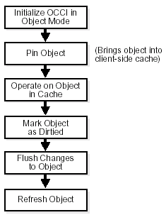

This chapter provides information on how to implement object-relational programming using the Oracle C++ Call Interface (OCCI).

This chapter contains these topics:

- Overview of Object Programming

- About Working with Objects in C++ with OCCI

- About Representing Objects in C++ Applications

- About Developing a C++ Application using OCCI

- Migrating C++ Applications to Oracle Using OCCI

- Overview of Associative Access

- Overview of Navigational Access

- Overview of Complex Object Retrieval

- Working with Collections

- About Using Object References

- About Deleting Objects from the Database

- About Type Inheritance

- A Sample OCCI Application

### 4.1 Overview of Object Programming

OCCI supports both the associative and navigational style of data access. Traditionally, third-generation language (3GL) programs manipulate data stored in a database by using the associative access based on the associations organized by relational database tables. In associative access, data is manipulated by executing SQL statements and PL/SQL procedures. OCCI supports associative access to objects by enabling your applications to execute SQL statements and PL/SQL procedures on the database server without incurring the cost of transporting data to the client.

Object-oriented programs that use OCCI can also make use of navigational access that is a key aspect of this programming paradigm. Object relationships between objects are implemented as references (`REF`s). Typically, an object application that uses navigational access first retrieves one or more objects from the database server by issuing a SQL statement that returns `REF`s to those objects. The application then uses those `REF`s to traverse related objects, and perform computations on these other objects as required. Navigational access does not involve executing SQL statements, except to fetch the references of an initial set of objects. By using the OCCI APIs for navigational access, your application can perform the following functions on Oracle objects:

- Creating, accessing, locking, deleting, copying and flushing objects

- Getting references to objects and navigating through the references

This chapter gives examples that show you how to create a persistent object, access an object, modify an object, and flush the changes to the database server. It discusses how to access the object using both navigational and associative approaches.

### 4.2 About Working with Objects in C++ with OCCI

Many of the programming principles that govern a relational OCCI applications are identical for object-relational applications. An object-relational application uses the standard OCCI calls to establish database connections and process SQL statements. The difference is that the SQL statements that are issued retrieve object references, which can then be manipulated with OCCI object functions. An object can also be directly manipulated as a value (without using its object reference).

Instances of an Oracle type are categorized into persistent objects and transient objects based on their lifetime. Instances of persistent objects can be further divided into standalone objects and embedded objects depending on whether they are referenced by way of an object identifier.

This section discusses the following topics:

- About Persistent Objects

- About Transient Objects

- About Values

#### 4.2.1 About Persistent Objects

A persistent object is an object which is stored in an Oracle database. It may be fetched into the object cache and modified by an OCCI application. The lifetime of a persistent object can exceed that of the application which is accessing it. There are two types of persistent objects:

- A standalone instance is stored in a database table row, and has a unique object identifier. An OCCI application can retrieve a reference to a standalone object, pin the object, and navigate from the pinned object to other related objects. Standalone objects may also be referred to as referenceable objects.

  It is also possible to select a persistent object, in which case you fetch the object by value instead of fetching it by reference.

- An embedded instance is not stored in a database table row, but rather is embedded within another object. Examples of embedded objects are objects which are attributes of another object, or objects that exist in an object column of a database table. Embedded objects do not have object identifiers, and OCCI applications cannot get `REF`s to embedded instances.

  Embedded objects may also be referred to as nonreferenceable objects or value instances. You may sometimes see them referred to as values, which is not to be confused with scalar data values. The context should make the meaning clear.

Users do not have to explicitly delete persistent objects that have been materialized through references.

Users should delete persistent objects created by application when the transactions are rolled back

The SQL examples, Example 4-1 and Example 4-2, demonstrate the difference between these two types of persistent objects.

Example 4-1 Creating Standalone Objects

Objects that are stored in the object table `person_tab` are standalone objects. They have object identifiers and can be referenced. They can be pinned in an OCCI application.

    CREATE TYPE person_t AS OBJECT
       (name      varchar2(30),
        age       number(3));
    CREATE TABLE person_tab OF person_t;

Example 4-2 Creating Embedded Objects

Objects which are stored in the `manager` column of the `department` table are embedded objects. They do not have object identifiers, and they cannot be referenced. Therefore, they cannot be pinned in an OCCI application, and they also never have to be unpinned. They are always retrieved into the object cache by value.

    CREATE TABLE department
       (deptno     number,
        deptname   varchar2(30),
        manager    person_t);

The Array Pin feature allows a vector of references to be dereferenced in one round-trip to return a vector of the corresponding objects. A new global method, `pinVectorOfRefs()`, takes a vector of `Ref`s and populates a vector of `PObject`s in a single round-trip, saving the cost of pinning `n-1` references in `n-1` round-trips.

#### 4.2.2 About Transient Objects

A transient object is an instance of an object type. Its lifetime cannot exceed that of the application. The application can also delete a transient object at any time.

The Object Type Translator (OTT) utility generates two `operator new` methods for each C++ class, as demonstrated in Example 4-3Example 4-3:

Example 4-4 demonstrates how to dynamically create a transient object. Transient objects cannot be converted to persistent objects. Their role is fixed at the time they are instantiated, and it is your responsibility to free memory by deleting transient objects.

A transient object can also be created on the stack as a local variable, as demonstrated in Example 4-5. The latter approach guarantees that the transient object is destroyed when the scope of the variable ends.

**See Also:**

- [Oracle Database Concepts](../cncpt/tables-and-table-clusters.md)for more information about objects

Example 4-3 Two Methods for Operator new() in the Object Type Translator Utility

    class Person : public PObject {
       ...
    public:
       dvoid *operator new(size_t size);    // creates transient instance
       dvoid *operator new(size_t size, Connection &conn, string table);
                                            // creates persistent instance
    }

Example 4-4 How to Dynamically Create a Transient Object

    Person *p = new Person();

Example 4-5 How to Create a Transient Object as a Local Variable

    Person p;

#### 4.2.3 About Values

In this manual, a value refers to either:

- A scalar value which is stored in a non-object column of a database table. An OCCI application can fetch values from a database by issuing SQL statements.

- An embedded (nonreferenceable) object.

The context should make it clear which meaning is intended.

It is possible to `SELECT` a referenceable object into the object cache, rather than pinning it, in which case you fetch the object by value instead of fetching it by reference.

### 4.3 About Representing Objects in C++ Applications

Before an OCCI application can work with object types, those types must exist in the database. Typically, you create types with SQL DDL statements, such as `CREATE` `TYPE`.

This section discusses the following topics:

- Creating Persistent and Transient Objects

- Creating Object Representations using the OTT Utility

#### 4.3.1 Creating Persistent and Transient Objects

This section discusses how persistent and transient objects are created.

Before you create a persistent object, you must have created the environment and opened a connection.

A persistent object is created in the database only when one of the following occurs:

- The transaction is committed (`Connection::commit()`)

- The object cache is flushed (`Connection::flushCache()`)

- The object itself is flushed (`PObject::flush()`)

Example 4-6 shows how to create a persistent object, `addr`, in the database table, `addr_tab`.

Example 4-7 shows hot to create an instance of the transient object `ADDRESS`.

Example 4-6 How to Create a Persistent Object

    CREATE TYPE ADDRESS AS OBJECT (
       state CHAR(2),
       zip_code CHAR(5));
    CREATE TABLE ADDR_TAB of ADDRESS;
    ADDRESS *addr = new(conn, "ADDR_TAB") ADDRESS("CA", "94065");

Example 4-7 How to Create a Transient Object

    ADDRESS *addr_trans = new ADDRESS("MD", "94111");

#### 4.3.2 Creating Object Representations using the OTT Utility

When your C++ application retrieves instances of object types from the database, it must have a client-side representation of the objects. The Object Type Translator (OTT) utility generates C++ class representations of database object types for you. Example 4-8 shows the declaration of a custom type in the database, and the corresponding C++ class that the OTT utility generates.

These class declarations in Example 4-8 are automatically written by OTT to a header file that you name. This header file is included in the source files for an application to provide access to objects. Instances of a `PObject` (and also instances of classes derived from `PObject`s) can be either transient or persistent. The methods `writeSQL()` and `readSQL()` are used internally by the OCCI object cache to linearize and delinearize the objects and are not to be used or modified by OCCI clients.

**See Also:**

[Object Type Translator Utility](object-type-translator-utility.md) for more information about the OTT utility

Example 4-8 How to Declare a Custom Type in the Database

    CREATE TYPE address AS OBJECT (state CHAR(2), zip_code CHAR(5));

The OTT utility produces the following C++ class:

    class ADDRESS : public PObject {

       protected:
          string state;
          string zip;

       public:
          void *operator new(size_t size);
          void *operator new(size_t size,
             const Connection* conn,
             const string& table);
          string  getSQLTypeName() const;
          void getSQLTypeName(oracle::occi::Environment *env, void **schemaName,
                              unsigned int &schemaNameLen, void **typeName,
                              unsigned int &typeNameLen) const;
          ADDRESS(void *ctx) : PObject(ctx) { };
          static void *readSQL(void *ctx);
          virtual void readSQL(AnyData& stream);
          static void writeSQL(void *obj, void *ctx);
          virtual void writeSQL(AnyData& stream);
    }

### 4.4 About Developing a C++ Application using OCCI

This section discusses the steps involved in developing a basic OCCI object application.

This section discusses the following topics:

- Developing Basic Object Program Structure

- About Basic Object Operational Flow

#### 4.4.1 Developing Basic Object Program Structure

The basic structure of an OCCI application that uses objects is similar to a relational OCCI application, the difference being object functionality. The steps involved in an OCCI object program include:

1.  Initialize the `Environment`. Initialize the OCCI programming environment in object mode. Your application must include C++ class representations of database objects in a header file. You can create these classes by using the Object Type Translator (OTT) utility, as described in [Object Type Translator Utility](object-type-translator-utility.md).

2.  Establish a Connection. Use the environment handle to establish a connection to the database server.

3.  Prepare a SQL statement. This is a local (client-side) step, which may include binding placeholders. In an object-relational application, this SQL statement should return a reference (`REF`) to an object.

4.  Access the object.

    1.  Associate the prepared statement with a database server, and execute the statement.

    2.  By using navigational access, retrieve an object reference (`REF`) from the database server and pin the object. You can then perform some or all of the following:

        - Manipulate the attributes of an object and mark it as dirty (modified)

        - Follow a reference to another object or series of objects

        - Access type and attribute information

        - Navigate a complex object retrieval graph

        - Flush modified objects to the database server

    3.  By using associative access, you can fetch an entire object by value by using SQL. Alternately, you can select an embedded (nonreferenceable) object. You can then perform some or all of the following:

        - Insert values into a table

        - Modify existing values

5.  Commit the transaction. This step implicitly writes all modified objects to the database server and commits the changes.

6.  Free statements and handles; the prepared statements should not be used or executed again.

    **See Also:**

    - [Accessing Oracle Database Using C++](accessing-oracle-database-using-cplusplus.md) for information about using OCCI to connect to a database server, process SQL statements, and allocate handles

    - [Object Type Translator Utility](object-type-translator-utility.md) for information about the OTT utility

    - [OCCI Application Programming Interface](occi-application-programing-interface.md) for descriptions of OCCI relational functions and the `Connect` class and the `getMetaData()` method

#### 4.4.2 About Basic Object Operational Flow

Figure 4-1 shows a simple program logic flow for how an application might work with objects. For simplicity, some required steps are omitted.

Figure 4-1 Basic Object Operational Flow

[Description of "Figure 4-1 Basic Object Operational Flow"](img_text/object_operational_flow.md)

The steps shown in Figure 4-1 are discussed in the following sections:

- About Initializing OCCI in Object Mode

- About Pinning anObject

- About Operating on an Object in Cache

- About Flushing Changes to the Object

- About Deletion of an Object

##### 4.4.2.1 About Initializing OCCI in Object Mode

If your OCCI application accesses and manipulates objects, then it is essential that you specify a value of `OBJECT` for the `mode` parameter of the `createEnvironment()` method, the first call in any OCCI application. Specifying this value for `mode` indicates to OCCI that your application works with objects. This notification has the following important effects:

- The object run-time environment is established.

- The object cache is set up.

Note that ithe `mode` parameter is not set to `OBJECT`, any attempt to use an object-related function results in an error.

The following code example demonstrates how to specify the `OBJECT` `mode` when creating an OCCI environment:

    Environment *env;
    Connection *con;
    Statement *stmt;

    env = Environment::createEnvironment(Environment::OBJECT);
    con = Connection(userName, password, connectString);

Your application does not have to allocate memory when database objects are loaded into the object cache. The object cache provides transparent and efficient memory management for database objects. When database objects are loaded into the object cache, they are transparently mapped into the host language (C++) representation.

The object cache maintains the association between the object copy in the object cache and the corresponding database object. Upon `commit`, changes made to the object copy in the object cache are automatically propagated back to the database.

The object cache maintains a look-up table for mapping references to objects. When an application dereferences a reference to an object and the corresponding object is not yet cached in the object cache, the object cache automatically sends a request to the database server to fetch the object from the database and load it into the object cache. Subsequent dereferences of the same reference are faster since they are to the object cache itself and do not incur a round-trip to the database server.

Subsequent dereferences of the same reference fetch from the cache instead of requiring a round-trip. The exception to this is in a dereferencing operation that occurs just after a commit. In this case, the latest object copy from the server is returned. This ensures that the latest object from the database is cached after each transaction.

The object cache maintains a pin count for each persistent object in the object cache. When an application dereferences a reference to an object, the pin count of the object is incremented. The subsequent dereferencing of the same reference to the object does not change the pin count. Until the reference to the object goes out of scope, the object continues to be pinned in the object cache and be accessible by the OCCI client.

The pin count functions as a reference count for the object. The pin count of the object becomes zero (`0`) only when there are no more references referring to this object, during which time the object becomes eligible for garbage collection. The object cache uses a least recently used algorithm to manage the size of the object cache. This algorithm frees objects with a pin count of 0 when the object cache reaches the maximum size.

##### 4.4.2.2 About Pinning anObject

In most situations, OCCI users do not have to explicitly pin or unpin the objects because the object cache automatically keeps track of the pin counts of all the objects in the cache. As explained earlier, the object cache increments the pin count when a reference points to the object and decrements it when the reference goes out of scope or no longer points to the object.

But there is one exception. If an OCCI application uses `Ref<T>::ptr()` method to get a pointer to the object, then the `pin` and `unpin` methods of the `PObject` class can be used by the application to control pinning and unpinning of the objects in the object cache.

##### 4.4.2.3 About Operating on an Object in Cache

Note that the object cache does not manage the contents of object copies; it does not automatically refresh object copies. Your application must ensure the validity and consistency of object copies.

##### 4.4.2.4 About Flushing Changes to the Object

Whenever changes are made to object copies in the object cache, your application is responsible for flushing the changed object to the database.

Memory for the object cache is allocated on demand when objects are loaded into the object cache.

The client-side object cache is allocated in the program's process space. This object cache is the memory for objects that have been retrieved from the database server and are available to your application.

If you initialize the OCCI environment in object mode, your application allocates memory for the object cache, whether the application actually uses object calls.

There is only one object cache allocated for each OCCI environment. All objects retrieved or created through different connections within the environment use the same physical object cache. Each connection has its own logical object cache.

##### 4.4.2.5 About Deletion of an Object

For objects retrieved into the cache by dereferencing a reference, you should not perform an explicit delete. For such objects, the pin count is incremented when a reference is dereferenced for the first time and decremented when the reference goes out of scope. When the pin count of the object becomes `0`, indicating that all references to that object are out of scope, the object is automatically eligible for garbage collection and subsequently deleted from the cache.

For persistent objects that have been created by calling the `new` operator, you must call a `delete` if you do not commit the transaction. Otherwise, the object is garbage collected after the commit. This is because when such an object is created using `new`, its pin count is initially `0`. However, because the object is dirty it remains in the cache. After a commit, it is no longer dirty and thus garbage collected. Therefore, a delete is not required.

If a commit is not performed, then you must explicitly call `delete` to destroy that object. You can do this if there are no references to that object. For transient objects, you must delete explicitly to destroy the object.

You should not call a delete operator on a persistent object. A persistent object that is not marked/dirty is freed by the garbage collector when its pin count is 0. However, for transient objects you must delete explicitly to destroy the object.

### 4.5 Migrating C++ Applications to Oracle Using OCCI

This section describes how to migrate existing C++ applications using OCCI.

The steps of migration are:

1.  Determine object model and class hierarchy
2.  Use JDeveloper9i to map to Oracle object schema
3.  Generate C++ header files using Oracle Type Translator
4.  Modify old C++ access classes as required to work with new object type definitions
5.  Add functionality for transient and persistent object management, as required.

### 4.6 Overview of Associative Access

You can employ SQL within OCCI to retrieve objects, and to perform DML operations.

This section discusses the following topics:

- Using SQL to Access Objects

- Inserting and Modifying Values

  **See Also:**

  Complete code listing of the demonstration programs

#### 4.6.1 Using SQL to Access Objects

In the previous sections we discussed navigational access, where SQL is used only to fetch the references of an initial set of objects and then navigate from them to the other objects. Here we discuss how to fetch the objects using SQL.

The following example shows how to use the `ResultSet::getObject()` method to fetch objects through associative access where it gets each object from the table, `addr_tab`, using SQL:

    string sel_addr_val = "SELECT VALUE(address) FROM ADDR_TAB address";

    ResultSet *rs = stmt->executeQuery(sel_addr_val);

    while (rs->next())
    {
       ADDRESS *addr_val = rs->getObject(1);
       cout << "state: " << addr_val->getState();
    }

The objects fetched through associative access are termed value instances and they behave just like transient objects. Methods such as `markModified()`, `flush()`, and `markDeleted()` are applicable only for persistent objects.

Any changes made to these objects are not reflected in the database.

Since the object returned is a value instance, it is the user's responsibility to free memory by deleting the object pointer.

#### 4.6.2 Inserting and Modifying Values

We have just seen how to use SQL to access objects. OCCI also provides the ability to use SQL to insert new objects or modify existing objects in the database server through the `Statement::setObject` method interface.

The following example creates a transient object `Address` and inserts it into the database table `addr_tab`:

    ADDRESS *addr_val = new address("NV", "12563");  // new a transient instance
    stmt->setSQL("INSERT INTO ADDR_TAB values(:1)");
    stmt->setObject(1, addr_val);
    stmt->execute();

### 4.7 Overview of Navigational Access

By using navigational access, you engage in a series of operations.

This section discusses the following topics:

- Retrieving an Object Reference (REF) from the Database Server

- Pinning an Object

- Manipulating Object Attributes

- About Marking Objects and Flushing Changes

- Marking an Object as Modified (Dirty)

- About Recording Changes in the Database

- Collecting Garbage in the Object Cache

- About Ensuring Transactional Consistency of References

  **See Also:**

  Complete code listing of the demonstration programs

#### 4.7.1 Retrieving an Object Reference (REF) from the Database Server

To work with objects, your application must first retrieve one or more objects from the database server. You accomplish this by issuing a SQL statement that returns references (`REF`s) to one or more objects.

It is also possible for a SQL statement to fetch value instances, rather than `REF`s, from a database.

The following SQL statement retrieves a `REF` to a single object `address` from the database table `addr_tab`:

    string sel_addr = "SELECT REF(address)
       FROM addr_tab address
       WHERE zip_code = '94065'";

The following code example illustrates how to execute the query and fetch the `REF` from the result set.

    ResultSet *rs = stmt->executeQuery(sel_addr);
    rs->next();
    Ref<address> addr_ref = rs->getRef(1);

At this point, you could use the object reference to access and manipulate the object or objects from the database.

**See Also:**

"[About Executing SQL DDL and DML Statements](accessing-oracle-database-using-cplusplus.md)" for general information about preparing and executing SQL statements

#### 4.7.2 Pinning an Object

This section deals with a simple pin operation involving a single object at a time. For information about retrieving multiple objects through complex object retrieval, see the section Overview of Complex Object Retrieval.

Upon completion of the fetch step, your application has a `REF` to an object. The actual object is not currently available to work with. Before you can manipulate an object, it must be pinned. Pinning an object loads the object into the object cache, and enables you to access and modify the object's attributes and follow references from that object to other objects. Your application also controls when modified objects are written back to the database server.

OCCI requires only that you dereference the `REF` in the same way you would dereference any C++ pointer. Dereferencing the `REF` transparently materializes the object as a C++ class instance.

Continuing the `Address` class example from the previous section, assume that the user has added the following method:

    string  Address::getState()
    {
       return state;
    }

To dereference this `REF` and access the object's attributes and methods:

    string state = addr_ref->getState();     // -> pins the object

The first time` Ref<T>` `(addr_ref)` is dereferenced, the object is pinned, which is to say that it is loaded into the object cache from the database server. From then on, the behavior of operator` ->` on `Ref<T>` is just like that of any C++ pointer` (T *)`. The object remains in the object cache until the `REF` `(addr_ref)` goes out of scope. It then becomes eligible for garbage collection.

Now that the object has been pinned, your application can modify that object.

#### 4.7.3 Manipulating Object Attributes

Manipulating object attributes is no different from that of accessing them as shown in the previous section. Let us assume the `Address` class has the following user defined method that sets the `state` attribute to the input value:

    void Address::setState(string new_state)
    {
       state = new_state;
    }

The following example shows how to modify the state attribute of the object, `addr`:

    addr_ref->setState("PA");

As explained earlier, the first invocation of the operator `->` on` Ref<T>` loads the object, if it is not in the object cache.

#### 4.7.4 About Marking Objects and Flushing Changes

In the example in the previous section, an attribute of an object was changed. This change exists only in the client-side cache; you must implement specific programmatic steps to write the changes to the database.

#### 4.7.5 Marking an Object as Modified (Dirty)

The first step is to indicate that the object has been modified. This is done by calling the `markModified()` method on the object (derived method of `PObject`). This method marks the object as dirty (modified).

Continuing the previous example, after object attributes are manipulated, the object referred to by `addr_ref `can be marked dirty as follows:

    addr_ref->markModified();

#### 4.7.6 About Recording Changes in the Database

Objects that have had their dirty flag set must be flushed to the database server for the changes to be recorded in the database. This can be done in three ways:

- Flush a single object marked dirty by calling the method `flush`, a derived method of `PObject`.

- Flush the entire object cache using the `Connection::flushCache()` method. In this case, OCCI traverses the dirty list maintained by the object cache and flushes all the dirty objects.

- Commit a transaction by calling the `Connection::commit()` method. Doing so also traverses the dirty list and flushes the objects to the database server. The dirty list includes newly created persistent objects.

#### 4.7.7 Collecting Garbage in the Object Cache

The object cache has two important associated parameters:

- The maximum cache size percentage

- The optimal cache size

These parameters refer to levels of cache memory usage, and they help determine when the cache automatically 'ages out' eligible objects to free up memory.

If the memory occupied by the objects currently in the cache reaches or exceeds the maximum cache size, the cache automatically begins to free (or age out) unmarked objects which have a pin count of zero. The cache continues freeing such objects until memory usage in the cache reaches the optimal size, or until it runs out of objects eligible for freeing. Note that the cache can grow beyond the specified maximum cache size.

The maximum object cache size (in bytes) is computed by incrementing the optimal cache size (`optimal_size`) by the maximum cache size percentage (`max_size_percentage`), as follows:

    Maximum cache size = optimal_size + optimal_size * max_size_percentage / 100;

The default value for the maximum cache size percentage is 10%. The default value for the optimal cache size is 8MB. When a persistent object is created through the overloaded `PObject::new()` operator, the newly created object is marked dirty and its pin count is set to` 0`.

These parameters can be set or retrieved using the following member functions of the Environment class:

- `void setCacheMaxSize(unsigned int maxSize); `

- `unsigned int getCacheMaxSize() const;`

- `void setCacheOptSize(unsigned int OptSize);`

- `unsigned int getCacheOptSize() const;`

"About Pinning anObject" describes how pin count of an object functions as a reference count and how an unmarked object with a `0` pin count can become eligible for garbage collection. For a newly created persistent object, the object is unmarked after the transaction is committed or aborted, and if the object has a `0` pin count. Because nothing is referencing this object, it becomes a candidate for ageing out.

If you are working with several object that have a large number of string or collection attributes, most of the memory is allocated from the C++ heap; this is because OCCI uses STLs. You should therefore set the cache size to a low value to avoid high memory use before garbage collection activates.

**See Also:**

[OCCI Application Programming Interface](occi-application-programing-interface.md) for details.

#### 4.7.8 About Ensuring Transactional Consistency of References

As described in the previous section, dereferencing a `Ref<T>` for the first time results in the object being loaded into the object cache from the database server. From then on, the behavior of operator `->` on `Ref<T>` equals any C++ pointer, and it provides access to the object copy in the cache. But when the transaction commits or aborts, the object copy in the cache can no longer be valid because it could be modified by any other client. Therefore, after the transaction ends, when the `Ref<T>` is again dereferenced, the object cache recognizes the fact that the object is no longer valid and fetches the most recent copy from the database server.

### 4.8 Overview of Complex Object Retrieval

In the examples discussed earlier, only a single object was fetched or pinned at a time. In these cases, each pin operation involved a separate database server round-trip to retrieve the object.

Object-oriented applications often model their problems as a set of interrelated objects that form graphs of objects. These applications process objects by starting with some initial set of objects and then using the references in these objects to traverse the remaining objects. In a client/server setting, each of these traversals could result in costly network round-trips to fetch objects.

The performance of such applications can be increased with complex object retrieval (COR). This is a prefetching mechanism in which an application specifies some criteria (content and boundary) for retrieving a set of linked objects in a single network round-trip. Using COR does not mean that these prefetched objects are pinned. They are fetched into the object cache, so that subsequent pin calls are local operations.

A complex object is a set of logically related objects consisting of a root object, and a set of objects each of which is prefetched based on a given depth level. The root object is explicitly fetched or pinned. The depth level is the shortest number of references that have to be traversed from the root object to a given prefetched object in a complex object.

An application specifies a complex object by describing its content and boundary. The fetching of complex objects is constrained by an environment's prefetch limit, the amount of memory in the object cache that is available for prefetching objects.

The use of complex object retrieval does not add functionality; it only improves performance, and so its use is optional.

This section discusses the following topics:

- Retrieving Complex Objects

- About Prefetching Complex Objects

  **See Also:**

  Complete code listing of the demonstration programs

#### 4.8.1 Retrieving Complex Objects

An OCCI application can achieve COR by setting the appropriate attributes of a `Ref<T>` before dereferencing it using the following methods:

    // prefetch attributes of the specified type name up to the specified depth
    Ref<T>::setPrefetch(const string &typeName, unsigned int depth);
    // prefetch all the attribute types up to the specified depth.
    Ref<T>::setPrefetch(unsigned int depth);

The application can also choose to fetch all objects reachable from the root object by way of REFs (transitive closure) to a certain depth. To do so, set the level parameter to the depth desired. For the preceding two examples, the application could also specify `(PO object REF, OCCI_MAX_PREFETCH_DEPTH)` and `(PO object REF, 1)` respectively to prefetch required objects. Doing so results in many extraneous fetches but is quite simple to specify, and requires only one database server round-trip.

As an example for this discussion, consider the following type declaration:

    CREATE TYPE customer(...);
    CREATE TYPE line_item(...);
    CREATE TYPE line_item_varray as VARRAY(100) of REF line_item;
    CREATE TYPE purchase_order AS OBJECT
       ( po_number         NUMBER,
        cust              REF customer,
        related_orders    REF purchase_order,
        line_items        line_item_varray);

The` purchase_order` type contains a scalar value for `po_number`, a `VARRAY` of `line_items`, and two references. The first is to a `customer` type and the second is to a `purchase_order` type, indicating that this type can be implemented as a linked list.

When fetching a complex object, an application must specify the following:

- A reference to the desired root object

- One or more pairs of type and depth information to specify the boundaries of the complex object. The type information indicates which `REF` attributes should be followed for COR, and the depth level indicates how many levels deep those links should be followed.

In the case of the `purchase_order` object in the preceding example, the application must specify the following:

- The reference to the root `purchase_order` object

- One or more pairs of type and depth information for `customer`, `purchase_order`, or `line_item`

An application prefetching a purchase order needs access to the customer information for that purchase order. Using simple navigation, this would require two database server accesses to retrieve the two objects.

Through complex object retrieval, `customer` can be prefetched when the application pins the `purchase_order` object. In this case, the complex object would consist of the `purchase_order` object and the `customer` object it references.

In the previous example, if the application wanted to prefetch a purchase order and the related customer information, the application would specify the `purchase_order` object and indicate that `customer` should be followed to a depth level of one as follows:

    Ref<PURCHASE_ORDER> poref;
    poref.setPrefetch("CUSTOMER",1);

If the application wanted to prefetch a `purchase order` and all objects in the object graph it contains, the application would specify the `purchase_order` object and indicate that both `customer` and `purchase_order` should be followed to the maximum depth level possible as follows:

    Ref<PURCHASE_ORDER> poref;
    poref.setPrefetch("CUSTOMER", OCCI_MAX_PREFETCH_DEPTH);
    poref.setPrefetch("PURCHASE_ORDER", OCCI_MAX_PREFETCH_DEPTH);

where `OCCI_MAX_PREFETCH_DEPTH` specifies that all objects of the specified type reachable through references from the root object should be prefetched.

If an application wanted to prefetch a purchase order and all the line items associated with it, the application would specify the `purchase_order `object and indicate that `line_items` should be followed to the maximum depth level possible as follows:

    Ref<PURCHASE_ORDER> poref;
    poref.setPrefetch("LINE_ITEM", 1);

#### 4.8.2 About Prefetching Complex Objects

After specifying and fetching a complex object, subsequent fetches of objects contained in the complex object do not incur the cost of a network round-trip, because these objects have been prefetched and are in the object cache. Keep in mind that excessive prefetching of objects can lead to a flooding of the object cache. This flooding, in turn, may force out other objects that the application had pinned, leading to a performance degradation instead of performance improvement.

Note that if there is insufficient memory in the object cache to hold all prefetched objects, some objects may not be prefetched. The application then incurs a network round-trip when those objects are accessed later.

You must have the `READ` or `SELECT `privilege for all prefetched objects. Objects in the complex object for which the application does not have `READ` or `SELECT` privilege cannot prefetched.

An entire vector of `Ref`s can be prefetched into object cache in a single round-trip by using the global [pinVectorOfRefs()](connection-class.md) method of the [Connection Class](connection-class.md). This method reduces the number of round-trips for an `n`-sized vector of `Ref`s from `n` to `1`, and tracks the newly pinned objects through an `OUT` parameter vector.

### 4.9 Working with Collections

Oracle supports two kinds of collections - variable length arrays (ordered collections) and nested tables (unordered collections). OCCI maps both of them to a Standard Template Library (STL) vector container, giving you the full power, flexibility, and speed of an STL vector to access and manipulate the collection elements. Example 4-9 shows the SQL DDL to create a `VARRAY` and an object that contains an attribute of type `VARRAY`, and the resulting C++ declaration that OTT generates.

**See Also:**

Complete code listing of the demonstration programs

Example 4-9 How to Create a VARRAY Collection

    CREATE TYPE ADDR_LIST AS VARRAY(3) OF REF ADDRESS;
    CREATE TYPE PERSON AS OBJECT (name VARCHAR2(20), addr_l ADDR_LIST);

Here is the C++ class declaration generated by OTT:

    class PERSON : public PObject
    {
       protected:
          string name;
          vector< Ref< ADDRESS > > addr_1;

       public:
          void *operator new(size_t size);
          void *operator new(size_t size,
          const Connection* conn,
          const string& table);
          string  getSQLTypeName() const;
          void getSQLTypeName(oracle::occi::Environment *env, void **schemaName,
                              unsigned int &schemaNameLen, void **typeName,
                              unsigned int &typeNameLen) const;
          PERSON (void *ctx) : PObject(ctx) { };
          static void *readSQL(void *ctx);
          virtual void readSQL(AnyData& stream);
          static void writeSQL(void *obj, void *ctx);
          virtual void writeSQL(AnyData& stream);
    }

This section includes the following topics:

- Fetching Embedded Objects

- About Nullness

#### 4.9.1 Fetching Embedded Objects

If your application must fetch an embedded object, which is an object stored in a column of a regular table rather than an object table, you cannot use the `REF` retrieval mechanism. Embedded instances do not have object identifiers, so it is not possible to get a reference to them. Therefore, they cannot serve as the basis for object navigation. There are still many situations, however, in which an application fetches embedded instances.

For example, assume that an `address` type has been created.

    CREATE TYPE address AS OBJECT
    (  street1             varchar2(50),
       street2             varchar2(50),
       city                varchar2(30),
       state               char(2),
       zip                 number(5));

You could then use that type as the data type of a column in another table:

    CREATE TABLE clients
    ( name          varchar2(40),
       addr          address);

Your OCCI application could then issue the following SQL statement:

    SELECT addr FROM clients
    WHERE name='BEAR BYTE DATA MANAGEMENT';

This statement would return an embedded `address` object from the `clients` table. The application could then use the values in the attributes of this object for other processing. The application should execute the statement and fetch the object in the same way as described in the section "Overview of Associative Access".

#### 4.9.2 About Nullness

If a column in a row of a database table has no value, then that column is said to be `NULL`, or to contain a `NULL`. Two different types of `NULL`s can apply to objects:

- Any attribute of an object can have a` NULL` value. This indicates that the value of that attribute of the object is not known.

- An object may be atomically NULL. Therefore, the value of the entire object is unknown.

Atomic `NULL`ness is different from nonexistence. An atomically `NULL` object still exists, its value is just not known. It may be thought of as an existing object with no data.

For every type of object attribute, OCCI provides a corresponding class. For instance, `NUMBER` attribute type maps to the `Number` class, `REF` maps to `RefAny`, and so on. Each and every OCCI class that represents a data type provides two methods:

- `isNull()` — returns whether the object is `NULL`

- `setNull()` — sets the object to `NULL`

Similarly, these methods are inherited from the `PObject` class by all the objects and can be used to access and set atomically `NULL` information about them.

### 4.10 About Using Object References

OCCI provides the application with the flexibility to access the contents of the objects using their pointers or their references. OCCI provides the `PObject::getRef()` method to return a reference to a persistent object. This call is valid for persistent objects only.

### 4.11 About Deleting Objects from the Database

OCCI users can use the overloaded` PObject::operator` `new()` to create the persistent objects. However, to delete the object from the database server, it is best to call `ref`.[markDelete()](pobject-class.md) directly on the `Ref`; this prevents the object from getting into the client cache. If the object is in the client cache, it can be removed by an `obj`.[markDelete()](pobject-class.md) call on the object. The object marked for deletion is permanently removed when the transaction commits.

### 4.12 About Type Inheritance

Type inheritance of objects has many similarities to inheritance in C++ and Java. You can create an object type as a subtype of an existing object type. The subtype is said to inherit all the attributes and methods (member functions and procedures) of the supertype, which is the original type. Only single inheritance is supported; an object cannot have multiple supertypes. The subtype can add new attributes and methods to the ones it inherits. It can also override (redefine the implementation) of any of its inherited methods. A subtype is said to extend (that is, inherit from) its supertype.

**See Also:**

[Oracle Database Object-Relational Developer's Guide](../adobj/key-features-object-relational-model.md) for a more complete discussion of this topic

As an example, a type `Person_t` can have a subtype `Student_t` and a subtype `Employee_t`. In turn, `Student_t` can have its own subtype, `PartTimeStudent_t`. A type declaration must have the flag `NOT FINAL` so that it can have subtypes. The default is `FINAL`, which means that the type can have no subtypes.

All types discussed so far in this chapter are `FINAL`. All types in applications developed before Oracle Database release 8.1.7 are `FINAL`. A type that is `FINAL` can be altered to be `NOT FINAL`. A `NOT FINAL` type with no subtypes can be altered to be `FINAL`. `Person_ t` is declared as `NOT FINAL` for our example:

    CREATE TYPE Person_t AS OBJECT
    (  ssn NUMBER,
       name VARCAHR2(30),
       address VARCHAR2(100)) NOT FINAL;

A subtype inherits all the attributes and methods declared in its supertype. It can also declare new attributes and methods, which must have different names than those of the supertype. The keyword `UNDER` identifies the supertype, like this:

    CREATE TYPE Student_t UNDER Person_t
    (  deptid NUMBER,
       major  VARCHAR2(30)) NOT FINAL;

The newly declared attributes `deptid` and `major` belong to the subtype `Student_t`. The subtype `Employee_t` is declared as, for example:

    CREATE TYPE Employee_t UNDER Person_t
    (  empid NUMBER,
       mgr   VARCHAR2(30));

**See Also:**

- "About OTT Support for Type Inheritance" for the classes generated by OTT for this example.

Subtype `Student_t` can have its own subtype, such as `PartTimeStudent_t`:

    CREATE TYPE PartTimeStuden_t UNDER Student_t ( numhours NUMBER) ;

This section includes the following topics:

- About Substitutability

- Declaring NOT INSTANTIABLE Types and Methods

- About OCCI Support for Type Inheritance

- About OTT Support for Type Inheritance

#### 4.12.1 About Substitutability

The benefits of polymorphism derive partially from the property substitutability. Substitutability allows a value of some subtype to be used by code originally written for the supertype, without any specific knowledge of the subtype being needed in advance. The subtype value behaves to the surrounding code just like a value of the supertype would, even if it perhaps uses different mechanisms within its specializations of methods.

Instance substitutability refers to the ability to use an object value of a subtype in a context declared in terms of a supertype. `REF` substitutability refers to the ability to use a `REF` to a subtype in a context declared in terms of a `REF` to a supertype.

`REF` type attributes are substitutable, that is, an attribute defined as `REF T` can hold a `REF` to an instance of `T` or any of its subtypes.

Object type attributes are substitutable, that is, an attribute defined to be of (an object) type `T` can hold an instance of `T` or any of its subtypes.

Collection element types are substitutable, that is, if we define a collection of elements of type `T`, then it can hold instances of type `T` and any of its subtypes. Here is an example of object attribute substitutability:

    CREATE TYPE Book_t AS OBJECT
    (  title VARCHAR2(30),
       author Person_t     /* substitutable */);

Thus, a `Book_t` instance can be created by specifying a title string and a `Person_t` (or any subtype of `Person_t`) object:

    Book_t('My Oracle Experience',
       Employee_t(12345, 'Joe', 'SF', 1111, NULL))

#### 4.12.2 Declaring NOT INSTANTIABLE Types and Methods

A type can be declared `NOT INSTANTIABLE`, which means that there is no constructor (default or user defined) for the type. Thus, it is not be possible to construct instances of this type. The typical usage would be to define instantiable subtypes for such a type. Here is how this property is used:

    CREATE TYPE Address_t AS OBJECT(...) NOT INSTANTIABLE NOT FINAL;
    CREATE TYPE USAddress_t UNDER Address_t(...);
    CREATE TYPE IntlAddress_t UNDER Address_t(...);

A method of a type can be declared to be `NOT INSTANTIABLE`. Declaring a method as `NOT INSTANTIABLE` means that the type is not providing an implementation for that method. Further, a type that contains any `NOT INSTANTIABLE` methods must necessarily be declared as `NOT INSTANTIABLE`. For example:

    CREATE TYPE T AS OBJECT
    (  x NUMBER,
       NOT INSTANTIABLE MEMBER FUNCTION func1() RETURN NUMBER
    ) NOT INSTANTIABLE;

A subtype of `NOT INSTANTIABLE` can override any of the `NOT INSTANTIABLE` methods of the supertype and provide concrete implementations. If there are any `NOT INSTANTIABLE` methods remaining, the subtype must also necessarily be declared as `NOT INSTANTIABLE`.

A `NOT INSTANTIABLE` subtype can be defined under an instantiable supertype. Declaring a `NOT INSTANTIABLE` type to be `FINAL` is not useful and is not allowed.

#### 4.12.3 About OCCI Support for Type Inheritance

The following calls support type inheritance:

- About Connection::getMetaData()

- About Bind and Define Functions

##### 4.12.3.1 About Connection::getMetaData()

This method provides information specific to inherited types. Additional attributes have been added for the properties of inherited types. For example, you can get the supertype of a type.

##### 4.12.3.2 About Bind and Define Functions

The `setRef()`, `setObject()` and `setVector()` methods of the `Statement` class are used to bind `REF`, object, and collections respectively. All these functions support `REF`, instance, and collection element substitutability. Similarly, the corresponding `get``xxx``()` methods to fetch the data also support substitutability.

#### 4.12.4 About OTT Support for Type Inheritance

Class declarations for objects with inheritance are similar to the simple object declarations except that the class is derived from the parent type class and only the fields corresponding to attributes not in the parent class are included. The structure for these declarations is listed in Example 4-10:

In this structure, all variables are the same as in the simple object case. `parentTypename` refers to the name of the parent type, that is, the class name of the type from which typename inherits.

Example 4-10 OTT Support Inheritance

    class <typename> : public <parentTypename>
    {
       protected:
          <OCCItype1> <attributename1>;
          ...
          <OCCItypen> <attributenamen>;

       public:
          void *operator new(size_t size);
          void *operator new(size_t size, const Connection* conn,
                              const string& table);
          string  getSQLTypeName() const;
          void getSQLTypeName(oracle::occi::Environment *env, void **schemaName,
                              unsigned int &schemaNameLen, void **typeName,
                              unsigned int &typeNameLen) const;
          <typename> (void *ctx) : <parentTypename>(ctx) { };
          static void *readSQL(void *ctx);
          virtual void readSQL(AnyData& stream);
          static void writeSQL(void *obj, void *ctx);
          virtual void writeSQL(AnyData& stream);
    }

### 4.13 A Sample OCCI Application

This section describes a sample OCCI application that uses some features discussed in this chapter.

Example 4-11 Listing of demo2.sql for a Sample OCCI Application

    drop table ADDR_TAB
    /
    drop table PERSON_TAB
    /
    drop type STUDENT
    /
    drop type PERSON
    /
    drop type ADDRESS_TAB
    /
    drop type ADDRESS
    /
    drop type FULLNAME
    /
    CREATE TYPE FULLNAME AS OBJECT (first_name CHAR(20), last_name CHAR(20))
    /
    CREATE TYPE ADDRESS AS OBJECT (state CHAR(20), zip CHAR(20))
    /
    CREATE TYPE ADDRESS_TAB  AS VARRAY(3) OF REF ADDRESS
    /
    CREATE TYPE PERSON AS OBJECT (id NUMBER, name FULLNAME,curr_addr REF ADDRESS,
    prev_addr_l ADDRESS_TAB) NOT FINAL
    /
    CREATE TYPE STUDENT UNDER  PERSON (school_name CHAR(20))
    /
    CREATE TABLE ADDR_TAB OF ADDRESS
    /
    CREATE TABLE PERSON_TAB OF PERSON
    /

Example 4-12 Listing of demo2.typ for a Sample OCCI Application

    TYPE FULLNAME GENERATE CFullName as MyFullName
    TYPE ADDRESS GENERATE CAddress as MyAddress
    TYPE PERSON GENERATE CPerson as MyPerson
    TYPE STUDENT GENERATE CStudent as MyStudent

Example 4-13 Listing of OTT Command that Generates Files for a Sample OCCI Application

OTT attempts to connect with user name `demousr`; the system prompts for the password.

    ott userid=demousr intype=demo2.typ code=cpp hfile=demo2.h
       cppfile=demo2.cpp mapfile=mappings.cpp attraccess=private

Example 4-14 Listing of mappings.h for a Sample OCCI Application

    #ifndef MAPPINGS_ORACLE
    # define MAPPINGS_ORACLE

    #ifndef OCCI_ORACLE
    # include <occi.h>
    #endif

    #ifndef DEMO2_ORACLE
    # include "demo2.h"
    #endif

    void mappings(oracle::occi::Environment* envOCCI_);

    #endif

Example 4-15 Listing of mappings.cpp for a Sample OCCI Application

    #ifndef MAPPINGS_ORACLE
    # include "mappings.h"
    #endif

    void mappings(oracle::occi::Environment* envOCCI_)
    {
      oracle::occi::Map *mapOCCI_ = envOCCI_->getMap();
      mapOCCI_->put("HR.FULLNAME", &CFullName::readSQL, &CFullName::writeSQL);
      mapOCCI_->put("HR.ADDRESS", &CAddress::readSQL, &CAddress::writeSQL);
      mapOCCI_->put("HR.PERSON", &CPerson::readSQL, &CPerson::writeSQL);
      mapOCCI_->put("HR.STUDENT", &CStudent::readSQL, &CStudent::writeSQL);
    }

Example 4-16 Listing of demo2.h for a Sample OCCI Application

    #ifndef DEMO2_ORACLE
    # define DEMO2_ORACLE

    #ifndef OCCI_ORACLE
    # include <occi.h>
    #endif

    using namespace std;
    using namespace oracle::occi;

    class MyFullName;
    class MyAddress;
    class MyPerson;
    /*   Changes ended here */

    /*  GENERATED DECLARATIONS FOR THE FULLNAME OBJECT TYPE. */
    class CFullName : public oracle::occi::PObject {

    private:
       OCCI_STD_NAMESPACE::string FIRST_NAME;
       OCCI_STD_NAMESPACE::string LAST_NAME;

    public:   OCCI_STD_NAMESPACE::string getFirst_name() const;
       void setFirst_name(const OCCI_STD_NAMESPACE::string &value);
       OCCI_STD_NAMESPACE::string getLast_name() const;
       void setLast_name(const OCCI_STD_NAMESPACE::string &value);
       void *operator new(size_t size);
       void *operator new(size_t size, const oracle::occi::Connection * sess,
          const OCCI_STD_NAMESPACE::string& table);
       void *operator new(size_t, void *ctxOCCI_);
       void *operator new(size_t size, const oracle::occi::Connection *sess,
          const OCCI_STD_NAMESPACE::string &tableName,
          const OCCI_STD_NAMESPACE::string &typeName,
          const OCCI_STD_NAMESPACE::string &tableSchema,
          const OCCI_STD_NAMESPACE::string &typeSchema);
       string  getSQLTypeName() const;
       void getSQLTypeName(oracle::occi::Environment *env, void **schemaName,
          unsigned int &schemaNameLen, void **typeName,
          unsigned int &typeNameLen) const;
       CFullName();
       CFullName(void *ctxOCCI_) : oracle::occi::PObject (ctxOCCI_) { };
       static void *readSQL(void *ctxOCCI_);
       virtual void readSQL(oracle::occi::AnyData& streamOCCI_);
       static void writeSQL(void *objOCCI_, void *ctxOCCI_);
       virtual void writeSQL(oracle::occi::AnyData& streamOCCI_);
       ~CFullName();
    };

    /* GENERATED DECLARATIONS FOR THE ADDRESS OBJECT TYPE. */
    class CAddress : public oracle::occi::PObject {

    private:
       OCCI_STD_NAMESPACE::string STATE;
       OCCI_STD_NAMESPACE::string ZIP;

    public:
       OCCI_STD_NAMESPACE::string getState() const;
       void setState(const OCCI_STD_NAMESPACE::string &value);
       OCCI_STD_NAMESPACE::string getZip() const;
       void setZip(const OCCI_STD_NAMESPACE::string &value);
       void *operator new(size_t size);
       void *operator new(size_t size, const oracle::occi::Connection * sess,
          const OCCI_STD_NAMESPACE::string& table);
       void *operator new(size_t, void *ctxOCCI_);
       void *operator new(size_t size, const oracle::occi::Connection *sess,
          const OCCI_STD_NAMESPACE::string &tableName,
          const OCCI_STD_NAMESPACE::string &typeName,
          const OCCI_STD_NAMESPACE::string &tableSchema,
          const OCCI_STD_NAMESPACE::string &typeSchema);
       string  getSQLTypeName() const;
       void getSQLTypeName(oracle::occi::Environment *env, void **schemaName,
          unsigned int &schemaNameLen, void **typeName,
          unsigned int &typeNameLen) const;
       CAddress();
       CAddress(void *ctxOCCI_) : oracle::occi::PObject (ctxOCCI_) { };
       static void *readSQL(void *ctxOCCI_);
       virtual void readSQL(oracle::occi::AnyData& streamOCCI_);
       static void writeSQL(void *objOCCI_, void *ctxOCCI_);
       virtual void writeSQL(oracle::occi::AnyData& streamOCCI_);
       ~CAddress();
    };

    /* GENERATED DECLARATIONS FOR THE PERSON OBJECT TYPE. */
    class CPerson : public oracle::occi::PObject {

    private:
       oracle::occi::Number ID;
       MyFullName * NAME;
       oracle::occi::Ref< MyAddress > CURR_ADDR;
       OCCI_STD_NAMESPACE::vector< oracle::occi::Ref< MyAddress > > PREV_ADDR_L;

    public:   oracle::occi::Number getId() const;
       void setId(const oracle::occi::Number &value);
       MyFullName * getName() const;
       void setName(MyFullName * value);
       oracle::occi::Ref< MyAddress > getCurr_addr() const;
       void setCurr_addr(const oracle::occi::Ref< MyAddress > &value);
       OCCI_STD_NAMESPACE::vector<oracle::occi::Ref< MyAddress>>&
          getPrev_addr_l();
       const OCCI_STD_NAMESPACE::vector<oracle::occi::Ref<MyAddress>>&
          getPrev_addr_l() const;
       void setPrev_addr_l(const OCCI_STD_NAMESPACE::vector
          <oracle::occi::Ref< MyAddress > > &value);
       void *operator new(size_t size);
       void *operator new(size_t size, const oracle::occi::Connection * sess,
          const OCCI_STD_NAMESPACE::string& table);
       void *operator new(size_t, void *ctxOCCI_);
       void *operator new(size_t size, const oracle::occi::Connection *sess,
          const OCCI_STD_NAMESPACE::string &tableName,
          const OCCI_STD_NAMESPACE::string &typeName,
          const OCCI_STD_NAMESPACE::string &tableSchema,
          const OCCI_STD_NAMESPACE::string &typeSchema);
       string  getSQLTypeName() const;
       void getSQLTypeName(oracle::occi::Environment *env, void **schemaName,
          unsigned int &schemaNameLen, void **typeName,
          unsigned int &typeNameLen) const;
       CPerson();
       CPerson(void *ctxOCCI_) : oracle::occi::PObject (ctxOCCI_) { };
       static void *readSQL(void *ctxOCCI_);
       virtual void readSQL(oracle::occi::AnyData& streamOCCI_);
       static void writeSQL(void *objOCCI_, void *ctxOCCI_);
       virtual void writeSQL(oracle::occi::AnyData& streamOCCI_);
       ~CPerson();
    };

    /* GENERATED DECLARATIONS FOR THE STUDENT OBJECT TYPE. */
    /*  changes to the generated file - declarations for the MyPerson class. */
    class MyPerson : public CPerson {

    public:
          MyPerson(Number id_i, MyFullName *name_i, const Ref<MyAddress>& addr_i) ;
          MyPerson(void *ctxOCCI_);
          void move(const Ref<MyAddress>& new_addr);
          void displayInfo();
          MyPerson();
    };
    /* changes  end here */

    class CStudent : public MyPerson {
    private:
       OCCI_STD_NAMESPACE::string SCHOOL_NAME;

    public:
       OCCI_STD_NAMESPACE::string getSchool_name() const;
       void setSchool_name(const OCCI_STD_NAMESPACE::string &value);\
       void *operator new(size_t size);
       void *operator new(size_t size, const oracle::occi::Connection * sess,\
          const OCCI_STD_NAMESPACE::string& table);
       void *operator new(size_t, void *ctxOCCI_);
       void *operator new(size_t size, const oracle::occi::Connection *sess,
          const OCCI_STD_NAMESPACE::string &tableName,
          const OCCI_STD_NAMESPACE::string &typeName,
          const OCCI_STD_NAMESPACE::string &tableSchema,
          const OCCI_STD_NAMESPACE::string &typeSchema);
       string  getSQLTypeName() const;
       void getSQLTypeName(oracle::occi::Environment *env, void **schemaName,
          unsigned int &schemaNameLen, void **typeName,
          unsigned int &typeNameLen) const;
       CStudent();
       CStudent(void *ctxOCCI_) : MyPerson (ctxOCCI_) { };
       static void *readSQL(void *ctxOCCI_);
       virtual void readSQL(oracle::occi::AnyData& streamOCCI_);
       static void writeSQL(void *objOCCI_, void *ctxOCCI_);
       virtual void writeSQL(oracle::occi::AnyData& streamOCCI_);
       ~CStudent();
    };

    /*changes  made to the generated file */
    /* declarations for the MyFullName class. */
    class MyFullName : public  CFullName
    {  public:
          MyFullName(string first_name, string last_name);
          void displayInfo();
          MyFullName(void *ctxOCCI_);
    };

    // declarations for the MyAddress class.
    class MyAddress : public CAddress
    {  public:
          MyAddress(string state_i, string zip_i);
          void displayInfo();
          MyAddress(void *ctxOCCI_);
    };

    class MyStudent : public CStudent
    {
      public :
         MyStudent(void *ctxOCCI_) ;
    };
    /* changes end here */
    #endif

Example 4-17 Listing of demo2.cpp for a Sample OCCI Application

    #ifndef DEMO2_ORACLE
    # include "demo2.h"
    #endif

    /* GENERATED METHOD IMPLEMENTATIONS FOR THE FULLNAME OBJECT TYPE. */
    OCCI_STD_NAMESPACE::string CFullName::getFirst_name() const
    {
      return FIRST_NAME;
    }

    void CFullName::setFirst_name(const OCCI_STD_NAMESPACE::string &value)
    {
      FIRST_NAME = value;
    }

    OCCI_STD_NAMESPACE::string CFullName::getLast_name() const
    {
      return LAST_NAME;
    }

    void CFullName::setLast_name(const OCCI_STD_NAMESPACE::string &value)
    {
      LAST_NAME = value;
    }

    void *CFullName::operator new(size_t size)
    {
      return oracle::occi::PObject::operator new(size);
    }

    void *CFullName::operator new(size_t size, const oracle::occi::Connection *
      sess,  const OCCI_STD_NAMESPACE::string& table)
    {
      return oracle::occi::PObject::operator new(size, sess, table,
                (char *) "HR.FULLNAME");
    }

    void *CFullName::operator new(size_t size, void *ctxOCCI_)
    {
     return oracle::occi::PObject::operator new(size, ctxOCCI_);
    }

    void *CFullName::operator new(size_t size,
        const oracle::occi::Connection *sess,
        const OCCI_STD_NAMESPACE::string &tableName,
        const OCCI_STD_NAMESPACE::string &typeName,
        const OCCI_STD_NAMESPACE::string &tableSchema,
        const OCCI_STD_NAMESPACE::string &typeSchema)
    {
      return oracle::occi::PObject::operator new(size, sess, tableName,
            typeName, tableSchema, typeSchema);
    }

    OCCI_STD_NAMESPACE::string CFullName::getSQLTypeName() const
    {
      return OCCI_STD_NAMESPACE::string("HR.FULLNAME");
    }

    void CFullName::getSQLTypeName(oracle::occi::Environment *env,
         void  **schemaName, unsigned int &schemaNameLen, void **typeName,
         unsigned int &typeNameLen) const
    {
      PObject::getSQLTypeName(env, &CFullName::readSQL, schemaName,
            schemaNameLen, typeName, typeNameLen);
    }

    CFullName::CFullName()
    {
    }

    void *CFullName::readSQL(void *ctxOCCI_)
    {
      MyFullName *objOCCI_ = new(ctxOCCI_) MyFullName(ctxOCCI_);
      oracle::occi::AnyData streamOCCI_(ctxOCCI_);

      try
      {
        if (streamOCCI_.isNull())
          objOCCI_->setNull();
        else
          objOCCI_->readSQL(streamOCCI_);
      }
      catch (oracle::occi::SQLException& excep)
      {
        delete objOCCI_;
        excep.setErrorCtx(ctxOCCI_);
        return (void *)NULL;
      }
      return (void *)objOCCI_;
    }

    void CFullName::readSQL(oracle::occi::AnyData& streamOCCI_)
    {
       FIRST_NAME = streamOCCI_.getString();
       LAST_NAME = streamOCCI_.getString();
    }

    void CFullName::writeSQL(void *objectOCCI_, void *ctxOCCI_){
      CFullName *objOCCI_ = (CFullName *) objectOCCI_;
      oracle::occi::AnyData streamOCCI_(ctxOCCI_);

      try
      {
        if (objOCCI_->isNull())
          streamOCCI_.setNull();
        else
          objOCCI_->writeSQL(streamOCCI_);
      }
      catch (oracle::occi::SQLException& excep)
      {
        excep.setErrorCtx(ctxOCCI_);
      }
      return;
    }

    void CFullName::writeSQL(oracle::occi::AnyData& streamOCCI_)
    {
       streamOCCI_.setString(FIRST_NAME);
       streamOCCI_.setString(LAST_NAME);
    }

    CFullName::~CFullName()
    {
      int i;
    }

    /* GENERATED METHOD IMPLEMENTATIONS FOR THE ADDRESS OBJECT TYPE. */
    OCCI_STD_NAMESPACE::string CAddress::getState() const
    {
      return STATE;
    }

    void CAddress::setState(const OCCI_STD_NAMESPACE::string &value)
    {
      STATE = value;
    }

    OCCI_STD_NAMESPACE::string CAddress::getZip() const
    {
      return ZIP;
    }

    void CAddress::setZip(const OCCI_STD_NAMESPACE::string &value)
    {
      ZIP = value;
    }

    void *CAddress::operator new(size_t size)
    {
      return oracle::occi::PObject::operator new(size);
    }

    void *CAddress::operator new(size_t size,
                                 const oracle::occi::Connection * sess,
                                 const OCCI_STD_NAMESPACE::string& table)
    {
      return oracle::occi::PObject::operator new(size, sess, table,
                (char *) "HR.ADDRESS");
    }

    void *CAddress::operator new(size_t size, void *ctxOCCI_)
    {
     return oracle::occi::PObject::operator new(size, ctxOCCI_);
    }

    void *CAddress::operator new(size_t size,
        const oracle::occi::Connection *sess,
        const OCCI_STD_NAMESPACE::string &tableName,
        const OCCI_STD_NAMESPACE::string &typeName,
        const OCCI_STD_NAMESPACE::string &tableSchema,
        const OCCI_STD_NAMESPACE::string &typeSchema)
    {
      return oracle::occi::PObject::operator new(size, sess, tableName,
            typeName, tableSchema, typeSchema);
    }

    OCCI_STD_NAMESPACE::string CAddress::getSQLTypeName() const
    {
      return OCCI_STD_NAMESPACE::string("HR.ADDRESS");
    }

    void CAddress::getSQLTypeName(oracle::occi::Environment *env,
                                  void **schemaName,
                                  unsigned int &schemaNameLen,
                                  void **typeName,
                                  unsigned int &typeNameLen) const
    {
      PObject::getSQLTypeName(env, &CAddress::readSQL, schemaName,
            schemaNameLen, typeName, typeNameLen);
    }

    CAddress::CAddress()
    {
    }

    void *CAddress::readSQL(void *ctxOCCI_)
    {
      MyAddress *objOCCI_ = new(ctxOCCI_) MyAddress(ctxOCCI_);
      oracle::occi::AnyData streamOCCI_(ctxOCCI_);

      try
      {
        if (streamOCCI_.isNull())
          objOCCI_->setNull();
        else
          objOCCI_->readSQL(streamOCCI_);
      }
      catch (oracle::occi::SQLException& excep)
      {
        delete objOCCI_;
        excep.setErrorCtx(ctxOCCI_);
        return (void *)NULL;
      }
      return (void *)objOCCI_;
    }

    void CAddress::readSQL(oracle::occi::AnyData& streamOCCI_)
    {
       STATE = streamOCCI_.getString();
       ZIP = streamOCCI_.getString();
    }

    void CAddress::writeSQL(void *objectOCCI_, void *ctxOCCI_)
    {
      CAddress *objOCCI_ = (CAddress *) objectOCCI_;
      oracle::occi::AnyData streamOCCI_(ctxOCCI_);

      try
      {
        if (objOCCI_->isNull())
          streamOCCI_.setNull();
        else
          objOCCI_->writeSQL(streamOCCI_);
      }
      catch (oracle::occi::SQLException& excep)
      {
        excep.setErrorCtx(ctxOCCI_);
      }
      return;
    }

    void CAddress::writeSQL(oracle::occi::AnyData& streamOCCI_)
    {
       streamOCCI_.setString(STATE);
       streamOCCI_.setString(ZIP);
    }

    CAddress::~CAddress()
    {
      int i;
    }

    /* GENERATED METHOD IMPLEMENTATIONS FOR THE PERSON OBJECT TYPE. */
    oracle::occi::Number CPerson::getId() const
    {
      return ID;
    }

    void CPerson::setId(const oracle::occi::Number &value)
    {
      ID = value;
    }

    MyFullName * CPerson::getName() const
    {
      return NAME;
    }

    void CPerson::setName(MyFullName * value)
    {
      NAME = value;
    }

    oracle::occi::Ref< MyAddress > CPerson::getCurr_addr() const
    {
      return CURR_ADDR;
    }

    void CPerson::setCurr_addr(const oracle::occi::Ref< MyAddress > &value)
    {
      CURR_ADDR = value;
    }

    OCCI_STD_NAMESPACE::vector< oracle::occi::Ref< MyAddress > >&
       CPerson::getPrev_addr_l()
    {
      return PREV_ADDR_L;
    }

    const OCCI_STD_NAMESPACE::vector< oracle::occi::Ref< MyAddress > >&
      CPerson::getPrev_addr_l() const
    {
      return PREV_ADDR_L;
    }

    void CPerson::setPrev_addr_l(const OCCI_STD_NAMESPACE::vector<
     oracle::occi::Ref< MyAddress > > &value)
    {
      PREV_ADDR_L = value;
    }
    void *CPerson::operator new(size_t size)
    {
      return oracle::occi::PObject::operator new(size);
    }

    void *CPerson::operator new(size_t size,
                                const oracle::occi::Connection * sess,
                                const OCCI_STD_NAMESPACE::string& table)
    {
      return oracle::occi::PObject::operator new(size, sess, table,
                (char *) "HR.PERSON");
    }

    void *CPerson::operator new(size_t size, void *ctxOCCI_)
    {
     return oracle::occi::PObject::operator new(size, ctxOCCI_);
    }

    void *CPerson::operator new(size_t size,
        const oracle::occi::Connection *sess,
        const OCCI_STD_NAMESPACE::string &tableName,
        const OCCI_STD_NAMESPACE::string &typeName,
        const OCCI_STD_NAMESPACE::string &tableSchema,
        const OCCI_STD_NAMESPACE::string &typeSchema)
    {
      return oracle::occi::PObject::operator new(size, sess, tableName,
            typeName, tableSchema, typeSchema);
    }

    OCCI_STD_NAMESPACE::string CPerson::getSQLTypeName() const
    {
      return OCCI_STD_NAMESPACE::string("HR.PERSON");
    }

    void CPerson::getSQLTypeName(oracle::occi::Environment *env,
                                 void **schemaName,
                                 unsigned int &schemaNameLen,
                                 void **typeName,
                                 unsigned int &typeNameLen) const
    {
      PObject::getSQLTypeName(env, &CPerson::readSQL, schemaName,
            schemaNameLen, typeName, typeNameLen);
    }

    CPerson::CPerson()
    {
       NAME = (MyFullName *) 0;
    }

    void *CPerson::readSQL(void *ctxOCCI_)
    {
      MyPerson *objOCCI_ = new(ctxOCCI_) MyPerson(ctxOCCI_);
      oracle::occi::AnyData streamOCCI_(ctxOCCI_);
      try
      {
        if (streamOCCI_.isNull())
          objOCCI_->setNull();
        else
          objOCCI_->readSQL(streamOCCI_);
      }
      catch (oracle::occi::SQLException& excep)
      {
        delete objOCCI_;
        excep.setErrorCtx(ctxOCCI_);
        return (void *)NULL;
      }
      return (void *)objOCCI_;
    }

    void CPerson::readSQL(oracle::occi::AnyData& streamOCCI_)
    {
       ID = streamOCCI_.getNumber();
       NAME = (MyFullName *) streamOCCI_.getObject(&MyFullName::readSQL);
       CURR_ADDR = streamOCCI_.getRef();
       oracle::occi::getVectorOfRefs(streamOCCI_, PREV_ADDR_L);
    }

    void CPerson::writeSQL(void *objectOCCI_, void *ctxOCCI_)
    {
      CPerson *objOCCI_ = (CPerson *) objectOCCI_;
      oracle::occi::AnyData streamOCCI_(ctxOCCI_);
      try
      {
        if (objOCCI_->isNull())
          streamOCCI_.setNull();
        else
          objOCCI_->writeSQL(streamOCCI_);
      }
      catch (oracle::occi::SQLException& excep)
      {
        excep.setErrorCtx(ctxOCCI_);
      }
      return;
    }

    void CPerson::writeSQL(oracle::occi::AnyData& streamOCCI_)
    {
       streamOCCI_.setNumber(ID);
       streamOCCI_.setObject(NAME);
       streamOCCI_.setRef(CURR_ADDR);
       oracle::occi::setVectorOfRefs(streamOCCI_, PREV_ADDR_L);
    }

    CPerson::~CPerson()
    {
      int i;
      delete NAME;
    }

    /* GENERATED METHOD IMPLEMENTATIONS FOR THE STUDENT OBJECT TYPE. */
    OCCI_STD_NAMESPACE::string CStudent::getSchool_name() const
    {
      return SCHOOL_NAME;
    }

    void CStudent::setSchool_name(const OCCI_STD_NAMESPACE::string &value)
    {
      SCHOOL_NAME = value;
    }

    void *CStudent::operator new(size_t size)
    {
      return oracle::occi::PObject::operator new(size);
    }

    void *CStudent::operator new(size_t size,
                                 const oracle::occi::Connection * sess,
                                 const OCCI_STD_NAMESPACE::string& table)
    {
      return oracle::occi::PObject::operator new(size, sess, table,
                (char *) "HR.STUDENT");
    }

    void *CStudent::operator new(size_t size, void *ctxOCCI_)
    {
     return oracle::occi::PObject::operator new(size, ctxOCCI_);
    }

    void *CStudent::operator new(size_t size,
        const oracle::occi::Connection *sess,
        const OCCI_STD_NAMESPACE::string &tableName,
        const OCCI_STD_NAMESPACE::string &typeName,
        const OCCI_STD_NAMESPACE::string &tableSchema,
        const OCCI_STD_NAMESPACE::string &typeSchema)
    {
      return oracle::occi::PObject::operator new(size, sess, tableName,
            typeName, tableSchema, typeSchema);
    }

    OCCI_STD_NAMESPACE::string CStudent::getSQLTypeName() const
    {
      return OCCI_STD_NAMESPACE::string("HR.STUDENT");
    }

    void CStudent::getSQLTypeName(oracle::occi::Environment *env,
                                  void **schemaName,
                                  unsigned int &schemaNameLen,
                                  void **typeName,
                                  unsigned int &typeNameLen) const
    {
      PObject::getSQLTypeName(env, &CStudent::readSQL, schemaName,
            schemaNameLen, typeName, typeNameLen);
    }

    CStudent::CStudent()
    {
    }
    void *CStudent::readSQL(void *ctxOCCI_)
    {
      MyStudent *objOCCI_ = new(ctxOCCI_) MyStudent(ctxOCCI_);
      oracle::occi::AnyData streamOCCI_(ctxOCCI_);

      try
      {
        if (streamOCCI_.isNull())
          objOCCI_->setNull();
        else
          objOCCI_->readSQL(streamOCCI_);
      }
      catch (oracle::occi::SQLException& excep)
      {
        delete objOCCI_;
        excep.setErrorCtx(ctxOCCI_);
        return (void *)NULL;
      }
      return (void *)objOCCI_;
    }

    void CStudent::readSQL(oracle::occi::AnyData& streamOCCI_)
    {
       CPerson::readSQL(streamOCCI_);
       SCHOOL_NAME = streamOCCI_.getString();
    }

    void CStudent::writeSQL(void *objectOCCI_, void *ctxOCCI_)
    {
      CStudent *objOCCI_ = (CStudent *) objectOCCI_;
      oracle::occi::AnyData streamOCCI_(ctxOCCI_);
      try
      {
        if (objOCCI_->isNull())
          streamOCCI_.setNull();
        else
          objOCCI_->writeSQL(streamOCCI_);
      }
      catch (oracle::occi::SQLException& excep)
      {
        excep.setErrorCtx(ctxOCCI_);
      }
      return;
    }

    void CStudent::writeSQL(oracle::occi::AnyData& streamOCCI_)
    {
       CPerson::writeSQL(streamOCCI_);
       streamOCCI_.setString(SCHOOL_NAME);
    }

    CStudent::~CStudent()
    {
      int i;
    }

Let us assume OTT generates `FULL_NAME`, `ADDRSESS`, `PERSON`, and `PFGRFDENT` class declarations in `demo2.h`. The following sample OCCI application extends the classes generated by OTT, as specified in `demo2.typ` file in Example 4-12, and adds some user-defined methods. Note that these class declarations have been incorporated into `demo2.h` to ensure correct compilation.

Example 4-18 Listing of myDemo.h for a Sample OCCI Application

    #ifndef MYDEMO_ORACLE
    #define MYDEMO_ORACLE

    #include <string>

    #ifndef DEMO2_ORACLE
    #include <demo2.h>
    #endif

    using namespace std;
    using namespace oracle::occi;

    // declarations for the MyFullName class.
    class MyFullName : public  CFullName
    {  public:
          MyFullName(string first_name, string last_name);
          void displayInfo();
    };

    // declarations for the MyAddress class.
    class MyAddress : public CAddress
    {  public:
          MyAddress(string state_i, string zip_i);
          void displayInfo();
    };

    // declarations for the MyPerson class.
    class MyPerson : public CPerson
    {  public:
          MyPerson(Number id_i, MyFullname *name_i,
                   const Ref<MyAddress>& addr_i);
          void move(const Ref<MyAddress>& new_addr);
          void displayInfo();
    };

    #endif

Example 4-19 Listing for myDemo.cpp for a Sample OCCI Application

    #ifndef DEMO2_ORACLE
    #include <demo2.h>
    #endif

    using namespace std;

    /* initialize MyFullName */
    MyFullName::MyFullName(string first_name,string last_name)
    {
     setFirst_name(first_name);
     setLast_name(last_name);
    }

    /* display all the information in MyFullName */
    void MyFullName::displayInfo()
    {
       cout << "FIRST NAME is" << getFirst_name() << endl;
       cout << "LAST NAME is" << getLast_name() << endl;
    }

    MyFullName::MyFullName(void *ctxOCCI_):CFullName(ctxOCCI_)
    {
    }

    /* METHOD IMPLEMENTATIONS FOR MyAddress CLASS. */

    /* initialize MyAddress */
    MyAddress::MyAddress(string state_i, string zip_i)
    {
      setState(state_i);
      setZip(zip_i);
    }

    /* display all the information in MyAddress */
    void MyAddress::displayInfo()
    {
       cout << "STATE is" << getState() << endl;
       cout << "ZIP is" << getZip() << endl;
    }

    MyAddress::MyAddress(void *ctxOCCI_) :CAddress(ctxOCCI_)
    {
    }

    /* METHOD IMPLEMENTATIONS FOR MyPerson CLASS. */

    /* initialize MyPerson */
    MyPerson::MyPerson(Number id_i, MyFullName* name_i,
               const Ref<MyAddress>& addr_i)
    {
      setId(id_i);
      setName(name_i);
      setCurr_addr(addr_i);
    }

    MyPerson::MyPerson(void *ctxOCCI_) :CPerson(ctxOCCI_)
    {
    }

    /* move Person from curr_addr to new_addr */
    void MyPerson::move(const Ref<MyAddress>& new_addr)
    {
       // append curr_addr to the vector //
       getPrev_addr_l().push_back(getCurr_addr());
       setCurr_addr(new_addr);

       // mark the object as dirty
       this->markModified();
    }

    /*  display all the information of MyPerson */
    void MyPerson::displayInfo()
    {
       cout << "ID is" << (int)getId() << endl;
       getName()->displayInfo();

       // de-referencing the Ref attribute using -> operator
       getCurr_addr()->displayInfo();
       cout << "Prev Addr List: " << endl;
       for (int i = 0; i < getPrev_addr_l().size(); i++)
       {
          // access the collection elements using [] operator
          (getPrev_addr_l())[i]->displayInfo();
       }
    }

    MyPerson::MyPerson()
    {
    }

    MyStudent::MyStudent(void *ctxOCCI_) : CStudent(ctxOCCI_)
    {
    }

Example 4-20 Listing of main.cpp for a Sample OCCI Application

    #ifndef DEMO2_ORACLE
    #include <demo2.h>
    #endif

    #ifndef MAPPINGS_ORACLE
    #include <mappings.h>
    #endif

    #include <iostream>
    using namespace std;
    using namespace::oracle;

    int main()
    {
       Environment *env = Environment::createEnvironment(Environment::OBJECT);
       mappings(env);

       try {
         Connection *conn = Connection("HR", "password");

        /* Call the OTT generated function to register the mappings */
        /* create a persistent object of type ADDRESS in the database table,
           ADDR_TAB */
        MyAddress *addr1 = new(conn, "ADDR_TAB") MyAddress("CA", "94065");
        conn->commit();

        Statement *st = conn->createStatement("select ref(a) from addr_tab a");
       ResultSet *rs = st->executeQuery();
       Ref<MyAddress> r1;
       if ( rs->next())
          r1 = rs->getRef(1);
       st->closeResultSet(rs);
       conn->terminateStatement(st);

       MyFullName * name1 = new MyFullName("Joe", "Black");

       /* create a persistent object of type Person in the database table
          PERSON_TAB */
       MyPerson *person1 = new(conn, "PERSON_TAB") MyPerson(1,name1,r1);
       conn->commit();

       /* selecting the inserted information */
       Statement *stmt = conn->createStatement();
       ResultSet *resultSet =
            stmt->executeQuery("SELECT REF(a) from person_tab a where id = 1");

       if (resultSet->next())
       {
          Ref<MyPerson> joe_ref = (Ref<MyPerson>) resultSet->getRef(1);
          joe_ref->displayInfo();

          /* create a persistent object of type ADDRESS in the database table
             ADDR_TAB */
          MyAddress *new_addr1 = new(conn, "ADDR_TAB") MyAddress("PA", "92140");
          joe_ref->move(new_addr1->getRef());
          joe_ref->displayInfo();
       }

       /* commit the transaction which results in the newly created object
           new_addr and the dirty object joe to be flushed to the server.
           Note that joe was marked dirty in move(). */
       conn->commit();

       conn->terminateStatement(stmt);
       env->terminateConnection(conn);
     }

     catch ( exception &x)

     {
      cout << x.what () << endl;
     }
       Environment::terminateEnvironment(env);
       return 0;
    }
