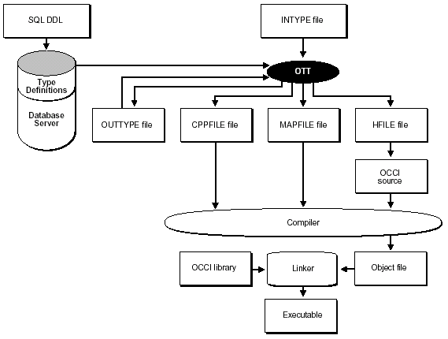

This chapter discusses the Object Type Translator (OTT) utility, which is used to map database object types, LOB types, and named collection types to C++ class declarations for use in OCCI applications.

This chapter contains these topics:

- Overview of the Object Type Translator Utility

- Using the OTT Utility

- Creating Types in the Database

- About Invoking the OTT Utility

- About Using the INTYPE File

- Using OTT Utility Data Type Mappings

- Overview of the OUTTYPE File

- Using the OTT Utility and OCCI Applications

- Carrying Forward User Added Code

**See Also:**

`$``ORACLE_HOME``/rdbms/demo` for a complete code listing of the demonstration program used in this chapter, and the class and method implementation generated by the OTT utility.

### 8.1 Overview of the Object Type Translator Utility

The Object Type Translator (OTT) utility assists in the development of applications that make use of user-defined types in an Oracle database server.

You can create object types using the SQL `CREATE TYPE` statement. The definitions of these types are stored in the database, and can be subsequently used to create database tables. Once these tables are populated, an OCCI programmer can access objects stored in the tables.

An application that accesses object data must be able to represent the data in a host language format. This is accomplished by representing object types classes in C++.

You could code structures or classes manually to represent database object types, but this is time-consuming and error-prone. The OTT utility simplifies this step by automatically generating the appropriate classes for C++.

For OCCI, the application must include and link the following files:

- Include the header file containing the generated class declarations

- Include the header file containing the prototype for the function to register the mappings

- Link with the C++ source file containing the static methods to be called by OCCI while instantiating the objects

- Link with the file containing the function to register the mappings with the environment and call this function

### 8.2 Using the OTT Utility

To translate database types to C++ representation, you must explicitly invoke the OTT utility. OCCI programmers must register the mappings with the environment. This function is generated by the OTT utility.

On most operating systems, the OTT utility is invoked on the command line. It takes as input an `INTYPE` file, and generates an `OUTTYPE` file, one or more C++ header files that contain the prototype information, and additional C++ method files that register generated mappings.

**See Also:**

Extending C++ Classes for a complete C++ example

Example 8-1 How to Use the OTT Utility

The following command invokes the OTT utility and generates C++ classes. OTT attempts to connect with user name `demousr`; the system prompts for the password.

    ott userid=demousr intype=demoin.typ outtype=demoout.typ code=cpp
       hfile=demo.h cppfile=demo.cpp mapfile=RegisterMappings.cpp

OTT utility uses the `demoin.typ` file as the `INTYPE` file, and the `demoout.typ` file as the `OUTTYPE` file. The resulting declarations are output to the file `demo.h` in C++, specified by the `CODE=cpp` parameter, the method implementations written to the file `demo.cpp`, and the functions to register mappings is written to `RegisterMappings.cpp `with its prototype written to `RegisterMappings.h`.

### 8.3 Creating Types in the Database

The first step in using the OTT utility is to create object types or named collection types and store them in the database. This is accomplished by the SQL `CREATE TYPE` statement.

Example 8-2 Object Creation Statements of the OTT Utility

    CREATE TYPE FULL_NAME AS OBJECT (first_name CHAR(20), last_name CHAR(20));
    CREATE TYPE ADDRESS AS OBJECT (state CHAR(20), zip CHAR(20));
    CREATE TYPE ADDRESS_TAB AS VARRAY(3) OF REF ADDRESS;
    CREATE TYPE PERSON AS OBJECT (id NUMBER, name FULL_NAME, curr_addr REF ADDRESS,
       prev_addr_1 ADDRESS_TAB) NOT FINAL;
    CREATE TYPE STUDENT UNDER PERSON (school_name CHAR(20));

### 8.4 About Invoking the OTT Utility

After creating types in the database, the next step is to invoke the OTT utility.

This section includes the following topics:

- Specifying OTT Parameters

- Invoking the OTT Utility on the Command Line

- OTT Utility Parameters

- Where OTT Parameters Can Appear

- File Name Comparison Restriction

- Using the OTT Command on Microsoft Windows

#### 8.4.1 Specifying OTT Parameters

You can specify OTT parameters either on the command line or in a configuration file. Certain parameters can also be specified in the `INTYPE` file.

If you specify a parameter in multiple locations, then its value on the command line takes precedence over its value in the `INTYPE` file. The value in the `INTYPE` file takes precedence over its value in a user-defined configuration file, which takes precedence over its value in the default configuration file.

Parameter precedence then is as follows:

1.  OTT command line
2.  Value in `INTYPE` file
3.  User-defined configuration file
4.  Default configuration file

For global options (that is, options on the command line or options at the beginning of the `INTYPE` file before any `TYPE` statements), the value on the command line overrides the value in the `INTYPE` file. (The options that can be specified globally in the `INTYPE` file are `CASE`, `INITFILE`, `INITFUNC`, `MAPFILE` and `MAPFUNC`, but not `HFILE` or `CPPFILE`.) Anything in the `INTYPE` file in a `TYPE` specification applies to a particular type only and overrides anything on the command line that would otherwise apply to the type. So if you enter `TYPE person HFILE=p.h`, then it applies to `person` only and overrides the `HFILE` on the command line. The statement is not considered a command line parameter.

This section includes the following topics:

- About Setting Parameters on the Command Line

- About Setting Parameters in the INTYPE File

- About Setting Parameters in the Configuration File

##### 8.4.1.1 About Setting Parameters on the Command Line

Parameters (also called options) set on the command line override any parameters or option set elsewhere.

##### 8.4.1.2 About Setting Parameters in the INTYPE File

The `INTYPE` file gives a list of types for the OTT utility to translate.

The parameters `CASE`, `CPPFILE`, `HFILE`, `INITFILE`, `INITFUNC`, `MAPFILE`, and `MAPFUNC` can appear in the `INTYPE` file.

##### 8.4.1.3 About Setting Parameters in the Configuration File

A configuration file is a text file that contains OTT parameters. Each nonblank line in the file contains one parameter, with its associated value or values. If multiple parameters are on the same line, then only the first one is used. No blank space is allowed on any nonblank line of a configuration file.

A configuration file can be named on the command line. In addition, a default configuration file is always read. This default configuration file must always exist, but can be empty. The name of the default configuration file is `ottcfg.cfg`, and the location of the file is operating system-specific.

**See Also:**

Your operating system-specific documentation for more information about the location of the default configuration file.

#### 8.4.2 Invoking the OTT Utility on the Command Line

On most platforms, the OTT utility is invoked on the command line. You can specify the input and output files and the database connection information at the command line, among other things.

**See Also:**

Your operating system-specific documentation to see how to invoke the OTT utility on your operating system

**Note:**

No spaces are permitted around the equals sign (`=`) on the OTT command line.

An OTT command line statement consists of the command OTT, followed by a list of OTT utility parameters.

The `HFILE` parameter is almost always used. If omitted, then `HFILE` must be specified individually for each type in the `INTYPE` file. If the OTT utility determines that a type not listed in the `INTYPE` file must be translated, then an error is reported. Therefore, it is safe to omit the `HFILE` parameter only if the `INTYPE` file was previously generated as an OTT `OUTTYPE` file.

If the `INTYPE` file is omitted, then the entire schema is translated. See the parameter descriptions in the following section for more information.

Example 8-3 How to Invoke the OTT Utility to Generate C++ Classes

OTT attempts to connect with user name `demousr`; the system prompts for the password.

    ott userid=demousr intype=demoin.typ outtype=demoout.typ code=cpp
       hfile=demo.h cppfile=demo.cpp mapfile=RegisterMappings.cpp

This section includes the following topic: Elements Used on the OTT Command Line.

##### 8.4.2.1 Elements Used on the OTT Command Line

Elements used on the OTT command line are:

- OTT command that invokes the OTT utility. It must be the first item on the command line.

- USERID parameter

- INTYPE parameter

- OUTTYPE parameter.

- CODE parameter.

- HFILE parameter.

- CPPFILE parameter.

- MAPFILE parameter.

#### 8.4.3 OTT Utility Parameters

To generate C++ using the OTT utility, the `CODE` parameter must be set to `CODE=CPP`. Once `CODE=CPP` is specified, you are required to specify the `CPPFILE` and `MAPFILE` parameters to define the filenames for the method implementation file and the mappings registration function file. The name of the mapping function is derived by the OTT utility from the `MAPFILE` or you may specify the name with the `MAPFUNC` parameter. `ATTRACCESS` is also an optional parameter that can be specified to change the generated code. These parameters control the generation of C++ classes.

- Enter parameters on the OTT command line where `parameter` is the literal parameter string and `value` is a valid parameter setting. The literal parameter string is not case sensitive:

      parameter=value

- Separate command line parameters by using either spaces or tabs.

- Parameters can also appear within a configuration file, but, in that case, no whitespace is permitted within a line, and each parameter must appear on a separate line. Additionally, the parameters `CASE`, `CPPFILE`, `HFILE`, `INITFILE`, `INTFUNC`, `MAPFILE`, and `MAPFUNC` can appear in the `INTYPE` file.

Table 8-1 lists all OTT Utility parameters:

Table 8-1 Summary of OTT Utility Parameters

| Parameter    | Description                                                                                            |
|:-------------|:-------------------------------------------------------------------------------------------------------|
| ATTRACCESS   | Specifies whether the access to type attributes is `PROTECTED` or `PRIVATE`.                           |
| CASE         | Affects the letter case of generated C++ identifiers                                                   |
| CODE         | Specifies the target language for the translation. Use `CPP`.                                          |
| CONFIG       | Specifies the name of the OTT configuration file that lists commonly used parameter specifications.    |
| CPPFILE      | Specifies the name of the C++ source file into which the method implementations are written.           |
| ERRTYPE      | Specifies the name of the error message output file.                                                   |
| HFILE        | Specifies the name of the C++ header file to which the generated C++ classes are written.              |
| INTYPE       | Specifies the name of the `INTYPE` file.                                                               |
| MAPFILE      | Specifies the name of the mapping file and the corresponding header file generated by the OTT utility. |
| MAPFUNC      | Specifies the name of the function used to register generated mappings.                                |
| OUTTYPE      | Specifies the name of the `OUTTYPE` file.                                                              |
| SCHEMA_NAMES | Controls the qualifying the database name of a type from the default schema                            |
| TRANSITIVE   | Indicates whether to translate type dependency that are not explicitly listed in the INTYPE.           |
| UNICODE      | Indicates whether the application should provide UTF16 support generate `UString` types.               |
| USE_MARKER   | Indicates whether OTT markers should be supported to carry forward user added cod                      |
| USERID       | Specifies the database connection information that the OTT utility uses.                               |

##### 8.4.3.1 ATTRACCESS

This parameter specifies access to type attributes:

- `PROTECTED` is the default.

- `PRIVATE` indicates that the OTT utility generates accessory and mutator methods for each type attribute, `get``XXX``()` and `set``XXX``()`.

##### 8.4.3.2 CASE

This parameter affects the letter case of generated C++ identifiers. The valid values of `CASE` are:

- `SAME` is the case of letters remains unchanged when converting database type and attribute names to C++ identifiers.

- `LOWER` indicates that all uppercase letters are converted to lowercase.

- `UPPER` indicates that all lowercase letters are converted to uppercase.

- `OPPOSITE` indicates that all uppercase letters are converted to lowercase, and all lowercase letters are converted to uppercase.

This parameter affects only those identifiers (attributes or types not explicitly listed) not mentioned in the `INTYPE` file. Case conversion takes place after a legal identifier has been generated.

Case insensitive SQL identifiers not mentioned in the `INTYPE` file appear in uppercase if `CASE=SAME`, and in lowercase if `CASE=OPPOSITE`. A SQL identifier is case insensitive if it was not quoted when it was declared.

##### 8.4.3.3 CODE

This parameter specifies the host language to be output by the OTT utility. `CODE=CPP` must be specified for the OTT utility to generate C++ code for OCCI applications.

##### 8.4.3.4 CONFIG

This parameter specifies the name of the OTT configuration file that lists commonly used parameter specifications. Parameter specifications are also read from a system configuration file found in an operating system-dependent location. All remaining parameter specifications must appear either on the command line or in the `INTYPE` file.

The `CONFIG` parameter can only be specified on the OTT command line. It is not allowed in the `CONFIG` file.

##### 8.4.3.5 CPPFILE

This parameter specifies the name of the C++ source file that contains the method implementations generated by the OTT utility. The methods generated in this file are called by OCCI while instantiating the objects and are not to be called directly in the an application.

This parameter is required under the following conditions:

- A type not mentioned in the `INTYPE` file must be generated and two or more `CPPFILE`s are being generated. In this case, the unmentioned type goes in the `CPPFILE` specified on the command line.

- The `INTYPE` parameter is not specified, and you want the OTT utility to translate all the types in the schema.

This parameter is optional when the `CPPFILE` is specified for individual types in the `INTYPE` file.

##### 8.4.3.6 ERRTYPE

This parameter specifies the name of the error message output file. Information and error messages are sent to the standard output regardless of whether the `ERRTYPE` parameter is specified. Essentially, the `ERRTYPE` file is a copy of the `INTYPE` file with error messages added. In most cases, an error message includes a pointer to the text that caused the error.

If the filename specified for the `ERRTYPE` parameter on the command line does not include an extension, a platform-specific extension, like .`TLS` or .`tls`, is added automatically.

##### 8.4.3.7 HFILE

This parameter specifies the name of the header (`.h`) file to be generated by the OTT utility. The `HFILE` specified on the command line contains the declarations of types that are mentioned in the `INTYPE` file but whose header files are not specified there.

This parameter is required unless the header file for each type is specified individually in the `INTYPE` file. This parameter is also required if a type not mentioned in the `INTYPE` file must be generated because other types require it, and these other types are declared in two or more different files.

If the filename specified for the `HFILE` parameter on the command line or in the `INTYPE` file does not include an extension, a platform-specific extension, like `.H` or `.h`, is added automatically.

##### 8.4.3.8 INTYPE

This parameter specifies the name of the file from which to read the list of object type specifications. The OTT utility translates each type in the list. If the `INTYPE` parameter is not specified, all types in the user's schema is translated.

If the filename specified for the `INTYPE` parameter on the command line does not include an extension, a platform-specific extension, like `.TYP` or `.typ`, is automatically added.

`INTYPE=` may be omitted if `USERID` and `INTYPE` are the first two parameters, in that order, and `USERID=` is omitted.

The `INTYPE` file can be thought of as a makefile for type declarations. It lists the types for which C++ classes are needed.

**See Also:**

"Structure of the INTYPE File" for more information about the format of the `INTYPE` file

##### 8.4.3.9 MAPFILE

This parameter specifies the name of the mapping file (`XXX``.cpp`) and corresponding header file (`XXX``.h`) that are generated by the OTT utility. The `XXX``.cpp` file contains the implementation of the functions to register the mappings, while the `XXX``.h` file contains the prototype for the function.

This parameter may be specified either on the command line or in the `INTYPE` file.

##### 8.4.3.10 MAPFUNC

This parameter specifies the name of the function to be used to register the mappings generated by the OTT utility.

If this parameter is omitted, then the name of the function to register the mappings is derived from the filename specified in the `MAPFILE` parameter.

This parameter may be specified either on the command line or in the `INTYPE` file.

##### 8.4.3.11 OUTTYPE

This parameter specifies the name of the file into which the OTT utility writes type information for all the object data types it processes. This file includes all types explicitly named in the `INTYPE` file, and may include additional types that are translated because they are used in the declarations of other types that must be translated. This file may be used as an `INTYPE` file in a future invocation of the OTT utility.

If the `INTYPE` and `OUTTYPE` parameters refer to the same file, then the new `INTYPE` information replaces the old information in the `INTYPE` file. This provides a convenient way for the same `INTYPE` file to be used repeatedly in the cycle of altering types, generating type declarations, editing source code, precompiling, compiling, and debugging.

If the filename specified for the `OUTTYPE` parameter on the command line or in the `INTYPE` file does not include an extension, a platform-specific extension, like`.TYP` or `.typ`, is automatically added.

##### 8.4.3.12 SCHEMA_NAMES

This parameter offers control in qualifying the database name of a type from the default schema that is named in the OUTTYPE file. The `OUTTYPE` file generated by the OTT utility contains information about the types processed by the OTT utility, including the type names. Valid values include:

- `ALWAYS` (default) indicates that all type names in the `OUTTYPE` file are qualified with a schema name.

- `IF_NEEDED` indicates that the type names in the `OUTTYPE` file that belong to the default schema are not qualified with a schema name. Type names belonging to other schemas are qualified with the schema name.

- `FROM_INTYPE` indicates that a type mentioned in the INTYPE file is qualified with a schema name in the `OUTTYPE` file only if it was qualified with a schema name in the `INTYPE` file. A type in the default schema that is not mentioned in the `INTYPE` file but generated because of type dependency is written with a schema name only if the first type encountered by the OTT utility that depends on it is also written with a schema name. However, a type that is not in the default schema to which the OTT utility is connected is always written with an explicit schema name.

The name of a type from a schema other that the default schema is always qualified with a schema name in the `OUTTYPE` file.

The schema name, or its absence, determines in which schema the type is found during program execution.

Example 8-4 How to use the SCHEMA_NAMES Parameter in OTT Utility

Consider an example where the `SCHEMA_NAMES` parameter is set to `FROM_INTYPE`, and the `INTYPE` file contains the following:

    TYPE Person
    TYPE joe.Dept
    TYPE sam.Company

If the OTT utility and the application both connect to schema joe, then the application uses the same type (`joe.Person`) that the OTT utility uses. If the OTT utility connects to schema `joe` but the application connects to schema `mary`, then the application uses the type `mary.Person`. This behavior is appropriate only if the same `CREATE TYPE Person` statement has been executed in schema `joe` and schema `mary`.

On the other hand, the application uses type `joe.Dept` regardless of which schema the application is connected to. If this is the behavior you want, then be sure to include schema names with your type names in the `INTYPE` file.

In some cases, the OTT utility translates a type that the user did not explicitly name. For example, consider the following SQL declarations:

    CREATE TYPE Address AS OBJECT
    (
       street    VARCHAR2(40),
       city      VARCHAR(30),
       state     CHAR(2),
       zip_code  CHAR(10)
    );

    CREATE TYPE Person AS OBJECT
    (
       name      CHAR(20),
       age       NUMBER,
       addr      ADDRESS
    );

Suppose that the OTT utility connects to schema `joe`, `SCHEMA_NAMES=FROM_INTYPE` is specified, and the user's `INTYPE` files include either `TYPE Person` or `TYPE joe.Person`. The `INTYPE` file does not mention the type `joe.Address`, which is used as a nested object type in type `joe.Person`.

- If `Type Person` appears in the `INTYPE` file, then `TYPE Person` and `TYPE Address` appears in the `OUTTYPE` file.

- If `TYPE joe.Person` appears in the `INTYPE` file, then `TYPE joe.Person` and `TYPE joe.Address` appear in the `OUTTYPE` file.

- If the `joe.Address` type is embedded in several types translated by the OTT utility, but it is not explicitly mentioned in the `INTYPE` file, then the decision of whether to use a schema name is made the first time the OTT utility encounters the embedded `joe.Address` type. If, for some reason, the user wants type `joe.Address` to have a schema name but does not want type `Person` to have one, then you must explicitly request this in the `INTYPE` file: `TYPE joe.Address`.

In the usual case in which each type is declared in a single schema, it is safest for you to qualify all type names with schema names in the `INTYPE` file.

##### 8.4.3.13 TRANSITIVE

This parameter indicates whether type dependencies not explicitly listed in the `INTYPE` file are to be translated. Valid values are:

- `TRUE` (default): types needed by other types and not mentioned in the `INTYPE` file are generated

- `FALSE`: types not mentioned in the `INTYPE` file are not generated, even if they are used as attribute types of other generated types.

##### 8.4.3.14 UNICODE

This parameter specifies whether the application provides unicode (`UTF16`) support.

- `NONE` (default)

- `ALL`: All `CHAR` (`CHAR`/`VARCHAR`) and `NCHAR` (`NCHAR`/`NVARCHAR2`) type attributes are declared as `UString` type in the OTT generated C++ class files. The corresponding `get``XXX``()`/`set``XXX``()` return values or parameters are `UString` types. The generated persistent operator new would also take only `UString` arguments.

  This setting is necessary when both the client characterset and the national characterset is `UTF16`.

- `ONLYNCHAR`: Similar to the `ALL` option, but only `NCHAR` type attributes are declared as `UString`.

  This setting is necessary when the application sets only the Environment's national characterset to `UTF16`.

Example 8-5 How to Define a Schema for Unicode Support in OTT

    create type CitiesList as varray(100) of varchar2(100);

    create type Country as object
    (  CNo Number(10),
       CName Varchar2(100),
       CNationalName NVarchar2(100),
       MainCities CitiesList);

Example 8-6 How to Use UNICODE=ALL Parameter in OTT

    class Country : public oracle::occi::PObject
    {
       private:
          oracle::occi::Number CNO;
          oracle::occi::UString CNAME;
          oracle::occi::UString CNATIONALNAME;
          OCCI_STD_NAMESPACE:::vector< oracle::occi::UString > MAINCITIES;

       public:

          oracle::occi::Number getCno() const;
          void setCno(const oracle::occi::Number &value);

          oracle::occi::UString getCname() const;
          void setCname(const oracle::occi::UString &value);

          oracle::occi::UString getCnationalname() const;
          void setCnationalname(const oracle::occi::UString &value);

          OCCI_STD_NAMESPACE::vector< oracle::occi::UString >& getMaincities();
          const OCCI_STD_NAMESPACE::vector< oracle::occi::UString >&
              getMaincities() const;
         void setMaincities(const OCCI_STD_NAMESPACE::vector< oracle::occi::UString
              > &value);
    ...
    }

Example 8-7 How to Use UNICODE=ONLYCHAR Parameter in OTT

    class Country : public oracle::occi::PObject
    {
       private:
          oracle::occi::Number CNO;
          oracle::occi::string CNAME;
          oracle::occi::UString CNATIONALNAME;
          OCCI_STD_NAMESPACE::vector< std::string > MAINCITIES;

       public:

          oracle::occi::Number getCno() const;
          void setCno(const oracle::occi::Number &value);

          oracle::occi::string getCname() const;
          void setCname(const OCCI_STD_NAMESPACE::string &value);

          oracle::occi::UString getCnationalname() const;
          void setCnationalname(const oracle::occi::UString &value);

          OCCI_STD_NAMESPACE::vector< OCCI_STD_NAMESPACE::string>&
             getMaincities();
          const OCCI_STD_NAMESPACE::vector< OCCI_STD_NAMESPACE::string >&
             getMaincities() const;
         void setMaincities(const OCCI_STD_NAMESPACE::vector
             < OCCI_STD_NAMESPACE::string > &value);
    ...
    }

##### 8.4.3.15 USE_MARKER

This parameter indicates whether to support OTT markers for carrying forward user added code. Valid values are:

- `FALSE` (default): User-supplied code is not carried forward, even if the code is added between `OTT_USERCODE_START` and `OTT_USERCODE_END` markers.

- `TRUE`: User-supplied code, between the markers `OTT_USER_CODESTART` and `OTT_USERCODE_END`, is carried forward when the same file is generated again.

##### 8.4.3.16 USERID

This parameter specifies the Oracle username and optional database name (Oracle Net database specification string). If the database name is omitted, the default database is assumed.

    USERID=username[@db_name]

If this is the first parameter, then `USERID=` may be omitted as shown:

    OTT username ...

Note that the system prompts you for the password that corresponds to the user id.

This parameter is optional. If omitted, the OTT utility automatically attempts to connect to the default database as user `OPS$username`, where `username` is the user's operating system username.

#### 8.4.4 Where OTT Parameters Can Appear

Supply OTT parameters on the command line, in a `CONFIG` file named on the command line, or both. Some parameters are also allowed in the `INTYPE` file.

The OTT utility is invoked as follows:

    OTT parameters

You can name a configuration file on the command line with the `CONFIG` parameter as follows:

    CONFIG=filename

If you name this parameter on the command line, then additional parameters are read from the configuration file named `filename`.

In addition, parameters are also read from a default configuration file that resides in an operating system-dependent location. This file must exist, but can be empty. If you choose to enter data in the configuration file, note that no white space is allowed on a line and parameters must be entered one to a line.

If the OTT utility is executed without any arguments, then an online parameter reference is displayed.

The types for the OTT utility to translate are named in the file specified by the `INTYPE` parameter. The parameters `CASE`, `CPPFILE`, `HFILE`, `INITFILE`, `INITFUNC`, `MAPFILE`, and `MAPFNC` may also appear in the `INTYPE` file. `OUTTYPE` files generated by the OTT utility include the `CASE` parameter, and include the `INITFILE`, and `INITFUNC` parameters if an initialization file was generated or the `MAPFILE` and `MAPFUNC` parameters if C++ codes was generated. The `OUTTYPE` file and the `CPPFILE` for C++ specify the `HFILE` individually for each type.

The case of the OTT command is operating system-dependent.

#### 8.4.5 File Name Comparison Restriction

Currently, the OTT utility determines if two files are the same by comparing the filenames provided by the user either on the command line or in the `INTYPE` file. But one potential problem can occur when the OTT utility must know if two filenames refer to the same file. For example, if the OTT-generated file foo.h requires a type declaration written to `foo1.h`, and another type declaration written to `/private/smith/foo1.h`, then the OTT utility should generate one `#include` if the two files are the same, and two `#include`s if the files are different. In practice, though, it concludes that the two files are different, and generates two `#include`s as follows:

    #ifndef FOO1_ORACLE
    #include "foo1.h"
    #endif
    #ifndef FOO1_ORACLE
    #include "/private/smith/foo1.h"
    #endif

If `foo1.h` and `/private/smith/foo1.h` are different files, then only the first one is included. If `foo1.h` and `/private/smith/foo1.h` are the same file, then a redundant `#include` is written.

Therefore, if a file is mentioned several times on the command line or in the `INTYPE` file, then each mention of the file should use the same filename.

#### 8.4.6 Using the OTT Command on Microsoft Windows

OTT executable on Microsoft Windows in the current release is `ott.bat`, instead of `ott.exe` as in the earlier releases. This may break Windows batch scripts, as the scripts exit immediately after executing ott. To fix this problem, OTT should be invoked as follows, in Windows batch scripts:

    call ott [arguments]

**Note:**

`ORACLE_HOME\precomp\admin\ott.exe` can be used until the scripts are fixed, as an intermediate solution. However, this intermediate solution will not be provided in future releases.

### 8.5 About Using the INTYPE File

When you run the OTT utility, the `INTYPE` file tells the OTT utility which database types should be translated. The `INTYPE` file also controls the naming of the generated structures or classes. You can either create an `INTYPE` file or use the `OUTTYPE` file of a previous invocation of the OTT utility. If you do not use an `INTYPE` file, then all types in the schema to which the OTT utility connects are translated.

This section includes the following topics:

- Using the INTYPE File

- Structure of the INTYPE File

- Using Nested include File Generation

#### 8.5.1 Using the INTYPE File

The OTT utility may have to translate additional types that are not listed in the `INTYPE` file. This is because the OTT utility analyzes the types in the `INTYPE` file for type dependencies before performing the translation, and it translates other types as necessary. For example, if the `ADDRESS `type were not listed in the `INTYPE` file, but the `Person` type had an attribute of type `ADDRESS`, then the OTT utility would still translate `ADDRESS` because it is required to define the `Person` type.

You may indicate whether the OTT utility should generate required object types that are not specified in the `INTYPE` file. Set `TRANSITIVE=FALSE` so the OTT utility does not to generate required object types. The default is `TRANSITIVE=TRUE`.

A normal case insensitive SQL identifier can be spelled in any combination of uppercase and lowercase in the `INTYPE` file, and is not quoted.

Use quotation marks, such as `TYPE "Person"` to reference SQL identifiers that have been created in a case sensitive manner, for example, `CREATE TYPE "Person"`. A SQL identifier is case sensitive if it was quoted when it was declared. Quotation marks can also be used to refer to a SQL identifier that is an OTT-reserved word, for example, `TYPE "CASE"`. In this case, the quoted name must be in uppercase if the SQL identifier was created in a case insensitive manner, for example, `CREATE TYPE Case`. If an OTT-reserved word is used to refer to the name of a SQL identifier but is not quoted, then the OTT utility reports a syntax error in the `INTYPE` file.

**See Also:**

- "Structure of the INTYPE File" for a more detailed specification of the structure of the `INTYPE` file and the available options.

- "CASE" for further information regarding the `CASE` parameter

Example 8-8 How to Create a User Defined INTYPE File Using the OTT Utility

    CASE=LOWER
    TYPE employee
       TRANSLATE SALARY$ AS salary
                 DEPTNO AS department
    TYPE ADDRESS
    TYPE item
    TYPE "Person"
    TYPE PURCHASE_ORDER AS p_o

- In the first line, the `CASE` parameter indicates that generated C identifiers should be in lowercase. However, this `CASE` parameter is only applied to those identifiers that are not explicitly mentioned in the `INTYPE` file. Thus, `employee `and `ADDRESS` would always result in C structures `employee` and `ADDRESS`, respectively. The members of these structures are named in lowercase.

- The lines that begin with the `TYPE` keyword specify which types in the database should be translated. In this case, the `EMPLOYEE`, `ADDRESS`, `ITEM`, `PERSON`, and `PURCHASE_ORDER` types are set to be translated.

- The `TRANSLATE...AS` keywords specify that the name of an object attribute should be changed when the type is translated into a C structure. In this case, the `SALARY$` attribute of the `employee` type is translated to `salary`.

- The `AS` keyword in the final line specifies that the name of an object type should be changed when it is translated into a structure. In this case, the `purchase_order` database type is translated into a structure called `p_o`.

#### 8.5.2 Structure of the INTYPE File

The `INTYPE` and `OUTTYPE` files list the types translated by the OTT utility and provide all the information needed to determine how a type or attribute name is translated to a legal C or C++ identifier. These files contain one or more type specifications, and may also contain specifications of `CASE`, `CPPFILE`, `HFILE`, `INITFILE`, `INITFUNC`, `MAPFILE`, or `MAPFUNC`.

If the `CASE`, `INITFILE`, `INITFUNC`, `MAPFILE`, or `MAPFUNC` options are present, then they must precede any type specifications. If these options appear both on the command line and in the `INTYPE` file, then the value on the command line is used.

**See Also:**

"Overview of the OUTTYPE File" for an example of a simple user-defined `INTYPE` file and of the full `OUTTYPE` file that the OTT utility generates from it

This section includes the following topic: INTYPE File Type Specifications.

##### 8.5.2.1 INTYPE File Type Specifications

A type specification in the `INTYPE` file names an object data type that is to be translated. The following is an example of a user-created `INTYPE` file:

    TYPE employee
       TRANSLATE SALARY$ AS salary
          DEPTNO AS department
    TYPE ADDRESS
    TYPE PURCHASE_ORDER AS p_o

The structure of a type specification is as follows:

    TYPE type_name
    [GENERATE type_identifier]
    [AS type_identifier]
    [VERSION [=] version_string]
    [HFILE [=] hfile_name]
    [CPPFILE [=] cppfile_name]
    [TRANSLATE{member_name [AS identifier]}...]

The `type_name` syntax follows this form:

    [schema_name.]type_name

In this syntax, `schema_name` is the name of the schema that owns the given object data type, and `type_name` is the name of the type. The default schema, if one is not specified, is that of the userID invoking the OTT utility. To use a specific schema, you must use schema_name.

The components of the type specification are:

- `type_name`: Name of the object data type.

- `type_identifier`: C / C++ identifier used to represent the class. The `GENERATE` clause is used to specify the name of the class that the OTT utility generates. The AS clause specifies the name of the class that you write. The `GENERATE` clause is typically used to extend a class. The `AS` clause, when optionally used without the `GENERATE` clause, specifies the name of the C structure or the C++ class that represents the user-defined type.

- `version_string`: Version string of the type that was used when the code was generated by the previous invocation of the OTT utility. The version string is generated by the OTT utility and written to the `OUTTYPE` file, which can later be used as the `INTYPE` file in later invocations of the OTT utility. The version string does not affect how the OTT utility operates, but can be used to select which version of the object data type is used in the running program.

- `hfile_name`: Name of the header file into which the declarations of the corresponding class are written. If you omit the `HFILE` clause, then the file specified by the command line `HFILE` parameter is used.

- `cppfile_name`: Name of the C++ source file into which the method implementations of the corresponding class is written. If you omit the `CPPFILE` clause, the file specified by the command line `CPPFILE` parameter is used.

- `member_name`: Name of an attribute (data member) that is to be translated to the identifier.

- `identifier`: C / C++ identifier used to represent the attribute in the program. You can specify identifiers in this way for any number of attributes. The default name mapping algorithm is used for the attributes not mentioned.

An object data type may be translated for one of two reasons:

- It appears in the `INTYPE` file.

- It is required to declare another type that must be translated, and the `TRANSITIVE` parameter is set to `TRUE`.

If a type that is not mentioned explicitly is necessary to types declared in exactly one file, then the translation of the required type is written to the same files as the explicitly declared types that require it.

If a type that is not mentioned explicitly is necessary to types declared in multiple files, then the translation of the required type is written to the global `HFILE` file.

You may indicate whether the OTT utility should generate required object types that are not specified in the `INTYPE` file. Set `TRANSITIVE=FALSE` so the OTT utility does not to generate required object types. The default is `TRANSITIVE=TRUE`.

#### 8.5.3 Using Nested include File Generation

`HFILE` files generated by the OTT utility `#include` other necessary files, and `#define`` `a symbol constructed from the name of the file. This symbol `#define` can then be used to determine if the related `HFILE` file has been included. Consider, for example, a database with the following types:

    create type px1 AS OBJECT (col1 number, col2 integer);
    create type px2 AS OBJECT (col1 px1);
    create type px3 AS OBJECT (col1 px1);

The `INTYPE` file contains the following information:

    CASE=lower
    type pxl
       hfile tott95a.h
    type px3
       hfile tott95b.h

You invoke the OTT utility as follows:

    >ott hr intype=tott95i.typ outtype=tott95o.typ code=cpp
    ...
    Enter password: password

The OTT utility then generates the following two header files, named `tott95a.h` and `tott95b.h`. They are listed in

In the `tott95b.h` file, the symbol `TOTT95B_ORACLE` is `#define` d at the beginning of the file. This enables you to conditionally `#include` this header file in another file, using the following construct:

    #ifndef TOTT95B_ORACLE
    #include "tott95b.h"
    #endif

By using this technique, you can `#include` `tott95b.h` in, say `foo.h`, without having to know whether some other file `#includ`ed in `foo.h` also `#include`s `tott95b.h`.

Next, the file `tott95a.h` is included because it contains the declaration of `struct px1`, that `tott95b.h` requires. When the `INTYPE` file requests that type declarations be written to multiple files, the OTT utility determines which other files each `HFILE` must `#include`, and generates each necessary `#include`.

Note that the OTT utility uses quotes in this `#include`. When a program including `tott95b.h` is compiled, the search for `tott95a.h` begins where the source program was found, and thereafter follows an implementation-defined search rule. If `tott95a.h` cannot be found in this way, then a complete filename (for example, a UNIX absolute path name beginning with a slash character (`/`)) is necessary in the `INTYPE` file to specify the location of `tott95a.h`.

Example 8-9 Listing of ott95a.h

    #ifndef TOTT95A_ORACLE
    # define TOTT95A_ORACLE

    #ifndef OCCI_ORACLE
    # include <occi.h>
    #endif

    /************************************************************/
    //  generated declarations for the PX1 object type.
    /************************************************************/

    class px1 : public oracle::occi::PObject {

    protected:
       oracle::occi::Number col1;
       oracle::occi::Number col2;

    public:
       void *operator new(size_t size);
       void *operator new(size_t size, const oracle::occi::Connection * sess,
          const OCCI_STD_NAMESPACE::string& table);
       void *operator new(size_t, void *ctxOCCI_);
       void *operator new(size_t size, const oracle::occi::Connection *sess,
          const OCCI_STD_NAMESPACE::string &tableName,
          const OCCI_STD_NAMESPACE::string &typeName,
          const OCCI_STD_NAMESPACE::string &tableSchema,
          const OCCI_STD_NAMESPACE::string &typeSchema);
       void getSQLTypeName(oracle::occi::Environment *env, void **schemaName,
          unsigned int &schemaNameLen, void **typeName,
          unsigned int &typeNameLen) const;
       px1();
       px1(void *ctxOCCI_) : oracle::occi::PObject (ctxOCCI_) { };
       static void *readSQL(void *ctxOCCI_);
       virtual void readSQL(oracle::occi::AnyData& streamOCCI_);
       static void writeSQL(void *objOCCI_, void *ctxOCCI_);
       virtual void writeSQL(oracle::occi::AnyData& streamOCCI_);
       ~px1();
    };

    #endif

Example 8-10 Listing of ott95b.h

    #ifndef TOTT95B_ORACLE
    # define TOTT95B_ORACLE

    #ifndef OCCI_ORACLE
    # include <occi.h>
    #endif

    #ifndef TOTT95A_ORACLE
    # include "tott95a.h"
    #endif

    /************************************************************/
    //  generated declarations for the PX3 object type.
    /************************************************************/

    class px3 : public oracle::occi::PObject {

    protected:
       px1 * col1;

    public:
       void *operator new(size_t size);
       void *operator new(size_t size, const oracle::occi::Connection * sess,
          const OCCI_STD_NAMESPACE::string& table);
       void *operator new(size_t, void *ctxOCCI_);
       void *operator new(size_t size, const oracle::occi::Connection *sess,
          const OCCI_STD_NAMESPACE::string &tableName,
          const OCCI_STD_NAMESPACE::string &typeName,
          const OCCI_STD_NAMESPACE::string &tableSchema,
          const OCCI_STD_NAMESPACE::string &typeSchema);
       void getSQLTypeName(oracle::occi::Environment *env, void **schemaName,
          unsigned int &schemaNameLen, void **typeName,
          unsigned int &typeNameLen) const;
       px3();
       px3(void *ctxOCCI_) : oracle::occi::PObject (ctxOCCI_) { };
       static void *readSQL(void *ctxOCCI_);
       virtual void readSQL(oracle::occi::AnyData& streamOCCI_);
       static void writeSQL(void *objOCCI_, void *ctxOCCI_);
       virtual void writeSQL(oracle::occi::AnyData& streamOCCI_);
       ~px3();
    };
    #endif

### 8.6 Using OTT Utility Data Type Mappings

When the OTT utility generates a C++ class from a database type, the structure or class contains one element corresponding to each attribute of the object type. The data types of the attributes are mapped to types that are used in Oracle object data types. The data types found in Oracle include a set of predefined, primitive types and provide for the creation of user-defined types, like object types and collections.

The set of predefined types includes standard types that are familiar to most programmers, including number and character types. It also includes large object data types (for example, `BLOB` or `CLOB`).

Table 8-2 C++ Object Data Type Mappings for Object Type Attributes

| Object Attribute Types                                                | C++ Mapping                        |
|:----------------------------------------------------------------------|:-----------------------------------|
| `BFILE`                                                               | `Bfile`                            |
| `BLOB`                                                                | `Blob`                             |
| `BINARY_DOUBLE`                                                       | `BDouble`                          |
| `BINARY_FLOAT`                                                        | `BFloat`                           |
| `CHAR(n), CHARACTER(n)`                                               | `string`                           |
| `CLOB`                                                                | `Clob`                             |
| `DATE`                                                                | `Date`                             |
| `DEC, DEC(n), DEC(n,n)`                                               | `Number`                           |
| `DECIMAL, DECIMAL(n), DECIMAL(n,n)`                                   | `Number`                           |
| `FLOAT, FLOAT(n), DOUBLE PRECISION`                                   | `Number`                           |
| `INT, INTEGER, SMALLINT`                                              | `Number`                           |
| `INTERVAL DAY TO SECOND `                                             | `IntervalDS`                       |
| `INTERVAL YEAR TO MONTH`                                              | `IntervalYM`                       |
| `Nested Object Type`                                                  | C++ name of the nested object type |
| `NESTED TABLE`                                                        | `vector<attribute_type>`           |
| `NUMBER, NUMBER(n), NUMBER(n,n)`                                      | `Number`                           |
| `NUMERIC, NUMERIC(n), NUMERIC(n,n)`                                   | `Number`                           |
| `RAW`                                                                 | `Bytes`                            |
| `REAL`                                                                | `Number`                           |
| `REF`                                                                 | `Ref<attribute_type>`              |
| `TIMESTAMP,TIMESTAMP WITH TIME ZONE, TIMESTAMP WITH LOCAL TIME ZONE ` | `Timestamp`                        |
| `VARCHAR(n)`                                                          | `string`                           |
| `VARCHAR2(n)`                                                         | `string`                           |
| `VARRAY`                                                              | `vector<attribute_type>`           |

Example 8-11 How to Represent Object Attributes Using the OTT Utility

Oracle also includes a set of predefined types that are used to represent object type attributes in C++ classes. Consider the following object type definition, and its corresponding OTT-generated structure declarations:

    CREATE TYPE employee AS OBJECT
    (  name       VARCHAR2(30),
       empno      NUMBER,
       deptno     NUMBER,
       hiredate   DATE,
       salary     NUMBER
    );

The OTT utility, assuming that the `CASE` parameter is set to `LOWER` and there are no explicit mappings of type or attribute names, produces the following output:

    #ifndef DATATYPES_ORACLE
    # define DATATYPES_ORACLE

    #ifndef OCCI_ORACLE
    # include <occi.h>
    #endif

    /************************************************************/
    //  generated declarations for the EMPLOYEE object type.
    /************************************************************/

    class employee : public oracle::occi::PObject {

    protected:
       OCCI_STD_NAMESPACE::string NAME;
       oracle::occi::Number EMPNO;
       oracle::occi::Number DEPTNO;   oracle::occi::Date HIREDATE;
       oracle::occi::Number SALARY;

    public:
       void *operator new(size_t size);
       void *operator new(size_t size, const oracle::occi::Connection * sess,
          const OCCI_STD_NAMESPACE::string& table);
       void *operator new(size_t, void *ctxOCCI_);
       void *operator new(size_t size, const oracle::occi::Connection *sess,
          const OCCI_STD_NAMESPACE::string &tableName,
          const OCCI_STD_NAMESPACE::string &typeName,
          const OCCI_STD_NAMESPACE::string &tableSchema,
          const OCCI_STD_NAMESPACE::string &typeSchema);
       void getSQLTypeName(oracle::occi::Environment *env, void **schemaName,
          unsigned int &schemaNameLen, void **typeName,
          unsigned int &typeNameLen) const;
       employee();
       employee(void *ctxOCCI_) : oracle::occi::PObject (ctxOCCI_) { };
       static void *readSQL(void *ctxOCCI_);
       virtual void readSQL(oracle::occi::AnyData& streamOCCI_);
       static void writeSQL(void *objOCCI_, void *ctxOCCI_);
       virtual void writeSQL(oracle::occi::AnyData& streamOCCI_);
       ~employee();

    };

    #endif

Table 8-2 lists the mappings from types that can be used as attributes to object data types that are generated by the OTT utility.

Example 8-12 How to Map Object Data Types Using the OTT Utility

The example assumes that the following database types are created:

    CREATE TYPE my_varray AS VARRAY(5) of integer;

    CREATE TYPE object_type AS OBJECT
       (object_name VARCHAR2(20));

    CREATE TYPE other_type AS OBJECT
       (object_number NUMBER);

    CREATE TYPE my_table AS TABLE OF object_type;

    CREATE TYPE many_types AS OBJECT
    (
        the_varchar    VARCHAR2(30),
       the_char       CHAR(3),
       the_blob       BLOB,
       the_clob       CLOB,
       the_object     object_type,
       another_ref    REF other_type,
       the_ref        REF many_types,
       the_varray     my_varray,
       the_table      my_table,
       the_date       DATE,
       the_num        NUMBER,
       the_raw        RAW(255)
    );

An `INTYPE` file exists, and includes the following:

    CASE = LOWER
    TYPE many_types

The following is an example of the OTT type mappings for C++, given the types created in the example in the previous section, and an `INTYPE` file that includes the following:

    CASE = LOWER
    TYPE many_types

    #ifndef MYFILENAME_ORACLE
    #define MYFILENAME_ORACLE

    #ifndef OCCI_ORACLE
    #include <occi.h>
    #endif

    /************************************************************/
    //  generated declarations for the OBJECT_TYPE object type.
    /************************************************************/

    class object_type : public oracle::occi::PObject
    {
       protected:
          OCCI_STD_NAMESPACE::string object_name;

       public:
          void *operator new(size_t size);
          void *operator new(size_t size, const oracle::occi::Connection * sess,
             const OCCI_STD_NAMESPACE::string& table);
          void getSQLTypeName(oracle::occi::Environment *env, void **schemaName,
                              unsigned int &schemaNameLen, void **typeName,
                              unsigned int &typeNameLen) const;
          object_type();
          object_type(void *ctxOCCI_) : oracle::occi::PObject (ctxOCCI_) { };
          static void *readSQL(void *ctxOCCI_);
          virtual void readSQL(oracle::occi::AnyData& streamOCCI_);
          static void writeSQL(void *objOCCI_, void *ctxOCCI_);
          virtual void writeSQL(oracle::occi::AnyData& streamOCCI_);
    };

    /************************************************************/
    //  generated declarations for the OTHER_TYPE object type.
    /************************************************************/

    class other_type : public oracle::occi::PObject
    {
       protected:
          oracle::occi::Number object_number;

       public:
          void *operator new(size_t size);
          void *operator new(size_t size, const oracle::occi::Connection * sess,
             const OCCI_STD_NAMESPACE::string& table);
          void getSQLTypeName(oracle::occi::Environment *env, void **schemaName,
                              unsigned int &schemaNameLen, void **typeName,
                              unsigned int &typeNameLen) const;
          other_type();
          other_type(void *ctxOCCI_) : oracle::occi::PObject (ctxOCCI_) { };
          static void *readSQL(void *ctxOCCI_);
          virtual void readSQL(oracle::occi::AnyData& streamOCCI_);
          static void writeSQL(void *objOCCI_, void *ctxOCCI_);
          virtual void writeSQL(oracle::occi::AnyData& streamOCCI_);
    };

    /************************************************************/
    //  generated declarations for the MANY_TYPES object type.
    /************************************************************/

    class many_types : public oracle::occi::PObject
    {
       protected:
          OCCI_STD_NAMESPACE::string the_varchar;
          OCCI_STD_NAMESPACE::string the_char;
          oracle::occi::Blob the_blob;
          oracle::occi::Clob the_clob;
          object_type * the_object;
          oracle::occi::Ref< other_type > another_ref;
          oracle::occi::Ref< many_types > the_ref;
          OCCI_STD_NAMESPACE::vector< oracle::occi::Number > the_varray;
          OCCI_STD_NAMESPACE::vector< object_type * > the_table;
          oracle::occi::Date the_date;
          oracle::occi::Number the_num;
          oracle::occi::Bytes the_raw;

       public:
          void *operator new(size_t size);
          void *operator new(size_t size, const oracle::occi::Connection * sess,
             const OCCI_STD_NAMESPACE::string& table);
          void getSQLTypeName(oracle::occi::Environment *env, void **schemaName,
                              unsigned int &schemaNameLen, void **typeName,
                              unsigned int &typeNameLen) const;
          many_types();
          many_types(void *ctxOCCI_) : oracle::occi::PObject (ctxOCCI_) { };
          static void *readSQL(void *ctxOCCI_);
          virtual void readSQL(oracle::occi::AnyData& streamOCCI_);
          static void writeSQL(void *objOCCI_, void *ctxOCCI_);
          virtual void writeSQL(oracle::occi::AnyData& streamOCCI_);
    };

    #endif

The OTT utility generates the following C++ class declarations (comments are not part of the OTT output, and are added only to clarify the example):

For C++, when `TRANSITIVE=TRUE`, the OTT utility automatically translates any types that are used as attributes of a type being translated, including types that are only being accessed by a pointer or `REF` in an object type attribute. Even though only the `many_types` object was specified in the `INTYPE` file for the C++ example, a class declaration was generated for all the object types, including the `other_type` object, which was only accessed by a `REF` in the `many_types` object.

This section includes the following topic: Default Name Mapping.

#### 8.6.1 Default Name Mapping

When the OTT utility creates a C or C++ identifier name for an object type or attribute, it translates the name from the database character set to a legal C or C++ identifier. First, the name is translated from the database character set to the character set used by the OTT utility. Next, if a translation of the resulting name is supplied in the `INTYPE` file, that translation is used. Otherwise, the OTT utility translates the name character-by-character to the compiler character set, applying the character case specified in the CASE parameter. The following text describes this in more detail.

When the OTT utility reads the name of a database entity, the name is automatically translated from the database character set to the character set used by the OTT utility. In order for the OTT utility to read the name of the database entity successfully, all the characters of the name must be found in the OTT character set, although a character may have different encodings in the two character sets.

The easiest way to guarantee that the character set used by the OTT utility contains all the necessary characters is to make it the same as the database character set. Note, however, that the OTT character set must be a superset of the compiler character set. That is, if the compiler character set is 7-bit ASCII, then the OTT character set must include 7-bit ASCII as a subset, and if the compiler character set is 7-bit EBCDIC, then the OTT character set must include 7-bit EBCDIC as a subset. The user specifies the character set that the OTT utility uses by setting the `NLS_LANG` environment variable, or by some other operating system-specific mechanism.

Once the OTT utility has read the name of a database entity, it translates the name from the character set used by the OTT utility to the compiler's character set. If a translation of the name appears in the `INTYPE` file, then the OTT utility uses that translation.

Otherwise, the OTT utility attempts to translate the name as follows:

1.  If the OTT character set is a multibyte character set, all multibyte characters in the name that have single-byte equivalents are converted to those single-byte equivalents.

2.  The name is converted from the OTT character set to the compiler character set. The compiler character set is a single-byte character set such as `US7ASCII`.

3.  The case of letters is set according to how the `CASE` parameter is defined, and any character that is not legal in a C or C++ identifier, or that has no translation in the compiler character set, is replaced by an underscore character (`_`). If at least one character is replaced by an underscore, then the OTT utility gives a warning message. If all the characters in a name are replaced by underscores, the OTT utility gives an error message.

Character-by-character name translation does not alter underscores, digits, or single-byte letters that appear in the compiler character set, so legal C or C++ identifiers are not altered.

Name translation may, for example, translate accented single-byte characters such as o with an umlaut or an a with an accent grave to o or a, with no accent, and may translate a multibyte letter to its single-byte equivalent. Name translation typically fails if the name contains multibyte characters that lack single-byte equivalents. In this case, the user must specify name translations in the `INTYPE` file.

The OTT utility does not detect a naming clash caused by two or more database identifiers being mapped to the same C name, nor does it detect a naming problem where a database identifier is mapped to a C keyword.

### 8.7 Overview of the OUTTYPE File

The `OUTTYPE` file is named on the OTT command line. When the OTT utility generates a C++ header file, it also writes the results of the translation into the `OUTTYPE` file. This file contains an entry for each of the translated types, including its version string and the header file to which its C++ representation was written.

The `OUTTYPE` file from one OTT utility run can be used as the `INTYPE` file for a subsequent invocation of the OTT utility.

The OTT utility analyzes the types in the `INTYPE` file for type dependencies before performing the translation, and translates other types as necessary.

You may indicate whether the OTT utility should generate required object types that are not specified in the `INTYPE` file. Set `TRANSITIVE=FALSE` so the OTT utility does not generate required object types. The default is `TRANSITIVE=TRUE`.

Example 8-13 OUTTYPE File Generated by the OTT Utility

In this `INTYPE` file, the programmer specifies the case for OTT-generated C++ identifiers, and provides a list of types that should be translated. In two of these types, naming conventions are specified. This is what the `OUTTYPE` file looks like after running the OTT utility:

The following example shows what t:

    CASE = LOWER
    TYPE EMPLOYEE AS employee
       VERSION = "$8.0"
       HFILE = demo.h
       TRANSLATE SALARY$ AS salary
                 DEPTNO AS department
    TYPE ADDRESS AS ADDRESS
       VERSION = "$8.0"
       HFILE = demo.h
    TYPE ITEM AS item
       VERSION = "$8.0"
       HFILE = demo.h
    TYPE "Person" AS Person
       VERSION = "$8.0"
       HFILE = demo.h
    TYPE PURCHASE_ORDER AS p_o
       VERSION = "$8.0"
       HFILE = demo.h

When examining the contents of the `OUTTYPE` file, you might discover types listed that were not included in the `INTYPE` file specification. For example, consider the case where the `INTYPE` file only specified that the `person` type was to be translated:

    CASE = LOWER
    TYPE PERSON

If the definition of the `person` type includes an attribute of type `address`, then the `OUTTYPE` file includes entries for both `PERSON `and `ADDRESS`. The `person` type cannot be translated completely without first translating `address`.

### 8.8 Using the OTT Utility and OCCI Applications

The OTT utility generates objects and maps SQL data types to C++ classes. The OTT utility also implements a few methods called by OCCI when instantiating objects and a function that is called in the OCCI application to register the mappings with the environment. These declarations are stored in a header file that you include (`#include`) in your OCCI application. The prototype for the function that registers the mappings is written to a separate header file, which you also include in your OCCI application. The method implementations are stored in a C++ source code file (with extension `.cpp`) that is linked with the OCCI application. The function that registers the mappings is stored in a separate C++ (`xxx``.cpp`) file that is also linked with the application.

Figure 8-1 shows the steps involved in using the OTT utility with OCCI. These steps are described following the figure.

Figure 8-1 The OTT Utility with OCCI

[Description of "Figure 8-1 The OTT Utility with OCCI"](img_text/ott_utility_with_occi.md)

1.  Create the type definitions in the database by using the SQL DLL.
2.  Create the `INTYPE` file that contains the database types to be translated by the OTT utility.
3.  Specify that C++ should be generated and invoke the OTT utility.
    The OTT utility then generates the following files:

    - A header file (with the extension `.h`) that contains C++ class representations of object types; the filename is specified on the OTT command line by the `HFILE` parameter.

    - A header file that contains the prototype of the function (`MAPFUNC`) that registers the mappings.

    - A C++ source file (with the extension `.cpp`) that contains the static methods called by OCCI while instantiating the objects; the filename is specified on the OTT command line by the `CPPFILE` parameter. Do not call these methods directly from your OCCI application.

    - A file that contains the function used to register the mappings with the environment (with the extension `.cpp`); the filename is specified on the OTT command line by the `MAPFILE` parameter.

    - A file (`OUTTYPE` file) that contains an entry for each of the translated types, including the version string and the file into which it is written; the filename is specified on the OTT command line by the `OUTTYPE` parameter.
4.  Write the OCCI application and include the header files created by the OTT utility in the OCCI source code file.
    The application declares an environment and calls the function `MAPFUNC` to register the mappings.
5.  Compile the OCCI application to create the OCCI object code, and link the object code with the OCCI libraries to create the program executable.

### 8.9 Generating C++ Classes Generated by the OTT Utility

When the OTT utility generates a C++ class from a database object type, the class declaration contains one element corresponding to each attribute of the object type. The data types of the attribute are mapped to types that are used in Oracle object data types, as defined in Table 8-2.

For each class, two new operators, `readSQL()` and `writeSQL()` methods are generated. They are used by OCCI to marshall and unmarshall objects.

By default, the C++ classes generated by the OTT utility for an object type are derived from the `PObject` class, so the generated constructor in the class also derives from the `PObject` class. For inherited database types, the class is derived from the parent type class as is the generated constructor and only the elements corresponding to attributes not in the parent class are included.

Class declarations that include the elements corresponding to the database type attributes and the method declarations are included in the header file generated by the OTT utility. The method implementations are included in the `CPPFILE` file generated by the OTT utility.

Example 8-14 How to Generate C++ Classes Using the OTT Utility

This example demonstrates how to generate C++ classes using the OTT utility:

1.  Define the types:

        CREATE TYPE FULL_NAME AS OBJECT (first_name CHAR(20),
           last_name CHAR(20));
        CREATE TYPE ADDRESS AS OBJECT (state CHAR(20), zip CHAR(20));
        CREATE TYPE ADDRESS_TAB AS VARRAY(3) of REF ADDRESS;
        CREATE TYPE PERSON AS OBJECT (id NUMBER, name FULL_NAME,
           curr_addr REF ADDRESS, prev_addr_l ADDRESS_TAB) NOT FINAL;
        CREATE TYPE STUDENT UNDER PERSON (school_name CHAR(20));

2.  Provide an `INTYPE` file:

        CASE = SAME
        MAPFILE = RegisterMappings_3.cpp
        TYPE FULL_NAME AS FullName
           TRANSLATE first_name as FirstName
                     last_name as LastName
        TYPE ADDRESS
        TYPE PERSON
        TYPE STUDENT

3.  Invoke the OTT utility:

        ott userid=demousr intype=demoin_3.typ outype=demoout_3.typ
           code=cpp hfile=demo_3.h cppfile=demo_3.cpp

This section includes the following topics:

- Map Registry Function

- Extending C++ Classes

- Carrying Forward User Added Code

#### 8.9.1 Map Registry Function

One function to register the mappings with the environment is generated by the OTT utility. The function contains the mappings for all the types translated by the invocation of the OTT utility. The function name is either specified in the `MAPFUNC` parameter or, if that parameter is not specified, derived from `MAPFILE `parameter. The only argument to the function is the pointer to `Environment`.

The function uses the provided `Environment` to get `Map` and then registers the mapping of each translated type.

#### 8.9.2 Extending C++ Classes

To enhance the functionality of a class generated by the OTT utility, you can derive new classes. You can also add methods to a class, but Oracle does not recommend doing so due to an inherent risk.

**See Also:**

"Carrying Forward User Added Code" for details on how to use OTT markers to retain code you want to add in OTT generated files

To generate both `CAddress` and `MyAddress` classes from the SQL object type `ADDRESS`, `MyAddress` class can be derived from `CAddress` class. The OTT utility must then alter the code it generates in the following ways:

- By using the `MyAddress` class instead of the `CAddress` class to represent attributes whose database type is `ADDRESS`

- By using the `MyAddress` class instead of the `CAddress` class to represent vector and `REF` elements whose database type is `ADDRESS`

- By using the `MyAddress` class instead of the `CAddress` class as the base class for database object types that are inherited from `ADDRESS`. Even though a derived class is a subtype of `MyAddress`, the `readSQL`() and `writeSQL()` methods called are those of the `CAddress` class.

**Note:**

When a class is both extended and used as a base class for another generated class, the inheriting type class and the inherited type class must be generated in separate files.

Example 8-15 How to Extend C++ Classes Using the OTT Utility

To use the OTT utility to generate the `CAddress` class, which is derived from `MyAddress` class), the following clause must be specified in the `TYPE` statement:

    TYPE ADDRESS GENERATE CAdress AS MyAddress

Given the database types `FULL_NAME`, `ADDRESS`, `PERSON`, and `PFGRFDENT` as they were created before and changing the `INTYPE` file to include the `GENERATE...``AS` clause:

    CASE = SAME
    MAPFILE = RegisterMappings_5.cpp

    TYPE FULL_NAME GENERATE CFullName AS MyFullName
       TRANSLATE first_name as FirstName
                 last_name as LastName

    TYPE ADDRESS GENERATE CAddress AS MyAddress
    TYPE PERSON GENERATE CPerson AS MyPerson
    TYPE STUDENT GENERATE CStudent AS MyStudent

#### 8.9.3 Carrying Forward User Added Code

To extend the functionality of OTT generated code, at times programmers may want to add code in the OTT generated file. The way OTT can distinguish between OTT generated code and code added by the user is by looking for some predefined markers (tags). OTT recognizes `OTT_USERCODE_START` as the start of user code marker, and `OTT_USERCODE_END` as the end of user code marker.

For OTT marker support, a user block is defined as

    OTT_USERCODE_START + user added code + OTT_USERCODE_END

OTT marker support enables carrying forward the user added blocks in \*.h and \*.cpp files.

This section includes the following topics:

- How to Use Properties of OTT Markers

- Using OTT Markers

##### 8.9.3.1 How to Use Properties of OTT Markers

These items describe the properties of OTT Markers Support:

1.  User must use the command line option `USE_MARKER=TRUE `from the very first time OTT is invoked to generate a file.
2.  User should treat markers like other C++ statements; a marker defined by OTT in the generated file as follows when the command line option `USE_MARKER=TRUE `is used:
                 #ifndef OTT_USERCODE_START
                 #define OTT_USERCODE_START
                 #endif
                 #ifndef OTT_USERCODE_END
                 #define OTT_USERCODE_END
                 #endif
3.  The markers, `OTT_USERCODE_START` and `OTT_USERCODE_END`, must be preceded and followed by white space.
4.  OTT copies the text or code given within markers verbatim, along with the markers, while generating the code next time.
    User modified code:

                 1  // --- modified generated code
                 2  OTT_USERCODE_START
                 3  // --- including "myfullname.h"
                 4  #ifndef MYFULLNAME_ORACLE
                 5  #include "myfullname.h"
                 6  #endif
                 7  OTT_USERCODE_END
                 8  // --- end of code addition

    Carried forward code:

                 1  OTT_USERCODE_START
                 2  // --- including "myfullname.h"
                 3  #ifndef MYFULLNAME_ORACLE
                 4  #include "myfullname.h"
                 5  #endif
                 6  OTT_USERCODE_END
5.  OTT does not carry forward user-added code properly if the database `TYPE` or `INTYPE` file undergoes changes as shown in the following cases:
    - If user modifies the case of the type name, OTT fails to determine the class name with which the code was associated earlier, as the case of the class name is modified by the user in the `INTYPE` file.

          CASE=UPPER                               CASE=LOWER
          TYPE employee                            TYPE employee
          TRANSLATE SALARY$ AS salary              TRANSLATE SALARY$ AS salary
             DEPTNO AS department                     DEPTNO AS department
          TYPE ADDRESS                             TYPE ADDRESS
          TYPE item                                TYPE item
          TYPE "Person"                            TYPE "Person"
          TYPE PURCHASE_ORDER AS p_o               TYPE PURCHASE_ORDER AS p_o

    - If user asks to generate the class with a different name (`GENERATE AS `clause of `INTYPE` file), OTT fails to determine the class name with which the code was associated earlier as the class name was modified by the user in the` INTYPE `file.

          CASE=LOWER                           CASE=LOWER
          TYPE employee                        TYPE employee
          TRANSLATE SALARY$ AS salary          TRANSLATE SALARY$ AS salary
             DEPTNO AS department                 DEPTNO AS department
          TYPE ADDRESS                         TYPE ADDRESS
          TYPE item                            TYPE item
          TYPE "Person"                        TYPE "Person"
          TYPE PURCHASE_ORDER AS p_o           TYPE PURCHASE_ORDER AS
                                                  purchase_order
6.  If OTT encounters an error while parsing an `.h` or `.cpp` file, it reports the error and leaves the file having error as it is so that the user can go back and correct the error reported, and rerun OTT.
7.  OTT flags an error if:
    - it does not find a matching` OTT_USERCODE_END` for `OTT_USERCODE_START` encountered

    - markers are nested (OTT finds next` OTT_USERCODE_START `before `OTT_USERCODE_END` is found for the previous `OTT_USERCODE_START`)

    - `OTT_USERCODE_END `is encountered before` OTT_USERCODE_START`

##### 8.9.3.2 Using OTT Markers

The user must use command line option `USE_MARKER=TRUE` to turn on marker support. There are two general ways in which OTT markers can carry forward user added code:

1.  User code added in .h file.
    - User code added in global scope. This is typically the case when user must include different header files, forward declaration, and so on. Refer to the code example provided later.

    - User code added in class declaration. At any point of time OTT generated class declaration has private scope for data members and public scope for methods, or protected scope for data members and public scope for methods. User blocks can be added after all OTT generated declarations in either access specifiers.

    How to Add User Code to a Header File Using OTT Utility

        ...
        #ifndef OTT_USERCODE_START
        #define OTT_USERCODE_START
        #endif
        #ifndef OTT_USERCODE_END
        #define OTT_USERCODE_END
        #endif

        #ifndef OCCI_ORACLE
        #include <occi.h>
        #endif

        OTT_USERCODE_START     // user added code
        ...
        OTT_USERCODE_END

        #ifndef ...            // OTT generated include
        #include " ... "
        #endif

        OTT_USERCODE_START     // user added code
        ...
        OTT_USERCODE_END

        class <class_name_1> : public oracle::occi::PObject
        {  protected:
              ...             // OTT generated data members
              OTT_USERCODE_START    // user added code  for data member / method
              ...                   //    declaration / inline method
              OTT_USERCODE_END

           public:
              void *operator new(size_t size);
              ...
              OTT_USERCODE_START   // user added code  for data member / method
              ...                  // declaration / inline method definition
              OTT_USERCODE_END
        };

        OTT_USERCODE_START     // user added code
        ...
        OTT_USERCODE_END

        class <class_name_2> : public oracle::occi::PObject
        {
           ...
        };

        OTT_USERCODE_START     // user added code
        ...
        OTT_USERCODE_END
        ...
        #endif                 // end of .h file
2.  User code added in .cpp file. OTT supports adding a new user defined method within OTT markers. The user block must be added at the beginning of the file, just after the includes and before the definition of OTT-generated methods. If there are multiple OTT-generated `include`s, user code can also be added between OTT generated includes. User code added in any other part of a `xxx``.cpp` file is not carried forward.
    How to Add User Code to the Source File Using the OTT Utility

        #ifndef OTT_USERCODE_START
        #define OTT_USERCODE_START
        #endif

        #ifndef OTT_USERCODE_END
        #define OTT_USERCODE_END
        #endif
        ...
           OTT_USERCODE_START    // user added code
              ...
           OTT_USERCODE_END
        ...
           OTT_USERCODE_START    // user added code
              ...
           OTT_USERCODE_END

        /*************************************************************
        / generated method implementations for the ... object type.
        /*************************************************************/

        void *<class_name_1>::operator new(size_t size)
        {
           return oracle::occi::PObject::operator new(size);
        }
        ...
        // end of .cpp file
