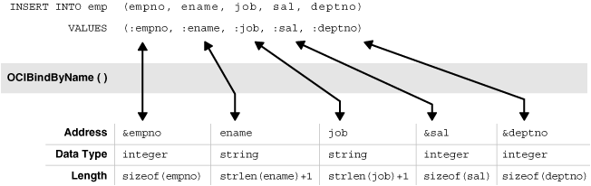
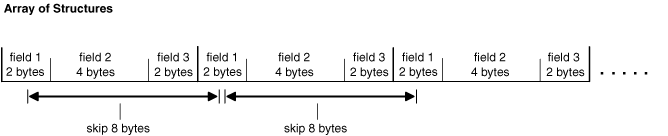
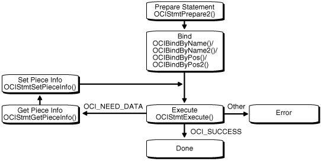
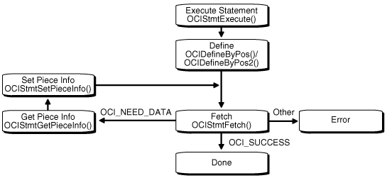

This chapter describes binding and defining in OCI.

This chapter contains these topics:

- Overview of Binding in OCI

- Advanced Bind Operations in OCI

- Overview of Defining in OCI

- Advanced Define Operations in OCI

- About Binding and Defining Arrays of Structures in OCI

- About Binding and Defining Multiple Buffers

- DML with a RETURNING Clause in OCI

- Character Conversion in OCI Binding and Defining

- PL/SQL REF CURSORs and Nested Tables in OCI

- Natively Describe and Bind All PL/SQL Types Including Package Types

- Runtime Data Allocation and Piecewise Operations in OCI

### 7.1 Overview of Binding in OCI

This chapter expands on the basic concepts of binding and defining, and provides more detailed information about the different types of binds and defines you can use in OCI applications.

Additionally, this chapter discusses the use of arrays of structures, and other issues involved in binding, defining, and character conversions.

For example, given the `INSERT` statement:

    INSERT INTO emp VALUES
        (:empno, :ename, :job, :sal, :deptno)

Then given the following variable declarations:

    text     *ename, *job;
    sword    empno, sal, deptno;

the bind step makes an association between the placeholder name and the address of the program variables. The bind also indicates the data type and length of the program variables, as illustrated in Figure 7-1.

Figure 7-1 Using OCIBindByName() to Associate Placeholders with Program Variables

[Description of "Figure 7-1 Using OCIBindByName() to Associate Placeholders with Program Variables"](img_text/lnoci021.md)

If you change only the value of a bind variable, it is not necessary to rebind it to execute the statement again. Because the bind is by reference, as long as the address of the variable and handle remain valid, you can reexecute a statement that references the variable without rebinding.

**Note:**

At the interface level, all bind variables are considered at least `IN` and must be properly initialized. If the variable is a pure `OUT` bind variable, you can set the variable to 0. You can also provide a `NULL` indicator and set that indicator to -1 (`NULL`).

In the Oracle database, data types have been implemented for named data types, `REF`s and LOBs, and they can be bound as placeholders in a SQL statement.

**Note:**

For opaque data types (descriptors or locators) whose sizes are not known, pass the address of the descriptor or locator pointer. Set the size parameter to the size of the appropriate data structure, (`sizeof(structure)`).

This section includes the following topics:

- Named Binds and Positional Binds

- OCI Array Interface

- About Binding Placeholders in PL/SQL

- Steps Used in OCI Binding

- PL/SQL Block in an OCI Program

**See Also:**

Steps Used in OCI Binding for the code that implements this example

#### 7.1.1 Named Binds and Positional Binds

In a named bind, each placeholder in the statement has a name associated with it, while in a positional bind, the placeholders are referred to by their position in the statement rather than by their names.

The SQL statement in Figure 7-1 is an example of a named bind. Each placeholder in the statement has a name associated with it, such as 'ename' or 'sal'. When this statement is prepared and the placeholders are associated with values in the application, the association is made by the name of the placeholder using the `OCIBindByName()` or `OCIBindByName2()` call with the name of the placeholder passed in the placeholder parameter.

A second type of bind is known as a positional bind. In a positional bind, the placeholders are referred to by their position in the statement rather than by their names. For binding purposes, an association is made between an input value and the position of the placeholder, using the `OCIBindByPos()` or `OCIBindByPos2()` call.

To use the previous example for a positional bind:

    INSERT INTO emp VALUES
        (:empno, :ename, :job, :sal, :deptno)

The five placeholders are then each bound by calling `OCIBindByPos()` or `OCIBindByPos2()` and passing the position number of the placeholder in the `position` parameter. For example, the `:empno` placeholder would be bound by calling `OCIBindByPos()` or `OCIBindByPos2()` with a position of 1, `:ename` with a position of 2, and so on.

In a duplicate bind, only a single bind call may be necessary. Consider the following SQL statement, which queries the database for employees whose commission and salary are both greater than a given amount:

    SELECT empno FROM emp
        WHERE sal > :some_value
        AND comm > :some_value

An OCI application could complete the binds for this statement with a single call to `OCIBindByName()` or `OCIBindByName2()` to bind the `:some_value` placeholder by name. In this case, all bind placeholders for `:some_value` get assigned the same value as provided by the `OCIBindByName()` or `OCIBindByName2()` call.

Now consider the case where a 6th placeholder is added that is a duplicate. For example, add `:ename` as the 6th placeholder in the first previous example:

    INSERT INTO emp VALUES
        (:empno, :ename, :job, :sal, :deptno, :ename)

If you are using the `OCIBindByName()` or `OCIBindByName2()` call, just one bind call suffices to bind both occurrences of the `:ename` placeholder. All occurrences of `:ename` in the statement will get bound to the same value. Moreover, if new bind placeholders get added as a result of which bind positions for existing bind placeholders change, you do not need to change your existing bind calls in order to update bind positions. This is a distinct advantage in using the `OCIBindByName()` or `OCIBindByName2()` call if your program evolves to add more bind variables in your statement text.

If you are using the `OCIBindByPos()` or `OCIBindByPos2()` call, however, you have increased flexibility in terms of binding duplicate bind-parameters separately, if you need it. You have the option of binding any of the duplicate occurrences of a bind parameter separately. Any unbound duplicate occurrences of a parameter inherit the value from the first occurrence of the bind parameter with the same name. The first occurrence must be explicitly bound.

In the context of SQL statements, the position n indicates the bind parameter at the nth position. However, in the context of PL/SQL statements, `OCIBindByPos()` or `OCIBindByPos2()` has a different interpretation for the position parameter: the position n in the bind call indicates a binding for the nth unique parameter name in the statement when scanned left to right.

Using the previous example again and the same SQL statement text, if you want to bind the 6th position separately, the `:ename` placeholder would be bound by calling `OCIBindByPos()` or `OCIBindByPos2()` with a position of 6. Otherwise, if left unbound, `:ename` would inherit the value from the first occurrence of the bind parameter with the same name, in this case, from `:ename` in position 2.

**See Also:**

- [OCIBindByName()](bind-define-describe-functions.md) or [OCIBindByName2()](bind-define-describe-functions.md)

- [OCIBindByPos()](bind-define-describe-functions.md) or [OCIBindByPos2()](bind-define-describe-functions.md)

#### 7.1.2 OCI Array Interface

You can pass data to the Oracle database in various ways.

You can execute a SQL statement repeatedly using the `OCIStmtExecute()` routine and supply different input values on each iteration.

You can use the Oracle array interface and input many values with a single statement and a single call to `OCIStmtExecute()`. In this case, you bind an array to an input placeholder, and the entire array can be passed at the same time, under the control of the iters parameter.

The array interface significantly reduces round-trips to the database when you are updating or inserting a large volume of data. This reduction can lead to considerable performance gains in a busy client/server environment. For example, consider an application that inserts 10 rows into the database. Calling `OCIStmtExecute()` 10 times with single values results in 10 network round-trips to insert all the data. The same result is possible with a single call to `OCIStmtExecute()` using an input array, which involves only one network round-trip.

Beginning with Oracle Database 12c Release 2 (12.2), support is added for Hybrid Columnar Compression (HCC) with conventional DMLs, so HCC can be used during array inserts with OCI. HCC conventional array inserts are only supported for HCC tables on ASSM tablespaces. .

**Note:**

When you use the OCI array interface to perform inserts, row triggers in the database are fired as each row is inserted.

The maximum number of rows allowed in an array DML statement is 4 billion -1 (3,999,999,999). However, if you use `ub8` instead of `ub4`, this increases the maximum number of rows allowed in an array DML statement to be more than 4 billion rows.

**See Also:**

- [OCIStmtExecute()](statement-functions.md)

- [About Table Compression](../admin/managing-tables.md) in Oracle Database Administrator’s Guide for information about how to configure HCC

#### 7.1.3 About Binding Placeholders in PL/SQL

You process a PL/SQL block by placing the block in a string variable, binding any variables, and then executing the statement containing the block, just as you would with a single SQL statement.

When you bind placeholders in a PL/SQL block to program variables, you must use `OCIBindByName()` or `OCIBindByName2()` or `OCIBindByPos()` or `OCIBindByPos2()` to perform the basic binds for host variables that are either scalars or arrays.

The following short PL/SQL block contains two placeholders, which represent `IN` parameters to a procedure that updates an employee's salary, when given the employee number and the new salary amount:

    char plsql_statement[] = "BEGIN\
                              RAISE_SALARY(:emp_number, :new_sal);\
                              END;" ;

These placeholders can be bound to input variables in the same way as placeholders in a SQL statement.

When processing PL/SQL statements, output variables are also associated with program variables by using bind calls.

For example, consider the following PL/SQL block:

    BEGIN
        SELECT ename,sal,comm INTO :emp_name, :salary, :commission
        FROM emp
        WHERE empno = :emp_number;
    END;

In this block, you would use `OCIBindByName()` or `OCIBindByName2()` to bind variables in place of the `:emp_name`, `:salary`, and `:commission` output placeholders, and in place of the input placeholder `:emp_number`.

**Note:**

All buffers, even pure `OUT` buffers, must be initialized by setting the buffer length to zero in the bind call, or by setting the corresponding indicator to -1.

**See Also:**

- [OCIBindByName()](bind-define-describe-functions.md) or [OCIBindByName2()](bind-define-describe-functions.md)

- [OCIBindByPos()](bind-define-describe-functions.md) or [OCIBindByPos2()](bind-define-describe-functions.md)

- [Information for Named Data Type and REF Binds](object-relational-data-types-in-oci.md) for more information about binding PL/SQL placeholders

#### 7.1.4 Steps Used in OCI Binding

Placeholders are bound in several steps.

For a simple scalar or array bind, it is only necessary to specify an association between the placeholder and the data, by using `OCIBindByName()` or `OCIBindByName2()` or `OCIBindByPos()` or `OCIBindByPos2()`.

Once the bind is complete, the OCI library detects where to find the input data or where to put the PL/SQL output data when the SQL statement is executed. Program input data does not need to be in the program variable when it is bound to the placeholder, but the data must be there when the statement is executed.

The following code example in Example 7-1 shows handle allocation and binding for each placeholder in a SQL statement.

**Note:**

The `checkerr()` function evaluates the return code from an OCI application. The code for the function is in the Example for `OCIErrorGet()`.

Example 7-1 Handle Allocation and Binding for Each Placeholder in a SQL Statement

    ...
    /* The SQL statement, associated with stmthp (the statement handle)
    by calling OCIStmtPrepare2() */
    text *insert = (text *) "INSERT INTO emp(empno, ename, job, sal, deptno)\
        VALUES (:empno, :ename, :job, :sal, :deptno)";
    ...

    /*  Bind the placeholders in the SQL statement, one per bind handle. */
    checkerr(errhp, OCIBindByName(stmthp, &bnd1p, errhp, (text *) ":ENAME",
        strlen(":ENAME"), (ub1 *) ename, enamelen+1, SQLT_STR, (void *) 0,
        (ub2 *) 0, (ub2) 0, (ub4) 0, (ub4 *) 0, OCI_DEFAULT));
    checkerr(errhp, OCIBindByName(stmthp, &bnd2p, errhp, (text *) ":JOB",
        strlen(":JOB"), (ub1 *) job, joblen+1, SQLT_STR, (void *)
        &job_ind, (ub2 *) 0, (ub2) 0, (ub4) 0, (ub4 *) 0, OCI_DEFAULT));
    checkerr(errhp, OCIBindByName(stmthp, &bnd3p, errhp, (text *) ":SAL",
        strlen(":SAL"), (ub1 *) &sal, (sword) sizeof(sal), SQLT_INT,
        (void *) &sal_ind, (ub2 *) 0, (ub2) 0, (ub4) 0, (ub4 *) 0,
        OCI_DEFAULT));
    checkerr(errhp, OCIBindByName(stmthp, &bnd4p, errhp, (text *) ":DEPTNO",
        strlen(":DEPTNO"), (ub1 *) &deptno,(sword) sizeof(deptno), SQLT_INT,
        (void *) 0, (ub2 *) 0, (ub2) 0, (ub4) 0, (ub4 *) 0, OCI_DEFAULT));
    checkerr(errhp, OCIBindByName(stmthp, &bnd5p, errhp, (text *) ":EMPNO",
        strlen(":EMPNO"), (ub1 *) &empno, (sword) sizeof(empno), SQLT_INT,
        (void *) 0, (ub2 *) 0, (ub2) 0, (ub4) 0, (ub4 *) 0,OCI_DEFAULT));

**See Also:**

- [OCIBindByName()](bind-define-describe-functions.md) or [OCIBindByName2()](bind-define-describe-functions.md)

- [OCIBindByPos()](bind-define-describe-functions.md) or [OCIBindByPos2()](bind-define-describe-functions.md)

- [OCIErrorGet()](miscellaneous-functions.md)

#### 7.1.5 PL/SQL Block in an OCI Program

Perhaps the most common use for PL/SQL blocks in OCI is to call stored procedures or stored functions.

Assume that there is a procedure named `RAISE_SALARY` stored in the database, and you embed a call to that procedure in an anonymous PL/SQL block, and then process the PL/SQL block.

The following program fragment shows how to embed a stored procedure call in an OCI application. The program passes an employee number and a salary increase as inputs to a stored procedure called `raise_salary`:

    raise_salary (employee_num IN, sal_increase IN, new_salary OUT);

This procedure raises a given employee's salary by a given amount. The increased salary that results is returned in the stored procedure's variable, `new_salary`, and the program displays this value.

Note that the PL/SQL procedure argument, `new_salary`, although a PL/SQL OUT variable, must be bound, not defined.

Example 7-2 demonstrates how to perform a simple scalar bind where only a single bind call is necessary. In some cases, additional bind calls are needed to define attributes for specific bind data types or execution modes.

Example 7-2 Defining a PL/SQL Statement to Be Used in OCI

    /* Define PL/SQL statement to be used in program. */
    text *give_raise = (text *) "BEGIN\
                      RAISE_SALARY(:emp_number,:sal_increase, :new_salary);\
                         END;";
    OCIBind  *bnd1p = NULL;                      /* the first bind handle */
    OCIBind  *bnd2p = NULL;                     /* the second bind handle */
    OCIBind  *bnd3p = NULL;                      /* the third bind handle */

    static void checkerr();
    sb4 status;

    main()
    {
      sword    empno, raise, new_sal;
      OCISession *usrhp = (OCISession *)NULL;
    ...
    /* attach to Oracle database, and perform necessary initializations
    and authorizations */
    ...
          /* prepare the statement request, passing the PL/SQL text
            block as the statement to be prepared */
    checkerr(errhp, OCIStmtPrepare2(svchp, &stmthp, errhp, (text *) give_raise, (ub4)
          strlen(give_raise), NULL, 0, OCI_NTV_SYNTAX, OCI_DEFAULT));

          /* bind each of the placeholders to a program variable */
    checkerr( errhp, OCIBindByName(stmthp, &bnd1p, errhp, (text *) ":emp_number",
                 -1, (ub1 *) &empno,
                (sword) sizeof(empno), SQLT_INT, (void *) 0,
                 (ub2 *) 0, (ub2) 0, (ub4) 0, (ub4 *) 0, OCI_DEFAULT));

    checkerr( errhp, OCIBindByName(stmthp, &bnd2p, errhp, (text *) ":sal_increase",
                 -1, (ub1 *) &raise,
                 (sword) sizeof(raise), SQLT_INT, (void *) 0,
                 (ub2 *) 0, (ub2) 0, (ub4) 0, (ub4 *) 0, OCI_DEFAULT));

          /* remember that PL/SQL OUT variables are bound, not defined */

    checkerr( errhp, OCIBindByName(stmthp, &bnd3p, errhp, (text *) ":new_salary",
                 -1, (ub1 *) &new_sal,
                 (sword) sizeof(new_sal), SQLT_INT, (void *) 0,
                 (ub2 *) 0, (ub2) 0, (ub4) 0, (ub4 *) 0, OCI_DEFAULT));

          /* prompt the user for input values */
    printf("Enter the employee number: ");
    scanf("%d", &empno);
          /* flush the input buffer */
    myfflush();

    printf("Enter employee's raise: ");
    scanf("%d", &raise);
          /* flush the input buffer */
    myfflush();

      /* execute PL/SQL block*/
      checkerr(errhp, OCIStmtExecute(svchp, stmthp, errhp, (ub4) 1, (ub4) 0,
          (OCISnapshot *) NULL, (OCISnapshot *) NULL, OCI_DEFAULT));

      /* display the new salary, following the raise */
    printf("The new salary is %d\n", new_sal);

    OCIStmtRelease(stmthp, errhp, NULL, 0, OCI_DEFAULT);
    }

**See Also:**

Why a PL/SQL OUT variable must be bound and not defined is explained in About Defining PL/SQL Output Variables and in [Information for Named Data Type and REF Defines, and PL/SQL OUT Binds](object-relational-data-types-in-oci.md).

### 7.2 Advanced Bind Operations in OCI

More advanced bind operations include multistep binds, and binds of named data types and `REFs`.

[About Binding Placeholders in OCI](using-sql_statements-in-oci.md) discussed how a basic bind operation is performed to create an association between a placeholder in a SQL statement and a program variable by using `OCIBindByName()` or `OCIBindByName2()` or `OCIBindByPos()` or `OCIBindByPos2()`. This section covers more advanced bind operations, including multistep binds, and binds of named data types and `REFs`.

In some cases, additional bind calls are necessary to define specific attributes for certain bind data types or certain execution modes.

The following sections describe these special cases, and the information about binding is summarized in Table 7-1.

Table 7-1 Information Summary for Bind Types

| Type of Bind                         | Bind Data Type             | Notes                                                                                                                                                                                                                              |
|:-------------------------------------|:---------------------------|:-----------------------------------------------------------------------------------------------------------------------------------------------------------------------------------------------------------------------------------|
| Scalar                               | Any scalar data type       | Bind a single scalar using `OCIBindByName()` or `OCIBindByName2()` or `OCIBindByPos()` or `OCIBindByPos2()`.                                                                                                                       |
| Array of scalars                     | Any scalar data type       | Bind an array of scalars using `OCIBindByName()` or `OCIBindByName2()` or `OCIBindByPos()` or `OCIBindByPos2()`.                                                                                                                   |
| Named data type                      | `SQLT_NTY`                 | Includes records and collections Two bind calls are required: • `OCIBindByName()` or `OCIBindByName2()` or `OCIBindByPos()` or `OCIBindByPos2()` • `OCIBindObject()`                                                      |
| Boolean                              | `SQLT_BOL`                 | Bind a Boolean using `OCIBindByName()` or `OCIBindByName2()` or `OCIBindByPos()` or `OCIBindByPos2()`.                                                                                                                             |
| `REF`                                | `SQLT_REF`                 | Two bind calls are required: • `OCIBindByName()` or `OCIBindByName2()` or `OCIBindByPos()` or `OCIBindByPos2()` • `OCIBindObject()`                                                                                          |
| LOB `BFILE`                       | `SQLT_BLOB` `SQLT_CLOB` | Allocate the LOB locator using `OCIDescriptorAlloc()`, and then bind its address, `OCILobLocator` `**`, with `OCIBindByName()` or `OCIBindByName2()` or `OCIBindByPos()` or `OCIBindByPos2()`, by using one of the LOB data types. |
| Array of structures or static arrays | Varies                     | Two bind calls are required: • `OCIBindByName()` or `OCIBindByName2()` or `OCIBindByPos()` or `OCIBindByPos2()` • `OCIBindArrayOfStruct()`                                                                                   |
| Piecewise insert                     | Varies                     | `OCIBindByName()` or `OCIBindByName2()` or `OCIBindByPos()` or `OCIBindByPos2()` is required. The application may also need to call `OCIBindDynamic()` to register piecewise callbacks.                                            |
| `REF CURSOR` variables               | `SQLT_RSET`                | Allocate a statement handle, `OCIStmt`, and then bind its address, `OCIStmt **`, using the `SQLT_RSET` data type.                                                                                                                  |

This section includes the following topics:

- About Binding LOBs

- About Binding in OCI_DATA_AT_EXEC Mode

- About Binding REF CURSOR Variables

**See Also:**

- [Named Data Type Binds](object-relational-data-types-in-oci.md) for information about binding named data types (objects)

- [About Binding REFs](object-relational-data-types-in-oci.md)

- [OCIBindByName()](bind-define-describe-functions.md) or [OCIBindByName2()](bind-define-describe-functions.md)

- [OCIBindByPos()](bind-define-describe-functions.md) or [OCIBindByPos2()](bind-define-describe-functions.md)

- [OCIBindObject()](bind-define-describe-functions.md)

- [OCIDescriptorAlloc()](handle-and-descriptor-functions.md)

- [OCIBindArrayOfStruct()](bind-define-describe-functions.md)

- [OCIBindDynamic()](bind-define-describe-functions.md)

#### 7.2.1 About Binding LOBs

There are two ways of binding LOBs:

- Bind the LOB locator, rather than the actual LOB values. In this case the LOB value is written or read by passing a LOB locator to the OCI LOB functions.

- Bind the LOB value directly, without using the LOB locator.

This section includes the following topics:

- Binding LOB Locators

- About Binding LOB Data

##### 7.2.1.1 Binding LOB Locators

Either a single locator or an array of locators can be bound in a single bind call.

In each case, the application must pass the address of a LOB locator and not the locator itself. For example, suppose that an application has prepared this SQL statement where `one_lob` is a bind variable corresponding to a LOB column:

    INSERT INTO some_table VALUES (:one_lob)

Then your application makes the following declaration:

    OCILobLocator * one_lob;

Then the calls in Example 7-3 would be used to bind the placeholder and execute the statement:

You can also insert an array using the same SQL `INSERT` statement. In this case, the application would include the code shown in Example 7-4.

You must allocate descriptors with the `OCIDescriptorAlloc()` function before they can be used. In an array of locators, you must initialize each array element using `OCIDescriptorAlloc()`. Use `OCI_DTYPE_LOB` as the `type` parameter when allocating `BLOB`s, `CLOB`s, and `NCLOB`s. Use `OCI_DTYPE_FILE` when allocating `BFILE`s.

Example 7-3 Binding the Placeholder and Executing the Statement to Insert a Single Locator

    /* initialize single locator */
    one_lob = OCIDescriptorAlloc(...OCI_DTYPE_LOB...);
    ...
    /* pass the address of the locator */
    OCIBindByName(...,(void *) &one_lob,... SQLT_CLOB, ...);
    OCIStmtExecute(...,1,...)                /* 1 is the iters parameter */

Example 7-4 Binding the Placeholder and Executing the Statement to Insert an Array of Locators

    OCILobLocator * lob_array[10];
    ...
    for (i=0; i<10, i++)
        lob_array[i] = OCIDescriptorAlloc(...OCI_DTYPE_LOB...);
                                         /* initialize array of locators */
    ...
    OCIBindByName(...,(void *) lob_array,...);
    OCIStmtExecute(...,10,...);               /* 10 is the iters parameter */

This section includes the following topic: Restrictions on Binding LOB Locators

**See Also:**

[OCIDescriptorAlloc()](handle-and-descriptor-functions.md)

###### 7.2.1.1.1 Restrictions on Binding LOB Locators

What are the restrictions on binding LOB locators.

Observe the following restrictions when you bind LOB locators:

- Piecewise and callback `INSERT` or `UPDATE` operations are not supported.

- When using a FILE locator as a bind variable for an `INSERT` or `UPDATE` statement, you must first initialize the locator with a directory object and file name, by using `OCILobFileSetName()` before issuing the `INSERT` or `UPDATE` statement.

**See Also:**

- [LOB and BFILE Operations](lobs-and-bfile-operations.md) for more information about the OCI LOB functions

- [OCILobFileSetName()](lob-functions.md)

##### 7.2.1.2 About Binding LOB Data

Oracle Database allows nonzero binds for `INSERT`s and `UPDATE`s of any size LOB.

So you can bind data into a LOB column using `OCIBindByPos()` or `OCIBindByPos2()`, `OCIBindByName()` or `OCIBindByName2()`, and PL/SQL binds.

The bind of more than 4 kilobytes of data to a LOB column uses space from the temporary tablespace. Ensure that your temporary tablespace is big enough to hold at least the amount of data equal to the sum of all the bind lengths for LOBs. If your temporary tablespace is extendable, it is extended automatically after the existing space is fully consumed. Use the following command to create an extendable temporary tablespace:

    CREATE TABLESPACE ... AUTOEXTEND ON ... TEMPORARY ...;

This section includes the following topics:

- Restrictions on Binding LOB Data

- Examples of Binding LOB Data

**See Also:**

- [OCIBindByPos()](bind-define-describe-functions.md) or [OCIBindByPos2()](bind-define-describe-functions.md)

- [OCIBindByName()](bind-define-describe-functions.md) or [OCIBindByName2()](bind-define-describe-functions.md)

###### 7.2.1.2.1 Restrictions on Binding LOB Data

What are the restrictions on binding LOB data.

Observe the following restrictions when you bind LOB data:

- If a table has both `LONG` and LOB columns, then you can have binds of greater than 4 kilobytes for either the `LONG` column or the LOB columns, but not both in the same statement.

- In an `INSERT` `AS` `SELECT` operation, Oracle Database does not allow binding of any length data to LOB columns.

- A special consideration applies on the maximum size of bind variables that are neither LONG or LOB, but that appear after any LOB or LONG bind variable in the SQL statement. You receive an `ORA-24816` error from Oracle Database if the maximum size for such bind variables exceeds 4000 bytes. To avoid this error, you must set `OCI_ATTR_MAXDATA_SIZE` to 4000 bytes for any such binds whose maximum size may exceed 4000 bytes on the server side after character set conversion. Alternatively, reorder the binds so that such binds are placed before any LONG or LOBs in the bind list.

- Oracle Database does not do implicit conversions, such as `HEX` to `RAW` or `RAW` to `HEX`, for data of size more than 4000 bytes. The PL/SQL code in the following code example illustrates this:

  Demonstrating Some Implicit Conversions That Cannot Be Done

      create table t (c1 clob, c2 blob);
      declare
        text   varchar(32767);
        binbuf raw(32767);
      begin
        text := lpad ('a', 12000, 'a');
        binbuf := utl_raw.cast_to_raw(text);

        -- The following works:
        insert into t values (text, binbuf);

        -- The following does not work because Oracle dpes not do implicit
        -- hex to raw conversion.
        insert into t (c2) values (text);

        -- The following does not work because Oracle does not do implicit
        -- raw to hex conversion.
        insert into t (c1) values (binbuf);

        -- The following does not work because you cannot combine the
        -- utl_raw.cast_to_raw() operator with the >4k bind.
        insert into t (c2) values (utl_raw.cast_to_raw(text));

      end;
      /

- If you bind more than 4000 bytes of data to a `BLOB` or a `CLOB`, and the data is filtered by a SQL operator, then Oracle Database limits the size of the result to at most 4000 bytes.

  For example:

      create table t (c1 clob, c2 blob);
      -- The following command inserts only 4000 bytes because the result of
      -- LPAD is limited to 4000 bytes
      insert into t(c1) values (lpad('a', 5000, 'a'));

      -- The following command inserts only 2000 bytes because the result of
      -- LPAD is limited to 4000 bytes, and the implicit hex to raw conversion
      -- converts it to 2000 bytes of RAW data.
      insert into t(c2) values (lpad('a', 5000, 'a'));

**See Also:**

About Using the OCI_ATTR_MAXDATA_SIZE Attribute

###### 7.2.1.2.2 Examples of Binding LOB Data

Shows some exampled of binding LOB data.

The following SQL statements are used in Example 7-5 through Example 7-12:

    CREATE TABLE foo (a INTEGER );
    CREATE TYPE lob_typ AS OBJECT (A1 CLOB );
    CREATE TABLE lob_long_tab (C1 CLOB, C2 CLOB, CT3 lob_typ, L LONG);

Example 7-5 Allowed: Inserting into C1, C2, and L Columns Up to 8000, 8000, and 2000 Byte-Sized Bind Variable Data Values, Respectively

    void insert()                 /* A function in an OCI program */
    {
       /* The following is allowed */
       ub1 buffer[8000];
       text *insert_sql = (text *) "INSERT INTO lob_long_tab (C1, C2, L) \
                           VALUES (:1, :2, :3)";
       OCIStmtPrepare(stmthp, errhp, insert_sql, strlen((char*)insert_sql),
                     (ub4) OCI_NTV_SYNTAX, (ub4) OCI_DEFAULT);
       OCIBindByPos(stmthp, &bindhp[0], errhp, 1, (void *)buffer, 8000,
                    SQLT_LNG, 0, 0, 0, 0, 0, (ub4) OCI_DEFAULT);
       OCIBindByPos(stmthp, &bindhp[1], errhp, 2, (void *)buffer, 8000,
                    SQLT_LNG, 0, 0, 0, 0, 0, (ub4) OCI_DEFAULT);
       OCIBindByPos(stmthp, &bindhp[2], errhp, 3, (void *)buffer, 2000,
                    SQLT_LNG, 0, 0, 0, 0, 0, (ub4) OCI_DEFAULT);
       OCIStmtExecute(svchp, stmthp, errhp, 1, 0, (OCISnapshot *) NULL,
                                  (OCISnapshot *) NULL, OCI_DEFAULT);
    }

Example 7-6 Allowed: Inserting into C1 and L Columns up to 2000 and 8000 Byte-Sized Bind Variable Data Values, Respectively

    void insert()
    {
       /* The following is allowed */
       ub1 buffer[8000];
       text *insert_sql = (text *) "INSERT INTO lob_long_tab (C1, L) \
                          VALUES (:1, :2)";
       OCIStmtPrepare(stmthp, errhp, insert_sql, strlen((char*)insert_sql),
                     (ub4) OCI_NTV_SYNTAX, (ub4) OCI_DEFAULT);
       OCIBindByPos(stmthp, &bindhp[0], errhp, 1, (void *)buffer, 2000,
                    SQLT_LNG, 0, 0, 0, 0, 0, (ub4) OCI_DEFAULT);
       OCIBindByPos(stmthp, &bindhp[1], errhp, 2, (void *)buffer, 8000,
                    SQLT_LNG, 0, 0, 0, 0, 0, (ub4) OCI_DEFAULT);
       OCIStmtExecute(svchp, stmthp, errhp, 1, 0, (OCISnapshot *) NULL,
                                  (OCISnapshot *) NULL, OCI_DEFAULT);
    }

Example 7-7 Allowed: Updating C1, C2, and L Columns up to 8000, 8000, and 2000 Byte-Sized Bind Variable Data Values, Respectively

    void update()
    {
       /* The following is allowed, no matter how many rows it updates */
       ub1 buffer[8000];
       text *update_sql = (text *)"UPDATE lob_long_tab SET \
                                  C1 = :1, C2=:2, L=:3";
       OCIStmtPrepare(stmthp, errhp, update_sql, strlen((char*)update_sql),
                     (ub4) OCI_NTV_SYNTAX, (ub4) OCI_DEFAULT);
       OCIBindByPos(stmthp, &bindhp[0], errhp, 1, (void *)buffer, 8000,
                    SQLT_LNG, 0, 0, 0, 0, 0, (ub4) OCI_DEFAULT);
       OCIBindByPos(stmthp, &bindhp[1], errhp, 2, (void *)buffer, 8000,
                    SQLT_LNG, 0, 0, 0, 0, 0, (ub4) OCI_DEFAULT);
       OCIBindByPos(stmthp, &bindhp[2], errhp, 3, (void *)buffer, 2000,
                    SQLT_LNG, 0, 0, 0, 0, 0, (ub4) OCI_DEFAULT);
       OCIStmtExecute(svchp, stmthp, errhp, 1, 0, (OCISnapshot *) NULL,
                                  (OCISnapshot *) NULL, OCI_DEFAULT);
    }

Example 7-8 Allowed: Updating C1, C2, and L Columns up to 2000, 2000, and 8000 Byte-Sized Bind Variable Data Values, Respectively

    void update()
    {
       /* The following is allowed, no matter how many rows it updates */
       ub1 buffer[8000];
       text *update_sql = (text *)"UPDATE lob_long_tab SET \
                                   C1 = :1, C2=:2, L=:3";
       OCIStmtPrepare(stmthp, errhp, update_sql, strlen((char*)update_sql),
                     (ub4) OCI_NTV_SYNTAX, (ub4) OCI_DEFAULT);
       OCIBindByPos(stmthp, &bindhp[0], errhp, 1, (void *)buffer, 2000,
                    SQLT_LNG, 0, 0, 0, 0, 0, (ub4) OCI_DEFAULT);
       OCIBindByPos(stmthp, &bindhp[1], errhp, 2, (void *)buffer, 2000,
                    SQLT_LNG, 0, 0, 0, 0, 0, (ub4) OCI_DEFAULT);
       OCIBindByPos(stmthp, &bindhp[2], errhp, 3, (void *)buffer, 8000,
                    SQLT_LNG, 0, 0, 0, 0, 0, (ub4) OCI_DEFAULT);
       OCIStmtExecute(svchp, stmthp, errhp, 1, 0, (OCISnapshot *) NULL,
                                   (OCISnapshot *) NULL, OCI_DEFAULT);
    }

Example 7-9 Allowed: Piecewise, Callback, and Array Insert or Update Operations

    void insert()
    {
       /* Piecewise, callback and array insert/update operations similar to
        * the allowed regular insert/update operations are also allowed */
    }

Example 7-10 Not Allowed: Inserting More Than 4000 Bytes into Both LOB and LONG Columns Using the Same INSERT Statement

    void insert()
    {
       /* The following is NOT allowed because you cannot insert >4000 bytes
        * into both LOB and LONG columns */
       ub1 buffer[8000];
       text *insert_sql = (text *)"INSERT INTO lob_long_tab (C1, L) \
                                   VALUES (:1, :2)";
       OCIStmtPrepare(stmthp, errhp, insert_sql, strlen((char*)insert_sql),
                     (ub4) OCI_NTV_SYNTAX, (ub4) OCI_DEFAULT);
       OCIBindByPos(stmthp, &bindhp[0], errhp, 1, (void *)buffer, 8000,
                    SQLT_LNG, 0, 0, 0, 0, 0, (ub4) OCI_DEFAULT);
       OCIBindByPos(stmthp, &bindhp[1], errhp, 2, (void *)buffer, 8000,
                    SQLT_LNG, 0, 0, 0, 0, 0, (ub4) OCI_DEFAULT);
       OCIStmtExecute(svchp, stmthp, errhp, 1, 0, (OCISnapshot *) NULL,
                                  (OCISnapshot *) NULL, OCI_DEFAULT);
    }

Example 7-11 Allowed: Inserting into the CT3 LOB Column up to 2000 Byte-Sized Bind Variable Data Values

    void insert()
    {
       /* Insert of data into LOB attributes is allowed */
       ub1 buffer[8000];
       text *insert_sql = (text *)"INSERT INTO lob_long_tab (CT3) \
                                   VALUES (lob_typ(:1))";
       OCIStmtPrepare(stmthp, errhp, insert_sql, strlen((char*)insert_sql),
                     (ub4) OCI_NTV_SYNTAX, (ub4) OCI_DEFAULT);
       OCIBindByPos(stmthp, &bindhp[0], errhp, 1, (void *)buffer, 2000,
                    SQLT_LNG, 0, 0, 0, 0, 0, (ub4) OCI_DEFAULT);
       OCIStmtExecute(svchp, stmthp, errhp, 1, 0, (OCISnapshot *) NULL,
                                  (OCISnapshot *) NULL, OCI_DEFAULT);
    }

Example 7-12 Not Allowed: Binding Any Length Data to a LOB Column in an Insert As Select Operation

    void insert()
    {
       /* The following is NOT allowed because you cannot do insert as
        * select character data into LOB column */
       ub1 buffer[8000];
       text *insert_sql = (text *)"INSERT INTO lob_long_tab (C1) SELECT \
                                   :1 from FOO";
       OCIStmtPrepare(stmthp, errhp, insert_sql, strlen((char*)insert_sql),
                     (ub4) OCI_NTV_SYNTAX, (ub4) OCI_DEFAULT);
       OCIBindByPos(stmthp, &bindhp[0], errhp, 1, (void *)buffer, 8000,
                    SQLT_LNG, 0, 0, 0, 0, 0, (ub4) OCI_DEFAULT);
       OCIStmtExecute(svchp, stmthp, errhp, 1, 0, (OCISnapshot *) NULL,
                                  (OCISnapshot *) NULL, OCI_DEFAULT);
    }

#### 7.2.2 About Binding in OCI_DATA_AT_EXEC Mode

If the `mode` parameter in a call to `OCIBindByName()` or `OCIBindByName2()` or `OCIBindByPos()` or `OCIBindByPos2()` is set to `OCI_DATA_AT_EXEC`, an additional call to `OCIBindDynamic()` is necessary if the application uses the callback method for providing data at run time.

The call to `OCIBindDynamic()` sets up the callback routines, if necessary, for indicating the data or piece provided. If the `OCI_DATA_AT_EXEC` mode is chosen, but the standard OCI piecewise polling method is used instead of callbacks, the call to `OCIBindDynamic()` is not necessary.

When binding `RETURN` clause variables, an application must use `OCI_DATA_AT_EXEC` mode, and it must provide callbacks.

**See Also:**

- Runtime Data Allocation and Piecewise Operations in OCI for more information about piecewise operations

- [OCIBindByName()](bind-define-describe-functions.md) or [OCIBindByName2()](bind-define-describe-functions.md)

- [OCIBindByPos()](bind-define-describe-functions.md) or [OCIBindByPos2()](bind-define-describe-functions.md)

- [OCIBindDynamic()](bind-define-describe-functions.md)

#### 7.2.3 About Binding REF CURSOR Variables

`REF CURSOR`s are bound to a statement handle with a bind data type of `SQLT_RSET`.

**See Also:**

PL/SQL REF CURSORs and Nested Tables in OCI

### 7.3 Overview of Defining in OCI

Query statements return data from the database to your application.

When processing a query, you must define an output variable or an array of output variables for each item in the select list for retrieving data. The define step creates an association that determines where returned results are stored, and in what format.

For example, if your program processes the following statement then you would normally define two output variables: one to receive the value returned from the `name` column, and one to receive the value returned from the `ssn` column:

    SELECT name, ssn FROM employees
        WHERE empno = :empnum

If you were only interested in retrieving values from the `name` column, you would not need to define an output variable for `ssn`. If the `SELECT` statement being processed returns more than a single row for a query, the output variables that you define can be arrays instead of scalar values.

Depending on the application, the define step can occur before or after an execute operation. If you know the data types of select-list items at compile time, the define can occur before the statement is executed. If your application is processing dynamic SQL statements entered by you at run time or statements that do not have a clearly defined select list, the application must execute the statement to retrieve describe information. After the describe information is retrieved, the type information for each select-list item is available for use in defining output variables.

OCI processes the define call locally on the client side. In addition to indicating the location of buffers where results should be stored, the define step determines what data conversions must occur when data is returned to the application.

**Note:**

Output buffers must be 2-byte aligned.

The `dty` parameter of the `OCIDefineByPos()` or `OCIDefineByPos2()` call specifies the data type of the output variable. OCI can perform a wide range of data conversions when data is fetched into the output variable. For example, internal data in Oracle `DATE` format can be automatically converted to a `String` data type on output.

This section includes the following topic: Steps Used in OCI Defining

**See Also:**

- [Data Types](data-types.md) for more information about data types and conversions

- [About Describing Select-List Items](using-sql_statements-in-oci.md)

- [OCIDefineByPos()](bind-define-describe-functions.md) or [OCIDefineByPos2()](bind-define-describe-functions.md)

#### 7.3.1 Steps Used in OCI Defining

A basic define is done with a position call, `OCIDefineByPos()` or `OCIDefineByPos2()`.

This step creates an association between a select-list item and an output variable. Additional define calls may be necessary for certain data types or fetch modes. Once the define step is complete, the OCI library determines where to put retrieved data. You can make your define calls again to redefine the output variables without having to reprepare or reexecute the SQL statement.

Example 7-13 shows a scalar output variable being defined following an execute and describe operation.

**See Also:**

- [About Describing Select-List Items](using-sql_statements-in-oci.md) for an explanation of the describe step

- [OCIDefineByPos()](bind-define-describe-functions.md) or [OCIDefineByPos2()](bind-define-describe-functions.md)

Example 7-13 Defining a Scalar Output Variable Following an Execute and Describe Operation

    SELECT department_name FROM departments WHERE department_id = :dept_input

       /* The input placeholder was bound earlier, and the data comes from the
       user input below */

      printf("Enter employee dept: ");
      scanf("%d", &deptno);

     /* Execute the statement. If OCIStmtExecute() returns OCI_NO_DATA, meaning that
        no data matches the query, then the department number is invalid. */

      if ((status = OCIStmtExecute(svchp, stmthp, errhp, 0, 0, (OCISnapshot *) 0, (OCISnapshot *) 0,
           OCI_DEFAULT))
          && (status != OCI_NO_DATA))
      {
        checkerr(errhp, status);
        return OCI_ERROR;
      }
      if (status == OCI_NO_DATA) {
        printf("The dept you entered does not exist.\n");
        return 0;
      }

       /* The next two statements describe the select-list item, dname, and
       return its length */
      checkerr(errhp, OCIParamGet((void *)stmthp, (ub4) OCI_HTYPE_STMT, errhp, (void **)&parmdp, (ub4) 1));
      checkerr(errhp, OCIAttrGet((void*) parmdp, (ub4) OCI_DTYPE_PARAM,
            (void*) &deptlen, (ub4 *) &sizelen, (ub4) OCI_ATTR_DATA_SIZE,
            (OCIError *) errhp  ));

      /* Use the retrieved length of dname to allocate an output buffer, and
       then define the output variable. If the define call returns an error,
       exit the application */
      dept = (text *) malloc((int) deptlen + 1);
      if (status = OCIDefineByPos(stmthp, &defnp, errhp,
                 1, (void *) dept, (sb4) deptlen+1,
                 SQLT_STR, (void *) 0, (ub2 *) 0,
                 (ub2 *) 0, OCI_DEFAULT))
      {
        checkerr(errhp, status);
        return OCI_ERROR;
      }

### 7.4 Advanced Define Operations in OCI

This section covers advanced define operations, including multistep defines and defines of named data types and `REF`s.

In some cases, the define step requires additional calls than just a call to `OCIDefineByPos()` or `OCIDefineByPos2()`; for example, that define the attributes of an array fetch, `OCIDefineArrayOfStruct()`, or a named data type fetch, `OCIDefineObject()`. For example, to fetch multiple rows with a column of named data types, all the three calls must be invoked for the column. To fetch multiple rows of scalar columns only, `OCIDefineArrayOfStruct()` and `OCIDefineByPos()` or `OCIDefineByPos2()` are sufficient.

Oracle Database also provides predefined C data types that map object type attributes.

This section includes the following topics:

- About Defining LOB Output Variables

- About Defining PL/SQL Output Variables

- About Defining for a Piecewise Fetch

**See Also:**

- [Object-Relational Data Types in OCI](object-relational-data-types-in-oci.md)

- Advanced Define Operations in OCI

- [OCIDefineByPos()](bind-define-describe-functions.md) or [OCIDefineByPos2()](bind-define-describe-functions.md)

- [OCIDefineArrayOfStruct()](bind-define-describe-functions.md)

- [OCIDefineObject()](bind-define-describe-functions.md)

#### 7.4.1 About Defining LOB Output Variables

There are two ways of defining LOBs:

- Define a LOB locator, rather than the actual LOB values. In this case, the LOB value is written or read by passing a LOB locator to the OCI LOB functions.

- Define a LOB value directly, without using the LOB locator.

This section includes the following topics:

- About Defining LOB Locators

- About Defining LOB Data

##### 7.4.1.1 About Defining LOB Locators

Either a single locator or an array of locators can be defined in a single define call. In each case, the application must passthe address of a LOB locator and not the locator itself. For example, suppose that an application has prepared the following SQL statement:

    SELECT lob1 FROM some_table;

In this statement, `lob1` is the LOB column, and `one_lob` is a define variable corresponding to a LOB column with the following declaration:

    OCILobLocator * one_lob;

Then the following calls would be used to bind the placeholder and execute the statement:

    /* initialize single locator */
    OCIDescriptorAlloc(...&one_lob, OCI_DTYPE_LOB...);
    ...
    /* pass the address of the locator */
    OCIBindByName(...,(void *) &one_lob,... SQLT_CLOB, ...);
    OCIStmtExecute(...,1,...);                /* 1 is the iters parameter */

You can also insert an array using this same SQL `SELECT` statement. In this case, the application would include the following code:

    OCILobLocator * lob_array[10];
    ...
    for (i=0; i<10, i++)
       OCIDescriptorAlloc(...&lob_array[i], OCI_DTYPE_LOB...);
                                             /* initialize array of locators */
    ...
    OCIBindByName(...,(void *) lob_array,...);
    OCIStmtExecute(...,10,...);               /* 10 is the iters parameter */

Note that you must allocate descriptors with the `OCIDescriptorAlloc()` function before they can be used. In an array of locators, you must initialize each array element using `OCIDescriptorAlloc()`. Use `OCI_DTYPE_LOB` as the `type` parameter when allocating `BLOB`s, `CLOB`s, and `NCLOB`s. Use `OCI_DTYPE_FILE` when allocating `BFILE`s.

##### 7.4.1.2 About Defining LOB Data

Oracle Database allows nonzero defines for `SELECT`s of any size LOB. So you can select up to the maximum allowed size of data from a LOB column using [OCIDefineByPos()](bind-define-describe-functions.md) and PL/SQL defines. Because there can be multiple LOBs in a row, you can select the maximum size of data from each one of those LOBs in the same `SELECT` statement.

The following SQL statement is the basis for Example 7-14 and Example 7-15:

    CREATE TABLE lob_tab (C1 CLOB, C2 CLOB);

Example 7-14 Defining LOBs Before Execution

    void select_define_before_execute()      /* A function in an OCI program */
    {
      /* The following is allowed */
       ub1 buffer1[8000];
       ub1 buffer2[8000];
       text *select_sql = (text *)"SELECT c1, c2 FROM lob_tab";

       OCIStmtPrepare(stmthp, errhp, select_sql, (ub4)strlen((char*)select_sql),
                     (ub4) OCI_NTV_SYNTAX, (ub4) OCI_DEFAULT);
       OCIDefineByPos(stmthp, &defhp[0], errhp, 1, (void *)buffer1, 8000,
                    SQLT_LNG, (void *)0, (ub2 *)0, (ub2 *)0, (ub4) OCI_DEFAULT);
       OCIDefineByPos(stmthp, &defhp[1], errhp, 2, (void *)buffer2, 8000,
                    SQLT_LNG, (void *)0, (ub2 *)0, (ub2 *)0, (ub4) OCI_DEFAULT);
       OCIStmtExecute(svchp, stmthp, errhp, 1, 0, (OCISnapshot *)0,
                     (OCISnapshot *)0, OCI_DEFAULT);
    }

Example 7-15 Defining LOBs After Execution

    void select_execute_before_define()
    {
      /* The following is allowed */
       ub1 buffer1[8000];
       ub1 buffer2[8000];
       text *select_sql = (text *)"SELECT c1, c2 FROM lob_tab";

       OCIStmtPrepare(stmthp, errhp, select_sql, (ub4)strlen((char*)select_sql),
                     (ub4) OCI_NTV_SYNTAX, (ub4) OCI_DEFAULT);
       OCIStmtExecute(svchp, stmthp, errhp, 0, 0, (OCISnapshot *)0,
                     (OCISnapshot *)0, OCI_DEFAULT);
       OCIDefineByPos(stmthp, &defhp[0], errhp, 1, (void *)buffer1, 8000,
                     SQLT_LNG, (void *)0, (ub2 *)0, (ub2 *)0, (ub4) OCI_DEFAULT);
       OCIDefineByPos(stmthp, &defhp[1], errhp, 2, (void *)buffer2, 8000,
                     SQLT_LNG, (void *)0, (ub2 *)0, (ub2 *)0, (ub4) OCI_DEFAULT);
       OCIStmtFetch(stmthp, errhp, 1, OCI_FETCH_NEXT, OCI_DEFAULT);
    }

#### 7.4.2 About Defining PL/SQL Output Variables

Do not use the define calls to define output variables for select-list items in a SQL `SELECT` statement inside a PL/SQL block.

Use OCI bind calls instead.

**See Also:**

[Information for Named Data Type and REF Defines, and PL/SQL OUT Binds](object-relational-data-types-in-oci.md) for more information about defining PL/SQL output variables

#### 7.4.3 About Defining for a Piecewise Fetch

A piecewise fetch requires an initial call to `OCIDefineByPos()` or `OCIDefineByPos2()`.

An additional call to `OCIDefineDynamic()` is necessary if the application uses callbacks rather than the standard polling mechanism.

**See Also:**

- [OCIDefineByPos()](bind-define-describe-functions.md)or [OCIDefineByPos2()](bind-define-describe-functions.md)

- [OCIDefineDynamic()](bind-define-describe-functions.md)

### 7.5 About Binding and Defining Arrays of Structures in OCI

Defining arrays of structures requires an initial call to `OCIDefineByPos()` or `OCIDefineByPos2()`.

An additional call to `OCIDefineArrayOfStruct()` is necessary to set up each additional parameter, including the `skip` parameter necessary for arrays of structures operations.

Using arrays of structures can simplify the processing of multirow, multicolumn operations. You can create a structure of related scalar data items, and then fetch values from the database into an array of these structures, or insert values into the database from an array of these structures.

For example, an application may need to fetch multiple rows of data from columns `NAME`, `AGE`, and `SALARY`. The application can include the definition of a structure containing separate fields to hold the `NAME`, `AGE`, and `SALARY` data from one row in the database table. The application would then fetch data into an array of these structures.

To perform a multirow, multicolumn operation using an array of structures, associate each column involved in the operation with a field in a structure. This association, which is part of `OCIDefineArrayOfStruct()` and `OCIBindArrayOfStruct()` calls, specifies where data is stored.

This section includes the following topics:

- Skip Parameters

- OCI Calls Used with Arrays of Structures

- Arrays of Structures and Indicator Variables

**See Also:**

- [OCIDefineByPos()](bind-define-describe-functions.md) or [OCIDefineByPos2()](bind-define-describe-functions.md)

- [OCIDefineArrayOfStruct()](bind-define-describe-functions.md)

- [OCIBindArrayOfStruct()](bind-define-describe-functions.md)

#### 7.5.1 Skip Parameters

When you split column data across an array of structures, it is no longer stored contiguously in the database.

The single array of structures stores data as though it were composed of several arrays of scalars. For this reason, you must specify a skip parameter for each field that you are binding or defining. This skip parameter is the number of bytes that must be skipped in the array of structures before the same field is encountered again. In general, this is equivalent to the byte size of one structure.

Figure 7-2 shows how a skip parameter is determined. In this case, the skip parameter is the sum of the sizes of the fields `field1` (2 bytes), `field2` (4 bytes), and `field3` (2 bytes), which is 8 bytes. This equals the size of one structure.

Figure 7-2 Determining Skip Parameters

[Description of "Figure 7-2 Determining Skip Parameters"](img_text/lnoci002.md)

On some operating systems it may be necessary to set the skip parameter to `sizeof`(`one_array_element`) rather than `sizeof`(`struct`), because some compilers insert extra bytes into a structure.

Consider an array of C structures consisting of two fields, a `ub4` and a `ub1`:

    struct demo {
        ub4 field1;
        ub1 field2;
    };
    struct demo demo_array[MAXSIZE];

Some compilers insert 3 bytes of padding after the `ub1` so that the `ub4` that begins the next structure in the array is properly aligned. In this case, the following statement may return an incorrect value:

    skip_parameter = sizeof(struct demo);

On some operating systems this produces a proper skip parameter of 8. On other systems, `skip_parameter` is set to 5 bytes by this statement. In the latter case, use the following statement to get the correct value for the skip parameter:

    skip_parameter = sizeof(demo_array[0]);

This section includes the following topic: Skip Parameters for Standard Arrays.

##### 7.5.1.1 Skip Parameters for Standard Arrays

Arrays of structures are an extension of binding and defining arrays of single variables.

When you specify a single-variable array operation, the related skip equals the size of the data type of the array under consideration. For example, consider an array declared as follows:

    text emp_names[4][20];

The skip parameter for the bind or define operation is 20. Each data element in the array is then recognized as a separate unit, rather than being part of a structure.

#### 7.5.2 OCI Calls Used with Arrays of Structures

What calls must be used when you perform operations involving arrays of structures.

Two OCI calls must be used when you perform operations involving arrays of structures:

- Use `OCIBindArrayOfStruct()` for binding fields in arrays of structures for input variables

- Use `OCIDefineArrayOfStruct()` for defining arrays of structures for output variables.

  **Note:**

  Binding or defining for arrays of structures requires multiple calls. A call to `OCIBindByName()` or `OCIBindByName2()` or `OCIBindByPos()` or `OCIBindByPos2()` must precede a call to `OCIBindArrayOfStruct()`, and a call to `OCIDefineByPos()` or `OCIDefineByPos2()` must precede a call to `OCIDefineArrayOfStruct()`.

**See Also:**

- [OCIBindArrayOfStruct()](bind-define-describe-functions.md)

- [OCIDefineArrayOfStruct()](bind-define-describe-functions.md)

- [OCIBindByName()](bind-define-describe-functions.md) or [OCIBindByName2()](bind-define-describe-functions.md)

- [OCIBindByPos()](bind-define-describe-functions.md) or [OCIBindByPos2()](bind-define-describe-functions.md)

- [OCIDefineByPos()](bind-define-describe-functions.md)or [OCIDefineByPos2()](bind-define-describe-functions.md)

#### 7.5.3 Arrays of Structures and Indicator Variables

The implementation of arrays of structures in addition supports the use of indicator variables and return codes.

You can declare parallel arrays of column-level indicator variables and return codes that correspond to the arrays of information being fetched, inserted, or updated. These arrays can have their own skip parameters, which are specified during `OCIBindArrayOfStruct()` or `OCIDefineArrayOfStruct()` calls.

You can set up arrays of structures of program values and indicator variables in many ways. Consider an application that fetches data from three database columns into an array of structures containing three fields. You can set up a corresponding array of indicator variable structures of three fields, each of which is a column-level indicator variable for one of the columns being fetched from the database. A one-to-one relationship between the fields in an indicator struct and the number of select-list items is not necessary.

**See Also:**

- [Indicator Variables](oci-programming-basics.md)

- [OCIBindArrayOfStruct()](bind-define-describe-functions.md)

- [OCIDefineArrayOfStruct()](bind-define-describe-functions.md)

### 7.6  About Binding and Defining Multiple Buffers

You can specify multiple buffers for use with a single bind or define call.

Performance is improved because the number of round-trips is decreased when data stored at different noncontiguous addresses is not copied to one contiguous location. CPU time spent and memory used are thus reduced.

The data type `OCIIOV` is defined as:

    typedef struct OCIIOV
    {
      void *bfp;  /* The pointer to a buffer for the data    */
      ub4  bfl;   /* The size of the buffer                  */
    }OCIIOV;

The value `OCI_IOV` for the `mode` parameter is used in the `OCIBindByPos()` or `OCIBindByPos2()` and `OCIBindByName()` or `OCIBindByName2()` functions for binding multiple buffers. If this value of `mode` is specified, the address of `OCIIOV` must be passed in parameter `valuep`. The size of the data type must be passed in the parameter `valuesz`. For example:

    OCIIOV vecarr[NumBuffers];
    ...
    /* For bind at position 1 with data type int     */
    OCIBindByPos(stmthp, bindp, errhp, 1, (void *)&vecarr[0],
                 sizeof(int), ... OCI_IOV);
    ...

The value `OCI_IOV` for the mode parameter is used in the `OCIDefineByPos()` or `OCIDefineByPos2()` function for defining multiple buffers. If this value of `mode` is specified, the address of `OCIIOV` is passed in parameter `valuep`. The size of the data type must be passed in the parameter `valuesz`. This mode is intended to be used for scatter or gather binding, which allows multiple buffers to be bound or defined to a position, for example column A for the first 10 rows in one buffer, next 5 rows in one buffer, and the remaining 25 rows in another buffer. That eliminates the need to allocate and copy all of them into one big buffer while doing the array execute operation.

Example 7-16 illustrates the use of the structure `OCIIOV` and its `mode` values.

Example 7-16 Using Multiple Bind and Define Buffers

    /* The following macros mention the maximum length of the data in the
     * different buffers. */

    #define    LENGTH_DATE      10
    #define    LENGTH_EMP_NAME  100

    /* These two macros represent the number of elements in each bind and define
       array */
    #define  NUM_BIND     30
    #define  NUM_DEFINE   45

    /* The bind buffers for inserting dates */
    char  buf_1[NUM_BIND][LENGTH_DATE],
    char  buf_2[NUM_BIND * 2][LENGTH_DATE],

    /* The bind buffer for inserting emp name */
    char  buf_3[NUM_BIND * 3][LENGTH_EMP_NAME],

    /* The define buffers */
    char  buf_4[NUM_DEFINE][LENGTH_EMP_NAME];
    char  buf_5[NUM_DEFINE][LENGTH_EMP_NAME];

    /* The size of data value for buffers corresponding to the same column must be
       the same, and that value is passed in the OCIBind or Define calls.
       buf_4 and buf_5 above have the same data values; that is, LENGTH_EMP_NAME
       although the  number of elements are different in the two buffers.

    */
    OCIBind     *bndhp1 = (OCIBind   *)0;
    OCIBind     *bndhp2 = (OCIBind   *)0;
    OCIDefine   *defhp  = (OCIDefine *)0;
    OCIStmt     *stmthp = (OCIStmt   *)0;
    OCIError    *errhp  = (OCIError  *)0;

    OCIIOV  bvec[2], dvec[2];

    /*
    Example of how to use indicators and return codes with this feature,
    showing the allocation when using with define. You allocate memory
    for indicator, return code, and the length buffer as one chunk of
    NUM_DEFINE * 2 elements.
    */
    short *indname[NUM_DEFINE*2];            /* indicators */
    ub4   *alenname[NUM_DEFINE*2];           /* return lengths */
    ub2   *rcodename[NUM_DEFINE*2];          /* return codes */

    static text *insertstr  =
                 "INSERT INTO EMP (EMP_NAME, JOIN_DATE) VALUES (:1, :2)";
    static text *selectstr  = "SELECT EMP_NAME FROM EMP";

    /* Allocate environment, error handles, and so on, and then initialize the
       environment.  */
    ...
    /* Prepare the statement with the insert query in order to show the
       binds. */
    OCIStmtPrepare  (stmthp, errhp, insertstr,
                     (ub4)strlen((char *)insertstr),
                     (ub4)OCI_NTV_SYNTAX, (ub4)OCI_DEFAULT);

    /* Populate buffers with values. The following represents the simplest
     * way of populating the buffers. However, in an actual scenario
     * these buffers may have been populated by data received from different
     * sources. */

    /* Store the date in the bind buffers for the date. */
    strcpy(buf_1[0], "21-SEP-02");
    ...
    strcpy(buf_1[NUM_BIND - 1], "21-OCT-02");
    ...
    strcpy(buf_2[0], "22-OCT-02");
    ...
    strcpy(buf_2[2*NUM_BIND - 1], "21-DEC-02");
    ...
    memset(bvec[0], 0, sizeof(OCIIOV));
    memset(bvec[1], 0, sizeof(OCIIOV));

    /* Set up the addresses in the IO Vector structure */
    bvec[0].bfp = buf_1[0];                       /* Buffer address of the data */
    bvec[0].bfl = NUM_BIND*LENGTH_DATE;           /* Size of the buffer */

    /* And so on for other structures as well. */
    bvec[1].bfp = buf_2[0];                       /* Buffer address of the data */
    bvec[1].bfl = NUM_BIND*2*LENGTH_DATE;         /* Size of the buffer  */

    /* Do the bind for date, using OCIIOV */
    OCIBindByPos (stmthp, &bindhp2, errhp, 2, (void *)&bvec[0],
                  sizeof(buf_1[0]), SQLT_STR,
                  (void *)inddate, (ub2 *)alendate, (ub2 *)rcodedate, 0,
                  (ub4 *)0,  OCI_IOV);

    /* Store the employee names in the bind buffers, 3 for the names */
    strcpy (buf_3[0], "JOHN ");
    ...
    strcpy (buf_3[NUM_BIND *3 - 1], "HARRY");

    /* Do the bind for employee name */
    OCIBindByPos  (stmthp,  &bindhp1, errhp, 1, buf_3[0], sizeof(buf_3[0]),
          SQLT_STR, (void *)indemp, (ub2 *)alenemp, (ub2 *)rcodeemp, 0,
          (ub4 *)0, OCI_DEFAULT);

    OCIStmtExecute (svchp, stmthp, errhp, NUM_BIND*3, 0,
                   (OCISnapshot *)0, (OCISnapshot *)0, OCI_DEFAULT);

    ...
    /* Now the statement to depict defines */
    /* Prepare the statement with the select query in order to show the
       defines */
    OCIStmtPrepare(stmthp, errhp, selectstr,(ub4)strlen((char *)selectstr),
                   (ub4)OCI_NTV_SYNTAX, (ub4)OCI_DEFAULT);

    memset(dvec[0], 0, sizeof(OCIIOV);
    memset(dvec[1], 0, sizeof(OCIIOV));

    /* Set up the define vector */
    dvec[0].bfp = buf_4[0];
    dvec[0].bfl = NUM_DEFINE*LENGTH_EMP_NAME;

    dvec[1].bfp = buf_5[0];
    dvec[1].bfl = NUM_DEFINE*LENGTH_EMP_NAME;

    /*
    Pass the buffers for the indicator, length of the data, and the
    return code.  Note that the buffer where you receive
    the data is split into two locations,
    each having NUM_DEFINE number of elements. However, the indicator
    buffer, the actual length buffer, and the return code buffer comprise a
    single chunk of NUM_DEFINE * 2 elements.
    */
    OCIDefineByPos (stmthp, &defhp, errhp, 1, (void *)&dvec[0],
                    sizeof(buf_4[0]), SQLT_STR, (void *)indname,
                    (ub2 *)alenname, (ub2 *)rcodename, OCI_IOV);

    OCIStmtExecute (svchp, stmthp, errhp, NUM_DEFINE*2, 0,
                    (OCISnapshot*)0,
                    (OCISnapshot*)0, OCI_DEFAULT);
    ...

**See Also:**

- [OCIBindByName()](bind-define-describe-functions.md) or [OCIBindByName2()](bind-define-describe-functions.md)

- [OCIBindByPos()](bind-define-describe-functions.md) or [OCIBindByPos2()](bind-define-describe-functions.md)

- [OCIDefineByPos()](bind-define-describe-functions.md) or [OCIDefineByPos2()](bind-define-describe-functions.md)

### 7.7 DML with a RETURNING Clause in OCI

This section outlines the rules for correctly implementing DML statements with the `RETURNING` clause.

OCI supports the use of the `RETURNING` clause with SQL `INSERT`, `UPDATE`, and `DELETE` statements.

This section includes the following topics:

- About Using DML with a RETURNING Clause to Combine Two SQL Statements

- About Binding RETURNING...INTO Variables

- OCI Error Handling

- DML with RETURNING REF...INTO Clause in OCI

- Additional Notes About OCI Callbacks

- Array Interface for DML RETURNING Statements in OCI

**See Also:**

- The Database demonstration programs included with your Oracle installation for complete examples. For additional information, see [OCI Demonstration Programs](oci-demo-programs.md).

- [Oracle Database SQL Language Reference](../sqlrf/INSERT.md) for more information about the use of the `RETURNING` clause with `INSERT`, `UPDATE`, or `DELETE` statements

#### 7.7.1 About Using DML with a RETURNING Clause to Combine Two SQL Statements

Using the `RETURNING` clause with a DML statement enables you to combine two SQL statements into one, possibly saving a server round-trip.

This is accomplished by adding an extra clause to the traditional `UPDATE`, `INSERT`, and `DELETE` statements. The extra clause effectively adds a query to the DML statement.

In OCI, values are returned to the application as `OUT` bind variables. In the following examples, the bind variables are indicated by a preceding colon, ":". These examples assume the existence of `table1`, a table that contains columns `col1`, `col2`, and `col3`.

The following statement inserts new values into the database and then retrieves the column values of the affected row from the database, for manipulating inserted rows.

    INSERT INTO table1 VALUES (:1, :2, :3)
         RETURNING col1, col2, col3
         INTO :out1, :out2, :out3

The next example updates the values of all columns where the value of `col1` falls within a given range, and then returns the affected rows that were modified.

    UPDATE table1 SET col1 = col1 + :1, col2 = :2, col3 = :3
         WHERE col1 >= :low AND col1 <= :high
         RETURNING col1, col2, col3
         INTO :out1, :out2, :out3

The `DELETE` statement deletes the rows where `col1` value falls within a given range, and then returns the data from those rows.

    DELETE FROM table1 WHERE col1 >= :low AND col2 <= :high
         RETURNING col1, col2, col3
         INTO :out1, :out2, :out3

#### 7.7.2 About Binding RETURNING...INTO Variables

Because both the `UPDATE` and `DELETE` statements can affect multiple rows in the table, and a DML statement can be executed multiple times in a single `OCIStmtExecute()` call, how much data is returned may not be known at run time.

As a result, the variables corresponding to the `RETURNING`...`INTO` placeholders must be bound in `OCI_DATA_AT_EXEC` mode. An application must define its own dynamic data handling callbacks rather than using a polling mechanism.

The returning clause can be particularly useful when working with LOBs. Normally, an application must insert an empty LOB locator into the database, and then select it back out again to operate on it. By using the `RETURNING` clause, the application can combine these two steps into a single statement:

    INSERT INTO some_table VALUES (:in_locator)
        RETURNING lob_column
        INTO :out_locator

An OCI application implements the placeholders in the `RETURNING` clause as pure `OUT` bind variables. However, all binds in the `RETURNING` clause are initially `IN` and must be properly initialized. To provide a valid value, you can provide a `NULL` indicator and set that indicator to -1.

An application must adhere to the following rules when working with bind variables in a `RETURNING` clause:

- Bind `RETURNING` clause placeholders in `OCI_DATA_AT_EXEC` mode using `OCIBindByName()` or `OCIBindByName2()` or `OCIBindByPos()` or `OCIBindByPos2()`, followed by a call to `OCIBindDynamic()` for each placeholder.

- When binding `RETURNING` clause placeholders, supply a valid `OUT` bind function as the `ocbfp` parameter of the `OCIBindDynamic()` call. This function must provide storage to hold the returned data.

- The `icbfp` parameter of `OCIBindDynamic()` call should provide a default function that returns `NULL` values when called.

- The `piecep` parameter of `OCIBindDynamic()` must be set to `OCI_ONE_PIECE`.

No duplicate binds are allowed in a DML statement with a `RETURNING` clause, and no duplication is allowed between bind variables in the DML section and the `RETURNING` section of the statement.

**Note:**

OCI supports only the callback mechanism for `RETURNING` clause binds. The polling mechanism is not supported.

**See Also:**

- [OCIStmtExecute()](statement-functions.md)

- [OCIBindByName()](bind-define-describe-functions.md) or [OCIBindByName2()](bind-define-describe-functions.md)

- [OCIBindByPos()](bind-define-describe-functions.md) or [OCIBindByPos2()](bind-define-describe-functions.md)

- [OCIBindDynamic()](bind-define-describe-functions.md)

#### 7.7.3 OCI Error Handling

The `OUT` bind function provided to `OCIBindDynamic()` must be prepared to receive partial results of a statement if there is an error.

If the application has issued a DML statement that is executed 10 times, and an error occurs during the fifth iteration, the Oracle database returns the data from iterations 1 through 4. The callback function is still called to receive data for the first four iterations.

#### 7.7.4 DML with RETURNING REF...INTO Clause in OCI

The `RETURNING` clause can also be used to return a `REF` to an object that is being inserted into or updated in the database.

    UPDATE extaddr e SET e.zip = '12345', e.state ='AZ'
        WHERE e.state = 'CA' AND e.zip = '95117'
        RETURNING REF(e), zip
        INTO :addref, :zip

The preceding statement updates several attributes of an object in an object table and returns a `REF` to the object (and a scalar postal code (ZIP)) in the `RETURNING` clause.

This section includes the following topic: Binding the Output Variable.

##### 7.7.4.1 Binding the Output Variable

Binding the `REF` output variable in an OCI application requires three steps.

The following pseudocode in Example 7-17 shows a function that performs the binds necessary for the preceding three steps.

1.  Set the initial bind information is set using `OCIBindByName()` or `OCIBindByName2()`.
2.  Set additional bind information for the `REF`, including the type description object (TDO), is set with `OCIBindObject()`.
3.  Make a call is made to `OCIBindDynamic()`.

Example 7-17 Binding the REF Output Variable in an OCI Application

    sword bind_output(stmthp, bndhp, errhp)
    OCIStmt *stmthp;
    OCIBind *bndhp[];
    OCIError *errhp;
    {
      ub4 i;
                                      /* get TDO for BindObject call */
      if (OCITypeByName(envhp, errhp, svchp, (CONST text *) 0,
                       (ub4) 0, (CONST text *) "ADDRESS_OBJECT",
                       (ub4) strlen((CONST char *) "ADDRESS_OBJECT"),
                       (CONST text *) 0, (ub4) 0,
                        OCI_DURATION_SESSION, OCI_TYPEGET_HEADER, &addrtdo))
      {
        return OCI_ERROR;
      }

                             /* initial bind call for both variables */
      if (OCIBindByName(stmthp, &bndhp[2], errhp,
                           (text *) ":addref", (sb4) strlen((char *) ":addref"),
                           (void *) 0, (sb4) sizeof(OCIRef *), SQLT_REF,
                           (void *) 0, (ub2 *)0, (ub2 *)0,
                           (ub4) 0, (ub4 *) 0, (ub4) OCI_DATA_AT_EXEC)
      ||  OCIBindByName(stmthp, &bndhp[3], errhp,
                           (text *) ":zip", (sb4) strlen((char *) ":zip"),
                           (void *) 0, (sb4) MAXZIPLEN, SQLT_CHR,
                           (void *) 0, (ub2 *)0, (ub2 *)0,
                           (ub4) 0, (ub4 *) 0, (ub4) OCI_DATA_AT_EXEC))
      {
        return OCI_ERROR;
      }

                                     /* object bind for REF variable */
      if (OCIBindObject(bndhp[2], errhp, (OCIType *) addrtdo,
              (void **) &addrref[0], (ub4 *) 0, (void **) 0, (ub4 *) 0))
      {
        return OCI_ERROR;
      }

      for (i = 0; i < MAXCOLS; i++)
        pos[i] = i;
                        /* dynamic binds for both RETURNING variables */
      if (OCIBindDynamic(bndhp[2], errhp, (void *) &pos[0], cbf_no_data,
                        (void *) &pos[0], cbf_get_data)
      ||  OCIBindDynamic(bndhp[3], errhp, (void *) &pos[1], cbf_no_data,
                        (void *) &pos[1], cbf_get_data))
      {
        return OCI_ERROR;
      }

      return OCI_SUCCESS;
    }

**See Also:**

- [OCIBindByName()](bind-define-describe-functions.md) or [OCIBindByName2()](bind-define-describe-functions.md)

- [OCIBindObject()](bind-define-describe-functions.md)

- [OCIBindDynamic()](bind-define-describe-functions.md)

#### 7.7.5 Additional Notes About OCI Callbacks

When a callback function is called, the `OCI_ATTR_ROWS_RETURNED` attribute of the bind handle tells the application the number of rows being returned in that particular iteration.

During the first callback of an iteration, you can allocate space for all rows that are returned for that bind variable. During subsequent callbacks of the same iteration, you increment the buffer pointer to the correct memory within the allocated space.

#### 7.7.6 Array Interface for DML RETURNING Statements in OCI

OCI provides additional functionality for single-row DML and array DML operations in which each iteration returns more than one row.

To take advantage of this feature, you must specify an OUT buffer in the bind call that is at least as big as the iteration count specified by the `OCIStmtExecute()` call. This is in addition to the bind buffers provided through callbacks.

If any of the iterations returns more than one row, then the application receives an `OCI_SUCCESS_WITH_INFO` return code. In this case, the DML operation is successful. At this point, the application may choose to roll back the transaction or ignore the warning.

**See Also:**

[OCIStmtExecute()](statement-functions.md)

### 7.8 Character Conversion in OCI Binding and Defining

This section discusses issues involving character conversions between the client and the server.

This section includes the following topics:

- About Choosing a Character Set

- About Setting Client Character Sets in OCI

- About Binding Variables in OCI

#### 7.8.1 About Choosing a Character Set

If a database column containing character data is defined to be a `CHAR` or `VARCHAR2` or `NCHAR` or `NVARCHAR2` column, then a bind or define involving that column must make special considerations for dealing with character set specifications.

These considerations are necessary in case the width of the client character set is different from the server character set, and also for proper character conversion. During conversion of data between different character sets, the size of the data may increase or decrease by up to a factor of four. Ensure that buffers that are provided to hold the data are of sufficient size.

Beginning with Oracle Database 12c Release 2 (12.2), OCI provides two service context handle attributes `OCI_ATTR_MAX_CHARSET_RATIO` and `OCI_ATTR_MAX_NCHARSET_RATIO` to obtain the maximum character set expansion ratio from server to client character set or national character set respectively. Using these attributes lets you more efficiently allocate optimal memory of buffers before conversion so that when data is returned from the database, sufficient space can be allocated to hold it. Using these attributes is useful in scenarios where there are different character sets or national character sets between server and client.

The following code example shows how get the maximum character set expansion ratio from server to client character set:

    size_t   cratio;
    OCIAttrGet((void *)svchp, (ub4)OCI_HTYPE_SVCCTX, (size_t *)&cratio, (ub4) 0, OCI_ATTR_MAX_CHARSET_RATIO, errhp);
    printf("Conversion ratio from server to client character set is %d\n", cratio);

    Conversion ratio from server to client character set is 2

The following code example shows how get the maximum character set expansion ratio from server to client national character set:

    size_t   cratio;
    OCIAttrGet((void *)svchp, (ub4)OCI_HTYPE_SVCCTX, (size_t *)&cratio, (ub4) 0, OCI_ATTR_MAX_NCHARSET_RATIO, errhp);
    printf("Conversion ratio from server to client ncharset is %d\n", cratio);

    Conversion ratio from server to client ncharset is 1

In some cases, it may also be easier for an application to deal with `CHAR` or `VARCHAR2` or with `NCHAR` or `NVARCHAR2` data in terms of numbers of characters, rather than numbers of bytes, which is the usual case.

This section includes the following topics:

- Character Set Form and ID

- Implicit Conversion Between CHAR and NCHAR

##### 7.8.1.1 Character Set Form and ID

Each OCI bind and define handle is associated with the `OCI_ATTR_CHARSET_FORM` and `OCI_ATTR_CHARSET_ID` attributes.

An application can set these attributes with the `OCIAttrSet()` call to specify the character form and character set ID of the bind or define buffer.

The `csform` attribute (`OCI_ATTR_CHARSET_FORM`) indicates the character set of the client buffer for binds, and the character set in which to store fetched data for defines. It has two possible values:

- `SQLCS_IMPLICIT` - Default value indicates that the database character set ID for the bind or define buffer and the character buffer data are converted to the server database character set

- `SQLCS_NCHAR` - Indicates that the national character set ID for the bind or define buffer and the client buffer data are converted to the server national character set.

If the character set ID attribute, `OCI_ATTR_CHARSET_ID`, is not specified, either the default value of the database or the national character set ID of the client is used, depending on the value of `csform`. They are the values specified in the `NLS_LANG` and `NLS_NCHAR` environment variables, respectively.

**Note:**

- The data is converted and inserted into the database according to the server's database character set ID or national character set ID, regardless of the client-side character set ID.

- `OCI_ATTR_CHARSET_ID` must never be set to 0.

- The define handle attributes `OCI_ATTR_CHARSET_FORM` and `OCI_ATTR_CHARSET_ID` do not affect the LOB types. LOB locators fetched from the server retain their original `csform`s. There is no `CLOB`/`NCLOB` conversion as part of define conversion based on these attributes.

**See Also:**

- [Oracle Database SQL Language Reference](../sqlrf/Data-Types.md) for more information about `NCHAR` data

- [OCIAttrSet()](handle-and-descriptor-functions.md)

##### 7.8.1.2 Implicit Conversion Between CHAR and NCHAR

As the result of implicit conversion between database character sets and national character sets, OCI can support cross binding and cross defining between `CHAR` and `NCHAR`.

Although the `OCI_ATTR_CHARSET_FORM` attribute is set to `SQLCS_NCHAR`, OCI enables conversion of data to the database character set if the data is inserted into a `CHAR` column.

#### 7.8.2 About Setting Client Character Sets in OCI

You can set the client character sets through the `OCIEnvNlsCreate()` function parameters `charset` and `ncharset`.

Both of these parameters can be set as `OCI_UTF16ID`. The `charset` parameter controls coding of the metadata and `CHAR` data. The `ncharset` parameter controls coding of `NCHAR` data. The function `OCINlsEnvironmentVariableGet()` returns the character set from `NLS_LANG` and the national character set from `NLS_NCHAR`.

Example 7-18 illustrates the use of these functions (OCI provides a typedef called `utext` to facilitate binding and defining of UTF-16 data):

**See Also:**

- [OCIEnvNlsCreate()](connect-authorize-and-initialize-functions.md)

- [OCINlsEnvironmentVariableGet()](oci-locale-functions.md)

Example 7-18 Setting the Client Character Set to OCI_UTF16ID in OCI

    OCIEnv *envhp;
    ub2 ncsid = 2; /* we8dec */
    ub2 hdlcsid, hdlncsid;
    OraText thename[20];
    utext *selstmt = L"SELECT ename FROM emp"; /* UTF16 statement */
    OCIStmt *stmthp;
    OCIDefine *defhp;
    OCIError *errhp;
    OCIEnvNlsCreate(OCIEnv **envhp, ..., OCI_UTF16ID, ncsid);
    ...
    OCIStmtPrepare(stmthp, ..., selstmt, ...); /* prepare UTF16 statement */
    OCIDefineByPos(stmthp, defnp, ..., 1, thename, sizeof(thename), SQLT_CHR,...);
    OCINlsEnvironmentVariableGet(&hdlcsid, (size_t)0, OCI_NLS_CHARSET_ID, (ub2)0,
         (size_t*)NULL);
    OCIAttrSet(defnp, ..., &hdlcsid, 0, OCI_ATTR_CHARSET_ID, errhp);
               /* change charset ID to NLS_LANG setting*/
    ...

#### 7.8.3 About Binding Variables in OCI

Update or insert operations are done through variable binding.

When binding variables, specify the `OCI_ATTR_MAXDATA_SIZE` attribute and `OCI_ATTR_MAXCHAR_SIZE` attribute in the bind handle to indicate the byte and character constraints used when inserting data in to the Oracle database.

These attributes are defined as:

- The `OCI_ATTR_MAXDATA_SIZE` attribute sets the maximum number of bytes allowed in the buffer on the server side.

- The `OCI_ATTR_MAXCHAR_SIZE` attribute sets the maximum number of characters allowed in the buffer on the server side.

This section includes these additional topics:

- Buffer Expansion During OCI Binding

- Constraint Checking During Defining

- General Compatibility Issues for Character-Length Semantics in OCI

**See Also:**

- About Using the OCI_ATTR_MAXDATA_SIZE Attribute for more information

- About Using the OCI_ATTR_MAXCHAR_SIZE Attribute for more information

##### 7.8.3.1 About Using the OCI_ATTR_MAXDATA_SIZE Attribute

Every bind handle has an `OCI_ATTR_MAXDATA_SIZE` attribute that specifies the number of bytes allocated on the server to accommodate client-side bind data after character set conversions.

An application typically sets `OCI_ATTR_MAXDATA_SIZE` to the maximum size of the column or the size of the PL/SQL variable, depending on how it is used. Oracle Database issues an error if `OCI_ATTR_MAXDATA_SIZE` is not large enough to accommodate the data after conversion, and the operation fails.

For `IN/INOUT` binds, when `OCI_ATTR_MAXDATA_SIZE` attribute is set, the bind buffer must be large enough to hold the number of characters multiplied by the bytes in each character of the character set.

If `OCI_ATTR_MAXCHAR_SIZE` is set to a nonzero value such as 100, then if the character set has 2 bytes in each character, the minimum possible allocated size is 200 bytes.

The following scenarios demonstrate some uses of the `OCI_ATTR_MAXDATA_SIZE` attribute:

- Scenario 1: `CHAR` (source data) converted to non-`CHAR` (destination column)

  There are implicit bind conversions of the data. The recommended value of `OCI_ATTR_MAXDATA_SIZE` is the size of the source buffer multiplied by the worst-case expansion factor between the client and Oracle Database character sets.

- Scenario 2: `CHAR` (source data) converted to `CHAR` (destination column) or non-`CHAR` (source data) converted to `CHAR` (destination column)

  The recommended value of `OCI_ATTR_MAXDATA_SIZE` is the size of the column.

- Scenario 3: CHAR (source data) converted to a PL/SQL variable

  In this case, the recommended value of `OCI_ATTR_MAXDATA_SIZE` is the size of the PL/SQL variable.

##### 7.8.3.2 About Using the OCI_ATTR_MAXCHAR_SIZE Attribute

`OCI_ATTR_MAXCHAR_SIZE` enables processing to work with data in terms of number of characters, rather than number of bytes.

For binds, the `OCI_ATTR_MAXCHAR_SIZE` attribute sets the number of characters reserved in the Oracle database to store the bind data.

For example, if OCI_ATTR_MAXDATA_SIZE is set to 100, and `OCI_ATTR_MAXCHAR_SIZE` is set to 0, then the maximum possible size of the data in the Oracle database after conversion is 100 bytes. However, if `OCI_ATTR_MAXDATA_SIZE` is set to 300, and `OCI_ATTR_MAXCHAR_SIZE` is set to a nonzero value, such as 100, then if the character set has 2 bytes/character, the maximum possible allocated size is 200 bytes.

For defines, the `OCI_ATTR_MAXCHAR_SIZE` attribute specifies the maximum number of characters that the client application allows in the return buffer. Its derived byte length overrides the `maxlength` parameter specified in the `OCIDefineByPos()` or `OCIDefineByPos2()` call.

**Note:**

Regardless of the value of the attribute `OCI_ATTR_MAXCHAR_SIZE`, the buffer lengths specified in a bind or define call are always in terms of bytes. The actual length values sent and received by you are also in bytes.

**See Also:**

[OCIDefineByPos()](bind-define-describe-functions.md) or [OCIDefineByPos2()](bind-define-describe-functions.md)

##### 7.8.3.3 Buffer Expansion During OCI Binding

Do not set `OCI_ATTR_MAXDATA_SIZE` for `OUT` binds or for PL/SQL binds. Only set `OCI_ATTR_MAXDATA_SIZE` for `INSERT` or `UPDATE` statements.

If neither of these two attributes is set, OCI expands the buffer using its best estimates.

This section includes the following topics:

- IN Binds

- Dynamic SQL

- Buffer Expansion During Inserts

###### 7.8.3.3.1 IN Binds

For an `IN` bind, if the underlying column was created using character-length semantics, then it is preferable to specify the constraint using `OCI_ATTR_MAXCHAR_SIZE`.

As long as the actual buffer contains fewer characters than specified in `OCI_ATTR_MAXCHAR_SIZE`, no constraints are violated at OCI level.

If the underlying column was created using byte-length semantics, then use `OCI_ATTR_MAXDATA_SIZE` in the bind handle to specify the byte constraint on the server. If you also specify an `OCI_ATTR_MAXCHAR_SIZE` value, then this constraint is imposed when allocating the receiving buffer on the server side.

###### 7.8.3.3.2 Dynamic SQL

For dynamic SQL, you can use the explicit describe to get `OCI_ATTR_DATA_SIZE` and `OCI_ATTR_CHAR_SIZE` in parameter handles, as a guide for setting `OCI_ATTR_MAXDATA_SIZE` and `OCI_ATTR_MAXCHAR_SIZE` attributes in bind handles.

It is a good practice to specify `OCI_ATTR_MAXDATA_SIZE` and `OCI_ATTR_MAXCHAR_SIZE` to be no more than the actual column width in bytes or characters.

###### 7.8.3.3.3 Buffer Expansion During Inserts

Use `OCI_ATTR_MAXDATA_SIZE` to avoid unexpected behavior caused by buffer expansion during inserts.

Consider what happens when the database column has character-length semantics, and the user tries to insert data using `OCIBindByPos()` or `OCIBindByPos2()` or `OCIBindByName()` or `OCIBindByName2()` while setting only the `OCI_ATTR_MAXCHAR_SIZE` to 3000 bytes. The database character set is UTF8 and the client character set is ASCII. Then, in this case although 3000 characters fits in a buffer of size 3000 bytes for the client, on the server side it might expand to more than 4000 bytes. Unless the underlying column is a `LONG` or a LOB type, the server returns an error. To avoid this problem specify the `OCI_ATTR_MAXDATA_SIZE` to be 4000 to guarantee that the Oracle database never exceeds 4000 bytes.

**See Also:**

- [OCIBindByPos()](bind-define-describe-functions.md) or [OCIBindByPos2()](bind-define-describe-functions.md)

- [OCIBindByName()](bind-define-describe-functions.md) or [OCIBindByName2()](bind-define-describe-functions.md)

##### 7.8.3.4 Constraint Checking During Defining

To select data from columns into client buffers, OCI uses defined variables.

You can set an `OCI_ATTR_MAXCHAR_SIZE` value on the define buffer to impose an additional character-length constraint. There is no `OCI_ATTR_MAXDATA_SIZE` attribute for define handles because the buffer size in bytes serves as the limit on byte length. The define buffer size provided in the `OCIDefineByPos()` or `OCIDefineByPos2()` call can be used as the byte constraint.

This section includes the following topics:

- Dynamic SQL Selects

- Return Lengths

**See Also:**

[OCIDefineByPos()](bind-define-describe-functions.md) or [OCIDefineByPos2()](bind-define-describe-functions.md)

###### 7.8.3.4.1 Dynamic SQL Selects

When sizing buffers for dynamic SQL, always use the `OCI_ATTR_DATA_SIZE` value in the implicit describe to avoid data loss through truncation.

If the database column is created using character-length semantics known through the `OCI_ATTR_CHAR_USED` attribute, then you can use the `OCI_ATTR_MAXCHAR_SIZE` value to set an additional constraint on the define buffer. A maximum number of `OCI_ATTR_MAXCHAR_SIZE` characters is put in the buffer.

###### 7.8.3.4.2 Return Lengths

The following return length values are always in bytes regardless of the character-length semantics of the database.

- The value returned in the `alen`, or the actual length field in binds and defines

- The value that appears in the length, prefixed in special data types such as `VARCHAR` and `LONG` `VARCHAR`

- The value of the indicator variable in case of truncation

The only exception to this rule is for string buffers in the `OCI_UTF16ID` character set ID; then the return lengths are in UTF-16 units.

**Note:**

The buffer sizes in the bind and define calls and the piece sizes in the `OCIStmtGetPieceInfo()` and `OCIStmtSetPieceInfo()` and the callbacks are always in bytes.

**See Also:**

- [OCIStmtGetPieceInfo()](statement-functions.md)

- [OCIStmtSetPieceInfo()](statement-functions.md)

##### 7.8.3.5 General Compatibility Issues for Character-Length Semantics in OCI

Character-length semantics in OCI depends on the Oracle Database release, release 9.0 or later versus release 8.1 or earlier.

- For a release 9.0 or later client communicating with a release 8.1 or earlier Oracle Database, `OCI_ATTR_MAXCHAR_SIZE` is not known by the Oracle Database, so this value is ignored. If you specify only this value, OCI derives the corresponding `OCI_ATTR_MAXDATA_SIZE` value based on the maximum number of bytes for each character for the client-side character set.

- For a release 8.1 or earlier client communicating with a release 9.0 or later Oracle Database, the client can never specify an `OCI_ATTR_MAXCHAR_SIZE` value, so the Oracle Database considers the client as always expecting byte-length semantics. This is similar to the situation when the client specifies only `OCI_ATTR_MAXDATA_SIZE`.

So in both cases, the Oracle database and client can exchange information in an appropriate manner.

This section includes the following topics:

- Code Example for Inserting and Selecting Using OCI_ATTR_MAXCHAR_SIZE

- Code Example for UTF-16 Binding and Defining

###### 7.8.3.5.1 Code Example for Inserting and Selecting Using OCI_ATTR_MAXCHAR_SIZE

When a column is created by specifying a number `N` of characters, the actual allocation in the database considers the worst case scenario.

This is shown in Example 7-19. The real number of bytes allocated is a multiple of `N`, say `M` times `N`. Currently, `M` is 3 as the maximum number of bytes allocated for each character in UTF-8.

For example, in Example 7-19, in the `EMP` table, the `ENAME` column is defined as 30 characters and the `ADDRESS` column is defined as 80 characters. Thus, the corresponding byte lengths in the database are M\*30 or 3\*30=90, and M\*80 or 3\*80=240, respectively.

Example 7-19 Insert and Select Operations Using the OCI_ATTR_MAXCHAR_SIZE Attribute

    ...
    utext ename[31], address[81];
    /* E' <= 30+ 1, D' <= 80+ 1, considering null-termination */
    sb4 ename_max_chars = EC=20, address_max_chars = ED=60;
     /* EC <= (E' - 1), ED <= (D' - 1) */
    sb4 ename_max_bytes = EB=80, address_max_bytes = DB=200;
     /* EB <= M * EC, DB <= M * DC */
    text *insstmt = (text *)"INSERT INTO EMP(ENAME, ADDRESS) VALUES (:ENAME, \
    :ADDRESS)";
    text *selstmt = (text *)"SELECT ENAME, ADDRESS FROM EMP";
    ...
    /* Inserting Column Data */
    OCIStmtPrepare(stmthp1, errhp, insstmt, (ub4)strlen((char *)insstmt),
        (ub4)OCI_NTV_SYNTAX, (ub4)OCI_DEFAULT);
    OCIBindByName(stmthp1, &bnd1p, errhp, (text *)":ENAME",
        (sb4)strlen((char *)":ENAME"),
        (void *)ename, sizeof(ename), SQLT_STR, (void *)&insname_ind,
        (ub2 *)alenp, (ub2 *)rcodep, (ub4)maxarr_len, (ub4 *)curelep, OCI_DEFAULT);
    /* either */
    OCIAttrSet((void *)bnd1p, (ub4)OCI_HTYPE_BIND, (void *)&ename_max_bytes,
        (ub4)0, (ub4)OCI_ATTR_MAXDATA_SIZE, errhp);
    /* or */
    OCIAttrSet((void *)bnd1p, (ub4)OCI_HTYPE_BIND, (void *)&ename_max_chars,
        (ub4)0, (ub4)OCI_ATTR_MAXCHAR_SIZE, errhp);
    ...
    /* Retrieving Column Data */
    OCIStmtPrepare(stmthp2, errhp, selstmt, strlen((char *)selstmt),
        (ub4)OCI_NTV_SYNTAX, (ub4)OCI_DEFAULT);
    OCIDefineByPos(stmthp2, &dfn1p, errhp, (ub4)1, (void *)ename,
       (sb4)sizeof (ename),
       SQLT_STR, (void *)&selname_ind, (ub2 *)alenp, (ub2 *)rcodep,
       (ub4)OCI_DEFAULT);
    /* if not called, byte semantics is by default */
    OCIAttrSet((void *)dfn1p, (ub4)OCI_HTYPE_DEFINE, (void *)&ename_max_chars,
       (ub4)0,
       (ub4)OCI_ATTR_MAXCHAR_SIZE, errhp);
    ...

###### 7.8.3.5.2 Code Example for UTF-16 Binding and Defining

The character set ID in bind and define of the `CHAR` or `VARCHAR2`, or in `NCHAR` or `NVARCHAR2` variant handles can be set to assume that all data is passed in UTF-16 (Unicode) encoding. To specify UTF-16, set `OCI_ATTR_CHARSET_ID` = `OCI_UTF16ID`.

OCI provides a typedef called `utext`to facilitate binding and defining of UTF-16 data. The internal representation of `utext` is a 16-bit unsigned integer, `ub2`. Operating systems where the encoding scheme of the `wchar_t` data type conforms to UTF-16 can easily convert `utext` to the `wchar_t`` `data type using cast operators.

Even for UTF-16 data, the buffer size in bind and define calls is assumed to be in bytes. Users should use the `utext` data type as the buffer for input and output data.

Example 7-20 shows pseudocode that illustrates a bind and define for UTF-16 data.

Example 7-20 Binding and Defining UTF-16 Data

    ...
    OCIStmt  *stmthp1, *stmthp2;
    OCIDefine *dfn1p, *dfn2p;
    OCIBind *bnd1p, *bnd2p;
    text *insstmt=
          (text *) "INSERT INTO EMP(ENAME, ADDRESS) VALUES (:ename, :address)"; \
    text *selname =
          (text *) "SELECT ENAME, ADDRESS FROM EMP";
    utext ename[21];   /* Name -    UTF-16 */
    utext address[51]; /* Address - UTF-16 */
    ub2 csid = OCI_UTF16ID;
    sb4 ename_col_len = 20;
    sb4 address_col_len = 50;
    ...
    /* Inserting UTF-16 data */
    OCIStmtPrepare (stmthp1, errhp, insstmt, (ub4)strlen ((char *)insstmt),
                    (ub4)OCI_NTV_SYNTAX, (ub4)OCI_DEFAULT);
    OCIBindByName (stmthp1, &bnd1p, errhp, (text*)":ENAME",
                  (sb4)strlen((char *)":ENAME"),
                  (void *) ename, sizeof(ename), SQLT_STR,
                  (void *)&insname_ind, (ub2 *) 0, (ub2 *) 0, (ub4) 0,
                  (ub4 *)0, OCI_DEFAULT);
    OCIAttrSet ((void *) bnd1p, (ub4) OCI_HTYPE_BIND, (void *) &csid,
               (ub4) 0, (ub4)OCI_ATTR_CHARSET_ID, errhp);
    OCIAttrSet((void *) bnd1p, (ub4) OCI_HTYPE_BIND, (void *) &ename_col_len,
               (ub4) 0, (ub4)OCI_ATTR_MAXDATA_SIZE, errhp);
    ...
    /* Retrieving UTF-16 data */
    OCIStmtPrepare (stmthp2, errhp, selname, strlen((char *) selname),
                    (ub4)OCI_NTV_SYNTAX, (ub4)OCI_DEFAULT);
    OCIDefineByPos (stmthp2, &dfn1p, errhp, (ub4)1, (void *)ename,
                    (sb4)sizeof(ename), SQLT_STR,
                    (void *)0, (ub2 *)0, (ub2 *)0, (ub4)OCI_DEFAULT);
    OCIAttrSet ((void *) dfn1p, (ub4) OCI_HTYPE_DEFINE, (void *) &csid,
                (ub4) 0, (ub4)OCI_ATTR_CHARSET_ID, errhp);
    ...

**See Also:**

[Bind Handle Attributes](handle-and-descriptor-attributes.md)

### 7.9 PL/SQL REF CURSORs and Nested Tables in OCI

OCI provides the ability to bind and define PL/SQL `REF` `CURSOR`s and nested tables.

An application can use a statement handle to bind and define these types of variables. As an example, consider this PL/SQL block:

    static const text *plsql_block = (text *)
      "begin \
         OPEN :cursor1 FOR SELECT employee_id, last_name, job_id, manager_id, \
                 salary, department_id \
                 FROM employees WHERE job_id=:job ORDER BY employee_id; \
         OPEN :cursor2 FOR SELECT * FROM departments ORDER BY department_id;
      end;";

An application allocates a statement handle for binding by calling `OCIHandleAlloc()`, and then binds the `:cursor1` placeholder to the statement handle, as in the following code, where `:cursor1` is bound to `stm2p`.

In this code in Example 7-21, `stm1p` is the statement handle for the PL/SQL block, whereas `stm2p` is the statement handle that is bound as a `REF` `CURSOR` for later data retrieval. A value of `SQLT_RSET` is passed for the `dty` parameter.

As another example, consider the following:

    static const text *nst_tab = (text *)
           "SELECT last_name, CURSOR(SELECT department_name, location_id \
            FROM  departments)  FROM employees WHERE last_name = 'FORD'";

The second position is a nested table, which an OCI application can define as a statement handle shown in Example 7-22.

After execution, when you fetch a row into `stm2p` it becomes a valid statement handle.

**Note:**

If you have retrieved multiple `REF` `CURSOR`s, you must take care when fetching them into `stm2p`. If you fetch the first one, you can then perform fetches on it to retrieve its data. However, after you fetch the second `REF` `CURSOR` into `stm2p`, you no longer have access to the data from the first `REF` `CURSOR`.

OCI does not support PL/SQL `REF` `CURSOR`s that were executed in scrollable mode.

OCI does not support scrollable `REF` `CURSOR`s because you cannot scroll back to the rows already fetched by a `REF` `CURSOR`.

Example 7-21 Binding the :cursor1 Placeholder to the Statement Handle stm2p as a REF CURSOR

    status = OCIStmtPrepare (stm1p, errhp, (text *) plsql_block,
                 strlen((char *)plsql_block), OCI_NTV_SYNTAX, OCI_DEFAULT);
    ...
    status = OCIBindByName (stm1p, (OCIBind **) &bnd1p, errhp,
                 (text *)":cursor1", (sb4)strlen((char *)":cursor1"),
                 (void *)&stm2p, (sb4) 0,  SQLT_RSET, (void *)0,
                   (ub2 *)0, (ub2 *)0, (ub4)0, (ub4 *)0,   (ub4)OCI_DEFAULT);

Example 7-22 Defining a Nested Table (Second Position) as a Statement Handle

    status = OCIStmtPrepare (stm1p, errhp, (text *) nst_tab,
             strlen((char *)nst_tab), OCI_NTV_SYNTAX, OCI_DEFAULT);
    ...
    status = OCIDefineByPos (stm1p, (OCIDefine **) &dfn2p, errhp, (ub4)2,
              (void *)&stm2p, (sb4)0, SQLT_RSET, (void *)0, (ub2 *)0,
                         (ub2 *)0, (ub4)OCI_DEFAULT);

**See Also:**

[OCIHandleAlloc()](handle-and-descriptor-functions.md)

### 7.10 Natively Describe and Bind All PL/SQL Types Including Package Types

Beginning with Oracle Database Release 12.1, OCI clients support the ability to natively describe and bind all PL/SQL types.

This includes the base scalar type Boolean, which was previously unsupported as a bind type. This also includes types declared in PL/SQL packages, such as named record or collection type (including nested table, varray and index table) or implicit record subtype (%rowtype) declared inside of a PL/SQL package specification. Native support for these features means clients can describe and bind PL/SQL types using only the provided client-side APIs.

The PL/SQL typecodes for these data types (Boolean, record, index-by `BINARY_INTEGER`, and `PLS_INTEGER` or `BINARY_INTEGER`) are listed in [Table 5-10](data-types.md). The equivalent `SQLT` type for these PL/SQL typecodes is listed in [Table 5-11](data-types.md). Clients must bind the specified type using the respective specified value of `SQLT` type as the DTY of the bind. For example, for records, clients must bind package record types (`OCI_TYPECODE_RECORD`) using `SQLT_NTY` as the DTY of the bind; for collections, clients must bind all package collection types (`OCI_TYPECODE_ITABLE`) using `SQLT_NTY` as the DTY of the bind; and for Booleans, clients must bind Boolean types (`OCI_TYPECODE_BOOLEAN`) using `SQLT_BOL` as the DTY of the bind. Bind APIs: `OCIBindByName()`, `OCIBindByName2()`, `OCIBindByPos()`, and `OCIBindByPos2()` support each `SQLT` type value in the DTY of the bind that represents these PL/SQL typecodes.

**See Also:**

- [OCIBindByName()](bind-define-describe-functions.md) or [OCIBindByName2()](bind-define-describe-functions.md)

- [OCIBindByPos()](bind-define-describe-functions.md) or [OCIBindByPos2()](bind-define-describe-functions.md)

### 7.11 Runtime Data Allocation and Piecewise Operations in OCI

You can use OCI to perform piecewise inserts, updates, and fetches of data.

You can also use OCI to provide data dynamically in case of array inserts or updates, instead of providing a static array of bind values. You can insert or retrieve a very large column as a series of chunks of smaller size, minimizing client-side memory requirements.

The size of individual pieces is determined at run time by the application and can be uniform or not.

The piecewise functionality of OCI is particularly useful when performing operations on extremely large blocks of string or binary data, operations involving database columns that store `CLOB`, `BLOB`, `LONG`, `RAW`, or `LONG` `RAW` data.

The piecewise fetch is complete when the final `OCIStmtFetch2()` call returns a value of OCI_SUCCESS.

In both the piecewise fetch and insert, it is important to understand the sequence of calls necessary for the operation to complete successfully. For a piecewise insert, you must call `OCIStmtExecute()` one time more than the number of pieces to be inserted (if callbacks are not used). This is because the first time `OCIStmtExecute()` is called, it returns a value indicating that the first piece to be inserted is required. As a result, if you are inserting n pieces, you must call `OCIStmtExecute()` a total of n+1 times.

Similarly, when performing a piecewise fetch, you must call `OCIStmtFetch2()` once more than the number of pieces to be fetched.

This section includes the following topics:

- Valid Data Types for Piecewise Operations

- Types of Piecewise Operations

- About Providing INSERT or UPDATE Data at Runtime

- Piecewise Operations with PL/SQL

- PL/SQL Indexed Table Binding Support

- About Providing FETCH Information at Run Time

- Piecewise Binds and Defines for LOBs

**See Also:**

- [OCIStmtFetch2()](statement-functions.md)

- [OCIStmtExecute()](statement-functions.md)

#### 7.11.1 Valid Data Types for Piecewise Operations

Only some data types can be manipulated in pieces.

OCI applications can perform piecewise fetches, inserts, or updates of all the following data types:

- `VARCHAR2`

- `STRING`

- `LONG`

- `LONG` `RAW`

- `RAW`

- `CLOB`

- `BLOB`

Another way of using this feature for all data types is to provide data dynamically for array inserts or updates. The callbacks should always specify `OCI_ONE_PIECE` for the `piecep` parameter of the callback for data types that do not support piecewise operations.

#### 7.11.2 Types of Piecewise Operations

What are the ways you can perform piecewise operations.

You can perform piecewise operations in two ways:

- Use calls provided in the OCI library to execute piecewise operations under a polling paradigm.

- Employ user-defined callback functions to provide the necessary information and data blocks.

When you set the `mode` parameter of an `OCIBindByPos()` or `OCIBindByPos2()` or `OCIBindByName()` or `OCIBindByName2()` call to `OCI_DATA_AT_EXEC`, it indicates that an OCI application is providing data for an `INSERT` or `UPDATE` operation dynamically at runtime.

Similarly, when you set the `mode` parameter of an `OCIDefineByPos()` or `OCIDefineByPos2()` call to `OCI_DYNAMIC_FETCH`, it indicates that an application dynamically provides allocation space for receiving data at the time of the fetch.

In each case, you can provide the runtime information for the `INSERT`, `UPDATE`, or `FETCH` operation in one of two ways: through callback functions, or by using piecewise operations. If callbacks are desired, an additional bind or define call is necessary to register the callbacks.

The following sections give specific information about runtime data allocation and piecewise operations for inserts, updates, and fetches.

**Note:**

Piecewise operations are also valid for SQL and PL/SQL blocks.

**See Also:**

- [OCIBindByPos()](bind-define-describe-functions.md) or [OCIBindByPos2()](bind-define-describe-functions.md)

- [OCIBindByName()](bind-define-describe-functions.md) or [OCIBindByName2()](bind-define-describe-functions.md)

- [OCIDefineByPos()](bind-define-describe-functions.md) or [OCIDefineByPos2()](bind-define-describe-functions.md)

#### 7.11.3 About Providing INSERT or UPDATE Data at Runtime

When you specify the `OCI_DATA_AT_EXEC` mode in a call to `OCIBindByPos()` or `OCIBindByPos2()` or `OCIBindByName()` or `OCIBindByName2()`, the `value_sz` parameter defines the total size of the data that can be provided at run time.

The application must be ready to provide to the OCI library the run time `IN` data buffers on demand as many times as is necessary to complete the operation. When the allocated buffers are no longer required, they must be freed by the client.

Runtime data is provided in one of two ways:

- You can define a callback using the `OCIBindDynamic()` function, which when called at run time returns either a piece of the data or all of it.

- If no callbacks are defined, the call to `OCIStmtExecute()` to process the SQL statement returns the `OCI_NEED_DATA` error code. The client application then provides the `IN/OUT` data buffer or piece using the `OCIStmtSetPieceInfo()` call that specifies which bind and piece are being used.

This section includes the following topic: Performing a Piecewise Insert or Update.

**See Also:**

- [OCIBindByPos()](bind-define-describe-functions.md) or [OCIBindByPos2()](bind-define-describe-functions.md)

- [OCIBindByName()](bind-define-describe-functions.md) or [OCIBindByName2()](bind-define-describe-functions.md)

- [OCIBindDynamic()](bind-define-describe-functions.md)

- [OCIStmtExecute()](statement-functions.md)

- [OCIStmtSetPieceInfo()](statement-functions.md)

##### 7.11.3.1 Performing a Piecewise Insert or Update

Once the OCI environment has been initialized, and a database connection and session have been established, a piecewise insert begins with calls to prepare a SQL or PL/SQL statement and to bind input values.

Piecewise operations using standard OCI calls rather than user-defined callbacks do not require a call to `OCIBindDynamic()`.

**Note:**

Additional bind variables that are not part of piecewise operations may require additional bind calls, depending on their data types.

Following the statement preparation and bind, the application performs a series of calls to `OCIStmtExecute()`, `OCIStmtGetPieceInfo()`, and `OCIStmtSetPieceInfo()` to complete the piecewise operation. Each call to `OCIStmtExecute()` returns a value that determines what action should be performed next. In general, the application retrieves a value indicating that the next piece must be inserted, populates a buffer with that piece, and then executes an insert. When the last piece has been inserted, the operation is complete.

Keep in mind that the insert buffer can be of arbitrary size and is provided at run time. In addition, each inserted piece does not need to be of the same size. The size of each piece to be inserted is established by each `OCIStmtSetPieceInfo()` call.

**Note:**

If the same piece size is used for all inserts, and the size of the data being inserted is not evenly divisible by the piece size, the final inserted piece is expected to be smaller. You must account for this by indicating the smaller size in the final `OCIStmtSetPieceInfo()` call.

The procedure is illustrated in Figure 7-3 and expanded in the steps following the figure.

Figure 7-3 Performing Piecewise Insert

[Description of "Figure 7-3 Performing Piecewise Insert"](img_text/lnoci025.md)

1.  Initialize the OCI environment, allocate the necessary handles, connect to a server, authorize a user, and prepare a statement request by using `OCIStmtPrepare2()`.
2.  Bind a placeholder by using `OCIBindByName()` or `OCIBindByName2()` or `OCIBindByPos()` or `OCIBindByPos2()`. You do not need to specify the actual size of the pieces you use, but you must provide the total size of the data that can be provided at run time.
3.  Call `OCIStmtExecute()` for the first time. No data is being inserted here, and the `OCI_NEED_DATA` error code is returned to the application. If any other value is returned, it indicates that an error occurred.
4.  Call `OCIStmtGetPieceInfo()` to retrieve information about the piece that must be inserted. The parameters of `OCIStmtGetPieceInfo()` include a pointer to a value indicating if the required piece is the first piece, `OCI_FIRST_PIECE`, or a subsequent piece, `OCI_NEXT_PIECE`.
5.  The application populates a buffer with the piece of data to be inserted and calls `OCIStmtSetPieceInfo()` with these parameters:
    - A pointer to the piece

    - A pointer to the length of the piece

    - A value indicating whether this is the first piece (`OCI_FIRST_PIECE`), an intermediate piece (`OCI_NEXT_PIECE`), or the last piece (`OCI_LAST_PIECE`)
6.  Call `OCIStmtExecute()` again. If `OCI_LAST_PIECE` was indicated in Step 5 and `OCIStmtExecute()` returns `OCI_SUCCESS`, all pieces were inserted successfully. If `OCIStmtExecute()` returns `OCI_NEED_DATA`, go back to Step 3 for the next insert. If `OCIStmtExecute()` returns any other value, an error occurred.

The piecewise operation is complete when the final piece has been successfully inserted. This is indicated by the `OCI_SUCCESS` return value from the final `OCIStmtExecute()` call.

Piecewise updates are performed in a similar manner. In a piecewise update operation the insert buffer is populated with data that is being updated, and `OCIStmtExecute()` is called to execute the update.

**See Also:**

- [Polling Mode Operations in OCI](oci-programming-basics.md)

- [OCIBindDynamic()](bind-define-describe-functions.md)

- [OCIStmtExecute()](statement-functions.md)

- [OCIStmtGetPieceInfo()](statement-functions.md)

- [OCIStmtSetPieceInfo()](statement-functions.md)

- [OCIStmtPrepare2()](statement-functions.md)

- [OCIBindByName()](bind-define-describe-functions.md) or [OCIBindByName2()](bind-define-describe-functions.md)

- [OCIBindByPos()](bind-define-describe-functions.md) or [OCIBindByPos2()](bind-define-describe-functions.md)

#### 7.11.4 Piecewise Operations with PL/SQL

An OCI application can perform piecewise operations with PL/SQL for `IN`, `OUT`, and `IN/OUT` bind variables in a method similar to that outlined previously.

Keep in mind that all placeholders in PL/SQL statements are bound, rather than defined. The call to `OCIBindDynamic()` specifies the appropriate callbacks for `OUT` or `IN/OUT` parameters.

**See Also:**

[OCIBindDynamic()](bind-define-describe-functions.md)

#### 7.11.5 PL/SQL Indexed Table Binding Support

PL/SQL indexed tables can be passed as `IN/OUT` binds into PL/SQL anonymous blocks using OCI.

The procedure for binding PL/SQL indexed tables is quite similar to performing an array bind for SQL statements. The OCI program must bind the location of an array with other metadata for the array as follows, using either `OCIBindByName()` or `OCIBindByName2()` or `OCIBindByPos()` or `OCIBindByPos2()`. The process of binding a C array into a PL/SQL indexed table bind variable must provide the following information during the bind call:

- `void *valuep (IN/OUT)` - A pointer to a location that specifies the beginning of the array in client memory

- `ub2 dty (IN)` - The data type of the elements of the array as represented on the client

- `sb4 value_sz (IN)` - The maximum size (in bytes) of each element of the array as represented on the client

- `ub4 maxarr_len (IN)` - The maximum number of elements of the data type the array is expected to hold in its lifetime

  If allocating the entire array up front for doing static bindings, the array must be sized sufficiently to contain `maxarr_len` number of elements, each of size `value_sz`. This information is also used to constrain the indexed table as seen by PL/SQL. PL/SQL cannot look up the indexed table (either for read or write) beyond this specified limit.

- `ub4 *curelep (IN/OUT)` - A pointer to the number of elements in the array (from the beginning of the array) that are currently valid.

  This should be less than or equal to the maximum array length. Note that this information is also used to constrain the indexed table as seen by PL/SQL. For `IN` binds, PL/SQL cannot read from the indexed table beyond this specified limit. For `OUT` binds, PL/SQL can write to the indexed table beyond this limit, but not beyond the `maxarr_len` limit.

For `IN` indexed table binds, before performing `OCIStmtExecute()`, the user must set up the current array length (`*curelep`) for that execution. In addition, the user also must set up the actual length and indicator as applicable for each element of the array.

For `OUT` binds, OCI must return the current array length (`*curelep`) and the actual length, indicator and return code as applicable for each element of the array.

For best performance, keep the array allocated with maximum array length, and then vary the current array length between executes based on how many elements are actually being passed back and forth. Such an approach does not require repeatedly deallocating and reallocating the array for every execute, thereby helping overall application performance.

It is also possible to bind using OCI piecewise calls for PL/SQL indexed tables. Such an approach does not require preallocating the entire array up front. The `OCIStmtSetPieceInfo()` and `OCIStmtGetPieceInfo()` calls can be used to pass in individual elements piecewise.

This section includes the following topic: Restrictions for PL/SQL Indexed Table Binding Interface.

**See Also:**

- [OCIBindByName()](bind-define-describe-functions.md) or [OCIBindByName2()](bind-define-describe-functions.md)

- [OCIBindByPos()](bind-define-describe-functions.md) or [OCIBindByPos2()](bind-define-describe-functions.md)

- [OCIStmtExecute()](statement-functions.md)

- [OCIStmtSetPieceInfo()](statement-functions.md)

- [OCIStmtGetPieceInfo()](statement-functions.md)

##### 7.11.5.1 Restrictions for PL/SQL Indexed Table Binding Interface

What are the restrictions for the PL/SQL indexed table OCI binding interface.

The PL/SQL indexed table OCI binding interface does not support binding:

- Arrays of ADTs or `REF`s

- Arrays of descriptor types such as LOB descriptors, ROWID descriptors, datetime or interval descriptors

- Arrays of PLSQL record types

#### 7.11.6 About Providing FETCH Information at Run Time

When a call is made to `OCIDefineByPos()` or `OCIDefineByPos2()` with the `mode` parameter set to `OCI_DYNAMIC_FETCH`, an application can specify information about the data buffer at the time of fetch.

You may also need to call `OCIDefineDynamic()` to set a callback function that is invoked to get information about your data buffer.

Runtime data is provided in one of two ways:

- You can define a callback using the `OCIDefineDynamic()` function. The `value_sz` parameter defines the maximum size of the data that is provided at run time. When the client library needs a buffer to return the fetched data, the callback is invoked to provide a runtime buffer into which either a piece of the data or all of it is returned.

- If no callbacks are defined, the `OCI_NEED_DATA` error code is returned and the `OUT` data buffer or piece can then be provided by the client application by using `OCIStmtSetPieceInfo()`. The `OCIStmtGetPieceInfo()` call provides information about which define and which piece are involved.

This section includes the following topic: Performing a Piecewise Fetch

**See Also:**

- [OCIDefineByPos()](bind-define-describe-functions.md) or [OCIDefineByPos2()](bind-define-describe-functions.md)

- [OCIDefineDynamic()](bind-define-describe-functions.md)

- [OCIStmtSetPieceInfo()](statement-functions.md)

- [OCIStmtGetPieceInfo()](statement-functions.md)

##### 7.11.6.1 Performing a Piecewise Fetch

The fetch buffer can be of arbitrary size. In addition, each fetched piece does not need to be of the same size.

The only requirement is that the size of the final fetch must be exactly the size of the last remaining piece. The size of each piece to be fetched is established by each `OCIStmtSetPieceInfo()` call. This process is illustrated in Figure 7-4 and explained in the steps following the figure.

Figure 7-4 Performing Piecewise Fetch

[Description of "Figure 7-4 Performing Piecewise Fetch"](img_text/lnoci026.md)

1.  Initialize the OCI environment, allocate necessary handles, connect to a database, authorize a user, prepare a statement, and execute the statement by using `OCIStmtExecute()`.
2.  Define an output variable by using `OCIDefineByPos()` or `OCIDefineByPos2()`, with `mode` set to `OCI_DYNAMIC_FETCH`. At this point you do not need to specify the actual size of the pieces you use, but you must provide the total size of the data that is to be fetched at run time.
3.  Call `OCIStmtFetch2()` for the first time. No data is retrieved, and the `OCI_NEED_DATA` error code is returned to the application. If any other value is returned, then an error occurred.
4.  Call `OCIStmtGetPieceInfo()` to obtain information about the piece to be fetched. The `piecep` parameter indicates whether it is the first piece (`OCI_FIRST_PIECE`), a subsequent piece (`OCI_NEXT_PIECE`), or the last piece (`OCI_LAST_PIECE`).
5.  Call `OCIStmtSetPieceInfo()` to specify the fetch buffer.
6.  Call `OCIStmtFetch2()` again to retrieve the actual piece. If `OCIStmtFetch2()` returns `OCI_SUCCESS`, all the pieces have been fetched successfully. If `OCIStmtFetch2()` returns `OCI_NEED_DATA`, return to Step 4 to process the next piece. If any other value is returned, an error occurred.

**See Also:**

- [Polling Mode Operations in OCI](oci-programming-basics.md)

- [OCIStmtSetPieceInfo()](statement-functions.md)

- [OCIStmtExecute()](statement-functions.md)

- [OCIDefineByPos()](bind-define-describe-functions.md) or [OCIDefineByPos2()](bind-define-describe-functions.md)

- [OCIStmtGetPieceInfo()](statement-functions.md)

- [OCIStmtFetch2()](statement-functions.md)

#### 7.11.7 Piecewise Binds and Defines for LOBs

What are the ways of doing piecewise binds and defines for LOBs.

There are two:

- Using the data interface

  You can bind or define character data for `CLOB` columns using `SQLT_CHR` (`VARCHAR2`) or `SQLT_LNG` (`LONG`) as the input data type for the following functions. You can also bind or define raw data for `BLOB` columns using `SQLT_LBI` (`LONG` `RAW`), and `SQLT_BIN` (`RAW`) as the input data type for these functions:

  - `OCIDefineByPos()` or `OCIDefineByPos2()`

  - `OCIBindByName()` or `OCIBindByName2()`

  - `OCIBindByPos()` or `OCIBindByPos2()`

  All the piecewise operations described later are supported for `CLOB` and `BLOB` columns in this case.

- Using the LOB locator

  You can bind or define a LOB locator for `CLOB` and `BLOB` columns using `SQLT_CLOB` (`CLOB`) or `SQLT_BLOB` (`BLOB`) as the input data type for the following functions.

  - `OCIDefineByPos()` or `OCIDefineByPos2()`

  - `OCIBindByName()` or `OCIBindByName2()`

  - `OCIBindByPos()` or `OCIBindByPos2()`

  You must then call OCILob\* functions to read and manipulate the data. `OCILobRead2()` and `OCILobWrite2()` support piecewise and callback modes.

**See Also:**

- [OCIDefineByPos()](bind-define-describe-functions.md) or [OCIDefineByPos2()](bind-define-describe-functions.md)

- [OCIBindByName()](bind-define-describe-functions.md) or [OCIBindByName2()](bind-define-describe-functions.md)

- [OCIBindByPos()](bind-define-describe-functions.md) or [OCIBindByPos2()](bind-define-describe-functions.md)

- About Binding LOB Data for usage and examples for both `INSERT` and `UPDATE statements`

- About Defining LOB Data for usage and examples of `SELECT` statements

- [OCILobRead2()](lob-functions.md)

- [OCILobWrite2()](lob-functions.md)

- [LOB Read and Write Callbacks](lobs-and-bfile-operations.md) for information about streaming using callbacks with `OCILobWrite2()` and `OCILobRead2()`
