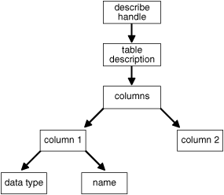

This chapter discusses the use of the `OCIDescribeAny()` function to obtain information about schema elements.

This chapter contains these topics:

- About Using OCIDescribeAny()

- Parameter Attributes

- Character-Length Semantics Support in Describe Operations

- Examples Using OCIDescribeAny()

**See Also:**

[OCIDescribeAny()](bind-define-describe-functions.md)

### 8.1 About Using OCIDescribeAny()

Performs an explicit describe of schema objects and their subschema objects.

The `OCIDescribeAny()` function enables you to perform an explicit describe of the following schema objects and their subschema objects:

- Tables and views

- Synonyms

- Procedures

- Functions

- Packages

- Sequences

- Collections

- Types

- Schemas

- Databases

Information about other schema elements (function arguments, columns, type attributes, and type methods) is available through a describe of one of the preceding schema objects or an explicit describe of the subschema object.

When an application describes a table, it can then retrieve information about that table's columns. Additionally, `OCIDescribeAny()` can directly describe subschema objects such as columns of a table, packages of a function, or fields of a type if given the name of the subschema object.

The `OCIDescribeAny()` call requires a describe handle as one of its arguments. The describe handle must be previously allocated with a call to `OCIHandleAlloc()`.

The information returned by `OCIDescribeAny()` is organized hierarchically like a tree, as shown in Figure 8-1.

Figure 8-1 OCIDescribeAny() Table Description

[Description of "Figure 8-1 OCIDescribeAny() Table Description"](img_text/lnoci031.md)

The describe handle returned by the `OCIDescribeAny()` call has an attribute, `OCI_ATTR_PARAM`, that points to such a description tree. Each node of the tree has attributes associated with that node, as well as attributes that are like recursive describe handles and point to subtrees containing further information. If all the attributes are homogenous, as with elements of a column list, they are called parameters. The attributes associated with any node are returned by `OCIAttrGet()`, and the parameters are returned by `OCIParamGet()`.

A call to `OCIAttrGet()` on the describe handle for the table returns a handle to the column-list information. An application can then use `OCIParamGet()` to retrieve the handle to the column description of a particular column in the column list. The handle to the column descriptor can be passed to `OCIAttrGet()` to get further information about the column, such as the name and data type.

After a SQL statement is executed, information about the select list is available as an attribute of the statement handle. No explicit describe call is needed. To retrieve information about select-list items from the statement handle, the application must call `OCIParamGet()` once for each position in the select list to allocate a parameter descriptor for that position.

**Note:**

No subsequent `OCIAttrGet()` or `OCIParamGet()` call requires extra round-trips, as the entire description is cached on the client side by `OCIDescribeAny()`.

This section includes the following topics:

- Limitations on OCIDescribeAny()

- Notes on Types and Attributes

**See Also:**

- [OCIDescribeAny()](bind-define-describe-functions.md)

- [OCIHandleAlloc()](handle-and-descriptor-functions.md)

- [OCIAttrGet()](handle-and-descriptor-functions.md)

- [OCIParamGet()](handle-and-descriptor-functions.md)

#### 8.1.1 Limitations on OCIDescribeAny()

The `OCIDescribeAny()` call limits information returned to the basic information and stops expanding a node if it amounts to another describe operation.

For example, if a table column is of an object type, then OCI does not return a subtree describing the type, because this information can be obtained by another describe call.

The table name is not returned by `OCIDescribeAny()` or the implicit use of `OCIStmtExecute()`. Sometimes a column is not associated with a table. In most cases, the table is already known.

**See Also:**

- [About Describing Select-List Items](using-sql_statements-in-oci.md)

- [OCIDescribeAny()](bind-define-describe-functions.md)

- [OCIStmtExecute()](statement-functions.md)

#### 8.1.2 Notes on Types and Attributes

What to be aware of when performing describe operations.

When performing describe operations, you should be aware of the following topics:

- Data Type Codes

- About Describing Types

- Implicit and Explicit Describe Operations

- OCI_ATTR_LIST_ARGUMENTS Attribute

##### 8.1.2.1 Data Type Codes

The `OCI_ATTR_TYPECODE` attribute returns typecodes that represent the types supplied by the user when a new type is created using the `CREATE TYPE` statement.

These typecodes are of the enumerated type `OCITypeCode`, and are represented by `OCI_TYPECODE` constants. Internal PL/SQL type (boolean) is supported.

The `OCI_ATTR_DATA_TYPE` attribute returns typecodes that represent the data types stored in database columns. These are similar to the describe values returned by previous versions of Oracle Database. These values are represented by SQLT constants (`ub2` values). Boolean types return `SQLT_BOL`.

**See Also:**

- [External Data Types](data-types.md) for more information about `SQLT_BOL`

- [Typecodes](data-types.md) for more information about typecodes, such as the `OCI_TYPECODE` values returned in the `OCI_ATTR_TYPECODE` attribute and the SQLT typecodes returned in the `OCI_ATTR_DATA_TYPE` attribute

##### 8.1.2.2 About Describing Types

To describe type objects, it is necessary to initialize the OCI process in object mode.

This is shown in Example 8-1.

Example 8-1 Initializing the OCI Process in Object Mode

    /* Initialize the OCI Process */
     if (OCIEnvCreate((OCIEnv **) &envhp, (ub4) OCI_OBJECT, (voivoid *) 0,
                      (void * (*)(void *,size_t)) 0,
                      (void * (*)(void *, void *, size_t)) 0,
                      (void (*)(void *, void *)) 0, (size_t) 0, (void **) 0))
     {
       printf("FAILED: OCIEnvCreate()\n");
       return OCI_ERROR;
     }

**See Also:**

[OCIEnvCreate()](connect-authorize-and-initialize-functions.md)

##### 8.1.2.3 Implicit and Explicit Describe Operations

The column attribute `OCI_ATTR_PRECISION` can be returned using an implicit describe with `OCIStmtExecute()` and an explicit describe with `OCIDescribeAny()`.

When you use an implicit describe, set the precision to `sb2`. When you use an explicit describe, set the precision to `ub1` for a placeholder. This is necessary to match the data type of precision in the dictionary.

**See Also:**

- [OCIStmtExecute()](statement-functions.md)

- [OCIDescribeAny()](bind-define-describe-functions.md)

##### 8.1.2.4 OCI_ATTR_LIST_ARGUMENTS Attribute

The `OCI_ATTR_LIST_ARGUMENTS` attribute for type methods represents second-level arguments for the method.

For example, consider the following record `my_type` and the procedure `my_proc `that takes an argument of type` my_type:`

    my_type record(a number, b char)
    my_proc (my_input my_type)

In this example, the `OCI_ATTR_LIST_ARGUMENTS` attribute would apply to arguments` a` and `b` of the `my_type` record.

### 8.2 Parameter Attributes

This section describes the attributes and handles that belong to different parameters.

A parameter is returned by `OCIParamGet()`. Parameters can describe different types of objects or information, and have attributes depending on the type of description they contain, or type-specific attributes.

The `OCIDescribeAny()` call does support more than two name components (for example, `schema.type.attr1.attr2.method1`). With more than one component, the first component is interpreted as the schema name (unless some other flag is set). There is a flag to specify that the object must be looked up under PUBLIC, that is, describe "a", where "a" can be either in the current schema or a public synonym.

If you do not know what the object type is, specify `OCI_PTYPE_UNK`. Otherwise, an error is returned if the actual object type does not match the specified type.

Table 8-1 lists the attributes of all parameters.

Table 8-1 Attributes of All Parameters

| Attribute             | Description                                                                                                                                                                                                                                                                                                                                                                                                                                                                                                                                                                                                                                                                                                                                                                                                                                                                                                                                                                                                                             | Attribute Data Type |
|:----------------------|:----------------------------------------------------------------------------------------------------------------------------------------------------------------------------------------------------------------------------------------------------------------------------------------------------------------------------------------------------------------------------------------------------------------------------------------------------------------------------------------------------------------------------------------------------------------------------------------------------------------------------------------------------------------------------------------------------------------------------------------------------------------------------------------------------------------------------------------------------------------------------------------------------------------------------------------------------------------------------------------------------------------------------------------|:--------------------|
| `OCI_ATTR_OBJ_ID`     | Object or schema ID                                                                                                                                                                                                                                                                                                                                                                                                                                                                                                                                                                                                                                                                                                                                                                                                                                                                                                                                                                                                                     | `ub4`               |
| `OCI_ATTR_OBJ_NAME`   | Database name or object name in a schema                                                                                                                                                                                                                                                                                                                                                                                                                                                                                                                                                                                                                                                                                                                                                                                                                                                                                                                                                                                                | `OraText *`         |
| `OCI_ATTR_OBJ_SCHEMA` | Schema name where the object is located                                                                                                                                                                                                                                                                                                                                                                                                                                                                                                                                                                                                                                                                                                                                                                                                                                                                                                                                                                                                 | `OraText *`         |
| `OCI_ATTR_PTYPE`      | Type of information described by the parameter. Possible values: `OCI_PTYPE_TABLE` - table `OCI_PTYPE_VIEW` - view `OCI_PTYPE_PROC` - procedure `OCI_PTYPE_FUNC` - function `OCI_PTYPE_PKG` - package `OCI_PTYPE_TYPE` - type, including a package type `OCI_PTYPE_TYPE_ATTR` - attribute of a type, including package record type attributes `OCI_PTYPE_TYPE_COLL` - collection type information, including package collection elements `OCI_PTYPE_TYPE_METHOD` - method of a type `OCI_PTYPE_SYN` - synonym `OCI_PTYPE_SEQ` - sequence `OCI_PTYPE_COL` - column of a table or view `OCI_PTYPE_ARG` - argument of a function or procedure `OCI_PTYPE_TYPE_ARG` - argument of a type method `OCI_PTYPE_TYPE_RESULT` - results of a method `OCI_PTYPE_LIST` - column list for tables and views, argument list for functions and procedures, or subprogram list for packages `OCI_PTYPE_SCHEMA` - schema `OCI_PTYPE_DATABASE` - database `OCI_PTYPE_UNK` - unknown schema object | `ub1 `              |
| `OCI_ATTR_TIMESTAMP`  | The time stamp of the object on which the description is based in Oracle date format                                                                                                                                                                                                                                                                                                                                                                                                                                                                                                                                                                                                                                                                                                                                                                                                                                                                                                                                                    | `ub1 *`             |

The following sections list the attributes and handles specific to different types of parameters:

- Table or View Parameters

- Procedure, Function, and Subprogram Attributes

- Package Attributes

- Type Attributes

- Type Attribute Attributes

- Type Method Attributes

- Collection Attributes

- Synonym Attributes

- Sequence Attributes

- Column Attributes

- Argument and Result Attributes

- List Attributes

- Schema Attributes

- Database Attributes

- Rule Attributes

- Rule Set Attributes

- Evaluation Context Attributes

- Table Alias Attributes

- Variable Type Attributes

- Name Value Attributes

**See Also:**

- [OCIParamGet()](handle-and-descriptor-functions.md)

- [OCIDescribeAny()](bind-define-describe-functions.md)

#### 8.2.1 Table or View Parameters

Lists and describes the type-specific attributes for parameters for a table or view.

Table 8-2 lists the type-specific attributes for parameters for a table or view (type `OCI_PTYPE_TABLE` or `OCI_PTYPE_VIEW`).

Table 8-2 Attributes of Tables or Views

| Attribute               | Description                                                                                                                                                          | Attribute Data Type |
|:------------------------|:---------------------------------------------------------------------------------------------------------------------------------------------------------------------|:--------------------|
| `OCI_ATTR_OBJID`        | Object ID                                                                                                                                                            | `ub4`               |
| `OCI_ATTR_NUM_COLS`     | Number of columns                                                                                                                                                    | `ub2`               |
| `OCI_ATTR_LIST_COLUMNS` | Column list (type `OCI_PTYPE_LIST`)                                                                                                                                  | `OCIParam *`        |
| `OCI_ATTR_REF_TDO`      | `REF` to the type description object (TDO) of the base type for extent tables                                                                                        | `OCIRef *`          |
| `OCI_ATTR_IS_TEMPORARY` | Indicates that the table is temporary                                                                                                                                | `ub1`               |
| `OCI_ATTR_IS_TYPED`     | Indicates that the table is typed                                                                                                                                    | `ub1`               |
| `OCI_ATTR_DURATION`     | Duration of a temporary table. Values can be: `OCI_DURATION_SESSION` - session `OCI_DURATION_TRANS` - transaction `OCI_DURATION_NULL` - table not temporary | `OCIDuration`       |

Table 8-3 lists additional attributes that belong to tables.

Table 8-3 Attributes Specific to Tables

| Attribute              | Description                              | Attribute Data Type |
|:-----------------------|:-----------------------------------------|:--------------------|
| `OCI_ATTR_RDBA`        | Data block address of the segment header | `ub4`               |
| `OCI_ATTR_TABLESPACE`  | Tablespace that the table resides in     | `word`              |
| `OCI_ATTR_CLUSTERED`   | Indicates that the table is clustered    | `ub1`               |
| `OCI_ATTR_PARTITIONED` | Indicates that the table is partitioned  | `ub1`               |
| `OCI_ATTR_INDEX_ONLY`  | Indicates that the table is index-only   | `ub1`               |

#### 8.2.2 Procedure, Function, and Subprogram Attributes

Lists and describes the type-specific attributes when a parameter is for a procedure or function.

Table 8-4 lists the type-specific attributes when a parameter is for a procedure or function (type `OCI_PTYPE_PROC` or `OCI_PTYPE_FUNC`).

Table 8-4 Attributes of Procedures or Functions

| Attribute                    | Description                                                   | Attribute Data Type |
|:-----------------------------|:--------------------------------------------------------------|:--------------------|
| `OCI_ATTR_LIST_ARGUMENTS`    | Argument list. See List Attributes.                           | `void *`            |
| `OCI_ATTR_IS_INVOKER_RIGHTS` | Indicates that the procedure or function has invoker's rights | `ub1`               |

Table 8-5 lists the attributes that are defined only for package subprograms.

Table 8-5 Attributes Specific to Package Subprograms

| Attribute              | Description                                                                                                                                                                                      | Attribute Data Type |
|:-----------------------|:-------------------------------------------------------------------------------------------------------------------------------------------------------------------------------------------------|:--------------------|
| `OCI_ATTR_NAME`        | Name of the procedure or function                                                                                                                                                                | `OraText *`         |
| `OCI_ATTR_OVERLOAD_ID` | Overloading ID number (relevant in case the procedure or function is part of a package and is overloaded). Values returned may be different from direct query of a PL/SQL function or procedure. | `ub2`               |

#### 8.2.3 Package Attributes

Lists and describes the attributes when a parameter is for a package.

Table 8-6 lists the attributes when a parameter is for a package (type `OCI_PTYPE_PKG`).

Table 8-6 Attributes of Packages

| Attribute                    | Description                                                             | Attribute Data Type |
|:-----------------------------|:------------------------------------------------------------------------|:--------------------|
| `OCI_ATTR_LIST_PKG_TYPES`    | Get a list of all types in an `OCI_PTYPE_PKG` package parameter handle. | `void *`            |
| `OCI_ATTR_LIST_SUBPROGRAMS`  | Subprogram list. See List Attributes.                                   | `void *`            |
| `OCI_ATTR_IS_INVOKER_RIGHTS` | Indicates that the package has invoker's rights?                        | `ub1`               |

#### 8.2.4 Type Attributes

Lists and describes the attributes when a parameter is for a type.

Table 8-7 lists the attributes when a parameter is for a type (type `OCI_PTYPE_TYPE`). These attributes are only valid if the application initialized the OCI process in `OCI_OBJECT` mode in a call to `OCIEnvCreate()`.

Table 8-7 Attributes of Types

| Attribute                           | Description                                                                                                                                                                                                                                                                | Attribute Data Type |
|:------------------------------------|:---------------------------------------------------------------------------------------------------------------------------------------------------------------------------------------------------------------------------------------------------------------------------|:--------------------|
| `OCI_ATTR_REF_TDO`                  | Returns the in-memory `REF` of the type descriptor object (TDO) for the type, if the column type is an object type. If space has not been reserved for the `OCIRef`, then it is allocated implicitly in the cache. The caller can then pin the TDO with `OCIObjectPin()`.  | `OCIRef *`          |
| `OCI_ATTR_TYPECODE`                 | Typecode. See Data Type Codes. Currently can be only `OCI_TYPECODE_OBJECT`, `OCI_TYPECODE_NAMEDCOLLECTION`, or `OCI_TYPECODE_RECORD`.                                                                                                                                      | `OCITypeCode`       |
| `OCI_ATTR_COLLECTION_TYPECODE`      | Typecode of collection if type is collection; invalid otherwise. See Data Type Codes. Currently can be only `OCI_TYPECODE_VARRAY`, `OCI_TYPECODE_TABLE`, or `OCI_TYPECODE_ITABLE`. If this attribute is queried for a type that is not a collection, an error is returned. | `OCITypeCode`       |
| `OCI_ATTR_IS_INCOMPLETE_TYPE`       | Indicates that this is an incomplete type                                                                                                                                                                                                                                  | `ub1`               |
| `OCI_ATTR_IS_SYSTEM_TYPE`           | Indicates that this is a system type                                                                                                                                                                                                                                       | `ub1`               |
| `OCI_ATTR_IS_PREDEFINED_TYPE`       | Indicates that this is a predefined type                                                                                                                                                                                                                                   | `ub1`               |
| `OCI_ATTR_IS_TRANSIENT_TYPE`        | Indicates that this is a transient type                                                                                                                                                                                                                                    | `ub1`               |
| `OCI_ATTR_IS_SYSTEM_GENERATED_TYPE` | Indicates that this is a system-generated type                                                                                                                                                                                                                             | `ub1`               |
| `OCI_ATTR_HAS_NESTED_TABLE`         | This type contains a nested table attribute.                                                                                                                                                                                                                               | `ub1`               |
| `OCI_ATTR_HAS_LOB`                  | This type contains a LOB attribute.                                                                                                                                                                                                                                        | `ub1`               |
| `OCI_ATTR_HAS_FILE`                 | This type contains a `BFILE` attribute.                                                                                                                                                                                                                                    | `ub1`               |
| `OCI_ATTR_COLLECTION_ELEMENT`       | Handle to collection element. See Collection Attributes.                                                                                                                                                                                                                   | `void *`            |
| `OCI_ATTR_NUM_TYPE_ATTRS`           | Number of type attributes                                                                                                                                                                                                                                                  | `ub2`               |
| `OCI_ATTR_LIST_TYPE_ATTRS`          | List of type attributes. See List Attributes.                                                                                                                                                                                                                              | `void *`            |
| `OCI_ATTR_NUM_TYPE_METHODS`         | Number of type methods                                                                                                                                                                                                                                                     | `ub2`               |
| `OCI_ATTR_LIST_TYPE_METHODS`        | List of type methods. See List Attributes.                                                                                                                                                                                                                                 | `void *`            |
| `OCI_ATTR_MAP_METHOD`               | Map method of type. See Type Method Attributes.                                                                                                                                                                                                                            | `void *`            |
| `OCI_ATTR_ORDER_METHOD`             | Order method of type. See Type Method Attributes.                                                                                                                                                                                                                          | `void *`            |
| `OCI_ATTR_IS_INVOKER_RIGHTS`        | Indicates that the type has invoker's rights                                                                                                                                                                                                                               | `ub1`               |
| `OCI_ATTR_NAME`                     | A pointer to a string that is the type attribute name                                                                                                                                                                                                                      | `OraText *`         |
| `OCI_ATTR_PACKAGE_NAME`             | A string with the package name if the attribute is a package type.                                                                                                                                                                                                         | `OraText *`         |
| `OCI_ATTR_SCHEMA_NAME`              | A string with the schema name where the type has been created                                                                                                                                                                                                              | `OraText *`         |
| `OCI_ATTR_IS_FINAL_TYPE`            | Indicates that this is a final type                                                                                                                                                                                                                                        | `ub1`               |
| `OCI_ATTR_IS_INSTANTIABLE_TYPE`     | Indicates that this is an instantiable type                                                                                                                                                                                                                                | `ub1`               |
| `OCI_ATTR_IS_SUBTYPE`               | Indicates that this is a subtype                                                                                                                                                                                                                                           | `ub1`               |
| `OCI_ATTR_SUPERTYPE_SCHEMA_NAME`    | Name of the schema that contains the supertype                                                                                                                                                                                                                             | `OraText *`         |
| `OCI_ATTR_SUPERTYPE_NAME`           | Name of the supertype                                                                                                                                                                                                                                                      | `OraText *`         |

**See Also:**

[OCIEnvCreate()](connect-authorize-and-initialize-functions.md)

#### 8.2.5 Type Attribute Attributes

Lists and describes the attributes when a parameter is for an attribute of a type.

Table 8-8 lists the attributes when a parameter is for an attribute of a type (type `OCI_PTYPE_TYPE_ATTR`).

Table 8-8 Attributes of Type Attributes

| Attribute               | Description                                                                                                                                                                                                                                                                                                           | Attribute Data Type                                              |
|:------------------------|:----------------------------------------------------------------------------------------------------------------------------------------------------------------------------------------------------------------------------------------------------------------------------------------------------------------------|:-----------------------------------------------------------------|
| `OCI_ATTR_DATA_SIZE`    | The maximum size of the type attribute. This length is returned in bytes and not characters for strings and raws. It returns 22 for `NUMBER`s.                                                                                                                                                                        | `ub2`                                                            |
| `OCI_ATTR_TYPECODE`     | Typecode. See Data Type Codes.                                                                                                                                                                                                                                                                                        | `OCITypeCode`                                                    |
| `OCI_ATTR_DATA_TYPE`    | The data type of the type attribute. See Data Type Codes.                                                                                                                                                                                                                                                             | `ub2`                                                            |
| `OCI_ATTR_NAME`         | A pointer to a string that is the type attribute name                                                                                                                                                                                                                                                                 | `OraText *`                                                      |
| `OCI_ATTR_PRECISION`    | The precision of numeric type attributes. If the precision is nonzero and scale is -127, then it is a `FLOAT`; otherwise, it is a `NUMBER(precision, scale)`. When precision is 0, `NUMBER(precision, scale)` can be represented simply as `NUMBER`.                                                                  | `ub1` for explicit describe `sb2` for implicit describe |
| `OCI_ATTR_SCALE`        | The scale of numeric type attributes. If the precision is nonzero and scale is -127, then it is a `FLOAT`; otherwise, it is a `NUMBER(precision, scale)`. When precision is 0, `NUMBER(precision, scale)` can be represented simply as `NUMBER`.                                                                      | `sb1`                                                            |
| `OCI_ATTR_PACKAGE_NAME` | A string that is the package name of a type if it is a package type.                                                                                                                                                                                                                                                  | `OraText *`                                                      |
| `OCI_ATTR_TYPE_NAME`    | A string that is the type name. The returned value contains the type name if the data type is `SQLT_NTY` or `SQLT_REF`. If the data type is `SQLT_NTY`, the name of the named data type's type is returned. If the data type is `SQLT_REF`, the type name of the named data type pointed to by the `REF` is returned. | `OraText *`                                                      |
| `OCI_ATTR_SCHEMA_NAME`  | A string with the schema name under which the type has been created                                                                                                                                                                                                                                                   | `OraText *`                                                      |
| `OCI_ATTR_REF_TDO`      | Returns the in-memory `REF` of the TDO for the type, if the column type is an object type. If space has not been reserved for the `OCIRef`, then it is allocated implicitly in the cache. The caller can then pin the TDO with `OCIObjectPin()`.                                                                      | `OCIRef *`                                                       |
| `OCI_ATTR_CHARSET_ID`   | The character set ID, if the type attribute is of a string or character type                                                                                                                                                                                                                                          | `ub2`                                                            |
| `OCI_ATTR_CHARSET_FORM` | The character set form, if the type attribute is of a string or character type                                                                                                                                                                                                                                        | `ub1`                                                            |
| `OCI_ATTR_FSPRECISION`  | The fractional seconds precision of a datetime or interval                                                                                                                                                                                                                                                            | `ub1`                                                            |
| `OCI_ATTR_LFPRECISION`  | The leading field precision of an interval                                                                                                                                                                                                                                                                            | `ub1`                                                            |

#### 8.2.6 Type Method Attributes

Lists and dsescribes the attributes when a parameter is for a method of a type.

Table 8-9 lists the attributes when a parameter is for a method of a type (type `OCI_PTYPE_TYPE_METHOD`).

Table 8-9 Attributes of Type Methods

| Attribute                         | Description                                                                                  | Attribute Data Type |
|:----------------------------------|:---------------------------------------------------------------------------------------------|:--------------------|
| `OCI_ATTR_NAME`                   | Name of method (procedure or function)                                                       | `OraText *`         |
| `OCI_ATTR_ENCAPSULATION`          | Encapsulation level of the method (either `OCI_TYPEENCAP_PRIVATE` or `OCI_TYPEENCAP_PUBLIC`) | `OCITypeEncap`      |
| `OCI_ATTR_LIST_ARGUMENTS`         | Argument list. See OCI_ATTR_LIST_ARGUMENTS Attribute, and List Attributes.                   | `void *`            |
| `OCI_ATTR_IS_CONSTRUCTOR`         | Indicates that method is a constructor                                                       | `ub1`               |
| `OCI_ATTR_IS_DESTRUCTOR`          | Indicates that method is a destructor                                                        | `ub1`               |
| `OCI_ATTR_IS_OPERATOR`            | Indicates that method is an operator                                                         | `ub1`               |
| `OCI_ATTR_IS_SELFISH`             | Indicates that method is selfish                                                             | `ub1`               |
| `OCI_ATTR_IS_MAP`                 | Indicates that method is a map method                                                        | `ub1`               |
| `OCI_ATTR_IS_ORDER`               | Indicates that method is an order method                                                     | `ub1`               |
| `OCI_ATTR_IS_RNDS`                | Indicates that "Read No Data State" is set for method                                        | `ub1`               |
| `OCI_ATTR_IS_RNPS`                | Indicates that "Read No Process State" is set for method                                     | `ub1`               |
| `OCI_ATTR_IS_WNDS`                | Indicates that "Write No Data State" is set for method                                       | `ub1`               |
| `OCI_ATTR_IS_WNPS`                | Indicates that "Write No Process State" is set for method                                    | `ub1`               |
| `OCI_ATTR_IS_FINAL_METHOD`        | Indicates that this is a final method                                                        | `ub1`               |
| `OCI_ATTR_IS_INSTANTIABLE_METHOD` | Indicates that this is an instantiable method                                                | `ub1`               |
| `OCI_ATTR_IS_OVERRIDING_METHOD`   | Indicates that this is an overriding method                                                  | `ub1`               |

#### 8.2.7 Collection Attributes

Lists and describes the attributes when a parameter is for a collection type.

Table 8-10 lists the attributes when a parameter is for a collection type (type `OCI_PTYPE_COLL`).

Table 8-10 Attributes of Collection Types

| Attribute               | Description                                                                                                                                                                                                                                                                                                           | Attribute Data Type                                              |
|:------------------------|:----------------------------------------------------------------------------------------------------------------------------------------------------------------------------------------------------------------------------------------------------------------------------------------------------------------------|:-----------------------------------------------------------------|
| `OCI_ATTR_DATA_SIZE`    | The maximum size of the type attribute. This length is returned in bytes and not characters for strings and raws. It returns 22 for `NUMBER`s.                                                                                                                                                                        | `ub2`                                                            |
| `OCI_ATTR_TYPECODE`     | Typecode. See Data Type Codes.                                                                                                                                                                                                                                                                                        | `OCITypeCode`                                                    |
| `OCI_ATTR_DATA_TYPE`    | The data type of the type attribute. See Data Type Codes.                                                                                                                                                                                                                                                             | `ub2`                                                            |
| `OCI_ATTR_NUM_ELEMS`    | The number of elements in an array. It is only valid for collections that are arrays.                                                                                                                                                                                                                                 | `ub4`                                                            |
| `OCI_ATTR_NAME`         | A pointer to a string that is the type attribute name                                                                                                                                                                                                                                                                 | `OraText *`                                                      |
| `OCI_ATTR_PRECISION`    | The precision of numeric type attributes. If the precision is nonzero and scale is -127, then it is a `FLOAT`; otherwise, it is a `NUMBER(precision, scale)`. When precision is 0, `NUMBER(precision, scale)` can be represented simply as `NUMBER`.                                                                  | `ub1` for explicit describe `sb2` for implicit describe |
| `OCI_ATTR_SCALE`        | The scale of numeric type attributes. If the precision is nonzero and scale is -127, then it is a `FLOAT`; otherwise, it is a `NUMBER(precision, scale)`. When precision is 0, `NUMBER(precision, scale)` can be represented simply as `NUMBER`.                                                                      | `sb1`                                                            |
| `OCI_ATTR_PACKAGE_NAME` | A string that is the package name of a type if it is a package type.                                                                                                                                                                                                                                                  | `OraText *`                                                      |
| `OCI_ATTR_TYPE_NAME`    | A string that is the type name. The returned value contains the type name if the data type is `SQLT_NTY` or `SQLT_REF`. If the data type is `SQLT_NTY`, the name of the named data type's type is returned. If the data type is `SQLT_REF`, the type name of the named data type pointed to by the `REF` is returned. | `OraText *`                                                      |
| `OCI_ATTR_SCHEMA_NAME`  | A string with the schema name under which the type has been created                                                                                                                                                                                                                                                   | `OraText *`                                                      |
| `OCI_ATTR_REF_TDO`      | Returns the in-memory `REF` of the type descriptor object (TDO) for the type, if the column type is an object type. If space has not been reserved for the `OCIRef`, then it is allocated implicitly in the cache. The caller can then pin the TDO with `OCIObjectPin()`.                                             | `OCIRef *`                                                       |
| `OCI_ATTR_CHARSET_ID`   | The character set ID, if the type attribute is of a string or character type                                                                                                                                                                                                                                          | `ub2`                                                            |
| `OCI_ATTR_CHARSET_FORM` | The character set form, if the type attribute is of a string or character type                                                                                                                                                                                                                                        | `ub1`                                                            |

#### 8.2.8 Synonym Attributes

Lists and describes the attributes when a parameter is for a synonym.

Table 8-11 lists the attributes when a parameter is for a synonym (type `OCI_PTYPE_SYN`).

Table 8-11 Attributes of Synonyms

| Attribute              | Description                                                                             | Attribute Data Type |
|:-----------------------|:----------------------------------------------------------------------------------------|:--------------------|
| `OCI_ATTR_OBJID`       | Object ID                                                                               | `ub4`               |
| `OCI_ATTR_SCHEMA_NAME` | A string containing the schema name of the synonym translation                          | `OraText *`         |
| `OCI_ATTR_NAME`        | A `NULL`-terminated string containing the object name of the synonym translation        | `OraText *`         |
| `OCI_ATTR_LINK`        | A `NULL`-terminated string containing the database link name of the synonym translation | `OraText *`         |

#### 8.2.9 Sequence Attributes

Lists and describes the attributes when a parameter is for a sequence.

Table 8-12 lists the attributes when a parameter is for a sequence (type `OCI_PTYPE_SEQ`).

Table 8-12 Attributes of Sequences

| Attribute          | Description                                                                                                  | Attribute Data Type |
|:-------------------|:-------------------------------------------------------------------------------------------------------------|:--------------------|
| `OCI_ATTR_OBJID`   | Object ID                                                                                                    | `ub4`               |
| `OCI_ATTR_MIN`     | Minimum value (in Oracle `NUMBER` format)                                                                    | `ub1`               |
| `OCI_ATTR_MAX`     | Maximum value (in Oracle `NUMBER` format)                                                                    | `ub1`               |
| `OCI_ATTR_INCR`    | Increment (in Oracle `NUMBER` format)                                                                        | `ub1`               |
| `OCI_ATTR_CACHE`   | Number of sequence numbers cached; zero if the sequence is not a cached sequence (in Oracle `NUMBER` format) | `ub1`               |
| `OCI_ATTR_ORDER`   | Whether the sequence is ordered                                                                              | `ub1`               |
| `OCI_ATTR_HW_MARK` | High-water mark (in `NUMBER` format)                                                                         | `ub1`               |

**See Also:**

[OCINumber Examples](object-relational-data-types-in-oci.md)

#### 8.2.10 Column Attributes

Lists and describes the attributes when a parameter is for a column of a table or view.

**Note:**

For `BINARY_FLOAT` and `BINARY_DOUBLE`:

If `OCIDescribeAny()` is used to retrieve the column data type (`OCI_ATTR_DATA_TYPE`) for `BINARY_FLOAT` or `BINARY_DOUBLE` columns in a table, it returns the internal data type code.

The SQLT codes corresponding to the internal data type codes for `BINARY_FLOAT` and `BINARY_DOUBLE` are `SQLT_IBFLOAT` and `SQLT_IBDOUBLE`.

The following table lists the attributes when a parameter is for a column of a table or view (type `OCI_PTYPE_COL`).

Table 8-13 Attributes of Columns of Tables or Views

| Attribute                 | Description                                                                                                                                                                                                                                                                                                                                                                                                                                                                                                                                                                                                                                                                                                                                                                                                                                                                                                                                                                                                                                                                                                                                                                                                                                                                                                                                                                                                                                                                                                                                                                                 | Attribute Data Type                                              |
|:--------------------------|:--------------------------------------------------------------------------------------------------------------------------------------------------------------------------------------------------------------------------------------------------------------------------------------------------------------------------------------------------------------------------------------------------------------------------------------------------------------------------------------------------------------------------------------------------------------------------------------------------------------------------------------------------------------------------------------------------------------------------------------------------------------------------------------------------------------------------------------------------------------------------------------------------------------------------------------------------------------------------------------------------------------------------------------------------------------------------------------------------------------------------------------------------------------------------------------------------------------------------------------------------------------------------------------------------------------------------------------------------------------------------------------------------------------------------------------------------------------------------------------------------------------------------------------------------------------------------------------------|:-----------------------------------------------------------------|
| `OCI_ATTR_CHAR_USED`      | Returns the type of length semantics of the column. Zero (0) means byte-length semantics and 1 means character-length semantics. See Character-Length Semantics Support in Describe Operations.                                                                                                                                                                                                                                                                                                                                                                                                                                                                                                                                                                                                                                                                                                                                                                                                                                                                                                                                                                                                                                                                                                                                                                                                                                                                                                                                                                                             | `ub1`                                                            |
| `OCI_ATTR_CHAR_SIZE`      | Returns the column character length that is the number of characters allowed in the column. It is the counterpart of `OCI_ATTR_DATA_SIZE`, which gets the byte length. See Character-Length Semantics Support in Describe Operations.                                                                                                                                                                                                                                                                                                                                                                                                                                                                                                                                                                                                                                                                                                                                                                                                                                                                                                                                                                                                                                                                                                                                                                                                                                                                                                                                                       | `ub2`                                                            |
| `OCI_ATTR_COLLATION_ID`   | Returns the derived collation ID of the column. The `OCI_ATTR_COLLATION_ID` attribute is valid only for select-list describes based on a statement handle for a query and not for `OCIDescribeAny()` describes. It is relevant only for select-list items of character data types. For other data types the value is always `OCI_COLLATION_NONE`. Table 8-14 describes the predefined constraints for a number of commonly used collation IDs. **Note:** You can use the SQL built-in functions `NLS_COLLATION_ID` and `NLS_COLLATION_NAME` to map between collation IDs returned for this attribute and collation names used in SQL syntax. **See Also:** • [OCI_ATTR_COLLATION_ID](handle-and-descriptor-attributes.md) • [Oracle Database Globalization Support Guide](../nlspg/appendix-C-collation-derivation-and-determination-rules-for-SQL-operations.md) for information on how this set collation influences query processing                                                                                                                                                                                                                                                                                                                                                                                                                                                                                                                                                                                                                                      | `ub4 *`                                                          |
| `OCI_ATTR_COL_PROPERTIES` | Returns describe data regarding certain column properties. The following are the flags available in `OCI_ATTR_COL_PROPERTIES`: • `OCI_ATTR_COL_PROPERTY_IS_IDENTITY` • `OCI_ATTR_COL_PROPERTY_IS_GEN_ALWAYS` • 1 - represents it is `ALWAYS GENERATED` • 0 - represents `GENERATED BY DEFAULT` • `OCI_ATTR_COL_PROPERTY_IS_GEN_BY_DEF_ON_NULL` • `OCI_ATTR_COL_PROPERTY_IS_LPART` • `OCI_ATTR_COL_PROPERTY_IS_CONID` The following is a sample usage: `OCIAttrGet((dvoid*) mypard, (ub4) OCI_DTYPE_PARAM,` `  (dvoid*) &col_prop, (ub4 *) 0,(ub4) OCI_ATTR_COL_PROPERTIES,` `  (OCIError *) errhp  ));` `if(col_prop & OCI_ATTR_COL_PROPERTY_IS_IDENTITY)` `  printf("Identity Column \n");` `if(col_prop & OCI_ATTR_COL_PROPERTY_IS_GEN_ALWAYS)` `  printf("Column is always generated\n");` `if(col_prop & OCI_ATTR_COL_PROPERTY_IS_GEN_BY_DEF_ON_NULL)` `  printf("Column is generated by default on NULL\n");` `if(col_prop & OCI_ATTR_COL_PROPERTY_IS_LPART)` `  printf("Column is an implicitly generated logical partitioning column for container_map enabled objects\n");` `if(col_prop & OCI_ATTR_COL_PROPERTY_IS_CONID)` `  printf("Column is a CON_ID column implicitly generated by CONTAINERS() or is an ORIGIN_CON_ID column implicitly generated for Extended Data Link\n");` See [Oracle Database SQL Language Reference](../sqlrf/CREATE-TABLE.md) for more information about the SQL syntax to specify these properties in an identity clause for a column definition in the `CREATE TABLE` statement. | `ub8`                                                            |
| `OCI_ATTR_INVISIBLE_COL`  | Returns whether a column is invisible or not. A value of `TRUE` indicates the column is an invisible column. Otherwise, the value `FALSE` is returned. See "Describing Each Column to Know Whether It Is an Invisible Column" for an example.                                                                                                                                                                                                                                                                                                                                                                                                                                                                                                                                                                                                                                                                                                                                                                                                                                                                                                                                                                                                                                                                                                                                                                                                                                                                                                                                               | `ub1`                                                            |
| `OCI_ATTR_DATA_SIZE`      | The maximum size of the column. This length is returned in bytes and not characters for strings and raws. It returns 22 for `NUMBER`s.                                                                                                                                                                                                                                                                                                                                                                                                                                                                                                                                                                                                                                                                                                                                                                                                                                                                                                                                                                                                                                                                                                                                                                                                                                                                                                                                                                                                                                                      | `ub2`                                                            |
| `OCI_ATTR_DATA_TYPE`      | The data type of the column. See Data Type Codes.                                                                                                                                                                                                                                                                                                                                                                                                                                                                                                                                                                                                                                                                                                                                                                                                                                                                                                                                                                                                                                                                                                                                                                                                                                                                                                                                                                                                                                                                                                                                           | `ub2`                                                            |
| `OCI_ATTR_NAME`           | A pointer to a string that is the column name                                                                                                                                                                                                                                                                                                                                                                                                                                                                                                                                                                                                                                                                                                                                                                                                                                                                                                                                                                                                                                                                                                                                                                                                                                                                                                                                                                                                                                                                                                                                               | `OraText *`                                                      |
| `OCI_ATTR_PRECISION`      | The precision of numeric columns. If the precision is nonzero and scale is -127, then it is a `FLOAT`; otherwise, it is a `NUMBER(precision, scale)`. When precision is 0, `NUMBER(precision, scale)` can be represented simply as `NUMBER`.                                                                                                                                                                                                                                                                                                                                                                                                                                                                                                                                                                                                                                                                                                                                                                                                                                                                                                                                                                                                                                                                                                                                                                                                                                                                                                                                                | `ub1` for explicit describe `sb2` for implicit describe |
| `OCI_ATTR_SCALE`          | The scale of numeric columns. If the precision is nonzero and scale is -127, then it is a `FLOAT`; otherwise, it is a `NUMBER`(`precision, scale`). When precision is 0, `NUMBER(precision, scale)` can be represented simply as `NUMBER`.                                                                                                                                                                                                                                                                                                                                                                                                                                                                                                                                                                                                                                                                                                                                                                                                                                                                                                                                                                                                                                                                                                                                                                                                                                                                                                                                                  | `sb1`                                                            |
| `OCI_ATTR_IS_NULL`        | Returns 0 if null values are not permitted for the column. Does not return a correct value for a `CUBE` or `ROLLUP` operation.                                                                                                                                                                                                                                                                                                                                                                                                                                                                                                                                                                                                                                                                                                                                                                                                                                                                                                                                                                                                                                                                                                                                                                                                                                                                                                                                                                                                                                                              | `ub1`                                                            |
| `OCI_ATTR_TYPE_NAME`      | Returns a string that is the type name. The returned value contains the type name if the data type is `SQLT_NTY` or `SQLT_REF`. If the data type is `SQLT_NTY`, the name of the named data type's type is returned. If the data type is `SQLT_REF`, the type name of the named data type pointed to by the `REF` is returned.                                                                                                                                                                                                                                                                                                                                                                                                                                                                                                                                                                                                                                                                                                                                                                                                                                                                                                                                                                                                                                                                                                                                                                                                                                                               | `OraText *`                                                      |
| `OCI_ATTR_SCHEMA_NAME`    | Returns a string with the schema name under which the type has been created                                                                                                                                                                                                                                                                                                                                                                                                                                                                                                                                                                                                                                                                                                                                                                                                                                                                                                                                                                                                                                                                                                                                                                                                                                                                                                                                                                                                                                                                                                                 | `OraText *`                                                      |
| `OCI_ATTR_REF_TDO`        | The `REF` of the TDO for the type, if the column type is an object type                                                                                                                                                                                                                                                                                                                                                                                                                                                                                                                                                                                                                                                                                                                                                                                                                                                                                                                                                                                                                                                                                                                                                                                                                                                                                                                                                                                                                                                                                                                     | `OCIRef *`                                                       |
| `OCI_ATTR_CHARSET_ID`     | The character set ID, if the column is of a string or character type                                                                                                                                                                                                                                                                                                                                                                                                                                                                                                                                                                                                                                                                                                                                                                                                                                                                                                                                                                                                                                                                                                                                                                                                                                                                                                                                                                                                                                                                                                                        | `ub2`                                                            |
| `OCI_ATTR_CHARSET_FORM`   | The character set form, if the column is of a string or character type                                                                                                                                                                                                                                                                                                                                                                                                                                                                                                                                                                                                                                                                                                                                                                                                                                                                                                                                                                                                                                                                                                                                                                                                                                                                                                                                                                                                                                                                                                                      | `ub1`                                                            |

Table 8-14 describes predefined constants for a number of commonly used collation IDs, which can be returned for the attribute `OCI_ATTR_COLLATION_ID`. The constants are listed with their values (in parenthesis) and the SQL names of the corresponding collations.

Table 8-14 Predefined Collation IDs, Their `ub4` Values (in parenthesis), and Their SQL Names

| Collation ID (Value)              | SQL Name                                              |
|:----------------------------------|:------------------------------------------------------|
| OCI_COLLATION_NONE (0)            | Undefined collation; no collation has been specified. |
| OCI_COLLATION_NLS_COMP (16382)    | USING_NLS_COMP                                        |
| OCI_COLLATION_NLS_SORT (16381)    | USING_NLS_SORT                                        |
| OCI_COLLATION_NLS_SORT_CI (16380) | USING_NLS_SORT_CI                                     |
| OCI_COLLATION_NLS_SORT_AI (16379) | USING_NLS_SORT_AI                                     |
| OCI_COLLATION_NLS_SORT_CS (16378) | USING_NLS_SORT_CS                                     |
| OCI_COLLATION_BINARY (16383)      | BINARY                                                |
| OCI_COLLATION_BINARY_CI (147455)  | BINARY_CI                                             |
| OCI_COLLATION_BINARY_AI (81919)   | BINARY_AI                                             |

#####

**See Also:**

[OCIDescribeAny()](bind-define-describe-functions.md)

#### 8.2.11 Argument and Result Attributes

Lists and describes the attributes when a parameter is for an argument of a procedure or function.

Table 8-15 lists the attributes when a parameter is for an argument of a procedure or function (type `OCI_PTYPE_ARG`), for a type method argument (type `OCI_PTYPE_TYPE_ARG`), or for method results (type `OCI_PTYPE_TYPE_RESULT`).

Table 8-15 Attributes of Arguments and Results

| Attribute                 | Description                                                                                                                                                                                                                                                                                                                                                               | Attribute Data Type                                        |
|:--------------------------|:--------------------------------------------------------------------------------------------------------------------------------------------------------------------------------------------------------------------------------------------------------------------------------------------------------------------------------------------------------------------------|:-----------------------------------------------------------|
| `OCI_ATTR_NAME`           | Returns a pointer to a string that is the argument name                                                                                                                                                                                                                                                                                                                   | `OraText *`                                                |
| `OCI_ATTR_POSITION`       | The position of the argument in the argument list. Always returns zero.                                                                                                                                                                                                                                                                                                   | `ub2`                                                      |
| `OCI_ATTR_TYPECODE`       | Typecode. See Data Type Codes.                                                                                                                                                                                                                                                                                                                                            | `OCITypeCode`                                              |
| `OCI_ATTR_DATA_TYPE`      | The data type of the argument. See Data Type Codes.                                                                                                                                                                                                                                                                                                                       | `ub2`                                                      |
| `OCI_ATTR_DATA_SIZE`      | The size of the data type of the argument. This length is returned in bytes and not characters for strings and raws. It returns 22 for `NUMBER`s.                                                                                                                                                                                                                         | `ub2`                                                      |
| `OCI_ATTR_PRECISION`      | The precision of numeric arguments. If the precision is nonzero and scale is -127, then it is a `FLOAT`; otherwise, it is a `NUMBER(precision, scale)`. When precision is 0, `NUMBER(precision, scale)` can be represented simply as `NUMBER`.                                                                                                                            | `sb1` for explicit describe `sb2` for implicit describe |
| `OCI_ATTR_SCALE`          | The scale of numeric arguments. If the precision is nonzero and scale is -127, then it is a `FLOAT`; otherwise, it is a `NUMBER(precision, scale)`. When precision is 0, `NUMBER(precision, scale)` can be represented simply as `NUMBER`.                                                                                                                                | `sb1`                                                      |
| `OCI_ATTR_LEVEL`          | The data type levels. This attribute always returns zero.                                                                                                                                                                                                                                                                                                                 | `ub2`                                                      |
| `OCI_ATTR_HAS_DEFAULT`    | Indicates whether an argument has a default                                                                                                                                                                                                                                                                                                                               | `ub1`                                                      |
| `OCI_ATTR_LIST_ARGUMENTS` | The list of arguments at the next level (when the argument is of a record or table type)                                                                                                                                                                                                                                                                                  | `void *`                                                   |
| `OCI_ATTR_IOMODE`         | Indicates the argument mode: 0 is IN (`OCI_TYPEPARAM_IN`), 1 is OUT (`OCI_TYPEPARAM_OUT`), 2 is IN/OUT (`OCI_TYPEPARAM_INOUT`)                                                                                                                                                                                                                                   | `OCITypeParamMode`                                         |
| `OCI_ATTR_RADIX`          | Returns a radix (if number type)                                                                                                                                                                                                                                                                                                                                          | `ub1`                                                      |
| `OCI_ATTR_IS_NULL`        | Returns 0 if null values are not permitted for the column                                                                                                                                                                                                                                                                                                                 | `ub1`                                                      |
| `OCI_ATTR_TYPE_NAME`      | Returns a string that is the type name or the package name for package local types. The returned value contains the type name if the data type is `SQLT_NTY` or `SQLT_REF`. If the data type is `SQLT_NTY`, the name of the named data type's type is returned. If the data type is `SQLT_REF`, the type name of the named data type pointed to by the `REF` is returned. | `OraText *`                                                |
| `OCI_ATTR_SCHEMA_NAME`    | For `SQLT_NTY` or `SQLT_REF`, returns a string with the schema name under which the type was created, or under which the package was created for package local types                                                                                                                                                                                                      | `OraText *`                                                |
| `OCI_ATTR_SUB_NAME`       | For `SQLT_NTY` or `SQLT_REF`, returns a string with the type name, for package local types                                                                                                                                                                                                                                                                                | `OraText *`                                                |
| `OCI_ATTR_LINK`           | For `SQLT_NTY` or `SQLT_REF`, returns a string with the database link name of the database on which the type exists. This can happen only for package local types, when the package is remote.                                                                                                                                                                            | `OraText *`                                                |
| `OCI_ATTR_REF_TDO`        | Returns the `REF` of the type descriptor object (TDO) for the type, if the argument type is an object                                                                                                                                                                                                                                                                     | `OCIRef *`                                                 |
| `OCI_ATTR_CHARSET_ID`     | Returns the character set ID if the argument is of a string or character type                                                                                                                                                                                                                                                                                             | `ub2`                                                      |
| `OCI_ATTR_CHARSET_FORM`   | Returns the character set form if the argument is of a string or character type                                                                                                                                                                                                                                                                                           | `ub1`                                                      |

#### 8.2.12 List Attributes

Lists and describes the attributes when the parameter is for a list of columns, arguments, and subprograms, or fields of a package record type.

When a parameter is for a list of columns, arguments, and subprograms, or fields of a package record type (type `OCI_PTYPE_LIST`), it has the type-specific attributes and handles (parameters) shown in Table 8-16.

The list has an `OCI_ATTR_LTYPE` attribute that designates the list type. Table 8-16 lists the possible values and their lower bounds when traversing the list.

Table 8-16 List Attributes

| List Attribute            | Description                              | Lower Bound |
|:--------------------------|:-----------------------------------------|:------------|
| `OCI_LTYPE_COLUMN`        | Column list                              | 1           |
| `OCI_LTYPE_ARG_PROC`      | Procedure argument list                  | 1           |
| `OCI_LTYPE_ARG_FUNC`      | Function argument list                   | 0           |
| `OCI_LTYPE_SUBPRG`        | Subprogram list                          | 0           |
| `OCI_LTYPE_TYPE_ATTR`     | Type attribute list                      | 1           |
| `OCI_LTYPE_TYPE_METHOD`   | Type method list                         | 1           |
| `OCI_LTYPE_TYPE_ARG_PROC` | Type method without result argument list | 0           |
| `OCI_LTYPE_TYPE_ARG_FUNC` | Type method without result argument list | 1           |
| `OCI_LTYPE_SCH_OBJ`       | Object list within a schema              | 0           |
| `OCI_LTYPE_DB_SCH`        | Schema list within a database            | 0           |

The list has an `OCI_ATTR_NUM_PARAMS` attribute, which tells the number of elements in the list.

Each list has `LowerBound` ... `OCI_ATTR_NUM_PARAMS` parameters. `LowerBound` is the value in the Lower Bound column of Table 8-16. For a function argument list, position 0 has a parameter for the return value (type `OCI_PTYPE_ARG`).

#### 8.2.13 Schema Attributes

Lists and describes the attributes when a parameter is for a schema type.

Table 8-17 lists the attributes when a parameter is for a schema type (type `OCI_PTYPE_SCHEMA`).

Table 8-17 Attributes Specific to Schemas

| Attribute               | Description                   | Attribute Data Type |
|:------------------------|:------------------------------|:--------------------|
| `OCI_ATTR_LIST_OBJECTS` | List of objects in the schema | `OCIParam *`        |

#### 8.2.14 Database Attributes

Lists and describes the attributes when a parameter is for a database type.

Table 8-18 lists the attributes when a parameter is for a database type (type `OCI_PTYPE_DATABASE`).

Table 8-18 Attributes Specific to Databases

| Attribute                         | Description                                                                                                                                                                                                                                                                                                           | Attribute Data Type |
|:----------------------------------|:----------------------------------------------------------------------------------------------------------------------------------------------------------------------------------------------------------------------------------------------------------------------------------------------------------------------|:--------------------|
| `OCI_ATTR_VERSION`                | Database version                                                                                                                                                                                                                                                                                                      | `OraText *`         |
| `OCI_ATTR_CHARSET_ID`             | Database character set ID from the server handle                                                                                                                                                                                                                                                                      | `ub2`               |
| `OCI_ATTR_NCHARSET_ID`            | Database national character set ID from the server handle                                                                                                                                                                                                                                                             | `ub2`               |
| `OCI_ATTR_LIST_SCHEMAS`           | List of schemas (type `OCI_PTYPE_SCHEMA`) in the database                                                                                                                                                                                                                                                             | `ub1`               |
| `OCI_ATTR_MAX_PROC_LEN`           | Maximum length of a procedure name                                                                                                                                                                                                                                                                                    | `ub4`               |
| `OCI_ATTR_MAX_COLUMN_LEN`         | Maximum length of a column name                                                                                                                                                                                                                                                                                       | `ub4`               |
| `OCI_ATTR_CURSOR_COMMIT_BEHAVIOR` | How a `COMMIT` operation affects cursors and prepared statements in the database. Values are: `OCI_CURSOR_OPEN` - Preserve cursor state as before the commit operation. `OCI_CURSOR_CLOSED` - Cursors are closed on `COMMIT`, but the application can still reexecute the statement without preparing it again. | `ub1`               |
| `OCI_ATTR_MAX_CATALOG_NAMELEN`    | Maximum length of a catalog (database) name                                                                                                                                                                                                                                                                           | `ub1`               |
| `OCI_ATTR_CATALOG_LOCATION`       | Position of the catalog in a qualified table. Values are `OCI_CL_START` and `OCI_CL_END`.                                                                                                                                                                                                                             | `ub1`               |
| `OCI_ATTR_SAVEPOINT_SUPPORT`      | Does database support savepoints? Values are `OCI_SP_SUPPORTED` and `OCI_SP_UNSUPPORTED`.                                                                                                                                                                                                                             | `ub1`               |
| `OCI_ATTR_NOWAIT_SUPPORT`         | Does database support the nowait clause? Values are `OCI_NW_SUPPORTED` and `OCI_NW_UNSUPPORTED`.                                                                                                                                                                                                                      | `ub1`               |
| `OCI_ATTR_AUTOCOMMIT_DDL`         | Is autocommit mode required for DDL statements? Values are `OCI_AC_DDL` and `OCI_NO_AC_DDL`.                                                                                                                                                                                                                          | `ub1`               |
| `OCI_ATTR_LOCKING_MODE`           | Locking mode for the database. Values are `OCI_LOCK_IMMEDIATE` and `OCI_LOCK_DELAYED`.                                                                                                                                                                                                                                | `ub1`               |

#### 8.2.15 Rule Attributes

Lists and describes the attributes when a parameter is for a rule.

Table 8-19 lists the attributes when a parameter is for a rule (type `OCI_PTYPE_RULE`).

Table 8-19 Attributes Specific to Rules

| Attribute                      | Description                                                            | Attribute Data Type |
|:-------------------------------|:-----------------------------------------------------------------------|:--------------------|
| `OCI_ATTR_CONDITION`           | Rule condition                                                         | `OraText *`         |
| `OCI_ATTR_EVAL_CONTEXT_OWNER`  | Owner name of the evaluation context associated with the rule, if any  | `OraText *`         |
| `OCI_ATTR_EVAL_CONTEXT_NAME`   | Object name of the evaluation context associated with the rule, if any | `OraText *`         |
| `OCI_ATTR_COMMENT`             | Comment associated with the rule, if any                               | `OraText *`         |
| `OCI_ATTR_LIST_ACTION_CONTEXT` | List of name-value pairs in the action context (type `OCI_PTYPE_LIST`) | `void *`            |

#### 8.2.16 Rule Set Attributes

Lists and describes the attributes when a parameter is for a rule set.

Table 8-20 lists the attributes when a parameter is for a rule set (type `OCI_PTYPE_RULE_SET`).

Table 8-20 Attributes Specific to Rule Sets

| Attribute                     | Description                                                                | Attribute Data Type |
|:------------------------------|:---------------------------------------------------------------------------|:--------------------|
| `OCI_ATTR_EVAL_CONTEXT_OWNER` | Owner name of the evaluation context associated with the rule set, if any  | `OraText *`         |
| `OCI_ATTR_EVAL_CONTEXT_NAME`  | Object name of the evaluation context associated with the rule set, if any | `OraText *`         |
| `OCI_ATTR_COMMENT`            | Comment associated with the rule set, if any                               | `OraText *`         |
| `OCI_ATTR_LIST_RULES`         | List of rules in the rule set (type `OCI_PTYPE_LIST`)                      | `void *`            |

#### 8.2.17 Evaluation Context Attributes

Lists and describes the attributes when a parameter is for an evaluation context.

Table 8-21 lists the attributes when a parameter is for an evaluation context (type `OCI_PTYPE_EVALUATION_CONTEXT`).

Table 8-21 Attributes Specific to Evaluation Contexts

| Attribute                      | Description                                                              | Attribute Data Type |
|:-------------------------------|:-------------------------------------------------------------------------|:--------------------|
| `OCI_ATTR_EVALUATION_FUNCTION` | Evaluation function associated with the evaluation context, if any       | `OraText *`         |
| `OCI_ATTR_COMMENT`             | Comment associated with the evaluation context, if any                   | `OraText *`         |
| `OCI_ATTR_LIST_TABLE_ALIASES`  | List of table aliases in the evaluation context (type `OCI_PTYPE_LIST`)  | `void *`            |
| `OCI_ATTR_LIST_VARIABLE_TYPES` | List of variable types in the evaluation context (type `OCI_PTYPE_LIST`) | `void *`            |

#### 8.2.18 Table Alias Attributes

Lists and describes the attributes when a parameter is for a table alias.

Table 8-22 lists the attributes when a parameter is for a table alias (type `OCI_PTYPE_TABLE_ALIAS`).

Table 8-22 Attributes Specific to Table Aliases

| Attribute             | Description                          | Attribute Data Type |
|:----------------------|:-------------------------------------|:--------------------|
| `OCI_ATTR_NAME`       | Table alias name                     | `OraText *`         |
| `OCI_ATTR_TABLE_NAME` | Table name associated with the alias | `OraText *`         |

#### 8.2.19 Variable Type Attributes

Lists and describes the attributes when a parameter is for a variable.

Table 8-23 lists the attributes when a parameter is for a variable (type `OCI_PTYPE_VARIABLE_TYPE`).

Table 8-23 Attributes Specific to Variable Types

| Attribute                      | Description                                                   | Attribute Data Type |
|:-------------------------------|:--------------------------------------------------------------|:--------------------|
| `OCI_ATTR_NAME`                | Variable name                                                 | `OraText *`         |
| `OCI_ATTR_TYPE`                | Variable type                                                 | `OraText *`         |
| `OCI_ATTR_VAR_VALUE_FUNCTION`  | Variable value function associated with the variable, if any  | `OraText *`         |
| `OCI_ATTR_VAR_METHOD_FUNCTION` | Variable method function associated with the variable, if any | `OraText *`         |

#### 8.2.20 Name Value Attributes

Lists and describes the attributes when a parameter is for a name-value pair.

Table 8-24 lists the attributes when a parameter is for a name-value pair (type `OCI_PTYPE_NAME_VALUE`).

Table 8-24 Attributes Specific to Name-Value Pair

| Attribute        | Description | Attribute Data Type |
|:-----------------|:------------|:--------------------|
| `OCI_ATTR_NAME`  | Name        | `OraText *`         |
| `OCI_ATTR_VALUE` | Value       | `OCIAnyData*`       |

### 8.3 Character-Length Semantics Support in Describe Operations

Query and column information are supported with character-length semantics.

Since release Oracle9i, query and column information are supported with character-length semantics.

The following attributes of describe handles support character-length semantics:

- `OCI_ATTR_CHAR_SIZE` gets the column character length, which is the number of characters allowed in the column. It is the counterpart of `OCI_ATTR_DATA_SIZE`, which gets the byte length.

- Calling `OCIAttrGet()` with attribute `OCI_ATTR_CHAR_SIZE` or `OCI_ATTR_DATA_SIZE` does not return data on stored procedure parameters, because stored procedure parameters are not bounded.

- `OCI_ATTR_CHAR_USED` gets the type of length semantics of the column. Zero (0) means byte-length semantics and 1 means character-length semantics.

An application can describe a select-list query either implicitly or explicitly through `OCIStmtExecute()`. Other schema elements must be described explicitly through `OCIDescribeAny()`.

This section includes the following topics:

- Implicit Describing

- Explicit Describing

**See Also:**

- [OCIStmtExecute()](statement-functions.md)

- [OCIDescribeAny()](bind-define-describe-functions.md)

#### 8.3.1 Implicit Describing

If the database column was created using character-length semantics, then the implicit describe information contains the character length, the byte length, and a flag indicating how the database column was created.

`OCI_ATTR_CHAR_SIZE` is the character length of the column or expression. The `OCI_ATTR_CHAR_USED` flag is 1 in this case, indicating that the column or expression was created with character-length semantics.

The `OCI_ATTR_DATA_SIZE` value is always large enough to hold all the data, as many as `OCI_ATTR_CHAR_SIZE` number of characters. The `OCI_ATTR_DATA_SIZE` is usually set to (`OCI_ATTR_CHAR_SIZE`)\*(the client's maximum number of bytes) for each character value.

If the database column was created with byte-length semantics, then for the implicit describe (it behaves exactly as it does before release 9.0) the `OCI_ATTR_DATA_SIZE` value returned is (column's byte length)\*(the maximum conversion ratio between the client and server's character set). That is, the column byte length divided by the server's maximum number of bytes for each character multiplied by the client's maximum number of bytes for each character. The `OCI_ATTR_CHAR_USED` value is 0 and the `OCI_ATTR_CHAR_SIZE` value is set to the same value as `OCI_ATTR_DATA_SIZE`.

#### 8.3.2 Explicit Describing

Explicit describes of tables have three attributes: `OCI_ATTR_DATA_SIZE`, `OCI_ATTR_CHAR_SIZE`, and `OCI_ATTR_CHAR_USED`.

Explicit describes of tables have the following attributes:

- `OCI_ATTR_DATA_SIZE` gets the column's size in bytes, as it appears in the server

- `OCI_ATTR_CHAR_SIZE` indicates the length of the column in characters

- `OCI_ATTR_CHAR_USED`, is a flag that indicates how the column was created, as described previously in terms of the type of length semantics of the column

When inserting, if the `OCI_ATTR_CHAR_USED` flag is set, you can set the `OCI_ATTR_MAXCHAR_SIZE` in the bind handle to the value returned by `OCI_ATTR_CHAR_SIZE` in the parameter handle. This prevents you from violating the size constraint for the column.

This section includes the following topic: Client and Server Compatibility Issues for Describing.

**See Also:**

[IN Binds](binding-and-defining-in-oci.md)

##### 8.3.2.1 Client and Server Compatibility Issues for Describing

Character-length semantics depends on the release of the server or client. It is best described when both server and client are Oracle9i or later. Otherwise, compatibility issues as described result.

When an Oracle9i or later client talks to an Oracle8i or earlier server, it behaves as if the database is only using byte-length semantics.

When an Oracle8i or earlier client talks to a Oracle9i or later server, the attributes `OCI_ATTR_CHAR_SIZE` and `OCI_ATTR_CHAR_USED` are not available on the client side.

In both cases, the character-length semantics cannot be described when either the server or client has an Oracle8i or earlier software release.

### 8.4 Examples Using OCIDescribeAny()

The following examples demonstrate the use of `OCIDescribeAny()` for describing different types of schema objects.

For a more detailed code sample, see the demonstration program `cdemodsa.c` included with your Oracle Database installation.

- Retrieving Column Data Types for a Table

- Describing the Stored Procedure

- Retrieving Attributes of an Object Type

- Retrieving the Collection Element's Data Type of a Named Collection Type

- Describing with Character-Length Semantics

- Describing Each Column to Know Whether It Is an Invisible Column

**See Also:**

- [OCI Demonstration Programs](oci-demo-programs.md) for additional information about the demonstration programs

- [OCIDescribeAny()](bind-define-describe-functions.md)

#### 8.4.1 Retrieving Column Data Types for a Table

Illustrates the use of an explicit describe that retrieves the column data types for a table.

Example 8-2 illustrates the use of an explicit describe that retrieves the column data types for a table.

Example 8-2 Using an Explicit Describe to Retrieve Column Data Types for a Table

    ...
    int i=0;
    text objptr[] = "EMPLOYEES"; /* the name of a table to be described */
    ub2          numcols, col_width;
    ub1          char_semantics;
    ub2  coltyp;
    ub4 objp_len = (ub4) strlen((char *)objptr);
    OCIParam *parmh = (OCIParam *) 0;         /* parameter handle */
    OCIParam *collsthd = (OCIParam *) 0;      /* handle to list of columns */
    OCIParam *colhd = (OCIParam *) 0;         /* column handle */
    OCIDescribe *dschp = (OCIDescribe *)0;      /* describe handle */

    OCIHandleAlloc((void *)envhp, (void **)&dschp,
            (ub4)OCI_HTYPE_DESCRIBE, (size_t)0, (void **)0);

    /* get the describe handle for the table */
    if (OCIDescribeAny(svch, errh, (void *)objptr, objp_len, OCI_OTYPE_NAME, 0,
         OCI_PTYPE_TABLE, dschp))
       return OCI_ERROR;

    /* get the parameter handle */
    if (OCIAttrGet((void *)dschp, OCI_HTYPE_DESCRIBE, (void *)&parmh, (ub4 *)0,
                    OCI_ATTR_PARAM, errh))
        return OCI_ERROR;

    /* The type information of the object, in this case, OCI_PTYPE_TABLE,
    is obtained from the parameter descriptor returned by the OCIAttrGet(). */
    /* get the number of columns in the table */
    numcols = 0;
    if (OCIAttrGet((void *)parmh, OCI_DTYPE_PARAM, (void *)&numcols, (ub4 *)0,
         OCI_ATTR_NUM_COLS, errh))
        return OCI_ERROR;

    /* get the handle to the column list of the table */
    if (OCIAttrGet((void *)parmh, OCI_DTYPE_PARAM, (void *)&collsthd, (ub4 *)0,
         OCI_ATTR_LIST_COLUMNS, errh)==OCI_NO_DATA)
       return OCI_ERROR;

    /* go through the column list and retrieve the data type of each column,
    and then recursively describe column types. */

    for (i = 1; i <= numcols; i++)
    {
        /* get parameter for column i */
        if (OCIParamGet((void *)collsthd, OCI_DTYPE_PARAM, errh, (void **)&colhd, (ub4)i))
            return OCI_ERROR;

        /* for example, get data type for ith column */
        coltyp = 0;
        if (OCIAttrGet((void *)colhd, OCI_DTYPE_PARAM, (void *)&coltyp, (ub4 *)0,
           OCI_ATTR_DATA_TYPE, errh))
            return OCI_ERROR;

        /* Retrieve the length semantics for the column */
        char_semantics = 0;
        OCIAttrGet((void*) colhd, (ub4) OCI_DTYPE_PARAM,
                     (void*) &char_semantics,(ub4 *) 0, (ub4) OCI_ATTR_CHAR_USED,
                     (OCIError *) errh);

        col_width = 0;
        if (char_semantics)
            /* Retrieve the column width in characters */
            OCIAttrGet((void*) colhd, (ub4) OCI_DTYPE_PARAM,
                     (void*) &col_width, (ub4 *) 0, (ub4) OCI_ATTR_CHAR_SIZE,
                     (OCIError *) errh);
        else
            /* Retrieve the column width in bytes */
            OCIAttrGet((void*) colhd, (ub4) OCI_DTYPE_PARAM,
                     (void*) &col_width,(ub4 *) 0, (ub4) OCI_ATTR_DATA_SIZE,
                     (OCIError *) errh);
    }

    if (dschp)
        OCIHandleFree((void *) dschp, OCI_HTYPE_DESCRIBE);
    ...

#### 8.4.2 Describing the Stored Procedure

The steps required to describe type methods (also divided into functions and procedures) are identical to those of regular PL/SQL functions and procedures.

The difference between a procedure and a function is that the latter has a return type at position 0 in the argument list, whereas the former has no argument associated with position 0 in the argument list. Note that procedures and functions can take the default types of objects as arguments. Consider the following procedure:

    P1 (arg1 emp.sal%type, arg2 emp%rowtype)

In Example 8-3, assume that each row in `emp` table has two columns: `name(VARCHAR2(20))` and `sal(NUMBER)`. In the argument list for `P1`, there are two arguments (`arg1` and `arg2` at positions 1 and 2, respectively) at level 0 and arguments (`name` and `sal` at positions 1 and 2, respectively) at level 1. Description of `P1` returns the number of arguments as two while returning the higher level (\> 0) arguments as attributes of the 0 zero level arguments.

Example 8-3 Describing the Stored Procedure

    ...
    int i = 0, j = 0;
    text objptr[] = "add_job_history"; /* the name of a procedure to be described */
    ub4 objp_len = (ub4)strlen((char *)objptr);
    ub2 numargs = 0, numargs1, pos, level;
    text *name, *name1;
    ub4 namelen, namelen1;
    OCIParam *parmh = (OCIParam *) 0;         /* parameter handle */
    OCIParam *arglst = (OCIParam *) 0;          /* list of args */
    OCIParam *arg = (OCIParam *) 0;             /* argument handle */
    OCIParam *arglst1 = (OCIParam *) 0;          /* list of args */
    OCIParam *arg1 = (OCIParam *) 0;             /* argument handle */
    OCIDescribe *dschp = (OCIDescribe *)0;      /* describe handle */

    OCIHandleAlloc((void *)envhp, (void **)&dschp,
            (ub4)OCI_HTYPE_DESCRIBE, (size_t)0, (void **)0);

    /* get the describe handle for the procedure */
    if (OCIDescribeAny(svch, errh, (void *)objptr, objp_len, OCI_OTYPE_NAME, 0,
         OCI_PTYPE_PROC, dschp))
       return OCI_ERROR;

    /* get the parameter handle */
    if (OCIAttrGet((void *)dschp, OCI_HTYPE_DESCRIBE, (void *)&parmh, (ub4 *)0,
             OCI_ATTR_PARAM, errh))
        return OCI_ERROR;

    /* Get the number of arguments and the arg list */
    if (OCIAttrGet((void *)parmh, OCI_DTYPE_PARAM, (void *)&arglst,
           (ub4 *)0, OCI_ATTR_LIST_ARGUMENTS, errh))
        return OCI_ERROR;

    if (OCIAttrGet((void *)arglst, OCI_DTYPE_PARAM, (void *)&numargs, (ub4 *)0,
        OCI_ATTR_NUM_PARAMS, errh))
        return OCI_ERROR;

    /* For a procedure, you begin with i = 1; for a
    function, you begin with i = 0. */

    for (i = 1; i <= numargs; i++) {
      OCIParamGet ((void *)arglst, OCI_DTYPE_PARAM, errh, (void **)&arg, (ub4)i);
      namelen = 0;
      OCIAttrGet((void *)arg, OCI_DTYPE_PARAM, (void *)&name, (ub4 *)&namelen,
           OCI_ATTR_NAME, errh);

      /* to print the attributes of the argument of type record
      (arguments at the next level), traverse the argument list */

      OCIAttrGet((void *)arg, OCI_DTYPE_PARAM, (void *)&arglst1, (ub4 *)0,
            OCI_ATTR_LIST_ARGUMENTS, errh);

      /* check if the current argument is a record. For arg1 in the procedure
      arglst1 is NULL. */

      if (arglst1) {
        numargs1 = 0;
        OCIAttrGet((void *)arglst1, OCI_DTYPE_PARAM, (void *)&numargs1, (ub4 *)0,
             OCI_ATTR_NUM_PARAMS, errh);

        /* Note that for both functions and procedures,the next higher level
        arguments start from index 1. For arg2 in the procedure, the number of
        arguments at the level 1 would be 2 */

        for (j = 1; j <= numargs1; j++) {
          OCIParamGet((void *)arglst1, OCI_DTYPE_PARAM, errh, (void **)&arg1,
              (ub4)j);
          namelen1 = 0;
          OCIAttrGet((void *)arg1, OCI_DTYPE_PARAM, (void *)&name1, (ub4 *)&namelen1,
            OCI_ATTR_NAME, errh);
        }
      }
    }

    if (dschp)
        OCIHandleFree((void *) dschp, OCI_HTYPE_DESCRIBE);
    ...

#### 8.4.3 Retrieving Attributes of an Object Type

Illustrates the use of an explicit describe on a named object type.

Example 8-4 illustrates the use of an explicit describe on a named object type. It illustrates how you can describe an object by its name or by its object reference (`OCIRef`). The following code fragment attempts to retrieve the data type value of each of the object type's attributes.

Example 8-4 Using an Explicit Describe on a Named Object Type

    ...
    int i = 0;
    text type_name[] = "inventory_typ";
    ub4 type_name_len = (ub4)strlen((char *)type_name);
    OCIRef *type_ref = (OCIRef *) 0;
    ub2 numattrs = 0, describe_by_name = 1;
    ub2 datatype = 0;
    OCITypeCode typecode = 0;
    OCIDescribe *dschp = (OCIDescribe *) 0;      /* describe handle */
    OCIParam *parmh = (OCIParam *) 0;         /* parameter handle */
    OCIParam *attrlsthd = (OCIParam *) 0;     /* handle to list of attrs */
    OCIParam *attrhd = (OCIParam *) 0;        /* attribute handle */

    /* allocate describe handle */
    if (OCIHandleAlloc((void *)envh, (void **)&dschp,
                      (ub4)OCI_HTYPE_DESCRIBE, (size_t)0, (void **)0))
       return OCI_ERROR;

    /* get the describe handle for the type */
    if (describe_by_name) {
      if (OCIDescribeAny(svch, errh, (void *)type_name, type_name_len,
           OCI_OTYPE_NAME, 0, OCI_PTYPE_TYPE, dschp))
           return OCI_ERROR;
    }
    else {
      /* get ref to type using OCIAttrGet */

      /* get the describe handle for the type */
      if (OCIDescribeAny(svch, errh, (void*)type_ref, 0, OCI_OTYPE_REF,
            0, OCI_PTYPE_TYPE, dschp))
           return OCI_ERROR;
    }

    /* get the parameter handle */
    if (OCIAttrGet((void *)dschp, OCI_HTYPE_DESCRIBE, (void *)&parmh, (ub4 *)0,
            OCI_ATTR_PARAM, errh))
        return OCI_ERROR;

    /* The type information of the object, in this case, OCI_PTYPE_TYPE, is
    obtained from the parameter descriptor returned by OCIAttrGet */

    /* get the number of attributes in the type */
    if (OCIAttrGet((void *)parmh, OCI_DTYPE_PARAM, (void *)&numattrs, (ub4 *)0,
        OCI_ATTR_NUM_TYPE_ATTRS, errh))
        return OCI_ERROR;

    /* get the handle to the attribute list of the type */
    if (OCIAttrGet((void *)parmh, OCI_DTYPE_PARAM, (void *)&attrlsthd, (ub4 *)0,
          OCI_ATTR_LIST_TYPE_ATTRS, errh))
      return OCI_ERROR;

    /* go through the attribute list and retrieve the data type of each attribute,
    and then recursively describe attribute types. */

    for (i = 1; i <= numattrs; i++)
    {
    /* get parameter for attribute i */
    if (OCIParamGet((void *)attrlsthd, OCI_DTYPE_PARAM, errh, (void **)&attrhd, i))
          return OCI_ERROR;

    /* for example, get data type and typecode for attribute; note that
    OCI_ATTR_DATA_TYPE returns the SQLT code, whereas OCI_ATTR_TYPECODE returns the
    Oracle Type System typecode. */

    datatype = 0;
    if (OCIAttrGet((void *)attrhd, OCI_DTYPE_PARAM, (void *)&datatype, (ub4 *)0,
                   OCI_ATTR_DATA_TYPE,errh))
        return OCI_ERROR;

    typecode = 0;
    if (OCIAttrGet((void *)attrhd, OCI_DTYPE_PARAM,(void *)&typecode, (ub4 *)0,
                   OCI_ATTR_TYPECODE, errh))
        return OCI_ERROR;

    /* if attribute is an object type, recursively describe it */
    if (typecode == OCI_TYPECODE_OBJECT)
    {
      OCIRef *attr_type_ref;
      OCIDescribe *nested_dschp;

      /* allocate describe handle */
      if (OCIHandleAlloc((void *)envh,(void**)&nested_dschp,
        (ub4)OCI_HTYPE_DESCRIBE,(size_t)0, (void **)0))
        return OCI_ERROR;

      if (OCIAttrGet((void *)attrhd, OCI_DTYPE_PARAM,
              (void *)&attr_type_ref, (ub4 *)0, OCI_ATTR_REF_TDO,errh))
        return OCI_ERROR;

       OCIDescribeAny(svch, errh,(void*)attr_type_ref, 0,
              OCI_OTYPE_REF, 0, OCI_PTYPE_TYPE, nested_dschp);
        /* go on describing the attribute type... */
    }
    }

    if (dschp)
        OCIHandleFree((void *) dschp, OCI_HTYPE_DESCRIBE);
    ...

#### 8.4.4 Retrieving the Collection Element's Data Type of a Named Collection Type

Illustrates the use of an explicit describe on a named collection type.

Example 8-5 illustrates the use of an explicit describe on a named collection type.

Example 8-5 Using an Explicit Describe on a Named Collection Type

    text type_name[] = "phone_list_typ";
    ub4 type_name_len = (ub4) strlen((char *)type_name);
    OCIRef *type_ref = (OCIRef *) 0;
    ub2 describe_by_name = 1;
    ub4 num_elements = 0;
    OCITypeCode typecode = 0, collection_typecode = 0, element_typecode = 0;
    void *collection_element_parmh = (void *) 0;
    OCIDescribe *dschp = (OCIDescribe *) 0;      /* describe handle */
    OCIParam *parmh = (OCIParam *) 0;         /* parameter handle */

    /* allocate describe handle */
    if (OCIHandleAlloc((void *)envh, (void **)&dschp,
                      (ub4)OCI_HTYPE_DESCRIBE, (size_t)0, (void **)0))
       return OCI_ERROR;

    /* get the describe handle for the type */
    if (describe_by_name) {
      if (OCIDescribeAny(svch, errh, (void *)type_name, type_name_len,
           OCI_OTYPE_NAME, 0, OCI_PTYPE_TYPE, dschp))
           return OCI_ERROR;
    }
    else {
      /* get ref to type using OCIAttrGet */

      /* get the describe handle for the type */
      if (OCIDescribeAny(svch, errh, (void*)type_ref, 0, OCI_OTYPE_REF,
            0, OCI_PTYPE_TYPE, dschp))
           return OCI_ERROR;
    }

    /* get the parameter handle */
    if (OCIAttrGet((void *)dschp, OCI_HTYPE_DESCRIBE, (void *)&parmh, (ub4 *)0,
            OCI_ATTR_PARAM, errh))
        return OCI_ERROR;

    /* get the Oracle Type System type code of the type to determine that this is a
    collection type */
    typecode = 0;
    if (OCIAttrGet((void *)parmh, OCI_DTYPE_PARAM,(void *)&typecode, (ub4 *)0,
          OCI_ATTR_TYPECODE, errh))
        return OCI_ERROR;

    /* if typecode is OCI_TYPECODE_NAMEDCOLLECTION,
      proceed to describe collection element */
    if (typecode == OCI_TYPECODE_NAMEDCOLLECTION)
    {
      /* get the collection's type: OCI_TYPECODE_VARRAY or OCI_TYPECODE_TABLE */
      collection_typecode = 0;
      if (OCIAttrGet((void *)parmh, OCI_DTYPE_PARAM, (void *)&collection_typecode,
     (ub4 *)0,
           OCI_ATTR_COLLECTION_TYPECODE, errh))
        return OCI_ERROR;

      /* get the collection element; you MUST use this to further retrieve information
         about the collection's element */
      if (OCIAttrGet((void *)parmh, OCI_DTYPE_PARAM, &collection_element_parmh,
                     (ub4 *)0,
            OCI_ATTR_COLLECTION_ELEMENT, errh))
        return OCI_ERROR;
      /* get the number of elements if collection is a VARRAY; not valid for nested
         tables */
      if (collection_typecode == OCI_TYPECODE_VARRAY) {
        if (OCIAttrGet((void *)collection_element_parmh, OCI_DTYPE_PARAM,
              (void *)&num_elements, (ub4 *)0, OCI_ATTR_NUM_ELEMS, errh))
          return OCI_ERROR;
      }
      /* now use the collection_element parameter handle to retrieve information about
         the collection element */
      element_typecode = 0;
      if (OCIAttrGet((void *)collection_element_parmh, OCI_DTYPE_PARAM,
            (void *)&element_typecode, (ub4 *)0, OCI_ATTR_TYPECODE, errh))
        return OCI_ERROR;

      /* do the same to describe additional collection element information; this is
      very similar to describing type attributes */
    }

    if (dschp)
        OCIHandleFree((void *) dschp, OCI_HTYPE_DESCRIBE);
    ...

#### 8.4.5 Describing with Character-Length Semantics

Shows a loop that retrieves the column names and data types corresponding to a query following query execution.

Example 8-6 shows a loop that retrieves the column names and data types corresponding to a query following query execution. The query was associated with the statement handle by a prior call to [OCIStmtPrepare2()](statement-functions.md).

Example 8-6 Using a Parameter Descriptor to Retrieve the Data Types, Column Names, and Character-Length Semantics

    ...
    OCIParam     *mypard = (OCIParam *) 0;
    ub2          dtype;
    text         *col_name;
    ub4          counter, col_name_len, char_semantics;
    ub2          col_width;
    sb4          parm_status;

    text *sqlstmt = (text *)"SELECT * FROM employees WHERE employee_id = 100";

    checkerr(errhp, OCIStmtPrepare2(svchp, &stmthp, errhp, (OraText *)sqlstmt,
                        (ub4)strlen((char *)sqlstmt), NULL, 0,
                        (ub4) OCI_NTV_SYNTAX, (ub4) OCI_DEFAULT));
    checkerr(errhp, OCIStmtExecute(svchp, stmthp, errhp, 0, 0, (OCISnapshot *)0, (OCISnapshot *)0, OCI_DEFAULT));

    /* Request a parameter descriptor for position 1 in the select list */
    counter = 1;
    parm_status = OCIParamGet((void *)stmthp, OCI_HTYPE_STMT, errhp,
                   (void **)&mypard, (ub4) counter);
    /* Loop only if a descriptor was successfully retrieved for
       current position, starting at 1 */
    while (parm_status == OCI_SUCCESS) {
       /* Retrieve the data type attribute */
       checkerr(errhp, OCIAttrGet((void*) mypard, (ub4) OCI_DTYPE_PARAM,
               (void*) &dtype,(ub4 *) 0, (ub4) OCI_ATTR_DATA_TYPE,
               (OCIError *) errhp  ));
       /* Retrieve the column name attribute */
       col_name_len = 0;
       checkerr(errhp, OCIAttrGet((void*) mypard, (ub4) OCI_DTYPE_PARAM,
               (void**) &col_name, (ub4 *) &col_name_len, (ub4) OCI_ATTR_NAME,
               (OCIError *) errhp ));
       /* Retrieve the length semantics for the column */
       char_semantics = 0;
       checkerr(errhp, OCIAttrGet((void*) mypard, (ub4) OCI_DTYPE_PARAM,
               (void*) &char_semantics,(ub4 *) 0, (ub4) OCI_ATTR_CHAR_USED,
               (OCIError *) errhp  ));
       col_width = 0;
       if (char_semantics)
           /* Retrieve the column width in characters */
           checkerr(errhp, OCIAttrGet((void*) mypard, (ub4) OCI_DTYPE_PARAM,
                   (void*) &col_width, (ub4 *) 0, (ub4) OCI_ATTR_CHAR_SIZE,
                   (OCIError *) errhp  ));
       else
           /* Retrieve the column width in bytes */
           checkerr(errhp, OCIAttrGet((void*) mypard, (ub4) OCI_DTYPE_PARAM,
                   (void*) &col_width,(ub4 *) 0, (ub4) OCI_ATTR_DATA_SIZE,
                   (OCIError *) errhp  ));
       /* increment counter and get next descriptor, if there is one */
       counter++;
       parm_status = OCIParamGet((void *)stmthp, OCI_HTYPE_STMT, errhp,
              (void **)&mypard, (ub4) counter);
    } /* while */
    ...

#### 8.4.6 Describing Each Column to Know Whether It Is an Invisible Column

Illustrates the use of invisible column properties and checking each column to determine if it is an invisible column.

The following code example illustrates the use of invisible column properties and checking each column to determine if it is an invisible column. See the `OCI_ATTR_INVISIBLE_COL` attribute description in the table in Column Attributes for more information.

Example 8-7 Checking for Invisible Columns

    .....
    .....
      checkerr(errhp, OCIHandleAlloc((dvoid *) envhp, (dvoid **) &dschp,
                               (ub4) OCI_HTYPE_DESCRIBE,
                               (size_t) 0, (dvoid **) 0));
      /* Set the invisible column attribute to get the invisible column(s). */
      checkerr(errhp, OCIAttrSet(dschp, OCI_HTYPE_DESCRIBE, &invscols, 0,
                                 OCI_ATTR_SHOW_INVISIBLE_COLUMNS, errhp));

      if ((retval = OCIDescribeAny(svchp, errhp, (dvoid *)tablename,
                                   (ub4) strlen((char *) tablename),
                                   OCI_OTYPE_NAME, (ub1)1,
                                   OCI_PTYPE_TABLE, dschp)) != OCI_SUCCESS)
      {
        if (retval == OCI_NO_DATA)
        {
          printf("NO DATA: OCIDescribeAny on %s\n", tablename);
        }
        else                                                      /* OCI_ERROR */
        {
          printf( "ERROR: OCIDescribeAny on %s\n", tablename);
          checkerr(errhp, retval);
          return;
        }
      }
      else
      {
        ub1 colIsInv;
        /* Get the parameter descriptor. */
        checkerr (errhp, OCIAttrGet((dvoid *)dschp, (ub4)OCI_HTYPE_DESCRIBE,
                             (dvoid *)&parmp, (ub4 *)0, (ub4)OCI_ATTR_PARAM,
                             (OCIError *)errhp));

        /* Get the attributes of the table. */
        checkerr (errhp, OCIAttrGet((dvoid*) parmp, (ub4) OCI_DTYPE_PARAM,
                             (dvoid*) &objid, (ub4 *) 0,
                             (ub4) OCI_ATTR_OBJID, (OCIError *)errhp));
        /* Get the column list of the table. */
        checkerr (errhp, OCIAttrGet((dvoid*) parmp, (ub4) OCI_DTYPE_PARAM,
                             (dvoid*) &collst, (ub4 *) 0,
                             (ub4) OCI_ATTR_LIST_COLUMNS, (OCIError *)errhp));
        /* Get the number of columns. */
        checkerr (errhp, OCIAttrGet((dvoid*) parmp, (ub4) OCI_DTYPE_PARAM,
                             (dvoid*) &numcols, (ub4 *) 0,
                             (ub4) OCI_ATTR_NUM_COLS, (OCIError *)errhp));

       /* Now describe each column to know whether it is a invisible column or not. */

         for (pos = 1; pos <= parmcnt; pos++)
           {
           /* Get the parameter descriptor for each column. */
           checkerr (errhp, OCIParamGet((dvoid *)parmp, (ub4)OCI_DTYPE_PARAM, errhp,
                           (dvoid *)&parmdp, (ub4) pos));
           .....
           .....

           checkerr (errhp, OCIAttrGet((dvoid*) parmdp, (ub4) OCI_DTYPE_PARAM,
                             (dvoid*) &colIsInv, (ub4 *) 0,
                             (ub4) OCI_ATTR_INVISIBLE_COL, (OCIError *)errhp));

           .....
           .....

           }

       }
        .....
        .....
