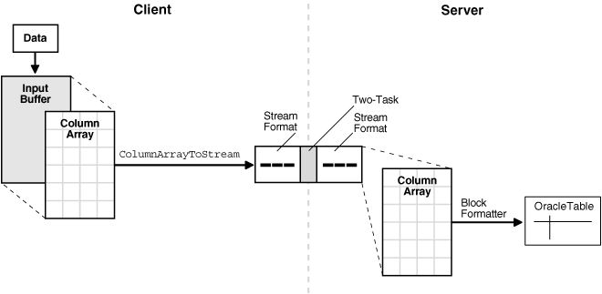
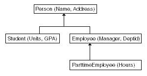

The direct path loading functions are used to load data from external files into tables and partitions.

This chapter contains these topics:

- Direct Path Loading Overview

- Direct Path Loading of Object Types

- Direct Path Loading in Pieces

- Direct Path Context Handles and Attributes for Object Types

### 21.1 Direct Path Loading Overview

The direct path load interface enables an OCI application to access the direct path load engine of Oracle Database to perform the functions of the SQL\*Loader utility.

This functionality provides the ability to load data from external files into either a table or a partition of a partitioned table.

Figure 21-1 introduces the subject of this chapter. On the client side of the illustration, data enters a column array through an input buffer. The `OCIDirPathColArrayToStream()` call moves the data to the server side through stream formats. These pass data to a column array that uses a block formatter to send the data to the database table.

Figure 21-1 Direct Path Loading

[Description of "Figure 21-1 Direct Path Loading"](img_text/lnoci040.md)

The OCI direct path load interface can load multiple rows by loading a direct path stream that contains data for multiple rows.

To use the direct path API, the client application performs the following steps:

1.  Initialize OCI.

2.  Allocate a direct path context handle and set the attributes.

3.  Supply the name of the object (table, partition, or subpartition) to be loaded.

4.  Describe the external data types of the columns of the object.

5.  Prepare the direct path interface.

6.  Allocate one or more column arrays.

7.  Allocate one or more direct path streams.

8.  Set entries in the column array to point to the input data value for each column.

9.  Convert a column array to a direct path stream format.

10. Load the direct path stream.

11. Retrieve any errors that may have occurred.

12. Invoke the direct path finishing function.

13. Free handles and data structures.

14. Disconnect from the server.

Steps 8 through 11 can be repeated many times, depending on the data to be loaded.

A direct load operation requires that the object being loaded is locked to prevent DML operations on the object. Note that queries are lock-free and are allowed while the object is being loaded. The mode of the DML lock, and which DML locks are obtained, depend upon the specification of the `OCI_ATTR_DIRPATH_PARALLEL` option, and if a partition or subpartition load is being done as opposed to an entire table load.

- For a table load, if the `OCI_ATTR_DIRPATH_PARALLEL` option is set to:

  - FALSE, then the table DML X-Lock is acquired

  - TRUE, then the table DML S-Lock is acquired

- For a partition load, if the `OCI_ATTR_DIRPATH_PARALLEL` option is set to:

  - FALSE, then the table DML SX-Lock and partition DML X-Lock are acquired

  - TRUE, then the table DML SS-Lock and partition DML S-Lock are acquired

This section includes the following topics:

- Data Types Supported for Direct Path Loading

- Direct Path Handles

- About Direct Path Interface Functions

- Limitations and Restrictions of the Direct Path Load Interface

- Direct Path Load Examples for Scalar Columns

- About Using a Date Cache in Direct Path Loading of Dates in OCI

- About Validating Format for Oracle NUMBER and DATE Data

**See Also:**

- [Direct Path Context Handle (OCIDirPathCtx) Attributes](handle-and-descriptor-attributes.md)

- [OCIDirPathColArrayToStream()](direct-path-loading-functions.md)

#### 21.1.1 Data Types Supported for Direct Path Loading

Lists the external data types that are valid for scalar columns in a direct path load operation.

The following external data types are valid for scalar columns in a direct path load operation:

- `SQLT_CHR`

- `SQLT_DAT`

- `SQLT_INT`

- `SQLT_UIN`

- `SQLT_FLT`

- `SQLT_BIN`

- `SQLT_NUM`

- `SQLT_PDN`

- `SQLT_CLOB`

- `SQLT_BLOB`

- `SQLT_DATE`

- `SQLT_TIMESTAMP`

- `SQLT_TIMESTAMP_TZ`

- `SQLT_TIMESTAMP_LTZ`

- `SQLT_INTERVAL_YM`

- `SQLT_INTERVAL_DS`

The following external object data types are supported:

- `SQLT_NTY` - column objects (`FINAL` and `NOT FINAL`) and SQL string columns

- `SQLT_REF` - `REF` columns (`FINAL` and `NOT FINAL`)

The following table types are supported:

- Nested tables

- Object tables (`FINAL` and `NOT FINAL`)

**See Also:**

- [About Accessing Column Parameter Attributes](handle-and-descriptor-attributes.md) for information on setting or retrieving the data type of a column

- [Table 5-2](data-types.md) for information about data types

#### 21.1.2 Direct Path Handles

A direct path load corresponds to a direct path array insert operation.

The direct path load interface uses the following handles to keep track of the objects loaded and the specification of the data operated on:

- Direct Path Context

- OCI Direct Path Function Context

- Direct Path Column Array and Direct Path Function Column Array

- Direct Path Stream

  **See Also:**

  [Direct Path Loading Handle Attributes](handle-and-descriptor-attributes.md) and all the descriptions of direct path attributes that follow

##### 21.1.2.1 Direct Path Context

The direct path context handle must be allocated for each object, either a table or a partition of a partitioned table, being loaded.

Because an `OCIDirPathCtx` handle is the parent handle of the `OCIDirPathFuncCtx`, `OCIDirPathColArray,` and `OCIDirPathStream` handles, freeing an `OCIDirPathCtx` handle frees its child handles also (although for good coding practices, free child handles individually before you free the parent handle).

A direct path context is allocated with `OCIHandleAlloc()`. Note that the parent handle of a direct path context is always the environment handle. A direct path context is freed with `OCIHandleFree()`. Include the header files in the first two lines in all direct path programs, as shown in Example 21-1.

Example 21-1 Direct Path Programs Must Include the Header Files

    ...
    #include <cdemodp0.h>
    #include <cdemodp.h>

    OCIEnv *envp;
    OCIDirPathCtx *dpctx;
    sword error;
    error = OCIHandleAlloc((void  *)envp, (void  **)&dpctx,
                        OCI_HTYPE_DIRPATH_CTX, (size_t)0,(void  **)0);
    ...
    error = OCIHandleFree(dpctx, OCI_HTYPE_DIRPATH_CTX);

**See Also:**

- [OCIHandleAlloc()](handle-and-descriptor-functions.md)

- [OCIHandleFree()](handle-and-descriptor-functions.md)

##### 21.1.2.2 OCI Direct Path Function Context

Use the direct path function context handle to describe named type and `REF` columns: column objects, REF columns, and SQL string columns.

The direct path function context handle, of type `OCIDirPathFuncCtx`, is used to describe the following named type and `REF` columns:

- Column objects. The function context here describes the object type, which is to be used as the default constructor to construct the object, and the object attributes of the constructor.

- `REF` columns. The function context here describes a single object table (optional) to reference row objects from, and the `REF` arguments that identify each row object.

- SQL string columns. The function context here describes a SQL string and its arguments to compute the value to be loaded into the column.

The handle type `OCI_HTYPE_DIRPATH_FN_CTX` is passed to `OCIHandleAlloc()` to indicate that a function context is to be allocated, as shown in Example 21-2.

Note that the parent handle of a direct path function context is always the direct path context handle. A direct path function context handle is freed with `OCIHandleFree()`:

    error = OCIHandleFree(dpfnctx, OCI_HTYPE_DIRPATH_FN_CTX);

Example 21-2 Passing the Handle Type to Allocate the Function Context

    OCIDirPathCtx *dpctx;       /* direct path context */
    OCIDirPathFuncCtx *dpfnctx; /* direct path function context */
    sword error;

    error = OCIHandleAlloc((void  *)dpctx, (void  **)&dpfnctx,
                           OCI_HTYPE_DIRPATH_FN_CTX,
                           (size_t)0, (void  **)0);

**See Also:**

- [Oracle Database Object-Relational Developer's Guide](../adobj/sql-and-object-types.md) for more information about the data types supported

- [OCIHandleAlloc()](handle-and-descriptor-functions.md)

- [OCIHandleFree()](handle-and-descriptor-functions.md)

##### 21.1.2.3 Direct Path Column Array and Direct Path Function Column Array

The direct path column array handle and direct path function column handle are used to present an array of rows to the direct path interface.

A row is represented by three arrays: column values, column lengths, and column flags. Methods used on a column array include: allocate the array handle and set or get values corresponding to an array entry.

Both handles share the same data structure, `OCIDirPathColArray`, but these column array handles differ in parent handles and handle types.

A direct path column array handle is allocated with `OCIHandleAlloc()`. The code fragment in Example 21-3 shows explicit allocation of the direct path column array handle.

A direct path column array handle is freed with `OCIHandleFree()`.

    error = OCIHandleFree(dpca, OCI_HTYPE_DIRPATH_COLUMN_ARRAY);

Example 21-4 shows that a direct path function column array handle is allocated in almost the same way.

A direct path function column array is freed with `OCIHandleFree()`:

    error = OCIHandleFree(dpfnca, OCI_HTYPE_DIRPATH_FN_COL_ARRAY);

Freeing an `OCIDirPathColArray` handle also frees the column array associated with the handle.

Example 21-3 Explicit Allocation of Direct Path Column Array Handle

    OCIDirPathCtx *dpctx;      /* direct path context */
    OCIDirPathColArray *dpca;  /* direct path column array */
    sword error;
    error = OCIHandleAlloc((void  *)dpctx, (void  **)&dpca,
                   OCI_HTYPE_DIRPATH_COLUMN_ARRAY,
                   (size_t)0, (void  **)0);

Example 21-4 Explicit Allocation of Direct Path Function Column Array Handle

    OCIDirPathFuncCtx *dpfnctx;   /* direct path function context */
    OCIDirPathColArray *dpfnca;   /* direct path function column array */
    sword error;
    error = OCIHandleAlloc((void  *)dpfnctx, (void  **)&dpfnca,
                            (ub4)OCI_HTYPE_DIRPATH_FN_COL_ARRAY,
                            (size_t)0, (void  **)0);

**See Also:**

[OCIHandleAlloc()](handle-and-descriptor-functions.md)

##### 21.1.2.4 Direct Path Stream

A direct path stream is a linear representation of Oracle table data.

The direct path stream handle is used by the conversion operation, `OCIDirPathColArrayToStream()`, and by the load operation, `OCIDirPathLoadStream()`.

Direct path stream handles are allocated by the client with `OCIHandleAlloc()`. The structure of an `OCIDirPathStream` handle can be thought of as a pair in the form (buffer, buffer length).

The conversion operations always append to the end of the stream. Load operations always start from the beginning of the stream. After a stream is completely loaded, the stream must be reset by calling `OCIDirPathStreamReset()`.

Example 21-5 shows a direct path stream handle allocated with `OCIHandleAlloc()`. The parent handle is always an `OCIDirPathCtx` handle.

A direct path stream handle is freed using `OCIHandleFree()`.

    error = OCIHandleFree(dpstr, OCI_HTYPE_DIRPATH_STREAM);

Freeing an `OCIDirPathStream` handle also frees the stream buffer associated with the handle.

Example 21-5 Allocating a Direct Path Stream Handle

    OCIDirPathCtx *dpctx;    /* direct path context */
    OCIDirPathStream *dpstr; /* direct path stream */
    sword error;
    error = OCIHandleAlloc((void  *)dpctx, (void  **)&dpstr,
                   OCI_HTYPE_DIRPATH_STREAM, (size_t)0,(void  **)0);

**See Also:**

- [OCIDirPathColArrayToStream()](direct-path-loading-functions.md)

- [OCIDirPathLoadStream()](direct-path-loading-functions.md)

- [OCIHandleAlloc()](handle-and-descriptor-functions.md)

- [OCIDirPathStreamReset()](direct-path-loading-functions.md)

#### 21.1.3 About Direct Path Interface Functions

Lists and describes the functions used with the direct path load interface.

The functions listed in this section are used with the direct path load interface.

Operations on the direct path context are performed by the functions in Table 21-1.

Table 21-1 Direct Path Context Functions

| Function                                                   | Purpose                                                                      |
|:-----------------------------------------------------------|:-----------------------------------------------------------------------------|
| [OCIDirPathAbort()](direct-path-loading-functions.md)      | Terminates a direct path operation                                           |
| [OCIDirPathDataSave()](direct-path-loading-functions.md)   | Executes a data savepoint                                                    |
| [OCIDirPathFinish()](direct-path-loading-functions.md)     | Commits the loaded data                                                      |
| [OCIDirPathFlushRow()](direct-path-loading-functions.md)   | Flushes a partially loaded row from the server. This function is deprecated. |
| [OCIDirPathLoadStream()](direct-path-loading-functions.md) | Loads the data that has been converted to direct path stream format          |
| [OCIDirPathPrepare()](direct-path-loading-functions.md)    | Prepares the direct path interface to convert or load rows                   |

Operations on the direct path column array are performed by the functions in Table 21-2.

Table 21-2 Direct Path Column Array Functions

| Function                                                         | Purpose                                                            |
|:-----------------------------------------------------------------|:-------------------------------------------------------------------|
| [OCIDirPathColArrayEntryGet()](direct-path-loading-functions.md) | Gets a specified entry in a column array                           |
| [OCIDirPathColArrayEntrySet()](direct-path-loading-functions.md) | Sets a specified entry in a column array to a specific value       |
| [OCIDirPathColArrayRowGet()](direct-path-loading-functions.md)   | Gets the base row pointers for a specified row number              |
| [OCIDirPathColArrayReset()](direct-path-loading-functions.md)    | Resets the row array state                                         |
| [OCIDirPathColArrayToStream()](direct-path-loading-functions.md) | Converts from a column array format to a direct path stream format |

Operations on the direct path stream are performed by the function [OCIDirPathStreamReset()](direct-path-loading-functions.md) that resets the direct stream state.

**See Also:**

[Direct Path Loading Functions](direct-path-loading-functions.md) for detailed descriptions of each function

#### 21.1.4 Limitations and Restrictions of the Direct Path Load Interface

Lists the limitations of the direct path load interface.

The direct path load interface has the following limitations that are the same as SQL\*Loader:

- Triggers are not supported.

- Referential integrity constraints are not supported.

- Clustered tables are not supported.

- Loading of remote objects is not supported.

- `LONGs` must be specified last.

- SQL strings that return LOBs, objects, or collections are not supported.

- Loading of `VARRAY` columns is not supported.

- All partitioning columns must come before any LOBs. This is because you must determine what partition the LOB goes into before you start writing to it.

#### 21.1.5 Direct Path Load Examples for Scalar Columns

This section describes the direct path load examples for scalar columns.

This is described in the following topics:

- Data Structures Used in Direct Path Loading Example

- Outline of an Example of a Direct Path Load for Scalar Columns

##### 21.1.5.1 Data Structures Used in Direct Path Loading Example

Shows examples that use the data structures in direct path loading.

Example 21-6 shows the data structure used in Example 21-7 through Example 21-17.

Example 21-7 shows the header file `cdemodp.h` from the `demo` directory, which defines several structs.

Example 21-6 Data Structures Used in Direct Path Loading Examples

    /* load control structure */
    struct loadctl
    {
      ub4                 nrow_ctl;            /* number of rows in column array */
      ub2                 ncol_ctl;         /* number of columns in column array */
      OCIEnv             *envhp_ctl;                       /* environment handle */
      OCIServer          *srvhp_ctl;                            /* server handle */
      OCIError           *errhp_ctl;                             /* error handle */
      OCIError           *errhp2_ctl;                /* yet another error handle */
      OCISvcCtx          *svchp_ctl;                          /* service context */
      OCISession         *authp_ctl;                   /* authentication context */
      OCIParam           *colLstDesc_ctl;        /* column list parameter handle */
      OCIDirPathCtx      *dpctx_ctl;                      /* direct path context */
      OCIDirPathColArray *dpca_ctl;           /* direct path column array handle */
      OCIDirPathColArray *dpobjca_ctl;          /* dp column array handle for obj*/
      OCIDirPathColArray *dpnestedobjca_ctl;  /* dp col array hndl for nested obj*/
      OCIDirPathStream   *dpstr_ctl;                /* direct path stream handle */
      ub1                *buf_ctl;    /* pre-alloc'd buffer for out-of-line data */
      ub4                 bufsz_ctl;                 /* size of buf_ctl in bytes */
      ub4                 bufoff_ctl;                     /* offset into buf_ctl */
      ub4                *otor_ctl;                  /* Offset to Recnum mapping */
      ub1                *inbuf_ctl;                 /* buffer for input records */
      struct pctx         pctx_ctl;                     /* partial field context */
      boolean             loadobjcol_ctl;             /* load to obj col(s)? T/F */
    };

Example 21-7 Contents of the Header File cdemodp.h

    #ifndef cdemodp_ORACLE
    # define cdemodp_ORACLE

    # include <oratypes.h>

    # ifndef externdef
    #  define externdef
    # endif

    /* External column attributes */
    struct col
    {
      text *name_col;                                             /* column name */
      ub2   id_col;                                            /* column load ID */
      ub2   exttyp_col;                                         /* external type */
      text *datemask_col;                             /* datemask, if applicable */
      ub1   prec_col;                                /* precision, if applicable */
      sb1   scale_col;                                   /* scale, if applicable */
      ub2   csid_col;                                        /* character set ID */
      ub1   date_col;            /* is column a chrdate or date? 1=TRUE. 0=FALSE */
      struct obj * obj_col;          /* description of object, if applicable */
    #define COL_OID 0x1                                         /* col is an OID */
      ub4   flag_col;
    };

    /* Input field descriptor
     * For this example (and simplicity),
     * fields are strictly positional.
     */
    struct fld
    {
      ub4  begpos_fld;                             /* 1-based beginning position */
      ub4  endpos_fld;                             /* 1-based ending    position */
      ub4  maxlen_fld;                       /* max length for out-of-line field */
      ub4    flag_fld;
    #define FLD_INLINE            0x1
    #define FLD_OUTOFLINE         0x2
    #define FLD_STRIP_LEAD_BLANK  0x4
    #define FLD_STRIP_TRAIL_BLANK 0x8
    };

    struct obj
    {
      text               *name_obj;                                /* type  name*/
      ub2                 ncol_obj;              /* number of columns in col_obj*/
      struct col         *col_obj;                          /* column attributes*/
      struct fld         *fld_obj;                           /* field descriptor*/
      ub4                 rowoff_obj;  /* current row offset in the column array*/
      ub4                 nrows_obj;              /* number of rows in col array*/
      OCIDirPathFuncCtx  *ctx_obj;       /* Function context for this obj column*/
      OCIDirPathColArray *ca_obj;           /* column array  for this obj column*/
      ub4                 flag_obj;                              /* type of obj */
    #define OBJ_OBJ  0x1                                             /* obj col */
    #define OBJ_OPQ  0x2                                  /* opaque/sql str col */
    #define OBJ_REF  0x4                                             /* ref col */
    };

    struct tbl
    {
      text        *owner_tbl;                                     /* table owner */
      text        *name_tbl;                                       /* table name */
      text        *subname_tbl;                        /* subname, if applicable */
      ub2          ncol_tbl;                     /* number of columns in col_tbl */
      text        *dfltdatemask_tbl;            /* table level default date mask */
      struct col  *col_tbl;                                 /* column attributes */
      struct fld  *fld_tbl;                                  /* field descriptor */
      ub1          parallel_tbl;                         /* parallel: 1 for true */
      ub1          nolog_tbl;                          /* no logging: 1 for true */
      ub4          xfrsz_tbl;                   /* transfer buffer size in bytes */
      text         *objconstr_tbl;   /* obj constr/type if loading a derived obj */
    };

    struct sess                        /* options for a direct path load session */
    {
      text        *username_sess;                                        /* user */
      text        *password_sess;                                    /* password */
      text        *inst_sess;                            /* remote instance name */
      text        *outfn_sess;                                /* output filename */
      ub4          maxreclen_sess;          /* max size of input record in bytes */
    };
    #endif                                              /* cdemodp_ORACLE */

##### 21.1.5.2 Outline of an Example of a Direct Path Load for Scalar Columns

Shows sample code that illustrates the use of several of the OCI direct path interfaces.

Example 21-8 shows sample code that illustrates the use of several of the OCI direct path interfaces. It is not a complete code example.

The init_load function performs a direct path load using the direct path API on the table described by tblp. The loadctl structure given by ctlp has an appropriately initialized environment and service context. A connection has been made to the server.

Additional attributes, such as `OCI_ATTR_SUB_NAME` and `OCI_ATTR_SCHEMA_NAME`, are also set here. After the attributes have been set, prepare the load.

      OCI_CHECK(ctlp->errhp_ctl, OCI_HTYPE_ERROR, ociret, ctlp,
                OCIDirPathPrepare(dpctx, ctlp->svchp_ctl, ctlp->errhp_ctl));

##### Allocate the Column Array and Stream Handles

Note that the direct path context handle is the parent handle for the column array and stream handles, as shown in Example 21-9. Also note that errors are returned with the environment handle associated with the direct path context.

##### Get the Number of Rows and Columns

Get the number of rows and columns in the column array just allocated, as shown in Example 21-10.

##### Set the Input Data Fields

Set the input data fields to their corresponding data columns, as shown in Example 21-11.

##### Reset the Column Array State

Reset the column array state in case a previous conversion must be continued or a row is expecting more data, as shown in Example 21-12.

##### Reset the Stream State

Reset the stream state to start a new stream, as shown in Example 21-13. Otherwise, data in the stream is appended to existing data.

##### Convert the Data in the Column Array to Stream Format

After inputting the data, convert the data in the column array to stream format and filter out any bad records, as shown in Example 21-14.

##### Load the Stream

Note that the position in the stream is maintained internally to the stream handle, along with offset information for the column array that produced the stream. When the conversion to stream format is done, the data is appended to the stream, as shown in Example 21-15. It is the responsibility of the caller to reset the stream when appropriate. On errors, the position is moved to the next row, or to the end of the stream if the error occurs on the last row. The next `OCIDirPathLoadStream()` call starts on the next row, if any. If an `OCIDirPathLoadStream()` call is made and the end of a stream has been reached, `OCI_NO_DATA` is returned.

##### Finish the Direct Path Load

Finish the direct path load as shown in Example 21-16.

##### Free the Direct Path Handles

Free all the direct path handles allocated, as shown in Example 21-17. Note that the direct path column array and stream handles are freed before the parent direct path context handle is freed.

Example 21-8 Use of OCI Direct Path Interfaces

    STATICF void
    init_load(ctlp, tblp)
    struct loadctl *ctlp;
    struct tbl     *tblp;
    {
      struct  col   *colp;
      struct  fld   *fldp;
      sword          ociret;                       /* return code from OCI calls */
      OCIDirPathCtx *dpctx;                               /* direct path context */
      OCIParam      *colDesc;                     /* column parameter descriptor */
      ub1            parmtyp;
      ub1           *timestamp = (ub1 *)0;
      ub4            size;
      ub4            i;
      ub4            pos;

      /* allocate and initialize a direct path context */
      /* See cdemodp.c for the definition of OCI_CHECK */
      OCI_CHECK(ctlp->envhp_ctl, OCI_HTYPE_ENV, ociret, ctlp,
                OCIHandleAlloc((void  *)ctlp->envhp_ctl,
                               (void  **)&ctlp->dpctx_ctl,
                               (ub4)OCI_HTYPE_DIRPATH_CTX,
                               (size_t)0, (void  **)0));

      dpctx = ctlp->dpctx_ctl;                                      /* shorthand */

      OCI_CHECK(ctlp->errhp_ctl, OCI_HTYPE_ERROR, ociret, ctlp,
                OCIAttrSet((void  *)dpctx, (ub4)OCI_HTYPE_DIRPATH_CTX,
                           (void  *)tblp->name_tbl,
                           (ub4)strlen((const char *)tblp->name_tbl),
                           (ub4)OCI_ATTR_NAME, ctlp->errhp_ctl));

Example 21-9 Allocating the Column Array and Stream Handles

       OCI_CHECK(ctlp->envhp_ctl, OCI_HTYPE_ENV, ociret, ctlp,
                OCIHandleAlloc((void  *)ctlp->dpctx_ctl, (void  **)&ctlp->dpca_ctl,
                               (ub4)OCI_HTYPE_DIRPATH_COLUMN_ARRAY,
                               (size_t)0, (void  **)0));

      OCI_CHECK(ctlp->envhp_ctl, OCI_HTYPE_ENV, ociret, ctlp,
                OCIHandleAlloc((void  *)ctlp->dpctx_ctl,(void  **)&ctlp->dpstr_ctl,
                               (ub4)OCI_HTYPE_DIRPATH_STREAM,
                               (size_t)0, (void  **)0));

Example 21-10 Getting the Number of Rows and Columns

      OCI_CHECK(ctlp->errhp_ctl, OCI_HTYPE_ERROR, ociret, ctlp,
                OCIAttrGet(ctlp->dpca_ctl, (ub4)OCI_HTYPE_DIRPATH_COLUMN_ARRAY,
                           &ctlp->nrow_ctl, 0, OCI_ATTR_NUM_ROWS,
                           ctlp->errhp_ctl));

       OCI_CHECK(ctlp->errhp_ctl, OCI_HTYPE_ERROR, ociret, ctlp,
                OCIAttrGet(ctlp->dpca_ctl, (ub4)OCI_HTYPE_DIRPATH_COLUMN_ARRAY,
                           &ctlp->ncol_ctl, 0, OCI_ATTR_NUM_COLS,
                           ctlp->errhp_ctl));

Example 21-11 Setting Input Data Fields

    ub4            rowoff;                          /* column array row offset */
    ub4            clen;                                      /* column length */
    ub1            cflg;                                  /* column state flag */
    ub1           *cval;                             /* column character value */

    OCI_CHECK(ctlp->errhp_ctl, OCI_HTYPE_ERROR, ociret, ctlp,
                OCIDirPathColArrayEntrySet(ctlp->dpca_ctl, ctlp->errhp_ctl,
                                           rowoff, colp->id_col,
                                           cval, clen, cflg));

Example 21-12 Resetting the Column Array State

    (void) OCIDirPathColArrayReset(ctlp->dpca_ctl, ctlp->errhp_ctl);

Example 21-13 Resetting the Stream State

    (void) OCIDirPathStreamReset(ctlp->dpstr_ctl, ctlp->errhp_ctl);

Example 21-14 Converting Data to Stream Format

    ub4            rowcnt;                   /* number of rows in column array */
    ub4            startoff;         /* starting row offset into column array  */

    /* convert array to stream, filter out bad records */
    ocierr = OCIDirPathColArrayToStream(ctlp->dpca_ctl, ctlp->dpctx_ctl,
                                            ctlp->dpstr_ctl, ctlp->errhp_ctl,
                                            rowcnt, startoff);

Example 21-15 Loading the Stream

    /* load the stream */
    ociret = OCIDirPathLoadStream(ctlp->dpctx_ctl, ctlp->dpstr_ctl,
                ctlp->errhp_ctl);

Example 21-16 Finishing the Direct Path Load Operation

    /* finish the direct path load operation */
    OCI_CHECK(ctlp->errhp_ctl, OCI_HTYPE_ERROR, ociret, ctlp,
              OCIDirPathFinish(ctlp->dpctx_ctl, ctlp->errhp_ctl));

Example 21-17 Freeing the Direct Path Handles

    /* free up server data structures for the load */
    ociret = OCIHandleFree((void  *)ctlp->dpca_ctl,
                               OCI_HTYPE_DIRPATH_COLUMN_ARRAY);
    ociret = OCIHandleFree((void  *)ctlp->dpstr_ctl,
                               OCI_HTYPE_DIRPATH_STREAM);
    ociret = OCIHandleFree((void  *)ctlp->dpctx_ctl,
                              OCI_HTYPE_DIRPATH_CTX);

**See Also:**

[OCIDirPathLoadStream()](direct-path-loading-functions.md)

#### 21.1.6 About Using a Date Cache in Direct Path Loading of Dates in OCI

The date cache feature provides improved performance when loading Oracle date and time-stamp values that require data type conversions to be stored in the table.

For more information about using this feature in direct path loading, see [Oracle Database Utilities](../sutil/oracle-sql-loader-conventional-and-direct-loads.md).

This feature is specifically targeted to direct path loads where the same input date or timestamp values are being loaded over and over again. Date conversions are very expensive and can account for a large percentage of the total load time, especially if multiple date columns are being loaded. The date cache feature can significantly improve performance by reducing the actual number of date conversions done when many duplicate date values occur in the input data. However, date cache only improves performance when many duplicate input date values are being loaded into date columns (the word date in this chapter applies to all the date and time-stamp data types).

The date cache is enabled by default. When you explicitly specify the date cache size, the date cache feature is not disabled, by default. To override this behavior, set `OCI_ATTR_DIRPATH_DCACHE_DISABLE` to 1. Otherwise, the cache continues to be searched to avoid date conversions. However, any misses (entries for which there are no duplicate values) are converted the usual way using expensive date conversion functions without the benefit of using the date cache feature.

Query the attributes `OCI_ATTR_DIRPATH_DCACHE_NUM`, `OCI_ATTR_DIRPATH_DCACHE_MISSES`, and `OCI_ATTR_DIRPATH_DCACHE_HITS` and then tune the cache size for future loads.

You can lower the cache size when there are no misses and the number of elements in the cache is less than the cache size. The cache size can be increased if there are many cache misses and relatively few hits (entries for which there are duplicate values). Excessive date cache misses, however, can cause the application to run slower than not using the date cache at all. Note that increasing the cache size too much can cause other problems, like paging or exhausting memory. If increasing the cache size does not improve performance, the feature should not be used.

The date cache feature can be explicitly and totally disabled by setting the date cache size to 0.

The following OCI direct path context attributes support this functionality:

- OCI_ATTR_DIRPATH_DCACHE_SIZE

- OCI_ATTR_DIRPATH_DCACHE_NUM

- OCI_ATTR_DIRPATH_DCACHE_MISSES

- OCI_ATTR_DIRPATH_DCACHE_HITS

- OCI_ATTR_DIRPATH_DCACHE_DISABLE

##### 21.1.6.1 OCI_ATTR_DIRPATH_DCACHE_SIZE

This attribute, when not equal to 0, sets the date cache size (in elements) for a table. For example, if the date cache size is set to 200, then at most 200 unique date or time-stamp values can be stored in the cache. The date cache size cannot be changed once [OCIDirPathPrepare()](direct-path-loading-functions.md) has been called. The default value is 0, meaning a date cache is not created for a table. A date cache is created for a table only if one or more date or time-stamp values are loaded that require data type conversions and the attribute value is nonzero.

##### 21.1.6.2 OCI_ATTR_DIRPATH_DCACHE_NUM

This attribute is used to query the current number of entries in a date cache.

##### 21.1.6.3 OCI_ATTR_DIRPATH_DCACHE_MISSES

This attribute is used to query the current number of date cache misses. If the number of misses is high, consider using a larger date cache size. If increasing the date cache size does not cause this number to decrease significantly, the date cache should probably not be used. Date cache misses are expensive, due to hashing and lookup times.

##### 21.1.6.4 OCI_ATTR_DIRPATH_DCACHE_HITS

This attribute is used to query the number of date cache hits. This number should be relatively large to see any benefit of using the date cache support.

##### 21.1.6.5 OCI_ATTR_DIRPATH_DCACHE_DISABLE

Used to disable the data cache if the size is exceeded.

Setting this attribute to 1 indicates that the date cache should be disabled if the size is exceeded. Note that this attribute cannot be changed or set after `OCIDirPathPrepare()` has been called.

The default (= 0) is to not disable a cache on overflow. When not disabled, the cache is searched to avoid conversions, but overflow input date value entries are not added to the date cache, and are converted using expensive date conversion functions. Again, excessive date cache misses can cause the application to run slower than not using the date cache at all.

This attribute can also be queried to see if a date cache has been disabled due to overflow.

**See Also:**

- [Direct Path Context Handle (OCIDirPathCtx) Attributes](handle-and-descriptor-attributes.md)

- [OCIDirPathPrepare()](direct-path-loading-functions.md)

#### 21.1.7 About Validating Format for Oracle NUMBER and DATE Data

Describes validating format for Oracle NUMBER and DATE data when loading stream data.

Use the direct path context handle attribute `OCI_ATTR_DIRPATH_FLAGS` with the `OCI_DIRPATH_FLAGS_VLDT` 0x01 flag set to validate format for Oracle `NUMBER` and `DATE` data when the stream is parsed on the server. The default value is to not set this flag because it is an expensive operation. It can be used when you suspect that there is a problem with `OCIDirPath` generating invalid internal representation of dates and numbers.

See [Direct Path Context Handle (OCIDirPathCtx) Attributes](handle-and-descriptor-attributes.md) for more information.

### 21.2 Direct Path Loading of Object Types

The use of the direct path function contexts to load various nonscalar types is discussed in this section.

The nonscalar types are:

- Nested tables

- Object tables (`FINAL` and `NOT FINAL`)

- Column objects (`FINAL` and `NOT FINAL`)

- `REF` columns (`FINAL` and `NOT FINAL`)

- SQL string columns

This section includes the following topics:

- Direct Path Loading of Nested Tables

- Direct Path Loading of Column Objects

- Direct Path Loading of SQL String Columns

- Direct Path Loading of REF Columns

- Direct Path Loading of NOT FINAL Object and REF Columns

- Direct Path Loading of Object Tables

- Direct Path Loading a NOT FINAL Object Table

**See Also:**

[Table B-1](oci-demo-programs.md) for a listing of the programs demonstrating direct path loading that are available with your Oracle Database installation

#### 21.2.1 Direct Path Loading of Nested Tables

Nested tables are stored in a separate table.

Using the direct path loading API, a nested table is loaded separately from its parent table with a foreign key, called a `SETID`, to link the two tables together.

**Note:**

- Currently, the `SETID`s must be user-supplied and are not system-generated.

- When loading the parent and child tables separately, it is possible for orphaned children to be created when the rows are inserted in to the child table, but the corresponding parent row is not inserted in to the parent table. It is also possible to insert a parent row in to the parent table without inserting child rows in to the child table, so that the parent row has missing children.

##### 21.2.1.1 Describing a Nested Table Column and Its Nested Table

Lists and describes loading the parent table with a nested table column, whichis a separate action from loading the child nested table.

**Note:**

Steps that are different from loading scalar data are in italic.

Loading the parent table with a nested table column is a separate action from loading the child nested table.

- To load the parent table with a nested table column:

  1.  Describe the parent table and its columns as usual, except:

  2.  When describing the nested table column, this is the column that stores the SETIDs. Its external data type is SQLT_CHR if the SETIDs in the data file are in characters, SQLT_BIN if binary.

- To load the nested table (child):

  1.  Describe the nested table and its columns as usual.

  2.  The SETID column is required.

      - Set its OCI_ATTR_NAME using a dummy name (for example "setid"), because the API does not expect you to know its system name.

      - Set the column attribute with OCI_ATTR_DIRPATH_SID to indicate that this is a SETID column:

            ub1 flg = 1;
            sword error;

            error = OCIAttrSet((void  *)colDesc,
                               OCI_DTYPE_PARAM,
                               (void  *)&flg, (ub4)0,
                               OCI_ATTR_DIRPATH_SID, ctlp->errhp_ctl);

This section includes the following topic: Describing a Nested Table Column and Its Nested Table.

#### 21.2.2 Direct Path Loading of Column Objects

A column object is a table column that is defined as an object.

Currently only the default constructor, which consists of all of the constituent attributes, is supported.

This section includes the following topics:

- Describing a Column Object

- Allocating the Array Column for the Column Object

- Loading Column Object Data into the Column Array

- OCI_DIRPATH_COL_ERROR

##### 21.2.2.1 Describing a Column Object

To describe a column object and its object attributes, use a direct path function context.

Describing a column object requires setting its object constructor. Describing object attributes is similar to describing a list of scalar columns.

To describe a column object:

**Note:**

- Nested column objects are supported.

- The steps shown here are similar to those describing a list of scalar columns to be loaded for a table. Steps that are different from loading scalar data are in italic.

1.  Allocate a parameter handle on the column object with `OCI_DTYPE_PARAM`. This parameter handle is used to set the column's external attributes.

2.  Set the column name and its other external column attributes (for example, maximum data size, precision, scale).

3.  Set the external type as SQLT_NTY (named type) with OCI_ATTR_DATA_TYPE.

4.  Allocate a direct path function context handle. This context is used to describe the column's object type and attributes:

        OCIDirPathFuncCtx *dpfnctx  /* direct path function context */;
        sword error;
        error = OCIHandleAlloc((void  *)dpctx, (void  **)&dpfnctx,
                       OCI_HTYPE_DIRPATH_FN_CTX,
                       (size_t)0, (void  **)0);

5.  Set the column's object type name (for example, "Employee") with OCI_ATTR_NAME in the function context:

        OCIDirPathFuncCtx *dpfnctx; /* direct path function context */
        text *obj_type;   /* column object's object type */
        sword error;

        error = OCIAttrSet((void  *)dpfnctx,
                           OCI_HTYPE_DIRPATH_FN_CTX,
                           (void  *)obj_type, (ub4)strlen((const char *)obj_type),
                           OCI_ATTR_NAME, ctlp->errhp_ctl);

6.  Set the expression type, OCI_ATTR_DIRPATH_EXPR_TYPE, to be OCI_DIRPATH_EXPR_OBJ_CONSTR. This indicates that the expression set with OCI_ATTR_NAME is used as the default object constructor:

        OCIDirPathFuncCtx *dpfnctx; /* direct path function context */
        ub1 expr_type = OCI_DIRPATH_EXPR_OBJ_CONSTR;
        sword error;

        error = OCIAttrSet((void  *)dpfnctx,
                           OCI_HTYPE_DIRPATH_FN_CTX,
                           (void  *)&expr_type, (ub4)0,
                           OCI_ATTR_DIRPATH_EXPR_TYPE,
                           ctlp->errhp_ctl);

7.  Set the number of columns or object attributes that are to be loaded for this column object using OCI_ATTR_NUM_COLS.

8.  Get the column or attribute parameter list for the function context `OCIDirPathFuncCtx`.

9.  For each object attribute:

    1.  Get the column descriptor for the object attribute with `OCI_DTYPE_PARAM`.

    2.  Set the attribute's column name with `OCI_ATTR_NAME`.

    3.  Set the external column type (the type of the data that is to be passed to the direct path API) with `OCI_ATTR_DATA_TYPE`.

    4.  Set any other external column attributes (maximum data size, precision, scale, and so on.)

    5.  If this attribute column is a column object, then do Steps 3 through 10 for its object attributes.

    6.  Free the handle to the column descriptor.

10. Set the function context `OCIDirPathFuncCtx` that was created in Step 4 into the parent column object's parameter handle with OCI_ATTR_DIRPATH_FN_CTX.

##### 21.2.2.2 Allocating the Array Column for the Column Object

When you direct path load a column object, the data for its object attributes is loaded into a separate column array created just for that object.

A child column array is allocated for each column object, whether it is nested or not. Each row of object attributes in the child column array maps to the corresponding non-NULL row of its parent column object in the parent column array.

Use the column object's direct path function context handle and function column array value `OCI_HTYPE_DIRPATH_FN_COL_ARRAY`.

Example 21-18 shows how to allocate a child column array for a column object.

Example 21-18 Allocating a Child Column Array for a Column Object

    OCIDirPathFuncCtx *dpfnctx; /* direct path function context */
    OCIDirPathColArray *dpfnca;   /* direct path function column array */
    sword error;

    error = OCIHandleAlloc((void  *)dpfnctx, (void  **)&dpfnca,
                           OCI_HTYPE_DIRPATH_FN_COL_ARRAY,
                           (size_t)0, (void  **)0);

##### 21.2.2.3 Loading Column Object Data into the Column Array

If a column is scalar, its value is set in the column array by passing the address of its value to `OCIDirPathColArrayEntrySet()`.

If a column is an object, the address of its child column array handle is passed instead. The child column array contains the data of the object attributes.

To load data into a column object:

**Note:**

Steps that are different from loading scalar data are in italic.

(Start.) For each column object:

1.  If the column is non-NULL:

    1.  For each of its object attribute columns:

        If an object attribute is a nested column object, then go to (Start.) and do this entire procedure recursively.

        Set the data in the child column array using OCIDirPathColArrayEntrySet().

    2.  Set the column object's data in the column array by passing the address of its child column array handle to `OCIDirPathColArrayEntrySet()`.

2.  Else if the column is NULL:

    Set the column object's data in the column array by passing a NULL address for the data, a length of 0, and an `OCI_DIRPATH_COL_NULL` flag to `OCIDirPathColArrayEntrySet()`.

**See Also:**

[OCIDirPathColArrayEntrySet()](direct-path-loading-functions.md)

##### 21.2.2.4 OCI_DIRPATH_COL_ERROR

The `OCI_DIRPATH_COL_ERROR` value is passed to `OCIDirPathColArrayEntry()` to indicate that the current column array row should be ignored.

A typical use of this value is to back out all previous conversions for a row when an error occurs, providing that more data for a partial column (`OCI_NEED_DATA` was returned from the previous `OCIDirPathColArrayToStream()` call). Any previously converted data placed in the output stream buffer for the current row is removed. Conversion then continues with the next row in the column array. The purged row is counted in the converted row count.

When `OCI_DIRPATH_COL_ERROR` is specified, the current row is ignored, as well as any corresponding rows in any child column arrays referenced, starting from the top-level column array row. Any `NULL` child column array references are ignored when moving all referenced child column arrays to their next row.

**See Also:**

[OCIDirPathColArrayToStream()](direct-path-loading-functions.md)

#### 21.2.3 Direct Path Loading of SQL String Columns

A column value can be computed by a SQL string. SQL strings can be used for scalar column types.

SQL strings cannot be used for object types, but can be used for object attributes of scalar column types. They cannot be used for nested tables, sequences, and `LONG`s.

A SQL expression is represented to the direct path API using the `OCIDirPathFuncCtx`. Its `OCI_ATTR_NAME` value is the SQL string with the parameter list of the named bind variables for the expression.

The bind variable namespace is limited to a column's SQL string. The same bind variable name can be used for multiple columns, but any arguments with the same name only apply to the SQL string of that column.

If a SQL string of a column contains multiple references to a bind variable and multiple arguments are specified for that name, all of the values must be the same; otherwise, the results are undefined. Only one argument is actually required for this case, as all references to the same bind variable name in a particular SQL expression are bound to that single argument.

A SQL string example is:

    substr(substr(:string, :offset, :length), :offset, :length)

Things to note about this example are:

- SQL expressions can be nested.

- Bind variable names can be repeated within the expression.

This section includes the following topics:

- Describing a SQL String Column

- Allocating the Column Array for SQL String Columns

- Loading the SQL String Data into the Column Array

##### 21.2.3.1 Describing a SQL String Column

Lists steps for describing a SQL string column.

**Note:**

Steps that are different from loading scalar data are in italic.

1.  Allocate a parameter handle on the SQL string column with `OCI_DTYPE_PARAM`. This parameter handle is used to set the column's external attributes.

2.  Set the column name and its other external column attributes (for example, maximum data size, precision, scale).

3.  Set the SQL string column's external type as SQLT_NTY with OCI_ATTR_DATA_TYPE.

4.  Allocate a direct path function context handle. This context is used to describe the arguments of the SQL string.

        OCIDirPathFuncCtx *dpfnctx  /* direct path function context */;
        sword error;
        error = OCIHandleAlloc((void  *)dpctx, (void  **)&dpfnctx,
                       OCI_HTYPE_DIRPATH_FN_CTX,
                       (size_t)0, (void  **)0);

5.  Set the column's SQL string in OCI_ATTR_NAME in the function context.

        OCIDirPathFuncCtx *dpfnctx; /* direct path function context */
        text *sql_str;   /* column's SQL string expression */
        sword error;

        error = OCIAttrSet((void  *)dpfnctx,
                           OCI_HTYPE_DIRPATH_FN_CTX,
                           (void  *)sql_str, (ub4)strlen((const char *)sql_str),
                           OCI_ATTR_NAME, ctlp->errhp_ctl);

6.  Set the expression type, OCI_ATTR_DIRPATH_EXPR_TYPE, to be OCI_DIRPATH_EXPR_SQL. This indicates that the expression set with OCI_ATTR_NAME is used as the SQL string to derive the value from.

        OCIDirPathFuncCtx *dpfnctx; /* direct path function context */
        ub1 expr_type = OCI_DIRPATH_EXPR_SQL;
        sword error;

        error = OCIAttrSet((void  *)dpfnctx,
                           OCI_HTYPE_DIRPATH_FN_CTX,
                           (void  *)&expr_type, (ub4)0,
                           OCI_ATTR_DIRPATH_EXPR_TYPE, ctlp->errhp_ctl);

7.  Set the number of arguments that are to be passed to the SQL string with OCI_ATTR_NUM_COLS.

8.  Get the column or attribute parameter list for the function context.

9.  For each SQL string argument:

    1.  Get the column descriptor for the object attribute with `OCI_DTYPE_PARAM`.

    2.  The order in which the SQL string arguments are defined does not matter. The order does not have to match the order used in the SQL string.

    3.  Set the attribute's column name with `OCI_ATTR_NAME`.

    4.  Use the naming convention for SQL string arguments.

    5.  The argument names must match the bind variable names used in the SQL string in content but not in case. For example, if the SQL string is "substr(:INPUT_STRING, 3, 5)", then it is acceptable if you give the argument name as "input_string".

    6.  If an argument is used multiple times in a SQL string, declaring it once and counting it as one argument only is correct.

    7.  Set the external column type (the type of the data that is to be passed to the direct path API) with `OCI_ATTR_DATA_TYPE`.

    8.  Set any other external column attributes (maximum data size, precision, scale, and so on).

    9.  Free the handle to the column descriptor.

10.  Set the function context `OCIDirPathFuncCtx` that was created in Step 4 into the parent column object's parameter handle with OCI_ATTR_DIRPATH_FN_CTX.

##### 21.2.3.2 Allocating the Column Array for SQL String Columns

When you direct path load a SQL string column, the data for its arguments is loaded into a separate column array created just for that SQL string column.

A child column array is allocated for each SQL string column. Each row of arguments in the child column array maps to the corresponding non-NULL row of its parent SQL string column in the parent column array.

Example 21-19 shows how to allocate a child column array for a SQL string column.

Example 21-19 Allocating a Child Column Array for a SQL String Column

    OCIDirPathFuncCtx *dpfnctx;        /* direct path function context */
    OCIDirPathColArray *dpfnca;   /* direct path function column array */
    sword error;

    error = OCIHandleAlloc((void  *)dpfnctx, (void  **)&dpfnca,
                           OCI_HTYPE_DIRPATH_FN_COL_ARRAY,
                           (size_t)0, (void  **)0);

##### 21.2.3.3 Loading the SQL String Data into the Column Array

If a column is scalar, its value would be set in the column array by passing the address of its value to `OCIDirPathColArrayEntrySet()`.

If a column is of a SQL string type, the address of its child column array handle would be passed instead. The child column array would contain the SQL string's argument data.

To load data into a SQL string column:

**Note:**

Steps that are different from loading scalar data are in italic.

For each SQL string column:

1.  If the column is non-NULL:

    1.  For each of its function argument columns:

        Set the data in the child column array using OCIDirPathColArrayEntrySet().

    2.  Set the SQL string column's data into the column array by passing the address of its child column array handle to OCIDirPathColArrayEntrySet().

2.  Else if the column is NULL:

    Set the SQL string column data into the column array by passing a NULL address for the data, a length of 0, and an `OCI_DIRPATH_COL_NULL` flag to `OCIDirPathColArrayEntrySet()`.

This process is similar to that for column objects.

**See Also:**

- OCI_DIRPATH_COL_ERROR for more information about passing the `OCI_DIRPATH_COL_ERROR` value to `OCIDirPathColArrayEntry()` to indicate that the current column array row should be ignored when an error occurs

- [OCIDirPathColArrayEntrySet()](direct-path-loading-functions.md)

#### 21.2.4 Direct Path Loading of REF Columns

The `REF` type is a pointer, or reference, to a row object in an object table.

This section includes the following topics:

- Describing the REF Column

- Allocating the Column Array for a REF Column

- Loading the REF Data into the Column Array

##### 21.2.4.1 Describing the REF Column

Describing the arguments to a `REF` column is similar to describing the list of columns to be loaded for a table.

**Note:**

A `REF` column can be a top-table-level column or nested as an object attribute to a column object.

Steps that are different from loading scalar data are in italic.

1.  Get a parameter handle on the `REF` column with `OCI_DTYPE_PARAM`. This parameter handle is used to set the column's external attributes.

2.  Set the column name and its other external column attributes (for example, maximum data size, precision, scale).

3.  Set the REF column's external type as SQLT_REF with OCI_ATTR_DATA_TYPE.

4.  Allocate a direct path function context handle. This context is used to describe the REF column's arguments.

        OCIDirPathFuncCtx *dpfnctx; /* direct path function context */
        sword error;

        error = OCIHandleAlloc((void  *)dpctx, (void  **)&dpfnctx,
                               OCI_HTYPE_DIRPATH_FN_CTX,
                               (size_t)0, (void  **)0);

5.  OPTIONAL: Set the REF column's table name in OCI_ATTR_NAME in the function context. See the next step for more details.

        OCIDirPathFuncCtx *dpfnctx; /* direct path function context */
        text *ref_tbl;     /* column's reference table */
        sword error;

        error = OCIAttrSet((void  *)dpfnctx,
                           OCI_HTYPE_DIRPATH_FN_CTX,
                           (void  *)ref_tbl, (ub4)strlen((const char *)ref_tbl),
                           OCI_ATTR_NAME, ctlp->errhp_ctl);

6.  OPTIONAL: Set the expression type, OCI_ATTR_DIRPATH_EXPR_TYPE, to be OCI_DIRPATH_EXPR_REF_TBLNAME. Set this only if Step 5 was done. This indicates that the expression set with OCI_ATTR_NAME is to be used as the object table to reference row objects from. This parameter is optional. The behavior for this parameter varies for the REF type.

    - Unscoped REF columns (unscoped, system-OID-based):

      If not set, then by the definition of an "unscoped" REF column, this REF column is required to have a reference table name as its argument for every data row.

      If set, this REF column can only refer to row objects from this specified object table for the duration of the load. And the REF column is not allowed to have a reference table name as its argument. (The direct path API is providing this parameter as a shortcut to users who will be loading to an unscoped REF column that refers to the same reference object table during the entire load.)

    - Scoped REF columns (scoped, system-OID-based, and primary-key-based):

      If not set, the direct path API uses the reference table specified in the schema.

      If set, the reference table name must match the object table specified in the schema for this scoped REF column. An error occurs if the table names do not match.

      Whether this parameter is set or not, it does not matter to the API whether this reference table name is in the data row or not. If the name is in the data row, it must match the table name specified in the schema. If it is not in the data row, the API uses the reference table specified in the schema.

7.  Set the number of REF arguments that are to be used to reference a row object with OCI_ATTR_NUM_COLS. The number of arguments required varies for the REF column type. This number is derived from Step 6 earlier.

    - Unscoped REF columns (unscoped, system-OID-based REF columns):

      One if OCI_DIRPATH_EXPR_REF_TBLNAME is used. None for the reference table name, and one for the OID value.

      Two if OCI_DIRPATH_EXPR_REF_TBLNAME is not used. One for the reference table name, and one for the OID value.

    - Scoped REF columns (scoped, system-OID-based, and primary-key-based):

      N or N+1 are acceptable, where N is the number of columns making up the object ID, regardless if OCI_DIRPATH_EXPR_REF_TBLNAME is used or not. Minimum is N if the reference table name is not in the data row. It is N+1 if the reference table name is in the data row. Note: If the REF is system-OID-based, then N is one. If the REF is primary-key-based, then N is the number of component columns that make up the primary key. If the reference table name is in the data row, then add one to N.

      **Note:**

      To simplify the error message if you pass in some `REF` arguments other than N or N+1, the error message says that it found so-and-so number of arguments when it expects N. Although N+1 is not stated in the message, N+1 is acceptable (even though the reference table name is not needed) and does not invoke an error message.

8.  Get the column or attribute parameter list for the function context.

9.  For each REF argument or attribute:

    1.  Get the column descriptor for the `REF` argument using `OCI_DTYPE_PARAM`.

    2.  Set the attribute's column name using `OCI_ATTR_NAME`.

        The order of the REF arguments given matter. The reference table name comes first, if given. The object ID, whether it is system-generated or primary-key-based, comes next.

        There is a naming convention for the REF arguments. Because the reference table name is not a table column, you can use any dummy names for its column name, such as "ref-tbl." For a system-generated OID column, you can use any dummy names for its column name, such as "sys-OID". For a primary-key-based object ID, list all the primary-key columns to load into. There is no need to create a dummy name for OID. The component column names, if given (see shortcut note later), can be given in any order.

        Do not set the attribute column names for the object ID to use the shortcut.

        Shortcut. If loading a system-OID-based REF column, do not set the column name with a name. The API figures it out. But you must still set other column attributes, such as external data type.

        If loading a primary-key REF column and its primary key consists of multiple columns, the shortcut is not to set their column names. But you must still set other column attributes, such as external data type.

        **Note:**

        If the component column names are NULL, then the API code determines the column names in the position or order in which they were defined for the primary key. So, when you set column attributes other than the name, ensure that the attributes are set for the component columns in the correct order.

    3.  Set the external column type (the type of the data that is to be passed to the direct path API) using `OCI_ATTR_DATA_TYPE`.

    4.  Set any other external column attributes (max data size, precision, scale, and so on).

    5.  Free the handle to the column descriptor.

    6.  Set the function context `OCIDirPathFuncCtx` that was created in Step 4 in the parent column object's parameter handle using OCI_ATTR_DIRPATH_FN_CTX.

##### 21.2.4.2 Allocating the Column Array for a REF Column

Shows how to allocate a child column array for a `REF` column.

Example 21-20 shows how to allocate a child column array for a `REF` column.

Example 21-20 Allocating a Child Column Array for a REF Column

    OCIDirPathFuncCtx *dpfnctx; /* direct path function context */
    OCIDirPathColArray *dpfnca; /* direct path function column array */
    sword error;

    error = OCIHandleAlloc((void  *)dpfnctx, (void  **)&dpfnca,
                           OCI_HTYPE_DIRPATH_FN_COL_ARRAY,
                           (size_t)0, (void  **)0);

##### 21.2.4.3 Loading the REF Data into the Column Array

If a column is scalar, its value is set in the column array by passing the address of its value to `OCIDirPathColArrayEntrySet()`.

If a column is a `REF`, the address of its child column array handle is passed instead. The child column array contains the `REF` arguments' data.

To load data into a `REF` column:

**Note:**

Steps that are different from loading scalar data are in italic.

For each REF column:

1.  If the column is non-NULL:

    1.  For each of its REF argument columns:

        Set its data in the child column array using OCIDirPathColArrayEntrySet().

    2.  Set the REF column's data into the column array by passing the address of its child column array handle to OCIDirPathColArrayEntrySet().

2.  Else if the column is NULL:

    Set the `REF` column's data into the column array by passing a NULL address for the data, a length of 0, and an `OCI_DIRPATH_COL_NULL` flag to `OCIDirPathColArrayEntrySet()`.

    **See Also:**

    - OCI_DIRPATH_COL_ERROR

    - [OCIDirPathColArrayEntrySet()](direct-path-loading-functions.md)

#### 21.2.5 Direct Path Loading of NOT FINAL Object and REF Columns

Recall that SQL object inheritance is based on a family tree of object types that forms a type hierarchy.

The type hierarchy consists of a parent object type, called a supertype, and one or more levels of child object types, called subtypes, which are derived from the parent.

This section includes the following topics:

- Inheritance Hierarchy

- About Describing a Fixed, Derived Type to Be Loaded

- About Allocating the Column Array

- About Loading the Data into the Column Array

##### 21.2.5.1 Inheritance Hierarchy

Recall that for an object type to be inheritable, the object type definition must specify that it is inheritable.

Figure 21-2 diagrams the inheritance hierarchy for a column of type `Person`. The `Person` supertype is at the top of the hierarchy with two attributes: `Name`, `Address`. `Person` has two subtypes, `Employee` and `Student`. The `Employee` subtype has two attributes: `Manager`, `Deptid`. The `Student` subtype has two attributes: `Units`, `GPA`. `ParttimeEmployee` is a subtype of `Employee` and appears below it. The subtype `ParttimeEmployee` has one attribute: `Hours`. These are the types that can be stored in a `Person` column.

Figure 21-2 Inheritance Hierarchy for a Column of Type Person

[Description of "Figure 21-2 Inheritance Hierarchy for a Column of Type Person"](img_text/lnoci046.md)

Once specified, subtypes can be derived from it. To specify an object to be inheritable, the keyword `NOT FINAL` must be specified in its type definition. To specify an object to not be inheritable, the keyword FINAL must be specified in its type definition.

When you direct path load a table that contains a column of type `Person`, the actual set of types could include any of these four: the `NOT FINAL` type `Person`, and its three subtypes: `Student`, `Employee`, and `ParttimeEmployee`. Because the direct path load API only supports the loading of one fixed, derived type to this `NOT FINAL` column for the duration of this load, the direct path load API must know which one of these types is to be loaded, the attributes to load for this type, and the function used to create this type.

So when you describe and load a derived type, you must specify all of the attributes for that type that are to be loaded. Think of a subtype as a flattened representation of all the object attributes that are unique to this type, plus all the attributes of its ancestors. Therefore, any of these attribute columns that are to be loaded into, you must describe and count.

For example, to load all columns in `ParttimeEmployee`, you must describe and count five object attributes to load into: `Name`, `Address`, `Manager`, `Deptid`, and `Hours.`

**See Also:**

[Oracle Database Object-Relational Developer's Guide](../adobj/inheritance-in-sql-object-types.md) for more information about defining `FINAL` and `NOT FINAL` types.

##### 21.2.5.2 About Describing a Fixed, Derived Type to Be Loaded

Note that the steps to describe a `NOT FINAL` or substitutable object columns and `REF` columns of a fixed, derived type are similar to the steps that describe its `FINAL` counterpart.

These sections describe a `FINAL` column of this type. Because the derived type (could be a supertype or a subtype) is fixed for the duration of the load, the client interface for describing a `NOT FINAL` column is the same as for describing a `FINAL` column.

A subtype can be thought of as a flattened representation of all the object attributes that are unique to this type plus all the attributes of its ancestors. Therefore, any of these attribute columns that are to be loaded into must be described and counted.

**See Also:**

Direct Path Loading of Column Objects or Direct Path Loading of REF Columns for information about how to describe a `NOT FINAL` column of type X (where X is an object or a `REF`)

##### 21.2.5.3 About Allocating the Column Array

Indicates it is the same as for a `FINAL` column of the same type.

Allocating the column array is the same as for a `FINAL` column of the same type.

##### 21.2.5.4 About Loading the Data into the Column Array

Indicates it is the same as for a `FINAL` column of the same type.

Loading the data into the column array is the same as for a `FINAL` column of the same type.

#### 21.2.6 Direct Path Loading of Object Tables

An object table is a table in which each row is an object (or row object). Each column in the table is an object attribute.

##### Describing an Object Table

Describing an object table is very similar to describing a non-object table. Each object attribute is a column in the table. The only difference is that you may need to describe the OID, which could be system-generated, user-generated, or primary-key-based.

To describe an object table:

**Note:**

Steps that are different from loading a non-object table are in italic.

For each object attribute column:

Describe each object attribute column as it must be described, depending on its type (for example, `NUMBER`, `REF`):

For the object table OID (Oracle Internet Directory):

1.  If the object ID is system-generated:

    There is nothing extra to do. The system generates OIDs for each row object.

2.  If the object ID is user-generated:

    1.  Use a dummy name to represent the column name for the OID (for example, "cust_oid").

    2.  Set the OID column attribute with OCI_ATTR_DIRPATH_OID.

3.  If the object ID is primary-key-based:

    1.  Load all of the primary-key columns making up the OID.

    2.  Do not set OCI_ATTR_DIRPATH_OID, because no OID column with a dummy name was created.

##### Allocating the Column Array for the Object Table

Example 21-21 shows that allocating the column array for the object table is the same as allocating a column array for a non-object table.

##### Loading Data into the Column Array

Loading data into the column array is the same as loading data into a non-object table.

Example 21-21 Allocating the Column Array for the Object Table

    OCIDirPathColArray *dpca;  /* direct path column array */
    sword error;

    error = OCIHandleAlloc((void  *)dpctx, (void  **)&dpca,
                           OCI_HTYPE_DIRPATH_COLUMN_ARRAY,
                           (size_t)0, (void  **)0);

#### 21.2.7 Direct Path Loading a NOT FINAL Object Table

A `NOT FINAL` object table supports inheritance and a `FINAL` object table cannot.

##### Describing a NOT FINAL Object Table

Describing a `NOT FINAL` object table of a fixed derived type is very similar to describing a `FINAL` object table.

To describe a `NOT FINAL` object table of a fixed derived type:

**Note:**

Steps that are different from describing a `FINAL` object table are in italic.

1.  Set the object table's object type in the direct path context with OCI_ATTR_DIRPATH_OBJ_CONSTR. This indicates that the object type, whether it is a supertype or a derived type, are used as the default object constructor when loading to this table for the duration of the load.

        text *obj_type;            /* the object type to load into this NOT FINAL */
                                   /* object table */
        sword error;

        error = OCIAttrSet((void  *)dpctx,
                           OCI_HTYPE_DIRPATH_CTX,
                           (void  *) obj_type,
                           (ub4)strlen((const char *) obj_type),
                           OCI_ATTR_DIRPATH_OBJ_CONSTR, ctlp->errhp_ctl);

2.  Describe according to its data type each of the object attribute columns to be loaded. Describe the object ID, if needed. This is the same as describing a `FINAL` object table.

##### Allocating the Column Array for the NOT FINAL Object Table

Allocating the column array for the `NOT FINAL` object table is the same as for a `FINAL` object table.

### 21.3 Direct Path Loading in Pieces

To support loading data that does not all fit in memory at one time, use loading in pieces.

The direct path API supports loading `LONG`s and LOBs incrementally. This is accomplished through the following steps:

1.  Set the first piece into the column array using `OCIDirPathColArrayEntrySet()` and passing in the `OCI_DIRPATH_COL_PARTIAL` flag to indicate that all the data for this column has not been loaded yet.
2.  Convert the column array to a stream.
3.  Load the stream.
4.  Set the next piece of that data into the column array. If it is not complete, set the partial flag and go back to Step 2. If it is complete, then set the `OCI_DIRPATH_COL_COMPLETE` flag and continue to the next column.

This approach is essentially the same for dealing with large attributes for column objects and large arguments for SQL string types.

**Note:**

Collections are not loaded in pieces, as such. Nested tables are loaded separately and are loaded like a top-level table. Nested tables can be loaded incrementally and can have columns that are loaded in pieces. Therefore, do not set the `OCI_DIRPATH_COL_PARTIAL` flag for the column containing the collection.

This section includes the following topic: Loading Object Types in Pieces.

**See Also:**

- OCI_DIRPATH_COL_ERROR for more information about passing the `OCI_DIRPATH_COL_ERROR` value to `OCIDirPathColArrayEntry()` to indicate that the current column array row should be ignored when an error occurs

- [OCIDirPathColArrayEntrySet()](direct-path-loading-functions.md)

#### 21.3.1 Loading Object Types in Pieces

Objects are loaded into a separate column array from the parent table that contains them.

Therefore, when they need to be loaded in pieces you must set the elements in the child column array up to and including the pieced element.

The general steps are:

1.  For the pieced element, set the `OCI_DIRPATH_COL_PARTIAL` flag.
2.  Set the child column array handle into the parent column array and mark that entry with the `OCI_DIRPATH_COL_PARTIAL` flag as well.
3.  Convert the parent column array to a stream. This converts the child column array as well.
4.  Load the stream.
5.  Go back to Step 1 and continue loading the remaining data for that element until it is complete.

Here are some rules about loading in pieces:

- There can only be one partial element at a time at any level. Once one partial element is marked complete, then another one at that level can be partial.

- If an element is partial and it is not top-level, then all of its ancestors up the containment hierarchy must be marked partial as well.

- If there are multiple levels of nesting, it is necessary to go up to a level where the data can be converted into a stream. This is a top-level table.

**See Also:**

OCI_DIRPATH_COL_ERROR for more information about passing the `OCI_DIRPATH_COL_ERROR` value to `OCIDirPathColArrayEntry()` to indicate that the current column array row should be ignored when an error occurs.

### 21.4 Direct Path Context Handles and Attributes for Object Types

The following discussion gives the supplemental details of the handles and attributes.

This section includes the following topics:

- Direct Path Context Attributes

- Direct Path Function Context and Attributes

- Direct Path Column Parameter Attributes

- Direct Path Function Column Array Handle for Nonscalar Columns

**See Also:**

[Handle and Descriptor Attributes](handle-and-descriptor-attributes.md) for a discussion that gives the supplemental details of the handles and attributes

#### 21.4.1 Direct Path Context Attributes

There is one direct path context attribute.

**See Also:**

OCI_ATTR_DIRPATH_OBJ_CONSTR is the only direct path context attribute

##### 21.4.1.1 OCI_ATTR_DIRPATH_OBJ_CONSTR

Indicates the object type to load into a `NOT FINAL` object table.

    ttext *obj_type;            /* the object type to load into this NOT FINAL */
                               /* object table */
    sword error;

    error = OCIAttrSet((void  *)dpctx,
                       OCI_HTYPE_DIRPATH_CTX,
                       (void  *) obj_type,
                       (ub4)strlen((const char *) obj_type),
                       OCI_ATTR_DIRPATH_OBJ_CONSTR, ctlp->errhp_ctl);

#### 21.4.2 Direct Path Function Context and Attributes

Here is a summary of the attributes for function context handles.

This section includes the following topics:

- OCI_ATTR_DIRPATH_OBJ_CONSTR

- OCI_ATTR_NAME

- OCI_ATTR_DIRPATH_EXPR_TYPE

- OCI_ATTR_DIRPATH_NO_INDEX_ERRORS

- OCI_ATTR_NUM_COLS

- OCI_ATTR_NUM_ROWS

**See Also:**

[Direct Path Context Handle (OCIDirPathCtx) Attributes](handle-and-descriptor-attributes.md)

##### 21.4.2.1 OCI_ATTR_DIRPATH_OBJ_CONSTR

Indicates the object type to load into a substitutable object table.

    text *obj_type; /* stores an object type name */
    sword error;

    error = OCIAttrSet((void  *)dpctx,
                       OCI_HTYPE_DIRPATH_CTX,
                       (void  *) obj_type,
                       (ub4)strlen((const char *) obj_type),
                       OCI_ATTR_DIRPATH_OBJ_CONSTR, ctlp->errhp_ctl);

##### 21.4.2.2 OCI_ATTR_NAME

When a function context is created, set `OCI_ATTR_NAME` equal to the expression that describes the nonscalar column.

Then set an OCI attribute to indicate the type of the expression. The expression type varies depending on whether it is a column object, a `REF` column, or a SQL string column.

##### Column Objects

This required expression is the object type name. The object type is used as the default object constructor.

Set the expression type `OCI_ATTR_DIRPATH_EXPR_TYPE` to `OCI_DIRPATH_EXPR_OBJ_CONSTR` to indicate that this expression is an object type name.

##### REF Columns

This optional expression is the reference table name. This table is the object table from which the `REF` column is to reference row objects.

Set the expression type `OCI_ATTR_DIRPATH_EXPR_TYPE` to `OCI_DIRPATH_EXPR_REF_TBLNAME` to indicate that this expression is a reference object table.

The behavior for this parameter, set or not set, varies for each `REF` type.

- Unscoped `REF` columns (unscoped, system-OID-based):

  - If not set, then by the definition of an "unscoped" `REF` column, this `REF` column must have a reference table name as its argument for every data row.

  - If set, this `REF` column can only refer to row objects from this specified object table for the duration of the load. The `REF` column is not allowed to have a reference table name as its argument. (Direct path API provides this parameter as a shortcut for the users who will be loading to an unscoped `REF` column that refers to the same reference object table during the entire load.)

- Scoped `REF`columns (scoped, system-OID-based and primary-key-based):

  - If not set, the direct path API uses the reference table specified in the schema.

  - If set, the reference table name must match the object table specified in the schema for this scoped `REF` column. An error occurs if the table names do not match.

  - Whether this parameter is set or not, it does not matter to the API whether this reference table name is in the data row or not. If the name is in the data row, it must match the table name specified in the schema. If it is not in the data row, the API uses the reference table defined in the schema.

##### SQL String Columns

This mandatory expression contains a SQL string to derive the value that is to be stored in the column.

Set the expression type `OCI_ATTR_DIRPATH_EXPR_TYPE` to `OCI_DIRPATH_EXPR_SQL` to indicate that this expression is a SQL string.

##### 21.4.2.3 OCI_ATTR_DIRPATH_EXPR_TYPE

This attribute is used to indicate the type of the expression specified in `OCI_ATTR_NAME` for the nonscalar column's function context.

If `OCI_ATTR_NAME` is set, then `OCI_ATTR_DIRPATH_EXPR_TYPE` is required.

The possible values for `OCI_ATTR_DIRPATH_EXPR_TYPE` are:

- `OCI_DIRPATH_EXPR_OBJ_CONSTR`

  - Indicates that the expression is an object type name and is to be used as the default object constructor for a column object.

  - Is required for column objects.

- `OCI_DIRPATH_EXPR_REF_TBLNAME`

  - Indicates that the expression is a reference object table name. This table is the object table from which the `REF` column is referencing row objects.

  - Is optional for `REF` columns.

- `OCI_DIRPATH_EXPR_SQL`

  - Indicates that the expression is a SQL string that is executed to derive a value to be stored in the column.

  - Is required for SQL string columns.

Example 21-22 shows the pseudocode that illustrates the preceding rules and values.

Example 21-22 Specifying Values for the OCI_ATTR_DIRPATH_EXPR_TYPE Attribute

    OCIDirPathFuncCtx  *dpfnctx; /* function context for this nonscalar column */
    ub1 expr_type; /* expression type */
    sword error;

    if (...) /* (column type is an object) */
    expr_type = OCI_DIRPATH_EXPR_OBJ_CONSTR;
    ...
    if (...) /* (column type is a REF && function context name exists) */
    expr_type = OCI_DIRPATH_EXPR_REF_TBLNAME;
    ...
    if (...) /* (column type is a SQL string) */
    expr_type = OCI_DIRPATH_EXPR_SQL;
    ...
    error = OCIAttrSet((void  *)(dpfnctx),
                       OCI_HTYPE_DIRPATH_FN_CTX,
                       (void  *)&expr_type, (ub4)0,
                       OCI_ATTR_DIRPATH_EXPR_TYPE, ctlp->errhp_ctl);

##### 21.4.2.4 OCI_ATTR_DIRPATH_NO_INDEX_ERRORS

When `OCI_ATTR_DIRPATH_NO_INDEX_ERRORS` is 1, indexes are not set unusable at any time during the load.

If any index errors are detected, the load is terminated. That is, no rows are loaded, and the indexes are left as is. The default is 0.

**See Also:**

[OCI_ATTR_DIRPATH_NO_INDEX_ERRORS](handle-and-descriptor-attributes.md)

##### 21.4.2.5 OCI_ATTR_NUM_COLS

This attribute describes the number of attributes or arguments that are to be loaded or processed for a nonscalar column.

This parameter must be set before the column list can be retrieved. The expression type varies depending on whether it is a column object, a SQL string column, or a `REF` column.

##### Column Objects

The number of object attribute columns to be loaded for this column object.

##### SQL String Columns

The number of arguments to be passed to the SQL string.

If an argument is used multiple times in the function, counting it as one is correct.

##### REF Columns

The number of `REF` arguments to identify the row object the `REF` column should point to.

The number of arguments required varies for the `REF` column type:

- Unscoped `REF` columns (unscoped, system-OID-based `REF` columns):

  - If `OCI_DIRPATH_EXPR_REF_TBLNAME` is used. None for the reference table name, and one for the OID value. (Only the OID values are in the data rows.)

  - If `OCI_DIRPATH_EXPR_REF_TBLNAME` is not used. One for the reference table name, and one for the OID value. (Both the reference table names and the OID values are in the data rows.)

- Scoped `REF` columns (scoped, system-OID-based and primary-key-based):

  - N or N+1 are acceptable, where N is the number of columns making up the object ID, regardless if `OCI_DIRPATH_EXPR_REF_TBLNAME` is used or not. The minimum is N if the reference table name is not in the data row. Use N+1 if the reference table name is in the data row.

  - If the `REF` is system-OID-based, then N is 1. If the `REF` is primary-key-based, then N is the number of component columns that make up the primary key. If the reference table name is in the data row, then add 1 to N.

  **Note:**

  To simplify the error message if you pass in some `REF` arguments other than N or N+1, the error message says that it found so-and-so number of arguments when it expects N. Although N+1 is not stated in the message, N+1 is acceptable (even though the reference table name is not needed) and does not invoke an error message.

##### 21.4.2.6 OCI_ATTR_NUM_ROWS

This attribute, when used for an `OCI_HTYPE_DIRPATH_FN_CTX` (function context), is retrievable only, and cannot be set by the user.

You can only use this attribute in `OCIAttrGet()` and not `OCIAttrSet()`. When `OCIAttrGet()` is called with OCI_ATTR_NUM_ROWS, the number of rows loaded so far is returned.

However, the attribute `OCI_ATTR_NUM_ROWS`, when used for an `OCI_HTYPE_DIRPATH_CTX` (table-level context), can be both set and retrieved by the user.

Calling `OCIAttrSet()` with `OCI_ATTR_NUM_ROWS` and `OCI_HTYPE_DIRPATH_CTX` sets the number of rows to be allocated for the table-level column array. If not set, the direct path API code derives a "reasonable" number based on the maximum record size and the transfer buffer size. To see how many rows were allocated, call `OCIAttrGet()` with `OCI_ATTR_NUM_ROWS` on `OCI_HTYPE_DIRPATH_COLUMN_ARRAY` for a table-level column array, and with `OCI_HTYPE_DIRPATH_FN_COL_ARRAY` for a function column array.

Calling `OCIAttrGet()` with `OCI_ATTR_NUM_ROWS` and `OCI_HTYPE_DIRPATH_CTX` returns the number of rows loaded so far.

This attribute cannot be set by the user for a function context. You are not allowed to specify the number of rows desired in a function column array through `OCI_ATTR_NUM_ROWS` with `OCIAttrSet()` because then all function column arrays will have the same number of rows as the table-level column array. Thus this attribute can only be set for a table-level context and not for a function context.

**See Also:**

- [OCIAttrGet()](handle-and-descriptor-functions.md)

- [OCIAttrSet()](handle-and-descriptor-functions.md)

#### 21.4.3 Direct Path Column Parameter Attributes

When you describe an object, SQL string, or `REF` column, one of its column attributes is a function context.

If a column is an object, then its function context describes its object type and object attributes. If the column is a SQL string, then its function context describes the expression to be called. If the column is a REF, its function context describes the reference table name and row object identifiers.

Example 21-23 shows that when you set a function context as a column attribute, `OCI_ATTR_DIRPATH_FN_CTX` is used in the `OCIAttrSet()` call.

Attributes for column parameter context handles follow.

Example 21-23 Setting a Function Context as a Column Attribute

    OCIDirPathFuncCtx *dpfnctx; /* direct path function context */
    sword error;

    error = OCIAttrSet((void  *)colDesc,
                       OCI_DTYPE_PARAM,
                       (void  *)(dpfnctx), (ub4)0,
                       OCI_ATTR_DIRPATH_FN_CTX, ctlp->errhp_ctl);

This section includes the following topics:

- OCI_ATTR_NAME

- OCI_ATTR_DIRPATH_SID

- OCI_ATTR_DIRPATH_OID

**See Also:**

- [Direct Path Column Parameter Attributes](handle-and-descriptor-attributes.md)

- [OCIAttrSet()](handle-and-descriptor-functions.md)

##### 21.4.3.1 OCI_ATTR_NAME

The naming conventions for loading nested tables, object tables, SQL string columns, and `REF` columns are described in the following paragraphs.

In general, a dummy column name is used if you are loading data into a column that is a system column with a system name that you are not aware of (for example, an object table's system-generated object ID (`OID`) column or a nested table's `SETID` (`SID`) column) or if a column is an argument that does not have a database table column (for example, SQL string and `REF` arguments).

If the column is a database table column but a dummy name was used, then a column attribute must be set so that the function can identify the column even though it is not under the name known to the database.

The naming rules are as follows:

- Child nested table's `SETID` (`SID`) column

  The SETID column is required. Set its `OCI_ATTR_NAME` using a dummy name, because the API does not expect the user to know its system name. Then set the column attribute with `OCI_ATTR_DIRPATH_SID` to indicate that this is a `SID` column.

- Object table's object ID (`OID`) column

  An object ID is required if:

  1.  The object ID is system-generated:

      Use a dummy name as its column name (for example, "cust_oid").

      Set its column attribute with `OCI_ATTR_DIRPATH_OID`. So if you have multiple columns with dummy names, you know which one represents the system-generated `OID`.

  2.  The object id is primary-key-based:

      You cannot use a dummy name as its column name. Therefore, you do not need to set its column attribute with `OCI_ATTR_DIRPATH_OID`.

- SQL string argument

  1.  Set the attribute's column name with `OCI_ATTR_NAME`.

  2.  The order of the SQL string arguments given does not matter. The order does not have to match the order used in the SQL string.

  3.  Use the naming convention for SQL string arguments.

      - The argument names must match the bind variable names used in the SQL string in content but not in case. For example, if the SQL string is `substr(:INPUT_STRING, 3, 5)`, then you can give the argument name as "input_string".

      - If an argument is used multiple times in an SQL string, then you can declare it once and count it as only one argument.

- `REF` argument

  1.  Set the attribute's column name using `OCI_ATTR_NAME`.

      The order of the `REF` arguments does matter.

      - The reference table name comes first, if given.

      - The object ID, whether it is system-generated or primary-key-based, comes next.

  2.  Use the naming convention for the `REF` arguments.

      - For the reference table name argument, use any dummy name for its column name, for example, "ref-tbl."

      - For the system-generated OID argument, use any dummy name for its column name, such as "sys-OID." Note: Because this column is used as an argument and not as a column to load into, do not set this column with `OCI_ATTR_DIRPATH_OID`.

      - For a primary-key-based object ID, list all the primary-key columns to load into. There is no need to create a dummy name for OID. The component column names, if given (see step for shortcut later), can be given in any order.

  3.  Do not set the attribute column names for the object ID to use the shortcut.

      - Shortcut. If loading a system-OID-based `REF` column, do not set the column name with a name. The API figures it out. But you must still set other column attributes, such as external data type.

      - If loading a primary-key `REF` column and its primary key consists of multiple columns, the shortcut is not to set their column names. However, you must set other column attributes, such as the external data type.

        **Note:**

        If the component column names are NULL, then the API code determines the column names in the position or order in which they were defined for the primary key. So, when you set column attributes other than the name, ensure that the attributes are set for the component columns in the correct order.

##### 21.4.3.2 OCI_ATTR_DIRPATH_SID

Indicates that a column is a nested table's `SETID` column. Required if loading to a nested table.

    ub1 flg = 1;
    sword error;

    error = OCIAttrSet((void  *)colDesc,
                       OCI_DTYPE_PARAM,
                       (void  *)&flg, (ub4)0,
                       OCI_ATTR_DIRPATH_SID, ctlp->errhp_ctl);

##### 21.4.3.3 OCI_ATTR_DIRPATH_OID

Indicates that a column is an object table's object ID column.

    ub1 flg = 1;
    sword error;

    error = OCIAttrSet((void  *)colDesc,
                       OCI_DTYPE_PARAM,
                       (void  *)&flg, (ub4)0,
                       OCI_ATTR_DIRPATH_OID, ctlp->errhp_ctl);

#### 21.4.4 Direct Path Function Column Array Handle for Nonscalar Columns

The handle type `OCI_HTYPE_DIRPATH_FN_COL_ARRAY` is used if the column is an object, SQL string, or `REF`.

The structure `OCIDirPathColArray` is the same for both scalar and nonscalar columns.

Example 21-24 shows how to allocate a child column array for a function context.

Example 21-24 Allocating a Child Column Array for a Function Context

    OCIDirPathFuncCtx *dpfnctx; /* direct path function context */
    OCIDirPathColArray *dpfnca; /* direct path function column array */
    sword error;

    error = OCIHandleAlloc((void  *)dpfnctx, (void  **)&dpfnca,
                           OCI_HTYPE_DIRPATH_FN_COL_ARRAY,
                           (size_t)0, (void  **)0);

This section includes the following topic: OCI_ATTR_NUM_ROWS Attribute.

**See Also:**

[Direct Path Function Column Array Handle (OCIDirPathColArray) Attributes](handle-and-descriptor-attributes.md)

##### 21.4.4.1 OCI_ATTR_NUM_ROWS Attribute

This attribute, when used for an `OCI_HTYPE_DIRPATH_FN_COL_ARRAY` (function column array), is retrievable only, and cannot be set by the user.

When the `OCI_ATTR_NUM_ROWS` attribute is called with the function `OCIAttrGet()`, the number of rows allocated for the function column array is returned.

**See Also:**

[OCIAttrGet()](handle-and-descriptor-functions.md)
