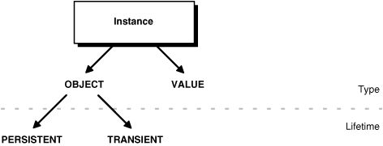

In an object navigational paradigm, data is represented as a graph of objects connected by references.

Objects in the graph are reached by following the references. OCI provides a navigational interface to objects in an Oracle database. Those calls are described in this chapter.

The OCI object environment is initialized when the application calls `OCIEnvCreate()`, `OCIEnvNlsCreate()`, or `OCIInitialize()` (deprecated) in `OCI_OBJECT` mode.

**See Also:**

[OCI Object-Relational Programming](oci-object-relational-programming.md) and [Object Advanced Topics in OCI](object-advanced-topics-in-oci.md) for more information about using the calls in this chapter

### 27.1.1 Object Types and Lifetimes

An object instance is an occurrence of a type defined in an Oracle database.

This section describes how an object instance can be represented in OCI. In OCI, an object instance can be classified based on the type, the lifetime, and referenceability:

- A persistent object is an instance of an object type. A persistent object resides in a row of a table in the server and can exist longer than the duration of a session (connection). Persistent objects can be identified by object references that contain the object identifiers. A persistent object is obtained by pinning its object reference.

- A transient object is an instance of an object type. A transient object cannot exist longer than the duration of a session, and it is used to contain temporary computing results. Transient objects can also be identified by references that contain transient object identifiers.

- A value is an instance of a user-defined type (object type or collection type) or any built-in Oracle type. Unlike objects, values of object types are identified by memory pointers, rather than by references.

A value can be standalone or embedded. A standalone value is usually obtained by issuing a select statement. OCI also allows the client program to select a row of object table into a value by issuing a SQL statement. A referenceable object in the database can be represented as a value that cannot be identified by a reference. A standalone value can also be an out-of-line attribute in an object, such as `VARCHAR` or `RAW`, or an out-of-line element in a collection, such as `VARCHAR`, `RAW`, or object.

An embedded value is physically included in a containing instance. An embedded value can be an inline attribute in an object (such as number or nested object), or an inline element in a collection.

All values are considered to be transient by OCI, which means that OCI does not support automatic flushing of a value to the database, and the client must explicitly execute a SQL statement to store a value into the database. Embedded values are flushed when their containing instances are flushed.

Figure 27-1 shows how instances can be classified according to their type and lifetime. The type can be an object or the value of an object. The lifetime can be persistent (can exist longer than the duration of a session) or transient (can exist no long than the duration of the session).

Figure 27-1 Classification of Instances by Type and Lifetime

[Description of "Figure 27-1 Classification of Instances by Type and Lifetime"](img_text/lnoci032.md)

The distinction between various instances is further described in Table 27-1.

Table 27-1 Type and Lifetime of Instances

| Characteristic   | Persistent Object       | Transient Object | Value                             |
|:-----------------|:------------------------|:-----------------|:----------------------------------|
| Type             | object type             | object type      | object type, built-in, collection |
| Maximum Lifetime | until object is deleted | session          | session                           |
| Referenceable    | yes                     | yes              | no                                |
| Embeddable       | no                      | no               | yes                               |

### 27.1.2 Terminology

Describes the terminology used.

The remainder of this chapter uses the following terms:

- An object is generally used to refer to a persistent object, a transient object, a standalone value of object type, or an embedded value of object type.

- A referenceable object refers to a persistent object or a transient object.

- A standalone object refers to a persistent object, a transient object, or a standalone value of object type.

- An embedded object refers to a embedded value of object type.

- An object is dirty if it has been created (newed), marked as updated, or marked as deleted.

  **See Also:**

  [Persistent Objects, Transient Objects, and Values](oci-object-relational-programming.md) for further discussion of the terms used to refer to different types of objects

### 27.1.3 Conventions for OCI Functions

Describes the conventions for OCI functions.

See the [Conventions for OCI Functions](introduction-to-relational-functions.md) for the conventions used in describing each function. The entries for each function may also contain the following information:

### 27.1.4 Return Values

Describes the return values by the function if the function returns something other then the standard codes.

A description of what value is returned by the function if the function returns something other then the standard codes listed in Table 27-3.

### 27.1.5 Navigational Function Return Values

Describes the navigational function return values.

Table 27-2 lists the values that OCI navigational functions typically return.

Table 27-2 Return Values of Navigational Functions

| Return Value         | Meaning                                                                                                                          |
|:---------------------|:---------------------------------------------------------------------------------------------------------------------------------|
| `OCI_SUCCESS`        | The operation succeeded.                                                                                                         |
| `OCI_ERROR`          | The operation failed. The specific error can be retrieved by calling `OCIErrorGet()` on the error handle passed to the function. |
| `OCI_INVALID_HANDLE` | The OCI handle passed to the function is invalid.                                                                                |

Function-specific return information follows the description of each function in this chapter. Information about specific error codes returned by each function is presented in the following section.

**See Also:**

[Error Handling in OCI](oci-programming-basics.md) for more information about return codes and error handling

### 27.1.6 Server Round-Trips for Cache and Object Functions

Describes the number of server round-trips required for individual OCI cache and object functions.

For a table showing the number of server round-trips required for individual OCI cache and object functions, see [Table C-3](oci-function-server-round-trips.md).

### 27.1.7 Navigational Function Error Codes

Describes the external Oracle error codes that can be returned by each of the OCI navigational functions.

Table 27-3 lists the external Oracle error codes that can be returned by each of the OCI navigational functions. The list following the table identifies what each error represents.

Table 27-3 OCI Navigational Functions Error Codes

| Function                     | Possible ORA Errors                      |
|:-----------------------------|:-----------------------------------------|
| `OCICacheFlush()`            | 24350, 21560, 21705                      |
| `OCICacheFree()`             | 24350, 21560, 21705                      |
| `OCICacheRefresh()`          | 24350, 21560, 21705                      |
| `OCICacheUnmark()`           | 24350, 21560, 21705                      |
| `OCICacheUnpin()`            | 24350, 21560, 21705                      |
| `OCIObjectArrayPin()`        | 24350, 21560                             |
| `OCIObjectCopy()`            | 24350, 21560, 21705, 21710               |
| `OCIObjectExists()`          | 24350, 21560, 21710                      |
| `OCIObjectFlush()`           | 24350, 21560, 21701, 21703, 21708, 21710 |
| `OCIObjectFree()`            | 24350, 21560, 21603, 21710               |
| `OCIObjectGetAttr()`         | 21560, 21600, 22305                      |
| `OCIObjectGetInd()`          | 24350, 21560, 21710                      |
| `OCIObjectGetObjectRef()`    | 24350, 21560, 21710                      |
| `OCIObjectGetTypeRef()`      | 24350, 21560, 21710                      |
| `OCIObjectIsDirty()`         | 24350, 21560, 21710                      |
| `OCIObjectIsLocked()`        | 24350, 21560, 21710                      |
| `OCIObjectLock()`            | 24350, 21560, 21701, 21708, 21710        |
| `OCIObjectLockNoWait()`      | 24350, 21560, 21701, 21708, 21710        |
| `OCIObjectMarkDelete()`      | 24350, 21560, 21700, 21701, 21702, 21710 |
| `OCIObjectMarkDeleteByRef()` | 24350, 21560                             |
| `OCIObjectMarkUpdate()`      | 24350, 21560, 21700, 21701, 21710        |
| `OCIObjectNew()`             | 24350, 21560, 21705, 21710               |
| `OCIObjectPin()`             | 24350, 21560, 21700, 21702               |
| `OCIObjectPinCountReset()`   | 24350, 21560, 21710                      |
| `OCIObjectPinTable()`        | 24350, 21560, 21705                      |
| `OCIObjectRefresh()`         | 24350, 21560, 21709, 21710               |
| `OCIObjectSetAttr()`         | 21560, 21600, 22305, 22279, 21601        |
| `OCIObjectUnmark()`          | 24350, 21560, 21710                      |
| `OCIObjectUnmarkByRef()`     | 24350, 21560                             |
| `OCIObjectUnpin()`           | 24350, 21560, 21710                      |

The ORA errors in Table 27-3 have the following meanings.

- ORA-21560 - name argument should not be `NULL`

- ORA-21600 - path expression too long

- ORA-21601 - attribute is not an instance of user-defined type

- ORA-21603 - cannot free a dirtied persistent object

- ORA-21700 - object does not exist or has been deleted

- ORA-21701 - invalid object

- ORA-21702 - object is not instantiated in the cache

- ORA-21703 - cannot flush an object that is not modified

- ORA-21704 - cannot terminate cache or connection without flushing

- ORA-21705 - service context is invalid

- ORA-21708 - operations cannot be performed on a transient object

- ORA-21709 - operations can only be performed on a current object

- ORA-21710 - invalid pointer or value passed to the function

- ORA-22279 - cannot perform operation with LOB buffering enabled

- ORA-22305 - name argument is invalid

- ORA-24350 - this OCI call is not allowed from external subroutines
