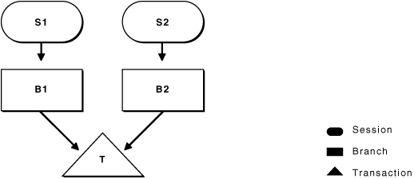
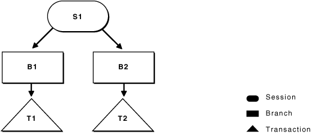

This chapter describes how OCI manages transaction operations.

This chapter contains these topics:

- OCI Support for Transactions

- Levels of Transactional Complexity

- Password and Session Management

- Middle-Tier Applications in OCI

- Externally Initialized Context in OCI

- Client Application Context

- Using Edition-Based Redefinition

- OCI Security Enhancements

- Overview of OCI Multithreaded Development

- OCIThread Package

### 10.1 OCI Support for Transactions

OCI has a set of API calls to support operations on both local and global transactions.

These calls include object support, so that if an OCI application is running in object mode, the commit and rollback calls synchronize the object cache with the state of the transaction.

The functions listed later perform transaction operations. Each call takes a service context handle that must be initialized with the proper server context and user session handle. The transaction handle is the third element of the service context; it stores specific information related to a transaction. When a SQL statement is prepared, it is associated with a particular service context. When the statement is executed, its effects (query, fetch, insert) become part of the transaction that is currently associated with the service context.

- `OCITransStart()` marks the start of a transaction.

- `OCITransDetach()` detaches a transaction.

- `OCITransCommit()` commits a transaction.

- `OCITransRollback()` rolls back a transaction.

- `OCITransPrepare()` prepares a transaction to be committed in a distributed processing environment.

- `OCITransMultiPrepare()` prepares a transaction with multiple branches in a single call.

- `OCITransForget()` causes the server to forget a heuristically completed global transaction.

Depending on the level of transactional complexity in your application, you may need all or only a few of these calls. The following section discusses this in more detail.

**See Also:**

- [Transaction Functions](transaction-functions.md)

- [OCITransStart()](transaction-functions.md)

- [OCITransDetach()](transaction-functions.md)

- [OCITransCommit()](transaction-functions.md)

- [OCITransRollback()](transaction-functions.md)

- [OCITransPrepare()](transaction-functions.md)

- [OCITransMultiPrepare()](transaction-functions.md)

- [OCITransForget()](transaction-functions.md)

### 10.2 Levels of Transactional Complexity

OCI supports several levels of transaction complexity.

These levels of transaction complexity include:

- Simple Local Transactions

- Serializable or Read-Only Local Transactions

- Global Transactions

This section includes the following additional topics:

- Transaction Examples

- Initialization Parameters

#### 10.2.1 Simple Local Transactions

Many applications work with only simple local transactions.

In these applications, an implicit transaction is created when the application makes database changes. The only transaction-specific calls needed by such applications are:

- `OCITransCommit()` to commit the transaction

- `OCITransRollback()` to roll back the transaction

As soon as one transaction has been committed or rolled back, the next modification to the database creates a new implicit transaction for the application.

Only one implicit transaction can be active at any time on a service context. Attributes of the implicit transaction are opaque to the user.

If an application creates multiple sessions, each one can have an implicit transaction associated with it.

**See Also:**

- [OCITransCommit()](transaction-functions.md) for sample code showing the use of simple local transactions

- [OCITransRollback()](transaction-functions.md)

#### 10.2.2 Serializable or Read-Only Local Transactions

Applications requiring serializable or read-only transactions require an additional OCI `OCITransStart()` call to start the transaction.

The `OCITransStart()` call must specify `OCI_TRANS_SERIALIZABLE` or `OCI_TRANS_READONLY`, as appropriate, for the `flags` parameter. If no flag is specified, the default value is `OCI_TRANS_READWRITE` for a standard read/write transaction.

Specifying the read-only option in the `OCITransStart()` call saves the application from performing a server round-trip to execute a `SET TRANSACTION READ ONLY` statement.

**See Also:**

[OCITransStart()](transaction-functions.md)

#### 10.2.3 Global Transactions

Global transactions are necessary only in more sophisticated transaction-processing applications.

This section includes the following topics:

- Transaction Identifiers

- Attribute OCI_ATTR_TRANS_NAME

- Transaction Branches

- Branch States

- Detaching and Resuming Branches

- About Setting the Client Database Name

- One-Phase Commit Versus Two-Phase Commit

- Preparing Multiple Branches in a Single Message

##### 10.2.3.1 Transaction Identifiers

Three-tier applications such as transaction processing (TP) monitors create and manage global transactions.

They supply a global transaction identifier (`XID`) that a server associates with a local transaction.

A global transaction has one or more branches. Each branch is identified by an `XID`. The `XID` consists of a global transaction identifier (`gtrid`) and a branch qualifier (`bqual`). This structure is based on the standard XA specification.

Table 10-1 provides the structure for one possible `XID` of 1234.

Table 10-1 Global Transaction Identifier

| Component         | Value  |
|:------------------|:-------|
| `gtrid`           | `12`   |
| `bqual`           | `34`   |
| `gtrid+bqual=XID` | `1234` |

The transaction identifier used by OCI transaction calls is set in the `OCI_ATTR_XID` attribute of the transaction handle, by using `OCIAttrSet()`. Alternately, the transaction can be identified by a name set in the `OCI_ATTR_TRANS_NAME` attribute.

**See Also:**

[OCIAttrSet()](handle-and-descriptor-functions.md)

##### 10.2.3.2 Attribute OCI_ATTR_TRANS_NAME

When this attribute is set in a transaction handle, the length of the name can be at most 64 bytes.

The `formatid` of the `XID` is 0 and the branch qualifier is 0.

When this attribute is retrieved from a transaction handle, the returned transaction name is the global transaction identifier. The size is the length of the global transaction identifier.

##### 10.2.3.3 Transaction Branches

Within a single global transaction, Oracle Database supports both tightly coupled and loosely coupled relationships between a pair of branches.

- Tightly coupled branches share the same local transaction. The `gtrid` references a unique local transaction, and multiple branches point to that same transaction. The owner of the transaction is the branch that was created first.

- Loosely coupled branches use different local transactions. The `gtrid` and `bqual` together map to a unique local transaction. Each branch points to a different transaction.

The `flags` parameter of `OCITransStart()` allows applications to pass `OCI_TRANS_TIGHT` or `OCI_TRANS_LOOSE` values to specify the type of coupling.

A session corresponds to a user session, created with `OCISessionBegin()`.

Figure 10-1 illustrates tightly coupled branches within an application. The `XID`s of the two branches (B1 and B2) share the same `gtrid`, because they are operating on the same transaction (T), but they have a different `bqual`, because they are on separate branches.

Figure 10-1 Multiple Tightly Coupled Branches

[Description of "Figure 10-1 Multiple Tightly Coupled Branches"](img_text/lnoci023.md)

Figure 10-2 illustrates how a single session operates on different branches. The `gtrid` components of the `XID`s are different, because they represent separate global transactions.

Figure 10-2 Session Operating on Multiple Branches

[Description of "Figure 10-2 Session Operating on Multiple Branches"](img_text/lnoci024.md)

It is possible for a single session to operate on multiple branches that share the same transaction, but this scenario does not have much practical value.

**See Also:**

- [OCITransStart()](transaction-functions.md) for sample code demonstrating this scenario

- [OCISessionBegin()](connect-authorize-and-initialize-functions.md)

##### 10.2.3.4 Branch States

Transaction branches are classified into two states: active branches and inactive branches.

A branch is active if a server process is executing requests on the branch. A branch is inactive if no server processes are executing requests in the branch. In this case, no session is the parent of the branch, and the branch becomes owned by the `PMON` process in the server.

##### 10.2.3.5 Detaching and Resuming Branches

A branch becomes inactive when an OCI application detaches it, using the `OCITransDetach()` call.

The branch can be made active again by resuming it with a call to `OCITransStart()` with the `flags` parameter set to `OCI_TRANS_RESUME`.

When an application detaches a branch with `OCITransDetach()`, it uses the value specified in the `timeout` parameter of the `OCITransStart()` call that created the branch. The `timeout` specifies the number of seconds the transaction can remain dormant as a child of `PMON` before being deleted.

To resume a branch, the application calls `OCITransStart()`, specifying the `XID` of the branch as an attribute of the transaction handle, `OCI_TRANS_RESUME` for the `flags` parameter, and a different `timeout` parameter. This timeout value for this call specifies the length of time that the session waits for the branch to become available if it is currently in use by another process. If no other processes are accessing the branch, it can be resumed immediately. A transaction can be resumed by a different process than the one that detached it, if that process has the same authorization as the one that detached the transaction.

**See Also:**

- [OCITransDetach()](transaction-functions.md)

- [OCITransStart()](transaction-functions.md)

##### 10.2.3.6 About Setting the Client Database Name

The server handle has `OCI_ATTR_EXTERNAL_NAME` and `OCI_ATTR_INTERNAL_NAME` attributes.

These attributes set the client database name recorded when performing global transactions. The name can be used by the database administrator to track transactions that may be pending in a prepared state because of failures.

**Note:**

An OCI application sets these attributes, by using `OCIAttrSet()` before logging on and using global transactions.

**See Also:**

[OCIAttrSet()](handle-and-descriptor-functions.md)

##### 10.2.3.7 One-Phase Commit Versus Two-Phase Commit

Global transactions can be committed in one or two phases.

The simplest situation is when a single transaction is operating against a single database. In this case, the application can perform a one-phase commit of the transaction by calling `OCITransCommit()`, because the default value of the call is for one-phase commit.

The situation is more complicated if the application is processing transactions against multiple Oracle databases. In this case, a two-phase commit is necessary. A two-phase commit operation consists of these steps:

1.  Prepare - The application issues an `OCITransPrepare()` call against each transaction. Each transaction returns a value indicating whether or not it can commit its current work (`OCI_SUCCESS`) or not (`OCI_ERROR`).

2.  Commit - If each `OCITransPrepare()` call returns a value of `OCI_SUCCESS`, the application can issue an `OCITransCommit()` call to each transaction. The `flags` parameter of the commit call must be explicitly set to `OCI_TRANS_TWOPHASE` for the appropriate behavior, because the default for this call is for one-phase commit.

    **Note:**

    The `OCITransPrepare()` call can also return `OCI_SUCCESS_WITH_INFO` if a transaction must indicate that it is read-only. Thus a commit is neither appropriate nor necessary.

An additional call, `OCITransForget()`, causes a database to "forget" a completed transaction. This call is for situations in which a problem has occurred that requires that a two-phase commit be terminated. When an Oracle database receives an `OCITransForget()` call, it removes all information about the transaction.

**See Also:**

- [OCITransCommit()](transaction-functions.md)

- [OCITransPrepare()](transaction-functions.md)

- [OCITransForget()](transaction-functions.md)

##### 10.2.3.8 Preparing Multiple Branches in a Single Message

Sometimes when multiple applications use different branches of a global transaction against the same Oracle database.

Before such a transaction can be committed, all branches must be prepared.

Most often, the applications using the branches are responsible for preparing their own branches. However, some architectures turn this responsibility over to an external transaction service. This external transaction service must then prepare each branch of the global transaction. The traditional `OCITransPrepare()` call is inefficient for this task as each branch must be individually prepared. The `OCITransMultiPrepare()` call, prepares multiple branches involved in the same global transaction in one round-trip. This call is more efficient and can greatly reduce the number of messages sent from the client to the server.

**See Also:**

- [OCITransPrepare()](transaction-functions.md)

- [OCITransMultiPrepare()](transaction-functions.md)

#### 10.2.4 Transaction Examples

Shows how to use the transaction OCI calls.

Table 10-1 through Table 10-5 illustrate how to use the transaction OCI calls.

They show a series of OCI calls and other actions, along with their resulting behavior. For simplicity, not all parameters to these calls are listed; rather, it is the flow of calls that is being demonstrated.

The OCI Action column indicates what the OCI application is doing, or what call it is making. The `XID` column lists the transaction identifier, when necessary. The Flags column lists the values passed in the `flags` parameter. The Result column describes the result of the call.

#### 10.2.5 Initialization Parameters

Two initialization parameters relate to the use of global transaction branches and migratable open connections.

- `TRANSACTIONS` - This parameter specifies the maximum number of global transaction branches in the entire system. In contrast, the maximum number of branches on a single global transaction is 8.

- `OPEN_LINKS_PER_INSTANCE` - This parameter specifies the maximum number of migratable open connections. Migratable open connections are used by global transactions to cache connections after committing a transaction. Contrast this with the `OPEN_LINKS` parameter, which controls the number of connections from a session and is not applicable to applications that use global transactions.

This section includes the following topics:

- Showing Update Successfully, One-Phase Commit

- Showing Starting a Transaction, Detach, Resume, Prepare, Two-Phase Commit

- Showing a Read-Only Update Fails

- Showing Starting a Read-Only Transaction, Select, and Commit

##### 10.2.5.1 Showing Update Successfully, One-Phase Commit

Lists the steps for a one-phase commit operation.

Table 10-2 lists the steps for a one-phase commit operation.

Table 10-2 One-Phase Commit

| Step | OCI Action         | XID  | Flags           | Result                            |
|:-----|:-------------------|:-----|:----------------|:----------------------------------|
| 1    | `OCITransStart()`  | 1234 | `OCI_TRANS_NEW` | Starts new read/write transaction |
| 2    | `SQL UPDATE`       | \-   | \-              | Update rows                       |
| 3    | `OCITransCommit()` | \-   | \-              | Commit succeeds.                  |

**See Also:**

- [OCITransStart()](transaction-functions.md)

- [OCITransCommit()](transaction-functions.md)

##### 10.2.5.2 Showing Starting a Transaction, Detach, Resume, Prepare, Two-Phase Commit

Lists the steps for a two-phase commit operation.

Table 10-3 lists the steps for a two-phase commit operation.

Table 10-3 Two-Phase Commit

| Step | OCI Action          | XID  | Flags                | Result                                        |
|:-----|:--------------------|:-----|:---------------------|:----------------------------------------------|
| 1    | `OCITransStart()`   | 1234 | `OCI_TRANS_NEW`      | Starts new read-only transaction              |
| 2    | `SQL UPDATE`        | \-   | \-                   | Updates rows                                  |
| 3    | `OCITransDetach()`  | \-   | \-                   | Transaction is detached.                      |
| 4    | `OCITransStart()`   | 1234 | `OCI_TRANS_RESUME`   | Transaction is resumed.                       |
| 5    | `SQL UPDATE`        | \-   | \-                   | \-                                            |
| 6    | `OCITransPrepare()` | \-   | \-                   | Transaction is prepared for two-phase commit. |
| 7    | `OCITransCommit()`  | \-   | `OCI_TRANS_TWOPHASE` | Transaction is committed.                     |

In Step 4, the transaction can be resumed by a different process, as long as it had the same authorization.

**See Also:**

- [OCITransStart()](transaction-functions.md)

- [OCITransDetach()](transaction-functions.md)

- [OCITransPrepare()](transaction-functions.md)

- [OCITransCommit()](transaction-functions.md)

##### 10.2.5.3 Showing a Read-Only Update Fails

Lsts the steps in a failed read-only update operation.

Table 10-4 lists the steps in a failed read-only update operation.

Table 10-4 Read-Only Update Fails

| Step | OCI Action         | XID  | Flags                                      | Result                                              |
|:-----|:-------------------|:-----|:-------------------------------------------|:----------------------------------------------------|
| 1    | `OCITransStart()`  | 1234 | `OCI_TRANS_NEW` \| `OCI_TRANS_READONLY` | Starts new read-only transaction.                   |
| 2    | `SQL UPDATE`       | \-   | \-                                         | Update fails, because the transaction is read-only. |
| 3    | `OCITransCommit()` | \-   | \-                                         | Commit has no effect.                               |

**See Also:**

- [OCITransStart()](transaction-functions.md)

- [OCITransCommit()](transaction-functions.md)

##### 10.2.5.4 Showing Starting a Read-Only Transaction, Select, and Commit

Lists the steps for a read-only transaction.

Table 10-5 lists the steps for a read-only transaction.

Table 10-5 Read-Only Transaction

| Step | OCI Action         | XID  | Flags                                      | Result                                                |
|:-----|:-------------------|:-----|:-------------------------------------------|:------------------------------------------------------|
| 1    | `OCITransStart()`  | 1234 | `OCI_TRANS_NEW` \| `OCI_TRANS_READONLY` | Starts new read-only transaction                      |
| 2    | `SQL SELECT`       | \-   | \-                                         | Queries the database                                  |
| 3    | `OCITransCommit()` | \-   | \-                                         | No effect — transaction is read-only, no changes made |

**See Also:**

- [OCITransStart()](transaction-functions.md)

- [OCITransCommit()](transaction-functions.md)

### 10.3 Password and Session Management

OCI can authenticate and maintain multiple users.

This section includes the following topics:

- OCI Authentication Management

- OCI Password Management

- Secure External Password Store

- OCI Session Management

#### 10.3.1 OCI Authentication Management

The `OCISessionBegin()` call authenticates a user against the server set in the service context handle.

It must be the first call for any given server handle. `OCISessionBegin()` authenticates the user for access to the Oracle database specified by the server handle and the service context of the call: after `OCIServerAttach()` initializes a server handle, `OCISessionBegin()` must be called to authenticate the user for that server.

When `OCISessionBegin()` is called for the first time on a server handle, the user session may not be created in migratable mode (`OCI_MIGRATE`). After `OCISessionBegin()` has been called for a server handle, the application can call `OCISessionBegin()` again to initialize another user session handle with different or the same credentials and different or the same operation modes. For an application to authenticate a user in `OCI_MIGRATE` mode, the service handle must already be associated with a nonmigratable user handle. The `userid` of that user handle becomes the ownership ID of the migratable user session. Every migratable session must have a nonmigratable parent session.

- If `OCI_MIGRATE` mode is not specified, then the user session context can be used only with the server handle specified with the `OCISessionBegin()`.

- If `OCI_MIGRATE` mode is specified, then the user authentication can be set with other server handles. However, the user session context can only be used with server handles that resolve to the same database instance. Security checking is performed during session switching.

A migratable session can switch to a different server handle only if the ownership ID of the session matches the `userid` of a nonmigratable session currently connected to that same server.

`OCI_SYSDBA`, `OCI_SYSOPER`, `OCI_SYSBKP`, `OCI_SYSDGD`, `OCI_SYSKMT`, `OCI_SYSRAC`, `OCI_SYSASM`, and `OCI_PRELIM_AUTH` settings can only be used with a primary user session context. For `OCI_SYSASM`, the SYSASM connection works only to ASM instances (not database instances).

A migratable session can be switched, or migrated, to a server handle within an environment represented by an environment handle. It can also migrate or be cloned to a server handle in another environment in the same process, or in a different process in a different mode. To perform this migration or cloning, you must do the following:

1.  Extract the session ID from the session handle using `OCI_ATTR_MIGSESSION`. This is an array of bytes that must not be modified by the caller.

2.  Transport this session ID to another process.

3.  In the new environment, create a session handle and set the session ID using `OCI_ATTR_MIGSESSION`.

4.  Execute `OCISessionBegin()`. The resulting session handle is fully authenticated.

To provide credentials for a call to `OCISessionBegin()`, you must provide a valid user name and password pair for database authentication in the user session handle parameter. This involves using `OCIAttrSet()` to set the `OCI_ATTR_USERNAME` and `OCI_ATTR_PASSWORD` attributes on the user session handle. Then `OCISessionBegin()` is called with `OCI_CRED_RDBMS`.

When the user session handle is terminated using `OCISessionEnd()`, the user name and password attributes are changed and thus cannot be reused in a future call to `OCISessionBegin()`. They must be reset to new values before the next `OCISessionBegin()` call.

Or, you can supply external credentials. No attributes need to be set on the user session handle before calling `OCISessionBegin()`. The credential type is `OCI_CRED_EXT`. If values have been set for `OCI_ATTR_USERNAME` and `OCI_ATTR_PASSWORD`, these are ignored if `OCI_CRED_EXT` is used.

**See Also:**

- [User Session Handle Attributes](handle-and-descriptor-attributes.md) for more information about `OCI_ATTR_MIGSESSION`

- [OCISessionBegin()](connect-authorize-and-initialize-functions.md)

- [OCIServerAttach()](connect-authorize-and-initialize-functions.md)

- [OCIAttrSet()](handle-and-descriptor-functions.md)

- [OCISessionEnd()](connect-authorize-and-initialize-functions.md)

#### 10.3.2 OCI Password Management

The `OCIPasswordChange()` call enables an application to modify a user's database password as necessary.

This is particularly useful if a call to `OCISessionBegin()` returns an error message or warning indicating that a user's password has expired.

Applications can also use `OCIPasswordChange()` to establish a user authentication context and to change the password. If `OCIPasswordChange()` is called with an uninitialized service context, it establishes a service context and authenticates the user's account using the old password, and then changes the password to the new password. If the `OCI_AUTH` flag is set, the call leaves the user session initialized. Otherwise, the user session is cleared.

If the service context passed to `OCIPasswordChange()` is already initialized, then `OCIPasswordChange()` authenticates the given account using the old password and changes the password to the new password. In this case, no matter how the flag is set, the user session remains initialized.

**See Also:**

- [OCIPasswordChange()](miscellaneous-functions.md)

- [OCISessionBegin()](connect-authorize-and-initialize-functions.md)

##### 10.3.2.1 Gradual Database Password Rollover

Starting with Oracle Database release 19.12, an application can change their database password without scheduling downtime.

Oracle Database release 19.12 introduces gradual database password rollover parameter for the database client applications when the database users change their passwords. With gradual database password rollover parameter, Oracle database allows the old password to be used while the new password is being gradually rolled out to all database clients. To accomplish this, a user account with a profile containing a non-zero value for profile limit `PASSWORD_ROLLOVER_TIME` changes the account status to `OPEN & IN ROLLOVER` when the password of the account is changed.

When the parameter, `PASSWORD_ROLLOVER_TIME` is configured in the password profile, use the `OCIPasswordChange()` function as usual to change the password and enter the password rollover period, during this period, the old password is still usable. To change a password during the rollover process, you can use `OCIPasswordChange()` function. The `OCIPasswordChange()` function accepts both the old password and the rollover password during the password rollover period. The `PASSWORD_ROLLOVER_TIME` parameter takes effect the moment you successfully change the password.

For example, consider `p1` as the old password and `p2` as the new password. The database user can logon using either the old password (p1) or the new password (p2) until the expiration of `PASSWORD_ROLLOVER_TIME` or until the administrator manually ends the password rollover using the following command:

`ALTER USER <username> EXPIRE PASSWORD ROLLOVER PERIOD. `

If the customer changes the password from password (p2) to password (p3) before the `PASSWORD_ROLLOVER_TIME` has expired, then the database user account logons accepts only the old password (p1) and the password (p3) (intrim passwords are not accepted) . The password (p2) is no longer accepted as it is considered to be a typo or has been created by mistake).

#### 10.3.3 Secure External Password Store

For large-scale deployments where applications use password credentials to connect to databases, it is possible to store such credentials in a client-side Oracle wallet.

An Oracle wallet is a secure software container that is used to store authentication and signing credentials.

Storing database password credentials in a client-side Oracle wallet eliminates the need to embed user names and passwords in application code, batch jobs, or scripts. This reduces the risk of exposing passwords in the clear in scripts and application code, and simplifies maintenance because you need not change your code each time user names and passwords change. In addition, not having to change application code makes it easier to enforce password management policies for these user accounts.

When you configure a client to use the external password store, applications can use the following syntax to connect to databases that use password authentication:

    CONNECT /@database_alias

Note that you need not specify database login credentials in this `CONNECT` statement. Instead your system looks for database login credentials in the client wallet.

**See Also:**

[Oracle Database Administrator’s Guide](../admin/creating-and-configuring-an-oracle-database.md) for information about configuring your client to use the secure external password store

#### 10.3.4 OCI Session Management

Transaction servers that actively balance user load by multiplexing user sessions over a few server connections must group these connections into a server group.

Oracle Database uses server groups to identify these connections so that sessions can be managed effectively and securely.

The attribute `OCI_ATTR_SERVER_GROUP` must be defined to specify the server group name by using the `OCIAttrSet()` call, as shown in Example 10-1.

The server group name is an alphanumeric string not exceeding 30 characters. This attribute can only be set after calling `OCIServerAttach()`. `OCI_ATTR_SERVER_GROUP` attribute must be set in the server context before creating the first nonmigratable session that uses that context. After the session is created successfully and the connection to the server is established, the server group name cannot be changed.

All migratable sessions created on servers within a server group can only migrate to other servers in the same server group. Servers that terminate are removed from the server group. New servers can be created within an existing server group at any time.

The use of server groups is optional. If no server group is specified, the server is created in a server group called `DEFAULT`.

The owner of the first nonmigratable session created in a nondefault server group becomes the owner of the server group. All subsequent nonmigratable sessions for any server in this server group must be created by the owner of the server group.

The server group feature is useful when dedicated servers are used. It has no effect on shared servers. All shared servers effectively belong to the server group `DEFAULT`.

Example 10-1 Defining the OCI_ATTR_SERVER_GROUP Attribute to Pass the Server Group Name

    OCIAttrSet ((void *) srvhp, (ub4) OCI_HTYPE_SERVER, (void *) group_name,
                (ub4) strlen ((CONST char *) group_name),
                (ub4) OCI_ATTR_SERVER_GROUP, errhp);

**See Also:**

- [Server Handle Attributes](handle-and-descriptor-attributes.md) for more information about `OCI_ATTR_SERVER_GROUP` attribute

- [OCIAttrSet()](handle-and-descriptor-functions.md)

- [OCIServerAttach()](connect-authorize-and-initialize-functions.md)

### 10.4 Middle-Tier Applications in OCI

A middle-tier application receives requests from browser clients.

The application determines database access and whether to generate an HTML page. Applications can have multiple lightweight user sessions within a single database session. These lightweight sessions allow each user to be authenticated without the overhead of a separate database connection, and they preserve the identity of the real user through the middle tier.

As long as the client authenticates itself with the middle tier, and the middle tier authenticates itself with the database, and the middle tier is authorized to act on behalf of the client by the administrator, client identities can be maintained all the way into the database without compromising the security of the client.

The design of a secure three-tier architecture is developed around a set of three trust zones.

The first is the client trust zone. Clients connecting to a web application server are authenticated by the middle tier using any means: password, cryptographic token, or another. This method can be entirely different from the method used to establish the other trust zones.

The second trust zone is the application server. The data server verifies the identity of the application server and trusts it to pass the correct identity of the client.

The third trust zone is the data server interaction with the authorization server to obtain the roles assigned to the client and the application server.

The application server creates a primary session for itself after it connects to a server. It authenticates itself in the normal manner to the database, creating the application server trust zone. The application server identity is now well known and trusted by the data server.

When the application verifies the identity of a client connecting to the application server, it creates the first trust zone. The application server now needs a session handle for the client so that it can service client requests. The middle-tier process allocates a session handle and then sets the following attributes of the client using `OCIAttrSet()`:

- `OCI_ATTR_USERNAME` sets the database user name of the client.

- `OCI_ATTR_PROXY_CREDENTIALS` indicates the authenticated application making the proxy request.

To specify a list of roles activated after the application server connects as the client, it can call `OCIAttrSet()` with the attribute `OCI_ATTR_INITIAL_CLIENT_ROLES` and an array of strings that contains the list of roles before the `OCISessionBegin()` call. Then the role is established and proxy capability is verified in one round-trip. If the application server is not allowed to act on behalf of the client, or if the application server is not allowed to activate the specified roles, the `OCISessionBegin()` call fails.

This section includes the following topic: OCI Attributes for Middle-Tier Applications.

**See Also:**

- [OCIAttrSet()](handle-and-descriptor-functions.md)

- [OCISessionBegin()](connect-authorize-and-initialize-functions.md)

#### 10.4.1 OCI Attributes for Middle-Tier Applications

The following attributes enable you to specify the external name and initial privileges of a client.

These credentials are used by applications as alternative means of identifying or authenticating the client.

These attributes include:

- OCI_CRED_PROXY

- OCI_ATTR_PROXY_CREDENTIALS

- OCI_ATTR_DISTINGUISHED_NAME

- OCI_ATTR_CERTIFICATE

- OCI_ATTR_INITIAL_CLIENT_ROLES

- OCI_ATTR_CLIENT_IDENTIFIER

- OCI_ATTR_PASSWORD

##### 10.4.1.1 OCI_CRED_PROXY

Use `OCI_CRED_PROXY` as the value passed in the `credt` parameter of `OCISessionBegin()`.

When an application server starts a session on behalf of a client, use `OCI_CRED_PROXY` as the value passed in the `credt` parameter of `OCISessionBegin()` rather than `OCI_CRED_RDBMS` (database user name and password required) or `OCI_CRED_EXT` (externally provided credentials).

**See Also:**

[OCISessionBegin()](connect-authorize-and-initialize-functions.md)

##### 10.4.1.2 OCI_ATTR_PROXY_CREDENTIALS

Use the `OCI_ATTR_PROXY_CREDENTIALS` attribute to specify the credentials of the application server in client authentication.

You can code the following declarations and `OCIAttrSet()` call, as shown in Example 10-2.

Example 10-2 Defining the OCI_ATTR_PROXY_CREDENTIALS Attribute to Specify the Credentials of the Application Server for Client Authentication

    OCISession *session_handle;
    OCISvcCtx  *application_server_session_handle;
    OCIError   *error_handle;
    ...
    OCIAttrSet((void *)session_handle, (ub4) OCI_HTYPE_SESSION,
               (void *)application_server_session_handle, (ub4) 0,
                OCI_ATTR_PROXY_CREDENTIALS, error_handle);

**See Also:**

[OCIAttrSet()](handle-and-descriptor-functions.md)

##### 10.4.1.3 OCI_ATTR_DISTINGUISHED_NAME

Use `OCI_ATTR_DISTINGUISHED_NAME` to pass the distinguished name of the client.

Your applications can use the distinguished name contained within a X.509 certificate as the login name of the client, instead of the database user name.

To pass the distinguished name of the client, the middle-tier server calls `OCIAttrSet()`, passing `OCI_ATTR_DISTINGUISHED_NAME`, as shown in Example 10-3.

Example 10-3 Defining the OCI_ATTR_DISTINGUISHED_NAME Attribute to Pass the Distinguished Name of the Client

    /* Declarations */
    ...
    OCIAttrSet((void *)session_handle, (ub4) OCI_HTYPE_SESSION,
               (void *)distinguished_name, (ub4) 0,
               OCI_ATTR_DISTINGUISHED_NAME, error_handle);

**See Also:**

[OCIAttrSet()](handle-and-descriptor-functions.md)

##### 10.4.1.4 OCI_ATTR_CERTIFICATE

Certificate-based proxy authentication using `OCI_ATTR_CERTIFICATE` will not be supported in future Oracle Database releases.

Use `OCI_ATTR_DISTINGUISHED_NAME` or `OCI_ATTR_USERNAME` attribute instead. This method of authentication is similar to the use of the distinguished name. The entire X.509 certificate is passed by the middle-tier server to the database.

To pass over the entire certificate, the middle tier calls `OCIAttrSet()`, passing `OCI_ATTR_CERTIFICATE`, as shown in Example 10-4.

Example 10-4 Defining the OCI_ATTR_CERTIFICATE Attribute to Pass the Entire X.509 Certificate

    OCIAttrSet((void *)session_handle, (ub4) OCI_HTYPE_SESSION,
               (void *)certificate, ub4 certificate_length,
               OCI_ATTR_CERTIFICATE, error_handle);

**See Also:**

[OCIAttrSet()](handle-and-descriptor-functions.md)

##### 10.4.1.5 OCI_ATTR_INITIAL_CLIENT_ROLES

Use the `OCI_ATTR_INITIAL_CLIENT_ROLES` attribute to specify the roles the client is to possess when the application server connects to the Oracle database.

To enable a set of roles, the function `OCIAttrSet()` is called with the attribute, an array of `NULL`-terminated strings, and the number of strings in the array, as shown in Example 10-5.

Example 10-5 Defining the OCI_ATTR_INITIAL_CLIENT_ROLES Attribute to Pass the Client Roles

    OCIAttrSet((void *)session_handle, (ub4) OCI_HTYPE_SESSION,
               (void *)role_array, (ub4) number_of_strings,
               OCI_ATTR_INITIAL_CLIENT_ROLES, error_handle);

**See Also:**

[OCIAttrSet()](handle-and-descriptor-functions.md)

##### 10.4.1.6 OCI_ATTR_CLIENT_IDENTIFIER

Use `OCI_ATTR_CLIENT_IDENTIFIER` on the middle tier to track end-user identity.

Many middle-tier applications connect to the database as an application, and rely on the middle tier to track end-user identity. To integrate tracking of the identity of these users in various database components, the database client can set the `CLIENT_IDENTIFIER` (a predefined attribute from the application context namespace `USERENV`) in the session handle at any time. Use the OCI attribute `OCI_ATTR_CLIENT_IDENTIFIER` in the call to `OCIAttrSet()`, as shown in Example 10-6. On the next request to the server, the information is propagated and stored in the server session.

The `CLIENT_IDENTIFIER`, which can also be set using the `DBMS_SESSION.SET_IDENTIFIER` procedure, is automatically truncated if the supplied input is more than 64 bytes because the maximum size for the client id is 64 bytes.

`OCI_ATTR_CLIENT_IDENTIFIER` can also be used in conjunction with the global application context to restrict availability of the context to the selected identity of these users.

When a client has multiple sessions, execute `OCIAttrSet()` for each session using the same client identifier. `OCIAttrSet()` must be executed manually for sessions that are reestablished through transparent application failover (TAF).

The client identifier is found in `V$SESSION` as a `CLIENT_IDENTIFIER` column or through the system context with this SQL statement:

    SELECT SYS_CONTEXT('userenv', 'client_identifier') FROM DUAL;

Example 10-6 Defining the OCI_ATTR_CLIENT_IDENTIFIER Attribute to Pass the End-User Identity

    OCIAttrSet((void *)session_handle, (ub4) OCI_HTYPE_SESSION,
               (void *)"janedoe", (ub4)strlen("janedoe"),
               OCI_ATTR_CLIENT_IDENTIFIER, error_handle);

**See Also:**

- [Oracle Database Security Guide](../dbseg/configuring-authentication.md) the section about preserving user identity in multi-tiered environments"

- [Transparent Application Failover in OCI](high-availability-in-oci.md)

- [OCIAttrSet()](handle-and-descriptor-functions.md)

##### 10.4.1.7 OCI_ATTR_PASSWORD

To use the password of the client for validation on the middle-tier, the application server can use the existing attribute `OCI_ATTR_PASSWORD` with the client’s authentication data.

A middle tier can ask the database server to authenticate a client on its behalf by validating the password of the client rather than doing the authentication itself. Although it appears that this is the same as a client/server connection, the client does not have to have Oracle Database software installed on the client's system to be able to perform database operations. To use the password of the client, the application server supplies `OCIAttrSet()` with the authentication data, using the existing attribute `OCI_ATTR_PASSWORD`, as shown in Example 10-7.

Example 10-8 shows OCI attributes that enable you to specify the external name and initial privileges of a client. These credentials are used by OCI applications as alternative means of identifying or authenticating the client.

Example 10-7 Defining the OCI_ATTR_PASSWORD Attribute to Pass the Password for Validation

    OCIAttrSet((void *)session_handle, (ub4) OCI_HTYPE_SESSION, (void *)password,
               (ub4)0, OCI_ATTR_PASSWORD, error_handle);

Example 10-8 OCI Attributes That Let You Specify the External Name and Initial Privileges of a Client

    ...
    *OCIEnv *environment_handle;
    OCIServer *data_server_handle;
    OCIError *error_handle;
    OCISvcCtx *application_server_service_handle;
    OraText *client_roles[2];
    OCISession *first_client_session_handle, second_client_session_handle;
    ...
    /*
    ** General initialization and allocation of contexts.
    */

    (void) OCIInitialize((ub4) OCI_DEFAULT, (void *)0,
                         (void * (*)(void *, size_t)) 0,
                         (void * (*)(void *, void *, size_t))0,
                         (void (*)(void *, void *)) 0 );
    (void) OCIEnvInit( (OCIEnv **) &environment_handle, OCI_DEFAULT, (size_t) 0,
                      (void **) 0 );
    (void) OCIHandleAlloc( (void *) environment_handle, (void **) &error_handle,
         OCI_HTYPE_ERROR, (size_t) 0, (void **) 0);
    /*
    ** Allocate and initialize the server and service contexts used by the
    ** application server.
    */

    (void) OCIHandleAlloc( (void *) environment_handle,
         (void **)&data_server_handle, OCI_HTYPE_SERVER, (size_t) 0, (void **) 0);
    (void) OCIHandleAlloc( (void *) environment_handle, (void **)
         &application_server_service_handle, OCI_HTYPE_SVCCTX, (size_t) 0,
         (void **) 0);
    (void) OCIAttrSet((void *) application_server_service_handle,
         OCI_HTYPE_SVCCTX, (void *) data_server_handle, (ub4) 0, OCI_ATTR_SERVER,
         error_handle);
    /*
    ** Authenticate the application server. In this case, external authentication is
    ** being used.
    */

    (void) OCIHandleAlloc((void *) environment_handle,
         (void **)&application_server_session_handle, (ub4) OCI_HTYPE_SESSION,
         (size_t) 0, (void **) 0);
    checkerr(error_handle, OCISessionBegin(application_server_service_handle,
         error_handle, application_server_session_handle, OCI_CRED_EXT,
         OCI_DEFAULT));
    /*
    ** Authenticate the first client.
    ** Note that no password is specified by the
    ** application server for the client as it is trusted.
    */

    (void) OCIHandleAlloc((void *) environment_handle,
         (void **)&first_client_session_handle, (ub4) OCI_HTYPE_SESSION,
         (size_t) 0,(void **) 0);
    (void) OCIAttrSet((void *) first_client_session_handle,
         (ub4) OCI_HTYPE_SESSION, (void *) "jeff", (ub4) strlen("jeff"),
         OCI_ATTR_USERNAME, error_handle);
    /*
    ** In place of specifying a password, pass the session handle of the application
    ** server instead.
    */

    (void) OCIAttrSet((void *) first_client_session_handle,
         (ub4) OCI_HTYPE_SESSION, (void *) application_server_session_handle,
         (ub4) 0, OCI_ATTR_PROXY_CREDENTIALS, error_handle);
    (void) OCIAttrSet((void *) first_client_session_handle,
         (ub4) OCI_HTYPE_SESSION, (void *) "jeff@VeryBigBank.com",
         (ub4) strlen("jeff@VeryBigBank.com"), OCI_ATTR_EXTERNAL_NAME,
         error_handle);
    /*
    ** Establish the roles that the application server can use as the client.
    */

    client_roles[0] = (OraText *) "TELLER";
    client_roles[1] = (OraText *) "SUPERVISOR";
    (void) OCIAttrSet((void *) first_client_session_handle,
         OCI_ATTR_INITIAL_CLIENT_ROLES, error_handle);
    checkerr(error_handle, OCISessionBegin(application_server_service_handle,
         error_handle, first_client_session_handle, OCI_CRED_PROXY, OCI_DEFAULT));
    /*
    ** To start a session as another client, the application server does the
    ** following.
    ** This code is unchanged from the current way of doing session switching.
    */

    (void) OCIHandleAlloc((void *) environment_handle,
         (void **)&second_client_session_handle, (ub4) OCI_HTYPE_SESSION,
         (size_t) 0, (void **) 0);
    (void) OCIAttrSet((void *) second_client_session_handle,
         (ub4) OCI_HTYPE_SESSION, (void *) "mutt", (ub4) strlen("mutt"),
         OCI_ATTR_USERNAME, error_handle);
    (void) OCIAttrSet((void *) second_client_session_handle,
         (ub4) OCI_HTYPE_SESSION, (void *) application_server_session_handle,
         (ub4) 0, OCI_ATTR_PROXY_CREDENTIALS, error_handle);
    (void) OCIAttrSet((void *) second_client_session_handle,
         (ub4) OCI_HTYPE_SESSION, (void *) "mutt@VeryBigBank.com",
         (ub4) strlen("mutt@VeryBigBank.com"), OCI_ATTR_EXTERNAL_NAME,
         error_handle);
    /*
    ** Note that the application server has not specified any initial roles to have
    ** as the second client.
    */

    checkerr(error_handle, OCISessionBegin(application_server_service_handle,
         error_handle, second_client_session_handle, OCI_CRED_PROXY, OCI_DEFAULT));
    /*
    ** To switch to the first user, the application server applies the session
    ** handle obtained by the first
    ** OCISessionBegin() call. This is the same as is currently done.
    */

    (void) OCIAttrSet((void *)application_server_service_handle,
         (ub4) OCI_HTYPE_SVCCTX, (void *)first_client_session_handle,
         (ub4)0, (ub4)OCI_ATTR_SESSION, error_handle);
    /*
    ** After doing some operations, the application server can switch to
    ** the second client. That
    ** is be done by the following call:
    */

    (void) OCIAttrSet((void *)application_server_service_handle,
         (ub4) OCI_HTYPE_SVCCTX,
         (void *)second_client_session_handle, (ub4)0, (ub4)OCI_ATTR_SESSION,
         error_handle);
    /*
    ** and then do operations as that client
    */
    ...

**See Also:**

- [User Session Handle Attributes](handle-and-descriptor-attributes.md)

- [OCIAttrSet()](handle-and-descriptor-functions.md)

### 10.5 Externally Initialized Context in OCI

An externally initialized context is an application context where attributes can be initialized from OCI. Use the SQL statement `CREATE` `CONTEXT` to create a context namespace in the server with the option `INITIALIZED` `EXTERNALLY`.

Then, you can initialize an OCI interface when establishing a session using `OCIAttrSet()` and `OCISessionBegin()`. Issue subsequent commands to write to any attributes inside the namespace only with the PL/SQL package designated in the `CREATE` `CONTEXT` statement.

You can set default values and other session attributes through the `OCISessionBegin()` call, thus reducing server round-trips.

This section includes the following topics:

- Externally Initialized Context in OCI

- End-to-End Application Tracing

- Using OCISessionBegin() with an Externally Initialized Context

**See Also:**

- [Oracle Database Security Guide](../dbseg/managing-security-for-application-developers.md) the chapter about managing security for application developers

- [Oracle Database SQL Language Reference](../sqlrf/CREATE-CONTEXT.md) the `CREATE` `CONTEXT` statement and the `SYS_CONTEXT` function

- [OCIAttrSet()](handle-and-descriptor-functions.md)

- [OCISessionBegin()](connect-authorize-and-initialize-functions.md)

#### 10.5.1 Externally Initialized Context Attributes in OCI

The client applications you develop can set application contexts explicitly in the session handle before authentication.

To do this, use the following attributes in OCI functions:

- OCI_ATTR_APPCTX_SIZE

- OCI_ATTR_APPCTX_LIST

- Session Handle Attributes Used to Set an Externally Initialized Context

##### 10.5.1.1 OCI_ATTR_APPCTX_SIZE

Use the `OCI_ATTR_APPCTX_SIZE` attribute to initialize the context array size with the desired number of context attributes in the `OCIAttrSet()` call.

This is shown in Example 10-9.

Example 10-9 Defining the OCI_ATTR_APPCTX_SIZE Attribute to Initialize the Context Array Size with the Desired Number of Context Attributes

    OCIAttrSet(session, (ub4) OCI_HTYPE_SESSION,
               (void *)&size, (ub4)0, OCI_ATTR_APPCTX_SIZE, error_handle);

**See Also:**

[OCIAttrSet()](handle-and-descriptor-functions.md)

##### 10.5.1.2 OCI_ATTR_APPCTX_LIST

Use the `OCI_ATTR_APPCTX_LIST` attribute to get a handle on the application context list descriptor for the session in the `OCIAttrGet()` call.

This is shown in Example 10-10. (The parameter `ctxl_desc` must be of data type `OCIParam *`).

Example 10-11 shows how to use the application context list descriptor to obtain an individual descriptor for the i-th application context in a call to `OCIParamGet()`.

Example 10-10 Using the OCI_ATTR_APPCTX_LIST Attribute to Get a Handle on the Application Context List Descriptor for the Session

    OCIAttrGet(session, (ub4) OCI_HTYPE_SESSION,
               (void *)&ctxl_desc, (ub4)0, OCI_ATTR_APPCTX_LIST, error_handle);

Example 10-11 Calling OCIParamGet() to Obtain an Individual Descriptor for the i-th Application Context Using the Application Context List Descriptor

    OCIParamGet(ctxl_desc, OCI_DTYPE_PARAM, error_handle,(void **)&ctx_desc, i);

**See Also:**

- [OCIAttrGet()](handle-and-descriptor-functions.md)

- [OCIParamGet()](handle-and-descriptor-functions.md)

##### 10.5.1.3 Session Handle Attributes Used to Set an Externally Initialized Context

Shows how to set the appropriate session handle attributes values for the application context.

Set the appropriate values of the application context using these attributes:

- `OCI_ATTR_APPCTX_NAME` to set the namespace of the context, which must be a valid SQL identifier.

- `OCI_ATTR_APPCTX_ATTR` to set an attribute name in the given context, a non-case-sensitive string of up to 30 bytes.

- `OCI_ATTR_APPCTX_VALUE` to set the value of an attribute in the given context.

Each namespace can have many attributes, each of which has one value. Example 10-12 shows the calls you can use to set them.

Note that only character type is supported, because application context operations are based on the `VARCHAR2` data type.

Example 10-12 Defining Session Handle Attributes to Set Externally Initialized Context

    OCIAttrSet(ctx_desc, OCI_DTYPE_PARAM,
         (void *)ctx_name, sizeof(ctx_name), OCI_ATTR_APPCTX_NAME, error_handle);

    OCIAttrSet(ctx_desc, OCI_DTYPE_PARAM,
         (void *)attr_name, sizeof(attr_name), OCI_ATTR_APPCTX_ATTR, error_handle);

    OCIAttrSet(ctx_desc, OCI_DTYPE_PARAM,
         (void *)value, sizeof(value), OCI_ATTR_APPCTX_VALUE, error_handle);

**See Also:**

[User Session Handle Attributes](handle-and-descriptor-attributes.md)

#### 10.5.2 End-to-End Application Tracing

Use the following attributes to measure server call time, not including server round-trips.

These attributes can also be set by using the PL/SQL package `DBMS_APPLICATION_INFO`, which incurs one round-trip to the server. Using OCI to set the attributes does not incur a round-trip.

This section includes the following topics:

- OCI_ATTR_COLLECT_CALL_TIME

- OCI_ATTR_CALL_TIME

- Attributes for End-to-End Application Tracing

##### 10.5.2.1 OCI_ATTR_COLLECT_CALL_TIME

Use the attribute `OCI_ATTR_COLLECT_CALL_TIME` and set the value to `TRUE` to enable the server to measure each call time.

Set a `boolean` variable to `TRUE` or `FALSE`. After you set the `OCI_ATTR_COLLECT_CALL_TIME` attribute by calling `OCIAttrSet()`, the server measures each call time. All server times between setting the variable to `TRUE` and setting it to `FALSE` are measured.

**See Also:**

[OCIAttrSet()](handle-and-descriptor-functions.md)

##### 10.5.2.2 OCI_ATTR_CALL_TIME

Use the attribute `OCI_ATTR_CALL_TIME` to get the elapsed time of the last server call.

The elapsed time, in microseconds, of the last server call is returned in a `ub8` variable by calling `OCIAttrGet()` with the `OCI_ATTR_CALL_TIME` attribute. Example 10-13 shows how to do this in a code fragment.

Example 10-13 Using the OCI_ATTR_CALL_TIME Attribute to Get the Elapsed Time of the Last Server Call

    boolean enable_call_time;
    ub8 call_time;
    ...
    enable_call_time = TRUE;
    OCIAttrSet(session, OCI_HTYPE_SESSION, (void *)&enable_call_time,
               (ub4)0, OCI_ATTR_COLLECT_CALL_TIME,
               (OCIError *)error_handle);
    OCIStmtExecute(...);
    OCIAttrGet(session, OCI_HTYPE_SESSION, (void *)&call_time,
               (ub4)0, OCI_ATTR_CALL_TIME,
               (OCIError *)error_handle);
    ...

**See Also:**

[OCIAttrGet()](handle-and-descriptor-functions.md)

##### 10.5.2.3 Attributes for End-to-End Application Tracing

Use these attributes for monitoring, tracing, and debugging applications.

Set these attributes for monitoring, tracing, and debugging applications:

- `OCI_ATTR_MODULE` - Name of the current module in the client application.

- `OCI_ATTR_ACTION` - Name of the current action within the current module. Set to `NULL` if you do not want to specify an action.

- `OCI_ATTR_DBOP` - Name of the database operation set by the client application to be monitored in the database. Set to `NULL` if you want to end monitoring the current running database operation.

- `OCI_ATTR_CLIENT_INFO` - Client application additional information.

  **See Also:**

  [User Session Handle Attributes](handle-and-descriptor-attributes.md)

  [Monitoring Database Operations](../tgsql/monitoring-database-operations.md) in Oracle Database SQL Tuning Guide

  [Monitoring Real-Time Database Performance](../tdppt/monitoring-real-time-database-performance.md) in Oracle Database 2 Day + Performance Tuning Guide

#### 10.5.3 Using OCISessionBegin() with an Externally Initialized Context

When you call `OCISessionBegin()`, the context set in the session handle is pushed to the server.

No additional contexts are propagated to the server session. Example 10-14 illustrates the use of these calls and attributes.

Example 10-14 Using OCISessionBegin() with an Externally Initialized Context

    #include <stdio.h>
    #include <stdlib.h>
    #include <string.h>
    #include <oci.h>

    static OraText *username = (OraText *) "HR";
    static OraText *password = (OraText *) "HR";

    static OCIEnv *envhp;
    static OCIError *errhp;

    int main(/*_ int argc, char *argv[] _*/);

    static sword status;

    int main(argc, argv)
    int argc;
    char *argv[];
    {

      OCISession *authp = (OCISession *) 0;
      OCIServer *srvhp;
      OCISvcCtx *svchp;
      OCIDefine *defnp = (OCIDefine *) 0;
      void     *parmdp;
      ub4        ctxsize;
      OCIParam  *ctxldesc;
      OCIParam  *ctxedesc;

      OCIEnvCreate(&envhp, OCI_DEFAULT, (void *)0, 0, 0, 0,
                                (size_t)0, (void *)0);

      (void) OCIHandleAlloc( (void *) envhp, (void **) &errhp, OCI_HTYPE_ERROR,
                       (size_t) 0, (void **) 0);

      /* server contexts */
      (void) OCIHandleAlloc( (void *) envhp, (void **) &srvhp, OCI_HTYPE_SERVER,
                       (size_t) 0, (void **) 0);

      (void) OCIHandleAlloc( (void *) envhp, (void **) &svchp, OCI_HTYPE_SVCCTX,
                       (size_t) 0, (void **) 0);

      (void) OCIServerAttach( srvhp, errhp, (OraText *)"", strlen(""), 0);

      /* set attribute server context in the service context */
      (void) OCIAttrSet( (void *) svchp, OCI_HTYPE_SVCCTX, (void *)srvhp,
                        (ub4) 0, OCI_ATTR_SERVER, (OCIError *) errhp);

      (void) OCIHandleAlloc((void *) envhp, (void **)&authp,
                            (ub4) OCI_HTYPE_SESSION, (size_t) 0, (void **) 0);
    /****************************************/
      /* set app ctx size to 2 because you want to set up 2 application contexts */
      ctxsize = 2;

      /* set up app ctx buffer */
      (void) OCIAttrSet((void *) authp, (ub4) OCI_HTYPE_SESSION,
                     (void *) &ctxsize, (ub4) 0,
                     (ub4) OCI_ATTR_APPCTX_SIZE, errhp);

      /* retrieve the list descriptor */
      (void) OCIAttrGet((void *)authp, (ub4) OCI_HTYPE_SESSION,
                        (void *)&ctxldesc, 0, OCI_ATTR_APPCTX_LIST, errhp );

      /* retrieve the 1st ctx element descriptor */
      (void) OCIParamGet(ctxldesc, OCI_DTYPE_PARAM, errhp, (void**)&ctxedesc, 1);

      (void) OCIAttrSet((void *) ctxedesc, (ub4) OCI_DTYPE_PARAM,
                     (void *) "HR", (ub4) strlen((char *)"HR"),
                     (ub4) OCI_ATTR_APPCTX_NAME, errhp);

      (void) OCIAttrSet((void *) ctxedesc, (ub4) OCI_DTYPE_PARAM,
                     (void *) "ATTR1", (ub4) strlen((char *)"ATTR1"),
                     (ub4) OCI_ATTR_APPCTX_ATTR, errhp);

      (void) OCIAttrSet((void *) ctxedesc, (ub4) OCI_DTYPE_PARAM,
                     (void *) "VALUE1", (ub4) strlen((char *)"VALUE1"),
                     (ub4) OCI_ATTR_APPCTX_VALUE, errhp);

      /* set second context */
      (void) OCIParamGet(ctxldesc, OCI_DTYPE_PARAM, errhp, (void**)&ctxedesc, 2);

      (void) OCIAttrSet((void *) ctxedesc, (ub4) OCI_DTYPE_PARAM,
                     (void *) "HR", (ub4) strlen((char *)"HR"),
                     (ub4) OCI_ATTR_APPCTX_NAME, errhp);

      (void) OCIAttrSet((void *) ctxedesc, (ub4) OCI_DTYPE_PARAM,
                     (void *) "ATTR2", (ub4) strlen((char *)"ATTR2"),
                     (ub4) OCI_ATTR_APPCTX_ATTR, errhp);

      (void) OCIAttrSet((void *) ctxedesc, (ub4) OCI_DTYPE_PARAM,
                     (void *) "VALUE2", (ub4) strlen((char *)"VALUE2"),
                     (ub4) OCI_ATTR_APPCTX_VALUE, errhp);
    /****************************************/
      (void) OCIAttrSet((void *) authp, (ub4) OCI_HTYPE_SESSION,
                     (void *) username, (ub4) strlen((char *)username),
                     (ub4) OCI_ATTR_USERNAME, errhp);

      (void) OCIAttrSet((void *) authp, (ub4) OCI_HTYPE_SESSION,
                     (void *) password, (ub4) strlen((char *)password),
                     (ub4) OCI_ATTR_PASSWORD, errhp);

      OCISessionBegin ( svchp,  errhp, authp, OCI_CRED_EXT, (ub4) OCI_DEFAULT);

    }

**See Also:**

[OCISessionBegin()](connect-authorize-and-initialize-functions.md)

### 10.6 Client Application Context

Application context enables database clients (such as mid-tier applications) to set and send arbitrary session data to the server with each executed statement in only one round-trip.

The server stores this data in the session context before statement execution, from which it can be used to restrict queries or DML operations. All database features such as views, triggers, virtual private database (VPD) policies, or PL/SQL stored procedures can use session data to constrain their operations.

A public writable namespace, `nm`, is created:

    CREATE CONTEXT nm USING hr.package1;

To modify the data grouped in that namespace, users must execute the designated PL/SQL package, `hr.package1`. However, no privilege is needed to query this information in a user session.

The variable length application context data that is stored in the user session is in the form of an attribute and value pair grouped under the context namespace.

For example, if you want a human resources application to store an end-user's responsibility information in the user session, then it could create an `nm` namespace and an attribute called "responsibility" that can be assigned a value such as "manager" or "accountant". This is referred to as the set operation in this document.

If you want the application to clear the value of the "responsibility" attribute in the `nm` namespace, then it could set it to `NULL` or an empty string. This is referred to as the clear operation in this document.

To clear all information in the `nm` namespace, the application can send the namespace information as a part of the clear-all operation to the server. This is referred to as the clear-all operation in a namespace in this document.

If there is no package security defined for a namespace, then this namespace is deemed to be a client namespace, and any OCI client can transport data for that namespace to the server. No privilege or package security check is done.

Network transport of application context data is done in a single round-trip to the server.

This section includes the following topics:

- Using Multiple SET Operations

- Using CLEAR-ALL Operations Between SET Operations

- Network Transport and PL/SQL on Client Namespace

#### 10.6.1 Using Multiple SET Operations

Use the `OCIAppCtxSet()` function to perform a series of set operations on the "responsibility" attribute in the `CLIENTCONTEXT` namespace.

When this information is sent to the server, the latest value prevails for that particular attribute in a namespace. To change the value of the "responsibility" attribute in the `CLIENTCONTEXT` namespace from "manager" to "vp", use the code fragment shown in Example 10-15, on the client side. When this information is transported to the server, the server shows the latest value "vp" for the "responsibility" attribute in the `CLIENTCONTEXT` namespace.

You can clear specific attribute information in a client namespace. This can be done by setting the value of an attribute to `NULL` or to an empty string, as shown in Example 10-16 using the `OCIAppCtxSet()` function.

Example 10-15 Changing the "responsibility" Attribute Value in the CLIENTCONTEXT Namespace

    err = OCIAppCtxSet((void *) sesshndl,(void *)"CLIENTCONTEXT",(ub4) 13,
                       (void *)"responsibility", 14
                       (void *)"manager", 7, errhp, OCI_DEFAULT);
    err = OCIAppCtxSet((void *) sesshndl, (void*)"CLIENTCONTEXT", 13,
                       (void *)"responsibility", 14,(void *)"vp",2, errhp,
                       OCI_DEFAULT);

Example 10-16 Two Ways to Clear Specific Attribute Information in a Client Namespace

    (void) OCIAppCtxSet((void *) sesshndl, (void *)"CLIENTCONTEXT", 13,
                        (void *)"responsibility", 14, (void *)0, 0,errhp,
                        OCI_DEFAULT);

    (void) OCIAppCtxSet((void *) sesshndl, (void *)"CLIENTCONTEXT", 13
                        (void *)"responsibility", 14, (void *)"", 0,errhp,
                         OCI_DEFAULT);

**See Also:**

[OCIAppCtxSet()](connect-authorize-and-initialize-functions.md)

#### 10.6.2 Using CLEAR-ALL Operations Between SET Operations

You can clear all the context information in a specific client namespace, using the `OCIAppCtxClearAll()` function, and it will also be cleared on the server-side user session, during the next network transport.

If the client application performs a clear-all operation in a namespace after several set operations, then values of all attributes in that namespace that were set before this clear-all operation are cleaned up on the client side and the server side. Only the set operations that were done after the clear-all operation are reflected on the server side. On the client side, the code appears, as shown in Example 10-17.

The clear-all operation clears any information set by earlier operations in the namespace `CLIENTCONTEXT`: "responsibility" = "manager" is removed. The information that was set subsequently will not be reflected on the server side.

Example 10-17 Clearing All the Context Information in a Specific Client Namespace

    err = OCIAppCtxSet((void *) sesshndl,(void *)"CLIENTCONTEXT", 13,
                       (void *)"responsibility", 14,
                       (void *)"manager", 7,errhp, OCI_DEFAULT);
    err = OCIAppCtxClearAll((void *) sesshndl, (void *)"CLIENTCONTEXT", 13, errhp,
                            OCI_DEFAULT);
    err = OCIAppCtxSet((void *) sesshndl, (void*)"CLIENTCONTEXT",13
                       (void *)"office",6, (void *)"2op123", 5, errhp, OCI_DEFAULT);

**See Also:**

[OCIAppCtxClearAll()](connect-authorize-and-initialize-functions.md)

#### 10.6.3 Network Transport and PL/SQL on Client Namespace

It is possible that an application could send application context information on an `OCIStmtExecute()` call to the server, and also attempt to change the same context information during that call by executing the `DBMS_SESSION` package.

In general, on the server side, the transported information is processed first and the main call is processed later. This behavior applies to the application context network transports as well.

If they are both writing to the same client namespace and attribute set, then the main call's information overwrites the information set provided by the fast network transport mechanism. If an error occurs in the network transport call, the main call is not executed.

However, an error in the main call does not affect the processing of the network transport call. Once the network transport call is processed, then there is no way to undo it. When the error is reported to the caller (by an OCI function), it is reported as a generic ORA error. Currently, there is no easy way to distinguish an error in the network transport call from an error in the main call. The client should not assume that an error from the main call will undo the round-trip network processing and should implement appropriate exception-handling mechanisms to prevent any inconsistencies.

**See Also:**

- [OCIStmtExecute()](statement-functions.md)

- [OCIAppCtxClearAll()](connect-authorize-and-initialize-functions.md)

- [OCIAppCtxSet()](connect-authorize-and-initialize-functions.md)

### 10.7 Using Edition-Based Redefinition

An edition provides a staging area where "editionable" objects changed by an application patch can be installed and executed while the existing application is still available.

You can specify an edition other than the database default by setting the attribute `OCI_ATTR_EDITION` at session initiation time. The application can call `OCIAttrSet()` specifying this attribute name and the edition as the value, as shown in Example 10-18.

If `OCIAttrSet()` is not called, the value of the edition name is obtained from the operating system environment variable `ORA_EDITION`. If that variable is not set, then the value of `OCI_ATTR_EDITION` is the empty string. If a nonempty value was specified, then the server sets the specified edition for the session, or the session uses the database default edition. The server then checks that the user has the `USE` privilege on the edition. If not, then the connect fails. If a nonexistent edition name was specified, then an error is returned.

Example 10-18 Calling OCIAttrSet() to Set the OCI_ATTR_EDITION Attribute

    static void workerFunction()
    {
      OCISvcCtx *svchp = (OCISvcCtx *) 0;
      OCIAuthInfo *authp = (OCIAuthInfo *)0;
      sword err;
      err =  OCIHandleAlloc((void *) envhp, (void **)&authp,
                            (ub4) OCI_HTYPE_AUTHINFO,
                            (size_t) 0, (void **) 0);
      if (err)
        checkerr(errhp, err);

      checkerr(errhp, OCIAttrSet((void *) authp, (ub4) OCI_HTYPE_AUTHINFO,
               (void *) username, (ub4) strlen((char *)username),
               (ub4) OCI_ATTR_USERNAME, errhp));

      checkerr(errhp,OCIAttrSet((void *) authp, (ub4) OCI_HTYPE_AUTHINFO,
               (void *) password, (ub4) strlen((char *)password),
               (ub4) OCI_ATTR_PASSWORD, errhp));

      (void) OCIAttrSet((void *) authp, (ub4) OCI_HTYPE_SESSION,
                        (void *) "Patch_Bug_12345",
                        (ub4) strlen((char *)"Patch_Bug_12345"),
                        (ub4) OCI_ATTR_EDITION, errhp);

      printf(("Create a new session that connects to the specified edition\n");
      if (err = OCISessionGet(envhp, errhp, &svchp, authp,
                   (OraText *)connstr, (ub4)strlen((char *)connstr), NULL,
                   0, NULL, NULL, NULL, OCI_DEFAULT))
      {
        checkerr(errhp, err);
        exit(1);
      }

      checkerr(errhp, OCISessionRelease(svchp, errhp, NULL, (ub4)0, OCI_DEFAULT));

      OCIHandleFree((void *)authp, OCI_HTYPE_AUTHINFO);
    }

**See Also:**

- OCI_ATTR_EDITION in [OCI_ATTR_EDITION](handle-and-descriptor-attributes.md)

- [Oracle Database Development Guide](../adfns/editions.md) for a more complete description of edition-based redefinition

- Restrictions on Attributes Supported for OCI Session Pool in [OCISessionGet()](connect-authorize-and-initialize-functions.md)

- [OCIAttrSet()](handle-and-descriptor-functions.md)

### 10.8 OCI Security Enhancements

The following security enhancements use configured parameters in the `init.ora` file or the `sqlnet.ora` file (the latter file is specifically noted for that feature).

These security enhancements are described in more detail in Oracle Database Security Guide. These initialization parameters apply to all instances of the database.

**See Also:**

[Oracle Database Security Guide](../dbseg/using-application-contexts-to-retrieve-user-information.md), the section about embedding calls in middle-tier applications to get, set, and clear client session IDs

This section includes the following topics:

- Controlling the Database Version Banner Displayed

- Banners for Unauthorized Access and User Actions Auditing

- Non-Deferred Linkage

#### 10.8.1 Controlling the Database Version Banner Displayed

The `OCIServerVersion()` function can be issued before authentication (on a connected server handle after calling `OCIServerAttach()`) to get the database version.

To avoid disclosing the database version string before authentication, set the `SEC_RETURN_SERVER_RELEASE_BANNER` initialization parameter to `NO`. For example:

    SEC_RETURN_SERVER_RELEASE_BANNER = NO

This displays the following string for Oracle Database Release 11.1 and all subsequent 11.1 releases and patch sets:

    Oracle Database 11g Release 11.1.0.0.0 - Production

Set `SEC_RETURN_SERVER_RELEASE_BANNER` to `YES` and then the current banner is displayed. If you have installed Oracle Database Release 11.2.0.2, the banner displayed is:

    Oracle Database 11g Enterprise Edition Release 11.2.0.2 - Production

This feature works with an Oracle Database Release 11.1 or later server, and any version client.

**See Also:**

- [OCIServerVersion()](miscellaneous-functions.md)

- [OCIServerAttach()](connect-authorize-and-initialize-functions.md)

#### 10.8.2 Banners for Unauthorized Access and User Actions Auditing

The following systemwide parameters are in `sqlnet.ora` and warn users against unauthorized access and possible auditing of user actions.

These features are available in Oracle Database Release 11.1 and later servers and clients. The content of the banners is in text files that the database administrator creates. There is a 512 byte buffer limit for displaying the banner content. If this buffer limit is exceeded, the banner content will appear to be cut off. The access banner syntax is:

    SEC_USER_UNAUTHORIZED_ACCESS_BANNER = file_path1

In this syntax, `file_path1` is the path of a text file. To retrieve the banner, get the value of the attribute `OCI_ATTR_ACCESS_BANNER` from the server handle after calls to either `OCIServerAttach()` or `OCISessionGet()`.

The audit banner syntax is:

    SEC_USER_AUDIT_ACTION_BANNER = file_path2

In this syntax, `file_path2` is the path of a text file. To retrieve the banner, get the value of the attribute `OCI_ATTR_AUDIT_BANNER` from the session handle after calls to either `OCISessionBegin()`, `OCISessionGet()`, `OCILogon()`, or `OCILogon2()`.

**See Also:**

- [OCI_ATTR_ACCESS_BANNER](handle-and-descriptor-attributes.md)

- [OCI_ATTR_AUDIT_BANNER](handle-and-descriptor-attributes.md)

- [OCIServerAttach()](connect-authorize-and-initialize-functions.md)

- [OCISessionGet()](connect-authorize-and-initialize-functions.md)

- [OCISessionBegin()](connect-authorize-and-initialize-functions.md)

- [OCILogon()](connect-authorize-and-initialize-functions.md)

- [OCILogon2()](connect-authorize-and-initialize-functions.md)

#### 10.8.3 Non-Deferred Linkage

Non-deferred linkage of applications is no longer supported and the `Makefile` is modified to remove it.

This method of linking was used before OCI V7.

### 10.9 Overview of OCI Multithreaded Development

Threads are lightweight processes that exist within a larger process.

Threads share the same code and data segments but have their own program counters, system registers, and stacks. Global and static variables are common to all threads, and a mutual exclusion mechanism is required to manage access to these variables from multiple threads within an application.

Once spawned, threads run asynchronously with respect to one another. They can access common data elements and make OCI calls in any order. Because of this shared access to data elements, a synchronized mechanism is required to maintain the integrity of data being accessed.

The mechanism to manage data access takes the form of mutexes (mutual exclusion locks). This mechanism is implemented to ensure that no conflicts arise between multiple threads accessing shared internal data that are opaque to users. In OCI, mutexes are granted for each environment handle.

The thread safety feature of Oracle Database and the OCI libraries allows developers to use OCI in a multithreaded environment. Thread safety ensures that code can be reentrant, with multiple threads making OCI calls without side effects.

**Note:**

Thread safety is not available on every operating system. Check your Oracle Database system-specific documentation for more information.

In a multithreaded Linux or UNIX environment, OCI calls except `OCIBreak()` are not allowed in a user signal handler.

The correct way to use and free handles is to create the handle, use the handle, then free the handle only after all the threads have been destroyed, when the application is terminating.

This section includes the following topics:

- Advantages of OCI Thread Safety

- OCI Thread Safety and Three-Tier Architectures

- About Implementing Thread Safety

**See Also:**

[OCIBreak()](miscellaneous-functions.md)

#### 10.9.1 Advantages of OCI Thread Safety

Lists the advantages of implementing thread safety.

The implementation of thread safety in OCI has the following advantages:

- Multiple threads of execution can make OCI calls with the same result as successive calls made by a single thread.

- When multiple threads make OCI calls, there are no side effects between threads.

- Users who do not write multithreaded programs do not pay a performance penalty for using thread-safe OCI calls.

- Use of multiple threads can improve program performance. Gains may be seen on multiprocessor systems where threads run concurrently on separate processors, and on single processor systems where overlap can occur between slower operations and faster operations.

#### 10.9.2 OCI Thread Safety and Three-Tier Architectures

In addition to client/server applications, where the client can be a multithreaded program, a typical use of multithreaded applications is in three-tier (client-agent-server) architectures.

In this architecture, the client is concerned only with presentation services. The agent (application server) processes the application logic for the client application. Typically, this relationship is a many-to-one relationship, with multiple clients sharing the same application server.

The server tier in this scenario is a database. The application server (agent) is very well suited to being a multithreaded application server, with each thread serving a single client application. In an Oracle Database environment, this application server is an OCI or precompiler program.

#### 10.9.3 About Implementing Thread Safety

To take advantage of thread safety, an application must be running on a thread-safe operating system.

The application specifies that it is running in a multithreaded environment by making an `OCIEnvNlsCreate()` call with `OCI_THREADED` as the value of the `mode` parameter.

All subsequent calls to `OCIEnvNlsCreate()` must also be made with `OCI_THREADED`.

**Note:**

Applications running on non-thread-safe operating systems must not pass a value of `OCI_THREADED` to `OCIEnvCreate()` or `OCIEnvNlsCreate()`.

If an application is single-threaded, whether or not the operating system is thread-safe, the application must pass a value of `OCI_DEFAULT` to `OCIEnvCreate()` or `OCIEnvNlsCreate()`. Single-threaded applications that run in `OCI_THREADED` mode may incur lower performance.

If a multithreaded application is running on a thread-safe operating system, the OCI library manages mutexes for the application for each environment handle. An application can override this feature and maintain its own mutex scheme by specifying a value of `OCI_ENV_NO_MUTEX` in the `mode` parameter of either the `OCIEnvCreate()` or `OCIEnvNlsCreate()` calls.

The following scenarios are possible, depending on how many connections exist in each environment handle, and how many threads are spawned in each connection.

- If an application has multiple environment handles, with a single thread in each, mutexes are not required.

- If an application running in `OCI_THREADED` mode maintains one or more environment handles, with multiple connections, it has these options:

  - Pass a value of `OCI_ENV_NO_MUTEX` for the `mode` of `OCIEnvNlsCreate()`. The application must set mutual exclusion locks (mutex) for OCI calls made on the same environment handle. This has the advantage that the mutex scheme can be optimized to the application design. The programmer must also ensure that only one OCI call is in process on the environment handle connection at any given time.

  - Pass a value of `OCI_DEFAULT` for the `mode` of `OCIEnvNlsCreate()`. The OCI library automatically gets a mutex on every OCI call on the same environment handle.

    **Note:**

    Most processing of an OCI call happens on the server, so if two threads using OCI calls go to the same connection, then one of them can be blocked while the other finishes processing at the server.

    Use one error handle for each thread in an application, because OCI errors can be overwritten by other threads.

This section includes the following topics:

- About Polling Mode Operations and Thread Safety

- Mixing 7.x and Later Release OCI Calls

**See Also:**

- [OCIEnvNlsCreate()](connect-authorize-and-initialize-functions.md)

- [OCIEnvCreate()](connect-authorize-and-initialize-functions.md)

##### 10.9.3.1 About Polling Mode Operations and Thread Safety

OCI supports polling mode operations.

When OCI is operating in threaded mode, OCI calls that poll for completion acquire mutexes when the OCI call is actively executing. However, when OCI returns control to the application, OCI releases any acquired mutexes. The caller should ensure that no other OCI call is made on the connection until the polling mode OCI operation in progress completes.

**See Also:**

[Polling Mode Operations in OCI](oci-programming-basics.md)

##### 10.9.3.2 Mixing 7.x and Later Release OCI Calls

If an application is mixing later release and 7.x OCI calls, and the application has been initialized as thread-safe (with the appropriate calls of the later release), it is not necessary to call `opinit()` to achieve thread safety.

The application gets 7.x behavior on any subsequent 7.x function calls.

### 10.10 OCIThread Package

The `OCIThread` package provides some commonly used threading primitives.

The `OCIThread` package offers a portable interface to threading capabilities native to various operating systems, but does not implement threading on operating systems that do not have native threading capability.

`OCIThread` does not provide a portable implementation, but it serves as a set of portable covers for native multithreaded facilities. Therefore, operating systems that do not have native support for multithreading are only able to support a limited implementation of the `OCIThread` package. As a result, products that rely on all of the `OCIThread` functionality do not port to all operating systems. Products that must be ported to all operating systems must use only a subset of the `OCIThread` functionality.

The `OCIThread` API consists of three main parts. Each part is described briefly here. The following subsections describe each in greater detail:

- Initialization and Termination. These calls deal with the initialization and termination of `OCIThread` context, which is required for other `OCIThread` calls.

  `OCIThread` only requires that the process initialization function, `OCIThreadProcessInit()`, is called when `OCIThread` is being used in a multithreaded application. Failing to call `OCIThreadProcessInit()` in a single-threaded application is not an error.

  Separate calls to `OCIThreadInit()` all return the same `OCIThread` context. Each call to `OCIThreadInit()` must eventually be matched by a call to `OCIThreadTerm()`.

- Passive Threading Primitives. Passive threading primitives are used to manipulate mutual exclusion locks (mutex), thread IDs, and thread-specific data keys. These primitives are described as passive because although their specifications allow for the existence of multiple threads, they do not require it. It is possible for these primitives to be implemented according to specification in both single-threaded and multithreaded environments. As a result, `OCIThread` clients that use only these primitives do not require a multiple-thread environment to work correctly. They are able to work in single-threaded environments without branching code.

- Active Threading Primitives. Active threading primitives deal with the creation, termination, and manipulation of threads. These primitives are described as active because they can only be used in true multithreaded environments. Their specification explicitly requires multiple threads. If you must determine at run time whether you are in a multithreaded environment, call `OCIThreadIsMulti()` before using an `OCIThread` active threading primitive.

  To write a version of the same application to run on single-threaded operating system, it is necessary to branch your code, whether by branching versions of the source file or by branching at run time with the `OCIThreadIsMuilt()` call.

**See Also:**

- [Thread Management Functions](thread-management-functions.md)

- `cdemothr.c` in the `demo` directory is an example of a multithreading application

- [OCIThreadProcessInit()](thread-management-functions.md)

- [OCIThreadInit()](thread-management-functions.md)

- [OCIThreadTerm()](thread-management-functions.md)

- [OCIThreadIsMulti()](thread-management-functions.md)

#### 10.10.1 Initialization and Termination

The types and functions described in this section are associated with the initialization and termination of the `OCIThread` package. `OCIThread` must be initialized before you can use any of its functionality.

The observed behavior of the initialization and termination functions is the same regardless of whether `OCIThread` is in a single-threaded or a multithreaded environment. Table 10-6 lists functions for thread initialization and termination.

Table 10-6 Initialization and Termination Multithreading Functions

| Function                                                 | Purpose                                                                                                             |
|:---------------------------------------------------------|:--------------------------------------------------------------------------------------------------------------------|
| [OCIThreadProcessInit()](thread-management-functions.md) | Performs OCIThread process initialization                                                                           |
| [OCIThreadInit()](thread-management-functions.md)        | Initializes OCIThread context                                                                                       |
| [OCIThreadTerm()](thread-management-functions.md)        | Terminates the OCIThread layer and frees context memory                                                             |
| [OCIThreadIsMulti()](thread-management-functions.md)     | Tells the caller whether the application is running in a multithreaded environment or a single-threaded environment |

This section includes the following topic: OCIThread Context.

**See Also:**

[Thread Management Functions](thread-management-functions.md)

##### 10.10.1.1 OCIThread Context

Most calls to `OCIThread` functions use the OCI environment or user session handle as a parameter.

The `OCIThread` context is part of the OCI environment or user session handle, and it must be initialized by calling `OCIThreadInit()`. Termination of the `OCIThread` context occurs by calling `OCIThreadTerm()`.

**Note:**

The `OCIThread` context is an opaque data structure. Do not attempt to examine the contents of the context.

**See Also:**

- [OCIThreadInit()](thread-management-functions.md)

- [OCIThreadTerm()](thread-management-functions.md)

#### 10.10.2 Passive Threading Primitives

Lists the passive threading primitive functions.

The passive threading primitives deal with the manipulation of mutex, thread IDs, and thread-specific data. Because the specifications of these primitives do not require the existence of multiple threads, they can be used both in multithreaded and single-threaded operating systems. Table 10-7 lists functions used to implement passive threading.

Table 10-7 Passive Threading Primitives

| Function                                                  | Purpose                                                    |
|:----------------------------------------------------------|:-----------------------------------------------------------|
| [OCIThreadMutexInit()](thread-management-functions.md)    | Allocates and initializes a mutex                          |
| [OCIThreadMutexDestroy()](thread-management-functions.md) | Destroys and deallocates a mutex                           |
| [OCIThreadMutexAcquire()](thread-management-functions.md) | Acquires a mutex for the thread in which it is called      |
| [OCIThreadMutexRelease()](thread-management-functions.md) | Releases a mutex                                           |
| [OCIThreadKeyInit()](thread-management-functions.md)      | Allocates and generates a new key                          |
| [OCIThreadKeyDestroy()](thread-management-functions.md)   | Destroys and deallocates a key                             |
| [OCIThreadKeyGet()](thread-management-functions.md)       | Gets the calling thread's current value for a key          |
| [OCIThreadKeySet()](thread-management-functions.md)       | Sets the calling thread's value for a key                  |
| [OCIThreadIdInit()](thread-management-functions.md)       | Allocates and initializes a thread ID                      |
| [OCIThreadIdDestroy()](thread-management-functions.md)    | Destroys and deallocates a thread ID                       |
| [OCIThreadIdSet()](thread-management-functions.md)        | Sets one thread ID to another                              |
| [OCIThreadIdSetNull()](thread-management-functions.md)    | Nulls a thread ID                                          |
| [OCIThreadIdGet()](thread-management-functions.md)        | Retrieves a thread ID for the thread in which it is called |
| [OCIThreadIdSame()](thread-management-functions.md)       | Determines if two thread IDs represent the same thread     |
| [OCIThreadIdNull()](thread-management-functions.md)       | Determines if a thread ID is `NULL`                        |

This section includes the following topics:

- OCIThreadMutex

- OCIThreadKey

- OCIThreadKeyDestFunc

- OCIThreadId

##### 10.10.2.1 OCIThreadMutex

The `OCIThreadMutex` data type is used to represent a mutex.

This mutex is used to ensure that either:

- Only one thread accesses a given set of data at a time

- Only one thread executes a given critical section of code at a time

Mutex pointers can be declared as parts of client structures or as standalone variables. Before they can be used, they must be initialized using `OCIThreadMutexInit()`. Once they are no longer needed, they must be destroyed using `OCIThreadMutexDestroy()`.

A thread can acquire a mutex by using `OCIThreadMutexAcquire()`. This ensures that only one thread at a time is allowed to hold a given mutex. A thread that holds a mutex can release it by calling `OCIThreadMutexRelease()`.

**See Also:**

- [OCIThreadMutexInit()](thread-management-functions.md)

- [OCIThreadMutexDestroy()](thread-management-functions.md)

- [OCIThreadMutexAcquire()](thread-management-functions.md)

- [OCIThreadMutexRelease()](thread-management-functions.md)

##### 10.10.2.2 OCIThreadKey

The data type `OCIThreadKey` can be thought of as a process-wide variable with a thread-specific value.

Thus all threads in a process can use a given key, but each thread can examine or modify that key independently of the other threads. The value that a thread sees when it examines the key is always the same as the value that it last set for the key. It does not see any values set for the key by other threads. The data type of the value held by a key is a `void *` generic pointer.

Keys can be created using `OCIThreadKeyInit()`. Key value are initialized to `NULL` for all threads.

A thread can set a key's value using `OCIThreadKeySet()`. A thread can get a key's value using `OCIThreadKeyGet()`.

The `OCIThread` key functions save and retrieve data specific to the thread. When clients maintain a pool of threads and assign them to different tasks, it may not be appropriate for a task to use `OCIThread` key functions to save data associated with it.

Here is a scenario of how things can fail: A thread is assigned to execute the initialization of a task. During initialization, the task stores data in the thread using `OCIThread` key functions. After initialization, the thread is returned to the threads pool. Later, the threads pool manager assigns another thread to perform some operations on the task, and the task must retrieve the data it stored earlier in initialization. Because the task is running in another thread, it is not able to retrieve the same data. Application developers that use thread pools must be aware of this.

**See Also:**

- [OCIThreadKeyInit()](thread-management-functions.md)

- [OCIThreadKeySet()](thread-management-functions.md)

- [OCIThreadKeyGet()](thread-management-functions.md)

##### 10.10.2.3 OCIThreadKeyDestFunc

`OCIThreadKeyDestFunc` is the type of a pointer to a key's destructor routine.

Keys can be associated with a destructor routine when they are created using `OCIThreadKeyInit()`. A key's destructor routine is called whenever a thread with a non-`NULL` value for the key terminates. The destructor routine returns nothing and takes one parameter, the value that was set for key when the thread terminated.

The destructor routine is guaranteed to be called on a thread's value in the key after the termination of the thread and before process termination. No more precise guarantee can be made about the timing of the destructor routine call; no code in the process may assume any post-condition of the destructor routine. In particular, the destructor is not guaranteed to execute before a join call on the terminated thread returns.

**See Also:**

[OCIThreadKeyInit()](thread-management-functions.md)

##### 10.10.2.4 OCIThreadId

`OCIThreadId` data type is used to identify a thread.

At any given time, no two threads can have the same `OCIThreadId`, but `OCIThreadId` values can be recycled; after a thread dies, a new thread may be created that has the same `OCIThreadId` value. In particular, the thread ID must uniquely identify a thread `T` within a process, and it must be consistent and valid in all threads `U` of the process for which it can be guaranteed that `T` is running concurrently with `U`. The thread ID for a thread `T` must be retrievable within thread `T`. This is done using `OCIThreadIdGet()`.

The `OCIThreadId` type supports the concept of a `NULL` thread ID: the `NULL` thread ID can never be the same as the ID of an actual thread.

**See Also:**

[OCIThreadIdGet()](thread-management-functions.md)

#### 10.10.3 Active Threading Primitives

Lists the active threading primitives, which deal with manipulation of actual threads.

Because specifications of most of these primitives require multiple threads, they work correctly only in the enabled `OCIThread`. In the disabled `OCIThread`, they always return an error. The exception is `OCIThreadHandleGet()`; it may be called in a single-threaded environment and has no effect.

Active primitives can only be called by code running in a multithreaded environment. You can call `OCIThreadIsMulti()` to determine whether the environment is multithreaded or single-threaded. Table 10-8 lists functions used to implement active threading.

Table 10-8 Active Threading Primitives

| Function                                                | Purpose                                        |
|:--------------------------------------------------------|:-----------------------------------------------|
| [OCIThreadHndInit()](thread-management-functions.md)    | Allocates and initializes a thread handle      |
| [OCIThreadHndDestroy()](thread-management-functions.md) | Destroys and deallocates a thread handle       |
| [OCIThreadCreate()](thread-management-functions.md)     | Creates a new thread                           |
| [OCIThreadJoin()](thread-management-functions.md)       | Allows the calling thread to join with another |
| [OCIThreadClose()](thread-management-functions.md)      | Closes a thread handle                         |
| [OCIThreadHandleGet()](thread-management-functions.md)  | Retrieves a thread handle                      |

This section includes the following topic: OCIThreadHandle.

**See Also:**

[OCIThreadIsMulti()](thread-management-functions.md)

##### 10.10.3.1 OCIThreadHandle

Data type `OCIThreadHandle` is used to manipulate a thread in the active primitives, `OCIThreadJoin()` and `OCIThreadClose()`.

A thread handle opened by `OCIThreadCreate()` must be closed in a matching call to `OCIThreadClose()`. A thread handle is invalid after the call to `OCIThreadClose()`.

**See Also:**

- [OCIThreadJoin()](thread-management-functions.md)

- [OCIThreadClose()](thread-management-functions.md)

- [OCIThreadCreate()](thread-management-functions.md)
