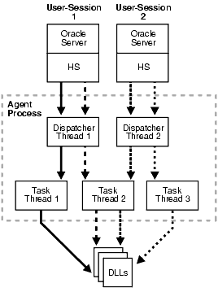

What is the multithreaded extproc agent?

This appendix explains what the multithreaded `extproc` agent is, how it contributes to the overall efficiency of a distributed database system, and how to administer it.

This section includes the following topics:

- Why Use the Multithreaded extproc Agent?

- Multithreaded extproc Agent Architecture

- Administering the Multithreaded extproc Agent

### F.1 Why Use the Multithreaded extproc Agent?

This section explains how the multithreaded `extproc` agent contributes to the efficiency of external procedures.

This section includes the following topics:

- The Challenge of Dedicated Agent Architecture

- The Advantage of Multithreading

#### F.1.1 The Challenge of Dedicated Agent Architecture

By default, an `extproc` agent is started for each user session and the `extproc` agent process terminates only when the user session ends.

This architecture can consume an unnecessarily large amount of system resources. For example, suppose that several thousand user sessions simultaneously spawn `extproc` agent processes. Because an `extproc` agent process is started for each session, several thousand `extproc` agent processes run concurrently. The `extproc` agent processes operate regardless of whether each individual `extproc` agent process is active at the moment. Thus `extproc` agent processes and open connections can consume a disproportionate amount of system resources. When sessions connect to Oracle Database, this problem is addressed by starting the server in shared server mode. Shared server mode allows database connections to be shared by a small number of server processes.

#### F.1.2 The Advantage of Multithreading

The Oracle Database shared server architecture assumes that even when several thousand user sessions are open, only a small percentage of these connections are active at any given time.

In shared server mode, there is a pool of shared server processes. User sessions connect to dispatcher processes that place the requested tasks in a queue. The tasks are picked up by the first available shared server processes. The number of shared server processes is usually less that the number of user sessions.

The multithreaded `extproc` agent provides similar functionality for connections to external procedures. The multithreaded `extproc` agent architecture uses a pool of shared agent threads. The tasks requested by the user sessions are put in a queue and are picked up by the first available multithreaded `extproc` agent thread. Because only a small percentage of user connections are active at a given moment, using a multithreaded `extproc` architecture allows more efficient use of system resources.

### F.2 Multithreaded extproc Agent Architecture

One multithreaded `extproc` agent must be started for each system identifier (SID) before attempting to connect to the external procedure. This is done using the agent control utility `agtctl`. This utility is also used to configure the agent and to shut down the agent.

Each Oracle Net listener that is running on a system listens for incoming connection requests for a set of SIDs. If the SID in an incoming Oracle Net connect string is an SID for which the listener is listening, then that listener processes the connection. Further, if a multithreaded `extproc` agent was started for the SID, then the listener passes the request to that `extproc` agent.

In the architecture for multithreaded `extproc` agents, each incoming connection request is processed by different kinds of threads:

- A single monitor thread. The monitor thread is responsible for:

  - Maintaining communication with the listener

  - Monitoring the load on the process

  - Starting and stopping threads when required

- Several dispatcher threads. The dispatcher threads are responsible for:

  - Handling communication with the Oracle Database

  - Passing task requests to the task threads

- Several task threads. The task threads handle requests from the Oracle Database processes.

Figure F-1 illustrates the architecture of the multithreaded `extproc` agent. User sessions 1 and 2 issue requests for callouts to functions in some DLLs. These requests get serviced through heterogeneous services to the multithreaded `extproc` agent. These requests get handled by the agent's dispatcher threads, which then pass them on to the task threads. The task thread that is actually handling a request is responsible for loading the respective DLL and calling the function therein.

- All requests from a user session get handled by the same dispatcher thread. For example, dispatcher 1 handles communication with user session 1, and dispatcher 2 handles communication with user session 2. This is the case for the lifetime of the session.

- The individual requests can be serviced by different task threads. For example, task thread 1 can handle the request from user session 1, and later handle the request from user session 2.

**See Also:**

[Oracle Database Administrator’s Guide](../admin/managing-processes.md). for details on managing processes for external procedures

Figure F-1 Multithreaded extproc Agent Architecture

[Description of "Figure F-1 Multithreaded extproc Agent Architecture"](img_text/adfns100.md)

These three thread types roughly correspond to the Oracle Database multithreaded server PMON, dispatcher, and shared server processes, respectively.

**Note:**

All requests from a user session go through the same dispatcher thread, but can be serviced by different task threads. Also, several task threads can use the same connection to the external procedure.

These topics explain each type of thread in more detail:

- Monitor Thread

- Dispatcher Threads

- Task Threads

  **See Also:**

  Administering the Multithreaded extproc Agent for more information about starting and stopping the multithreaded `exproc` agent by using the agent control utility `agtctl`

#### F.2.1 Monitor Thread

When the agent control utility `agtctl` starts a multithreaded `extproc` agent for a SID, `agtctl` creates the monitor thread.

The monitor thread performs these functions:

- Creates the dispatcher and task threads.

- Registers the dispatcher threads with all the listeners that are handling connections to this `extproc` agent. While the dispatcher for this SID is running, the listener does not start a process when it gets an incoming connection. Instead, the listener gives the connection to this same dispatcher.

- Monitors the other threads and sends load information about the dispatcher threads to all the listener processes handling connections to this `extproc` agent, enabling listeners to give incoming connections to the least loaded dispatcher.

- Continues to monitor each of the threads it has created.

#### F.2.2 Dispatcher Threads

How are dispatcher threads used?

Dispatcher threads perform these functions:

- Accept incoming connections and task requests from Oracle Database servers.

- Place incoming requests on a queue for a task thread to pick up.

- Send results of a request back to the server that issued the request.

  **Note:**

  After a user session establishes a connection with a dispatcher, all requests from that user session go to the same dispatcher until the end of the user session.

#### F.2.3 Task Threads

How are task threads used?

Task threads perform these functions:

- Pick up requests from a queue.

- Perform the necessary operations.

- Place the results on a queue for a dispatcher to pick up.

### F.3 Administering the Multithreaded extproc Agent

One multithreaded `extproc` agent must be started for each system identifier (SID) before attempting to connect to the external procedure.

A multithreaded `extproc` agent is started, stopped, and configured by an agent control utility called `agtctl`, which works like `lsnrctl`. However, unlike `lsnrctl`, which reads a configuration file (`listener.ora`), `agtctl` takes configuration information from the command line and writes it to a control file.

Before starting `agtctl`, ensure that Oracle Listener is running. Then use the `agtctl` commands to set the `agtctl` configuration parameters (if you do not want their default values) and to start `agtctl`, as in Example F-1.

You can use `agtctl` commands in either single-line command mode or shell mode.

#### Topics:

- Agent Control Utility (agtctl) Commands

- About Using agtctl in Single-Line Command Mode

- Using Shell Mode Commands

- Configuration Parameters for Multithreaded extproc Agent Control

Example F-1 Setting Configuration Parameters and Starting agtctl

    agtctl set max_dispatchers  2 ep_agt1
    agtctl set tcp_dispatchers  1   ep_agt1
    agtctl set max_task_threads 2  ep_agt1
    agtctl set max_sessions     5 ep_agt1
    agtctl unset listener_address ep_agt1
    agtctl set listener_address "(address=(protocol=ipc)(key=extproc))" ep_agt1
    agtctl startup extproc ep_agt1

#### F.3.1 Agent Control Utility (agtctl) Commands

What are the Agent Control Utility commands and what are they used for?

You can start and stop `agtctl` and create and maintain its control file by using the commands shown in Table F-1.

Table F-1 Agent Control Utility (agtctl) Commands

| Command    | Description                                                        |
|:-----------|:-------------------------------------------------------------------|
| `startup`  | Starts a multithreaded `extproc` agent                             |
| `shutdown` | Stops a multithreaded `extproc` agent                              |
| `set`      | Sets a configuration parameter for a multithreaded `extproc` agent |
| `unset`    | Causes a parameter to revert to its default value                  |
| `show`     | Displays the value of a configuration parameter                    |
| `delete`   | Deletes the entry for a particular SID from the control file       |
| `exit`     | Exits shell mode                                                   |
| `help`     | Lists available commands                                           |

These commands can be issued in one of two ways:

- You can issue commands from the UNIX or DOS shell. This mode is called single-line command mode.

- You can enter `agtctl` and an `AGTCTL>` prompt appears. You then can enter commands from within the `agtctl` shell. This mode is called shell mode.

The syntax and parameters for `agtctl` commands depend on the mode in which they are issued.

**Note:**

- All commands are case-sensitive.

- The `agtctl` utility puts its control file in the directory specified by either one of two environment variables, `AGTCTL_ADMIN` or `TNS_ADMIN`. Ensure that at least one of these environment variables is set and that it specifies a directory to which the agent has access.

- If the multithreaded `extproc` agent requires that an environment variable be set, or if the `ENVS` parameter was used when configuring the `listener.ora` entry for the agent working in dedicated mode, then all required environment variables must be set in the UNIX or DOS shell that runs the `agtctl` utility.

#### F.3.2 About Using agtctl in Single-Line Command Mode

This section describes the use of `agtctl` commands.

They are presented in single-line command mode.

This section includes the following topics:

- Setting Configuration Parameters for a Multithreaded extproc Agent

- Starting a Multithreaded extproc Agent

- Shutting Down a Multithreaded extproc Agent

- Examining the Value of Configuration Parameters

- Resetting a Configuration Parameter to Its Default Value

- Deleting an Entry for a Specific SID from the Control File

- Requesting Help

##### F.3.2.1 Setting Configuration Parameters for a Multithreaded extproc Agent

Set the configuration parameters for a multithreaded `extproc` agent before you start the agent.

If a configuration parameter is not specifically set, a default value is used. Configuration parameters and their default values are shown in Table F-2.

Use the `set` command to set multithreaded `extproc` agent configuration parameters.

##### Syntax

    agtctl set parameter parameter_value agent_sid

`parameter` is the parameter that you are setting.

`parameter_value` is the value being assigned to that parameter.

`agent_sid` is the SID that this agent services. This must be specified for single-line command mode.

##### Example

    agtctl set max_dispatchers 5 salesDB

##### F.3.2.2 Starting a Multithreaded extproc Agent

Use the `startup` command to start a multithreaded `extproc` agent.

##### Syntax

    agtctl startup extproc agent_sid

`agent_sid` is the SID that this multithreaded `extproc` agent services. This must be specified for single-line command mode.

##### Example

    agtctl startup extproc salesDB

##### F.3.2.3 Shutting Down a Multithreaded extproc Agent

Use the `shutdown` command to stop a multithreaded `extproc` agent.

There are three forms of shutdown:

- Normal (default)

  `agtctl` asks the multithreaded `extproc` agent to terminate itself gracefully. All sessions complete their current operations and then shut down.

- Immediate

  `agtctl` tells the multithreaded `extproc` agent to terminate immediately. The agent exits immediately regardless of the state of current sessions.

- Abort

  Without talking to the multithreaded `extproc` agent, `agtctl` issues a system call to stop it.

##### Syntax

    agtctl shutdown [immediate|abort] agent_sid

`agent_sid` is the SID that the multithreaded `extproc` agent services. It must be specified for single-line command mode.

##### Example

    agtctl shutdown immediate salesDB

##### F.3.2.4 Examining the Value of Configuration Parameters

To examine the value of a configuration parameter, use the `show` command.

##### Syntax

    agtctl show parameter agent_sid

`parameter` is the parameter that you are examining.

`agent_sid` is the SID that this multithreaded `extproc` agent services. This must be specified for single-line command mode.

##### Example

    agtctl show max_dispatchers salesDB

##### F.3.2.5 Resetting a Configuration Parameter to Its Default Value

You can reset a configuration parameter to its default value using the `unset` command.

##### Syntax

    agtctl unset parameter agent_sid

`parameter` is the parameter that you are resetting (or changing).

`agent_sid` is the SID that this multithreaded `extproc` agent services. It must be specified for single-line command mode.

##### Example

    agtctl unset max_dispatchers salesDB

##### F.3.2.6 Deleting an Entry for a Specific SID from the Control File

The `delete` command deletes the entry for the specified SID from the control file.

##### Syntax

    agtctl delete agent_sid

`agent_sid` is the SID entry to delete.

##### Example

    agtctl delete salesDB

##### F.3.2.7 Requesting Help

Use the `help` command to view a list of available commands for `agtctl` or to see the syntax for a particular command.

##### Syntax

    agtctl help [command]

`command` is the name of the command whose syntax you want to view. The default is all `agtctl` commands.

##### Example

    agtctl help set

#### F.3.3 Using Shell Mode Commands

When issuing the `AGTCTL>` command, it results in the prompt `AGTCTL>`.

In shell mode, start `agtctl` by entering:

    agtctl

Thereafter, because you are issuing commands from within the `agtctl` shell, you need not prefix the command string with `agtctl`.

Set the name of the agent SID by entering:

    AGTCTL> set agent_sid agent_sid

All subsequent commands are assumed to be for the specified SID until the `agent_sid` value is changed. Unlike single-line command mode, you do not specify `agent_sid` in the command string.

You can set the language for error messages as follows:

    AGTCTL> set language language

The commands themselves are the same as those for the single-line command mode. To exit shell mode, enter `exit`.

The following examples use shell mode commands:

- Example: Setting a Configuration Parameter

- Example: Starting a Multithreaded extproc Agent

##### F.3.3.1 Example: Setting a Configuration Parameter

How to set the value for the `shutdown_address` configuration parameter.

This example sets a value for the `shutdown_address` configuration parameter.

    AGTCTL> set shutdown_address (address=(protocol=ipc)(key=oraDBsalesDB))

##### F.3.3.2 Example: Starting a Multithreaded extproc Agent

How to start a multithreaded `extproc` agent.

This example starts a multithreaded `extproc` agent.

    AGTCTL> startup extproc

#### F.3.4 Configuration Parameters for Multithreaded extproc Agent Control

What do the configuration parameters for multithreaded extproc agent control do?

Table F-2 describes and gives the defaults of the configuration parameters for the agent control utility.

Table F-2 Configuration Parameters for agtctl

| Parameter          | Description                                                                                                                                                               | Default Value                                                                                                                                                                                                                                                                                                                                                                                         |
|:-------------------|:--------------------------------------------------------------------------------------------------------------------------------------------------------------------------|:------------------------------------------------------------------------------------------------------------------------------------------------------------------------------------------------------------------------------------------------------------------------------------------------------------------------------------------------------------------------------------------------------|
| `max_dispatchers`  | Maximum number of dispatchers                                                                                                                                             | 1                                                                                                                                                                                                                                                                                                                                                                                                     |
| `tcp_dispatchers`  | Number of dispatchers listening on TCP (the rest are using IPC)                                                                                                           | 0                                                                                                                                                                                                                                                                                                                                                                                                     |
| `max_task_threads` | Maximum number of task threads                                                                                                                                            | 2                                                                                                                                                                                                                                                                                                                                                                                                     |
| `max_sessions`     | Maximum number of sessions for each task thread                                                                                                                           | 5                                                                                                                                                                                                                                                                                                                                                                                                     |
| `listener_address` | Address on which the listener is listening (needed for registration)                                                                                                      | `(ADDRESS_LIST=` `    (ADDRESS=` `        (PROTOCOL=IPC)` `        (KEY=PNPKEY))` `    (ADDRESS=` `        (PROTOCOL=IPC)` `        (KEY=listener_sid))` `    (ADDRESS=` `        (PROTOCOL=TCP)` `        (HOST=127.0.0.1)` `        (PORT=1521)))` Note: `listener_sid` is the IPC key of the address, on the Oracle Database, on which the listener is listening. |
| `shutdown_address` | Address the agent uses to communicate with the listener. This is the address on which the agent listens for all communication, including shutdown messages from `agtctl`. | `(ADDRESS=` `    (PROTOCOL=IPC)` `    (KEY=listener_sid || agent_sid))` `(ADDRESS=` `    (PROTOCOL=TCP)` `    (HOST=127.0.0.1)` `    (PORT=1521))` Notes: • `agent_sid` is the SID of the multithreaded `extproc` agent. • \|\| indicates that `listener_sid` and `agent_sid` are concatenated into one string.                                                            |

##### max_dispatchers, tcp_dispatchers, max_task_threads, and max_sessions

To improve performance, you might need to change the values of some or all of the parameters `max_dispatchers`, `tcp_dispatchers`, `max_task_threads`, and `max_sessions`.

You can calculate the optimum values of `max_dispatchers`, `tcp_dispatchers`, `max_task_threads` with these formulas:

    max_dispatchers = CEIL(x/y)
    tcp_dispatchers = CEIL(x_tcpip/y)
    max_task_threads = CEIL(x/max_sessions)

Where:

- `CEIL` is a SQL function that returns the smallest integer greater than or equal to its argument.

- `x` is the maximum number of sessions that can be connected to `extproc` concurrently.

- `y` is the maximum number of connections that the system can support for each dispatcher.

- `x_tcpip` is the maximum number of sessions that can be connected to `extproc` concurrently by TCP/IP.

  (`x` - `x_tcpip` is the maximum number of sessions that can be connected to `extproc` concurrently by IPC.)

There is no formula for computing the optimum value of `max_sessions`, which affects `max_task_threads`.

You must fine-tune these parameter settings, based on the capability of your hardware, and ensure that the concurrent threads do not exhaust your operating system.

The value of `max_dispatchers` must be at least 1 (which is the default).

##### Example

Suppose:

- The maximum number of sessions that can be connected to `extproc` concurrently (`x`) is 650.

- The maximum number of sessions that can be connected to `extproc` concurrently by TCP/IP (`x_tcpip`) is 400.

  (The maximum number of sessions that can be connected to `extproc` concurrently by IPC is 650-400=250.)

- The maximum number of connections that the system can support for each dispatcher (`y`) is 100.

- The maximum number of sessions for each task thread (`max_sessions`) is 20.

The optimum values for these parameters are:

    max_dispatchers = CEIL(650/100) = CEIL(6.5)  = 7
    tcp_dispatchers  = CEIL(400/100) = CEIL(4)    = 4
    max_task_threads = CEIL(650/20)  = CEIL(32.5) = 33

That is, optimally:

- The maximum number of dispatchers is seven.

- Four of the seven dispatchers are listening on TCP/IP, and the remaining three are listening on IPC.

- The maximum number of task threads is 33.

##### listener_address and shutdown_address

The values of the configuration parameters `listener_address` and `shutdown_address` are specified with `ADDRESS`, as shown in both Table F-2 and Example F-1. Within `ADDRESS`, you can specify the parameter `HOST`, which can be either an IPv6 or IPv4 address or a host name. If `HOST` is a host name, then these values of the optional `ADDRESS` parameter `IP` are relevant:

| IP Value  | Meaning                                                                         |
|:----------|:--------------------------------------------------------------------------------|
| `FIRST`   | Listen on the first IP address returned by the DNS resolution of the host name. |
| `V4_ONLY` | Listen only on the IPv4 interfaces in the system.                               |
| `V6_ONLY` | Listen only on the IPv6 interfaces in the system.                               |

For example, this value of `listener_address` or `shutdown_address` restricts it to IPv6 interfaces:

    "(ADDRESS=(PROTOCOL=tcp)(HOST=sales)(PORT=1521)(IP=V6_ONLY))"

**See Also:**

[Oracle Database Net Services Administrator's Guide](../netag/understanding-communication-layers.md) for detailed information about IPv6 support in Oracle Database
