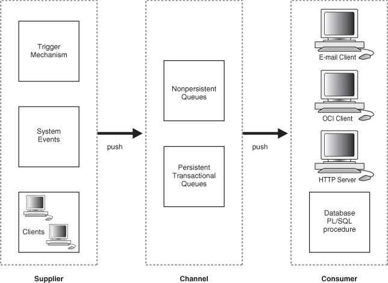

This chapter describes continuous query notification, publish-subscribe notification, and Database advanced queuing features.

This chapter includes the following topics:

- About Continuous Query Notification

- Publish-Subscribe Notification in OCI

- OCI and Database Advanced Queuing

### 13.1 About Continuous Query Notification

Continuous Query Notification (CQN) enables client applications to register queries with the database and receive notifications in response to DML or DDL changes on the objects or in response to result set changes associated with the queries.

The notifications are published by the database when the DML or DDL transaction commits.

During registration, the application specifies a notification handler and associates a set of interesting queries with the notification handler. A notification handler can be either a server-side PL/SQL procedure or a client-side C callback. Registrations are created at either the object level or the query level. If registration is at the object level, then whenever a transaction changes any of the registered objects and commits, the notification handler is invoked. If registration is at the query level, then whenever a transaction commits changes such that the result set of the query is modified, the notification handler is invoked, but if the changes do not affect the result set of the query, the notification handler is not invoked.

Query change notification can be registered for the following types of statements: `OCI_STMT_SELECT`, `OCI_STMT_BEGIN`, `OCI_STMT_DECLARE`, and `OCI_STMT_CALL`.

Query change notification assumes that the PLSQL code performs only `SELECT` statements and registers for every `SELECT` statement. Otherwise, it raises an error if there are any non SELECT statements in the PLSQL code.

One use of continuous query notification is in middle-tier applications that must have cached data and keep the cache as recent as possible for the back-end database.

The notification includes the following information:

- Query IDs of queries whose result sets have changed. This is if the registration was at query granularity.

- Names of the modified objects or changed rows.

- Operation type (`INSERT`, `UPDATE`, `DELETE`, `ALTER` `TABLE`, `DROP` `TABLE`).

- `ROWID`s of the changed rows and the associated DML operation (`INSERT`, `UPDATE`, `DELETE`).

- Global database events (`STARTUP`, `SHUTDOWN`). In Oracle Real Application Cluster (Oracle RAC) the database delivers a notification when the first instance starts or the last instance shuts down.

**See Also:**

- [Oracle Database Development Guide](../adfns/cqn.md), the section about using continuous query notification for a complete discussion of the concepts of this feature and using OCI and PL/SQL interfaces to create CQN registrations

- Publish-Subscribe Notification in OCI

### 13.2 Publish-Subscribe Notification in OCI

The publish-subscribe notification feature allows an OCI application to receive client notifications directly, register an email address to which notifications can be sent, register an HTTP URL to which notifications can be posted, or register a PL/SQL procedure to be invoked on a notification.

Figure 13-1 illustrates the process.

Figure 13-1 Publish-Subscribe Model

[Description of "Figure 13-1 Publish-Subscribe Model"](img_text/lnoci039.md)

An OCI application can:

- Register interest in notifications in the AQ namespace and be notified when an enqueue occurs

- Register interest in subscriptions to database events and receive notifications when the events are triggered

- Manage registrations, such as disabling registrations temporarily or dropping the registrations entirely

- Post or send notifications to registered clients

In all the preceding scenarios the notification can be received directly by the OCI application, or the notification can be sent to a prespecified email address, or it can be sent to a predefined HTTP URL, or a prespecified database PL/SQL procedure can be invoked because of a notification.

Registered clients are notified asynchronously when events are triggered or on an explicit AQ enqueue. Clients do not need to be connected to a database.

This section includes the following topics:

- Publish-Subscribe Registration Functions in OCI

- Notification Callback in OCI

- Notification Procedure

- Publish-Subscribe Direct Registration Example

- Publish-Subscribe LDAP Registration Example

**See Also:**

- OCI and Database Advanced Queuing for information about Database Advanced Queuing

- [Oracle Database Advanced Queuing User's Guide](../adque/aq-introduction.md) for information about creating queues and about Database AQ, including concepts, features, and examples

- The chapter about `CREATE` `TRIGGER` in the [Oracle Database SQL Language Reference](../sqlrf/CREATE-TRIGGER.md) for information about creating triggers

#### 13.2.1 Publish-Subscribe Registration Functions in OCI

You can register directly to the database or register using Lightweight Directory Access Protocol (LDAP).

Registration can be done in two ways:

- Direct registration. You register directly to the database. This way is simple and the registration takes effect immediately.

- Open registration. You register using Lightweight Directory Access Protocol (LDAP), from which the database receives the registration request. This is useful when the client cannot have a database connection (the client wants to register for a database open event while the database is down), or if the client wants to register for the same event or events in multiple databases simultaneously.

This section includes the following topics:

- Publish-Subscribe Register Directly to the Database

- Open Registration for Publish-Subscribe

- Using OCI to Open Register with LDAP

- Setting QOS, Timeout Interval, Namespace, Client Address, and Port Number

- OCI Functions Used to Manage Publish-Subscribe Notification

**See Also:**

- Publish-Subscribe Register Directly to the Database

- Open Registration for Publish-Subscribe

##### 13.2.1.1 Publish-Subscribe Register Directly to the Database

The following steps are required in an OCI application to register directly and receive notifications for events.

It is assumed that the appropriate event trigger or AQ queue has been set up. The initialization parameter `COMPATIBLE` must be set to 8.1 or later.

**See Also:**

- [Database Advanced Queuing and Publish-Subscribe Functions](streams-advanced-queueing-and-publish-subscribe-functions.md)

- Publish-Subscribe Direct Registration Example for examples of the use of these functions in an application

**Note:**

The publish-subscribe feature is only available on multithreaded operating systems.

1.  Call `OCIEnvCreate()` or `OCIEnvNlsCreate()` with `OCI_EVENTS` mode to specify that the application is interested in registering for and receiving notifications. This starts a dedicated listening thread for notifications on the client.

2.  Call `OCIHandleAlloc()` with handle type `OCI_HTYPE_SUBSCRIPTION` to allocate a subscription handle.

3.  Call `OCIAttrSet()` to set the subscription handle attributes for:

    - `OCI_ATTR_SUBSCR_NAME` - Subscription name

    - `OCI_ATTR_SUBSCR_NAMESPACE` - Subscription namespace

    - `OCI_ATTR_SUBSCR_HOSTADDR` - Environment handle attribute that sets the client IP (in either IPv4 or IPv6 format) to which notification is sent

      Oracle Database components and utilities support Internet Protocol version 6 (IPv6) addresses.

      **See Also:**

      [OCI_ATTR_SUBSCR_HOSTADDR](handle-and-descriptor-attributes.md), [OCI_ATTR_SUBSCR_IPADDR](handle-and-descriptor-attributes.md), and [Oracle Database Net Services Administrator's Guide](../netag/understanding-communication-layers.md) for more information about the IPv6 format for IP addresses

    - `OCI_ATTR_SUBSCR_CALLBACK` - Notification callback

    - `OCI_ATTR_SUBSCR_CTX` - Callback context

    - `OCI_ATTR_SUBSCR_PAYLOAD` - Payload buffer for posting

    - `OCI_ATTR_SUBSCR_RECPT` - Recipient name

    - `OCI_ATTR_SUBSCR_RECPTPROTO` - Protocol to receive notification with

    - `OCI_ATTR_SUBSCR_RECPTPRES` - Presentation to receive notification with

    - `OCI_ATTR_SUBSCR_QOSFLAGS` - QOS (quality of service) levels with the following values:

      - If `OCI_SUBSCR_QOS_PURGE_ON_NTFN` is set, the registration is purged on the first notification.

      - If `OCI_SUBSCR_QOS_RELIABLE` is set, notifications are persistent. You can use surviving instances of an Oracle RAC database to send and retrieve change notification messages even after a node failure, because invalidations associated with this registration are queued persistently into the database. If `FALSE`, then invalidations are enqueued into a fast in-memory queue. Note that this option describes the persistence of notifications and not the persistence of registrations. Registrations are automatically persistent by default.

    - `OCI_ATTR_SUBSCR_TIMEOUT` - Registration timeout interval in seconds. The default is 0 if a timeout is not set.

    - `OCI_ATTR_SUBSCR_NTFN_GROUPING_CLASS` - notification grouping class

      Notifications can be spaced out by using the grouping NTFN option with the following constants. A value supported for notification grouping class is:

          #define OCI_SUBSCR_NTFN_GROUPING_CLASS_TIME   1 /* time  */

    - `OCI_ATTR_SUBSCR_NTFN_GROUPING_VALUE` - notification grouping value in seconds

    - `OCI_ATTR_SUBSCR_NTFN_GROUPING_TYPE` - notification grouping type

      Supported values for notification grouping type:

          #define OCI_SUBSCR_NTFN_GROUPING_TYPE_SUMMARY 1  /* summary */
          #define OCI_SUBSCR_NTFN_GROUPING_TYPE_LAST    2  /* last */

    - `OCI_ATTR_SUBSCR_NTFN_GROUPING_START_TIME` - notification grouping start time

    - `OCI_ATTR_SUBSCR_NTFN_GROUPING_REPEAT_COUNT` - notification grouping repeat count

    `OCI_ATTR_SUBSCR_NAME`, `OCI_ATTR_SUBSCR_NAMESPACE`, and `OCI_ATTR_SUBSCR_RECPTPROTO` must be set before you register a subscription.

    If `OCI_ATTR_SUBSCR_RECPTPROTO` is set to `OCI_SUBSCR_PROTO_OCI`, then `OCI_ATTR_SUBSCR_CALLBACK` and `OCI_ATTR_SUBSCR_CTX` also must be set.

    If `OCI_ATTR_SUBSCR_RECPTPROTO` is set to `OCI_SUBSCR_PROTO_MAIL`, `OCI_SUBSCR_PROTO_SERVER`, or `OCI_SUBSCR_PROTO_HTTP`, then `OCI_ATTR_SUBSCR_RECPT` also must be set.

    Setting `OCI_ATTR_SUBSCR_CALLBACK` and `OCI_ATTR_SUBSCR_RECPT` at the same time causes an application error.

    `OCI_ATTR_SUBSCR_PAYLOAD` is required before the application can perform a post to a subscription.

    **See Also:**

    [Subscription Handle Attributes](handle-and-descriptor-attributes.md) and [About Creating the OCI Environment](oci-programming-basics.md) for setting up the environment with `mode = OCI_EVENTS | OCI_OBJECT`. `OCI_OBJECT` is required for grouping notifications.

4.  Set he values of QOS, timeout interval, namespace, and port (see Example 9–15).

    **See Also:**

    Setting QOS, Timeout Interval, Namespace, Client Address, and Port Number

5.  Set `OCI_ATTR_SUBSCR_RECPTPROTO` to `OCI_SUBSCR_PROTO_OCI`, then define the callback routine to be used with the subscription handle.

    **See Also:**

    Notification Callback in OCI

6.  Set `OCI_ATTR_SUBSCR_RECPTPROTO` to `OCI_SUBSCR_PROTO_SERVER`, then define the PL/SQL procedure, to be invoked on notification, in the database.

    **See Also:**

    Notification Procedure

7.  Call `OCISubscriptionRegister()` to register with the subscriptions. This call can register interest in several subscriptions at the same time.

Example 13-1 shows an example of setting QOS levels.

Example 13-1 Setting QOS Levels, the Notification Grouping Class, Value, and Type, and the Namespace Specific Context

    /* Set QOS levels */
    ub4 qosflags = OCI_SUBSCR_QOS_PAYLOAD;

    /* Set QOS flags in subscription handle */
    (void) OCIAttrSet((dvoid *) subscrhp, (ub4) OCI_HTYPE_SUBSCRIPTION,
                     (dvoid *) &qosflags, (ub4) 0,
                     (ub4) OCI_ATTR_SUBSCR_QOSFLAGS, errhp);

    /* Set notification grouping class */
    ub4 ntfn_grouping_class = OCI_SUBSCR_NTFN_GROUPING_CLASS_TIME;
    (void) OCIAttrSet((dvoid *) subscrhp, (ub4) OCI_HTYPE_SUBSCRIPTION,
                     (dvoid *) &ntfn_grouping_class, (ub4) 0,
                     (ub4) OCI_ATTR_SUBSCR_NTFN_GROUPING_CLASS, errhp);

    /* Set notification grouping value of 10 minutes */
    ub4 ntfn_grouping_value = 600;
    (void) OCIAttrSet((dvoid *) subscrhp, (ub4) OCI_HTYPE_SUBSCRIPTION,
                     (dvoid *) &ntfn_grouping_value, (ub4) 0,
                     (ub4) OCI_ATTR_SUBSCR_NTFN_GROUPING_VALUE, errhp);

    /* Set notification grouping type */
    ub4 ntfn_grouping_type = OCI_SUBSCR_NTFN_GROUPING_TYPE_SUMMARY;

    /* Set notification grouping type in subscription handle */
    (void) OCIAttrSet((dvoid *) subscrhp, (ub4) OCI_HTYPE_SUBSCRIPTION,
                     (dvoid *) &ntfn_grouping_type, (ub4) 0,
                     (ub4) OCI_ATTR_SUBSCR_NTFN_GROUPING_TYPE, errhp);

    /* Set namespace specific context */
    (void) OCIAttrSet((dvoid *) subscrhp, (ub4) OCI_HTYPE_SUBSCRIPTION,
                     (dvoid *) NULL, (ub4) 0,
                     (ub4) OCI_ATTR_SUBSCR_NAMESPACE_CTX, errhp);

#####

**See Also:**

- [OCIEnvCreate()](connect-authorize-and-initialize-functions.md)

- [OCIEnvNlsCreate()](connect-authorize-and-initialize-functions.md)

- [OCIHandleAlloc()](handle-and-descriptor-functions.md)

- [OCIAttrSet()](handle-and-descriptor-functions.md)

- [OCISubscriptionRegister()](streams-advanced-queueing-and-publish-subscribe-functions.md)

##### 13.2.1.2 Open Registration for Publish-Subscribe

Lists the prerequisites for the open registration for publish-subscribe.

Prerequisites for the open registration for publish-subscribe are as follows:

- Registering using LDAP (open registration) requires the client to be an enterprise user.

  **See Also:**

  [Oracle Database Enterprise User Security Administrator's Guide](../dbimi/introducing-enterprise-user-security.md), sections about managing enterprise user security

<!-- -->

- The compatibility of the database must be 9.0 or later.

- `LDAP_REGISTRATION_ENABLED` must be set to `TRUE`. This can be done this way:

       ALTER SYSTEM SET LDAP_REGISTRATION_ENABLED=TRUE

  The default is `FALSE`.

- `LDAP_REG_SYNC_INTERVAL` must be set to the time interval (in seconds) to refresh registrations from LDAP:

       ALTER SYSTEM SET LDAP_REG_SYNC_INTERVAL =  time_interval

  The default is 0, which means do not refresh.

- To force a database refresh of LDAP registration information immediately:

      ALTER SYSTEM REFRESH LDAP_REGISTRATION

The steps for open registration using Oracle Enterprise Security Manager (OESM) are:

1.  In each enterprise domain, create the enterprise role, `ENTERPRISE_AQ_USER_ROLE`.
2.  For each database in the enterprise domain, add the global role `GLOBAL_AQ_USER_ROLE` to the enterprise role `ENTERPRISE_AQ_USER_ROLE`.
3.  For each enterprise domain, add the enterprise role `ENTERPRISE_AQ_USER_ROLE` to the privilege group `cn=OracleDBAQUsers`, under `cn=oraclecontext`, under the administrative context.
4.  For each enterprise user that is authorized to register for events in the database, grant the enterprise role `ENTERPRISE_AQ_USER_ROLE`.

##### 13.2.1.3 Using OCI to Open Register with LDAP

Shows how to open register using LDAP registration.

1.  Call `OCIEnvCreate()` or `OCIEnvNlsCreate()` with `mode` set to `OCI_EVENTS` \| `OCI_USE_LDAP`.
2.  Call `OCIAttrSet()` to set the following environment handle attributes for accessing LDAP:
    - `OCI_ATTR_LDAP_HOST`: the host name on which the LDAP server resides

    - `OCI_ATTR_LDAP_PORT`: the port on which the LDAP server is listening

    - `OCI_ATTR_BIND_DN`: the distinguished name to log in to the LDAP server, usually the DN of the enterprise user

    - `OCI_ATTR_LDAP_CRED`: the credential used to authenticate the client, for example, the password for simple authentication (user name and password)

    - `OCI_ATTR_WALL_LOC`: for SSL authentication, the location of the client wallet

    - `OCI_ATTR_LDAP_AUTH`: the authentication method code

      **See Also:**

      [Environment Handle Attributes](handle-and-descriptor-attributes.md) for a complete list of authentication modes

    - `OCI_ATTR_LDAP_CTX`: the administrative context for Oracle Database in the LDAP server
3.  Call `OCIHandleAlloc()` with handle type `OCI_HTYPE_SUBSCRIPTION`, to allocate a subscription handle.
4.  Call `OCIArrayDescriptorAlloc()` with descriptor type `OCI_DTYPE_SRVDN`, to allocate a server DN descriptor.
5.  Call `OCIAttrSet()`to set the server DN descriptor attributes for `OCI_ATTR_SERVER_DN`, the distinguished name of the database in which the client wants to receive notifications. `OCIAttrSet()` can be called multiple times for this attribute so that more than one database server is included in the registration.
6.  Call `OCIAttrSet()` to set the subscription handle attributes for:
    - `OCI_ATTR_SUBSCR_NAME` - Subscription name

    - `OCI_ATTR_SUBSCR_NAMESPACE` - Subscription namespace

    - `OCI_ATTR_SUBSCR_CALLBACK`- Notification callback

    - `OCI_ATTR_SUBSCR_CTX` - Callback context

    - `OCI_ATTR_SUBSCR_PAYLOAD` - Payload buffer for posting

    - `OCI_ATTR_SUBSCR_RECPT` - Recipient name

    - `OCI_ATTR_SUBSCR_RECPTPROTO` - Protocol to receive notification with

    - `OCI_ATTR_SUBSCR_RECPTRES` - Presentation to receive notification with

    - `OCI_ATTR_SUBSCR_QOSFLAGS` - QOS (quality of service) levels

    - `OCI_ATTR_SUBSCR_TIMEOUT` - Registration timeout interval in seconds. The default is 0 if a timeout is not set.

    - `OCI_ATTR_SUBSCR_SERVER_DN` - The descriptor handles you populated in Step 5
7.  The values of QOS, timeout interval, namespace, and port are set. See Setting QOS, Timeout Interval, Namespace, Client Address, and Port Number.
8.  Call `OCISubscriptionRegister()` to register the subscriptions. The registration takes effect when the database accesses LDAP to pick up new registrations. The frequency of pickups is determined by the value of `LDAP_REG_SYNC_INTERVAL`.

**See Also:**

- [OCIEnvCreate()](connect-authorize-and-initialize-functions.md)

- [OCIEnvNlsCreate()](connect-authorize-and-initialize-functions.md)

- [OCIAttrSet()](handle-and-descriptor-functions.md)

- [OCIHandleAlloc()](handle-and-descriptor-functions.md)

- [OCIArrayDescriptorAlloc()](handle-and-descriptor-functions.md)

- [OCISubscriptionRegister()](streams-advanced-queueing-and-publish-subscribe-functions.md)

##### 13.2.1.4 Setting QOS, Timeout Interval, Namespace, Client Address, and Port Number

Shows how to set QOSFLAGS to QOS levels using `OCIAttrSet()`.

You can set QOSFLAGS to the following QOS levels using `OCIAttrSet()`:

- `OCI_SUBSCR_QOS_RELIABLE` - Reliable notification persists across instance and database restarts. Reliability is of the server only and is only for persistent queues or buffered messages. This option describes the persistence of the notifications. Registrations are persistent by default.

- `OCI_SUBSCR_QOS_PURGE_ON_NTFN` - Once notification is received, purge registration on first notification. (Subscription is unregistered.)

<!-- -->

    /* Set QOS levels */
    ub4 qosflags = OCI_SUBSCR_QOS_RELIABLE | OCI_SUBSCR_QOS_PURGE_ON_NTFN;

    /* Set flags in subscription handle */
    (void)OCIAttrSet((void *)subscrhp, (ub4)OCI_HTYPE_SUBSCRIPTION,
                   (void *)&qosflags, (ub4)0, (ub4)OCI_ATTR_SUBSCR_QOSFLAGS, errhp);

    /* Set auto-expiration after 30 seconds */
    ub4 timeout = 30;
    (void)OCIAttrSet((void *)subscrhp, (ub4)OCI_HTYPE_SUBSCRIPTION,
                     (void *)&timeout, (ub4)0, (ub4)OCI_ATTR_SUBSCR_TIMEOUT, errhp);

The registration is purged when the timeout is exceeded, and a notification is sent to the client, so that the client can invoke its callback and take any necessary action. For client failure before the timeout, the registration is purged.

You can set the port number on the environment handle, which is important if the client is on a system behind a firewall that can receive notifications only on certain ports. Clients can specify the port for the listener thread before the first registration, using an attribute in the environment handle. The thread is started the first time OCISubscriptionRegister() is called. If available, this specified port number is used. An error is returned if the client tries to start another thread on a different port using a different environment handle.

    ub4 port = 1581;
    (void)OCIAttrSet((void *)envhp, (ub4)OCI_HTYPE_ENV, (void *)&port, (ub4)0,
                     (ub4)OCI_ATTR_SUBSCR_PORTNO, errhp);

If instead, the port is determined automatically, you can get the port number at which the client thread is listening for notification by obtaining the attribute from the environment handle.

    (void)OCIAttrGet((void *)subhp, (ub4)OCI_HTYPE_ENV, (void *)&port, (ub4)0,
                     (ub4)OCI_ATTR_SUBSCR_PORTNO, errhp);

Example to set client address:

    text ipaddr[16] = "10.177.246.40";
    (void)(OCIAttrSet((dvoid *) envhp, (ub4) OCI_HTYPE_ENV,
           (dvoid *) ipaddr, (ub4) strlen((const char *)ipaddr),
           (ub4) OCI_ATTR_SUBSCR_IPADDR, errhp));

**See Also:**

[OCI_ATTR_SUBSCR_IPADDR](handle-and-descriptor-attributes.md)

##### 13.2.1.5 OCI Functions Used to Manage Publish-Subscribe Notification

Lists and describes the functions used to manage publish-subscribe notification.

Table 13-1 lists the functions that are used to manage publish-subscribe notification.

Table 13-1 Publish-Subscribe Functions

| Function                                                                                    | Purpose                    |
|:--------------------------------------------------------------------------------------------|:---------------------------|
| [OCISubscriptionDisable()](streams-advanced-queueing-and-publish-subscribe-functions.md)    | Disables a subscription    |
| [OCISubscriptionEnable()](streams-advanced-queueing-and-publish-subscribe-functions.md)     | Enables a subscription     |
| [OCISubscriptionPost()](streams-advanced-queueing-and-publish-subscribe-functions.md)       | Posts a subscription       |
| [OCISubscriptionRegister()](streams-advanced-queueing-and-publish-subscribe-functions.md)   | Registers a subscription   |
| [OCISubscriptionUnRegister()](streams-advanced-queueing-and-publish-subscribe-functions.md) | Unregisters a subscription |

#### 13.2.2 Notification Callback in OCI

The client must register a notification callback that gets invoked when there is some activity on the subscription for which interest has been registered.

In the AQ namespace, for instance, this occurs when a message of interest is enqueued.

This callback is typically set through the `OCI_ATTR_SUBSCR_CALLBACK` attribute of the subscription handle.

**See Also:**

[Subscription Handle Attributes](handle-and-descriptor-attributes.md)

The callback must return a value of `OCI_CONTINUE` and adhere to the following specification:

    typedef ub4 (*OCISubscriptionNotify) ( void            *pCtx,
                                           OCISubscription *pSubscrHp,
                                           void            *pPayload,
                                           ub4             iPayloadLen,
                                           void            *pDescriptor,
                                           ub4             iMode);

The parameters are described as follows:

pCtx (IN)
A user-defined context specified when the callback was registered.

pSubscrHp (IN)
The subscription handle specified when the callback was registered.

pPayload (IN)
The payload for this notification. Currently, only ub1 \* (a sequence of bytes) for the payload is supported.

iPayloadLen (IN)
The length of the payload for this notification.

pDescriptor (IN)
The namespace-specific descriptor. Namespace-specific parameters can be extracted from this descriptor. The structure of this descriptor is opaque to the user and its type is dependent on the namespace.

The attributes of the descriptor are namespace-specific. For Advanced Queuing (AQ), the descriptor is `OCI_DTYPE_AQNFY`. For the AQ namespace, the count of notifications received in the group is provided in the notification descriptor. The attributes of `pDescriptor` are:

- Notification flag (regular = 0, timeout = 1, or grouping notification = 2) - `OCI_ATTR_NFY_FLAGS`

- Queue name - `OCI_ATTR_QUEUE_NAME`

- Consumer name - `OCI_ATTR_CONSUMER_NAME`

- Message ID - `OCI_ATTR_NFY_MSGID`

- Message properties - `OCI_ATTR_MSG_PROP`

- Count of notifications received in the group - `OCI_ATTR_AQ_NTFN_GROUPING_COUNT`

- The group, an OCI collection - `OCI_ATTR_AQ_NTFN_GROUPING_MSGID_ARRAY`

**See Also:**

- OCI and Database Advanced Queuing

- [Notification Descriptor Attributes](handle-and-descriptor-attributes.md)

iMode (IN)
Call-specific mode. The only valid value is `OCI_DEFAULT`. This value executes the default call.

Example 13-2 shows how to use AQ grouping notification attributes in a notification callback.

Example 13-2 Using AQ Grouping Notification Attributes in an OCI Notification Callback

    ub4 notifyCB1(void *ctx, OCISubscription *subscrhp, void *pay, ub4 payl,
                  void *desc, ub4 mode)
    {
     oratext            *subname;
     ub4                 size;
     OCIColl            *msgid_array = (OCIColl *)0;
     ub4                 msgid_cnt = 0;
     OCIRaw             *msgid;
     void              **msgid_ptr;
     sb4                 num_msgid = 0;
     void               *elemind = (void *)0;
     boolean             exist;
     ub2                 flags;
     oratext            *hexit = (oratext *)"0123456789ABCDEF";
     ub4                 i, j;

     /* get subscription name */
     OCIAttrGet(subscrhp, OCI_HTYPE_SUBSCRIPTION, (void *)&subname, &size,
                OCI_ATTR_SUBSCR_NAME,ctxptr->errhp);

     /* print subscripton name */
     printf("Got notification for %.*s\n", size, subname);
     fflush((FILE *)stdout);

     /* get the #ntfns received in this group */
     OCIAttrGet(desc, OCI_DTYPE_AQNFY, (void *)&msgid_cnt, &size,
                OCI_ATTR_AQ_NTFN_GROUPING_COUNT, ctxptr->errhp);

     /* get the group - collection of msgids */
     OCIAttrGet(desc, OCI_DTYPE_AQNFY, (void *)&msgid_array, &size,
                OCI_ATTR_AQ_NTFN_GROUPING_MSGID_ARRAY, ctxptr->errhp);

     /* get notification flag - regular, timeout, or grouping notification? */
     OCIAttrGet(desc, OCI_DTYPE_AQNFY, (void *)&flags, &size,
                OCI_ATTR_NFY_FLAGS, ctxptr->errhp);

     /* print notification flag */
     printf("Flag: %d\n", (int)flags);

     /* get group (collection) size */
     if (msgid_array)
       checkerr(ctxptr->errhp,
            OCICollSize(ctxptr->envhp, ctxptr->errhp,
            CONST OCIColl *) msgid_array, &num_msgid),
            "Inside notifyCB1-OCICollSize");
     else
       num_msgid =0;

     /* print group size */
     printf("Collection size: %d\n", num_msgid);

     /* print all msgids in the group */
     for(i = 0; i < num_msgid; i++)
     {
       ub4  rawSize;                                             /* raw size    */
       ub1 *rawPtr;                                              /* raw pointer */
         /* get msgid from group */
       checkerr(ctxptr->errhp,
            OCICollGetElem(ctxptr->envhp, ctxptr->errhp,
                   (OCIColl *) msgid_array, i, &exist,
                   (void **)(&msgid_ptr), &elemind),
            "Inside notifyCB1-OCICollGetElem");
       msgid = *msgid_ptr;
       rawSize = OCIRawSize(ctxptr->envhp, msgid);
       rawPtr = OCIRawPtr(ctxptr->envhp, msgid);

       /* print msgid size */
       printf("Msgid size: %d\n", rawSize);

       /* print msgid in hexadecimal format */
       for (j = 0; j < rawSize; j++)
       {                                           /* for each byte in the raw */
         printf("%c", hexit[(rawPtr[j] & 0xf0) >> 4]);
         printf("%c", hexit[(rawPtr[j] & 0x0f)]);
       }
       printf("\n");
     }

     /* print #ntfns received in group */
     printf("Notification Count: %d\n", msgid_cnt);
     printf("\n");
     printf("***********************************************************\n");
     fflush((FILE *)stdout);
     return 1;
    }

#### 13.2.3 Notification Procedure

The PL/SQL notification procedure that is invoked when there is some activity on the subscription for which interest has been registered, must be created in the database.

This procedure is typically set through the `OCI_ATTR_SUBSCR_RECPT` attribute of the subscription handle.

**See Also:**

- [Subscription Handle Attributes](handle-and-descriptor-attributes.md)

- "Oracle Database AQ PL/SQL Callback" in [Oracle Database PL/SQL Packages and Types Reference](../arpls/index.md) for the PL/SQL procedure specification

#### 13.2.4 Publish-Subscribe Direct Registration Example

Shows examples implementing publish subscription notification using direct registration.

Example 13-3 shows how system events, client notification, and Advanced Queuing work together to implement publish subscription notification.

The PL/SQL code in Example 13-3 creates all objects necessary to support a publish-subscribe mechanism under the user schema `pubsub`. In this code, the Agent `snoop` subscribes to messages that are published at logon events. Note that the user `pubsub` needs `AQ_ADMINISTRATOR_ROLE` and `AQ_USER_ROLE` privileges to use Advance Queuing functionality. The initialization parameter `_SYSTEM_TRIG_ENABLED` must be set to `TRUE` (the default) to enable triggers for system events. Connect as `pubsub` before running Example 13-3.

After the subscriptions are created, the client must register for notification using callback functions. Example 13-4 shows sample code that performs the necessary steps for registration. The initial steps of allocating and initializing session handles are omitted here for clarity.

If user `IX` logs on to the database, the client is notified by email, and the callback function `notifySnoop` is called. An email notification is sent to the address xyz@company.com and the PL/SQL procedure `plsqlnotifySnoop` is also called in the database.

Example 13-3 Implementing a Publish Subscription Notification

    ----------------------------------------------------------
    ----create queue table for persistent multiple consumers
    ----------------------------------------------------------
    ---- Create or replace a queue table
    begin
      DBMS_AQADM.CREATE_QUEUE_TABLE(
      QUEUE_TABLE=>'pubsub.raw_msg_table',
      MULTIPLE_CONSUMERS => TRUE,
      QUEUE_PAYLOAD_TYPE =>'RAW',
      COMPATIBLE => '8.1.5');
    end;
    /
    ----------------------------------------------------------
    ---- Create a persistent queue for publishing messages
    ----------------------------------------------------------
    ---- Create a queue for logon events
    begin
      DBMS_AQADM.CREATE_QUEUE(QUEUE_NAME=>'pubsub.logon',
      QUEUE_TABLE=>'pubsub.raw_msg_table',
      COMMENT=>'Q for error triggers');
    end;
    /
    ----------------------------------------------------------
    ---- Start the queue
    ----------------------------------------------------------
    begin
      DBMS_AQADM.START_QUEUE('pubsub.logon');
    end;
    /
    ----------------------------------------------------------
    ---- define new_enqueue for convenience
    ----------------------------------------------------------
    create or replace procedure new_enqueue(queue_name  in varchar2,
                                            payload  in raw ,
    correlation in varchar2 := NULL,
    exception_queue in varchar2 := NULL)
    as
      enq_ct     dbms_aq.enqueue_options_t;
      msg_prop   dbms_aq.message_properties_t;
      enq_msgid  raw(16);
      userdata   raw(1000);
    begin
      msg_prop.exception_queue := exception_queue;
      msg_prop.correlation := correlation;
      userdata := payload;
      DBMS_AQ.ENQUEUE(queue_name,enq_ct, msg_prop,userdata,enq_msgid);
    end;
    /
    ----------------------------------------------------------
    ---- add subscriber with rule based on current user name,
    ---- using correlation_id
    ----------------------------------------------------------
    declare
    subscriber sys.aq$_agent;
    begin
      subscriber := sys.aq$_agent('SNOOP', null, null);
      dbms_aqadm.add_subscriber(queue_name => 'pubsub.logon',
                                subscriber => subscriber,
                                rule => 'CORRID = ''ix'' ');
    end;
    /
    ----------------------------------------------------------
    ---- create a trigger on logon on database
    ----------------------------------------------------------
    ---- create trigger on after logon
    create or replace trigger systrig2
       AFTER LOGON
       ON DATABASE
       begin
         new_enqueue('pubsub.logon', hextoraw('9999'), dbms_standard.login_user);
       end;
    /

    ----------------------------------------------------------
    ---- create a PL/SQL callback for notification of logon
    ---- of user 'ix' on database
    ----------------------------------------------------------
    ----
    create or replace procedure plsqlnotifySnoop(
      context raw, reginfo sys.aq$_reg_info, descr sys.aq$_descriptor,
      payload raw, payloadl number)
    as
    begin
     dbms_output.put_line('Notification : User ix Logged on\n');
    end;
    /

Example 13-4 Registering for Notification Using Callback Functions

    ...
    static ub4 namespace = OCI_SUBSCR_NAMESPACE_AQ;

    static OCISubscription *subscrhpSnoop = (OCISubscription *)0;
    static OCISubscription *subscrhpSnoopMail = (OCISubscription *)0;
    static OCISubscription *subscrhpSnoopServer = (OCISubscription *)0;

    /* callback function for notification of logon of user 'ix' on database */

    static ub4 notifySnoop(ctx, subscrhp, pay, payl, desc, mode)
        void *ctx;
        OCISubscription *subscrhp;
        void *pay;
        ub4 payl;
        void *desc;
        ub4 mode;
    {
        printf("Notification : User ix Logged on\n");
      (void)OCIHandleFree((void *)subscrhpSnoop,
                (ub4) OCI_HTYPE_SUBSCRIPTION);
        return 1;
    }

    static void checkerr(errhp, status)
    OCIError *errhp;
    sword status;
    {
      text errbuf[512];
      ub4 buflen;
      sb4 errcode;

      if (status == OCI_SUCCESS) return;

      switch (status)
      {
      case OCI_SUCCESS_WITH_INFO:
        printf("Error - OCI_SUCCESS_WITH_INFO\n");
        break;
      case OCI_NEED_DATA:
        printf("Error - OCI_NEED_DATA\n");
        break;
      case OCI_NO_DATA:
        printf("Error - OCI_NO_DATA\n");
        break;
      case OCI_ERROR:
        OCIErrorGet ((void *) errhp, (ub4) 1, (text *) NULL, &errcode,
                errbuf, (ub4) sizeof(errbuf), (ub4) OCI_HTYPE_ERROR);
        printf("Error - %s\n", errbuf);
        break;
      case OCI_INVALID_HANDLE:
        printf("Error - OCI_INVALID_HANDLE\n");
        break;
      case OCI_STILL_EXECUTING:
        printf("Error - OCI_STILL_EXECUTING\n");
        break;
      case OCI_CONTINUE:
        printf("Error - OCI_CONTINUE\n");
        break;
      default:
        printf("Error - %d\n", status);
        break;
      }
    }

    static void initSubscriptionHn (subscrhp,
                             subscriptionName,
                             func,
                             recpproto,
                             recpaddr,
                             recppres)
    OCISubscription **subscrhp;
      char * subscriptionName;
      void * func;
      ub4 recpproto;
      char * recpaddr;
      ub4 recppres;
    {
        /* allocate subscription handle */
        (void) OCIHandleAlloc((void *) envhp, (void **)subscrhp,
            (ub4) OCI_HTYPE_SUBSCRIPTION,
            (size_t) 0, (void **) 0);

        /* set subscription name in handle */
        (void) OCIAttrSet((void *) *subscrhp, (ub4) OCI_HTYPE_SUBSCRIPTION,
            (void *) subscriptionName,
            (ub4) strlen((char *)subscriptionName),
            (ub4) OCI_ATTR_SUBSCR_NAME, errhp);

        /* set callback function in handle */
        if (func)
          (void) OCIAttrSet((void *) *subscrhp, (ub4) OCI_HTYPE_SUBSCRIPTION,
              (void *) func, (ub4) 0,
              (ub4) OCI_ATTR_SUBSCR_CALLBACK, errhp);

        /* set context in handle */
        (void) OCIAttrSet((void *) *subscrhp, (ub4) OCI_HTYPE_SUBSCRIPTION,
            (void *) 0, (ub4) 0,
           (ub4) OCI_ATTR_SUBSCR_CTX, errhp);

        /* set namespace in handle */
        (void) OCIAttrSet((void *) *subscrhp, (ub4) OCI_HTYPE_SUBSCRIPTION,
            (void *) &namespace, (ub4) 0,
            (ub4) OCI_ATTR_SUBSCR_NAMESPACE, errhp);

        /* set receive with protocol in handle */
        (void) OCIAttrSet((void *) *subscrhp, (ub4) OCI_HTYPE_SUBSCRIPTION,
            (void *) &recpproto, (ub4) 0,
            (ub4) OCI_ATTR_SUBSCR_RECPTPROTO, errhp);

        /* set recipient address in handle */
        if (recpaddr)
          (void) OCIAttrSet((void *) *subscrhp, (ub4) OCI_HTYPE_SUBSCRIPTION,
              (void *) recpaddr, (ub4) strlen(recpaddr),
              (ub4) OCI_ATTR_SUBSCR_RECPT, errhp);

        /* set receive with presentation in handle */
        (void) OCIAttrSet((void *) *subscrhp, (ub4) OCI_HTYPE_SUBSCRIPTION,
            (void *) &recppres, (ub4) 0,
            (ub4) OCI_ATTR_SUBSCR_RECPTPRES, errhp);

        printf("Begining Registration for subscription %s\n", subscriptionName);
        checkerr(errhp, OCISubscriptionRegister(svchp, subscrhp, 1, errhp,
            OCI_DEFAULT));
       printf("done\n");

    }

    int main( argc, argv)
    int    argc;
    char * argv[];
    {
        OCISession *authp = (OCISession *) 0;

    /*****************************************************
    Initialize OCI Process/Environment
    Initialize Server Contexts
    Connect to Server
    Set Service Context
    ******************************************************/

    /* Registration Code Begins */
    /* Each call to initSubscriptionHn allocates
       and initializes a Registration Handle */

    /* Register for OCI notification */
        initSubscriptionHn(    &subscrhpSnoop,    /* subscription handle*/
        (char*) "PUBSUB.LOGON:SNOOP", /* subscription name */
                                      /*<queue_name>:<agent_name> */
            (void*)notifySnoop,  /* callback function */
            OCI_SUBSCR_PROTO_OCI, /* receive with protocol */
            (char *)0, /* recipient address */
            OCI_SUBSCR_PRES_DEFAULT); /* receive with presentation */

    /* Register for email notification */
        initSubscriptionHn(    &subscrhpSnoopMail,  /* subscription handle */
         (char*) "PUBSUB.LOGON:SNOOP",              /* subscription name */
                                                    /* <queue_name>:<agent_name> */
            (void*)0, /* callback function */
            OCI_SUBSCR_PROTO_MAIL, /* receive with protocol */
            (char*)  "xyz@company.com", /* recipient address */
            OCI_SUBSCR_PRES_DEFAULT); /* receive with presentation */

    /* Register for server to server notification */
        initSubscriptionHn(    &subscrhpSnoopServer, /* subscription handle */
           (char*)  "PUBSUB.LOGON:SNOOP",            /* subscription name */
                                                     /* <queue_name>:<agent_name> */
            (void*)0, /* callback function */
            OCI_SUBSCR_PROTO_SERVER, /* receive with protocol */
             (char*) "pubsub.plsqlnotifySnoop", /* recipient address */
            OCI_SUBSCR_PRES_DEFAULT); /* receive with presentation */

        checkerr(errhp, OCITransCommit(svchp, errhp, (ub4) OCI_DEFAULT));

    /*****************************************************
    The Client Process does not need a live Session for Callbacks.
    End Session and Detach from Server.
    ******************************************************/

        OCISessionEnd ( svchp,  errhp, authp, (ub4) OCI_DEFAULT);

        /* detach from server */
        OCIServerDetach( srvhp, errhp, OCI_DEFAULT);

       while (1)    /* wait for callback */
        sleep(1);
    }

#### 13.2.5 Publish-Subscribe LDAP Registration Example

Shows an example that illustrates how to do LDAP registration.

Example 13-5 shows a code fragment that illustrates how to do LDAP registration. Please read all the program comments.

Example 13-5 LDAP Registration

    ...

      /* To use the LDAP registration feature, OCI_EVENTS | OCI_EVENTS |OCI_USE_LDAP*/
      /*   must be set in OCIEnvCreate or OCIEnvNlsCreate */
      /*     (Note: OCIInitialize is deprecated): */
      (void) OCIInitialize((ub4) OCI_EVENTS|OCI_OBJECT|OCI_USE_LDAP, (void *)0,
                           (void * (*)(void *, size_t)) 0,
                           (void * (*)(void *, void *, size_t))0,
                           (void (*)(void *, void *)) 0 );

    ...

      /* set LDAP attributes in the environment handle */

      /* LDAP host name */
      (void) OCIAttrSet((void *)envhp, OCI_HTYPE_ENV, (void *)"yow", 3,
                        OCI_ATTR_LDAP_HOST, (OCIError *)errhp);

      /* LDAP server port */
      ldap_port = 389;
      (void) OCIAttrSet((void *)envhp, OCI_HTYPE_ENV, (void *)&ldap_port,
                        (ub4)0, OCI_ATTR_LDAP_PORT, (OCIError *)errhp);

      /* bind DN of the client, normally the enterprise user name */
      (void) OCIAttrSet((void *)envhp, OCI_HTYPE_ENV, (void *)"cn=orcladmin",
                        12, OCI_ATTR_BIND_DN, (OCIError *)errhp);

      /* password of the client */
      (void) OCIAttrSet((void *)envhp, OCI_HTYPE_ENV, (void *)"welcome",
                        7, OCI_ATTR_LDAP_CRED, (OCIError *)errhp);

      /* authentication method is "simple", username/password authentication */
      ldap_auth = 0x01;
      (void) OCIAttrSet((void *)envhp, OCI_HTYPE_ENV, (void *)&ldap_auth,
                        (ub4)0, OCI_ATTR_LDAP_AUTH, (OCIError *)errhp);

      /* administrative context: this is the DN above cn=oraclecontext */
      (void) OCIAttrSet((void *)envhp, OCI_HTYPE_ENV, (void *)"cn=acme,cn=com",
                        14, OCI_ATTR_LDAP_CTX, (OCIError *)errhp);

    ...

      /* retrieve the LDAP attributes from the environment handle */

      /* LDAP host */
      (void) OCIAttrGet((void *)envhp, OCI_HTYPE_ENV, (void *)&buf,
                        &szp,  OCI_ATTR_LDAP_HOST,  (OCIError *)errhp);

      /* LDAP server port */
      (void) OCIAttrGet((void *)envhp, OCI_HTYPE_ENV, (void *)&intval,
                        0,  OCI_ATTR_LDAP_PORT,  (OCIError *)errhp);

      /* client binding DN */
      (void) OCIAttrGet((void *)envhp, OCI_HTYPE_ENV, (void *)&buf,
                        &szp,  OCI_ATTR_BIND_DN,  (OCIError *)errhp);

      /* client password */
      (void) OCIAttrGet((void *)envhp, OCI_HTYPE_ENV, (void *)&buf,
                        &szp,  OCI_ATTR_LDAP_CRED,  (OCIError *)errhp);

      /* administrative context */
      (void) OCIAttrGet((void *)envhp, OCI_HTYPE_ENV, (void *)&buf,
                        &szp,  OCI_ATTR_LDAP_CTX,  (OCIError *)errhp);

      /* client authentication method */
      (void) OCIAttrGet((void *)envhp, OCI_HTYPE_ENV, (void *)&intval,
                        0,  OCI_ATTR_LDAP_AUTH,  (OCIError *)errhp);

      ...

      /* to set up the server DN descriptor in the subscription handle */

      /* allocate a server DN descriptor, dn is of type "OCIServerDNs **",
         subhp is of type "OCISubscription **" */
      (void) OCIDescriptorAlloc((void *)envhp, (void **)dn,
                             (ub4) OCI_DTYPE_SRVDN, (size_t)0, (void **)0);

      /* now *dn is the server DN descriptor, add the DN of the first database
         that you want to register */
      (void) OCIAttrSet((void *)*dn, (ub4) OCI_DTYPE_SRVDN,
                        (void *)"cn=server1,cn=oraclecontext,cn=acme,cn=com",
                        42, (ub4)OCI_ATTR_SERVER_DN, errhp);
      /* add the DN of another database in the descriptor */
      (void) OCIAttrSet((void *)*dn, (ub4) OCI_DTYPE_SRVDN,
                        (void *)"cn=server2,cn=oraclecontext,cn=acme,cn=com",
                        42, (ub4)OCI_ATTR_SERVER_DN, errhp);

      /* set the server DN descriptor into the subscription handle */
      (void) OCIAttrSet((void *) *subhp, (ub4) OCI_HTYPE_SUBSCRIPTION,
                     (void *) *dn, (ub4)0, (ub4) OCI_ATTR_SERVER_DNS, errhp);

      ...

      /* now you will try to get the server DN information from the subscription
         handle */

      /* first, get the server DN descriptor out */
      (void) OCIAttrGet((void *) *subhp, (ub4) OCI_HTYPE_SUBSCRIPTION,
                        (void *)dn, &szp, OCI_ATTR_SERVER_DNS, errhp);

      /* then, get the number of server DNs in the descriptor */
      (void) OCIAttrGet((void *) *dn, (ub4)OCI_DTYPE_SRVDN, (void *)&intval,
                        &szp, (ub4)OCI_ATTR_DN_COUNT, errhp);

      /* allocate an array of char * to hold server DN pointers returned by
         an Oracle database*/
        if (intval)
        {
          arr = (char **)malloc(intval*sizeof(char *));
          (void) OCIAttrGet((void *)*dn, (ub4)OCI_DTYPE_SRVDN, (void *)arr,
                            &intval, (ub4)OCI_ATTR_SERVER_DN, errhp);
        }

      /* OCISubscriptionRegister() calls have two modes: OCI_DEFAULT and
         OCI_REG_LDAPONLY. If OCI_DEFAULT is used, there should be only one
         server DN in the server DN descriptor. The registration request will
         be sent to the database. If a database connection is not available,
         the registration request will be detoured to the LDAP server. However,
         if mode OCI_REG_LDAPONLY is used, the registration request
         will be directly sent to LDAP. This mode should be used when there is
         more than one server DN in the server DN descriptor or you are sure
         that a database connection is not available.

         In this example, two DNs are entered, so you should use mode
         OCI_REG_LDAPONLY in LDAP registration. */
      OCISubscriptionRegister(svchp, subhp, 1, errhp, OCI_REG_LDAPONLY);

      ...

      /* as OCISubscriptionRegister(), OCISubscriptionUnregister() also has
         mode OCI_DEFAULT and OCI_REG_LDAPONLY. The usage is the same. */

      OCISubscriptionUnRegister(svchp, *subhp, errhp, OCI_REG_LDAPONLY);
    }
    ...

### 13.3 OCI and Database Advanced Queuing

OCI provides an interface to the Database Advanced Queuing (Database AQ) feature. Database Advanced Queuing provides message queuing as an integrated part of Oracle Database.

Database AQ provides this functionality by integrating the queuing system with the database, thereby creating a message-enabled database. By providing an integrated solution, Database AQ frees application developers to devote their efforts to their specific business logic rather than having to construct a messaging infrastructure.

**Note:**

To use Database Advanced Queuing, you must be using the Enterprise Edition of Oracle Database.

This section includes the following topics:

- OCI Database Advanced Queuing Functions

- OCI Database Advanced Queuing Descriptors

- Database Advanced Queuing in OCI Versus PL/SQL

- Using Buffered Messaging

**See Also:**

- [Oracle Database Advanced Queuing User's Guide](../adque/aq-introduction.md)

- [Oracle XML Developer's Kit Programmer's Guide](../adxdk/getting-started-with-XDK-for-C.md)

- The description of [OCIAQEnq()](streams-advanced-queueing-and-publish-subscribe-functions.md) for example code demonstrating the use of OCI with AQ

#### 13.3.1 OCI Database Advanced Queuing Functions

Lists the OCI Database Advanced Queuing functions.

The OCI library includes several functions related to Database Advanced Queuing:

- `OCIAQEnq()`

- `OCIAQDeq()`

- `OCIAQListen()` (Deprecated)

- `OCIAQListen2()`

- `OCIAQEnqArray()`

- `OCIAQDeqArray()`

You can enqueue an array of messages to a single queue. The messages all share the same enqueue options, but each message in the array can have different message properties. You can also dequeue an array of messages from a single queue. For transaction group queues, you can dequeue all messages for a single transaction group using one call.

**See Also:**

- [Database Advanced Queuing and Publish-Subscribe Functions](streams-advanced-queueing-and-publish-subscribe-functions.md)

- [OCIAQEnq()](streams-advanced-queueing-and-publish-subscribe-functions.md)

- [OCIAQDeq()](streams-advanced-queueing-and-publish-subscribe-functions.md)

- [OCIAQListen()](deprecated-oci-functions.md)

- [OCIAQListen2()](streams-advanced-queueing-and-publish-subscribe-functions.md)

- [OCIAQEnqArray()](streams-advanced-queueing-and-publish-subscribe-functions.md)

- [OCIAQDeqArray()](streams-advanced-queueing-and-publish-subscribe-functions.md)

#### 13.3.2 OCI Database Advanced Queuing Descriptors

Lists the OCI Database Advanced Queuing descriptors and shows their usage.

The following descriptors are used by OCI Database Advanced Queuing operations:

- `OCIAQEnqOptions`

- `OCIAQDeqOptions`

- `OCIAQMsgProperties`

- `OCIAQAgent`

You can allocate these descriptors with the service handle using the standard `OCIDescriptorAlloc()` call. The following code shows examples of this:

    OCIDescriptorAlloc(svch, &enqueue_options, OCI_DTYPE_AQENQ_OPTIONS, 0, 0 );
    OCIDescriptorAlloc(svch, &dequeue_options, OCI_DTYPE_AQDEQ_OPTIONS, 0, 0 );
    OCIDescriptorAlloc(svch, &message_properties, OCI_DTYPE_AQMSG_PROPERTIES, 0, 0);
    OCIDescriptorAlloc(svch, &agent, OCI_DTYPE_AQAGENT, 0, 0 );

Each descriptor has a variety of attributes that can be set or read.

**See Also:**

- [Database Advanced Queuing Descriptor Attributes](handle-and-descriptor-attributes.md)

- [OCIDescriptorAlloc()](handle-and-descriptor-functions.md)

#### 13.3.3 Database Advanced Queuing in OCI Versus PL/SQL

Shows a comparison between functions, parameters, and options for OCI Database Advanced Queuing functions and descriptors, and PL/SQL AQ functions in the DBMS_AQ package.

The following tables compare functions, parameters, and options for OCI Database Advanced Queuing functions and descriptors, and PL/SQL AQ functions in the DBMS_AQ package. Table 13-2 compares AQ functions.

Table 13-2 AQ Functions

| PL/SQL Function       | OCI Function                    |
|:----------------------|:--------------------------------|
| DBMS_AQ.ENQUEUE       | `OCIAQEnq()`                    |
| DBMS_AQ.DEQUEUE       | `OCIAQDeq()`                    |
| DBMS_AQ.LISTEN        | `OCIAQListen(), OCIAQListen2()` |
| DBMS_AQ.ENQUEUE_ARRAY | `OCIAQEnqArray()`               |
| DBMS_AQ.DEQUEUE_ARRAY | `OCIAQDeqArray()`               |

Table 13-3 compares the parameters for the enqueue functions.

Table 13-3 Enqueue Parameters

| DBMS_AQ.ENQUEUE Parameter | OCIAQEnq() Parameter                                                                                                        |
|:--------------------------|:----------------------------------------------------------------------------------------------------------------------------|
| `queue_name`              | `queue_name`                                                                                                                |
| `enqueue_options`         | `enqueue_options`                                                                                                           |
| `message_properties`      | `message_properties`                                                                                                        |
| `payload`                 | `payload`                                                                                                                   |
| `msgid`                   | `msgid`                                                                                                                     |
| \-                        | Note: `OCIAQEnq()` requires the following additional parameters: `svch``, ``errh, payload_tdo, payload_ind``, and ``flags`. |

Table 13-4 compares the parameters for the dequeue functions.

Table 13-4 Dequeue Parameters

| DBMS_AQ.DEQUEUE Parameter | OCIAQDeq() Parameter                                                                                                                                                      |
|:--------------------------|:--------------------------------------------------------------------------------------------------------------------------------------------------------------------------|
| `queue_name`              | `queue_name`                                                                                                                                                              |
| `dequeue_options`         | `dequeue_options`                                                                                                                                                         |
| `message_properties`      | `message_properties`                                                                                                                                                      |
| `payload`                 | `payload`                                                                                                                                                                 |
| `msgid`                   | `msgid`                                                                                                                                                                   |
| \-                        | Note: `OCIAQDeq()` requires the following additional parameters: `svch``, ``errh, dequeue_options, message_properties, payload_tdo, payload, payload_ind``, and ``flags`. |

Table 13-5 compares parameters for the listen functions.

Table 13-5 Listen Parameters

| DBMS_AQ.LISTEN Parameter | OCIAQListen2() Parameter                                                                                                                  |
|:-------------------------|:------------------------------------------------------------------------------------------------------------------------------------------|
| `agent_list`             | `agent_list`                                                                                                                              |
| `wait`                   | `wait`                                                                                                                                    |
| `agent`                  | `agent`                                                                                                                                   |
| `listen_delivery_mode`   | `lopts`                                                                                                                                   |
| \-                       | Note: `OCIAQListen2()` requires the following additional parameters: `svchp, errhp, agent_list, num_agents, agent``, lmops, and ``flags`. |

Table 13-6 compares parameters for the array enqueue functions.

Table 13-6 Array Enqueue Parameters

| DBMS_AQ.ENQUEUE_ARRAY Parameter | OCIAQEnqArray() Parameter                                                                                                                       |
|:--------------------------------|:------------------------------------------------------------------------------------------------------------------------------------------------|
| `queue_name`                    | `queue_name`                                                                                                                                    |
| `enqueue_options`               | `enqopt`                                                                                                                                        |
| `array_size`                    | `iters`                                                                                                                                         |
| `message_properties_array`      | `msgprop`                                                                                                                                       |
| `payload_array`                 | `payload`                                                                                                                                       |
| `msgid_array`                   | `msgid`                                                                                                                                         |
| \-                              | Note: `OCIAQEnqArray()` requires the following additional parameters: `svch``, ``errh, payload_tdo, payload_ind, ctxp, enqcbfp,` `and ``flags`. |

Table 13-7 compares parameters for the array dequeue functions.

Table 13-7 Array Dequeue Parameters

| DBMS_AQ.DEQUEUE_ARRAY Parameter | OCIAQDeqArray() Parameter                                                                                                                                    |
|:--------------------------------|:-------------------------------------------------------------------------------------------------------------------------------------------------------------|
| `queue_name`                    | `queue_name`                                                                                                                                                 |
| `dequeue_options`               | `deqopt`                                                                                                                                                     |
| `array_size`                    | `iters`                                                                                                                                                      |
| `message_properties_array`      | `msgprop`                                                                                                                                                    |
| `payload_array`                 | `payload`                                                                                                                                                    |
| `msgid_array`                   | `msgid`                                                                                                                                                      |
| \-                              | Note: `OCIAQDeqArray()` requires the following additional parameters: `svch``, ``errh,`` ``msgprop, payload_tdo, payload_ind, ctxp, deqcbfp,`` and ``flags`. |

Table 13-8 compares parameters for the agent attributes.

Table 13-8 Agent Parameters

| PL/SQL Agent Parameter | OCIAQAgent Attribute      |
|:-----------------------|:--------------------------|
| `name`                 | `OCI_ATTR_AGENT_NAME`     |
| `address`              | `OCI_ATTR_AGENT_ADDRESS`  |
| `protocol`             | `OCI_ATTR_AGENT_PROTOCOL` |

Table 13-9 compares parameters for the message properties.

Table 13-9 Message Properties

| PL/SQL Message Property | OCIAQMsgProperties Attribute |
|:------------------------|:-----------------------------|
| `priority`              | `OCI_ATTR_PRIORITY`          |
| `delay`                 | `OCI_ATTR_DELAY`             |
| `expiration`            | `OCI_ATTR_EXPIRATION`        |
| `correlation`           | `OCI_ATTR_CORRELATION`       |
| `attempts`              | `OCI_ATTR_ATTEMPTS`          |
| `recipient_list`        | `OCI_ATTR_RECIPIENT_LIST`    |
| `exception_queue`       | `OCI_ATTR_EXCEPTION_QUEUE`   |
| `enqueue_time`          | `OCI_ATTR_ENQ_TIME`          |
| `state`                 | `OCI_ATTR_MSG_STATE`         |
| `sender_id`             | `OCI_ATTR_SENDER_ID`         |
| `transaction_group`     | `OCI_ATTR_TRANSACTION_NO`    |
| `original_msgid`        | `OCI_ATTR_ORIGINAL_MSGID`    |
| `delivery_mode`         | `OCI_ATTR_MSG_DELIVERY_MODE` |

Table 13-10 compares enqueue option attributes.

Table 13-10 Enqueue Option Attributes

| PL/SQL Enqueue Option | OCIAQEnqOptions Attribute                     |
|:----------------------|:----------------------------------------------|
| `visibility`          | `OCI_ATTR_VISIBILITY`                         |
| `relative_msgid`      | `OCI_ATTR_RELATIVE_MSGID`                     |
| `sequence_deviation`  | `OCI_ATTR_SEQUENCE_DEVIATION` (deprecated) |
| `transformation`      | `OCI_ATTR_TRANSFORMATION`                     |
| `delivery_mode`       | `OCI_ATTR_MSG_DELIVERY_MODE`                  |

Table 13-11 compares dequeue option attributes.

Table 13-11 Dequeue Option Attributes

| PL/SQL Dequeue Option | OCIAQDeqOptions Attribute    |
|:----------------------|:-----------------------------|
| `consumer_name`       | `OCI_ATTR_CONSUMER_NAME`     |
| `dequeue_mode`        | `OCI_ATTR_DEQ_MODE`          |
| `navigation`          | `OCI_ATTR_NAVIGATION`        |
| `visibility`          | `OCI_ATTR_VISIBILITY`        |
| `wait`                | `OCI_ATTR_WAIT`              |
| `msgid`               | `OCI_ATTR_DEQ_MSGID`         |
| `correlation`         | `OCI_ATTR_CORRELATION`       |
| `deq_condition`       | `OCI_ATTR_DEQCOND`           |
| `transformation`      | `OCI_ATTR_TRANSFORMATION`    |
| `delivery_mode`       | `OCI_ATTR_MSG_DELIVERY_MODE` |

**Note:**

`OCIAQEnq()` returns the error `ORA-25219` while specifying the enqueue option `OCI_ATTR_SEQUENCE` along with `OCI_ATTR_RELATIVE_MSGID.` This happens when enqueuing two messages. For the second message, enqueue options `OCI_ATTR_SEQUENCE` and `OCI_ATTR_RELATIVE_MSGID` are set to dequeue this message before the first one. An error is not returned if you do not specify the sequence but, of course, the message is not dequeued before the relative message.

`OCIAQEnq()` does not return an error if the `OCI_ATTR_SEQUENCE` attribute is not set, but the message is not dequeued before the message with relative message ID.

**See Also:**

[OCIAQEnq()](streams-advanced-queueing-and-publish-subscribe-functions.md)

#### 13.3.4 Using Buffered Messaging

Buffered messaging is a nonpersistent messaging capability within Database AQ that was first available in Oracle Database 10g Release 2.

Buffered messages reside in shared memory and can be lost if there is an instance failure. Unlike persistent messages, redo does not get written to disk. Buffered message enqueue and dequeue is much faster than persistent message operations. Because shared memory is limited, buffered messages may have to be spilled to disk. Flow control can be enabled to prevent applications from flooding the shared memory when the message consumers are slow or have stopped for some reason. The following functions are used for buffered messaging:

- `OCIAQEnq()`

- `OCIAQDeq()`

- `OCIAQListen2()`

Example 13-6 shows an example of enqueue buffered messaging.

Example 13-7 shows an example of dequeue buffered messaging.

**Note:**

Array operations are not supported for buffered messaging. Applications can use the `OCIAQEnqArray()` and `OCIAQDeqArray()` functions with the array size set to 1.

Example 13-6 Enqueue Buffered Messaging

    ...
    OCIAQMsgProperties  *msgprop;
    OCIAQEnqueueOptions *enqopt;
    message              msg;    /* message is an object type */
    null_message         nmsg;   /* message indicator */
    ...
    /* Allocate descriptors */
      OCIDescriptorAlloc(envhp, (void **)&enqopt, OCI_DTYPE_AQENQ_OPTIONS, 0,
                         (void **)0));

     OCIDescriptorAlloc(envhp, (void **)&msgprop,OCI_DTYPE_AQMSG_PROPERTIES, 0,
                        (void **)0));

    /* Set delivery mode to buffered */
     dlvm = OCI_MSG_BUFFERED;
     OCIAttrSet(enqopt,  OCI_DTYPE_AQENQ_OPTIONS, (void *)&dlvm, sizeof(ub2),
                OCI_ATTR_MSG_DELIVERY_MODE, errhp);
    /* Set visibility to Immediate (visibility must always be immediate for buffered
       messages) */
    vis = OCI_ENQ_ON_COMMIT;

    OCIAttrSet(enqopt, OCI_DTYPE_AQENQ_OPTIONS,(void *)&vis, sizeof(ub4),
               OCI_ATTR_VISIBILITY, errhp)

    /* Message was an object type created earlier, msg_tdo is its type
       descriptor object */
    OCIAQEnq(svchp, errhp, "Test_Queue", enqopt, msgprop, msg_tdo, (void **)&mesg,
             (void **)&nmesg, (OCIRaw **)0, 0));
    ...

Example 13-7 Dequeue Buffered Messaging

    ...
    OCIAQMsgProperties  *msgprop;
    OCIAQDequeueOptions *deqopt;
    ...
    OCIDescriptorAlloc(envhp, (void **)&mprop, OCI_DTYPE_AQMSG_PROPERTIES, 0,
                       (void **)0));
    OCIDescriptorAlloc(envhp, (void **)&deqopt, OCI_DTYPE_AQDEQ_OPTIONS, 0,
                       (void **)0);

    /* Set visibility to Immediate (visibility must always be immediate for buffered
       message operations) */
    vis = OCI_ENQ_ON_COMMIT;
    OCIAttrSet(deqopt, OCI_DTYPE_AQDEQ_OPTIONS,(void *)&vis, sizeof(ub4),
               OCI_ATTR_VISIBILITY, errhp)
    /* delivery mode is buffered */
    dlvm  = OCI_MSG_BUFFERED;
    OCIAttrSet(deqopt, OCI_DTYPE_AQDEQ_OPTIONS, (void *)&dlvm,  sizeof(ub2),
               OCI_ATTR_MSG_DELIVERY_MODE, errhp);
    /* Set the consumer for which to dequeue the message (this must be specified
       regardless of the type of message being dequeued).
    */
    consumer = "FIRST_SUBSCRIBER";
    OCIAttrSet(deqopt, OCI_DTYPE_AQDEQ_OPTIONS, (void *)consumer,
               (ub4)strlen((char*)consumer), OCI_ATTR_CONSUMER_NAME, errhp);
    /* Dequeue the message but do not return the payload (to simplify the code
       fragment)
    */
    OCIAQDeq(svchp, errhp,  "test_queue", deqopt, msgprop, msg_tdo, (void **)0,
             (void **)0, (OCIRaw**)0, 0);
    ...

**See Also:**

- [OCIAQEnq()](streams-advanced-queueing-and-publish-subscribe-functions.md)

- [OCIAQDeq()](streams-advanced-queueing-and-publish-subscribe-functions.md)

- [OCIAQListen2()](streams-advanced-queueing-and-publish-subscribe-functions.md)
