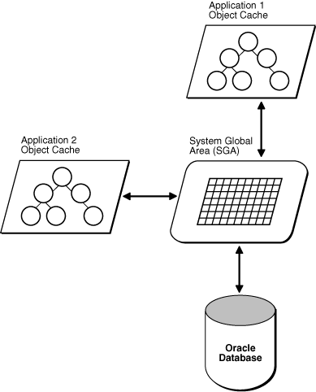
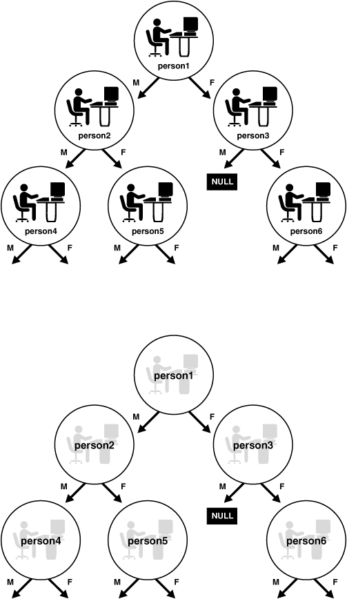

This chapter introduces the OCI facility for working with objects in an Oracle Database.

It also discusses the object navigational function calls, type evolution, and support for XML produced by OCI.

This chapter contains these topics:

- Object Cache and Memory Management

- Object Navigation

- OCI Navigational Functions

- Type Evolution and the Object Cache

### 22.1 Object Cache and Memory Management

The object cache is a client-side memory buffer that provides lookup and memory management support for objects.

It stores and tracks object instances that have been fetched by an OCI application. The object cache provides memory management.

When objects are fetched by the application through a SQL `SELECT` statement, or through an OCI pin operation, a copy of the object is stored in the object cache. Objects that are fetched directly through a `SELECT` statement are fetched by value, and they are nonreferenceable objects that cannot be pinned. Only referenceable objects can be pinned.

If an object is being pinned, and an appropriate version exists in the cache, it does not need to be fetched from the server.

Every client program that uses OCI to dereference `REF`s to retrieve objects utilizes the object cache. A client-side object cache is allocated for every OCI environment handle initialized in object mode. Multiple threads of a process can share the same client-side cache by sharing the same OCI environment handle.

Exactly one copy of each referenceable object exists in the cache for each connection. The object cache is logically partitioned by the connection.

Dereferencing a `REF` many times or dereferencing several equivalent `REF`s in the same connection returns the same copy of the object.

If you modify a copy of an object in the cache, you must flush the changes to the server before they are visible to other processes. Objects that are no longer needed can be unpinned or freed; they can then be swapped out of the cache, freeing the memory space they occupied.

When database objects are loaded into the cache, they are transparently mapped into the C language structures. The object cache maintains the association between all object copies in the cache and their corresponding objects in the database. When the transaction is committed, changes made to the object copy in the cache are automatically propagated to the database.

The cache does not manage the contents of object copies; it does not automatically refresh object copies. The application must ensure the correctness and consistency of the contents of object copies. For example, if the application marks an object copy for insert, update, or delete, and then terminates the transaction, the cache simply unmarks the object copy but does not purge or invalidate the copy. The application must pin recent or latest, or refresh the object copy in the next transaction. If it pins any, it may get the same object copy with its uncommitted changes from the previous terminated transaction.

The object cache is created when the OCI environment is initialized using `OCIEnvCreate()` with `mode` set to `OCI_OBJECT`.

The object cache maintains a fast lookup table for mapping `REF`s to objects. When an application dereferences a `REF` and the corresponding object is not yet cached in the object cache, the object cache automatically sends a request to the server to fetch the object from the database and load it into the object cache.

Subsequent dereferences of the same `REF` are faster because they use local cache access and do not incur network round-trips. To notify the object cache that an application is accessing an object in the cache, the application pins the object; when it is done with the object, it should unpin it. The object cache maintains a pin count for each object in the cache; the count is incremented upon a pin call, and an unpin call decrements it. The pin count goes to zero when the object is no longer needed by the application.

The object cache uses a least recently used (LRU) algorithm to manage the size of the cache. The LRU algorithm frees candidate objects when the cache reaches the maximum size. The candidate objects are objects with a pin count of zero.

Each application process running against the same server has its own object cache, as shown in Figure 22-1.

Figure 22-1 Object Cache

[Description of "Figure 22-1 Object Cache"](img_text/lnoci028.md)

The object cache tracks the objects that are currently in memory, maintains references to the objects, manages automatic object swapping, and tracks object meta-attributes.

This section includes the following topics:

- Cache Consistency and Coherency

- Object Cache Parameters

- Object Cache Operations

- About Loading and Removing Object Copies

- About Making Changes to Object Copies

- About Synchronizing Object Copies with the Server

- Object Locking

- Commit and Rollback in Object Applications

- Object Duration

- Memory Layout of an Instance

**See Also:**

- About Pinning an Object Copy

- [OCIEnvCreate()](connect-authorize-and-initialize-functions.md)

#### 22.1.1 Cache Consistency and Coherency

The object cache does not automatically maintain value coherency or consistency between object copies and their corresponding objects in the database.

In other words, if an application makes changes to an object copy, the changes are not automatically applied to the corresponding object in the database, and vice versa. The cache provides operations such as flushing a modified object copy to the database and refreshing a stale object copy with the latest value from the database to enable the program to maintain some coherency.

**Note:**

Oracle Database does not support automatic cache coherency with the server's buffer cache or database. Automatic cache coherency refers to the mechanism by which the object cache refreshes local object copies when the corresponding objects have been modified in the server's buffer cache. This mechanism occurs when the object cache flushes the changes made to local object copies to the buffer cache before any direct access of corresponding objects in the server. Direct access includes using SQL, triggers, or stored procedures to read or modify objects in the server.

#### 22.1.2 Object Cache Parameters

The object cache has two important parameters associated with it, which are attributes of the environment handle.

They include:

- `OCI_ATTR_CACHE_MAX_SIZE` – The maximum cache size

- `OCI_ATTR_CACHE_OPT_SIZE` – The optimal cache size

These parameters refer to levels of cache memory usage, and they help determine when the cache automatically ages out eligible objects to free up memory.

If the memory occupied by the objects currently in the cache reaches or exceeds the maximum cache size, the cache automatically begins to free (or ages out) unmarked objects that have a pin count of zero. The cache continues freeing such objects until memory usage in the cache reaches the optimal size, or until it runs out of objects eligible for freeing. Note that the cache can grow beyond the specified maximum cache size.

`OCI_ATTR_CACHE_MAX_SIZE` is specified as a percentage of `OCI_ATTR_CACHE_OPT_SIZE`. The maximum object cache size (in bytes) is computed by incrementing `OCI_ATTR_CACHE_OPT_SIZE` by the `OCI_ATTR_CACHE_MAX_SIZE` percentage, using the following algorithm:

    maximum_cache_size = optimal_size + optimal_size * max_size_percentage / 100

Next, represent the algorithm in terms of environment handle attributes.

    maximum_cache_size = OCI_ATTR_CACHE_OPT_SIZE + OCI_ATTR_CACHE_OPT_SIZE *
                                                OCI_ATTR_CACHE_MAX_SIZE / 100

You can set the value of `OCI_ATTR_CACHE_MAX_SIZE` at 10% (the default) of the `OCI_ATTR_CACHE_OPT_SIZE`. The default value for `OCI_ATTR_CACHE_OPT_SIZE` is 8 MB.

The cache size attributes of the environment handle can be set with the `OCIAttrSet()` call and retrieved with the `OCIAttrGet()` function.

**See Also:**

- [Environment Handle Attributes](handle-and-descriptor-attributes.md) for more information

- [OCIAttrSet()](handle-and-descriptor-functions.md)

- [OCIAttrGet()](handle-and-descriptor-functions.md)

#### 22.1.3 Object Cache Operations

This section describes the most important functions that the object cache provides to operate on object copies.

This section includes the following topics:

- About Pinning and Unpinning

- About Freeing

- About Marking and Unmarking

- About Flushing

- About Refreshing

**See Also:**

OCI Navigational Functions for a list of all the OCI navigational, cache, and object management functions

##### 22.1.3.1 About Pinning and Unpinning

Pinning an object copy enables the application to access it in the cache by dereferencing the `REF` to it.

Unpinning an object indicates to the cache that the object currently is not being used. Objects should be unpinned when they are no longer needed to make them eligible for implicit freeing by the cache, thus freeing up memory.

##### 22.1.3.2 About Freeing

What about freeing an object. What does it do.

Freeing an object copy removes it from the cache and frees its memory.

##### 22.1.3.3 About Marking and Unmarking

Marking an object notifies the cache that an object copy has been updated in the cache and the corresponding object must be updated in the server when the object copy is flushed.

Unmarking an object removes the indication that the object has been updated.

##### 22.1.3.4 About Flushing

Flushing an object writes local changes made to marked object copies in the cache to the corresponding objects in the server.

When this happens, the copies in the object cache are unmarked.

##### 22.1.3.5 About Refreshing

Refreshing an object copy in the cache replaces it with the latest value of the corresponding object in the server.

Note that pointers to top-level object memory are valid after a refresh. However, pointers to secondary-level memory (for example, string text pointers, collections, and so on) may become invalid after a refresh.

For example, if the object is of type `person` with two attributes: `salary (number)`, and `name (varchar2(20)`). The type is:

    struct Person {
    OCINumber salary;
    OCIString *name;
    }

If the client has a pointer `scott_p` to `Person` instance, and calls `OCIObjectRefresh()` on that instance, the pointer `scott_p` is still the same after the refresh, but the pointers to second-level memory, such as `scott_p->name`, can be different.

**See Also:**

[OCIObjectRefresh()](oci-flush-or-refresh-functions.md)

#### 22.1.4 About Loading and Removing Object Copies

Pin, unpin, and free functions are discussed in this section.

This section includes the following topics:

- About Pinning an Object Copy

- About Unpinning an Object Copy

- About Freeing an Object Copy

##### 22.1.4.1 About Pinning an Object Copy

When an application must dereference a `REF` in the object cache, it calls `OCIObjectPin()`. This call dereferences the `REF` and pins the object copy in the cache. As long as the object copy is pinned, it is guaranteed to be accessible by the application. `OCIObjectPin()` takes a pin option, any, recent, or latest. The data type of the pin option is `OCIPinOpt`.

- If the any (`OCI_PIN_ANY`) option is specified, the object cache immediately returns the object copy that is in the cache, if one exists. If no copy is in the cache, the object cache loads the latest object copy from the database and then returns the object copy. The any option is appropriate for read-only, informational, fact, or meta objects, such as products, sales representatives, vendors, regions, parts, or offices. These objects usually do not change often, and even if they change, the change does not affect the application.

  Note that the object cache looks for the object copy only within the logical partition of the cache for the specified connection. If there is no copy in the partition, the latest copy of the object is loaded from the server.

- If the latest (`OCI_PIN_LATEST`) option is specified, the object cache loads into the cache the latest object copy from the database. It returns that copy unless the object copy is locked in the cache, in which case the marked object copy is returned immediately. If the object is in the cache and not locked, the latest object copy is loaded and overwrites the existing one. The latest option is appropriate for operational objects, such as purchase orders, bugs, line items, bank accounts, or stock quotes. These objects usually change often, and it is important that the program access these objects at their latest possible state.

- If the recent (`OCI_PIN_RECENT`) option is specified, there are two possibilities:

  - If in the same transaction the object copy has been previously pinned using the latest or recent option, the recent option becomes equivalent to the any option.

  - If the previous condition does not apply, the recent option becomes equivalent to the latest option.

When the program pins an object, the program also specifies one of two possible values for the pin duration: session or transaction. The data type of the duration is `OCIDuration`.

- If the pin duration is session (`OCI_DURATION_SESSION`), the object copy remains pinned until the end of session (that is, end of connection) or until it is unpinned explicitly by the program (by calling `OCIObjectUnpin()`).

- If the pin duration is transaction (`OCI_DURATION_TRANS`), the object copy remains pinned until the end of transaction or until it is unpinned explicitly.

When loading an object copy into the cache from the database, the cache effectively executes the following statement:

    SELECT VALUE(t) FROM t WHERE REF(t) = :r

In this statement, `t` is the object table storing the object, `r` is the `REF`, and the fetched value becomes the value of the object copy in the cache.

Because the object cache effectively executes a separate `SELECT` statement to load each object copy into the cache, in a read-committed transaction, object copies are not guaranteed to be read-consistent with each other.

In a serializable transaction, object copies pinned as recent or latest are read-consistent with each other because the `SELECT` statements to load these object copies are executed based on the same database snapshot.

Read-committed and serialized transactions refer to different isolation levels that a database can support. There are other isolation levels also, such as read-uncommitted, repeatable read, and so on. Each isolation level permits more or less interference among concurrent transactions. Typically, when an isolation level permits more interference, simultaneous transactions have higher concurrency. In a read-committed transaction, when a query is executed multiple times, this type of transaction can produce inconsistent sets of data because it allows changes made by other committed transactions to be seen. This does not happen in serializable transactions.

The object cache model is orthogonal to or independent of the Oracle Database transaction model. The behavior of the object cache does not change based on the transaction model, even though the objects that are retrieved from the server through the object cache can be different when running the same program under different transaction models (for example, read-committed versus serializable).

**Note:**

For `OCIObjectArrayPin()` the pin option has no effect, because objects are always retrieved from the database. If a `REF` is to an object in the cache, `OCIObjectArrayPin()` fails with:

    ORA-22881: dangling REF

**See Also:**

- [OCIObjectPin()](oci-pin-unpin-and-free-functions.md)

- [OCIObjectArrayPin()](oci-pin-unpin-and-free-functions.md)

##### 22.1.4.2 About Unpinning an Object Copy

An object copy can be unpinned when it is no longer used by the program.

It then becomes available to be freed. An object copy must be both completely unpinned and unmarked to become eligible to be implicitly freed by the cache when the cache begins to run out of memory. To be completely unpinned, an object copy that has been pinned n times must be unpinned n times.

An unpinned but marked object copy is not eligible for implicit freeing until the object copy is flushed or explicitly unmarked by the user. However, the object cache implicitly frees object copies only when it begins to run out of memory, so an unpinned object copy need not necessarily be freed. If it has not been implicitly freed and is pinned again (with the any or recent options), the program gets the same object copy.

An application calls `OCIObjectUnpin()` or `OCIObjectPinCountReset()` to unpin an object copy. In addition, a program can call `OCICacheUnpin()` to completely unpin all object copies in the cache for a specific connection.

**See Also:**

- [OCIObjectUnpin()](oci-pin-unpin-and-free-functions.md)

- [OCIObjectPinCountReset()](oci-pin-unpin-and-free-functions.md)

- [OCICacheUnpin()](oci-pin-unpin-and-free-functions.md)

##### 22.1.4.3 About Freeing an Object Copy

Freeing an object copy removes it from the object cache and frees up its memory.

The cache supports two methods for freeing up memory:

- Explicit freeing – A program explicitly frees or removes an object copy from the cache by calling `OCIObjectFree()`, which takes an option to (forcefully) free either a marked or pinned object copy. The program can also call `OCIObjectFree()` to free all object copies in the cache.

- Implicit freeing – if the cache begins to run out of memory, it implicitly frees object copies that are both unpinned and unmarked. Unpinned objects that are marked are eligible for implicitly freeing only when the object copy is flushed or unmarked.

For memory management reasons, it is important that applications unpin objects when they are no longer needed. This makes these objects available for aging out of the cache, and makes it easier for the cache to free memory when necessary.

OCI does not provide a function to free unreferenced objects in the client-side cache.

**See Also:**

- Object Cache Parameters for more information

- [OCIObjectFree()](oci-pin-unpin-and-free-functions.md)

#### 22.1.5 About Making Changes to Object Copies

Functions for marking and unmarking object copies are discussed in this section.

This section includes the following topics:

- About Marking an Object Copy

- About Unmarking an Object Copy

##### 22.1.5.1 About Marking an Object Copy

An object copy can be created, updated, and deleted locally in the cache.

If the object copy is created in the cache (by calling `OCIObjectNew()`), the object copy is marked for insert by the object cache, so that the object is inserted in the server when the object copy is flushed.

If the object copy is updated in the cache, the user must notify the object cache by marking the object copy for update (by calling `OCIObjectMarkUpdate()`). When the object copy is flushed, the corresponding object in the server is updated with the value in the object copy.

If the object copy is deleted, the object copy is marked for delete in the object cache (by calling `OCIObjectMarkDelete()`). When the object copy is flushed, the corresponding object in the server is deleted. The memory of the marked object copy is not freed until it is flushed and unpinned. When pinning an object marked for delete, the program receives an error, as if the program is dereferencing a dangling reference.

When a user makes multiple changes to an object copy, it is the final results of these changes that are applied to the object in the server when the copy is flushed. For example, if the user updates and deletes an object copy, the object in the server is deleted when the object copy is flushed. Similarly, if an attribute of an object copy is updated multiple times, it is the final value of this attribute that is updated in the server when the object copy is flushed.

The program can mark an object copy as updated or deleted only if the object copy has been loaded into the object cache.

**See Also:**

- [OCIObjectNew()](oci-miscellaneous-object-functions.md)

- [OCIObjectMarkUpdate()](oci-mark-or-unmark-object-cache-functions.md)

- [OCIObjectMarkDelete()](oci-mark-or-unmark-object-cache-functions.md)

##### 22.1.5.2 About Unmarking an Object Copy

A marked object copy can be unmarked in the object cache.

By unmarking a marked object copy, the program ensures that the changes that are made to the object copy are not flushed to the server. The object cache does not undo the local changes that are made to the object copy.

A program calls `OCIObjectUnmark()` to unmark an object. In addition, a program can call `OCICacheUnmark()` to unmark all object copies in the cache for a specific connection.

**See Also:**

- [OCIObjectUnmark()](oci-mark-or-unmark-object-cache-functions.md)

- [OCICacheUnmark()](oci-mark-or-unmark-object-cache-functions.md)

#### 22.1.6 About Synchronizing Object Copies with the Server

Cache and server synchronization operations (flushing, refreshing) are discussed in this section.

This section includes the following topics:

- About Flushing Changes to the Server

- About Refreshing an Object Copy

##### 22.1.6.1 About Flushing Changes to the Server

When the program flushes the object copy, it writes the local changes made to a marked object copy in the cache to the server.

The program can call `OCIObjectFlush()` to flush a single object copy. The program can call `OCICacheFlush()` to flush all marked object copies in the cache or a list of selected marked object copies. `OCICacheFlush()` flushes objects associated with a specific service context. See `OCICacheFlush()`.

After the object copy is flushed, it is unmarked. (Note that the object is locked in the server after it is flushed; the object copy is therefore marked as locked in the cache.)

**Note:**

The `OCIObjectFlush()` operation incurs only a single server round-trip even if multiple objects are being flushed.

The callback function (an optional argument to the `OCIObjectFlush()` call) enables an application to flush only dirty objects of a certain type. The application can define a callback that returns only the desired objects. In this case, the operation still incurs only a single server round-trip for the flush.

In the default mode during `OCIObjectFlush()`, the objects are flushed in the order that they are marked dirty. The performance of this flush operation can be considerably improved by setting the `OCI_ATTR_CACHE_ARRAYFLUSH` attribute in the environment handle.

However, the `OCI_ATTR_CACHE_ARRAYFLUSH` attribute should be used only if the order in which the objects are flushed is not important. While this attribute is in effect, the dirty objects are grouped together and sent to the server in a manner that enables the server to efficiently update its tables. When this attribute is enabled, it is not guaranteed that the order in which the objects are marked dirty is preserved.

**See Also:**

- [Environment Handle Attributes](handle-and-descriptor-attributes.md)

- [OCIObjectFlush()](oci-flush-or-refresh-functions.md)

- [OCICacheFlush()](oci-flush-or-refresh-functions.md)

##### 22.1.6.2 About Refreshing an Object Copy

When refreshed, an object copy is reloaded with the latest value of the corresponding object in the server.

The latest value may contain changes made by other committed transactions and changes made directly (not through the object cache) in the server by the transaction. The program can change objects directly in the server using SQL DML, triggers, or stored procedures.

To refresh a marked object copy, the program must first unmark the object copy. An unpinned object copy is freed when it is refreshed (that is, when the whole cache is refreshed).

The program can call `OCIObjectRefresh()` to refresh a single object copy or `OCICacheRefresh()` to refresh all object copies in the cache, all object copies that are loaded in a transaction (that is, object copies that are pinned recent or pinned latest), or a list of selected object copies.

When an object is flushed to the server, triggers can be fired to modify more objects in the server. The same objects (modified by the triggers) in the object cache become out-of-date, and must be refreshed before they can be locked or flushed.

The various meta-attribute flags and durations of an object are modified as described in Table 22-1 after being refreshed.

Table 22-1 Object Attributes After a Refresh Operation

| Object Attribute    | Status After Refresh     |
|:--------------------|:-------------------------|
| Existent            | Set to appropriate value |
| Pinned              | Unchanged                |
| Flushed             | Reset                    |
| Allocation duration | Unchanged                |
| Pin duration        | Unchanged                |

During the refresh operation, the object cache loads the new data into the top-level memory of an object copy, thus reusing the top-level memory. The top-level memory of an object copy contains the inline attributes of the object. However, the memory for the out-of-line attributes of an object copy can be freed and relocated, because the out-of-line attributes can vary in size.

**See Also:**

- Memory Layout of an Instance for more information about object memory

- [OCIObjectRefresh()](oci-flush-or-refresh-functions.md)

- [OCICacheRefresh()](oci-flush-or-refresh-functions.md)

#### 22.1.7 Object Locking

OCI functions related to object locking are discussed in this section.

This section includes the following topics:

- Lock Options

- About Locking Objects for Update

- About Locking with the NOWAIT Option

- About Implementing Optimistic Locking

##### 22.1.7.1 Lock Options

When pinning an object, you can specify whether the object should be locked or not through lock options.

When an object is locked, a server-side lock is acquired, which prevents any other user from modifying the object. The lock is released when the transaction commits or rolls back. The different lock options are as follows:

- The lock option `OCI_LOCK_NONE` instructs the cache to pin the object without locking.

- The lock option `OCI_LOCK_X` instructs the cache to pin the object only after acquiring a lock. If the object is currently locked by another user, the pin call with this option waits until it can acquire the lock before returning to the caller. This is equivalent to executing a `SELECT` `FOR` `UPDATE` statement.

- The lock option `OCI_LOCK_X_NOWAIT` instructs the cache to pin the object only after acquiring a lock. Unlike the `OCI_LOCK_X` option, the pin call with the `OCI_LOCK_X_NOWAIT` option does not wait if the object is currently locked by another user. This is equivalent to executing a `SELECT` `FOR` `UPDATE` `WITH` `NOWAIT` statement.

##### 22.1.7.2 About Locking Objects for Update

The program can optionally call `OCIObjectLock()` to lock an object for update.

This call instructs the object cache to get a row lock on the object in the database. This is similar to executing the following statement:

    SELECT NULL FROM t WHERE REF(t) = :r FOR UPDATE

In this statement, `t` is the object table storing the object to be locked, and `r` is the `REF` identifying the object. The object copy is marked locked in the object cache after `OCIObjectLock()` is called.

To lock a graph or set of objects, several `OCIObjectLock()` calls are required (one for each object) or the array pin `OCIObjectArrayPin()` call can be used for better performance.

By locking an object, the application is guaranteed that the object in the cache is up-to-date. No other transaction can modify the object while the application has it locked.

At the end of a transaction, all locks are released automatically by the server. The locked indicator in the object copy is reset.

**See Also:**

- [OCIObjectLock()](oci-miscellaneous-object-functions.md)

- [OCIObjectArrayPin()](oci-pin-unpin-and-free-functions.md)

##### 22.1.7.3 About Locking with the NOWAIT Option

Occasionally, an application attempts to lock an object that is currently locked by another user. In this case, the application is blocked.

To avoid blocking when trying to lock an object, an application can use the `OCIObjectLockNoWait()` call instead of `OCIObjectLock()`. This function returns an error if it cannot lock an object immediately because it is locked by another user.

The `NOWAIT` option is also available to pin calls by passing a value of `OCI_LOCK_X_NOWAIT` as the lock option parameter.

**See Also:**

- [OCIObjectLockNoWait()](oci-miscellaneous-object-functions.md)

- [OCIObjectLock()](oci-miscellaneous-object-functions.md)

##### 22.1.7.4 About Implementing Optimistic Locking

There are two options available for implementing optimistic locking in an OCI application.

Optimistic locking makes the assumption that a transaction will modify objects in the cache, flush them, and commit the changes successfully.

Optimistic Locking Option 1
The first optimistic locking option is for OCI applications that run transactions at the serializable level.

OCI supports calls that allow you to dereference and pin objects in the object cache without locking them, modify them in the cache (again without locking them), and then flush them (the dirtied objects) to the database.

During the flush operation, if a dirty object has been modified by another committed transaction since the beginning of your transaction, a nonserializable transaction error is returned. If none of the dirty objects has been modified by any other transaction since the beginning of your transaction, then your transaction writes the changes to the database successfully.

**Note:**

`OCITransCommit()` flushes dirty objects into the database before committing a transaction.

The preceding mechanism effectively implements an optimistic locking model.

Optimistic Locking Option 2
Alternately, an application can enable object change detection mode. To do this operation, set the `OCI_ATTR_OBJECT_DETECTCHANGE` attribute of the environment handle to a value of `TRUE`.

When this mode has been activated, the application receives an `ORA-08179` error ("concurrency check failed") when it attempts to flush an object that has been changed in the server by another committed transaction. The application can then handle this error in an appropriate manner.

**See Also:**

[OCITransCommit()](transaction-functions.md)

#### 22.1.8 Commit and Rollback in Object Applications

When a transaction is committed (`OCITransCommit()`), all marked objects are flushed to the server.

If an object copy is pinned with a transaction duration, the object copy is unpinned.

When a transaction is rolled back, all marked objects are unmarked. If an object copy is pinned with a transaction duration, the object copy is unpinned.

**See Also:**

[OCITransCommit()](transaction-functions.md)

#### 22.1.9 Object Duration

To maintain free space in memory, the object cache attempts to reuse objects' memory whenever possible. The object cache reuses an object's memory when the object's lifetime (allocation duration) expires or when the object's pin duration expires.

The allocation duration is set when an object is created with `OCIObjectNew()`, and the pin duration is set when an object is pinned with `OCIObjectPin()`. The data type of the duration value is `OCIDuration`.

**Note:**

The pin duration for an object cannot be longer than the object's allocation duration.

When an object reaches the end of its allocation duration, it is automatically deleted and its memory can be reused. The pin duration indicates when an object's memory can be reused; memory is reused when the cache is full.

OCI supports two predefined durations:

- Transaction (`OCI_DURATION_TRANS`)

- Session (`OCI_DURATION_SESSION`)

The transaction duration expires when the containing transaction ends (commits or terminates). The session duration expires when the containing session or connection ends.

The application can explicitly unpin an object using `OCIObjectUnpin()`. To minimize explicit unpinning of individual objects, the application can unpin all objects currently pinned in the object cache using the function `OCICacheUnpin()`. By default, all objects are unpinned at the end of the pin duration.

This section includes the following topic: Durations Example.

**See Also:**

- [OCIObjectNew()](oci-miscellaneous-object-functions.md)

- [OCIObjectPin()](oci-pin-unpin-and-free-functions.md)

- [OCIObjectUnpin()](oci-pin-unpin-and-free-functions.md)

- [OCICacheUnpin()](oci-pin-unpin-and-free-functions.md)

##### 22.1.9.1 Durations Example

Illustrates the use of the different durations in an application.

Table 22-2 illustrates the use of the different durations in an application. Four objects are created or pinned in this application over the course of one connection and three transactions. The first column is the relative time indicator. The second column indicates the action performed by the database, and the third column indicates the function that performs the action. The remaining columns indicate the states of the various objects at each point in the application.

For example, Object 1 comes into existence at T2 when it is created with a connection duration, and it exists until T19 when the connection is terminated. Object 2 is pinned at T7 with a transaction duration, after being fetched at T6, and it remains pinned until T9 when the transaction is committed.

Table 22-2 Example of Allocation and Pin Durations

| Time           | Application Action                                  | Function                                                | Object 1 | Object 2 | Object 3 | Object 4 |
|:---------------|:----------------------------------------------------|:--------------------------------------------------------|:---------|:---------|:---------|:---------|
| T1  | Establish connection                                | \-                                                      | \-       | \-       | \-       | \-       |
| T2  | Create object 1 - allocation duration = connection  | [OCIObjectNew()](oci-miscellaneous-object-functions.md) | Exists   | \-       | \-       | \-       |
| T5  | Start Transaction1                                  | [OCITransStart()](transaction-functions.md)             | Exists   | \-       | \-       | \-       |
| T6  | SQL - fetch `REF` to object 2                       | \-                                                      | Exists   | \-       | \-       | \-       |
| T7  | Pin object 2 - pin duration = transaction           | [OCIObjectPin()](oci-pin-unpin-and-free-functions.md)   | Exists   | Pinned   | \-       | \-       |
| T8  | Process application data                            | \-                                                      | Exists   | Pinned   | \-       | \-       |
| T9  | Commit Transaction1                                 | [OCITransCommit()](transaction-functions.md)            | Exists   | Unpinned | \-       | \-       |
| T10 | Start Transaction2                                  | [OCITransStart()](transaction-functions.md)             | Exists   | \-       | \-       | \-       |
| T11 | Create object 3 - allocation duration = transaction | [OCIObjectNew()](oci-miscellaneous-object-functions.md) | Exists   | \-       | Exists   | \-       |
| T12 | SQL - fetch `REF` to object 4                       | \-                                                      | Exists   | \-       | Exists   | \-       |
| T13 | Pin object 4 - pin duration = connection            | [OCIObjectPin()](oci-pin-unpin-and-free-functions.md)   | Exists   | \-       | Exists   | Pinned   |
| T14 | Commit Transaction2                                 | [OCITransCommit()](transaction-functions.md)            | Exists   | \-       | Deleted  | Pinned   |
| T15 | Terminate session1                                  | [OCIDurationEnd()](lob-functions.md)                    | Exists   | \-       | \-       | Pinned   |
| T16 | Start Transaction3                                  | [OCITransStart()](transaction-functions.md)             | Exists   | \-       | \-       | Pinned   |
| T17 | Process application data                            | \-                                                      | Exists   | \-       | \-       | Pinned   |
| T18 | Commit Transaction3                                 | [OCITransCommit()](transaction-functions.md)            | Exists   | \-       | \-       | Pinned   |
| T19 | Terminate connection                                | \-                                                      | Deleted  | \-       | \-       | Unpinned |

**See Also:**

- The descriptions of [OCIObjectNew()](oci-miscellaneous-object-functions.md) and [OCIObjectPin()](oci-pin-unpin-and-free-functions.md) in [OCI Navigational and Type Functions](oci-navigational-and-type-functions.md) for specific information about parameter values that can be passed to these functions

- [About Creating Objects](oci-object-relational-programming.md) for information about freeing up an object's memory before its allocation duration has expired

#### 22.1.10 Memory Layout of an Instance

An instance in memory is composed of a top-level memory chunk of the instance, a top-level memory of the null indicator structure and optionally, some secondary memory chunks.

Consider the `DEPARTMENT` row type defined in Example 22-1.

The C representation of the `DEPARTMENT` is shown in Example 22-2.

Each instance of `DEPARTMENT` has a top-level memory chunk that contains the top-level attributes such as `dep_name`, `budget`, `manager`, and `employees`. The attributes `dep_name` and `employees` are pointers to the additional memory (the secondary memory chunks). The secondary memory is used to contain the data for the embedded instances (for example, `employees` varray and `dep_name` string).

The top-level memory of the null indicator structure contains the null statuses of the attributes in the top-level memory chunk of the instance. In Example 22-2, the top-level memory of the null structure contains the null statuses of the attributes `dep_name`, `budget`, and `manager`, and the atomic nullity of `employees`.

Example 22-1 Object Type Representation of a Department Row

    CREATE TYPE department AS OBJECT
    ( dep_name      varchar2(20),
      budget        number,
      manager       person,            /* person is an object type */
      employees     person_array );   /* varray of person objects */

Example 22-2 C Representation of a Department Row

    struct department
    {
    OCIString * dep_name;
    OCINumber budget;
    struct person manager;
    OCIArray * employees;
    );
    typedef struct department department;

### 22.2 Object Navigation

This section discusses how OCI applications can navigate through graphs of objects in the object cache.

This section includes the following topic: Simple Object Navigation.

#### 22.2.1 Simple Object Navigation

If an application retrieves an object with an attribute that is a `REF` to another object, the application can use OCI calls to traverse the object graph and access the referenced instance.

In Example 22-1 and Example 22-2, the object retrieved by the application was a simple object, whose attributes were all scalar values.

As an example, consider the following declaration for a new type in the database:

    CREATE TYPE person_t AS OBJECT
    (  name          VARCHAR2(30),
      mother          REF person_t,
      father          REF person_t);

An object table of `person_t` objects is created with the following statement:

    CREATE TABLE person_table OF person_t;

Instances of the `person_t` type can now be stored in the typed table. Each instance of `person_t` includes references to two other objects, which would also be stored in the table. A `NULL` reference could represent a parent about whom information is not available.

An object graph is a graphical representation of the `REF` links between object instances. For example, Figure 22-2 depicts an object graph of `person_t` instances, showing the links from one object to another. The circles represent objects, and the arrows represent references to other objects. The M and F adjacent to the arrows indicate mother and father, respectively.

Figure 22-2 Object Graph of person_t Instances

[Description of "Figure 22-2 Object Graph of person_t Instances"](img_text/lnoci027.md)

In this case, each object has links to two other instances (M and F) of the same object. This need not always be the case. Objects may have links to other object types. Other types of graphs are also possible. For example, if a set of objects is implemented as a linked list, the object graph could be viewed as a simple chain, where each object references either the previous or next objects or both in the linked list.

You can use the methods described earlier in this chapter to retrieve a reference to a `person_t` instance and then pin that instance. OCI provides functionality that enables you to traverse the object graph by following a reference from one object to another.

As an example, assume that an application fetches the `person1` instance in the preceding graph and pins it as `pers_1`. Once that has been done, the application can access the mother instance of `person1` and pin it into `pers_2` through a second pin operation:

    OCIObjectPin(env, err, pers_1->mother, OCI_PIN_ANY, OCI_DURATION_TRANS,
                 OCI_LOCK_X, (OCIComplexObject *) 0, &pers_2);

In this case, an OCI fetch operation is not required to retrieve the second instance.

The application could then pin the father instance of `person1`, or it could operate on the reference links of `person2`.

**Note:**

Attempting to pin a `NULL` or dangling `REF` results in an error on the `OCIObjectPin()` call.

**See Also:**

[OCIObjectPin()](oci-pin-unpin-and-free-functions.md)

### 22.3 OCI Navigational Functions

This section provides a brief summary of the available OCI navigational functions.

The functions are grouped according to their general functionality.

This section includes the following topics:

- About Pin/Unpin/Free Functions

- About Flush and Refresh Functions

- About Mark and Unmark Functions

- About Object Meta-Attribute Accessor Functions

- About Other Functions

Earlier sections of this chapter describe the use of these functions.

The navigational functions follow a naming scheme that uses different prefixes for different types of functionality:

`OCICache*()` – These functions are cache operations.

`OCIObject*()` – These functions are individual object operations.

**See Also:**

[OCI Navigational and Type Functions](oci-navigational-and-type-functions.md) for more detailed descriptions of each of these functions

#### 22.3.1 About Pin/Unpin/Free Functions

Lists and describes the pin, unpin, and free functions.

The functions in Table 22-3 are available to pin, unpin, or free objects.

Table 22-3 Pin, Free, and Unpin Functions

| Function                                                        | Purpose                                         |
|:----------------------------------------------------------------|:------------------------------------------------|
| [OCICacheFree()](oci-pin-unpin-and-free-functions.md)           | Free all instances in the cache                 |
| [OCICacheUnpin()](oci-pin-unpin-and-free-functions.md)          | Unpin persistent objects in cache or connection |
| [OCIObjectArrayPin()](oci-pin-unpin-and-free-functions.md)      | Pin an array of references                      |
| [OCIObjectFree()](oci-pin-unpin-and-free-functions.md)          | Free and unpin a standalone instance            |
| [OCIObjectPin()](oci-pin-unpin-and-free-functions.md)           | Pin an object                                   |
| [OCIObjectPinCountReset()](oci-pin-unpin-and-free-functions.md) | Unpin an object to zero pin count               |
| [OCIObjectPinTable()](oci-pin-unpin-and-free-functions.md)      | Pin a table object with a given duration        |
| [OCIObjectUnpin()](oci-pin-unpin-and-free-functions.md)         | Unpin an object                                 |

#### 22.3.2 About Flush and Refresh Functions

Lists and describes the flush and refresh functions.

The functions in Table 22-4 are available to flush modified objects to the server.

Table 22-4 Flush and Refresh Functions

| Function                                                | Purpose                                              |
|:--------------------------------------------------------|:-----------------------------------------------------|
| [OCICacheFlush()](oci-flush-or-refresh-functions.md)    | Flush modified persistent objects in cache to server |
| [OCIObjectFlush()](oci-flush-or-refresh-functions.md)   | Flush a modified persistent object to the server     |
| [OCICacheRefresh()](oci-flush-or-refresh-functions.md)  | Refresh pinned persistent objects in the cache       |
| [OCIObjectRefresh()](oci-flush-or-refresh-functions.md) | Refresh a single persistent object                   |

#### 22.3.3 About Mark and Unmark Functions

Lists and describes the mark and unmark functions.

The functions in Table 22-5 allow an application to mark or unmark an object by modifying one of its meta-attributes.

Table 22-5 Mark and Unmark Functions

| Function                                                                   | Purpose                                           |
|:---------------------------------------------------------------------------|:--------------------------------------------------|
| [OCIObjectMarkDeleteByRef()](oci-mark-or-unmark-object-cache-functions.md) | Mark an object deleted when given a `REF`         |
| [OCIObjectMarkUpdate()](oci-mark-or-unmark-object-cache-functions.md)      | Mark an object as updated (dirty)                 |
| [OCIObjectMarkDelete()](oci-mark-or-unmark-object-cache-functions.md)      | Mark an object deleted or delete a value instance |
| [OCICacheUnmark()](oci-mark-or-unmark-object-cache-functions.md)           | Unmark all objects in the cache                   |
| [OCIObjectUnmark()](oci-mark-or-unmark-object-cache-functions.md)          | Mark a given object as updated                    |
| [OCIObjectUnmarkByRef()](oci-mark-or-unmark-object-cache-functions.md)     | Mark an object as updated, when given a `REF`     |

#### 22.3.4 About Object Meta-Attribute Accessor Functions

Lists and describes the meta-attribute accessor functions.

The functions in Table 22-6 allow an application to access the meta-attributes of an object.

Table 22-6 Object Meta-Attributes Functions

| Function                                                   | Purpose                               |
|:-----------------------------------------------------------|:--------------------------------------|
| [OCIObjectExists()](oci-get-object-status-functions.md)    | Get existence status of an instance   |
| [OCIObjectGetInd()](oci-miscellaneous-object-functions.md) | Get null structure of an instance     |
| [OCIObjectIsDirty()](oci-get-object-status-functions.md)   | Has an object been marked as updated? |
| [OCIObjectIsLocked()](oci-get-object-status-functions.md)  | Is an object locked?                  |

#### 22.3.5 About Other Functions

Lists and describes the miscellaneous functions.

The functions in Table 22-7 provide additional object functionality for OCI applications.

Table 22-7 Other Object Functions

| Function                                                         | Purpose                                 |
|:-----------------------------------------------------------------|:----------------------------------------|
| [OCIObjectCopy()](oci-miscellaneous-object-functions.md)         | Copy one instance to another            |
| [OCIObjectGetObjectRef()](oci-miscellaneous-object-functions.md) | Return a reference to a given object    |
| [OCIObjectGetTypeRef()](oci-miscellaneous-object-functions.md)   | Get a reference to a TDO of an instance |
| [OCIObjectLock()](oci-miscellaneous-object-functions.md)         | Lock a persistent object                |
| [OCIObjectLockNoWait()](oci-miscellaneous-object-functions.md)   | Lock an object in NOWAIT mode           |
| [OCIObjectNew()](oci-miscellaneous-object-functions.md)          | Create a new instance                   |

### 22.4 Type Evolution and the Object Cache

When type information is requested based on the type name, OCI returns the type descriptor object (TDO) corresponding to the latest version of the type.

Because there is no synchronization between the server and the object cache, the TDO in the object cache may not be current.

It is possible that the version of the image might differ from the TDO version during the pinning of an object. Then, an error is issued. It is up to you to stop the application or refresh the TDO and repin the object. Continuing with the application may cause the application to fail because even if the image and the TDO are at the same version, there is no guarantee that the object structure (that is, C struct) defined in the application is compatible with the new type version, especially when an attribute has been dropped from the type in the server.

Thus, when the structure of a type is altered, you must regenerate the header files of the changed type, modify their application, recompile, and relink before executing the program again.

**See Also:**

[About Type Evolution](oci-object-relational-programming.md)
