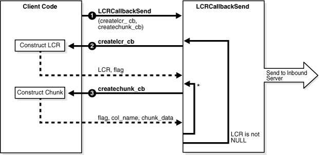
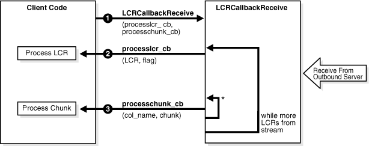

Lists and describes OCI XStream Functions.

This section and Table 35-2 describe the OCI XStream functions.

Table 35-2 OCI XStream Functions  

| Function                          | Purpose                                                                                            |
|:----------------------------------|:---------------------------------------------------------------------------------------------------|
| LCR Functions                     | To get and set one or more values of an LCR. Note: These calls do not require a server round-trip. |
| OCILCRAttributesGet()             | Gets extra attribute information in (ROW or DDL) LCR.                                              |
| OCILCRAttributesSet()             | Populates extra attribute information in ROW or DDL LCR.                                           |
| OCILCRComparePosition()           | Compares two position LCRID values.                                                                |
| OCILCRConvertPosition()           | Converts an LCRID value to the specified version (1 or 2).                                         |
| OCILCRFree()                      | Frees the LCR                                                                                      |
| OCILCRHeaderGet()                 | Returns the common header fields for a ROW or DDL LCR                                              |
| OCILCRHeaderSet()                 | Initializes the common header fields for a ROW or DDL LCR                                          |
| OCILCRDDLInfoGet()                | Retrieves specific fields in a DDL LCR                                                             |
| OCILCRDDLInfoSet()                | Populates DDL-specific fields in a DDL LCR                                                         |
| OCILCRLobInfoGet()                | Returns the LOB information for a piece-wise LOB LCR                                               |
| OCILCRLobInfoSet()                | Sets the LOB information for a piece-wise LOB LCR                                                  |
| OCILCRNew()                       | Constructs a new LCR object of the specified type (row or DDL) for the given duration              |
| OCILCRRowColumnInfoGet()          | Returns the column fields in a row LCR                                                             |
| OCILCRRowColumnInfoSet()          | Populates column fields in a row LCR                                                               |
| OCILCRRowStmtGet()                | Returns the generated SQL statement for the row LCR, with values in-lined                          |
| OCILCRRowStmtWithBindVarGet()     | Returns the generated SQL statement, which uses bind variables for column values                   |
| OCILCRSCNsFromPosition()          | Gets the SCN and commit SCN from a position value                                                  |
| OCILCRSCNToPosition()             | Converts SCN to position                                                                           |
| OCILCRWhereClauseGet()            | Gets the `WHERE` clause statement for the given row LCR                                            |
| OCILCRWhereClauseWithBindVarGet() | Gets the `WHERE` clause statement with bind variables for the given row LCR                        |
| XStream In Functions              | To send an LCR stream to an XStream inbound server                                                 |
| OCIXStreamInAttach()              | Attaches to an inbound server                                                                      |
| OCIXStreamInChunkSend()           | Sends chunk data to the inbound server                                                             |
| OCIXStreamInCommit()              | Commits the given transaction                                                                      |
| OCIXStreamInDetach()              | Detaches from the inbound server                                                                   |
| OCIXStreamInErrorGet()            | Returns the first error encountered by the inbound server since the attach call                    |
| OCIXStreamInFlush()               | Flushes the network while attaching to an XStream inbound server                                   |
| OCIXStreamInLCRCallbackSend()     | Sends the LCR stream to the attached inbound server using callbacks                                |
| OCIXStreamInLCRSend()             | Sends the LCR stream to the attached inbound server using callbacks                                |
| OCIXStreamInProcessedLWMGet()     | Gets the local processed low position                                                              |
| OCIXStreamInSessionSet()          | Sets session attributes for XStream In functions                                                   |
| XStream Out Functions             | To receive an LCR stream from an XStream outbound server                                           |
| OCIXStreamOutAttach()             | Attaches to an outbound server                                                                     |
| OCIXStreamOutChunkReceive()       | Retrieves data of each LOB or `LONG` or `XMLType` column one chunk at a time                       |
| OCIXStreamOutDetach()             | Detaches from the outbound server                                                                  |
| OCIXStreamOutLCRCallbackReceive() | Gets the LCR stream from the outbound server using callbacks                                       |
| OCIXStreamOutLCRReceive()         | Receives an LCR stream from an outbound server without using callbacks                             |
| OCIXStreamOutProcessedLWMSet()    | Updates the local copy of the processed low-water mark                                             |
| OCIXStreamOutSessionSet()         | Sets session attributes for XStream Out functions                                                  |

### 35.3.1 OCILCRAttributesGet()

Gets extra attribute information in (ROW or DDL) LCR.

#### Purpose

It gets any extra non-first class attributes that are not populated through `OCILCRHeaderGet()`, `OCILCRDDLInfoGet()`, or `OCILCRProcedureInfoGet()`, for example, edition name.

#### Syntax

    sword OCILCRAttributesGet (      OCISvcCtx   *svchp,
                                     OCIError    *errhp,
                                     ub2         *num_attrs,
                                     oratext     **attr_names,
                                     ub2         *attr_namesl,
                                     ub2         *attr_dtyp,
                                     void        **attr_valuesp,
                                     OCIInd      *attr_indp,
                                     ub2         *attr_alensp,
                                     void        *lcrp,
                                     ub2          array_size,
                                     ub4          mode );

#### Parameters

svchp (IN)
Service handle context.

errhp (IN/OUT)
An error handle you can pass to `OCIErrorGet()` for diagnostic information in case of an error.

num_attrs (OUT)
Number of extra attributes.

attr_names (OUT)
An array of extra attribute name pointers.

attr_namesl (OUT)
An array of extra attribute name lengths.

attr_dtyp (OUT)
An array of extra attribute data types. Valid data types: see Comments.

attr_valuesp (OUT)
An array of extra attribute data value pointers.

attr_indp (OUT)
An indicator array. Each returned element is an `OCIInd` value (`OCI_IND_NULL` or `OCI_IND_NOTNULL`).

attr_alensp (OUT)
An array of actual extra attribute data lengths. Each element in `alensp` is the length in bytes.

lcrp (IN)
Pointer to ROW or DDL LCR.

array_size (IN)
Size of the array argument in the other parameters. If `array_size` is not large enough to accommodate the number of attributes in the requested attribute list, then `OCI_ERROR` is returned. Parameter `num_attrs` returns the expected size.

mode (IN)
Specify `OCI_DEFAULT`.

#### Comments

The valid data types for `attr_dtyp` are:

    SQLT_CHR
    SQLT_INT
    SQLT_RDD

### 35.3.2 OCILCRAttributesSet()

Populates extra attribute information in ROW or DDL LCR.

#### Purpose

It populates any extra non-first class attributes that cannot be set through `OCILCRHeaderSet()`, `OCILCRDDLInfoSet()`, or `OCILCRRowColumnInfoSet()`, for example, edition name.

#### Syntax

    sword OCILCRAttributesSet (      OCISvcCtx   *svchp,
                                     OCIError    *errhp,
                                     ub2          num_attrs,
                                     oratext    **attr_names,
                                     ub2         *attr_names_lens,
                                     ub2         *attr_dtyp,
                                     void       **attr_valuesp,
                                     OCIInd      *attr_indp,
                                     ub2         *attr_alensp,
                                     void        *lcrp,
                                     ub4          mode );

#### Parameters

svchp (IN)
Service handle context.

errhp (IN/OUT)
An error handle you can pass to `OCIErrorGet()` for diagnostic information in case of an error.

num_attrs (IN)
Number of extra attributes.

attr_names (IN)
Pointer to an array of extra attribute names. Attribute names must be canonicalized.

attr_names_lens (IN)
Pointer to an array of extra attribute name lengths.

attr_dtyp (IN)
Pointer to an array of extra attribute data types. See valid data types in Comments of `OCILCRRowColumnInfoSet()`.

attr_valuesp (IN)
Address of an array of extra attribute data values.

attr_indp (IN)
Pointer to an indicator array. For all data types, this is a pointer to an array of `OCIInd` values (`OCI_IND_NULL` or `OCI_IND_NOTNULL`).

attr_alensp (IN)
Pointer to an array of actual extra attribute data lengths. Each element in `attr_lensp` is the length in bytes.

lcrp (IN/OUT)
Pointer to a ROW or DDL LCR.

mode (IN)
Specify `OCI_DEFAULT`.

#### Comments

Valid attributes are:

    #define OCI_LCR_ATTR_THREAD_NO              "THREAD#"
    #define OCI_LCR_ATTR_ROW_ID                 "ROW_ID"
    #define OCI_LCR_ATTR_SESSION_NO             "SESSION#"
    #define OCI_LCR_ATTR_SERIAL_NO              "SERIAL#"
    #define OCI_LCR_ATTR_USERNAME               "USERNAME"
    #define OCI_LCR_ATTR_TX_NAME                "TX_NAME"
    #define OCI_LCR_ATTR_EDITION_NAME           "EDITION_NAME"
    #define OCI_LCR_ATTR_MESSAGE_TRACKING_LABEL "MESSAGE_TRACKING_LABEL"
    #define OCI_LCR_ATTR_CURRENT_USER           "CURRENT_USER"
    #define OCI_LCR_ATTR_ROOT_NAME              "ROOT_NAME"

**Related Topics**

- OCILCRRowColumnInfoSet()

### 35.3.3 OCILCRComparePosition()

Compares two position LCRID values.

#### Purpose

These LCRIDs can have different versions. The provided position must be a valid LCRID for Oracle Database 12c Release 2 (12.2).

#### Syntax

    sword OCILCRComparePosition(OCISvcCtx  *svchp,
                                OCIError   *errhp,
                                ub1        *position1,
                                ub2         position1_len,
                                ub1        *position2,
                                ub2         position2_len,
                                ub4         mode,
                                sb2        *result);

#### Parameters

svchp (IN)
OCI service context.

errhp (IN)
OCI Error handle.

position1 (IN)
The first position value to compare.

position1_len (IN)
The length of `position1`.

position2 (IN)
The second position value to compare.

position2_len (IN)
The length of `position2`.

mode (IN)
The mode flags.

result (OUT)
`0` if both values are equal.

`-1` if `position1` is less than `position2`.

`1` if `position1` is greater than `position2`.

#### Returns

`OCI_SUCCESS` if the conversion succeeds, `OCI_ERROR` otherwise.

#### Usage Notes

Supported modes are:

- `0` - Complete byte comparison.

- `2` - Smaller length is smaller value

### 35.3.4 OCILCRConvertPosition()

Converts an LCRID value to the specified version (1 or 2).

#### Purpose

The provided LCRID must be valid for Oracle Database 12c Release 2 (12.2).

#### Syntax

    sword OCILCRConvertPosition(OCISvcCtx  *svchp,
                                OCIError   *errhp,
                                ub1        *in_position,
                                ub2         in_position_len,
                                ub1        *out_position,
                                ub2        *out_position_len,
                                ub1         to_version,
                                ub4         mode);

#### Parameters

svchp (IN)
OCI service context.

errhp (IN)
OCI Error handle.

in_position (IN)
The position value to convert.

in_position_len (IN)
The length of `in_position`.

out_position (OUT)
The result position value (in the specified version). The memory must be preallocated.

out_position_len (OUT)
The length of `out_position`.

to_version (IN)
The version to which to convert to. The value `1` should be specified for the original `OCI_LCRID_V1` format. The value `2` should be specified for the `OCI_LCRID_V2` format.

    #define  OCI_LCRID_V1       1
    #define  OCI_LCRID_V2       2

mode (IN)
The mode flags.

#### Returns

`OCI_SUCCESS` if the conversion succeeds.

`OCI_SUCCESS` if the LCRID is already in the desired version.

`OCI_ERROR` if the conversion fails.

#### Usage Notes

None.

### 35.3.5 OCILCRFree()

Frees the LCR.

#### Purpose

Frees the LCR.

#### Syntax

    sword OCILCRFree ( OCISvcCtx   *svchp,
                       OCIError    *errhp,
                       void        *lcrp,
                       ub4          mode );

#### Parameters

svchp (IN)
Service handle context.

errhp (IN)
An error handle you can pass to `OCIErrorGet()` for diagnostic information in case of an error.

lcrp (IN/OUT)
Streams LCR pointer.

mode (IN)
Specify `OCI_DEFAULT`.

### 35.3.6 OCILCRDDLInfoGet()

Retrieves specific fields in a DDL LCR.

#### Purpose

Retrieves specific fields in a DDL LCR.

#### Syntax

    sword OCILCRDDLInfoGet ( OCISvcCtx    *svchp,
                             OCIError     *errhp,
                             oratext     **object_type,
                             ub2          *object_type_len,
                             oratext     **ddl_text,
                             ub4          *ddl_text_len,
                             oratext     **logon_user,
                             ub2          *logon_user_len,
                             oratext     **current_schema,
                             ub2          *current_schema_len,
                             oratext     **base_table_owner,
                             ub2          *base_table_owner_len,
                             oratext     **base_table_name,
                             ub2          *base_table_name_len,
                             oraub8       *flag,
                             void         *ddl_lcrp,
                             ub4           mode );

#### Parameters

svchp (IN)
Service handle context.

errhp (IN/OUT)
An error handle you can pass to `OCIErrorGet()` for diagnostic information in case of an error.

object_type (OUT)
The type of object on which the DDL statement was executed. (See OCILCRDDLInfoSet().) Optional. If not `NULL`, then both `object_type` and `object_type_len` arguments must not be `NULL`.

object_type_len (OUT)
Length of the `object_type` string without the `NULL` terminator.

ddl_text (OUT)
The text of the DDL statement. Optional. If not `NULL`, then both `ddl_text` and `ddl_text_len` arguments must not be `NULL`.

ddl_text_len (OUT)
DDL text length in bytes without the `NULL` terminator.

logon_user (OUT)
Canonicalized (follows a rule or procedure) name of the user whose session executed the DDL statement. Optional. If not `NULL`, then both `logon_user` and `logon_user_len` arguments must not be `NULL`.

logon_user_len (OUT)
Length of the logon_user string without the `NULL` terminator.

current_schema (OUT)
The canonicalized schema name that is used if no schema is specified explicitly for the modified database objects in `ddl_text`. Optional. If not `NULL`, then both `current_schema` and `current_schema_len` arguments must not be `NULL`.

current_schema_len (OUT)
Length of the `current_schema` string without the `NULL` terminator.

base_table_owner (OUT)
If the DDL statement is a table-related DDL (such as `CREATE` `TABLE` and `ALTER` `TABLE`), or if the DDL statement involves a table (such as creating a trigger on a table), then `base_table_owner` specifies the canonicalized owner of the table involved. Otherwise, `base_table_owner` is `NULL`. Optional. If not `NULL`, then both `base_table_owner` and `base_table_owner_len` arguments must not be `NULL`.

base_table_owner_len (OUT)
Length of the `base_table_owner` string without the `NULL` terminator.

base_table_name (OUT)
If the DDL statement is a table-related DDL (such as `CREATE` `TABLE` and `ALTER` `TABLE`), or if the DDL statement involves a table (such as creating a trigger on a table), then `base_table_name` specifies the canonicalized name of the table involved. Otherwise, `base_table_name` is `NULL`. Optional. If not `NULL`, then both `base_table_name` and `base_table_name_len` arguments must not be `NULL`.

base_table_name_len (OUT)
Length of the `base_table_name` string without the `NULL` terminator.

flag (OUT)
DDL LCR flag. Optional. Data not returned if argument is `NULL`. Future extension not used currently.

ddl_lcrp (IN)
DDL LCR. Cannot be `NULL`.

mode (IN)
Specify `OCI_DEFAULT`.

**Related Topics**

- OCILCRDDLInfoSet()

### 35.3.7 OCILCRHeaderGet()

Returns the common header fields for ROW or DDL LCR.

#### Purpose

All returned pointers point directly to the corresponding LCR fields.

#### Syntax

    sword OCILCRHeaderGet ( OCISvcCtx    *svchp,
                            OCIError     *errhp,
                            oratext     **src_db_name,
                            ub2          *src_db_name_len,
                            oratext     **cmd_type,
                            ub2          *cmd_type_len,
                            oratext     **owner,
                            ub2          *owner_len,
                            oratext     **oname,
                            ub2          *oname_len,
                            ub1         **tag,
                            ub2          *tag_len,
                            oratext     **txid,
                            ub2          *txid_len,
                            OCIDate      *src_time,
                            ub2          *old_columns,
                            ub2          *new_columns,
                            ub1         **position,
                            ub2          *position_len,
                            oraub8       *flag,
                            void         *lcrp,
                            ub4           mode );

#### Parameters

svchp (IN)
Service handle context.

errhp (IN)
An error handle you can pass to `OCIErrorGet()` for diagnostic information in case of an error.

src_db_name (OUT)
Canonicalized source database name. Must be non-`NULL`.

src_db_name_len (OUT)
Length of the `src_db_name` string in bytes excluding the `NULL` terminator.

cmd_type (OUT)
For row LCRs: One of the following values:

**Note:**

The values, `#define OCI_LCR_ROW_CMD_ROLLBACK` and `#define OCI_LCR_ROW_CMD_START_TX`, is functionality that is available starting with Oracle Database 11g Release 2 (11.2.0.2).

    #define OCI_LCR_ROW_CMD_INSERT
    #define OCI_LCR_ROW_CMD_DELETE
    #define OCI_LCR_ROW_CMD_UPDATE
    #define OCI_LCR_ROW_CMD_COMMIT
    #define OCI_LCR_ROW_CMD_ROLLBACK
    #define OCI_LCR_ROW_CMD_START_TX
    #define OCI_LCR_ROW_CMD_LOB_WRITE
    #define OCI_LCR_ROW_CMD_LOB_TRIM
    #define OCI_LCR_ROW_CMD_LOB_ERASE

For DDL LCRs: One of the command types in [OCI_ATTR_SQLFNCODE](handle-and-descriptor-attributes.md).

cmd_type_len (OUT)
Length of the `cmd_type` string in bytes excluding the `NULL` terminator.

owner (OUT)
Canonicalized table owner name. Must be non-`NULL`. For procedure LCRs, the package or procedure owner is returned in `owner`.

owner_len (OUT)
Length of the `owner` string in bytes excluding the `NULL` terminator.

oname (OUT)
Canonicalized table name. Must be non-`NULL`. For procedure LCRs, the procedure name is returned in `oname`.

oname_len (OUT)
Length of the `oname` string in bytes excluding the `NULL` terminator.

tag (OUT)
A binary tag that enables tracking of the LCR. For example, you can use this tag to determine the original source database of the DML statement if apply forwarding is used.

tag_len (OUT)
Number of bytes in the tag.

txid (OUT)
Transaction ID. Must be non-`NULL`

txid_len (OUT)
Length of the string in bytes excluding the `NULL` terminator.

src_time (OUT)
The time when the change was generated in the redo log file of the source database.

old_columns (OUT)
Number of columns in the `OLD` column list. Returns 0 if the input LCR is a DDL LCR. Optional.

new_columns (OUT)
Number of columns in the `NEW` column list. Returns 0 if the input LCR is a DDL LCR. Optional.

position (OUT)
Position for LCR.

position_len (OUT)
Length of `position`.

flag (OUT)
LCR flag. Possible flags are listed in Comments.

lcrp (IN)
`lcrp` cannot be `NULL`.

mode (IN)
`OCILCR_NEW_ONLY_MODE` - If this mode is specified, then the `new_columns` returned is the count of the columns in the `NEW` column list only. Otherwise, the `new_columns` returned is the number of distinct columns present in either the `NEW` or the `OLD` column list of the given row LCR.

`OCI_LCR_APPCON_REPLAY` - If this mode is specified, then it indicates the LCR is replayed from the application container sync statement.

#### Comments

LCR flag.

    #define OCI_ROWLCR_HAS_ID_KEY_ONLY  /* only has ID key cols */
    #define OCI_ROWLCR_SEQ_LCR          /* sequence lcr */

`OCILCRProcedureInfoGet()` can be called to get the package name.

### 35.3.8 OCILCRRowStmtGet()

Returns the generated SQL statement for the row LCR, with values in-lined.

#### Purpose

Users must preallocate the memory for `sql_stmt`, and `*sql_stmt_len` must be set to the size of the allocated buffer, when it is passed in. If \*`sql_stmt_len` is not large enough to hold the generated SQL statement, then an error is raised.

#### Syntax

    sword OCILCRRowStmtGet ( OCISvcCtx   *svchp,
                             OCIError    *errhp,
                             oratext     *row_stmt,
                             ub4         *row_stmt_len,
                             void        *row_lcrp,
                             ub4          mode );

#### Parameters

svchp (IN)
Service handle context.

errhp (IN/OUT)
An error handle you can pass to `OCIErrorGet()` for diagnostic information in case of an error.

row_stmt (IN/OUT)
The generated SQL statement for the row LCR.

row_stmt_len (IN/OUT)
Set to the size of the allocated buffer for `row_stmt` when passed in; returns the length of `row_stmt`.

row_lcrp (IN)
Pointer to row LCR.

mode (IN)
Specify `OCI_DEFAULT`.

### 35.3.9 OCILCRRowStmtWithBindVarGet()

Returns the generated SQL statement, which uses bind variables for column values.

#### Purpose

The values for the bind variables are returned separately in arrays. You must preallocate the memory for `sql_stmt` and the arrays, `*sql_stmt_len` must be set to the size of the allocated buffer, and `array_size` must be the length of the arrays. The actual column values in `bind_var_valuesp` points to the values inside the LCR, so it is a shallow copy. If `array_size` is not large enough to hold all the variables, or if `*sql_stmt_len` is not large enough to hold the generated SQL statement, then an error is raised.

#### Syntax

    sword OCILCRRowStmtWithBindVarGet ( OCISvcCtx    *svchp,
                                        OCIError     *errhp,
                                        oratext      *row_stmt,
                                        ub4          *row_stmt_len,
                                        ub2          *num_bind_var,
                                        ub2          *bind_var_dtyp,
                                        void         **bind_var_valuesp,
                                        OCIInd       *bind_var_indp,
                                        ub2          *bind_var_alensp,
                                        ub1          *bind_var_csetidp,
                                        ub1          *bind_var_csetfp,
                                        void         *row_lcrp,
                                        oratext     **chunk_column_names,
                                        ub2          *chunk_column_namesl,
                                        oraub8       *chunk_column_flags,
                                        ub2           array_size,
                                        oratext      *bind_var_syntax,
                                        ub4           mode );

#### Parameters

svchp (IN)
Service handle context.

errhp (IN/OUT)
An error handle you can pass to `OCIErrorGet()` for diagnostic information in case of an error.

row_stmt (IN/OUT)
The generated SQL statement for the row LCR.

row_stmt_len (IN/OUT)
Set to the size of the allocated buffer for `row_stmt` when passed in; returns the length of `row_stmt`.

num_bind_var (OUT)
The number of bind variables.

bind_var_dtyp (IN/OUT)
Array of data types for the bind variables.

bind_var_valuesp (IN/OUT)
Array of values for the bind variables.

bind_var_indp (IN/OUT)
Array of `NULL` indicators for the bind variables.

bind_var_alensp (IN/OUT)
Array of lengths for the bind variable values.

bind_var_csetidp (IN/OUT)
Array of character set IDs for the bind variables.

bind_var_csetfp (IN/OUT)
Array of character set forms for the bind variables.

row_lcrp (IN)
Pointer to row LCR.

chunk_column_names (OUT)
Array of LOB column names in LCR.

chunk_column_namesl (OUT)
Array of LOB column name lengths.

chunk_column_flags (OUT)
Array of LOB column flags. Possible flags are listed in Comments.

array_size (IN)
Size of each of the parameter arrays.

bind_var_syntax (IN)
Either (`:`) (binds are of the form `:1`, `:2`, and so on.) or (`?`) (binds are of the form (`?`)).

mode (IN)
Specify `OCI_DEFAULT`.

#### Comments

The following LCR column flags can be combined using bitwise `OR` operator.

    #define OCI_LCR_COLUMN_LOB_DATA     /* column contains LOB data */
    #define OCI_LCR_COLUMN_LONG_DATA    /* column contains long data */
    #define OCI_LCR_COLUMN_EMPTY_LOB    /* column has an empty LOB  */
    #define OCI_LCR_COLUMN_LAST_CHUNK   /* last chunk of current column */
    #define OCI_LCR_COLUMN_AL16UTF16    /* column is in AL16UTF16 fmt */
    #define OCI_LCR_COLUMN_NCLOB        /* column has NCLOB data */
    #define OCI_LCR_COLUMN_XML_DATA     /* column contains xml data */
    #define OCI_LCR_COLUMN_XML_DIFF     /* column contains xmldiff data */
    #define OCI_LCR_COLUMN_ENCRYPTED    /* column is encrypted */
    #define OCI_LCR_COLUMN_UPDATED      /* col is updated */

    /* OCI_LCR_COLUMN_UPDATED is set only for the modified columns in the NEW
     * column list of an update LCR.
     */

### 35.3.10 OCILCRNew()

Constructs a new Streams LCR object of the specified type (ROW or DDL) for the given duration.

#### Purpose

Constructs a new Streams LCR object of the specified type (ROW or DDL) for the given duration.

#### Syntax

    sword OCILCRNew ( OCISvcCtx     *svchp,
                      OCIError      *errhp,
                      OCIDuration    duration,
                      ub1            lcrtype,
                      void          **lcrp,
                      ub4            mode );

#### Parameters

svchp (IN)
Service handle context.

errhp (IN)
An error handle you can pass to `OCIErrorGet()` for diagnostic information in case of an error.

duration (IN)
Memory for the LCR is allocated for this specified duration.

lcrtype (IN)
LCR type. Values are:

    #define OCI_LCR_XROW
    #define OCI_LCR_XDDL

lcrp (IN/OUT)
If `*lcrp` is not `NULL`, an error is raised.

mode (IN)
Specify `OCI_DEFAULT`.

#### Comments

Note:

- After creation, you are not allowed to change the type of the LCR (ROW or DDL) or duration of the memory allocation.

- Use `OCILCRHeaderSet()` to populate common header fields for row or DDL LCR.

- After the LCR header is initialized, use `OCILCRRowColumnInfoSet()` or `OCILCRDDLInfoSet()` to populate operation specific elements. Use `OCILCRExtraAttributesSet()` to populate extra attribute information.

- Use `OCILCRFree()` to free the LCR created by this function.

### 35.3.11 OCILCRRowColumnInfoGet()

Returns the column fields in a row LCR.

#### Purpose

Returns the column fields in a row LCR.

#### Syntax

    sword OCILCRRowColumnInfoGet ( OCISvcCtx    *svchp,
                                   OCIError     *errhp,
                                   ub2           column_value_type,
                                   ub2          *num_columns,
                                   oratext     **column_names,
                                   ub2          *column_name_lens,
                                   ub2          *column_dtyp,
                                   void        **column_valuesp,
                                   OCIInd       *column_indp,
                                   ub2          *column_alensp,
                                   ub1          *column_csetfp,
                                   oraub8       *column_flags,
                                   ub2          *column_csid,
                                   void         *row_lcrp,
                                   ub2           array_size,
                                   ub4           mode );

#### Parameters

svchp (IN)
Service handle context.

errhp (IN/OUT)
An error handle you can pass to `OCIErrorGet()` for diagnostic information in case of an error.

column_value_type (IN)
ROW LCR column value type; either of:

    #define OCI_LCR_ROW_COLVAL_OLD
    #define OCI_LCR_ROW_COLVAL_NEW

num_columns (OUT)
Number of columns in the specified column array.

column_names (OUT)
An array of column name pointers.

column_name_lens (OUT)
An array of column name lengths.

column_dtyp (OUT)
An array of column data types. Optional. Data is not returned if `column_dtyp` is `NULL`.

column_valuesp (OUT)
An array of column data pointers.

column_indp (OUT)
An array of indicators.

column_alensp (OUT)
An array of column lengths. Each returned element is the length in bytes.

column_csetfp (OUT)
An array of character set forms for the columns. Optional. Data is not returned if the argument is `NULL`.

column_flags (OUT)
An array of column flags. Optional. Data is not returned if the argument is `NULL`. See Comments for the values.

column_csid (OUT)
An array of character set IDs for the columns.

row_lcrp (IN)
`row_lcrp` cannot be `NULL`.

array_size (IN)
Size of each of the parameter arrays. An error is returned if `array_size` is less than the number of columns in the requested column list. The actual size of the requested column list is returned through the `num_columns` parameter.

mode (IN)
`OCILCR_NEW_ONLY_MODE` - If this mode is specified, then the `new_columns` returned is the count of the columns in the `NEW` column list only. Otherwise, the `new_columns` returned is the number of distinct columns present in either the `NEW` or the `OLD` column list of the given row LCR.

#### Comments

- For `INSERT`, this function must only be called to get the NEW column values.

- For `DELETE`, this function must only be called to get the OLD column values.

- For `UPDATE`, this function can be called twice, once to get the NEW column values and once to get the OLD column values.

- This function must not be called for `COMMIT` operations.

The following LCR column flags can be combined using bitwise `OR` operator.

    #define OCI_LCR_COLUMN_LOB_DATA     /* column contains LOB data */
    #define OCI_LCR_COLUMN_LONG_DATA    /* column contains long data */
    #define OCI_LCR_COLUMN_EMPTY_LOB    /* column has an empty LOB  */
    #define OCI_LCR_COLUMN_LAST_CHUNK   /* last chunk of current column */
    #define OCI_LCR_COLUMN_AL16UTF16    /* column is in AL16UTF16 fmt */
    #define OCI_LCR_COLUMN_NCLOB        /* column has NCLOB data */
    #define OCI_LCR_COLUMN_XML_DATA     /* column contains xml data */

    #define OCI_LCR_COLUMN_XML_DIFF     /* column contains xmldiff data */

    #define OCI_LCR_COLUMN_ENCRYPTED    /* column is encrypted */
    #define OCI_LCR_COLUMN_UPDATED      /* col is updated */

    /* OCI_LCR_COLUMN_UPDATED is set only for the modified columns in the NEW
     * column list of an update LCR.
     */

Table 35-3 lists the currently supported table column data types. For each data type, it lists the corresponding LCR column data type, the C program variable type to cast the LCR column value, and the OCI functions that can manipulate the column values returned from `OCILCRRowColumnInfoGet()`.

Table 35-3 Table Column Data Types

| Table Column Data Types          | LCR Column Data Type     | Program Variable  | Conversion Function                                                                                           |
|:---------------------------------|:-------------------------|:------------------|:--------------------------------------------------------------------------------------------------------------|
| `VARCHAR`, `NVARCHAR2`           | `SQLT_CHR`               | `char *`          |                                                                                                               |
| `NUMBER`                         | `SQLT_VNU`               | `OCINumber`       | `OCINumberToInt()` `OCINumberToReal()` `OCINumberToText()`                                              |
| `DATE`                           | `SQLT_ODT`               | `OCIDate`         | `OCIDateToText()` Can access structure directly to get date and time fields.                               |
| `RAW`                            | `SQLT_BIN`               | `unsigned char *` |                                                                                                               |
| `CHAR`, `NCHAR`                  | `SQL_AFC`                | `char *`          |                                                                                                               |
| `BINARY_FLOAT`                   | `SQLT_BFLOAT`            | `float`           |                                                                                                               |
| `BINARY_DOUBLE`                  | `SQLT_BDOUBLE`           | `double`          |                                                                                                               |
| `TIMESTAMP`                      | `SQLT_TIMESTAMP`         | `OCIDateTime *`   | `OCIDateTimeGetTime()` `OCIDateTimeGetDate()` `OCIDateTimeGetTimeZoneOffset()` `OCIDateTimeToText()` |
| `TIMESTAMP WITH TIME ZONE`       | `SQLT_TIMESTAMP_TZ`      | `OCIDateTime *`   | `OCIDateTimeGetTime()` `OCIDateTimeGetDate()` `OCIDateTimeGetTimeZoneOffset()` `OCIDateTimeToText()` |
| `TIMESTAMP WITH LOCAL TIME ZONE` | `SQLT_TIMESTAMP_LTZ`     | `OCIDateTime *`   | `OCIDateTimeGetTime()` `OCIDateTimeGetDate()` `OCIDateTimeGetTimeZoneOffset()` `OCIDateTimeToText()` |
| `INTERVAL YEAR TO MONTH`         | `SQLT_INTERVAL_YM`       | `OCIInterval *`   | `OCIIntervalToText()` `OCIIntervalGetYearMonth()`                                                          |
| `INTERVAL DAY TO SECOND`         | `SQLT_INTERVAL_DS`       | `OCIInterval *`   | `OCIIntervalToText()` `OCIIntervalGetDaySecond()`                                                          |
| `UROWID`                         | `SQLT_RDD`               | `OCIRowid *`      | `OCIRowidToChar()`                                                                                            |
| `CLOB`                           | `SQLT_CHR` or `SQLT_BIN` | `unsigned char *` | Foot 1                                                                                             |
| `NCLOB`                          | `SQLT_BIN`               | `unsigned char *` | Foot 1                                                                                             |
| `BLOB`                           | `SQLT_BIN`               | `unsigned char *` | Foot 1                                                                                             |
| `LONG`                           | `SQLT_CHR`               | `char *`          | Foot 1                                                                                             |
| `LONG RAW`                       | `SQLT_BIN`               | `unsigned char *` | Foot 1                                                                                             |
| `XMLType`                        | `SQLT_CHR` or `SQLT_BIN` | `unsigned char *` |                                                                                                               |

Footnote 1

Call OCIXStreamOutChunkReceive() to get column data.

### 35.3.12 OCILCRRowColumnInfoSet()

Populates column fields in a row LCR.

#### Purpose

Populates column fields in a row LCR.

#### Syntax

    sword OCILCRRowColumnInfoSet ( OCISvcCtx    *svchp,
                                   OCIError     *errhp,
                                   ub2           column_value_type,
                                   ub2           num_columns,
                                   oratext     **column_names,
                                   ub2          *column_name_lens,
                                   ub2          *column_dtyp,
                                   void        **column_valuesp,
                                   OCIInd       *column_indp,
                                   ub2          *column_alensp,
                                   ub1          *column_csetfp,
                                   oraub8       *column_flags,
                                   ub2          *column_csid,
                                   void         *row_lcrp,
                                   ub4           mode );

#### Parameters

svchp (IN)
Service handle context.

errhp (IN/OUT)
An error handle you can pass to `OCIErrorGet()` for diagnostic information in case of an error.

column_value_type (IN)
ROW LCR Column value types:

    #define OCI_LCR_ROW_COLVAL_OLD
    #define OCI_LCR_ROW_COLVAL_NEW

num_columns (IN)
Number of columns in each of the array parameters.

column_names (IN)
Pointer to an array of column names. Column names must be canonicalized. Column names must follow Oracle Database naming conventions and size limitations.

column_name_lens (IN)
Pointer to an array of column name lengths.

column_dtyp (IN)
Pointer to an array of column data types. See Comments for valid data types.

column_valuesp (IN)
Pointer to an array of column data pointers.

column_indp (IN)
Pointer to an indicator array. For all data types, this is a pointer to an array of `OCIInd` values (`OCI_IND_NULL` or `OCI_IND_NOTNULL`).

column_alensp (IN)
Pointer to an array of actual column lengths in bytes.

column_csetfp (IN)
Pointer to an array of character set forms for the columns. The default form is `SQLCS_IMPLICIT`. Setting this attribute causes the database or national character set to be used on the client side. Set this attribute to `SQLCS_NCHAR` for the national character set or `SQLCS_IMPLICIT` for the database character set. Pass 0 for non-character columns.

column_flags (IN)
Pointer to an array of column flags. (See Comments for the list of valid LCR column flags.)

column_csid (IN)
Pointer to an array of character set IDs for the columns.

row_lcrp (IN/OUT)
`row_lcrp` cannot be `NULL`.

mode (IN)
Specify `OCI_DEFAULT`.

#### Comments

Note:

- For `INSERT`, this function must only be called to specify the NEW column values.

- For `DELETE`, this function must only be called to specify the OLD column values.

- For `UPDATE`, this function can be called twice, once to specify the NEW column values and once to specify the OLD column values.

- This function must not be called for `COMMIT` operations.

The following LCR column flags can be combined using the bitwise `OR` operator.

    #define OCI_LCR_COLUMN_LOB_DATA     /* column contains LOB data */
    #define OCI_LCR_COLUMN_LONG_DATA    /* column contains long data */
    #define OCI_LCR_COLUMN_EMPTY_LOB    /* column has an empty LOB  */
    #define OCI_LCR_COLUMN_LAST_CHUNK   /* last chunk of current column */
    #define OCI_LCR_COLUMN_AL16UTF16    /* column is in AL16UTF16 fmt */
    #define OCI_LCR_COLUMN_NCLOB        /* column has NCLOB data */
    #define OCI_LCR_COLUMN_XML_DATA     /* column contains xml data */

    #define OCI_LCR_COLUMN_XML_DIFF     /* column contains xmldiff data */

    #define OCI_LCR_COLUMN_ENCRYPTED    /* column is encrypted */
    #define OCI_LCR_COLUMN_UPDATED      /* col is updated */

    /* OCI_LCR_COLUMN_UPDATED is set only for the modified columns in the NEW
     * column list of an update LCR.
     */

Valid data types are:

    SQLT_AFC           SQLT_TIMESTAMP
    SQLT_DAT           SQLT_TIMESTAMP_TZ
    SQLT_BFLOAT        SQLT_TIMESTAMP_LTZ
    SQLT_BDOUBLE       SQLT_INTERVAL_YM
    SQLT_NUM           SQLT_INTERVAL_DS
    SQLT_VCS
    SQLT_ODT
    SQLT_INT
    SQLT_BIN
    SQLT_CHR
    SQLT_RDD
    SQLT_VST
    SQLT_INT
    SQLT_FLT

### 35.3.13 OCILCRDDLInfoSet()

Populates DDL-specific fields in a DDL LCR.

#### Purpose

Populates DDL-specific fields in a DDL LCR.

#### Syntax

    sword OCILCRDDLInfoSet ( OCISvcCtx    *svchp,
                             OCIError     *errhp,
                             oratext      *object_type,
                             ub2           object_type_len,
                             oratext      *ddl_text,
                             ub4           ddl_text_len,
                             oratext      *logon_user,
                             ub2           logon_user_len,
                             oratext      *current_schema,
                             ub2           current_schema_len,
                             oratext      *base_table_owner,
                             ub2           base_table_owner_len,
                             oratext      *base_table_name,
                             ub2           base_table_name_len,
                             oraub8        flag,
                             void         *ddl_lcrp,
                             ub4           mode );

#### Parameters

svchp (IN)
Service handle context.

errhp (IN/OUT)
An error handle you can pass to `OCIErrorGet()` for diagnostic information in case of an error.

object_type (IN)
The type of object on which the DDL statement was executed. See Comments for the valid object types.

object_type_len (IN)
Length of the `object_type` string without the `NULL` terminator.

ddl_text (IN)
The text of the DDL statement. This parameter must be set to a non-`NULL` value. DDL text must be in Oracle Database DDL format.

ddl_text_len (IN)
DDL text length in bytes without the `NULL` terminator.

logon_user (IN)
Canonicalized name of the user whose session executed the DDL statement.

logon_user_len (IN)
Length of the `logon_user` string without the `NULL` terminator. Must follow Oracle Database naming conventions and size limitations.

current_schema (IN)
The canonicalized schema name that is used if no schema is specified explicitly for the modified database objects in `ddl_text`. If a schema is specified in `ddl_text` that differs from the one specified for `current_schema`, then the function uses the schema specified in `ddl_text`.

This parameter must be set to a non-`NULL` value.

current_schema_len (IN)
Length of the `current_schema` string without the `NULL` terminator. Must follow Oracle Database naming conventions and size limitations.

base_table_owner (IN)
If the DDL statement is a table-related DDL (such as `CREATE` `TABLE` or `ALTER` `TABLE`), or if the DDL statement involves a table (such as creating a trigger on a table), then `base_table_owner` specifies the canonicalized owner of the table involved. Otherwise, `base_table_owner` is `NULL`.

base_table_owner_len (IN)
Length of the `base_table_owner` string without the `NULL` terminator. Must follow Oracle Database naming conventions and size limitations.

base_table_name (IN)
If the DDL statement is a table-related DDL (such as `CREATE` `TABLE` or `ALTER` `TABLE`), or if the DDL statement involves a table (such as creating a trigger on a table), then `base_table_name` specifies the canonicalized name of the table involved. Otherwise, `base_table_name` is `NULL`.

base_table_name_len (IN)
Length of the `base_table_name` without the `NULL` terminator. Must follow Oracle Database naming conventions and size limitations.

flag (IN)
DDL LCR flag. (Not currently used; used for future extension.) Specify `OCI_DEFAULT`.

ddl_lcrp (IN/OUT)
`ddl_lcrp` cannot be `NULL`.

mode (IN)
Specify `OCI_DEFAULT`.

#### Comments

The following are valid object types:

    CLUSTER
    FUNCTION
    INDEX
    OUTLINE
    PACKAGE
    PACKAGE BODY
    PROCEDURE
    SEQUENCE
    SYNONYM
    TABLE
    TRIGGER
    TYPE
    USER
    VIEW

`NULL` is also a valid object type. Specify `NULL` for all object types not listed.

### 35.3.14 OCILCRGetLCRIDVersion()

Determines the LCRID version of a given position.

#### Purpose

Determines the LCRID version of a given position.

#### Syntax

    sword OCILCRGetLCRIDVersion(OCISvcCtx  *svchp,
                                OCIError   *errhp,
                                ub1        *position,
                                ub2         position_len,
                                ub1        *version);

#### Parameters

svchp (IN)
The OCI service context.

errhp (IN)
The OCI Error handle.

position (IN)
The position.

position_len (IN)
The length of `position`.

version (OUT)
The LCRID version for the given input `position`. A value of `1` should be specified for the original `OCI_LCRID_V1` format. A value of `2` should be specified for the `OCI_LCRID_V2` format.

    #define  OCI_LCRID_V1       1
    #define  OCI_LCRID_V2       2

#### Returns

`OCI_SUCCESS` if the LCRID version is valid, `OCI_ERROR` otherwise.

#### Usage Notes

None.

### 35.3.15 OCILCRHeaderSet()

Initializes the common header fields for ROW or DDL LCR.

#### Purpose

Initializes the common header fields for row or DDL LCR.

#### Syntax

    sword OCILCRHeaderSet ( OCISvcCtx  *svchp,
                            OCIError   *errhp,
                            oratext    *src_db_name,
                            ub2         src_db_name_len,
                            oratext    *cmd_type,
                            ub2         cmd_type_len,
                            oratext    *owner,
                            ub2         owner_len,
                            oratext    *oname,
                            ub2         oname_len,
                            ub1        *tag,
                            ub2         tag_len,
                            oratext    *txid,
                            ub2         txid_len,
                            OCIDate    *src_time,
                            ub1        *position,
                            ub2         position_len,
                            oraub8      flag,
                            void       *lcrp,
                            ub4         mode );

#### Parameters

svchp (IN)
Service handle context.

errhp (IN)
An error handle you can pass to `OCIErrorGet()` for diagnostic information in case of an error.

src_db_name (IN)
Canonicalized source database name. Must be non-`NULL`.

src_db_name_len (IN)
Length of the `src_db_name` string in bytes excluding the `NULL` terminator. Must follow Oracle Database naming conventions and size limitations.

cmd_type (IN)
For row LCRs: One of the following values:

**Note:**

The values, `#define OCI_LCR_ROW_CMD_ROLLBACK` and `#define OCI_LCR_ROW_CMD_START_TX`, are available starting with Oracle Database 11g Release 2 (11.2.0.2).

    #define OCI_LCR_ROW_CMD_INSERT
    #define OCI_LCR_ROW_CMD_DELETE
    #define OCI_LCR_ROW_CMD_UPDATE
    #define OCI_LCR_ROW_CMD_COMMIT
    #define OCI_LCR_ROW_CMD_ROLLBACK
    #define OCI_LCR_ROW_CMD_START_TX
    #define OCI_LCR_ROW_CMD_LOB_WRITE
    #define OCI_LCR_ROW_CMD_LOB_TRIM
    #define OCI_LCR_ROW_CMD_LOB_ERASE

For DDL LCRs: One of the command types in [OCI_ATTR_SQLFNCODE](handle-and-descriptor-attributes.md).

cmd_type_len (IN)
Length of `cmd_type`.

owner (IN)
Canonicalized table owner name. Owner is not required for `COMMIT` LCR.

owner_len (IN)
Length of the `owner` string in bytes excluding the `NULL` terminator. Must follow Oracle Database naming conventions and size limitations.

oname (IN)
Canonicalized table name. Not required for `COMMIT` LCR.

oname_len (IN)
Length of the `oname` string in bytes excluding the `NULL` terminator. Must follow Oracle Database naming conventions and size limitations.

tag (IN)
A binary tag that enables tracking of the LCR. For example, you can use this tag to determine the original source database of the DML statement if apply forwarding is used.

tag_len (IN)
Number of bytes in the tag. Cannot exceed 2000 bytes.

txid (IN)
Transaction ID. Must be non-`NULL`.

txid_len (IN)
Length of the `txid` string in bytes, excluding the `NULL` terminator. Must follow Oracle Database naming conventions and size limitations.

src_time (IN)
The time when the change was generated in the online redo log file of the source database.

position (IN)
Position for LCR. Must be non-`NULL` and byte-comparable.

position_len (IN)
Length of position. Must be greater than zero.

flag (IN)
LCR flag. Possible flags are listed in Comments.

lcrp (IN/OUT)
`lcrp` cannot be `NULL`.

mode (IN)
Specify `OCI_DEFAULT`.

#### Comments

Note:

- This function sets all internal fields of the LCR to `NULL` including extra attributes.

- This function does not deep copy the passed-in values. You must ensure data is valid for the duration of the LCR.

- For `COMMIT` LCRs, `owner` and `oname` information are not required. Provide valid values for `src_db_name`, `cmd_type`, `tag`, `txid`, and `position`.

- For ROW LCRs, use `OCILCRRowColumnInfoSet()` to populate row LCR-specific column information.

- For DDL LCRs, use `OCILCRDDLInfoSet()` to populate DDL operation specific information.

- For ROW or DDL LCRs, use `OCILCRAttributesSet()` to populate extra attribute information.

The following are LCR flags:

    #define OCI_ROWLCR_HAS_ID_KEY_ONLY  /* only has ID key cols */
    #define OCI_ROWLCR_SEQ_LCR          /* sequence lcr */

### 35.3.16 OCILCRLobInfoGet()

Returns the LOB information for a piece-wise LOB LCR generated from a `DBMS_LOB` or `OCILob` procedure.

#### Purpose

Returns the LOB information for a piece-wise LOB LCR generated from a `DBMS_LOB` or `OCILob` procedure.

#### Syntax

    sword OCILCRLobInfoGet ( OCISvcCtx   *svchp,
                             OCIError    *errhp,
                             oratext    **column_name,
                             ub2         *column_name_len,
                             ub2         *column_dty,
                             oraub8      *column_flag,
                             ub4         *offset,
                             ub4         *size,
                             void        *row_lcrp,
                             ub4          mode );

#### Parameters

svchp (IN)
Service handle context.

errhp (IN/OUT)
An error handle you can pass to `OCIErrorGet()` for diagnostic information in case of an error.

column_name (OUT)
LOB column name.

column_name_len (OUT)
Length of LOB column name.

column_dty (OUT)
Column data type (either `SQLT_CHR` or `SQLT_BIN`).

column_flag (OUT)
Column flag. See Comments in `OCILCRRowColumnInfoSet()`.

offset (OUT)
LOB operation offset in code points. Only returned for `LOB` `WRITE` and `LOB` `TRIM` operations. This is the same as the `offset` parameter for `OCILobErase()` or the `offset` parameter in `OCILobWrite()`.

size (OUT)
LOB operation size in code points. Only returned for `LOB` `TRIM` and `LOB` `ERASE` operations. This is the same as the `new_length` parameter in `OCILobTrim()` or the `amtp` parameter in `OCILobErase()`.

row_lcrp (IN)
Pointer to a row LCR.

mode (IN)
Specify `OCI_DEFAULT`.

#### Comments

Returns `OCI_SUCCESS` or `OCI_ERROR`.

**Related Topics**

- OCILCRRowColumnInfoSet()

### 35.3.17 OCILCRLobInfoSet()

Sets the LOB information for a piece-wise LOB LCR.

#### Purpose

This call is valid when the input LCR is a `LOB_WRITE`, `LOB_ERASE`, or `LOB_TRIM`; otherwise, an error is returned.

#### Syntax

    sword OCILCRLobInfoSet ( OCISvcCtx   *svchp,
                             OCIError    *errhp,
                             oratext     *column_name,
                             ub2          column_name_len,
                             ub2          column_dty,
                             oraub8       column_flag,
                             ub4          offset,
                             ub4          size,
                             void        *row_lcrp,
                             ub4          mode );

#### Parameters

svchp (IN)
Service handle context.

errhp (IN/OUT)
An error handle you can pass to `OCIErrorGet()` for diagnostic information in case of an error.

column_name (IN)
LOB column name.

column_name_len (IN)
Length of LOB column name.

column_dty (IN)
Column data type (either `SQLT_CHR` or `SQLT_BIN`).

column_flag (IN)
Column flag. See Comments in `OCILCRRowColumnInfoSet()`.

offset (IN)
LOB operation offset in code points. Only required for `LOB` `WRITE` and `LOB` `TRIM` operations. This is the same as the `soffset` parameter for `OCILobErase()` or the `offset` parameter in `OCILobWrite()`.

size (IN)
LOB operation size in code points. Only required for `LOB` `TRIM` and `LOB` `ERASE` operations.This is the same as the `new_length` parameter in `OCILobTrim()` or the `amtp` parameter in `OCILobErase()`.

row_lcrp (IN/OUT)
Pointer to a row LCR.

mode (IN)
Specify `OCI_DEFAULT`.

#### Comments

Returns `OCI_SUCCESS` or `OCI_ERROR`.

**Related Topics**

- OCILCRRowColumnInfoSet()

### 35.3.18 OCILCRSCNsFromPosition()

Returns the SCN and the commit SCN from the position value.

#### Purpose

The input position must be one that is obtained from an XStream outbound server. An error is returned if the input position does not conform to the expected format.

#### Syntax

    sword OCILCRSCNsFromPosition ( OCISvcCtx   *svchp,
                                   OCIError    *errhp,
                                   ub1         *position,
                                   ub2          position_len,
                                   OCINumber   *scn,
                                   OCINumber   *commit_scn,
                                   ub4          mode );

#### Parameters

svchp (IN)
Service handle context.

errhp (IN/OUT)
An error handle you can pass to `OCIErrorGet()` for diagnostic information in case of an error.

position (IN)
LCR position value.

position_len (IN)
Length of LCR position value.

scn (OUT)
SCN number embedded in the given LCR position.

commit_scn (OUT)
The commit SCN embedded in the given position.

mode (IN)
Mode flags used for future expansion. Specify `OCI_DEFAULT`.

#### Comments

This function can handle both version 1 and version 2 position (LCRID) values.

### 35.3.19 OCILCRSCNToPosition()

Converts an SCN to a position.

#### Purpose

The generated position can be passed as the `last_position` to `OCIXStreamOutAttach()` to filter the LCRs with commit SCN less than the given SCN and the LCR's SCN less than the given SCN. Therefore, the first LCR sent by the outbound server is either:

- A commit LCR at the given SCN, or

- The first LCR of the subsequent transaction with commit SCN greater than or equal to the given SCN.

#### Syntax

    sword OCILCRSCNToPosition ( OCISvcCtx  *svchp,
                                OCIError   *errhp,
                                ub1        *position,
                                ub2        *position_len,
                                OCINumber  *scn,
                                ub4         mode );

#### Parameters

svchp (IN)
OCI service context.

errhp (IN)
OCI error handle.

position (OUT)
The resulting position. You must preallocate `OCI_LCR_MAX_POSITION_LEN` bytes.

position_len (OUT)
Length of `position`.

scn (IN)
The SCN to be stored in `position`.

mode (IN)
Mode flags (Not currently used; used for future extension).

#### Comments

Returns `OCI_SUCCESS` if the conversion succeeds, `OCI_ERROR` otherwise.

This function will return a version 1 LCRID.

An error will be raised if the SCN value is larger than the maximum value.

### 35.3.20 OCILCRScnToPosition2()

Converts SCN to position (LCRID), which can handle both version 1 and version 2.

#### Purpose

Converts SCN to position (LCRID) for either version 1 or version 2.

#### Syntax

    sword OCILCRSCNToPosition2(OCISvcCtx  *svchp,
                               OCIError   *errhp,
                               ub1        *position,
                               ub2        *position_len,
                               OCINumber  *scn,
                               ub1         version,
                               ub4         mode);

#### Parameters

svchp (IN)
The OCI service context.

errhp (IN)
The OCI Error handle.

position (OUT)
The result position value (in the specified version) returned. The memory must be preallocated.

position_len (OUT)
The length of `position`.

scn (IN)
The SCN value to be stored in `position`.

version (IN)
The version to which to convert the LCRID value. A value of `1` should be specified for version 1. A value of `2` should be specified for version 2.

    #define  OCI_LCRID_V1       1
    #define  OCI_LCRID_V2       2

mode (IN)
The mode flags (Not currently used; used for future extension)..

#### Returns

`OCI_SUCCESS` if the conversion is successful, `OCI_ERROR` otherwise.

#### Usage Notes

If version `1` is specified, and the SCN value is larger than the maximum value, then an error will be raised.

The given SCN value is assumed to be the commit SCN value.

### 35.3.21 OCILCRWhereClauseGet()

Gets the `WHERE` clause statement for the given row LCR.

#### Purpose

Gets the `WHERE` clause statement for the given row LCR.

#### Syntax

    sword OCILCRWhereClauseGet ( OCISvcCtx  *svchp,
                                 OCIError   *errhp,
                                 oratext    *wc_stmt,
                                 ub4        *wc_stmt_len,
                                 void       *row_lcrp,
                                 ub4         mode );

#### Parameters

svchp (IN/OUT)
Service handle context.

errhp (IN/OUT)
An error handle you can pass to `OCIErrorGet()` for diagnostic information in case of an error.

wc_stmt (OUT)
SQL statement equivalent to the LCR.

wc_stmt_len (IN/OUT)
Length of the `wc_stmt` buffer.

row_lcrp (IN)
Row LCR to be converted to SQL.

mode (IN)
Mode flags used for future expansion. Specify `OCI_DEFAULT`.

#### Comments

The `WHERE` clause generated for an `INSERT` LCR has all the columns that are being inserted. This `WHERE` clause could be used to identify the inserted row after it is inserted, for example, like "returning `ROWID`".

    INSERT INTO TAB(COL1) VALUES (10) -> WHERE COL1=10

The `WHERE` clause generated for `UPDATE` has all the columns in the old column list. However, the values of the columns are that of the new value if it exists in the new column list of the `UPDATE`. If the column does not have a new value, then the old column value is used.

    UPDATE TAB SET COL1 = 10 WHERE COL1 = 20 -> WHERE COL1 = 10
    UPDATE TAB SET COL2 = 20 WHERE COL1 = 20 -> WHERE COL1 = 20

The `WHERE` clause for DELETE uses the columns and values from the old column list.

LOB piecewise operations use the new columns and values for generating the `WHERE` clause.

#### Returns

`OCI_SUCCESS` or `OCI_ERROR`.

### 35.3.22 OCILCRWhereClauseWithBindVarGet()

Gets the `WHERE` clause statement with bind variables for the given row LCR.

#### Purpose

Gets the `WHERE` clause statement with bind variables for the given row LCR.

#### Syntax

    sword OCILCRWhereClauseWithBindVarGet ( OCISvcCtx  *svchp,
                                            OCIError   *errhp,
                                            oratext    *wc_stmt,
                                            ub4        *wc_stmt_len,
                                            ub2        *num_bind_var,
                                            ub2        *bind_var_dtyp,
                                            void       **bind_var_valuesp,
                                            OCIInd     *bind_var_indp,
                                            ub2        *bind_var_alensp,
                                            ub2        *bind_var_csetidp,
                                            ub1        *bind_var_csetfp,
                                            void       *row_lcrp,
                                            ub2         array_size,
                                            oratext    *bind_var_syntax,
                                            ub4         mode );

#### Parameters

svchp (IN/OUT)
Service handle context.

errhp (IN/OUT)
An error handle you can pass to `OCIErrorGet()` for diagnostic information in case of an error.

wc_stmt (OUT)
SQL statement equivalent to the LCR.

wc_stmt_len (IN/OUT)
Length of the `wc_stmt` buffer.

num_bind_var (OUT)
Number of bind variables.

bind_var_dtyp (OUT)
Array of data types of bind variables.

bind_var_valuesp (OUT)
Array of values of bind variables.

bind_var_indp (OUT)
Array of `NULL` indicators of bind variables.

bind_var_alensp (OUT)
Array of lengths of bind values.

bind_var_csetidp (OUT)
Array of char set IDs of binds.

bind_var_csetfp (OUT)
Array of char set forms of binds.

row_lcrp (IN)
Row LCR to be converted to SQL.

array_size (IN)
Size of the array of bind values.

bind_var_syntax (IN)
Native syntax to be used for binds.

mode (IN)
Mode flags for future expansion. Specify `OCI_DEFAULT`.

#### Comments

If `array_size` is not large enough to accommodate the number of columns in the requested column list, then `OCI_ERROR` is returned. The expected `array_size` is returned through the `num_bind_var` parameter.

`bind_var_syntax` for Oracle Database should contain (`:`). This generates positional binds such as `:1`, `:2`, `:3`, and so on. For non-Oracle databases input the string that must be used for binds.

The `WHERE` clause generated for `INSERT` LCR has all the columns that are being inserted. This `WHERE` clause can identify the inserted row after it is inserted, for example, like "returning `ROWID`".

    INSERT INTO TAB(COL1) VALUES (10) -> WHERE COL1=10

The `WHERE` clause generated for `UPDATE` has all the columns in the old column list. However, the values of the columns are that of the new column value of the column if it exists in the new values of the `UPDATE`. If the column appears only in the old column, then the old column value is used.

    UPDATE TAB SET COL1 = 10 WHERE COL1 = 20 -> WHERE COL1 = 10
    UPDATE TAB SET COL2 = 20 WHERE COL1 = 20 -> WHERE COL1 = 20

The `WHERE` clause for `DELETE` uses the columns and values from the old column list.

LOB piecewise operations use the new columns and values for generating the `WHERE` clause.

#### Returns

`OCI_SUCCESS` or `OCI_ERROR`.

### 35.3.23 OCIXStreamInAttach()

Attaches to an inbound server.

#### Purpose

The client application must connect to the database using a dedicated connection.

#### Syntax

    sword OCIXStreamInAttach ( OCISvcCtx  *svchp,
                               OCIError   *errhp,
                               oratext    *server_name,
                               ub2         server_name_len,
                               oratext    *source_name,
                               ub2         source_name_len,
                               ub1        *last_position,
                               ub2        *last_position_len,
                               ub4         mode );

#### Parameters

svchp (IN)
Service handle context.

errhp (IN/OUT)
An error handle you can pass to `OCIErrorGet()` for diagnostic information in case of an error.

server_name (IN)
XStream inbound server name.

server_name_len (IN)
Length of the XStream inbound server name.

source_name (IN)
Source name to identify the data source.

source_name_len (IN)
Source name length.

last_position (OUT)
Last position received by inbound server. Optional. If specified, then you must preallocate `OCI_LCR_MAX_POSITION_LEN` bytes for the return value.

last_position_len (OUT)
Length of `last_position`. Must be non-`NULL` if `last_position` is non-`NULL`.

mode (IN)
`OCIXSTREAM_IN_ATTACH_RESTART_INBOUND` - If this mode is specified, then this function can notify the server to restart the inbound server regardless of whether it is in a disabled or aborted state. If you do not pass in this mode and the inbound server is in an aborted state when this call is made, then the function returns an error.

#### Comments

The name of the inbound server must be provided because multiple inbound servers can be configured in one Oracle instance. This function returns `OCI_ERROR` if any error is encountered while attaching to the inbound server. Only one client can attach to an XStream inbound server at any time. An error is returned if multiple clients attempt to attach to the same inbound server or if the same client attempts to attach to multiple inbound servers concurrently.

This function returns the last position received by the inbound server. Having successfully attached to the server, the client should resume sending LCRs with positions greater than this `last_position` since the inbound server discards all LCRs with positions less than or equal to the `last_position`.

Returns either `OCI_SUCCESS` or `OCI_ERROR` status code.

### 35.3.24 OCIXStreamInDetach()

Detaches from the inbound server.

#### Purpose

Detaches from the inbound server.

#### Syntax

    sword OCIXStreamInDetach ( OCISvcCtx  *svchp,
                               OCIError   *errhp,
                               ub1        *processed_low_position,
                               ub2        *processed_low_position_len,
                               ub4         mode );

#### Parameters

svchp (IN)
Service handle context.

errhp (IN/OUT)
An error handle you can pass to `OCIErrorGet()` for diagnostic information in case of an error.

processed_low_position (OUT)
The server's processed low position.

processed_low_position_len (OUT)
Length of `processed_low_position`.

mode (IN)
Specify `OCI_DEFAULT`.

#### Comments

You must pass in a preallocated buffer for the position argument. The maximum length of this buffer is `OCI_LCR_MAX_POSITION_LEN`. This position is exposed in `DBA_XSTREAM_INBOUND_PROGRESS` view

This call returns the server's processed low position. If this function is invoked while a `OCIXStreamInLCRSend()` call is in progress, then it immediately terminates that call before detaching from the inbound server.

Returns either `OCI_SUCCESS` or `OCI_ERROR` status code.

### 35.3.25 OCIXStreamInLCRSend()

Sends an LCR stream from the client to the attached inbound server.

#### Purpose

To avoid a network round-trip for every `OCIXStreamInLCRSend()` call, the connection is tied to this call and terminates the call after an ACK interval since the LCR stream is initiated to the server.

#### Syntax

    sword OCIXStreamInLCRSend ( OCISvcCtx   *svchp,
                                OCIError    *errhp,
                                void        *lcrp,
                                ub1          lcrtype,
                                oraub8       flag,
                                ub4          mode );

#### Parameters

svchp (IN)
Service handle context.

errhp (IN/OUT)
An error handle you can pass to `OCIErrorGet()` for diagnostic information in case of an error.

lcrp (IN)
Pointer to the new LCR to send. It cannot be `NULL`.

lcrtype (IN)
LCR type. Either of:

    #define OCI_LCR_XROW
    #define OCI_LCR_XDDL

flag (IN)
If bit `OCI_XSTREAM_MORE_ROW_DATA` (0x01) is set, then LCR contains more chunk data. You must call `OCIXStreamInChunkSend()` before calling `OCIXStreamInLCRSend()` again.

mode (IN)
Specify `OCI_DEFAULT`.

#### Comments

Return codes are:

- `OCI_STILL_EXECUTING` means that the current call is still in progress. The connection associated with the specified service context handle is still tied to this call for streaming the LCRs to the server. An error is returned if you attempt to use the same connection to execute any OCI calls that require database round-trip, for example, `OCIStmtExecute()`, `OCIStmtFetch()`, `OCILobRead()`, and so on. `OCILCR*` calls are local calls; thus, they are valid while this call is in progress.

- `OCI_SUCCESS` means the current call is completed. You can execute `OCIStmt*`, `OCILob*`, and so on from the same service context.

- `OCI_ERROR` means this call encounters some errors. Use `OCIErrorGet()` to obtain information about the error.

**Related Topics**

- [Server Handle Attributes](handle-and-descriptor-attributes.md)

### 35.3.26 OCIXStreamInLCRCallbackSend()

Sends an LCR stream to the attached inbound server.

#### Purpose

You must specify a callback to construct each LCR for streaming. If some LCRs contain chunk data, then a second callback must be provided to create each chunk data.

#### Syntax

    sword OCIXStreamInLCRCallbackSend (
              OCISvcCtx                       *svchp,
              OCIError                        *errhp,
              OCICallbackXStreamInLCRCreate    createlcr_cb,
              OCICallbackXStreamInChunkCreate  createchunk_cb,
              void                            *usrctxp,
              ub4                              mode );

#### Parameters

svchp (IN)
Service handle context.

errhp (IN/OUT)
An error handle you can pass to `OCIErrorGet()` for diagnostic information in case of an error.

createlcr_cb (IN)
Client callback procedure to be invoked to generate an LCR for streaming. Cannot be `NULL`.

createchunk_cb (IN)
Client callback procedure to be invoked to create each chunk. Can be `NULL` if you do not need to send any LCR with LOB or `LONG` or `XMLType` columns. `OCI_ERROR` is returned if this argument is `NULL` and you attempt to send an LCR with additional chunk data.

usrctxp (IN)
User context to pass to both callback functions.

mode (IN)
Specify `OCI_DEFAULT` fore now.

#### Comments

Return code: `OCI_ERROR` or `OCI_SUCCESS`.

The `createlcr_cb` argument must be of type `OCICallbackXStreamInLCRCreate`:

    typedef sb4  (*OCICallbackXStreamInLCRCreate)
                  void  *usrctxp, void **lcrp, ub1 *lcrtyp, oraub8 *flag);

Parameters of `OCICallbackXStreamInLCRCreate()`:

usrctxp (IN/OUT)
Pointer to the user context.

lcrp (OUT)
Pointer to the LCR to be sent.

lcrtyp (OUT)
LCR type (`OCI_LCR_XROW` or `OCI_LCR_XDDL`).

flag (OUT)
If `OCI_XSTREAM_MORE_ROW_DATA` is set, then the current LCR has more chunk data.

The input parameter to the callback is the user context. The output parameters are the new LCR, its type, and a flag. If the generated LCR contains additional chunk data, then this flag must have the `OCI_XSTREAM_MORE_ROW_DATA` (0x01) bit set. The valid return codes from the `OCICallbackXStreamInLCRCreate()` callback function are `OCI_CONTINUE` or `OCI_SUCCESS`. This callback function must return `OCI_CONTINUE` to continue processing the `OCIXStreamInLCRCallbackSend()` call. Any return code other than `OCI_CONTINUE` signals that the client wants to terminate the `OCIXStreamInLCRCallbackSend()` call immediately. In addition, a `NULL` LCR returned from the `OCICallbackXStreamInLCRCreate()` callback function signals that the client wants to terminate the current call.

The `createchunk_cb` argument must be of type `OCICallbackXStreamInChunkCreate`:

    typedef sb4 (*OCICallbackXStreamInChunkCreate)
    void     *usrctxp,
    oratext  **column_name,
    ub2      *column_name_len,
    ub2      *column_dty,
    oraub8   *column_flag,
    ub2      *column_csid,
    ub4      *chunk_bytes,
    ub1      **chunk_data,
    oraub8   *flag);

The input parameters of the `createchunk_cb()` procedure are the user context and the information about the chunk.

Parameters of `OCICallbackXStreamInChunkCreate()`:

usrctxp (IN/OUT)
Pointer to the user context.

column_name (OUT)
Column name of the current chunk.

column_name_len (OUT)
Length of the column name.

column_name_dty (OUT)
Chunk data type (`SQLT_CHR` or `SQLT_BIN`).

column_flag (OUT)
See Comments in `OCIXStreamInChunkSend()`.

column_csid (OUT)
Column character set ID. Relevant only if the column is an `XMLType` column (that is, `column_flag` has the `OCI_LCR_COLUMN_XML_DATA` bit set).

chunk_bytes (OUT)
Chunk data length in bytes.

chunk_data (OUT)
Chunk data pointer.

flag (OUT)
If `OCI_XSTREAM_MORE_ROW_DATA` is set, then the current LCR has more chunk data.

The `OCIXStreamInLCRCallbackSend()` function invokes the `createlcr_cb()` procedure to obtain each LCR to send to the server. If the return flag from the `createlcr_cb()` procedure has the `OCI_XSTREAM_MORE_ROW_DATA` bit set, then it invokes the `createchunk_cb()` procedure to obtain each chunk. It repeatedly calls the `createchunk_cb()` procedure while the flag returned from this callback has the `OCI_XSTREAM_MORE_ROW_DATA` bit set. When this bit is not set, this function cycles back to invoke the `createlcr_cb()` procedure to get the next LCR. This cycle is repeated until the `createlcr_cb()` procedure returns a `NULL` LCR or when at the transaction boundary after an ACK interval has elapsed since the call began.

The valid return codes from the `OCICallbackXStreamInChunkCreate()` callback function are `OCI_CONTINUE` or `OCI_SUCCESS`. This callback function must return `OCI_CONTINUE` to continue processing the `OCIXStreamInLCRCallbackSend()` call. Any return code other than `OCI_CONTINUE` signals that the client wants to terminate the `OCIXStreamInLCRCallbackSend()` call immediately.

Because terminating the current call flushes the network and incurs another network round-trip in the next call, you must avoid returning a `NULL` LCR immediately when there is no LCR to send. Doing this can greatly reduce network throughput and affect performance. During short idle periods, you can add some delays in the callback procedure instead of returning a `NULL` LCR immediately to avoid flushing the network too frequently.

Figure 35-1 shows the execution flow of the `OCIXStreamInLCRCallbackSend()` function.

Figure 35-1 Execution Flow of the OCIXStreamInLCRCallbackSend() Function

[Description of "Figure 35-1 Execution Flow of the OCIXStreamInLCRCallbackSend() Function"](img_text/xstrm044.md)

\* `While OCI_XSTREAM_MORE_ROW_DATA` is set

Description of Figure 35-1:

- At 1, the user invokes the `OCIXStreamInLCRCallbackSend()` providing two callbacks. This function initiates an LCR inbound stream to the server.

- At 2, this function invokes the `createlcr_cb()` procedure to get an LCR from the callback to send to the server. If the return LCR is `NULL`, then this function exits.

- If the flag from 2 indicates the current LCR has more data (that is, the `OCI_XSTREAM_MORE_ROW_DATA` bit is set), then this function proceeds to 3; otherwise, it loops back to 2 to get the next LCR.

- At 3, this function invokes `createchunk_cb()` to get the chunk data to send to the server. If the flag from this callback has the `OCI_XSTREAM_MORE_ROW_DATA` bit set, then it repeats 3; otherwise, it loops back to 2 to get the next LCR from the user. If any callback function returns any values other than `OCI_CONTINUE`, then the `OCIXStreamInLCRCallbackSend()` call terminates.

  Following is a sample client pseudocode snippet for callback mode (error checking is not included for simplicity):

      main
      {
         /* Attach to inbound server */
         OCIXStreamInAttach();

         /* Get the server's processed low position to determine
          * the position of the first LCR to generate.
          */
         OCIXStreamInProcessedLWMGet(&lwm);

         while (TRUE)
         {
            /* Initiate LCR inbound stream */
            OCIXStreamInLCRCallbackSend(createlcr_cb, createchunk_cb);

            OCIXStreamInProcessedLWMGet(&lwm);

            if (some terminating condition)
               break;
         }
         OCIXStreamInDetach(&lwm);
      }

      createlcr_cb (IN usrctx, OUT lcr, OUT flag)
      {
         if (have more LCRs to send)
         {
            /* construct lcr */
            OCILCRHeaderSet(lcr);
            OCILCRRowColumnInfoSet(lcr);

            if (lcr has LOB | LONG | XMLType columns)
               Set OCI_XSTREAM_MORE_ROW_DATA flag;

            if (lcr is LOB_ERASE | LOB_TRIM | LOB_WRITE)
               OCILCRLobInfoSet(lcr);
         }
         else if (idle timeout expires)
         {
            lcr = null;
         }
      }

      createchunk_cb (IN usrctx, OUT chunk, OUT flag)
      {
         /* set col_name, col_flag, chunk data, and so on */
         construct_chunk;

         if (last chunk of current column)
         {
            set col_flag |= OCI_LCR_COLUMN_LAST_CHUNK;

            if (last column)
               clear OCI_XSTREAM_MORE_ROW_DATA flag;
         }
      }

**Related Topics**

- OCIXStreamInChunkSend()

### 35.3.27 OCIXStreamInProcessedLWMGet()

Gets the local processed low position that is cached at the client.

#### Purpose

This function can be called anytime while the client is attached to an XStream inbound server. Clients, using the callback mode to stream LCRs to the server (see `OCIXStreamInLCRCallbackSend()`), can invoke this function while in the callback procedures.

#### Syntax

    sword OCIXStreamInProcessedLWMGet ( OCISvcCtx  *svchp,
                                        OCIError   *errhp,
                                        ub1        *processed_low_position,
                                        ub2        *processed_low_position_len,
                                        ub4         mode );

#### Parameters

svchp (IN)
Service handle context.

errhp (IN/OUT)
An error handle you can pass to `OCIErrorGet()` for diagnostic information in case of an error.

processed_low_position (OUT)
The processed low position maintained at the client.

processed_low_position_len (OUT)
Length of `processed_low_position`.

mode (IN)
Specify `OCI_DEFAULT`.

#### Comments

After attaching to an XStream inbound server, a local copy of the server's processed low position (see `OCIXStreamOutProcessedLWMSet()`) is cached at the client. This local copy is refreshed with the server's low position when each of the following calls returns `OCI_SUCCESS`:

- `OCIXStreamInAttach()`

- `OCIXStreamInLCRSend()`

- `OCIXStreamInLCRCallbackSend()`

- `OCIXStreamInFlush()`

Return code: `OCI_ERROR` or `OCI_SUCCESS`.

You must pass in a preallocated buffer for the position argument. The maximum length of this buffer is `OCI_LCR_MAX_POSITION_LEN`. This position is exposed in the `DBA_XSTREAM_INBOUND_PROGRESS` view.

The client can use this position to periodically purge the logs used to generate the LCRs at or below this position.

**Related Topics**

- OCIXStreamInLCRCallbackSend()
- OCIXStreamOutProcessedLWMSet()

### 35.3.28 OCIXStreamInErrorGet()

Returns the first error encountered by the inbound server since attaching to it.

#### Purpose

Returns the first error encountered by the inbound server since the `OCIXStreamInAttach()` call.

#### Syntax

    sword OCIXStreamInErrorGet ( OCISvcCtx *svchp,
                                 OCIError  *errhp,
                                 sb4       *errcodep,
                                 oratext   *msgbuf,
                                 ub2        msg_bufsize,
                                 ub2       *msg_len,
                                 oratext   *txn_id,
                                 ub2        txn_id_bufsize,
                                 ub2       *txn_id_len );

#### Parameters

svchp (IN/OUT)
OCI service handle.

errhp (IN/OUT)
Error Handle.

errcodep (OUT)
Error code.

msgbuf (IN/OUT)
Preallocated message buffer.

msg_bufsize (IN)
Message buffer size.

msg_len (OUT)
Length of returned error message.

txn_id (IN/OUT)
Preallocated transaction ID buffer.

txn_id_bufsize (IN)
The transaction ID buffer size.

txn_id_len (OUT)
Length of the returned transaction ID.

#### Comments

The maximum size for the returned transaction ID is `OCI_LCR_MAX_TXID_LEN`. If the allocated buffer for `txn_id` is too small, then this routine returns `ORA-29258`. The maximum size for the returned error msg is `OCI_ERROR_MAXMSG_SIZE`. If the allocated size for `msgbuf` is too small, then the returned message is truncated.

### 35.3.29 OCIXStreamInFlush()

Used to flush the network while attaching to an XStream inbound server.

#### Purpose

It terminates any in-progress `OCIXStreamInLCRSend()` call associated with the specified service context.

#### Syntax

    sword OCIXStreamInFlush ( OCISvcCtx    *svchp,
                              OCIError     *errhp,
                              ub4           mode );

#### Parameters

svchp (IN)
Service handle context.

errhp (IN/OUT)
An error handle you can pass to `OCIErrorGet()` for diagnostic information in case of an error.

mode (IN)
`OCIXSTREAM_IN_FLUSH_WAIT_FOR_COMPLETE` - If this mode is specified, then this function flushes the network, and then waits for all complete and rollback transactions that have been sent to the inbound server to complete before returning control to the client.

#### Comments

Return code: `OCI_ERROR` or `OCI_SUCCESS`.

Each call incurs a database round-trip to get the server's processed low position, which you can retrieve afterward using `OCIXStreamInProcessedLWMGet()`. Call this function only when there is no LCR to send to the server and the client wants to know the progress of the attached inbound server.

This call returns `OCI_ERROR` if it is invoked from the callback functions of `OCIXStreamInLCRCallbackSend()`.

### 35.3.30 OCIXStreamInChunkSend()

Sends a chunk to the inbound server.

#### Purpose

This function is valid during the execution of the `OCIXStreamInLCRSend()` call.

#### Syntax

    sword OCIXStreamInChunkSend (  OCISvcCtx   *svchp,
                                   OCIError    *errhp,
                                   oratext     *column_name,
                                   ub2          column_name_len,
                                   ub2          column_dty,
                                   oraub8       column_flag,
                                   ub2          column_csid,
                                   ub4          chunk_bytes,
                                   ub1         *chunk_data,
                                   oraub8       flag,
                                   ub4          mode );

#### Parameters

svchp (IN)
Service handle context.

errhp (IN/OUT)
An error handle you can pass to `OCIErrorGet()` for diagnostic information in case of an error.

column_name (IN)
Name of column associated with the given data. Column name must be canonicalized and must follow Oracle Database naming convention.

column_name_len (IN)
Length of column name.

column_dty (IN)
LCR chunk data type (must be `SQLT_CHR` or `SQLT_BIN`). See Table 35-5.

column_flag (IN)
Column flag. (See Comments for valid column flags.) Must specify `OCI_LCR_COLUMN_LAST_CHUNK` for the last chunk of each LOB or `LONG` or `XMLType` column.

column_csid (IN)
Column character set ID. This is required only if the `column_flag` has `OCI_LCR_COLUMN_XML_DATA` bit set.

chunk_bytes (IN)
Chunk data length in bytes.

chunk_data (IN)
Pointer to column data chunk. If the column is `NCLOB` or varying width `CLOB`, then the input chunk data must be in `AL16UTF16` format. The chunk data must be in the character set defined in Table 35-5.

flag (IN)
If `OCI_XSTREAM_MORE_ROW_DATA` (0x01) bit is set, then the current row change contains more data. You must clear this bit when sending the last chunk of the current LCR.

mode (IN)
Specify `OCI_DEFAULT`.

#### Comments

You can call `OCIXStreamInChunkSend()` to send a chunk of large argument data for a procedure LCR to the XStream Inbound server.

The following LCR column flags can be combined using bitwise `OR` operator.

    #define OCI_LCR_COLUMN_LOB_DATA     /* column contains LOB data */
    #define OCI_LCR_COLUMN_LONG_DATA    /* column contains long data */
    #define OCI_LCR_COLUMN_EMPTY_LOB    /* column has an empty LOB  */
    #define OCI_LCR_COLUMN_LAST_CHUNK   /* last chunk of current column */
    #define OCI_LCR_COLUMN_AL16UTF16    /* column is in AL16UTF16 fmt */
    #define OCI_LCR_COLUMN_NCLOB        /* column has NCLOB data */
    #define OCI_LCR_COLUMN_XML_DATA     /* column contains xml data */

    #define OCI_LCR_COLUMN_XML_DIFF     /* column contains xmldiff data */

    #define OCI_LCR_COLUMN_ENCRYPTED    /* column is encrypted */
    #define OCI_LCR_COLUMN_UPDATED      /* col is updated */

    #define OCI_LCR_COLUMN_32K_DATA     /* col contains 32K data */

    #define OCI_LCR_COLUMN_OBJECT_DATA  /* col contains object data in xml format */

In Streams, LOB, `LONG`, or `XMLType` column data is broken up into multiple chunks. For a row change containing columns of these data types, its associated LCR only contains data for the other column types. All LOB, `LONG` or `XMLType` columns are either represented in the LCR as `NULL` or not included in the LCR as defined in Table 35-4.

`OCILCRRowColumnInfoSet()` is provided to generate a list of scalar columns in an LCR. For LOB, `LONG`, and `XMLType` columns, `OCIXStreamInChunkSend()` is provided to set the value of each chunk in a column. For a large column, this function can be invoked consecutively multiple times with smaller chunks of data. The XStream inbound server can assemble these chunks and apply the accumulated change to the designated column.

The LCR of a row change must contain all the scalar columns that can uniquely identify a row at the apply site. Table 35-4 describes the required column list in each LCR for each DML operation.

Table 35-4 Required Column List in the First LCR

| Command Type of the First LCR of a Row Change | Columns Required in the First LCR                                                                                                                                                                                                                                                                 |
|:----------------------------------------------|:--------------------------------------------------------------------------------------------------------------------------------------------------------------------------------------------------------------------------------------------------------------------------------------------------|
| `INSERT`                                      | The `NEW` column list must contain all non-`NULL` scalar columns. All LOB, `XMLType`, and `LONG` columns with chunk data must be included in this NEW column list. Each must have `NULL` value and `OCI_LCR_COLUMN_EMPTY_LOB` flag specified.                                                     |
| `UPDATE`                                      | The `OLD` column list must contain the key columns. The `NEW` column list must contain all updated scalar columns. All LOB, `XMLType`, and `LONG` columns with chunk data must be included in this NEW column list. Each must have `NULL` value and `OCI_LCR_COLUMN_EMPTY_LOB` flag specified. |
| `DELETE`                                      | The `OLD` column list must contain the key columns.                                                                                                                                                                                                                                               |
| `LOB_WRITE`, `LOB_TRIM`, `LOB_ERASE`          | The `NEW` column list must contain the key columns and the modified LOB column.                                                                                                                                                                                                                   |

After constructing each LCR, you can call `OCIXStreamInLCRSend()` to send that LCR. Afterward, `OCIXStreamInChunkSend()` can be called repeatedly to send the chunk data for each LOB or `LONG` or `XMLType` column in that LCR. Sending the chunk value for different columns cannot be interleaved. If a column contains multiple chunks, then this function must be called consecutively using the same column name before proceeding to a new column. The ordering of the columns is irrelevant.

When invoking this function, you must pass `OCI_XSTREAM_MORE_ROW_DATA` as the flag argument if there is more data for the current LCR. When sending the last chunk of the current LCR, then this flag must be cleared to signal the end of the current LCR.

This function is valid only for `INSERT`, `UPDATE`, and `LOB_WRITE` operations. Multiple LOB, `LONG`, or `XMLType` columns can be specified for `INSERT` and `UPDATE`, while only one LOB column is allowed for `LOB_WRITE` operation.

The following is a sample client pseudocode snippet for non-callback mode (error checking is not included for simplicity):

    main
    {
       /* Attach to inbound server */
       OCIXStreamInAttach();

       /* Get the server's processed low position to determine
        * the position of the first LCR to generate.
        */
       OCIXStreamInProcessedLWMGet(&lwm);

       while (TRUE)
       {
          flag = 0;
          /* construct lcr */
          OCILCRHeaderSet(lcr);
          OCILCRRowColumnInfoSet(lcr);

          if (lcr has LOB | LONG | XMLType columns)
             set OCI_XSTREAM_MORE_ROW_DATA flag;

          status = OCIXStreamInLCRSend(lcr, flag);

          if (status == OCI_STILL_EXECUTING &&
                 (OCI_XSTREAM_MORE_ROW_DATA flag set))
          {
             for each LOB/LONG/XMLType column in row change
             {
                for each chunk in column
                {
                   /* set col_name, col_flag, chunk data */
                   construct chunk;

                   if (last chunk of current column)
                       col_flag |= OCI_LCR_COLUMN_LAST_CHUNK;

                   if (last chunk of last column)
                      clear OCI_XSTREAM_MORE_ROW_DATA flag;

                   OCIXStreamInChunkSend(chunk, col_flag, flag);
                }
             }
          }
          else if (status == OCI_SUCCESS)
          {
             /* get lwm when SendLCR call ends successfully. */
             OCIXStreamInProcessedLWMGet(&lwm);
          }

          if (some terminating_condition)
            break;
       }

       OCIXStreamInDetach();
    }

### 35.3.31 OCIXStreamInCommit()

Commits the given transaction.

#### Purpose

This function lets the client notify the inbound server about a transaction that has been executed by the client rather than by the server. So that if the same transaction is retransmitted during apply restart, it is ignored by the inbound server. A commit LCR must be supplied for the inbound server to extract the transaction ID and the position of the commit.

#### Syntax

    sword OCIXStreamInCommit ( OCISvcCtx *svchp,
                               OCIError  *errhp,
                               void      *lcrp,
                               ub4        mode );

#### Parameters

svchp (IN/OUT)
OCI service handle.

errhp (IN/OUT)
Error Handle to which errors should be reported.

lcrp (IN)
Pointer to the LCR to send. Must be a commit LCR.

mode (IN)
Mode flags. Not used currently; used for future extension.

#### Comments

The position of the input LCR must be higher than `DBA_XSTREAM_INBOUND_PROGRESS.APPLIED_HIGH_POSITION`, and the LCR's source database must match `DBA_APPLY_PROGRESS.SOURCE_DATABASE` of the attached inbound server.

If there is any pre-commit handler defined, it is executed when this commit LCR is executed.

Assume a sample use case in which a situation where the inbound server does not support certain data types, but the client can do the work directly. The client performs the transaction changes directly to the database and then invokes the `OCIXStreamInCommit()` to commit the transaction by way of the inbound server. Note that the client should not directly commit the transaction itself. Rather, the transaction changes are committed with this command (`OCIXStreamInCommit()`) so that the transaction is atomic. Thus, if the inbound server becomes disabled during the client transaction, then the entire transaction is correctly rolled back.

### 35.3.32 OCIXStreamInSessionSet()

Sets session attributes for XStream In functions.

#### Purpose

Sets session attributes for XStream In functions.

#### Syntax

    sword OCIXStreamInSessionSet(OCISvcCtx   *svchp,
                                 OCIError    *errhp,
                                 oratext     *attribute_name,
                                 ub2          attribute_name_len,
                                 void        *attribute_value,
                                 ub2          attribute_value_len,
                                 ub2          attribute_dty,
                                 ub4          mode);

#### Parameters

svchp (IN)
Service handle context.

errhp (IN)
An error handle you can pass to `OCIErrorGet()` for diagnostic information in case of an error.

attribute_name (IN)
An attribute name.

Valid values for `attribute_name` are:

    #define  OCIXSTREAM_ATTR_ATTACH_TIMEOUT "ATTACH_TIMEOUT_SECS"
    #define  OCIXSTREAM_ATTR_MAX_ATTACH_RETRIES "MAX_ATTACH_RETRIES"

attribute_name_len (IN)
An attribute name length.

The maximum value for `attribute_name_len` is `OCIXSTREAM_SESSION_SET_MAX_PARAM_LEN`:

    #define  OCIXSTREAM_SESSION_SET_MAX_PARAM_LEN   128

attribute_value (IN)
The attribute value.

attribute_value_len (IN)
The attribute value length.

The maximum value for `attribute_value_len` is 128.

attribute_dty (IN)
Pointer to an array of attribute data types. The only valid value for `attribute_dty` is `DTYUB2`. An error is returned if you try a data type other than `DTYUB2` for `ATTACH_TIMEOUT_SECS` and `MAX_ATTACH_RETRIES`.

mode (IN)
Specify `OCI_DEFAULT`.

#### Comments

You must invoke `OCIXStreamInSessionSet()` before calling `OCIXStreamInAttach()`.

#### Returns

`OCI_SUCCESS` if successful, otherwise `OCI_ERROR`.

### 35.3.33 OCIXStreamOutAttach()

Attaches to an XStream outbound server.

#### Purpose

The client application must connect to the database using a dedicated connection.

#### Syntax

    sword OCIXStreamOutAttach ( OCISvcCtx   *svchp,
                                OCIError    *errhp,
                                oratext     *server_name,
                                ub2          server_name_len,
                                ub1         *last_position,
                                ub2          last_position_len,
                                ub4          mode );

#### Parameters

svchp (IN)
Service handle context.

errhp (IN/OUT)
An error handle you can pass to `OCIErrorGet()` for diagnostic information in case of an error.

server_name (IN)
XStream outbound server name.

server_name_len (IN)
Length of XStream outbound server name.

last_position (IN)
Position to the last received LCR. Can be `NULL`.

last_position_len (IN)
Length of `last_position`.

mode (IN)
`OCIXSTREAM_OUT_ATTACH_APP_FREE_LCR` - If this mode is specified, then the application is in charge of freeing the LCRs from the outbound server.

`OCIXSTREAM_OUT_ATTACH_APP_CONTAINER` - If this mode is specified, then the application is capturing application container statements (ALTER PLUGGABLE DATABASE APPLICATIONS LCRs). The XStream application should set this mode option if it is intending to replicate ALTER PLUGGABLE DATABASE APPLICATIONS LCRs to other application containers.

`OCIXSTREAM_OUT_ATTACH_EXTENDED_TXID` - If this mode is specified, then the application is making a request for extended transaction ID format. The typical transaction ID format is `xidusn.xidslt.xidsqn`. The extended transaction ID format is `pdbuid.xidusn.xidslt.xidsqn`. Use this mode if the XStream Out server is configured to capture changes from multiple containers and the source database has local undo mode enabled.

#### Comments

The `OCIEnv` environment handle must be created with `OCI_OBJECT` mode, and the service context must be in a connected state to issue this function. This function does not support nonblocking mode. It returns either the `OCI_SUCCESS` or `OCI_ERROR` status code.

The name of the outbound server must be provided because multiple outbound servers can be configured in one Oracle Database instance. This function returns `OCI_ERROR` if it encounters any error while attaching to the outbound server. Only one client can attach to an XStream outbound server at any time. An error is returned if multiple clients attempt to attach to the same outbound server or if the same client attempts to attach to multiple outbound servers using the same service handle.

The `last_position` parameter is used to establish the starting point of the stream. This call returns `OCI_ERROR` if the specified position is non-`NULL` and less than the server's processed low position (see `OCIXStreamOutProcessedLWMSet()`); otherwise, LCRs with positions greater than the specified `last_position` are sent to the user.

If the `last_position` is `NULL`, then the stream starts from the processed low position maintained in the server.

**Related Topics**

- OCIXStreamOutProcessedLWMSet()

### 35.3.34 OCIXStreamOutDetach()

Detaches from the outbound server.

#### Purpose

Detaches from the outbound server.

#### Syntax

    sword OCIXStreamOutDetach ( OCISvcCtx   *svchp,
                                OCIError    *errhp,
                                ub4          mode );

#### Parameters

svchp (IN)
Service handle context.

errhp (IN/OUT)
An error handle that you can pass to `OCIErrorGet()` for diagnostic information in case of an error.

mode (IN)
Specify `OCI_DEFAULT`.

#### Comments

This function sends the current local processed low position to the server before detaching from the outbound server. The outbound server automatically restarts after this call. This function returns `OCI_ERROR` if it is invoked while a `OCIXStreamOutReceive()` call is in progress.

### 35.3.35 OCIXStreamOutLCRReceive()

Receives an LCR, including a procedure LCR, from an outbound stream.

#### Purpose

If an LCR is available, then this function immediately returns that LCR. The duration of each LCR is limited to the interval between two successive `OCIXStreamOutLCRReceive()` calls. When there is no LCR available in the stream, this call returns a `NULL` LCR after an idle timeout.

#### Syntax

    sword OCIXStreamOutLCRReceive ( OCISvcCtx     *svchp,
                                    OCIError      *errhp,
                                    void         **lcrp,
                                    ub1           *lcrtype,
                                    oraub8        *flag,
                                    ub1           *fetch_low_position,
                                    ub2           *fetch_low_position_len,
                                    ub4            mode );

#### Parameters

svchp (IN)
Service handle context.

errhp (IN/OUT)
An error handle you can pass to `OCIErrorGet()` for diagnostic information in case of an error.

lcrp (OUT)
Pointer to the LCR received from the stream; can include a procedure LCR. If there is an available LCR, then this LCR is returned with status code `OCI_STILL_EXECUTING`. When the call ends, a `NULL` LCR is returned with status code `OCI_SUCCESS`.

lcrtype (OUT)
This value is valid only when `lcrp` is not `NULL`.

flag (OUT)
Return flag. If bit `OCI_XSTREAM_MORE_ROW_DATA` (0x01) is set, then this LCR has more data. You must use `OCIXStreamOutReceiveChunk()` function to get the remaining data.

fetch_low_position (OUT)
XStream outbound server's fetch low position. This value is returned only when the return code is `OCI_SUCCESS`. Optional. If non-`NULL`, then you must preallocate `OCI_LCR_MAX_POSITION_LEN` bytes for the return value.

fetch_low_position_len (OUT)
Length of `fetch_low_position`.

mode (IN)
Specify `OCI_DEFAULT`.

#### Comments

To avoid a network round-trip for every `OCIXStreamOutLCRReceive()` call, the connection is tied to this call and allows the server to fill up the network buffer with LCRs so subsequent calls can quickly receive the LCRs from the network. The server ends each call at the transaction boundary after an ACK interval elapses since the call began. When there is no LCR in the stream, the server ends the call after the idle timeout elapses.

Return codes:

- `OCI_STILL_EXECUTING` means that the current call is still in progress. The connection associated with the specified service context handle is still tied to this call for streaming the LCRs from the server. An error is returned if you attempt to use the same connection to execute any OCI calls that require database round-trip, for example, `OCIStmtExecute()`, `OCIStmtFetch()`, `OCILobRead()`, and so on. `OCILCR*` calls do not require round-trips; thus, they are valid while the call is in progress.

- `OCI_SUCCESS` means that the current call is completed. You are free to execute `OCIStmt*`, `OCILob*`, and so on from the same service context.

- `OCI_ERROR` means the current call encounters some errors. Use `OCIErrorGet()` to obtain information about the error.

This call always returns a `NULL` LCR when the return code is `OCI_SUCCESS`. In addition, it returns the fetch low position to denote that the outbound server has received all transactions with commit position lower than or equal to this value.

**See Also:**

- [Server Handle Attributes](handler-and-descriptor-attributes.md)

- OCIXStreamOutChunkReceive() for non-callback pseudocode in the Comments section

### 35.3.36 OCIXStreamOutLCRCallbackReceive()

Used to get the LCR stream from the outbound server using callbacks.

#### Purpose

You must supply a callback procedure to be invoked for each LCR received. If some LCRs in the stream may contain `LOB` or `LONG` or `XMLType` columns, then a second callback must be supplied to process each chunk (see `OCIXStreamOutChunkReceive()`).

#### Syntax

    sword OCIXStreamOutLCRCallbackReceive (
               OCISvcCtx                           *svchp,
               OCIError                            *errhp,
               OCICallbackXStreamOutLCRProcess      processlcr_cb,
               OCICallbackXStreamOutChunkProcess    processchunk_cb,
               void                                *usrctxp,
               ub1                                 *fetch_low_position,
               ub2                                 *fetch_low_position_len,
               ub4                                  mode );

#### Parameters

svchp (IN)
Service handle context.

errhp (IN/OUT)
An error handle you can pass to `OCIErrorGet()` for diagnostic information in case of an error.

processlcr_cb (IN)
Callback function to process each LCR received by the client. Cannot be `NULL`.

processchunk_cb (IN)
Callback function to process each chunk in the received LCR. Can be `NULL` if you do not expect to receive any LCRs with additional chunk data.

usrctxp (IN)
User context to pass to both callback procedures.

fetch_low_position (OUT)
XStream outbound server's fetch low position (see `OCIXStreamOutLCRReceive()`). Optional.

fetch_low_position_len (OUT)
Length of `fetch_low_position`.

mode (IN)
Specify `OCI_DEFAULT`.

#### Comments

Return code: `OCI_SUCCESS` or `OCI_ERROR`.

The `processlcr_cb` argument must be of type `OCICallbackXStreamOutLCRProcess`:

    typedef sb4  (*OCICallbackXStreamOutLCRProcess)
                   (void  *usrctxp, void *lcrp, ub1 lcrtyp, oraub8 flag);

Parameters of `OCICallbackXStreamOutLCRProcess()`:

usrctxp (IN/OUT)
Pointer to the user context.

lcrp (IN)
Pointer to the LCR just received.

lcrtyp (IN)
LCR type (`OCI_LCR_XROW` or `OCI_LCR_XDDL`).

flag (IN)
If `OCI_XSTREAM_MORE_ROW_DATA` is set, then the current LCR has more chunk data.

The input parameters of the `processlcr_cb()` procedure are the user context, the LCR just received, its type, and a flag to indicate whether the LCR contains more data. If there is an LCR available, then this callback is invoked immediately. If there is no LCR in the stream, after an idle timeout, then this call ends with `OCI_SUCCESS` return code.

You can invoke the callback `OCICallbackXStreamOutLCRProcess` to process procedure LCRs as well.

The valid return codes from the `OCICallbackXStreamOutLCRProcess()` callback function are `OCI_CONTINUE` or `OCI_SUCCESS`. This callback function must return `OCI_CONTINUE` to continue processing the `OCIXStreamOutLCRCallbackReceive()` call. Any return code other than `OCI_CONTINUE` signals that the client wants to terminate `OCIXStreamOutLCRCallbackReceive()` immediately.

**See Also:**

[Server Handle Attributes](handler-and-descriptor-attributes.md)

The `processchunk_cb` argument must be of type `OCICallbackXStreamOutChunkProcess`:

    typedef sb4  (*OCICallbackXStreamOutChunkProcess)
    (void        *usrctxp,
    oratext      *column_name,
    ub2          column_name_len,
    ub2          column_dty,
    oraub8       column_flag,
    ub2          column_csid,
    ub4          chunk_bytes,
    ub1          *chunk_data,
    oraub8       flag );

Parameters of `OCICallbackXStreamOutChunkProcess()`:

usrctxp (IN/OUT)
Pointer to the user context.

column_name (IN)
Column name of the current chunk.

column_name_len (IN)
Length of the column name.

column_name_dty (IN)
Chunk data type (`SQLT_CHR` or `SQLT_BIN`).

column_flag (IN)
See Comments in `OCIXStreamInChunkSend()`.

column_csid (IN)
Column character set ID. Relevant only if the column is an `XMLType` column (that is, `column_flag` has the `OCI_LCR_COLUMN_XML_DATA` bit set).

chunk_bytes (IN)
Chunk data length in bytes.

chunk_data (IN)
Chunk data pointer.

flag (IN)
If `OCI_XSTREAM_MORE_ROW_DATA` is set, then the current LCR has more chunk data.

The input parameters of the `processchunk_cb()` procedure are the user context, the information about the chunk, and a flag. When the `flag` argument has the `OCI_XSTREAM_MORE_ROW_DATA` (0x01) bit set, then there is more data for the current LCR.

The valid return codes from the `OCICallbackXStreamOutChunkProcess()` callback function are `OCI_CONTINUE` or `OCI_SUCCESS`. This callback function must return `OCI_CONTINUE` to continue processing the `OCIXStreamOutLCRCallbackReceive()` call. Any return code other than `OCI_CONTINUE` signals that the client wants to terminate `OCIXStreamOutLCRCallbackReceive()` immediately.

OCI calls are provided to access each field in the LCR. If the LCR contains only scalar column(s), then the duration of that LCR is limited only to the `processlcr_cb()` procedure. If the LCR contains some chunk data, then the duration of the LCR is extended until all the chunks have been processed. If you want to access the LCR data at a later time, then a copy of the LCR must be made before it is freed.

As for `OCIXStreamOutLCRReceive()`, the server ends each call at the transaction boundary after each ACK interval since the call began, or after each idle timeout. The default ACK interval is 30 seconds, and the default idle timeout is one second. See "[Server Handle Attributes](handler-and-descriptor-attributes.md)" to tune these values. This function also returns the fetch low position when the call ends.

Figure 35-2 shows the execution flow of the `OCIXStreamOutLCRCallbackReceive()` function.

Figure 35-2 Execution Flow of the OCIXStreamOutLCRCallbackReceive() Function

[Description of "Figure 35-2 Execution Flow of the OCIXStreamOutLCRCallbackReceive() Function"](img_text/xstrm045.md)

\* While `OCI_XSTREAM_MORE_ROW_DATA` is set.

Description of Figure 35-2:

- At 1, the client invokes `OCIXStreamOutLCRCallbackReceive()` providing two callbacks. This function initiates an LCR outbound stream from the server.

- At 2, this function receives an LCR from the stream and invokes `processlcr_cb()` procedure with the LCR just received. It passes `OCI_XSTREAM_MORE_ROW_DATA` flag to `processlcr_cb()` if the current LCR has additional data.

- If the current LCR has no additional chunk, then this function repeats 2 for the next LCR in the stream.

- At 3, if the current LCR contains additional chunk data, then this function invokes `processchunk_cb()` for each chunk received with the `OCI_XSTREAM_MORE_ROW_DATA` flag. This flag is cleared when the callback is invoked on the last chunk of the current LCR.

- If there is more LCR in the stream, then it loops back to 2. This process continues until the end of the current call, or when there is no LCR in the stream for one second, or if a callback function returns any value other than `OCI_CONTINUE`.

Here is sample pseudocode for callback mode:

    main
    {
       /* Attach to outbound server specifying last position */
       OCIXStreamOutAttach(last_pos);

       /* Update the local processed low position */
       OCIXStreamOutProcessedLWMSet(lwm);

       while (TRUE)
       {
          OCIXStreamOutLCRCallbackReceive(processlcr_cb,
                                          processchunk_cb, fwm);

          /* Use fetch low position(fwm)
           * to update processed lwm if applied.
           */

          /* Update the local lwm so it is sent to
           * server during next call.
           */
          OCIXStreamOutProcessedLWMSet(lwm);
          if (some terminating_condition)
             break;
       }
       OCIXStreamOutDetach();
    }

    processlcr_cb (IN lcr, IN flag)
    {
       /* Process the LCR just received */
       OCILCRHeaderGet(lcr);
       OCILCRRowColumnInfoGet(lcr);

       if (lcr is LOB_WRITE | LOB_TRIM | LOB_ERASE)
          OCILCRLobInfoGet(lcr);

       if (OCI_XSTREAM_MORE_ROW_DATA flag set)
          prepare_for_chunk_data;
       else
          process_end_of_row;
    }

    processchunk_cb (IN chunk, IN flag)
    {
       process_chunk;

       if (OCI_XSTREAM_MORE_ROW_DATA flag not set)
          process_end_of_row;
    }

**Related Topics**

- OCIXStreamOutChunkReceive()
- OCIXStreamOutLCRReceive()
- OCIXStreamInChunkSend()

### 35.3.37 OCIXStreamOutProcessedLWMSet()

Updates the local copy of the processed low position.

#### Purpose

This function can be called anytime between `OCIXStreamOutAttach()` and `OCIXStreamOutDetach()` calls. Clients using the callback mechanism to stream LCRs from the server (see `OCIXStreamOutLCRCallbackReceive()`), can invoke this function while in the callback procedures.

#### Syntax

    sword OCIXStreamOutProcessedLWMSet ( OCISvcCtx  *svchp,
                                         OCIError   *errhp,
                                         ub1        *processed_low_position,
                                         ub2         processed_low_position_len,
                                         ub4         mode );

#### Parameters

svchp (IN)
Service handle context.

errhp (IN/OUT)
An error handle you can pass to `OCIErrorGet()` for diagnostic information in case of an error.

processed_low_position (IN)
The processed low position maintained at the client.

processed_low_position_len (IN)
Length of `processed_low_position`.

mode (IN)
Specify `OCI_DEFAULT`.

#### Comments

The processed low position denotes that all LCRs at or below it have been processed. After successfully attaching to an XStream outbound server, a local copy of the processed low position is maintained at the client. Periodically, this position is sent to the server so that archived redo log files containing already processed transactions can be purged.

Return code: `OCI_SUCCESS` or `OCI_ERROR`.

Clients using `XStreamOut` functions must keep track of the processed low position based on what they have processed and call this function whenever their processed low position has changed. This is done so that a more current value is sent to the server during the next update, which occurs at the beginning of the `OCIXStreamOutLCRCallbackReceive()` and `OCIXStreamDetach()` calls. For an `OCIXStreamOutLCRReceive()` call, the processed low position is sent to the server when it initiates a request to start the outbound stream. It is not sent while the stream is in progress.

You can query the `DBA_XSTREAM_OUTBOUND_PROGRESS` view to confirm that the processed low position has been saved in the server.

**Related Topics**

- OCIXStreamOutLCRCallbackReceive()

### 35.3.38 OCIXStreamOutChunkReceive()

Retrieves data of each LOB or LONG or XMLType column one chunk at a time.

#### Purpose

Allows the client to retrieve the data of each LOB or `LONG` or `XMLType` column one chunk at a time.

#### Syntax

    sword OCIXStreamOutChunkReceive ( OCISvcCtx   *svchp,
                                      OCIError    *errhp,
                                      oratext    **column_name,
                                      ub2         *column_name_len,
                                      ub2         *column_dty,
                                      oraub8      *column_flag,
                                      ub2         *column_csid,
                                      ub4         *chunk_bytes,
                                      ub1        **chunk_data,
                                      oraub8      *flag,
                                      ub4          mode );

#### Parameters

svchp (IN)
Service handle context.

errhp (IN/OUT)
An error handle you can pass to `OCIErrorGet()` for diagnostic information in case of an error.

column_name (OUT)
Name of the column that has data.

column_name_len (OUT)
Length of the column name.

column_dty (OUT)
Column chunk data type (either `SQLT_CHR` or `SQLT_BIN`).

column_flag (OUT)
Column flag. See Comments for valid flags.

column_csid (OUT)
Column character set ID. This is returned only for `XMLType` column, that is, `column_flag` has `OCI_LCR_COLUMN_XML_DATA` bit set.

chunk_bytes (OUT)
Number of bytes in the returned chunk.

chunk_data (OUT)
Pointer to the chunk data in the LCR. The client must not deallocate this buffer since the LCR and its contents are maintained by this function.

flag (OUT)
If `OCI_XSTREAM_MORE_ROW_DATA` (0x01) is set, then the current LCR has more chunks coming.

mode (IN)
Specify `OCI_DEFAULT`.

#### Comments

In Streams, LOB, `LONG`, or `XMLType` column data is broken up into multiple LCRs based on how they are stored in the online redo log files. Thus, for a row change containing these columns multiple LCRs may be constructed. The first LCR of a row change contains the column data for all the scalar columns. All LOB or `LONG` or `XMLType` columns in the first LCR are set to `NULL` because their data are sent in subsequent LCRs for that row change. These column data are stored in the LCR as either `RAW` (`SQLT_BIN`) or `VARCHAR2` (`SQLT_CHR`) chunks as shown in Table 35-5.

Table 35-5 Storage of LOB or LONG Data in the LCR

| Source Column Data Type | Streams LCR Data Type | Streams LCR Character Set             |
|:------------------------|:----------------------|:--------------------------------------|
| `BLOB`                  | `RAW`                 | N/A                                   |
| Fixed-width `CLOB`      | `VARCHAR2`            | Client Character Set                  |
| Varying-width `CLOB`    | `RAW`                 | AL16UTF16                             |
| `NCLOB`                 | `RAW`                 | AL16UTF16                             |
| `XMLType`               | `RAW`                 | Column `csid` obtained from the chunk |

In Streams, LOB, `LONG`, or `XMLType` column data is broken up into multiple chunks based on how they are stored in the online redo log files. For a row change containing columns of these data types, its associated LCR only contains data for the other scalar columns. All LOB, `LONG`, or `XMLType` columns are either represented in the LCR as `NULL` or not included in the LCR. The actual data for these columns are sent following each LCR as `RAW` (`SQLT_BIN`) or `VARCHAR2` (`SQLT_CHR`) chunks as shown in Table 35-5.

The following LCR column flags can be combined using the bitwise `OR` operator.

    #define OCI_LCR_COLUMN_LOB_DATA     /* column contains LOB data */
    #define OCI_LCR_COLUMN_LONG_DATA    /* column contains long data */
    #define OCI_LCR_COLUMN_EMPTY_LOB    /* column has an empty LOB  */
    #define OCI_LCR_COLUMN_LAST_CHUNK   /* last chunk of current column */
    #define OCI_LCR_COLUMN_AL16UTF16    /* column is in AL16UTF16 fmt */
    #define OCI_LCR_COLUMN_NCLOB        /* column has NCLOB data */
    #define OCI_LCR_COLUMN_XML_DATA     /* column contains xml data */

    #define OCI_LCR_COLUMN_XML_DIFF     /* column contains xmldiff data */

    #define OCI_LCR_COLUMN_ENCRYPTED    /* column is encrypted */
    #define OCI_LCR_COLUMN_UPDATED      /* col is updated */

    #define OCI_LCR_COLUMN_32K_DATA     /* col contains 32K data */

    #define OCI_LCR_COLUMN_OBJECT_DATA  /* col contains object data in xml format */

Return code: `OCI_ERROR` or `OCI_SUCCESS`.

This call returns a `NULL` column name and `NULL` chunk data if it is invoked when the current LCR does not contain the LOB, `LONG`, or `XMLType` columns. This function is valid only when an `OCIXStreamOutLCRReceive()` call is in progress. An error is returned if it is called during other times.

If the return flag from `OCIXStreamOutLCRReceive()` has `OCI_XSTREAM_MORE_ROW_DATA` bit set, then you must iteratively call `OCIXStreamOutChunkReceive()` to retrieve all the chunks belonging to that row change before getting the next row change (that is, before making the next `OCIXStreamOutLCRReceive()` call); otherwise, an error is returned.

Here is sample pseudocode for non-callback mode:

    main
    {
       /* Attach to outbound server specifying last position */
       OCIXStreamOutAttach(last_pos);

       /* Update the local processed low position */
       OCIXStreamOutProcessedLWMSet(lwm);

       while (TRUE)
       {
          status = OCIXStreamOutLCRReceive(lcr, flag, fwm);

          if (status == OCI_STILL_EXECUTING)
          {
             /* Process LCR just received */
             OCILCRHeaderGet(lcr);
             OCILCRRowColumnInfoGet(lcr);

             while (OCI_XSTREAM_MORE_ROW_DATA flag set)
             {
                OCIXStreamReceiveChunk(chunk, flag, );

                process_chunk;
             }
             process_end_of_row;
          }
          else if (status == OCI_SUCCESS)
          {
             /* Use fetch low position(fwm)
              * to update processed lwm if applied.
              */

             /* Update the local lwm so it is sent to
              * server during next call.
              */
             OCIXStreamOutProcessedLWMSet(lwm);

              if (some terminating_condition)
                break;
           }
       }
       OCIXStreamOutDetach();
    }

### 35.3.39 OCIXStreamOutGetNextChunk()

While in the `ProcessLCRStream()` callback function, retrieves the next chunk in the current LCR until all chunks are retrieved.

#### Purpose

While in the `ProcessLCRStream()` callback function, the client must repeatedly call `OCIXStreamOutGetNextChunk()` to retrieve all the chunks in the current LCR (that is, until either `OCI_ERROR` or `OCI_SUCCESS` is returned). If this is not done, an error will be raised when the callback function ends.

#### Syntax

    sword OCIXStreamOutGetNextChunk ( OCISvcCtx   *svchp,
                                      OCIError    *errhp,
                                      oratext    **column_name,
                                      ub2         *column_name_len,
                                      ub2         *column_dty,
                                      oraub8      *column_flag,
                                      ub4         *rtn_bytes,
                                      ub1        **bufp,
                                      ub4         *op_offset,
                                      ub4         *op_size,
                                      ub4          mode );

#### Parameters

svchp (IN)
Service handle context.

errhp (IN/OUT)
An error handle you can pass to `OCIErrorGet()` for diagnostic information in the event of an error.

column_name (OUT)
Name of LOB column which the data belongs to.

column_name_len (OUT)
Length of column name.

column_dty (OUT)
Column data type (either `SQLT_CHR` or `SQLT_BIN`).

column_flag (OUT)
Column flag. Valid values are listed in Comments.

rtn_bytes (OUT)
Number of bytes in returned buffer.

bufp (OUT)
Pointer to the LOB chunk data in the LCR. The client should not de-allocate this buffer since the LCR and its contents are maintained by the function.

op_offset (OUT)
LOB operation offset. Optional. Data is not returned if the argument is `NULL`. Relevant only for `LOB_WRITE` and `LOB_TRIM` operation; otherwise, a zero is returned.

op_size (OUT)
LOB operation size. Optional. Data not returned if the argument is `NULL`. Relevant only for `LOB_TRIM` and `LOB_ERASE` operation; otherwise, a zero is returned.

mode (IN)
Specify `OCI_DEFAULT` for now.

#### Comments

The `OCIEnv` environment handle must be created with `OCI_OBJECT` mode, and the service context must be in connected state to issue this function.

In streams, LOB or `LONG` column data is broken up into multiple LCRs based on how they are stored in the redo logs. Thus, for a row change containing Re `LONG` columns, multiple LCRs can be constructed. The first LCR of a row change contains the column data for all the scalar columns. All LOB or `LONG` columns in the first LCR are set to `NULL` since their data are sent in subsequent LCRs for that row change. `LONG` column data is implicitly converted to LOB before the data is sent to the client. LOB or `LONG` data is stored in the LCR as `RAW` (`SQLT_BIN`) or `VARCHAR2` (`SQLT_CHR`) as shown in Table 35-5:

The `OCIXStreamOutProcessLCRStream()` function allows the client to retrieve the data of each LOB or LONG column one chunk at a time. All the chunks belonging to one column are returned in a contiguous order. Chunk data from one column is returned entirely before switching to the next column. There is no fixed ordering on how the columns are returned. The client should not rely on the ordering of LOB columns but rely on the returned column names.

Invoking `OCIXStreamOutGetNextChunk()` when the current LCR contains only scalar columns results in a `NULL` column name, and no data is returned.

The returned column flag provides more information on each chunk data. For example, the flag `OCI_LCR_COLUMN_LAST_CHUNK` is always returned on the last chunk of each column:

The following flags can specify a column property. Multiples of these flags can be combined using the bitwise `OR` operator.

    #define OCI_LCR_COLUMN_LOB_DATA /* column contains lob data */
    #define OCI_LCR_COLUMN_LONG_DATA /* column contains long data */
    #define OCI_LCR_COLUMN_EMPTY_LOB /* column has an empty lob */
    #define OCI_LCR_COLUMN_LAST_CHUNK /* last chunk of column */
    #define OCI_LCR_COLUMN_AL16UTF16 /* column is in AL16UTF16 fmt */
    #define OCI_LCR_COLUMN_NCLOB /* column has NCLOB data */
    #define OCI_LCR_COLUMN_XML_DATA /* column contains xml data */
    #define OCI_LCR_COLUMN_XML_DIFF /* column contains xmldiff */
    #define OCI_LCR_COLUMN_ENCRYPTED /* column is encrypted */

During an `OCIXStreamOutProcessLCRStream()` call, the client provides a callback function that will be invoked each time an LCR is retrieved. For an LCR containing LOB or `LONG` columns, the first LCR of a row change is passed to this callback function. From within this callback function, the client can repeatedly call `OCIXStreamOutGetNextChunk()` to retrieve all the chunks for each LOB or `LONG` column. When this function returns `OCI_SUCCESS`, it means the client has consumed all the data for the current row change.

While in the `ProcessLCRStream` callback function the client must repeatedly call `OCIXStreamOutGetNextChunk()` to retrieve all the chunks in the current LCR (that is, until either `OCI_ERROR` or `OCI_SUCCESS` is returned). If this is not done, an error is raised when the callback function ends.

This function is valid only during the duration that the `ProcessLCRStream` callback function is invoked. An error is raised if it is called during other times.

This function returns the following values:

- `OCI_SUCCESS` means that all the data for the current LCR has been retrieved. You can check the returned column and buffer information to access the returned column data.

- `OCI_NEED_DATA` means there is more data in the stream for the current LCR. You can check the returned column and buffer information to access the returned column data.

- `OCI_ERROR` means there is an error. You can use `OCIErrorGet()` to get the error code.

Following is a sample client code snippet (error checking is not included for simplicity):

    main()
    {
    ...
    OCIServerAttach(...); /* Connect to Oracle db */
    /* Attach to the outbound server named ‘TT1' */
    OCIXStreamOutAttach(...,“TT1", 3, hwm, hwm_len, (OCIDate *)0, OCI_DEFAULT);
    /*--------------------------------------------------------
    Initialize the LWM by querying the client's system tables
    or set to zero and let the outbound server determines the LWM.
    --------------------------------------------------------*/
    Init_lwm(&lwm);
    /*---------------------------------------------------------
    ProcessLCR_CB is a callback function to process each LCR (see below).
    usrctxp is the user context to be passed to the callback function.
    --------------------------------------------------------*/
    while (OCIXStreamOutProcessLCRStream(..., lwm, lwm_len,(OCIDate *)0,
           ProcessLCR_CB, usrctxp, 0, OCI_DEFAULT) == OCI_SUCCESS)
    {
    /* Client maintains LWM. */
    Maintain_lwm(&lwm);
    ...
    }
    /* detach from the outbound server */
    OCIXStreamOutDetach(..., lwm, lwm_len, (OCIDate *)0, OCI_DEFAULT);
    }
    /* Sample callback routine to OCIXStreamOutProcessLCRStream() */
    sb4 ProcessLCR_CB (void *ctxp, void *lcrp, ub1 lcrtyp)
    {
    /* Get header information for current LCR */
    status = OCILCRGetHeader(lcrp,...);
    if (status != OCI_SUCCESS)
        handle_error();
    if (lcrtype == OCI_LCR_XROW)
      {
       if (OCILcrRowGetColumnInfo(lcrp, ...) != OCI_SUCCESS)
         handle_error();
       process_scalar_columns(...);
       do
       {
         status = OCIXStreamOutGetNextChunk(..., &colname, &colnamelen,
                                            &coldty, &flag, &rtn_bytes,
                                            bufp, ...);
         if (status == OCI_ERROR)
              handle_error();
         process_lob_chunk(...);
       } while (status == OCI_NEED_DATA);
           if (status == OCI_ERROR)
             handle_error();
      }
    return OCI_CONTINUE;
    }

### 35.3.40 OCIXStreamOutSessionSet()

Sets session attributes for XStream Out functions.

#### Purpose

Sets session attributes for XStream Out functions.

#### Syntax

    sword OCIXStreamOutSessionSet(OCISvcCtx   *svchp,
                                  OCIError    *errhp,
                                  oratext     *attribute_name,
                                  ub2          attribute_name_len,
                                  void        *attribute_value,
                                  ub2          attribute_value_len,
                                  ub2          attribute_dty,
                                  ub4          mode);

#### Parameters

svchp (IN)
Service handle context.

errhp (IN)
An error handle you can pass to `OCIErrorGet()` for diagnostic information in case of an error.

attribute_name (IN)
An attribute name.

Valid values for `attribute_name` are:

    #define  OCIXSTREAM_ATTR_ATTACH_TIMEOUT "ATTACH_TIMEOUT_SECS"
    #define  OCIXSTREAM_ATTR_MAX_ATTACH_RETRIES "MAX_ATTACH_RETRIES"

attribute_name_len (IN)
An attribute name length.

The maximum value for `attribute_name_len` is `OCIXSTREAM_SESSION_SET_MAX_PARAM_LEN`:

    #define  OCIXSTREAM_SESSION_SET_MAX_PARAM_LEN   128

attribute_value (IN)
The attribute value.

attribute_value_len (IN)
The attribute value length.

The maximum value for `attribute_value_len` is 128.

attribute_dty (IN)
Pointer to an array of attribute data types. The only valid value for `attribute_dty` is `DTYUB2`. An error is returned if you try a data type other than `DTYUB2` for `ATTACH_TIMEOUT_SECS` and `MAX_ATTACH_RETRIES`.

mode (IN)
Specify `OCI_DEFAULT`.

#### Comments

You must invoke `OCIXStreamOutSessionSet()` before calling `OCIXStreamOutAttach()`.

#### Returns

`OCI_SUCCESS` if successful, otherwise `OCI_ERROR`.
