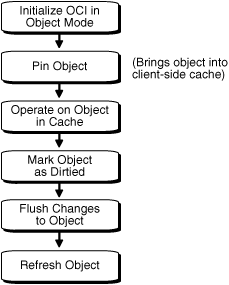

This chapter introduces the OCI facility for working with objects in an Oracle database. It also discusses the object navigational function calls of OCI.

This chapter contains these topics:

- OCI Object Overview

- About Working with Objects in OCI

- About Developing an OCI Object Application

- About Type Inheritance

- About Type Evolution

### 19.1 OCI Object Overview

OCI allows applications to access any of the data types found in Oracle Database, including scalar values, collections, and instances of any object type.

This includes all of the following:

- Objects

- Variable-length arrays (`varray`s)

- Nested tables (multisets)

- References (`REF`s)

- LOBs

**Note:**

Beginning with Oracle Database 12`c` Release 2 (12.2), there is a change in the linear snapshot size from 24 bytes to 34 bytes that requires the reconstruction of the collection image form. When an older client or server accesses a Release 12.2 or higher database involving any access to collections, the collection image form that contains the linear snapshot must be converted when sending or receiving to older clients or server. This conversion results in the performance degradation. Oracle recommends that you use a 12.2 version of the client or server to avoid this conversion.

To take full advantage of Oracle Database object capabilities, most applications must do more than just access objects. After an object has been retrieved, the application must navigate through references from that object to other objects. OCI provides the capability to do this. Through the OCI object navigational calls, an application can perform any of the following functions on objects:

- Creating, accessing, locking, deleting, copying, and flushing objects

- Getting references to the objects and their meta-objects

- Dynamically getting and setting values of objects' attributes

OCI also provides the ability to access type information stored in an Oracle database. The `OCIDescribeAny()` function enables an application to access most information relating to types stored in the database, including information about methods, attributes, and type metadata.

Applications interacting with Oracle Database objects need a way to represent those objects in a host language format. Oracle Database provides a utility called the Object Type Translator (OTT), which can convert type definitions in the database to C struct declarations. The declarations are stored in a header file that can be included in an OCI application.

When type definitions are represented in C, the types of attributes are mapped to special C variable types. OCI includes a set of data type mapping and manipulation functions that enable an application to manipulate these data types, and thus manipulate the attributes of objects.

The terminology for objects can occasionally become confusing. In the remainder of this chapter, the terms object and instance both refer to an object that is either stored in the database or is present in the object cache.

**See Also:**

- About Developing an OCI Object Application for more detail about OCI navigational calls

- [Describing Schema Metadata](describing-schema-metadata.md) for a discussion of `OCIDescribeAny()`

- [Object-Relational Data Types in OCI](object-relational-data-types-in-oci.md) for a more detailed discussion about functions

- [OCIDescribeAny()](bind-define-describe-functions.md)

### 19.2 About Working with Objects in OCI

Many of the programming principles that govern a relational OCI application are the same for an object-relational application.

An object-relational application uses the standard OCI calls to establish database connections and process SQL statements. The difference is that the SQL statements issued retrieve object references, which can then be manipulated with the OCI object functions. An object can also be directly manipulated as a value instance (without using its object reference).

This section includes the following topics:

- Basic Object Program Structure

- Persistent Objects, Transient Objects, and Values

#### 19.2.1 Basic Object Program Structure

The basic structure of an OCI application that uses objects is essentially the same as that for a relational OCI application.

That paradigm is reproduced here, with extra information covering basic object functionality.

1.  Initialize the OCI programming environment. You must initialize the environment in object mode.

    Your application must include C struct representations of database objects in a header file. These structs can be created by the programmer, or, more easily, they can be generated by the Object Type Translator (OTT).

2.  Allocate necessary handles, and establish a connection to a server.

3.  Prepare a SQL statement for execution. This is a local (client-side) step, which may include binding placeholders and defining output variables. In an object-relational application, this SQL statement should return a reference (`REF`) to an object.

    **Note:**

    It is also possible to fetch an entire object, rather than just a reference (`REF`). If you select a referenceable object, rather than pinning it, you get that object by value. You can also select a nonreferenceable object.

4.  Associate the prepared statement with a database server, and execute the statement.

5.  Fetch returned results.

    In an object-relational application, this step entails retrieving the `REF`, and then pinning the object to which it refers. Once the object is pinned, your application can do some or all of the following:

    - Manipulate the attributes of the object and mark it as dirty (modified)

    - Follow a `REF` to another object or series of objects

    - Access type and attribute information

    - Navigate a complex object retrieval graph

    - Flush modified objects to the server

6.  Commit the transaction. This step implicitly flushes all modified objects to the server and commits the changes.

7.  Free statements and handles not to be reused, or reexecute prepared statements again.

These steps are discussed in more detail in the remainder of this chapter.

**See Also:**

- [Overview of OCI Program Programming](oci-programming-basics.md)

- Fetching Embedded Objects describes fetching the entire object

- [OCI Programming Basics](oci-programming-basics.md) for information about using OCI to connect to a server, process SQL statements, and allocate handles and the description of the OCI relational functions in [Oracle Database Access C API](database-access-c-api.md)

- About Representing Objects in C Applications for information about OTT and [Using the Object Type Translator with OCI](using-object-type-translator-in-oci.md)

#### 19.2.2  Persistent Objects, Transient Objects, and Values

Instances of an Oracle type are categorized into persistent objects and transient objects based on their lifetime.

Instances of persistent objects can be further divided into standalone objects and embedded objects depending on whether they are referenceable by way of an object identifier.

**Note:**

The terms object and instance are used interchangeably in this manual.

This section includes the following topics:

- Persistent Objects

- Transient Objects

- Values

**See Also:**

[Oracle Database Object-Relational Developer's Guide](../adobj/introduction-to-oracle-objects.md) for more information about objects

##### 19.2.2.1 Persistent Objects

A persistent object is an object that is stored in an Oracle database.

It may be fetched into the object cache and modified by an OCI application. The lifetime of a persistent object can exceed that of the application that is accessing it. Once it is created, it remains in the database until it is explicitly deleted. There are two types of persistent objects:

- Standalone instances are stored in rows of an object table, and each instance has a unique object identifier. An OCI application can retrieve a `REF` to a standalone instance, pin the object, and navigate from the pinned object to other related objects. Standalone objects may also be referred to as referenceable objects.

  It is also possible to select a referenceable object, in which case you fetch the object by value instead of fetching its `REF`.

- Embedded instances are not stored as rows in an object table. They are embedded within other structures. Examples of embedded objects are objects that are attributes of another object, or instances that exist in an object column of a database table. Embedded instances do not have object identifiers, and OCI applications cannot get `REF`s to embedded instances.

  Embedded objects may also be referred to as nonreferenceable objects or value instances. You may sometimes see them referred to as values, which is not to be confused with scalar data values. The context should make the meaning clear.

Example 19-1 and Example 19-2 show SQL examples that demonstrate the difference between these two types of persistent objects.

Objects that are stored in the object table `person_tab` are standalone instances. They have object identifiers and are referenceable. They can be pinned in an OCI application.

Objects that are stored in the `manager` column of the `department` table are embedded objects. They do not have object identifiers, and they are not referenceable; this means they cannot be pinned in an OCI application, and they also never need to be unpinned. They are always retrieved into the object cache by value.

Example 19-1 SQL Definition of Standalone Objects

    CREATE TYPE person_t AS OBJECT
       (name      varchar2(30),
        age       number(3));
    CREATE TABLE person_tab OF person_t;

Example 19-2 SQL Definition of Embedded Objects

    CREATE TABLE department
       (deptno     number,
        deptname   varchar2(30),
        manager    person_t);

##### 19.2.2.2 Transient Objects

A transient object is a temporary instance whose life does not exceed that of the application, and that cannot be stored or flushed to the server.

The application can delete a transient object at any time.

Transient objects are often created by the application using the `OCIObjectNew()` function to store temporary values for computation. Transient objects cannot be converted to persistent objects. Their role is fixed at the time they are instantiated.

**See Also:**

- About Creating Objects for more information about using `OCIObjectNew()`

- [OCIObjectNew()](oci-miscellaneous-object-functions.md)

##### 19.2.2.3 Values

A value is referred to as being either a scalar value or as an embedded or nonreferenceable object.

In the context of this manual, a value refers to either:

- A scalar value that is stored in a non-object column of a database table. An OCI application can fetch values from a database by issuing SQL statements.

- An embedded or nonreferenceable object.

The context should make it clear which meaning is intended.

**Note:**

It is possible to select a referenceable object into the object cache, rather than pinning it, in which case you fetch the object by value instead of fetching its `REF`.

### 19.3 About Developing an OCI Object Application

This section discusses the steps involved in developing a basic OCI object application.

Figure 19-1 shows a simple program logic flow for how an application might work with objects. For simplicity, some required steps are omitted. Each step in this diagram is discussed in the following sections.

Figure 19-1 Basic Object Operational Flow

[Description of "Figure 19-1 Basic Object Operational Flow"](img_text/lnoci035.md)

This section includes the following topics:

- About Representing Objects in C Applications

- About Initializing the Environment and the Object Cache

- About Making Database Connections

- Retrieving an Object Reference from the Server

- Pinning an Object

- Manipulating Object Attributes

- About Marking Objects and Flushing Changes

- Fetching Embedded Objects

- Object Meta-Attributes

- Complex Object Retrieval

- COR Prefetching

- OCI Versus SQL Access to Objects

- Pin Count and Unpinning

- NULL Indicator Structure

- About Creating Objects

- About Freeing and Copying Objects

- Object Reference and Type Reference

- Create Objects Based on Object Views and Object Tables with Primary-Key-Based OIDs

- Error Handling in Object Applications

**See Also:**

Basic Object Program Structure

#### 19.3.1 About Representing Objects in C Applications

Before an OCI application can work with object types, those types must exist in the database.

Typically, you create types with SQL DDL statements, such as `CREATE` `TYPE`.

When the Oracle database processes the type definition DDL commands, it stores the type definitions in the data dictionary as type descriptor objects (TDOs).

When your application retrieves instances of object types from the database, it must have a client-side representation of the objects. In a C program, the representation of an object type is a struct. In an OCI object application, you may also include a `NULL` indicator structure corresponding to each object type structure.

Oracle Database provides a utility called the Object Type Translator (OTT), which generates C struct representations of database object types for you. For example, suppose that you have a type in your database declared as follows:

    CREATE TYPE emp_t AS OBJECT
    ( name       VARCHAR2(30),
      empno      NUMBER,
      deptno     NUMBER,
      hiredate   DATE,
      salary     NUMBER);

OTT produces the following C struct and corresponding `NULL` indicator struct:

    struct emp_t
    {
      OCIString    * name;
      OCINumber    empno;
      OCINumber    deptno;
      OCIDate      hiredate;
      OCINumber    salary;
    };
    typedef struct emp_t emp_t

    struct emp_t_ind
    {
      OCIInd     _atomic;
      OCIInd     name;
      OCIInd     empno;
      OCIInd     deptno;
      OCIInd     hiredate;
      OCIInd     salary;
    };
    typedef struct emp_t_ind emp_t_ind;

The variable types used in the struct declarations are special types employed by the OCI object calls. A subset of OCI functions manipulate data of these types. These functions are mentioned later in this chapter.

These struct declarations are automatically written to a header file whose name is determined by the OTT input parameters. You can include this header file in the code files for an application to provide access to objects.

**See Also:**

- [Object Cache and Memory Management](object-advanced-topics-in-oci.md) for application programmers who want to use object representations other than the default structs generated by the object cache

- NULL Indicator Structure

- [Using the Object Type Translator with OCI](using-object-type-translator-in-oci.md) for more information about OTT

- [Object-Relational Data Types in OCI](object-relational-data-types-in-oci.md) for more detail about the subset of OCI functions that manipulate data of these variable types used in the struct declarations employed by the OCI object calls

#### 19.3.2 About Initializing the Environment and the Object Cache

If your OCI application is going to access and manipulate objects, it is essential that you specify a value of `OCI_OBJECT` for the `mode` parameter of the `OCIEnvCreate()` call, which is the first OCI call in any OCI application. Specifying this value for `mode` indicates to the OCI libraries that your application is working with objects.

This notification has the following important effects:

- It establishes the object runtime environment.

- It sets up the object cache.

Memory for the object cache is allocated on demand when objects are loaded into the cache.

If the mode parameter of `OCIEnvCreate()` or `OCIEnvNlsCreate()` is not set to `OCI_OBJECT`, any attempt to use an object-related function results in an error.

The client-side object cache is allocated in the program's process space. This cache is the memory for objects that have been retrieved from the server and are available to your application.

**Note:**

If you initialize the OCI environment in object mode, your application allocates memory for the object cache, whether or not the application actually uses object calls.

**See Also:**

- [Object Advanced Topics in OCI](object-advanced-topics-in-oci.md) for a detailed explanation of the object cache

- [OCIEnvCreate()](connect-authorize-and-initialize-functions.md)

- [OCIEnvNlsCreate()](connect-authorize-and-initialize-functions.md)

#### 19.3.3 About Making Database Connections

Once the OCI environment has been properly initialized, the application can connect to a server.

This is accomplished through the standard OCI connect calls. When you use these calls, no additional considerations must be made because this application is accessing objects.

Only one object cache is allocated for each OCI environment. All objects retrieved or created through different connections within the environment use the same physical object cache. Each connection has its own logical object cache.

**See Also:**

[OCI Programming Steps](oci-programming-basics.md) for more information about properly initializing the OCI environment

#### 19.3.4 Retrieving an Object Reference from the Server

To work with objects, your application must first retrieve one or more objects from the server.

You accomplish this by issuing a SQL statement that returns `REF`s to one or more objects.

**Note:**

It is also possible for a SQL statement to fetch embedded objects, rather than `REF`s, from a database.

In the following example, the application declares a text block that stores a SQL statement designed to retrieve a `REF` to a single employee object from an object table of employees (`emp_tab`) in the database, when given a particular employee number that is passed as an input variable (`:emp_num`) at runtime:

    text *selemp = (text *) "SELECT REF(e)
                              FROM emp_tab e
                              WHERE empno = :emp_num";

Your application should prepare and process this statement as follows in the same way that it would handle any relational SQL statement:

1.  Prepare an application request, using `OCIStmtPrepare2()`.
2.  Bind the host input variable using one or more appropriate bind calls.
3.  Declare and prepare an output variable to receive the employee object reference. Here you would use an employee object reference:
        OCIRef  *emp1_ref = (OCIRef *) 0; /* reference to an employee object */

    When you define the output variable, set the dty data type parameter for the define call to SQLT_REF, the data type constant for `REF`.
4.  Execute the statement with `OCUStmtExecute()`.
5.  Fetch the resulting `REF` into `emp1_ref`, using `OCIStmtFetch2()`.

At this point, you could use the object reference to access and manipulate an object or objects from the database.

**See Also:**

- Fetching Embedded Objects for more information

- [OCI Programming Basics](oci-programming-basics.md)

- [OCI Programming Steps](oci-programming-basics.md) for general information about preparing and executing SQL statements

- [Advanced Bind Operations in OCI](binding-and-defining-in-oci.md) and [Advanced Define Operations in OCI](binding-and-defining-in-oci.md) for specific information about binding and defining `REF` variables

- The demonstration programs included with your Oracle installation for a code example showing `REF` retrieval and pinning. For additional information, see [OCI Demonstration Programs](oci-demo-programs.md).

- [OCIStmtPrepare2()](statement-functions.md)

- About Representing Objects in C Applications about using an employee object reference declaration mentioned in Step 3

- [OCIStmtExecute()](statement-functions.md)

- [OCIStmtFetch2()](statement-functions.md)

#### 19.3.5 Pinning an Object

Pinning an object loads the object instance into the object cache, and enables you to access and modify the instance's attributes and follow references from that object to other objects, if necessary.

Upon completion of the fetch step, your application has a `REF`, or pointer, to an object. The actual object is not currently available to work with. Before you can manipulate an object, it must be pinned. Your application also controls when modified objects are written back to the server.

**Note:**

This section deals with a simple pin operation involving a single object at a time. For information about retrieving multiple objects through complex object retrieval, see Complex Object Retrieval.

An application pins an object by calling the function `OCIObjectPin()`. The parameters for this function allow you to specify the pin option, pin duration, and lock option for the object.

Example 19-3 shows sample code that illustrates a pin operation for the employee reference your application retrieved in the previous section, Retrieving an Object Reference from the Server.

In this example, `process_error()` represents an error-handling function. If the call to `OCIObjectPin()` returns anything but `OCI_SUCCESS`, the error-handling function is called. The parameters of the `OCIObjectPin()` function are as follows:

- `env` is the OCI environment handle.

- `err` is the OCI error handle.

- `emp1_ref` is the reference that was retrieved through SQL.

- `(OCIComplexObject *) 0` indicates that this pin operation is not utilizing complex object retrieval.

- `OCI_PIN_ANY` is the pin option.

- `OCI_DURATION_TRANS` is the pin duration.

- `OCI_LOCK_X` is the lock option.

- `emp1` is an out parameter that returns a pointer to the pinned object.

Now that the object has been pinned, the OCI application can modify that object. In this simple example, the object contains no references to other objects.

This section includes the following topic: Array Pin.

Example 19-3 Pinning an Object

    if (OCIObjectPin(env, err, emp1_ref, (OCIComplexObject *) 0,
         OCI_PIN_ANY,
         OCI_DURATION_TRANS,
         OCI_LOCK_X,  &emp1) != OCI_SUCCESS)
         process_error(err);

**See Also:**

- [Simple Object Navigation](object-advanced-topics-in-oci.md) for an example of navigation from one instance to another

- [OCIObjectPin()](oci-pin-unpin-and-free-functions.md)

- [About Pinning an Object Copy](object-advanced-topics-in-oci.md) for more information about the pin option `OCI_PIN_ANY`

- [Object Duration](object-advanced-topics-in-oci.md) for more information about the pin duration `OCI_DURATION_TRANS`

- [About Locking Objects for Update](object-advanced-topics-in-oci.md) for more information about the lock option `OCI_LOCK_X`

##### 19.3.5.1 Array Pin

Given an array of references, an OCI application can pin an array of objects by calling `OCIObjectArrayPin()`.

The references may point to objects of different types. This function provides the ability to fetch objects of different types from different tables in one network round-trip.

**See Also:**

[OCIObjectArrayPin()](oci-pin-unpin-and-free-functions.md)

#### 19.3.6 Manipulating Object Attributes

Once an object has been pinned, an OCI application can modify its attributes.

OCI provides a set of functions for working with data types of object type structs, known as the OCI data type mapping and manipulation functions.

**Note:**

Changes made to objects pinned in the object cache affect only those object copies (instances), and not the original object in the database. For changes made by the application to reach the database, those changes must be flushed or committed to the server.

For example, assume that the employee object in the previous section was pinned so that the employee's salary could be increased. Assume also that at this company, yearly salary increases are prorated for employees who have been at the company for less than 180 days.

For this example, you must access the employee's hire date and check whether it is more or less than 180 days before the current date. Based on that calculation, the employee's salary is increased by either \$5000 (for more than 180 days) or \$3000 (for less than 180 days). The sample code in Example 19-4 demonstrates this process.

Note that the data type mapping and manipulation functions work with a specific set of data types; you must convert other types, like `int`, to the appropriate OCI types before using them in calculations.

Example 19-4 points out how values must be converted to OCI data types (for example, `OCIDate`, `OCINumber`) before being passed as parameters to the OCI data type mapping and manipulation functions.

Example 19-4 Manipulating Object Attributes in OCI

    /* assume that sysdate has been fetched into sys_date, a string. */
    /* emp1 and emp1_ref are the same as in previous sections. */
    /* err is the OCI error handle. */
    /* NOTE: error handling code is not included in this example. */

    sb4 num_days;        /* the number of days between today and hiredate */
    OCIDate curr_date;          /* holds the current date for calculations */
    int raise;   /* holds the employee's raise amount before calculations */
    OCINumber raise_num;       /* holds employee's raise for calculations */
    OCINumber new_sal;                 /* holds the employee's new salary */

    /* convert date string to an OCIDate */
    OCIDateFromText(err, (text *) sys_date, (ub4) strlen(sys_date), (text *)
              NULL, (ub1) 0, (text *) NULL, (ub4) 0, &curr_date);

      /* get number of days between hire date and today */
    OCIDateDaysBetween(err, &curr_date, &emp1->hiredate, &num_days);

    /* calculate raise based on number of days since hiredate */
    if (num_days > 180)
        raise = 5000;
    else
        raise = 3000;

    /* convert raise value to an OCINumber */
    OCINumberFromInt(err, (void  *)&raise, (uword)sizeof(raise),
                     OCI_NUMBER_SIGNED, &raise_num);

    /* add raise amount to salary */
    OCINumberAdd(err, &raise_num, &emp1->salary, &new_sal);
    OCINumberAssign(err, &new_sal, &emp1->salary);

**See Also:**

- About Marking Objects and Flushing Changes for more information about flushing changes or committing them to the server

- [Object-Relational Data Types in OCI](object-relational-data-types-in-oci.md) for more information about the OCI data types and the data type mapping and manipulation functions

#### 19.3.7 About Marking Objects and Flushing Changes

The application must take specific steps to ensure that changes to objects by marking them and then flushing them are written in the database.

In Example 19-4, an attribute of an object instance was changed. At this point, however, that change exists only in the client-side object cache. The application must take specific steps to ensure that the change is written in the database.

The first step is to indicate that the object has been modified. This is done with the `OCIObjectMarkUpdate()` function. This function marks the object as dirty (modified).

Objects that have had their dirty flag set must be flushed to the server for the changes to be recorded in the database. You can do this in three ways:

- Flush a single dirty object by calling `OCIObjectFlush()`.

- Flush the entire cache using `OCICacheFlush()`. In this case OCI traverses the dirty list maintained by the cache and flushes the dirty objects to the server.

- Call `OCICacheFlush()` to commit a transaction. Doing so also traverses the dirty list and flushes the dirty objects to the server.

The flush operations work only on persistent objects in the cache. Transient objects are never flushed to the server.

Flushing an object to the server can activate triggers in the database. In fact, on some occasions an application may want to explicitly flush objects just to fire triggers on the server side.

**See Also:**

- [OCI Support for Transactions](managing-scalable-platforms.md) for more information about `OCITransCommit()`

- About Creating Objects for information about transient and persistent objects

- Object Meta-Attributes for information about seeing and checking object meta-attributes, such as dirty

- [OCIObjectMarkUpdate()](oci-mark-or-unmark-object-cache-functions.md)

- [OCIObjectFlush()](oci-flush-or-refresh-functions.md)

- [OCICacheFlush()](oci-flush-or-refresh-functions.md)

- [OCICacheFlush()](transaction-functions.md)

#### 19.3.8 Fetching Embedded Objects

An application must fetch embedded object instances.

If your application must fetch an embedded object instance—an object stored in a column of a regular table, rather than an object table—you cannot use the `REF` retrieval mechanism described in Retrieving an Object Reference from the Server. Embedded instances do not have object identifiers, so it is not possible to get a `REF` to them; they cannot serve as the basis for object navigation. Many situations exist, however, in which an application must fetch embedded instances.

For example, assume that an `address` type has been created.

    CREATE TYPE address AS OBJECT
    ( street1             varchar2(50),
      street2             varchar2(50),
      city                varchar2(30),
      state               char(2),
      zip                 number(5));

You could then use that type as the data type of a column in another table:

    CREATE TABLE clients
    ( name          varchar2(40),
      addr          address);

Your OCI application could then issue the following SQL statement:

    SELECT addr FROM clients
    WHERE name='BEAR BYTE DATA MANAGEMENT'

This statement would return an embedded `address` object from the `clients` table. The application could then use the values in the attributes of this object for other processing.

Your application should prepare and process this statement in the same way that it would handle any relational SQL statement, as described in [OCI Programming Basics](oci-programming-basics.md):

- Prepare an application request, using `OCIStmtPrepare2()`.

- Bind the input variable using one or more appropriate bind calls.

- Define an output variable to receive the `address` instance. You use a C struct representation of the object type that was generated by OTT, as described in About Representing Objects in C Applications.

      addr1      *address; /* variable of the address struct type */

  When you define the output variable, set the `dty` data type parameter for the define call to SQLT_NTY, the data type constant for named data types.

- Execute the statement with `OCIStmtExecute()`.

- Fetch the resulting instance into `addr1`, using `OCIStmtFetch2()`.

Following this operation, you can access the attributes of the instance, as described in Manipulating Object Attributes, or pass the instance as an input parameter for another SQL statement.

**Note:**

Changes made to an embedded instance can be made persistent only by executing a SQL `UPDATE` statement.

**See Also:**

- [OCI Programming Steps](oci-programming-basics.md) for more information about preparing and executing SQL statements

- [OCIStmtPrepare2()](statement-functions.md)

- [OCIStmtExecute()](statement-functions.md)

- [OCIStmtFetch2()](statement-functions.md)

#### 19.3.9 Object Meta-Attributes

An object's meta-attributes serve as flags that can provide information to an application, or to the object cache, about the status of an object.

For example, one of the meta-attributes of an object indicates whether it has been flushed to the server. Object meta-attributes can help an application control the behavior of instances.

Persistent and transient object instances have different sets of meta-attributes. The meta-attributes for persistent objects are further subdivided into persistent meta-attributes and transient meta-attributes. Transient meta-attributes exist only when an instance is in memory. Persistent meta-attributes also apply to objects stored in the server.

This section includes the following topics:

- Persistent Object Meta-Attributes

- Additional Attribute Functions

- Transient Object Meta-Attributes

##### 19.3.9.1 Persistent Object Meta-Attributes

Lists and describes the meta-attributes for standalone persistent objects.

Table 19-1 shows the meta-attributes for standalone persistent objects.

Table 19-1 Meta-Attributes of Persistent Objects

| Meta‐Attributes     | Meaning                                                  |
|:--------------------|:---------------------------------------------------------|
| existent            | Does the object exist?                                   |
| nullity             | Null information of the instance                         |
| locked              | Has the object been locked?                              |
| dirty               | Has the object been marked as dirtied?                   |
| pinned              | Is the object pinned?                                    |
| allocation duration | See [Object Duration](object-advanced-topics-in-oci.md). |
| pin duration        | See [Object Duration](object-advanced-topics-in-oci.md). |

**Note:**

Embedded persistent objects only have the nullity and allocation duration attributes, which are transient.

OCI provides the `OCIObjectGetProperty()` function, which allows an application to check the status of a variety of attributes of an object. The syntax of the function is:

    sword OCIObjectGetProperty ( OCIEnv              *envh,
                                 OCIError            *errh,
                                 const void          *obj,
                                 OCIObjectPropId     propertyId,
                                 void                *property,
                                 ub4                 *size );

The `propertyId` and `property` parameters are used to retrieve information about any of a variety of properties or attributes.

The different property IDs and the corresponding type of `property` argument follow.

OCI_OBJECTPROP_LIFETIME
This identifies whether the given object is a persistent object or a transient object or a value instance. The `property` argument must be a pointer to a variable of type `OCIObjectLifetime`. Possible values include:

- `OCI_OBJECT_PERSISTENT`

- `OCI_OBJECT_TRANSIENT`

- `OCI_OBJECT_VALUE`

<!-- -->

OCI_OBJECTPROP_SCHEMA
This returns the schema name of the table in which the object exists. An error is returned if the given object points to a transient instance or a value. If the input buffer is not big enough to hold the schema name, an error is returned; the error message communicates the required size. Upon success, the size of the returned schema name in bytes is returned by `size`. The `property` argument must be an array of type `text`, and `size` should be set to the size of the array in bytes by the caller.

OCI_OBJECTPROP_TABLE
This returns the table name in which the object exists. An error is returned if the given object points to a transient instance or a value. If the input buffer is not big enough to hold the table name, an error is returned; the error message communicates the required size. Upon success, the size of the returned table name in bytes is returned by `size`. The `property` argument must be an array of type `text` and `size` should be set to the size of the array in bytes by the caller.

OCI_OBJECTPROP_PIN_DURATION
This returns the pin duration of the object. An error is returned if the given object points to a value instance. The `property` argument must be a pointer to a variable of type `OCIDuration`. Valid values include:

- `OCI_DURATION_SESSION`

- `OCI_DURATION_TRANS`

<!-- -->

OCI_OBJECTPROP_ALLOC_DURATION
This returns the allocation duration of the object. The `property` argument must be a pointer to a variable of type `OCIDuration`. Valid values include:

- `OCI_DURATION_SESSION`

- `OCI_DURATION_TRANS`

<!-- -->

OCI_OBJECTPROP_LOCK
This returns the lock status of the object. The possible lock status is indicated by `OCILockOpt`. An error is returned if the given object points to a transient or value instance. The `property` argument must be a pointer to a variable of type `OCILockOpt`. The lock status of an object can also be retrieved by calling `OCIObjectIsLocked()`.

OCI_OBJECTPROP_MARKSTATUS
This returns the dirty status and indicates whether the object is a new object, updated object, or deleted object. An error is returned if the given object points to a transient or value instance. The `property` argument must be of type `OCIObjectMarkStatus`. Valid values include:

- `OCI_OBJECT_NEW`

- `OCI_OBJECT_DELETED`

- `OCI_OBJECT_UPDATED`

The following macros are available to test the object mark status:

- `OCI_OBJECT_IS_UPDATED` (flag)

- `OCI_OBJECT_IS_DELETED` (flag)

- `OCI_OBJECT_IS_NEW` (flag)

- `OCI_OBJECT_IS_DIRTY` (flag)

<!-- -->

OCI_OBJECTPROP_VIEW
This identifies whether the specified object is an object view or not. If the property value returned is `TRUE`, the object is a view; otherwise, it is not. An error is returned if the given object points to a transient or value instance. The `property` argument must be of type `boolean`.

Just as a view is a virtual table, an object view is a virtual object table. Each row in the view is an object: you can call its methods, access its attributes using the dot notation, and create a `REF` that points to it.

**See Also:**

- [OCIObjectGetProperty()](oci-get-object-status-functions.md)

- [Object Duration](object-advanced-topics-in-oci.md) for more information about durations

- [OCIObjectIsLocked()](oci-get-object-status-functions.md)

##### 19.3.9.2 Additional Attribute Functions

Lists and describes additional attribute functions known as set and check functions.

OCI also provides functions that allow an application to set or check some of these attributes directly or indirectly, as shown in Table 19-2.

Table 19-2 Set and Check Functions

| Meta-Attribute | Set with                                                              | Check with                                                 |
|:---------------|:----------------------------------------------------------------------|:-----------------------------------------------------------|
| nullity        | \<none\>                                                              | [OCIObjectGetInd()](oci-miscellaneous-object-functions.md) |
| existence      | \<none\>                                                              | [OCIObjectExists()](oci-get-object-status-functions.md)    |
| locked         | [OCIObjectLock()](oci-miscellaneous-object-functions.md)              | [OCIObjectIsLocked()](oci-get-object-status-functions.md)  |
| dirty          | [OCIObjectMarkUpdate()](oci-mark-or-unmark-object-cache-functions.md) | [OCIObjectIsDirty()](oci-get-object-status-functions.md)   |

##### 19.3.9.3 Transient Object Meta-Attributes

Lists and describes transient object meta-attributes.

Transient objects have no persistent attributes. Table 19-3 shows the following transient attributes.

Table 19-3 Transient Meta-Attributes

| Transient Meta-Attributes | Meaning                                                  |
|:--------------------------|:---------------------------------------------------------|
| existent                  | Does the object exist?                                   |
| pinned                    | Is the object being accessed by the application?         |
| dirty                     | Has the object been marked as dirtied?                   |
| nullity                   | Null information of the instance.                        |
| allocation duration       | See [Object Duration](object-advanced-topics-in-oci.md). |
| pin duration              | See [Object Duration](object-advanced-topics-in-oci.md). |

#### 19.3.10 Complex Object Retrieval

A complex object includes its root object and its set of logically related objects each of which are prefetched based on a given depth level.

In Example 19-3 and Example 19-4, only a single instance at a time was fetched or pinned. In these cases, each pin operation involved a separate server round-trip to retrieve the object.

Object-oriented applications often model their problems as a set of interrelated objects that form graphs of objects. The applications process these objects by starting at some initial set of objects, and then using the references in these initial objects to traverse the remaining objects. In a client/server setting, each of these traversals could result in costly network round-trips to fetch objects.

Application performance with objects can be improved with complex object retrieval (COR). This is a prefetching mechanism in which an application specifies the criteria for retrieving a set of linked objects in a single operation.

**Note:**

As described later, this does not mean that these prefetched objects are all pinned. They are fetched into the object cache, so that subsequent pin calls are local operations.

A complex object is a set of logically related objects consisting of a root object, and a set of objects each of which is prefetched based on a given depth level. The root object is explicitly fetched or pinned. The depth level is the shortest number of references that must be traversed from the root object to a given prefetched object in a complex object.

An application specifies a complex object by describing its content and boundary. The fetching of complex objects is constrained by an environment's prefetch limit, the amount of memory in the object cache that is available for prefetching objects.

**Note:**

The use of COR does not add functionality, but it improves performance. Its use is optional.

Consider the following type declaration:

    CREATE TYPE customer(...);
    CREATE TYPE line_item(...);
    CREATE TYPE line_item_varray as VARRAY(100) of REF line_item;
    CREATE TYPE purchase_order AS OBJECT
    ( po_number         NUMBER,
      cust              REF customer,
      related_orders    REF purchase_order,
      line_items        line_item_varray);

The `purchase_order` type contains a scalar value for `po_number`, a `VARRAY` of line items, and two references. The first is to a `customer` type, and the second is to a `purchase_order` type, indicating that this type may be implemented as a linked list.

When fetching a complex object, an application must specify the following:

- A `REF` to the desired root object.

- One or more pairs of type and depth information to specify the boundaries of the complex object. The type information indicates which `REF` attributes should be followed for COR, and the depth level indicates how many levels deep those links should be followed.

In the preceding purchase order object, the application must specify the following:

- The `REF` to the root purchase order object

- One or more pairs of type and depth information for `cust`, `related_orders`, or `line_items`

An application fetching a purchase order may very likely need access to the customer information for that order. Using simple navigation, this would require two server accesses to retrieve the two objects. Through complex object retrieval, the customer can be prefetched when the application pins the purchase order. In this case, the complex object would consist of the purchase order object and the customer object that it references.

In the previous example, the application would specify the `purchase_order` `REF`, and would indicate that the `cust` `REF` attribute should be followed to a depth level of 1, as follows:

- `REF(PO object)`

- {`(customer, 1`)}

For the application to prefetch the `purchase_order` object and all objects in the object graph it contains, the application would specify that both the `cust` and `related_orders` should be followed to the maximum depth level possible.

- `REF(PO object)`

- {`(customer, UB4MAXVAL), (purchase_order, UB4MAXVAL)`}

(In this example, `UB4MAXVAL` specifies that all objects of the specified type reachable through references from the root object should be prefetched.)

For an application to fetch a PO and all the associated line items, it would specify:

- `REF(PO object)`

- {`(line_item, 1)`}

The application can also fetch all objects reachable from the root object by way of `REF`s (transitive closure) by setting the level parameter to the depth desired. For the preceding two examples, the application could also specify `(PO object REF, UB4MAXVAL)` and `(PO object REF, 1)` respectively, to prefetch required objects. Although, doing so results in many extraneous fetches, quite simple to specify and requires only one server round-trip.

This section includes the following topics:

- About Prefetching Objects

- About Implementing Complex Object Retrieval in OCI

##### 19.3.10.1 About Prefetching Objects

After specifying and fetching a complex object, subsequent fetches of objects contained in the complex object do not incur the cost of a network round-trip, because these objects have been prefetched and are in the object cache.

Consider that excessive prefetching of objects can lead to a flooding of the object cache. This flooding, in turn, may force out other objects that the application had pinned, leading to a performance degradation instead of performance improvement.

**Note:**

If there is insufficient memory in the cache to hold all prefetched objects, some objects may not be prefetched. The application incurs a network round-trip when those objects are accessed later.

The `READ` or `SELECT` privilege is needed for all prefetched objects. Objects in the complex object for which the application does not have `READ` or `SELECT` privilege are not prefetched.

##### 19.3.10.2 About Implementing Complex Object Retrieval in OCI

Complex object retrieval (COR) allows an application to prefetch a complex object while fetching the root object.

The complex object specifications are passed to the same `OCIObjectPin()` function used for simple objects.

An application specifies the parameters for complex object retrieval using a complex object retrieval handle. This handle is of type `OCIComplexObject` and is allocated in the same way as other OCI handles.

The complex object retrieval handle contains a list of complex object retrieval descriptors. The descriptors are of type `OCIComplexObjectComp`, and are allocated in the same way as other OCI descriptors.

Each COR descriptor contains a type `REF` and a depth level. The type `REF` specifies a type of reference to be followed while constructing the complex object. The depth level indicates how far a particular type of reference should be followed. Specify an integer value, or specify the constant `UB4MAXVAL` for the maximum possible depth level.

The application can also specify the depth level in the COR handle without creating COR descriptors for type and depth parameters. In this case, all `REF`s are followed to the depth specified in the COR handle. The COR handle can also be used to specify whether a collection attribute should be fetched separately on demand (out-of-line) as opposed to the default case of fetching it along with the containing object (inline).

The application uses `OCIAttrSet()` to set the attributes of a COR handle. The attributes are:

`OCI_ATTR_COMPLEXOBJECT_LEVEL` - the depth level

`OCI_ATTR_COMPLEXOBJECT_COLL_OUTOFLINE` - fetch collection attribute in an object type out-of-line

The application allocates the COR descriptor using `OCIDescriptorAlloc()` and then can set the following attributes:

`OCI_ATTR_COMPLEXOBJECTCOMP_TYPE` - the type `REF`

`OCI_ATTR_COMPLEXOBJECTCOMP_TYPE_LEVEL` - the depth level for references of the preceding type

Once these attributes are set, the application calls `OCIParamSet()` to put the descriptor into a complex object retrieval handle. The handle has an `OCI_ATTR_PARAM_COUNT` attribute that specifies the number of descriptors on the handle. This attribute can be read with `OCIAttrGet()`.

Once the handle has been populated, it can be passed to the `OCIObjectPin()` call to pin the root object and prefetch the remainder of the complex object.

The complex object retrieval handles and descriptors must be freed explicitly when they are no longer needed.

**See Also:**

- [Handles](oci-programming-basics.md)

- [OCI Descriptors](oci-programming-basics.md)

- [OCIObjectPin()](oci-pin-unpin-and-free-functions.md)

- [OCIAttrSet()](handle-and-descriptor-functions.md)

- [OCIDescriptorAlloc()](handle-and-descriptor-functions.md)

- [OCIParamSet()](handle-and-descriptor-functions.md)

- [OCIAttrGet()](handle-and-descriptor-functions.md)

- [OCIObjectPin()](oci-pin-unpin-and-free-functions.md)

#### 19.3.11 COR Prefetching

The application specifies a complex object while fetching the root object.

The prefetched objects are obtained by doing a breadth-first traversal of the graphs of objects rooted at a given root object. The traversal stops when all required objects have been prefetched, or when the total size of all the prefetched objects exceeds the prefetch limit.

This section includes the following topics:

- COR Interface

- Example of COR

##### 19.3.11.1 COR Interface

The interface for fetching complex objects is the OCI pin interface.

The application can pass an initialized COR handle to `OCIObjectPin()` (or an array of handles to `OCIObjectArrayPin()`) to fetch the root object and the prefetched objects specified in the COR handle.

    sword OCIObjectPin ( OCIEnv              *env,
                         OCIError            *err,
                         OCIRef              *object_ref,
                         OCIComplexObject    *corhdl,
                         OCIPinOpt           pin_option,
                         OCIDuration         pin_duration,
                         OCILockOpt          lock_option,
                         void                **object );

    sword OCIObjectArrayPin ( OCIEnv            *env,
                              OCIError          *err,
                              OCIRef            **ref_array,
                              ub4               array_size,
                              OCIComplexObject  **cor_array,
                              ub4               cor_array_size,
                              OCIPinOpt         pin_option,
                              OCIDuration       pin_duration,
                              OCILockOpt        lock,
                              void              **obj_array,
                              ub4               *pos );

Note the following points when using COR:

- A null COR handle argument defaults to pinning just the root object.

- A COR handle with the type of the root object and a depth level of 0 fetches only the root object and is thus equivalent to a null COR handle.

- The lock options apply only to the root object.

  **Note:**

  To specify lock options for prefetched objects, the application can visit all the objects in a complex object, create an array of `REF`s, and lock the entire complex object in another round-trip using the array interface (`OCIObjectArrayPin()`).

**See Also:**

- [OCIObjectPin()](oci-pin-unpin-and-free-functions.md)

- [OCIObjectArrayPin()](oci-pin-unpin-and-free-functions.md)

- [OCIObjectArrayPin()](oci-pin-unpin-and-free-functions.md)

##### 19.3.11.2 Example of COR

Shows how an application program can be modified to use complex object retrieval.

Example 19-5 illustrates how an application program can be modified to use complex object retrieval.

Consider an application that displays a purchase order and the line items associated with it. The code in boldface accomplishes this. The rest of the code uses complex object retrieval for prefetching and thus enhances the application's performance.

Example 19-5 Using Complex Object Retrieval in OCI

    OCIEnv *envhp;
    OCIError *errhp;
    OCIRef **liref;
    OCIRef *poref;
    OCIIter *itr;
    boolean  eoc;
    purchase_order *po = (purchase_order *)0;
    line_item *li = (line_item *)0;
    OCISvcCtx *svchp;
    OCIComplexObject *corhp;
    OCIComplexObjectComp *cordp;
    OCIType *litdo;
    ub4 level = 0;

    /* get COR Handle */
    OCIHandleAlloc((void  *) envhp, (void  **) &corhp, (ub4)
                    OCI_HTYPE_COMPLEXOBJECT, 0, (void  **)0);

    /* get COR descriptor for type line_item */
    OCIDescriptorAlloc((void  *) envhp, (void  **) &cordp, (ub4)
                    OCI_DTYPE_COMPLEXOBJECTCOMP, 0, (void  **) 0);

    /* get type of line_item to set in COR descriptor */
    OCITypeByName(envhp, errhp, svchp, (const text *) 0, (ub4) 0,
                  (const text *) "LINE_ITEM",
                  (ub4) strlen((const char *) "LINE_ITEM"), (text *) 0,
                  (ub4) 0, OCI_DURATION_SESSION,
                  OCI_TYPEGET_HEADER, &litdo);

    /* set line_item type in COR descriptor */
    OCIAttrSet( (void  *) cordp, (ub4) OCI_DTYPE_COMPLEXOBJECTCOMP,
                (void  *) litdo, (ub4) sizeof(void  *), (ub4)
                OCI_ATTR_COMPLEXOBJECTCOMP_TYPE, (OCIError *) errhp);
    level = 1;

    /* set depth level for line_item_varray in COR descriptor */
    OCIAttrSet( (void  *) cordp, (ub4) OCI_DTYPE_COMPLEXOBJECTCOMP,
                (void  *) &level, (ub4) sizeof(ub4), (ub4)
                OCI_ATTR_COMPLEXOBJECTCOMP_TYPE_LEVEL, (OCIError *) errhp);

    /* put COR descriptor in COR handle */
    OCIParamSet(corhp, OCI_HTYPE_COMPLEXOBJECT, errhp, cordp,
                OCI_DTYPE_COMPLEXOBJECTCOMP, 1);

    /* pin the purchase order */
    OCIObjectPin(envhp, errhp, poref, corhp, OCI_PIN_LATEST,
       OCI_DURATION_SESSION, OCI_LOCK_NONE, (void  **)&po);

    /* free COR descriptor and COR handle */
    OCIDescriptorFree((void  *) cordp, (ub4) OCI_DTYPE_COMPLEXOBJECTCOMP);
    OCIHandleFree((void  *) corhp, (ub4) OCI_HTYPE_COMPLEXOBJECT);

    /* iterate and print line items for this purchase order */
    OCIIterCreate(envhp, errhp, po->line_items, &itr);

    /* get first line item */
    OCIIterNext(envhp, errhp, itr, (void  **)&liref, (void  **)0, &eoc);
    while (!eoc)        /* not end of collection */
    {
    /* pin line item */
       OCIObjectPin(envhp, errhp, *liref, (void  *)0, OCI_PIN_RECENT,
           OCI_DURATION_SESSION,
           OCI_LOCK_NONE, (void  **)&li));
      display_line_item(li);

    /* get next line item */
    OCIIterNext(envhp, errhp, itr, (void  **)&liref, (void  **)0, &eoc);
    }

#### 19.3.12 OCI Versus SQL Access to Objects

If an application must manipulate a graph of objects (interrelated by object references), then it is more effective to use the OCI interface rather than the SQL interface for accessing objects.

Retrieving a graph of objects using the SQL interface may require executing multiple `SELECT` statements, requiring multiple network round-trips. Using the complex object retrieval capability provided by OCI, the application can retrieve the graph of objects in one `OCIObjectPin()` call.

Consider the update case where the application retrieves a graph of objects, and modifies it based upon user interaction, and then wants to make the modifications persistent in the database. Using the SQL interface, the application would have to execute multiple `UPDATE` statements to update the graph of objects. If the modifications involved creation of new objects and deletion of existing objects, then execution of corresponding `INSERT` and `DELETE` statements would also be required. In addition, the application would have to do more bookkeeping, such as keeping track of table names, because this information is required for executing the `INSERT`, `UPDATE`, and `DELETE` statements.

Using the `OCICacheFlush()` function, the application can flush all modifications (insertion, deletion, and update of objects) in a single operation. OCI does all the bookkeeping, thereby requiring less coding in the application. For manipulating a graph of objects OCI is not only efficient, but also provides an easy-to-use interface.

Consider a different case in which the application must fetch an object when given its `REF`. In OCI, this is achieved by pinning the object using the `OCIObjectPin()` call. In the SQL interface, this can be achieved by dereferencing the `REF` in a `SELECT` statement (for example, `SELECT DEREF(ref) from tbl;`). Consider situations where the same `REF` (reference to the same object) is being dereferenced multiple times in a transaction. By calling `OCIObjectPin()` with the `OCI_PIN_RECENT` option, the object is fetched from the server only once for the transaction, and repeated pins on the same `REF` return a pointer to the pinned object in the cache. In the SQL interface, each execution of the `SELECT` `DEREF...` statement would result in fetching the object from the server. This would result in multiple round-trips to the server and multiple copies of the same object.

Finally, consider the case in which the application must fetch a nonreferenceable object, as in the following example:

    CREATE TABLE department
    (
    deptno number,
    deptname varchar2(30),
    manager employee_t
    );

The `employee_t` instances stored in the `manager` column are nonreferenceable. You can only use the SQL interface to fetch `manager` column instances. But if `employee_t` has any `REF` attributes, OCI calls can then be used to navigate the `REF`.

**See Also:**

- [OCIObjectPin()](oci-pin-unpin-and-free-functions.md)

- [OCICacheFlush()](oci-flush-or-refresh-functions.md)

#### 19.3.13 Pin Count and Unpinning

Each object in the object cache has a pin count associated with it.

The pin count indicates the number of code modules that are concurrently accessing the object. The pin count is set to 1 when an object is pinned into the cache for the first time. Objects prefetched with complex object retrieval enter the object cache with a pin count of zero.

It is possible to pin an pinned object. Doing so increases the pin count by one. When a process finishes using an object, it should unpin it, using `OCIObjectUnpin()`. This call decrements the pin count by one.

When the pin count of an object reaches zero, that object is eligible to be aged out of the cache if necessary, freeing up the memory space occupied by the object.

The pin count of an object can be set to zero explicitly by calling `OCIObjectPinCountReset()`.

An application can unpin all objects in the cache related to a specific connection, by calling `OCICacheUnpin()`.

**See Also:**

- [About Freeing an Object Copy](object-advanced-topics-in-oci.md) for more information about the conditions under which objects with zero pin count are removed from the cache and about objects being aged out of the cache

- About Marking Objects and Flushing Changes for information about explicitly flushing an object or the entire cache

- [OCIObjectUnpin()](oci-pin-unpin-and-free-functions.md)

- [OCIObjectPinCountReset()](oci-pin-unpin-and-free-functions.md)

- [OCICacheUnpin()](oci-pin-unpin-and-free-functions.md)

#### 19.3.14 NULL Indicator Structure

If a column in a row of a database table has no value, then that column is said to be `NULL`, or to contain a `NULL`.

Two different types of `NULL`s can apply to objects:

- Any attribute of an object can have a `NULL` value. This indicates that the value of that attribute of the object is not known.

- An object instance may be atomically NULL, meaning that the value of the entire object is unknown.

Atomic nullity is not the same thing as nonexistence. An atomically `NULL` instance still exists; its value is just not known. It may be thought of as an existing object with no data.

When working with objects in OCI, an application can define a NULL indicator structure for each object type used by the application. In most cases, doing so simply requires including the `NULL` indicator structure generated by OTT along with the struct declaration. When the OTT output header file is included, the `NULL` indicator struct becomes available to your application.

For each type, the `NULL` indicator structure includes an atomic `NULL` indicator (whose type is `OCIInd`), and a `NULL` indicator for each attribute of the instance. If the type has an object attribute, the `NULL` indicator structure includes that attribute's `NULL` indicator structure. Example 19-6 shows the C representations of types with their corresponding `NULL` indicator structures.

**Note:**

The `dependentsAge` field of `person_ind` indicates whether the entire varray (`dependentsAge` field of `person`) is atomically `NULL` or not. `NULL` information of individual elements of `dependentsAge` can be retrieved through the `elemind` parameter of a call to `OCICollGetElem()`. Similarly, the `prevAddr` field of `person_ind` indicates whether the entire nested table (`prevAddr` field of `person`) is atomically `NULL` or not. `NULL` information of individual elements of `prevAddr` can be retrieved through the `elemind` parameter of a call to `OCICollGetElem()`.

For an object type instance, the first field of the `NULL` indicator structure is the atomic `NULL` indicator, and the remaining fields are the attribute `NULL` indicators whose layout resembles the layout of the object type instance's attributes.

Checking the value of the atomic `NULL` indicator allows an application to test whether an instance is atomically `NULL`. Checking any of the others allows an application to test the `NULL` status of that attribute, as in the following code sample:

    person_ind *my_person_ind
    if( my_person_ind -> _atomic == OCI_IND_NULL)
       printf ("instance is atomically NULL\n");
    else
    if( my_person_ind -> fname == OCI_IND_NULL)
       printf ("fname attribute is NULL\n");

In the preceding example, the value of the atomic `NULL` indicator, or one of the attribute `NULL` indicators, is compared to the predefined value `OCI_IND_NULL` to test if it is `NULL`. The following predefined values are available for such a comparison:

- `OCI_IND_NOTNULL`, indicating that the value is not `NULL`

- `OCI_IND_NULL`, indicating that the value is `NULL`

- `OCI_IND_BADNULL` indicates that an enclosing object (or parent object) is `NULL`. This is used by PL/SQL, and may also be referred to as an INVALID_NULL. For example, if a type instance is `NULL`, then its attributes are INVALID_NULLs.

Use the function `OCIObjectGetInd()` to retrieve the `NULL` indicator structure of an object.

If you update an attribute in its C structure, you must also set the `NULL` indicator for that attribute:

    obj->attr1 = string1;
    OCIObjectGetInd(envhp, errhp, obj, &ind);
    ind->attr1 = OCI_IND_NOTNULL;

Example 19-6 C Representations of Types with Their Corresponding NULL Indicator Structures

    struct address
    {
       OCINumber    no;
       OCIString    *street;
       OCIString    *state;
       OCIString    *zip;
    };
    typedef struct address address;

    struct address_ind
    {
      OCIInd    _atomic;
      OCIInd    no;
      OCIInd    street;
      OCIInd    state;
      OCIInd    zip;
    };
    typedef struct address_ind address_ind;

    struct person
    {
       OCIString      *fname;
       OCIString      *lname;
       OCINumber      age;
       OCIDate        birthday;
       OCIArray       *dependentsAge;
       OCITable       *prevAddr;
       OCIRaw         *comment1;
       OCILobLocator  *comment2;
       address        addr;
       OCIRef         *spouse;
    };
    typedef struct person person;

    struct person_ind
    {
      OCIInd        _atomic;
      OCIInd        fname;
      OCIInd        lname;
      OCIInd        age;
      OCIInd        birthday;
      OCIInd        dependentsAge;
      OCIInd        prevAddr;
      OCIInd        comment1;
      OCIInd        comment2;
      address_ind   addr;
      OCIInd        spouse;
    };
    typedef struct person_ind person_ind;

**See Also:**

- [Using the Object Type Translator with OCI](using-object-type-translator-in-oci.md) for more information about OTT-generated `NULL` indicator structures

- [OCICollGetElem()](oci-collection-and-iterator-functions.md)

- [OCIObjectGetInd()](oci-miscellaneous-object-functions.md)

#### 19.3.15 About Creating Objects

An OCI application can create any object using `OCIObjectNew()`.

To create a persistent object, the application must specify the object table where the new object resides. This value can be retrieved by calling `OCIObjectPinTable()`, and it is passed in the `table` parameter. To create a transient object, the application must pass only the type descriptor object (retrieved by calling `OCIDescribeAny()`) for the type of object being created.

`OCIObjectNew()` can also be used to create instances of scalars (for example, `REF`, LOB, string, raw, number, and date) and collections (for example, varray and nested table) by passing the appropriate value for the `typecode` parameter.

This section includes the following topic: Attribute Values of New Objects.

**See Also:**

- [OCIObjectNew()](oci-miscellaneous-object-functions.md)

- [OCIObjectPinTable()](oci-pin-unpin-and-free-functions.md)

- [OCIDescribeAny()](bind-define-describe-functions.md)

##### 19.3.15.1 Attribute Values of New Objects

By default, all attributes of a newly created object have `NULL` values.

After initializing attribute data, the user must change the corresponding `NULL` status of each attribute to non-`NULL`.

It is possible to have attributes set to non-`NULL` values when an object is created. This is accomplished by setting the `OCI_ATTR_OBJECT_NEWNOTNULL` attribute of the environment handle to `TRUE` using `OCIAttrSet()`. This mode can later be turned off by setting the attribute to `FALSE`.

If `OCI_ATTR_OBJECT_NEWNOTNULL` is set to `TRUE`, then `OCIObjectNew()` creates a non-`NULL` object. The attributes of the object have the default values described in Table 19-4, and the corresponding `NULL` indicators are set to `NOT NULL`.

Table 19-4 Attribute Values for New Objects

| Attribute Type                   | Default Value                                                                                                                                           |
|:---------------------------------|:--------------------------------------------------------------------------------------------------------------------------------------------------------|
| `REF`                            | If an object has a `REF` attribute, the user must set it to a valid `REF` before flushing the object or an error is returned                            |
| `DATE`                           | The earliest possible date that Oracle Database allows, which is midnight, 01-JAN-4712 BCE (equivalent to Julian day 1)                                 |
| `ANSI DATE`                      | The earliest possible date that Oracle Database allows, 01-JAN-4712 BCE (equivalent to Julian day 1)                                                    |
| `TIMESTAMP`                      | The earliest possible date and time that Oracle Database allows, which is midnight, 01-JAN-4712 BCE (equivalent to Julian day 1)                        |
| `TIMESTAMP WITH TIME ZONE`       | The earliest possible date and time that Oracle Database allows, which is midnight, 01-JAN-4712 BCE (equivalent to Julian day 1) at UTC (0:0) time zone |
| `TIMESTAMP WITH LOCAL TIME ZONE` | The earliest possible date and time that Oracle Database allows, which is midnight, 01-JAN-4712 BCE (equivalent to Julian day 1) at UTC (0:0) time zone |
| `INTERVAL YEAR TO MONTH`         | `INTERVAL '0-0' YEAR TO MONTH`                                                                                                                          |
| `INTERVAL DAY TO SECOND`         | `INTERVAL '0 0:0:0' DAY TO SECOND`                                                                                                                      |
| `FLOAT`                          | 0                                                                                                                                                       |
| `NUMBER`                         | 0                                                                                                                                                       |
| `DECIMAL`                        | 0                                                                                                                                                       |
| `RAW`                            | Raw data with length set to 0. Note: the default value for a `RAW` attribute is the same as that for a `NULL RAW` attribute.                            |
| `VARCHAR2, NVARCHAR2`            | `OCIString` with 0 length and first char set to `NULL`. The default value is the same as that of a `NULL` string attribute.                             |
| `CHAR, NCHAR`                    | `OCIString` with 0 length and first char set to `NULL`. The default value is the same as that of a null string attribute.                               |
| `VARCHAR`                        | `OCIString` with 0 length and first char set to `NULL`. The default value is the same as that of a null string attribute.                               |
| `VARRAY`                         | Collection with 0 elements                                                                                                                              |
| `NESTED TABLE`                   | Table with 0 elements                                                                                                                                   |
| `CLOB, NCLOB`                    | Empty `CLOB`                                                                                                                                            |
| `BLOB`                           | Empty `BLOB`                                                                                                                                            |
| `BFILE`                          | The user must initialize the `BFILE` to a valid value by setting the directory object and file name.                                                    |

#####

**See Also:**

- [OCIAttrSet()](handle-and-descriptor-functions.md)

- [OCIObjectNew()](oci-miscellaneous-object-functions.md)

#### 19.3.16 About Freeing and Copying Objects

Use `OCIObjectFree()` to free memory allocated by `OCIObjectNew()`.

An object instance can have attributes that are pointers to additional memory (secondary memory chunks).

Freeing an object deallocates all the memory allocated for the object, including the associated NULL indicator structure and any secondary memory chunks. You must neither explicitly free the secondary memory chunks nor reassign the pointers. Doing so can result in memory leaks and memory corruption. This procedure deletes a transient, but not a persistent, object before its lifetime expires. An application should use `OCIObjectMarkDelete()` to delete a persistent object.

An application can copy one instance to another instance of the same type using `OCIObjectCopy()`.

**See Also:**

- [Memory Layout of an Instance](object-advanced-topics-in-oci.md)

- [OCI Navigational and Type Functions](oci-navigational-and-type-functions.md)

- [OCIObjectNew()](oci-miscellaneous-object-functions.md)

- [OCIObjectFree()](oci-pin-unpin-and-free-functions.md)

- [OCIObjectMarkDelete()](oci-mark-or-unmark-object-cache-functions.md)

- [OCIObjectCopy()](oci-miscellaneous-object-functions.md)

#### 19.3.17 Object Reference and Type Reference

The object extensions to OCI provide the application with the flexibility to access the contents of objects using their pointers or their references.

OCI provides the function `OCIObjectGetObjectRef()` to return a reference to an object when given the object's pointer.

For applications that also want to access the type information of objects, OCI provides the function `OCIObjectGetProperty()` to return a reference to an object's type descriptor object (TDO), when given a pointer to the object.

When a persistent object based on an object table with system-generated object identifiers (OIDs) is created, a reference to this object may be immediately obtained by using `OCIObjectGetObjectRef()`. But when a persistent object is based on an object view or on an object table with primary-key-based OIDs, all attributes belonging to the primary key must first be set before a reference can be obtained.

**See Also:**

- [OCIObjectGetObjectRef()](oci-miscellaneous-object-functions.md)

- [OCIObjectGetProperty()](oci-get-object-status-functions.md)

- [OCIObjectGetObjectRef()](oci-miscellaneous-object-functions.md)

#### 19.3.18 Create Objects Based on Object Views and Object Tables with Primary-Key-Based OIDs

Applications can use the `OCIObjectNew()` call to create objects, which are based on object views, or on object tables with primary-key-based object identifiers (OIDs).

Because object identifiers of such views and tables are based on attribute values, applications must then use `OCIObjectSetAttr()` to set all attributes belonging to the primary key. Once the attribute values have been set, applications can obtain an object reference based on the attribute value by calling `OCIObjectGetObjectRef()`.

This process involves the following steps:

1.  Pin the object view or object table on which the new object is to be based.
2.  Create a new object using `OCIObjectNew()`, passing in the handle to the table or view obtained by the pin operation in Step 1.
3.  Use `OCIObjectSetAttr()` to fill in the necessary values for the object attributes. These must include those attributes that make up the user-defined object identifier for the object table or object view.
4.  Use `OCIObjectNew()` to allocate an object reference, passing in the handle to the table or view obtained by the pin operation in Step 1.
5.  Use `OCIObjectGetObjectRef()` to obtain the primary-key-based reference to the object, if necessary. If desired, return to Step 2 to create more objects.
6.  Flush the newly created objects to the server.

Example 19-7 Creating a New Object for an Object View

    void object_view_new ()
    {
    void     *table;
    OCIRef   *pkref;
    void     *object;
    OCIType  *emptdo;
    ...
    /* Set up the service context, error handle and so on.. */
    ...
    /* Pin the object view */
    OCIObjectPinTable(envp,errorp,svctx, "HR", strlen("HR"), "EMP_VIEW",
        strlen("EMP_VIEW"),(void  *) 0, OCI_DURATION_SESSION, (void  **) &table);

    /* Create a new object instance  */
    OCIObjectNew(envp, errorp, svctx, OCI_TYPECODE_OBJECT,(OCIType *)emptdo, table,
    OCI_DURATION_SESSION,FALSE,&object);

    /* Populate the attributes of "object" */
    OCIObjectSetAttr(...);
    ...
    /* Allocate an object reference */
    OCIObjectNew(envp, errorp, svctx, OCI_TYPECODE_REF, (OCIType *)0, (void  *)0,
        OCI_DURATION_SESSION,TRUE,&pkref);

    /* Get the reference using OCIObjectGetObjectRef */
    OCIObjectGetObjectRef(envp,errorp,object,pkref);
    ...
    /* Flush new objects to server */
    ...
    } /* end function */

Example 19-7 shows how this process might be implemented to create a new object for the `emp_view` object view in the `HR` schema.

**See Also:**

- [OCIObjectNew()](oci-miscellaneous-object-functions.md)

- [OCIObjectSetAttr()](oci-miscellaneous-object-functions.md)

- [OCIObjectGetObjectRef()](oci-miscellaneous-object-functions.md)

#### 19.3.19 Error Handling in Object Applications

Is like any other OCI application.

Error handling in OCI applications is the same whether or not the application uses objects.

**See Also:**

[Error Handling in OCI](oci-programming-basics.md) for more information about function return codes and error messages

### 19.4 About Type Inheritance

Type inheritance of objects has many similarities to inheritance in C++ and Java.

You can create an object type as a subtype of an existing object type. The subtype is said to inherit all the attributes and methods (member functions and procedures) of the supertype, which is the original type. Only single inheritance is supported; an object cannot have more than one supertype. The subtype can add new attributes and methods to the ones it inherits. It can also override (redefine the implementation) of any of its inherited methods. A subtype is said to extend (that is, inherit from) its supertype.

As an example, a type `Person_t` can have a subtype `Student_t` and a subtype `Employee_t`. In turn, `Student_t` can have its own subtype, `PartTimeStudent_t`. A type declaration must have the flag `NOT` `FINAL` so that it can have subtypes. The default is `FINAL`, which means that the type can have no subtypes.

All types discussed so far in this chapter are `FINAL`. All types in applications developed before Oracle Database Release 9.0 are `FINAL`. A type that is `FINAL` can be altered to be `NOT` `FINAL`. A `NOT` `FINAL` type with no subtypes can be altered to be `FINAL`. `Person_t` is declared as `NOT` `FINAL` for our example:

    CREATE TYPE Person_t AS OBJECT
    ( ssn NUMBER,
      name VARCHAR2(30),
      address VARCHAR2(100)) NOT FINAL;

A subtype inherits all the attributes and methods declared in its supertype. It can also declare new attributes and methods, which must have different names than those of the supertype. The keyword `UNDER` identifies the supertype, like this:

    CREATE TYPE Student_t UNDER Person_t
    ( deptid NUMBER,
      major  VARCHAR2(30)) NOT FINAL;

The newly declared attributes `deptid` and `major` belong to the subtype `Student_t`. The subtype `Employee_t` is declared as, for example:

    CREATE TYPE Employee_t UNDER Person_t
    ( empid NUMBER,
      mgr   VARCHAR2(30));

See [OTT Support for Type Inheritance](using-object-type-translator-in-oci.md) for the resulting structs generated by OTT for this example.

This subtype `Student_t` can have its own subtype, such as `PartTimeStudent_t`:

    CREATE TYPE PartTimeStudent_t UNDER Student_t
    ( numhours NUMBER) ;

This section includes the following topics:

- Substitutability

- NOT INSTANTIABLE Types and Methods

- OCI Support for Type Inheritance

- OTT Support for Type Inheritance

**See Also:**

[Oracle Database Object-Relational Developer's Guide](../adobj/inheritance-in-sql-object-types.md) for a more complete discussion about type inheritance

#### 19.4.1 Substitutability

Object type attributes and collection element types are substitutable.

The benefits of [polymorphism](../adobj/glossary.md) derive partially from the property substitutability. Substitutability allows a value of some subtype to be used by code originally written for the supertype, without any specific knowledge of the subtype being needed in advance. The subtype value behaves to the surrounding code, just like a value of the supertype would, even if it perhaps uses different mechanisms within its specializations of methods.

Instance substitutability refers to the ability to use an object value of a subtype in a context declared in terms of a supertype. `REF` substitutability refers to the ability to use a `REF` to a subtype in a context declared in terms of a `REF` to a supertype.

`REF` type attributes are substitutable; that is, an attribute defined as `REF` T can hold a `REF` to an instance of T or any of its subtypes.

Object type attributes are substitutable; an attribute defined to be of (an object) type T can hold an instance of T or any of its subtypes.

Collection element types are substitutable; if you define a collection of elements of type T, it can hold instances of type T and any of its subtypes. Here is an example of object attribute substitutability:

    CREATE TYPE Book_t AS OBJECT
    ( title VARCHAR2(30),
      author Person_t     /* substitutable */);

Thus, a `Book_t` instance can be created by specifying a title string and a `Person_t` (or any subtype of `Person_t`) instance:

    Book_t('My Oracle Experience',
            Employee_t(12345, 'Joe', 'SF', 1111, NULL))

#### 19.4.2 NOT INSTANTIABLE Types and Methods

A type can be declared to be `NOT` `INSTANTIABLE`, which means that there is no constructor (default or user-defined) for the type.

Thus, it is not possible to construct instances of this type. The typical usage would be to define instantiable subtypes for such a type. Here is how this property is used:

    CREATE TYPE Address_t AS OBJECT(...) NOT INSTANTIABLE NOT FINAL;
    CREATE TYPE USAddress_t UNDER Address_t(...);
    CREATE TYPE IntlAddress_t UNDER Address_t(...);

A method of a type can be declared to be `NOT` `INSTANTIABLE`. Declaring a method as `NOT` `INSTANTIABLE` means that the type is not providing an implementation for that method. Further, a type that contains any `NOT` `INSTANTIABLE` methods must necessarily be declared as `NOT` `INSTANTIABLE`. For example:

    CREATE TYPE T AS OBJECT
    (
      x NUMBER,
      NOT INSTANTIABLE MEMBER FUNCTION func1() RETURN NUMBER
    ) NOT INSTANTIABLE NOT FINAL;

A subtype of a `NOT` `INSTANTIABLE` type can override any of the `NOT` `INSTANTIABLE` methods of the supertype and provide concrete implementations. If there are any `NOT` `INSTANTIABLE` methods remaining, the subtype must also necessarily be declared as `NOT` `INSTANTIABLE`.

A `NOT` `INSTANTIABLE` subtype can be defined under an instantiable supertype. Declaring a `NOT` `INSTANTIABLE` type to be `FINAL` is not useful and is not allowed.

#### 19.4.3 OCI Support for Type Inheritance

Lists the calls that support type inheritance.

The following calls support type inheritance:

- OCIDescribeAny()

- Bind and Define Functions

- OCIObjectGetTypeRef()

- OCIObjectCopy()

- OCICollAssignElem()

- OCICollAppend()

- OCICollGetElem()

##### 19.4.3.1 OCIDescribeAny()

The `OCIDescribeAny()` function provides information specific to inherited types.

Additional attributes have been added for the properties of inherited types. For example, you can get the supertype of a type.

**See Also:**

- [Table 8-7](describing-schema-metadata.md) and [Table 8-9](describing-schema-metadata.md) for attributes that `OCIDescribeAny()` can use to describe existing schema and subschema objects

- [OCIDescribeAny()](bind-define-describe-functions.md)

##### 19.4.3.2 Bind and Define Functions

OCI bind functions support `REF`, instance, and collection element substitutability (subtype instances can be passed in where supertype is expected).

There are no changes to the OCI bind interface, because all type checking and conversions are done on the server side.

OCI define functions also support substitutability (subtype instances can be fetched into define variables declared to hold the supertype). However, this might require the system to resize the memory to hold the subtype instance.

**Note:**

The client program must use objects that are allocated out of the object cache (and are thus resizable) in such scenarios.

The client should not use a struct (allocated on the stack) as the define variable if the value is potentially polymorphic.

**See Also:**

[Object-Relational Data Types in OCI](object-relational-data-types-in-oci.md) for details of the bind and define processes

##### 19.4.3.3 OCIObjectGetTypeRef()

The `OCIObjectGetTypeRef()` function returns the `REF` of the TDO of the most specific type of the input object.

This operation returns an error if the user does not have privileges on the most specific type.

**See Also:**

[OCIObjectGetTypeRef()](oci-miscellaneous-object-functions.md)

##### 19.4.3.4 OCIObjectCopy()

The `OCIObjectCopy()` function copies the contents of the source instance to the target instance.

The source and target instances must be of the same type. It is not possible to copy between a supertype and a subtype.

Similarly, the `tdo` argument must describe the same object type as the source and target objects, and must not refer to a subtype or supertype of the source and target objects.

**See Also:**

[OCIObjectCopy()](oci-miscellaneous-object-functions.md)

##### 19.4.3.5 OCICollAssignElem()

The input element can be an instance of the subtype of the declared type.

If the collection is of type `Person_t`, you can use the `OCICollAssignElem()` function to assign an `Employee_t` instance as an element of the collection.

**See Also:**

[OCICollAssignElem()](oci-collection-and-iterator-functions.md)

##### 19.4.3.6 OCICollAppend()

The input element can be an instance of the subtype of the declared type.

If the collection is of type `Person_t`, you can use the `OCICollAppend()` function to append an `Employee_t` instance to the collection.

**See Also:**

[OCICollAppend()](oci-collection-and-iterator-functions.md)

##### 19.4.3.7 OCICollGetElem()

The collection element returned could be an instance of the subtype of the declared type.

If the collection is of type `Person_t`, you can use the `OCICollGetElem()` function to get a pointer to an element, such as an `Employee_t` instance, in this collection.

**See Also:**

[OCICollGetElem()](oci-collection-and-iterator-functions.md)

#### 19.4.4 OTT Support for Type Inheritance

The Object Type Translator (OTT) supports type inheritance of objects by declaring first the inherited attributes in an encapsulated struct called "\_super", followed by the new declared attributes.

This is done because C does not support type inheritance.

**See Also:**

[OTT Support for Type Inheritance](using-object-type-translator-in-oci.md) for an example and discussion

### 19.5 About Type Evolution

Adding, dropping, and modifying type attributes are supported. This concept is known as type evolution.

It is discussed in the [Oracle Database Object-Relational Developer's Guide](../adobj/type-evolution.md).

`OCIDescribeAny()` returns information about the latest version of the requested type if the type of the input object is `OCI_OTYPE_NAME`, and the type of the described object is `OCI_PTYPE_TYPE`, that is, if the name input to `OCIDescribeAny()` is a type name.

**See Also:**

- [OCITypeArrayByName()](oci-type-information-accessor-functions.md) and[OCITypeByName()](oci-type-information-accessor-functions.md). To access type information, use these functions and `OCIDescribeAny()`

- [Type Evolution and the Object Cache](object-advanced-topics-in-oci.md) for a discussion of the effect of type evolution on the object cache

- [OCIDescribeAny()](bind-define-describe-functions.md)
