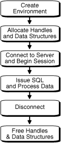
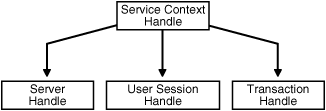
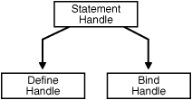
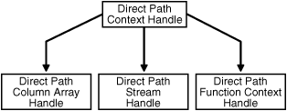

This chapter introduces concepts and procedures involved in programming with OCI.

After reading this chapter, you should have most of the tools necessary to understand and create a basic OCI application.

This chapter includes the following major sections:

- Overview of OCI Program Programming

- OCI Data Structures

- OCI Programming Steps

- Error Handling in OCI

- Additional Coding Guidelines

- About Using PL/SQL in an OCI Program

- OCI Globalization Support

New users should pay particular attention to the information presented in this chapter, because it forms the basis for the rest of the material presented in this guide. The information in this chapter is supplemented by information in later chapters.

**See Also:**

- [Oracle Database Globalization Support Guide](../nlspg/programming-with-unicode.md) for a discussion of the OCI functions that apply to a multilingual environment

- [Oracle Database Data Cartridge Developer's Guide](../addci/implementing-data-cartridges-in-C-CPP-and-java.md) for a discussion of the OCI functions that apply to cartridge services

### 4.1 Overview of OCI Program Programming

The general goal of an OCI application is to operate on behalf of multiple users.

In an n-tiered configuration, multiple users are sending HTTP requests to the client application. The client application may need to perform some data operations that include exchanging data and performing data processing.

OCI uses the following basic program flow:

1.  Create the environment by initializing the OCI programming environment and threads.

2.  Allocate necessary handles, and establish server connections and user sessions.

3.  Exchange data with the database server by executing SQL statements on the server, and perform necessary application data processing.

4.  Execute prepared statements, or prepare a new statement for execution.

5.  Terminate user sessions and disconnect from server connections.

6.  Free handles and data structures.

Figure 4-1 illustrates the flow of steps in an OCI application. OCI Programming Steps describes each step in more detail.

Figure 4-1 Basic OCI Program Flow

[Description of "Figure 4-1 Basic OCI Program Flow"](img_text/lnoci017.md)

The diagram and the list of steps present a simple generalization of OCI programming steps. Variations are possible, depending on the functionality of the program. OCI applications that include more sophisticated functionality, such as managing multiple sessions and transactions and using objects, require additional steps.

All OCI function calls are executed in the context of an environment. There can be multiple environments within an OCI process. If an environment requires any process-level initialization, then it is performed automatically.

**Note:**

It is possible to have multiple active connections and statements in an OCI application.

**See Also:**

[OCI Object-Relational Programming](oci-object-relational-programming.md) through [Using the Object Type Translator with OCI](using-object-type-translator-in-oci.md) for information about accessing and manipulating objects

### 4.2 OCI Data Structures

Handles and descriptors are opaque data structures that are defined in OCI applications.

Handles and descriptors can be allocated directly, through specific allocate calls, or they can be implicitly allocated by OCI functions.

**Note:**

Programmers who have previously written 7.x OCI applications must become familiar with these data structures that are used by most OCI calls.

Handles and descriptors store information pertaining to data, connections, or application behavior. Handles are defined in more detail in the next section.

This section includes the following topics: Handles

**Related Topics**

- OCI Descriptors

#### 4.2.1 Handles

Almost every OCI call includes in its parameter list one or more handles.

A handle is an opaque pointer to a storage area allocated by the OCI library. You use a handle to store context or connection information, (for example, an environment or service context handle), or it may store information about OCI functions or data (for example, an error or describe handle). Handles can make programming easier, because the library, rather than the application, maintains this data.

Most OCI applications must access the information stored in handles. The get and set attribute OCI calls, `OCIAttrGet()` and `OCIAttrSet()`, access and set this information.

Table 4-1 lists the handles defined for OCI. For each handle type, the C data type and handle type constant used to identify the handle type in OCI calls are listed.

Table 4-1 OCI Handle Types

| Description                               | C Data Type               | Handle Type Constant             |
|:------------------------------------------|:--------------------------|:---------------------------------|
| OCI environment handle                    | `OCIEnv`                  | `OCI_HTYPE_ENV`                  |
| OCI error handle                          | `OCIError`                | `OCI_HTYPE_ERROR`                |
| OCI service context handle                | `OCISvcCtx`               | `OCI_HTYPE_SVCCTX`               |
| OCI statement handle                      | `OCIStmt`                 | `OCI_HTYPE_STMT`                 |
| OCI bind handle                           | `OCIBind`                 | `OCI_HTYPE_BIND`                 |
| OCI define handle                         | `OCIDefine`               | `OCI_HTYPE_DEFINE`               |
| OCI describe handle                       | `OCIDescribe`             | `OCI_HTYPE_DESCRIBE`             |
| OCI server handle                         | `OCIServer`               | `OCI_HTYPE_SERVER`               |
| OCI user session handle                   | `OCISession`              | `OCI_HTYPE_SESSION`              |
| OCI authentication information handle     | `OCIAuthInfo`             | `OCI_HTYPE_AUTHINFO`             |
| OCI connection pool handle                | `OCICPool`                | `OCI_HTYPE_CPOOL`                |
| OCI session pool handle                   | `OCISPool`                | `OCI_HTYPE_SPOOL`                |
| OCI transaction handle                    | `OCITrans`                | `OCI_HTYPE_TRANS`                |
| OCI complex object retrieval (COR) handle | `OCIComplexObject`        | `OCI_HTYPE_COMPLEXOBJECT`        |
| OCI thread handle                         | `OCIThreadHandle`         | Not applicable                   |
| OCI subscription handle                   | `OCISubscription`         | `OCI_HTYPE_SUBSCRIPTION`         |
| OCI direct path context handle            | `OCIDirPathCtx`           | `OCI_HTYPE_DIRPATH_CTX`          |
| OCI direct path function context handle   | `OCIDirPathFuncCtx`       | `OCI_HTYPE_DIRPATH_FN_CTX`       |
| OCI direct path column array handle       | `OCIDirPathColArray`      | `OCI_HTYPE_DIRPATH_COLUMN_ARRAY` |
| OCI direct path stream handle             | `OCIDirPathStream`        | `OCI_HTYPE_DIRPATH_STREAM`       |
| OCI process handle                        | `OCIProcess`              | `OCI_HTYPE_PROC`                 |
| OCI administration handle                 | `OCIAdmin`                | `OCI_HTYPE_ADMIN`                |
| OCI HA event handle                       | `OCIEvent`                | Not applicable                   |
| OCI SODA collection handle                | `OCISodaColl`             | `OCI_HTYPE_SODA_COLLECTION`      |
| OCI SODA collection cursor handle         | `OCISodaCollCursor`       | `OCI_HTYPE_SODA_CURSOR`          |
| OCI SODA document cursor handle           | `OCISodaDocCursor`        | `OCI_HTYPE_SODA_DOC_CURSOR`      |
| OCI SODA document handle                  | `OCISodaDoc`              | `OCI_HTYPE_SODA_DOCUMENT`        |
| OCI SODA output options handle            | `OCISodaOutputOptions`    | `OCI_HTYPE_SODA_OUTPUT_OPTIONS`  |
| OCI SODA operation options handle         | `OCISodaOperationOptions` | `OCI_HTYPE_SODA_OPER_OPTIONS`    |

This section includes the following topics:

- About Allocating and Freeing Handles

- Environment Handle

- Error Handle

- Service Context Handle and Associated Handles

- Statement, Bind, and Define Handles

- Describe Handle

- Complex Object Retrieval Handle

- Thread Handle

- Subscription Handle

- Direct Path Handles

- Connection Pool Handle

- Handle Attributes

- OCI Descriptors

**Related Topics**

- Handle Attributes
- [OCIAttrSet()](handle-and-descriptor-functions.md)
- [OCIAttrGet()](handle-and-descriptor-functions.md)

##### 4.2.1.1 About Allocating and Freeing Handles

Your application allocates all handles (except the bind, define, and thread handles) for a particular environment handle.

You pass the environment handle as one of the parameters to the handle allocation call. The allocated handle is then specific to that particular environment.

The bind and define handles are allocated for a statement handle, and contain information about the statement represented by that handle.

**Note:**

The bind and define handles are implicitly allocated by the OCI library, and do not require user allocation.

The environment handle is allocated and initialized with a call to `OCIEnvCreate()` or to `OCIEnvNlsCreate()`, one of which is required by all OCI applications.

All user-allocated handles are initialized using the OCI handle allocation call, `OCIHandleAlloc()`.

The types of handles include: session pool handle, direct path context handle, thread handle, COR handle, subscription handle, describe handle, statement handle, service context handle, error handle, server handle, connection pool handle, event handle, and administration handle.

The thread handle is allocated with the `OCIThreadHndInit()` call.

An application must free all handles when they are no longer needed. The `OCIHandleFree()` function frees all handles.

**Note:**

When a parent handle is freed, all child handles associated with it are also freed and can no longer be used. For example, when a statement handle is freed, any bind and define handles associated with it are also freed.

Handles lessen the need for global variables. Handles also make error reporting easier. An error handle is used to return errors and diagnostic information.

**Related Topics**

- [OCI Demonstration Programs](oci-demo-programs.md)
- [OCIEnvCreate()](connect-authorize-and-initialize-functions.md)
- [OCIEnvNlsCreate()](connect-authorize-and-initialize-functions.md)
- [OCIHandleAlloc()](handle-and-descriptor-functions.md)
- [OCIThreadHndInit()](thread-management-functions.md)
- [OCIHandleFree()](handle-and-descriptor-functions.md)

##### 4.2.1.2 Environment Handle

The environment handle defines a context in which all OCI functions are invoked. Each environment handle contains a memory cache that enables fast memory access. All memory allocation under the environment handle is done from this cache. Access to the cache is serialized if multiple threads try to allocate memory under the same environment handle. When multiple threads share a single environment handle, they may block on access to the cache.

The environment handle is passed as the parent parameter to the [OCIHandleAlloc()](handle-and-descriptor-functions.md) call to allocate all other handle types. Bind and define handles are allocated implicitly.

##### 4.2.1.3 Error Handle

The error handle is passed as a parameter to most OCI calls.

The error handle maintains information about errors that occur during an OCI operation. If an error occurs in a call, the error handle can be passed to `OCIErrorGet()` to obtain additional information about the error that occurred.

Allocating the error handle is one of the first steps in an OCI application because most OCI calls require an error handle as a parameter.

**Related Topics**

- [About Implementing Thread Safety](managing-scalable-platforms.md)

##### 4.2.1.4 Service Context Handle and Associated Handles

A service context handle defines attributes that determine the operational context for OCI calls to a server.

The service context handle contains three handles as its attributes, that represent a server connection, a user session, and a transaction. These attributes are illustrated in Figure 4-2.

Figure 4-2 Components of a Service Context

[Description of "Figure 4-2 Components of a Service Context"](img_text/lnoci019.md)

- A server handle identifies a connection to a database. It translates into a physical connection in a connection-oriented transport mechanism.

- A user session handle defines a user's roles and privileges (also known as the user's security domain), and the operational context in which the calls execute.

- A transaction handle defines the transaction in which the SQL operations are performed. The transaction context includes user session state information, including any fetch state and package instantiation.

Breaking the service context handle down in this way provides scalability and enables programmers to create sophisticated multitiered applications and transaction processing (TP) monitors to execute requests on behalf of multiple users on multiple application servers and different transaction contexts.

You must allocate and initialize the service context handle with `OCIHandleAlloc()`, `OCILogon()`, or `OCILogon2()` before you can use it. The service context handle is allocated explicitly by `OCIHandleAlloc()`. It can be initialized using `OCIAttrSet()` with the server, user session, and transaction handle. If the service context handle is allocated implicitly using `OCILogon()`, it is already initialized.

Applications maintaining only a single user session for each database connection at any time can call `OCILogon()` to get an initialized service context handle.

In applications requiring more complex session management, the service context handle must be explicitly allocated, and the server and user session handles must be explicitly set into the service context handle. `OCIServerAttach()` and `OCISessionBegin()` calls initialize the server and user session handle respectively.

An application only defines a transaction explicitly if it is a global transaction or there are multiple transactions active for sessions. It works correctly with the implicit transaction created automatically by OCI when the application makes changes to the database.

**See Also:**

- [OCI Support for Transactions](managing-scalable-platforms.md)

- OCI Environment Initialization, and [Password and Session Management](managing-scalable-platforms.md) for more information about establishing a server connection and user session

- [OCIHandleAlloc()](handle-and-descriptor-functions.md)

- [OCILogon()](connect-authorize-and-initialize-functions.md)

- [OCILogon2()](connect-authorize-and-initialize-functions.md)

- [OCIAttrSet()](handle-and-descriptor-functions.md)

- [OCIServerAttach()](connect-authorize-and-initialize-functions.md)

- [OCISessionBegin()](connect-authorize-and-initialize-functions.md)

- [OCISessionGet()](connect-authorize-and-initialize-functions.md)

##### 4.2.1.5 Statement, Bind, and Define Handles

A statement handle is the context that identifies a SQL or PL/SQL statement and its associated attributes

A statement handle is shown in Figure 4-3.

Figure 4-3 Statement Handles

[Description of "Figure 4-3 Statement Handles"](img_text/lnoci041.md)

Information about input and output bind variables is stored in bind handles. The OCI library allocates a bind handle for each placeholder bound with the `OCIBindByName()` or `OCIBindByName2()` or `OCIBindByPos()` or `OCIBindByPos2()` function. The user must not allocate bind handles. They are implicitly allocated by the bind call.

Fetched data returned by a query (select statement) is converted and retrieved according to the specifications of the define handles. The OCI library allocates a define handle for each output variable defined with `OCIDefineByPos()` or `OCIDefineByPos2()`. The user must not allocate define handles. They are implicitly allocated by the define call.

Bind and define handles are implicitly allocated by the OCI library, and are transparently reused if the bind or define operation is repeated. The actual value of the bind or define handle is needed by the application for the advanced bind or define operations described in [Binding and Defining in OCI](binding-and-defining-in-oci.md). The handles are freed when the statement handle is freed or when a new statement is prepared on the statement handle. Explicitly allocating bind or define handles may lead to memory leaks. Explicitly freeing bind or define handles may cause abnormal program termination.

**See Also:**

- "[Advanced Bind Operations in OCI](binding-and-defining-in-oci.md)"

- "[Advanced Define Operations in OCI](binding-and-defining-in-oci.md)"

- [OCIBindByName()](bind-define-describe-functions.md)

- [OCIBindByName2()](bind-define-describe-functions.md)

- [OCIBindByPos()](bind-define-describe-functions.md)

- [OCIBindByPos2()](bind-define-describe-functions.md)

- [OCIDefineByPos()](bind-define-describe-functions.md)

- [OCIDefineByPos2()](bind-define-describe-functions.md)

##### 4.2.1.6 Describe Handle

The describe handle is used by the OCI describe call, `OCIDescribeAny()`.

The `OCIDescribeAny()` call obtains information about schema objects in a database (for example, functions or procedures). The call takes a describe handle as one of its parameters, along with information about the object being described. When the call completes, the describe handle is populated with information about the object. The OCI application can then obtain describe information through the attributes of the parameter descriptors.

**See Also:**

- [Describing Schema Metadata](describing-schema-metadata.md) for more information about using the `OCIDescribeAny()` function

- [OCIDescribeAny()](bind-define-describe-functions.md)

##### 4.2.1.7 Complex Object Retrieval Handle

The complex object retrieval (COR) handle is used by some OCI applications that work with objects in an Oracle database.

The complex object retrieval (COR) handle contains COR descriptors, provides instructions for retrieving objects referenced by another object.

**Related Topics**

- [Complex Object Retrieval](oci-object-relational-programming.md)

##### 4.2.1.8 Thread Handle

The thread handle is used in multithreaded applications.

For information about the thread handle, which is used in multithreaded applications, see the following OCIThread Package.

**Related Topics**

- [OCIThread Package](managing-scalable-platforms.md)

##### 4.2.1.9 Subscription Handle

The subscription handle is used by an OCI client application that registers and subscribes to receive notifications of database events or events in the AQ namespace.

The subscription handle encapsulates all information related to a registration from a client.

**Related Topics**

- [Publish-Subscribe Notification in OCI](notification-streams-advanced-queuing.md)

##### 4.2.1.10 Direct Path Handles

The direct path handles are necessary for an OCI application that uses the direct path load engine in the Oracle database.

The direct path load interface enables the application to access the direct block formatter of the Oracle database. Figure 4-4 shows the different kinds of direct path handles.

Figure 4-4 Direct Path Handles

[Description of "Figure 4-4 Direct Path Handles"](img_text/lnoci042.md)

**Related Topics**

- [Direct Path Loading Overview](direct-path-load-interface.md)
- [Direct Path Loading Handle Attributes](handle-and-descriptor-attributes.md)

##### 4.2.1.11 Connection Pool Handle

The connection pool handle is used for applications that pool physical connections into virtual connections.

The connection pool handle is used for applications that pool physical connections into virtual connections by calling specific OCI functions.

**Related Topics**

- [Connection Pooling in OCI](session-and-connection-pooling.md)

##### 4.2.1.12 Handle Attributes

All OCI handles have attributes that represent data stored in that handle.

You can read handle attributes by using the attribute get call, `OCIAttrGet()`, and you can change them with the attribute set call, `OCIAttrSet()`.

For example, the statements in Example 4-1 set the user name in the session handle by writing to the `OCI_ATTR_USERNAME` attribute:

Some OCI functions require that particular handle attributes be set before the function is called. For example, when `OCISessionBegin()` is called to establish a user's login session, the user name and password must be set in the user session handle before the call is made.

Other OCI functions provide useful return data in handle attributes after the function completes. For example, when `OCIStmtExecute()` is called to execute a SQL query, describe information relating to the select-list items is returned in the statement handle, as shown in Example 4-2.

**See Also:**

- The description of [OCIArrayDescriptorAlloc()](handle-and-descriptor-functions.md) for an example showing how to allocate a large number of descriptors

- [Handle and Descriptor Attributes](handle-and-descriptor-attributes.md)

- [OCIAttrGet()](handle-and-descriptor-functions.md)

- [OCIAttrSet()](handle-and-descriptor-functions.md)

- [OCISessionBegin()](connect-authorize-and-initialize-functions.md)

- [OCIStmtExecute()](statement-functions.md)

Example 4-1 Using the OCI_ATTR_USERNAME Attribute to Set the User Name in the Session Handle

    text username[] = "hr";
    err = OCIAttrSet ((void *) mysessp, OCI_HTYPE_SESSION, (void *)username,
          (ub4) strlen((char *)username), OCI_ATTR_USERNAME, (OCIError *) myerrhp);

Example 4-2 Returning Describe Information in the Statement Handle Relating to Select-List Items

    ub4 parmcnt;
    /* get the number of columns in the select list */
    err = OCIAttrGet ((void  *)stmhp, (ub4)OCI_HTYPE_STMT, (void  *)
             &parmcnt, (ub4 *) 0, (ub4)OCI_ATTR_PARAM_COUNT, errhp);

##### 4.2.1.13 OCI Descriptors

OCI descriptors and locators are opaque data structures that maintain data-specific information.

Table 4-2 lists OCI descriptors, along with their C data type, and the OCI type constant that allocates a descriptor of that type in a call to `OCIDescriptorAlloc()`. The `OCIDescriptorFree()` function frees descriptors and locators.

Table 4-2 Descriptor Types

| Description                                                           | C Data Type            | OCI Type Constant                |
|:----------------------------------------------------------------------|:-----------------------|:---------------------------------|
| Snapshot descriptor                                                   | `OCISnapshot`          | `OCI_DTYPE_SNAP`                 |
| Result set descriptor                                                 | `OCIResult`            | `OCI_DTYPE_RSET` (Deprecated)    |
| LOB data type locator                                                 | `OCILobLocator`        | `OCI_DTYPE_LOB`                  |
| `BFILE` data type locator                                             | `OCILobLocator`        | `OCI_DTYPE_FILE`                 |
| Read-only parameter descriptor                                        | `OCIParam`             | `OCI_DTYPE_PARAM`                |
| `ROWID` descriptor                                                    | `OCIRowid`             | `OCI_DTYPE_ROWID`                |
| `ANSI DATE` descriptor                                                | `OCIDateTime`          | `OCI_DTYPE_DATE`                 |
| `TIMESTAMP` descriptor                                                | `OCIDateTime`          | `OCI_DTYPE_TIMESTAMP`            |
| `TIMESTAMP WITH TIME ZONE` descriptor                                 | `OCIDateTime`          | `OCI_DTYPE_TIMESTAMP_TZ`         |
| `TIMESTAMP WITH LOCAL TIME ZONE` descriptor                           | `OCIDateTime`          | `OCI_DTYPE_TIMESTAMP_LTZ`        |
| `INTERVAL YEAR TO MONTH` descriptor                                   | `OCIInterval`          | `OCI_DTYPE_INTERVAL_YM`          |
| `INTERVAL DAY TO SECOND` descriptor                                   | `OCIInterval`          | `OCI_DTYPE_INTERVAL_DS`          |
| User callback descriptor                                              | `OCIUcb`               | `OCI_DTYPE_UCB`                  |
| Distinguished names of the database servers in a registration request | `OCIServerDNs`         | `OCI_DTYPE_SRVDN`                |
| Complex object descriptor                                             | `OCIComplexObjectComp` | `OCI_DTYPE_COMPLEXOBJECTCOMP`    |
| Advanced queuing enqueue options                                      | `OCIAQEnqOptions`      | `OCI_DTYPE_AQENQ_OPTIONS`        |
| Advanced queuing dequeue options                                      | `OCIAQDeqOptions`      | `OCI_DTYPE_AQDEQ_OPTIONS`        |
| Advanced queuing message properties                                   | `OCIAQMsgProperties`   | `OCI_DTYPE_AQMSG_PROPERTIES`     |
| Advanced queuing agent                                                | `OCIAQAgent`           | `OCI_DTYPE_AQAGENT`              |
| Advanced queuing notification                                         | `OCIAQNotify`          | `OCI_DTYPE_AQNFY`                |
| Advanced queuing listen options                                       | `OCIAQListenOpts`      | `OCI_DTYPE_AQLIS_OPTIONS`        |
| Advanced queuing message properties                                   | `OCIAQLisMsgProps`     | `OCI_DTYPE_AQLIS_MSG_PROPERTIES` |
| Change notification                                                   | None                   | `OCI_DTYPE_CHDES`                |
| Table change                                                          | None                   | `OCI_DTYPE_TABLE_CHDES`          |
| Row change                                                            | None                   | `OCI_DTYPE_ROW_CHDES`            |
| Shard key and shard group key descriptor                              | `OCIShardkey`          | `OCI_DTYPE_SHARD_KEY`            |

**Note:**

Although there is a single C type for `OCILobLocator`, this locator is allocated with a different OCI type constant for internal and external LOBs. LOB and BFILE Locators discusses this difference.

The following list describes the main purpose of each descriptor type. The sections that follow describe each descriptor type in more detail:

- `OCISnapshot` - Used in statement execution

- `OCILobLocator` - Used for LOB (`OCI_DTYPE_LOB`) or `BFILE` (`OCI_DTYPE_FILE`) calls

- `OCIParam` - Used in describe calls

- `OCIRowid` - Used for binding or defining `ROWID` values

- `OCIDateTime` and `OCIInterval` - Used for datetime and interval data types

- `OCIComplexObjectComp` - Used for complex object retrieval

- `OCIAQEnqOptions`, `OCIAQDeqOptions`, `OCIAQMsgProperties`, `OCIAQAgent` - Used for Advanced Queuing

- `OCIAQNotify` - Used for publish-subscribe notification

- `OCIServerDNs` - Used for LDAP-based publish-subscribe notification

This section includes the following topics:

- Snapshot Descriptor

- LOB and BFILE Locators

- Parameter Descriptor

- ROWID Descriptor

- Date, Datetime, and Interval Descriptors

- Complex Object Descriptor

- Advanced Queuing Descriptors

- User Memory Allocation

**Related Topics**

- [OCIDescriptorAlloc()](handle-and-descriptor-functions.md)
- [OCIDescriptorFree()](handle-and-descriptor-functions.md)
- [OCIArrayDescriptorAlloc()](handle-and-descriptor-functions.md)
- [OCIArrayDescriptorFree()](handle-and-descriptor-functions.md)

###### 4.2.1.13.1 Snapshot Descriptor

The snapshot descriptor is an optional parameter to the execute call,` OCIStmtExecute()`.

The snapshot descriptor indicates that a query is being executed against a database snapshot that represents the state of a database at a particular time.

Allocate a snapshot descriptor with a call to `OCIDescriptorAlloc()` by passing `OCI_DTYPE_SNAP` as the `type` parameter.

**Related Topics**

- [OCIStmtExecute()](statement-functions.md)
- [OCIDescriptorAlloc()](handle-and-descriptor-functions.md)
- [Execution Snapshots](using-sql_statements-in-oci.md)

###### 4.2.1.13.2 LOB and BFILE Locators

A large object (LOB) is an Oracle data type that can hold binary large object (`BLOB`) or character large object (`CLOB`) data.

In the database, an opaque data structure called a LOB locator is stored in a LOB column of a database row, or in the place of a LOB attribute of an object. The locator serves as a pointer to the actual LOB value, which is stored in a separate location.

**Note:**

Depending on your application, you may or may not want to use LOB locators. You can use the data interface for LOBs, which does not require LOB locators. In this interface, you can bind or define character data for `CLOB` columns or `RAW` data for `BLOB` columns.

The OCI LOB locator is used to perform OCI operations against a LOB (`BLOB` or `CLOB`) or FILE (`BFILE`). `OCILobXXX` functions take a LOB locator parameter instead of the LOB value. OCI LOB functions do not use actual LOB data as parameters. They use the LOB locators as parameters and operate on the LOB data referenced by them.

The LOB locator is allocated with a call to `OCIDescriptorAlloc()` by passing `OCI_DTYPE_LOB` as the `type` parameter for `BLOB`s or `CLOB`s, and `OCI_DTYPE_FILE` for `BFILE`s.

**Note:**

The two LOB locator types are not interchangeable. When binding or defining a `BLOB` or `CLOB`, the application must take care that the locator is properly allocated by using `OCI_DTYPE_LOB`. Similarly, when binding or defining a `BFILE`, the application must be sure to allocate the locator using `OCI_DTYPE_FILE`.

An OCI application can retrieve a LOB locator from the Oracle database by issuing a SQL statement containing a LOB column or attribute as an element in the select list. In this case, the application would first allocate the LOB locator and then use it to define an output variable. Similarly, a LOB locator can be used as part of a bind operation to create an association between a LOB and a placeholder in a SQL statement.

**Related Topics**

- [LOB and BFILE Operations](lobs-and-bfile-operations.md)
- [About Binding LOB Data](binding-and-defining-in-oci.md)
- [About Defining LOB Data](binding-and-defining-in-oci.md)
- [OCIDescriptorAlloc()](handle-and-descriptor-functions.md)

###### 4.2.1.13.3 Parameter Descriptor

OCI applications use parameter descriptors to obtain information about select-list columns or schema objects.

This information is obtained through a describe operation.

The parameter descriptor is the only descriptor type that is not allocated using `OCIDescriptorAlloc()`. You can obtain it only as an attribute of a describe handle, statement handle, or through a complex object retrieval handle by specifying the position of the parameter using an `OCIParamGet()` call.

**Related Topics**

- [OCIDescriptorAlloc()](handle-and-descriptor-functions.md)
- [OCIParamGet()](handle-and-descriptor-functions.md)
- [About Describing Select-List Items](using-sql_statements-in-oci.md)
- [Describing Schema Metadata](describing-schema-metadata.md)

###### 4.2.1.13.4 ROWID Descriptor

The `ROWID` descriptor, `OCIRowid`, is used by applications that must retrieve and use Oracle ROWIDs.

To work with a `ROWID` an application can define a `ROWID` descriptor for a rowid position in a SQL select list, and retrieve a `ROWID` into the descriptor. This same descriptor can later be bound to an input variable in an `INSERT` statement or `WHERE` clause.

`ROWID`s are also redirected into descriptors using `OCIAttrGet()` on the statement handle following an execute operation.

**Related Topics**

- [OCIAttrGet()](handle-and-descriptor-functions.md)

###### 4.2.1.13.5 Date, Datetime, and Interval Descriptors

The date, datetime, and interval descriptors are used by applications that use the date, datetime, or interval data types (`OCIDate`, `OCIDateTime`, and `OCIInterval`).

These descriptors can be used for binding and defining, and are passed as parameters to the functions `OCIDescriptorAlloc()` and `OCIDescriptorFree()` to allocate and free memory.

**Related Topics**

- [OCIDescriptorAlloc()](handle-and-descriptor-functions.md)
- [OCIDescriptorFree()](handle-and-descriptor-functions.md)
- [Data Types](data-types.md)
- [OCI Data Type Mapping and Manipulation Functions](oci-data-type-mapping-and-manipulation-functions.md)

###### 4.2.1.13.6 Complex Object Descriptor

Complex object retrieval (COR) may improve application performance when dealing with objects.

Application performance when dealing with objects may be increased using complex object retrieval (COR).

**Related Topics**

- [Complex Object Retrieval](oci-object-relational-programming.md)

###### 4.2.1.13.7 Advanced Queuing Descriptors

There are a number of Oracle Database Advanced Queuing descriptors for use to maintain data-specific information.

Oracle Database Advanced Queuing provides message queuing as an integrated part of Oracle Database.

**Related Topics**

- [OCI and Database Advanced Queuing](notification-streams-advanced-queuing.md)
- [Publish-Subscribe Registration Functions in OCI](notification-streams-advanced-queuing.md)

###### 4.2.1.13.8 User Memory Allocation

The `OCIDescriptorAlloc()` call has an `xtramem_sz` parameter in its parameter list.

The `xtramem_sz` parameter is used to specify the amount of user memory that should be allocated along with a descriptor or locator.

Typically, an application uses this parameter to allocate an application-defined structure that has the same lifetime as the descriptor or locator. This structure can be used for application bookkeeping or storing context information.

Using the `xtramem_sz` parameter means that the application does not need to explicitly allocate and deallocate memory as each descriptor or locator is allocated and deallocated. The memory is allocated along with the descriptor or locator, and freeing the descriptor or locator (with `OCIDescriptorFree()`) frees the user's data structures as well.

The `OCIHandleAlloc()` call has a similar parameter for allocating user memory that has the same lifetime as the handle.

The `OCIEnvCreate()` and (`OCIEnvInit()` deprecated) calls have a similar parameter for allocating user memory that has the same lifetime as the environment handle.

**Related Topics**

- [OCIDescriptorAlloc()](handle-and-descriptor-functions.md)
- [OCIDescriptorFree()](handle-and-descriptor-functions.md)
- [OCIHandleAlloc()](handle-and-descriptor-functions.md)
- [OCIEnvCreate()](connect-authorize-and-initialize-functions.md)
- [OCIEnvInit()](deprecated-oci-functions.md)

### 4.3 OCI Programming Steps

The following sections describe in detail each of the steps in developing an OCI application.

Some of the steps are optional. For example, you do not need to describe or define select-list items if the statement is not a query. Application-specific processing also occurs in between any and all of the OCI function steps.

The following sections describe the steps that are required of an OCI application:

- OCI Environment Initialization

- About Processing SQL Statements in OCI

- Commit or Roll Back Operations

- About Terminating the Application

- Error Handling in OCI

**See Also:**

- The first sample program in [OCI Demonstration Programs](oci-demo-programs.md) for an example showing the use of OCI calls for processing SQL statements.

- [Runtime Data Allocation and Piecewise Operations in OCI](binding-and-defining-in-oci.md) for a detailed description of the special case of dynamically providing data at run time

- [About Binding and Defining Arrays of Structures in OCI](binding-and-defining-in-oci.md) for a description of the special considerations for operations involving arrays of structures

- Error Handling in OCI for an outline of the steps involved in processing a SQL statement within an OCI program

- [Overview of OCI Multithreaded Development](managing-scalable-platforms.md) for information about using the OCI to write multithreaded applications

- [SQL Statements](introduction.md) for more information about types of SQL statements

#### 4.3.1 OCI Environment Initialization

This section describes how to initialize the OCI environment, establish a connection to a server, and authorize a user to perform actions against the database.

First, the three main steps in initializing the OCI environment are described in the following sections:

- About Creating the OCI Environment

- About Allocating Handles and Descriptors

- Application Initialization, Connection, and Session Creation

##### 4.3.1.1 About Creating the OCI Environment

Each OCI function call is executed in the context of an environment that is created with the `OCIEnvCreate()` call.

The `OCIEnvCreate()` call must be invoked before any other OCI call is executed. The only exception is the setting of a process-level attribute for the OCI shared mode.

The `mode` parameter of `OCIEnvCreate()` specifies whether the application calling the OCI library functions can:

- Run in a threaded environment (`mode` = `OCI_THREADED`).

- Use objects (`mode` = `OCI_OBJECT`). Use with AQ subscription registration.

- Use subscriptions (`mode`= `OCI_EVENTS`).

The mode can be set independently in each environment.

It is necessary to initialize in object mode if the application binds and defines objects, or if it uses the OCI's object navigation calls. The program may also choose to use none of these features (`mode` = `OCI_DEFAULT`) or some combination of them, separating the options with a vertical bar. For example if `mode` = (`OCI_THREADED` \| `OCI_OBJECT`), then the application runs in a threaded environment and uses objects.

You can specify user-defined memory management functions for each OCI environment.

**See Also:**

- [OCIEnvCreate()](connect-authorize-and-initialize-functions.md), [OCIEnvNlsCreate()](connect-authorize-and-initialize-functions.md), and [OCIInitialize()](deprecated-oci-functions.md) (deprecated) for more information about the initialization calls

- [Overview of OCI Multithreaded Development](managing-scalable-platforms.md)

- [OCI Object-Relational Programming](oci-object-relational-programming.md), [Object-Relational Data Types in OCI](object-relational-data-types-in-oci.md), [Direct Path Load Interface](direct-path-load-interface.md), [Object Advanced Topics in OCI](object-advanced-topics-in-oci.md), and [Using the Object Type Translator with OCI](using-object-type-translator-in-oci.md)

- [Publish-Subscribe Notification in OCI](notification-streams-advanced-queuing.md)

##### 4.3.1.2 About Allocating Handles and Descriptors

Oracle Database provides OCI functions to allocate and deallocate handles and descriptors.

You must allocate handles using `OCIHandleAlloc()` before passing them into an OCI call, unless the OCI call, such as `OCIBindByPos()` or `OCIBindByPos2()`, allocates the handles for you.

You can allocate the types of handles listed in Table 4-1 with `OCIHandleAlloc() `Depending on the functionality of your application, it must allocate some or all of these handles.

**Related Topics**

- [OCIHandleAlloc()](handle-and-descriptor-functions.md)
- [OCIBindByPos()](bind-define-describe-functions.md)
- [OCIBindByPos2()](bind-define-describe-functions.md)

##### 4.3.1.3 Application Initialization, Connection, and Session Creation

An application must call `OCIEnvNlsCreate()` to initialize the OCI environment handle. Existing applications may have used `OCIEnvCreate()`.

Following this step, the application has several options for establishing an Oracle database connection and beginning a user session.

These methods include:

- Single User, Single Connection

- Client Access Through a Proxy

- Nonproxy Multiple Sessions or Connections

**Note:**

`OCIEnvCreate()` or `OCIEnvNlsCreate()` should be used instead of the `OCIInitialize()` and `OCIEnvInit()` calls. `OCIInitialize()` and `OCIEnvInit()` calls are supported for backward compatibility.

###### 4.3.1.3.1 Single User, Single Connection

The single user, single connection option is the simplified logon method, which can be used if an application maintains only a single user session for each database connection at any time.

When an application calls `OCILogon2()` or `OCILogon()`, the OCI library initializes the service context handle that is passed to it, and creates a connection to the specified Oracle database for the user making the request.

Example 4-3 shows what a call to `OCILogon2()` looks like for a single user session with user name `hr`, password `hr`, and database `oracledb`.

The parameters to this call include the service context handle (which has been initialized), the user name, the user's password, and the name of the database that are used to establish the connection. With the last parameter, `mode`, set to `OCI_DEFAULT`, this call has the same effect as calling the older `OCILogon()`. Use `OCILogon2()` for any new applications. The server and user session handles are implicitly allocated by this function.

If an application uses this logon method, the service context, server, and user session handles are all read-only; the application cannot switch session or transaction by changing the appropriate attributes of the service context handle using an `OCIAttrSet()` call.

An application that initializes its session and authorization using `OCILogon2()` must terminate them using `OCILogoff()`.

**Note:**

For simplicity in demonstrating this feature, this example does not perform the password management techniques that a deployed system normally uses. In a production environment, follow the Oracle Database password management guidelines, and disable any sample accounts. See [Oracle Database Security Guide](../dbseg/keeping-your-oracle-database-secure.md) for password management guidelines and other security recommendations.

Example 4-3 Using the OCILogon2 Call for a Single User Session

    OCILogon2(envhp, errhp, &svchp, (text *)"hr", (ub4)strlen("hr"), (text *)"hr",
              (ub4)strlen("hr"), (text *)"oracledb", (ub4)strlen("oracledb"),
              OCI_DEFAULT);

#####

**See Also:**

Operating System Considerations for information regarding operating systems providing facilities for spawning processes that allow child processes to reuse state created by their parent process. This section explains why the child process must not use the same database connection as created by the parent.

###### 4.3.1.3.2 Client Access Through a Proxy

Proxy authentication is a process typically employed in an environment with a middle tier such as a firewall, in which the end user authenticates to the middle tier, which then authenticates to the database on the user's behalf—as its proxy.

The middle tier logs in to the database as a proxy user. A proxy user can switch identities and, after logging in to the database, switch to the end user's identity. It can perform operations on the end user's behalf, using the authorization appropriate to that particular end user.

**Note:**

In release 1 of Oracle 11g, standards for acceptable passwords were greatly raised to increase security. Examples of passwords in this section are incorrect. A password must contain no fewer than eight characters. See the guidelines for securing passwords [Oracle Database Security Guide](../dbseg/keeping-your-oracle-database-secure.md) for additional information.

Proxy to database users is supported by using OCI and the `ALTER` `USER` statement, whose BNF syntax is:

    ALTER USER <targetuser> GRANT CONNECT THROUGH <proxy> [AUTHENTICATION REQUIRED];

The `ALTER` `USER` statement is used once in an application. Connections can be made multiple times afterward. In OCI, you can either use connect strings or the function `OCIAttrSet()` with the parameter `OCI_ATTR_PROXY_CLIENT`.

Even though beginning with Oracle Database 12`c` Release 2 (12.2) the maximum length of each identifier is increased to 128 bytes, the user name and proxy combination can not exceed 250 bytes.

After a proxy switch is made, the current and connected user is the target user of the proxy. The identity of the original user is not used for any privilege calculations. The original user can be a local or external user.

Example 4-4 through Example 4-11 show connect strings that you can use in functions such as `OCILogon2()` (set `mode` = `OCI_DEFAULT`), `OCILogon()`, `OCISessionBegin()` with `OCIAttrSet()` (pass the attribute `OCI_ATTR_USERNAME` of the session handle), and so on.

In Example 4-4, Dilbert and Joe are two local database users. To enable Dilbert to serve as a proxy for Joe, use the SQL statement shown in Example 4-4.

When user name `dilbert` is acting on behalf of `joe`, use the connection string shown in Example 4-5. (The user name `dilbert` has the password `tiger123`).

The left and right brackets "\[" and "\]" are entered in the connection string.

In Example 4-6, "Dilbert" and "Joe" are two local database users. The names are case-sensitive and must be enclosed in double quotation marks. To enable "Dilbert" to serve as a proxy for "Joe", use the SQL statement shown in Example 4-6.

When "Dilbert" is acting on behalf of "Joe", use the connection string shown in Example 4-7. Be sure to include the double quotation marks (") characters.

When the proxy user is created as "dilbert\[mybert\]", use the connection string shown in Example 4-8 to connect to the database. (The left and right brackets "\[" and "\]" are entered in the connection string.)

In Example 4-9, dilbert\[mybert\] and joe\[myjoe\] are two database users that contain the left and right bracket characters "\[" and "\]". If dilbert\[mybert\] wants to act on behalf of joe\[myjoe\], Example 4-9 shows the connect statement to use.

In Example 4-10, you can set the target user name by using the `ALTER` `USER` statement.

**See Also:**

- [OCI_ATTR_PROXY_CLIENT](handle-and-descriptor-attributes.md)

- [Oracle Database Security Guide](../dbseg/configuring-authentication.md) for a discussion of proxy authentication

- [Password and Session Management](managing-scalable-platforms.md)

- [OCIAttrSet()](handle-and-descriptor-functions.md)

**Note:**

There are compatibility issues of client access through a proxy. Because this feature was introduced in Oracle Database release 10.2, pre-10.2 clients do not have it. If newer clients use the feature with pre-10.2 Oracle databases, the connect fails and the client returns an error after checking the database release level.

Example 4-4 Enabling a Local User to Serve as a Proxy for Another User

    ALTER USER joe GRANT CONNECT THROUGH dilbert;

Example 4-5 Connection String to Use for the Proxy User

    dilbert[joe]/tiger123@db1

Example 4-6 Preserving Case Sensitivity When Enabling a Local User to Serve as a Proxy for Another User

    ALTER USER "Joe" GRANT CONNECT THROUGH "Dilbert";

Example 4-7 Preserving Case Sensitivity in the Connection String

    "Dilbert"["Joe"]/tiger123@db1

Example 4-8 Using "dilbert\[mybert\]" in the Connection String

    "dilbert[mybert]"/tiger123

    rem the user was already created this way:
    rem CREATE USER "dilbert[mybert]" IDENTIFIED BY tiger123;

Example 4-9 Using "dilbert\[mybert\]"\["joe\[myjoe\]"\] in the Connection String

    "dilbert[mybert]"["joe[myjoe]"]/tiger123

Example 4-10 Setting the Target User Name

    ALTER USER joe GRANT CONNECT THROUGH dilbert;

Then, as shown in Example 4-11, in an OCI program, use the `OCIAttrSet()` call to set the attribute `OCI_ATTR_PROXY_CLIENT` and the proxy `dilbert`. In your program, use these statements to connect multiple times.

Example 4-11 Using OCI to Set the OCI_ATTR_PROXY_CLIENT Attribute and the Proxy dilbert

    OCIAttrSet(session, OCI_HTYPE_SESSION, (void  *)"dilbert",
               (ub4)strlen("dilbert"), OCI_ATTR_USERNAME,
               error_handle);
    OCIAttrSet(session, OCI_HTYPE_SESSION, (void  *)"tiger123",
               (ub4)strlen("tiger123"), OCI_ATTR_PASSWORD,
               error_handle);
    OCIAttrSet(session, OCI_HTYPE_SESSION, (void  *)"joe",
               (ub4)strlen("joe"), OCI_ATTR_PROXY_CLIENT,
               error_handle);

###### 4.3.1.3.3 Nonproxy Multiple Sessions or Connections

The nonproxy multiple sessions or connections option uses explicit attach and begin-session calls to maintain multiple user sessions and connections on a database connection.

Specific calls to attach to the Oracle database and begin sessions are:

- `OCIServerAttach()` - Creates an access path to the Oracle database for OCI operations.

- `OCISessionBegin()` - Establishes a session for a user against a particular Oracle database. This call is required for the user to execute operations on the Oracle database.

A subsequent call to `OCISessionBegin()` using different service context and session context handles logs off the previous user and causes an error. To run two simultaneous nonmigratable sessions, a second `OCISessionBegin()` call must be made with the same service context handle and a new session context handle.

These calls set up an operational environment that enables you to execute SQL and PL/SQL statements against a database.

**See Also:**

- [Connect, Authorize, and Initialize Functions](connect-authorize-and-initialize-functions.md)

- [Session Pooling and Connection Pooling in OCI](session-and-connection-pooling.md) for more information about maintaining multiple sessions, transactions, and connections

- Client Character Set Control from OCI for the use of `OCIEnvNlsCreate()`

Example 4-12 demonstrates the creation and initialization of an OCI environment.

- A server context is created and set in the service handle.

- Then a user session handle is created and initialized using a database user name and password.

- For simplicity, error checking is not included.

The demonstration program `cdemo81.c` in the `demo` directory illustrates this process, with error checking.

Example 4-12 Creating and Initializing an OCI Environment

    #include <oci.h>
    ...
    main()
    {
    ...
    OCIEnv     *myenvhp;    /* the environment handle */
    OCIServer  *mysrvhp;    /* the server handle */
    OCIError   *myerrhp;    /* the error handle */
    OCISession *myusrhp;    /* user session handle */
    OCISvcCtx  *mysvchp;    /* the  service handle */
    ...
    /* initialize the mode to be the threaded and object environment */
    (void) OCIEnvCreate(&myenvhp, OCI_THREADED|OCI_OBJECT, (void  *)0,
                        0, 0, 0, (size_t) 0, (void  **)0);

         /* allocate a server handle */
    (void) OCIHandleAlloc ((void  *)myenvhp, (void  **)&mysrvhp,
          OCI_HTYPE_SERVER, 0, (void  **) 0);

          /* allocate an error handle */
    (void) OCIHandleAlloc ((void  *)myenvhp, (void  **)&myerrhp,
          OCI_HTYPE_ERROR, 0, (void  **) 0);

          /* create a server context */
    (void) OCIServerAttach (mysrvhp, myerrhp, (text *)"inst1_alias",
          strlen ("inst1_alias"), OCI_DEFAULT);

         /* allocate a service handle */
    (void) OCIHandleAlloc ((void  *)myenvhp, (void  **)&mysvchp,
          OCI_HTYPE_SVCCTX, 0, (void  **) 0);

     /* set the server attribute in the service context handle*/
    (void) OCIAttrSet ((void  *)mysvchp, OCI_HTYPE_SVCCTX,
           (void  *)mysrvhp, (ub4) 0, OCI_ATTR_SERVER, myerrhp);

          /* allocate a user session handle */
    (void) OCIHandleAlloc ((void  *)myenvhp, (void  **)&myusrhp,
         OCI_HTYPE_SESSION, 0, (void  **) 0);

          /* set user name attribute in user session handle */
     (void) OCIAttrSet ((void  *)myusrhp, OCI_HTYPE_SESSION,
          (void  *)"hr", (ub4)strlen("hr"),
          OCI_ATTR_USERNAME, myerrhp);

          /* set password attribute in user session handle */
     (void) OCIAttrSet ((void  *)myusrhp, OCI_HTYPE_SESSION,
          (void  *)"hr", (ub4)strlen("hr"),
          OCI_ATTR_PASSWORD, myerrhp);

     (void) OCISessionBegin ((void  *) mysvchp, myerrhp, myusrhp,
          OCI_CRED_RDBMS, OCI_DEFAULT);

        /* set the user session attribute in the service context handle*/
     (void) OCIAttrSet ((void  *)mysvchp, OCI_HTYPE_SVCCTX,
           (void  *)myusrhp, (ub4) 0, OCI_ATTR_SESSION, myerrhp);
    ...
    }

#### 4.3.2 About Processing SQL Statements in OCI

What are the specific steps involved in processing SQL statements in OCI.

[Using SQL Statements in OCI](using-sql_statements-in-oci.md) outlines the specific steps involved in processing SQL statements in OCI.

#### 4.3.3 Commit or Roll Back Operations

An application commits changes to the database by calling `OCITransCommit()`.

The `OCITransCommit()` call uses a service context as one of its parameters. The transaction is associated with the service context whose changes are committed. This transaction can be explicitly created by the application or implicitly created when the application modifies the database.

**Note:**

By using the `OCI_COMMIT_ON_SUCCESS` mode of the `OCIStmtExecute()` call, the application can selectively commit transactions after each statement execution, saving an extra round-trip.

To roll back a transaction, use the `OCITransRollback()` call.

If an application disconnects from Oracle Database in a way other than a normal logoff, such as losing a network connection, and `OCITransCommit()` has not been called, all active transactions are rolled back automatically.

**See Also:**

- "Service Context Handle and Associated Handles"

- "[OCI Support for Transactions](managing-scalable-platforms.md)"

#### 4.3.4 About Terminating the Application

What should an application do before it terminates.

An OCI application should perform the following steps before it terminates:

1.  Delete the user session by calling `OCISessionEnd()` for each session.

2.  Delete access to the data sources by calling `OCIServerDetach()` for each source.

3.  Explicitly deallocate all handles by calling `OCIHandleFree()` for each handle.

4.  Delete the environment handle, which deallocates all other handles associated with it.

    **Note:**

    When a parent OCI handle is freed, any child handles associated with it are freed automatically

The calls to `OCIServerDetach()` and `OCISessionEnd()` are not mandatory but are recommended. If the application terminates, and `OCITransCommit()` (transaction commit) has not been called, any pending transactions are automatically rolled back.

**See Also:**

The first sample program in [OCI Demonstration Programs](oci-demo-programs.md) for an example showing handles being freed at the end of an application

**Note:**

If the application uses the simplified logon method of `OCILogon2()`, then a call to `OCILogoff()` terminates the session, disconnects from the Oracle database, and frees the service context and associated handles. The application is still responsible for freeing other handles it allocated.

#### 4.3.5 Error Handling in OCI

OCI function calls have a set of return codes.

These OCI function call return codes are listed in Table 4-3, which indicate the success or failure of the call, such as `OCI_SUCCESS` or `OCI_ERROR`, or provide other information that may be required by the application, such as `OCI_NEED_DATA` or `OCI_STILL_EXECUTING`. Most OCI calls return one of these codes.

To verify that the connection to the server is not terminated by the `OCI_ERROR`, an application can check the value of the attribute `OCI_ATTR_SERVER_STATUS` in the server handle. If the value of the attribute is `OCI_SERVER_NOT_CONNECTED`, then the connection to the server and the user session must be reestablished.

**See Also:**

- "Functions Returning Other Values" for exceptions

- "[OCIErrorGet()](miscellaneous-functions.md)" for complete details and an example of usage

- "[Server Handle Attributes](handle-and-descriptor-attributes.md)"

Table 4-3 OCI Return Codes

| OCI Return Code         | Value  | Description                                                                                                                                                                                                                   |
|:------------------------|:-------|:------------------------------------------------------------------------------------------------------------------------------------------------------------------------------------------------------------------------------|
| `OCI_SUCCESS`           | 0      | The function completed successfully.                                                                                                                                                                                          |
| `OCI_SUCCESS_WITH_INFO` | 1      | The function completed successfully; a call to `OCIErrorGet()` returns additional diagnostic information. This may include warnings.                                                                                          |
| `OCI_NO_DATA`           | 100    | The function completed, and there is no further data.                                                                                                                                                                         |
| `OCI_ERROR`             | -1     | The function failed; a call to `OCIErrorGet()` returns additional information.                                                                                                                                                |
| `OCI_INVALID_HANDLE`    | -2     | An invalid handle was passed as a parameter or a user callback was passed an invalid handle or invalid context. No further diagnostics are available.                                                                         |
| `OCI_NEED_DATA`         | 99     | The application must provide runtime data.                                                                                                                                                                                    |
| `OCI_STILL_EXECUTING`   | -3123  | The service context was established in nonblocking mode, and the current operation could not be completed immediately. The operation must be called again to complete. `OCIErrorGet()` returns `ORA-03123` as the error code. |
| `OCI_CONTINUE`          | -24200 | This code is returned only from a callback function. It indicates that the callback function wants the OCI library to resume its normal processing.                                                                           |
| `OCI_ROWCBK_DONE`       | -24201 | This code is returned only from a callback function. It indicates that the callback function is done with the user row callback.                                                                                              |

If the return code indicates that an error has occurred, the application can retrieve error codes and messages specific to Oracle Database by calling `OCIErrorGet()`. One of the parameters to `OCIErrorGet()` is the error handle passed to the call that caused the error.

**Note:**

Multiple diagnostic records can be retrieved by calling `OCIErrorGet()` repeatedly until there are no more records (`OCI_NO_DATA` is returned). `OCIErrorGet()` returns at most a single diagnostic record.

This section includes the following topics:

- Return and Error Codes for Data

- [Functions Returning Other Values](intro-to-data-type-mapping-and-manipulation-functions.md)

##### 4.3.5.1 Return and Error Codes for Data

The OCI return code, error number, indicator variable, and column return code are specified when the data fetched is normal, null, or truncated.

In Table 4-4, the OCI return code, error number, indicator variable, and column return code are specified when the data fetched is normal, null, or truncated.

**See Also:**

"Indicator Variables"

Table 4-4 Return and Error Codes

| State of Data         | Return Code  | Indicator - Not provided                                       | Indicator - Provided                                                                   |
|:----------------------|:-------------|:---------------------------------------------------------------|:---------------------------------------------------------------------------------------|
| Not null or truncated | Not provided | `OCI_SUCCESS` Error = 0                                     | `OCI_SUCCESS` Error = 0 Indicator = 0                                            |
| Not null or truncated | Provided     | `OCI_SUCCESS` Error = 0 Return code = 0                  | `OCI_SUCCESS` Error = 0 Indicator = 0 Return code = 0                         |
| Null data             | Not provided | `OCI_ERROR` Error = 1405                                    | `OCI_SUCCESS` Error = 0 Indicator = -1                                           |
| Null data             | Provided     | `OCI_ERROR` Error = 1405 Return code = 1405              | `OCI_SUCCESS` Error = 0 Indicator = -1 Return code = 1405                     |
| Truncated data        | Not provided | `OCI_ERROR` Error = 1406                                    | `OCI_ERROR` Error = 1406 Indicator = data_len                                    |
| Truncated data        | Provided     | `OCI_SUCCESS_WITH_INFO` Error = 24345 Return code = 1405 | `OCI_SUCCESS_WITH_INFO` Error = 24345 Indicator = data_len Return code = 1406 |

For truncated data, `data_len` is the actual length of the data that has been truncated if this length is less than or equal to `SB2MAXVAL`. Otherwise, the indicator is set to -2.

##### 4.3.5.2 Functions Returning Other Values

Some functions return values other than the OCI error codes.

These other OCI error codes are listed in Table 4-3. When you use these functions, be aware that they return values directly from the function call, rather than through an `OUT` parameter. More detailed information about each function and its return values is listed in the reference chapters.

### 4.4 Additional Coding Guidelines

This section explains some additional issues when coding OCI applications.

This section includes the following topics:

- Operating System Considerations

- Parameter Types

- Inserting Nulls into a Column

- Indicator Variables

- About Canceling Calls

- Positioned Updates and Deletes

- Reserved Words

- Polling Mode Operations in OCI

- Nonblocking Mode in OCI

- Setting Blocking Modes

- Canceling a Nonblocking Call

#### 4.4.1 Operating System Considerations

Operating systems may provide facilities for spawning processes that allow child processes to reuse the state created by their parent process.

After spawning a child process, the child process must not use the same database connection as created by the parent. Any attempt on behalf of the child process to use the same database connection as the parent may cause undesired connection interference and result in intermittent `ORA-03137` errors, because Oracle Net expects only one user process to be using a connection to the database.

Where multiple, concurrent connections are required, consider using threads if your platform supports a threads package. Concurrent connections are supported in either single-threaded or multithreaded applications. For better performance with many concurrently opened connections, consider pooling them.

**See Also:**

- [Overview of OCI Multithreaded Development](managing-scalable-platforms.md)

- [OCIThread Package](managing-scalable-platforms.md)

- [Session Pooling in OCI](session-and-connection-pooling.md)

- [When to Use Connection Pooling, Session Pooling, or Neither](session-and-connection-pooling.md)

#### 4.4.2 Parameter Types

OCI functions take a variety of different types of parameters, including integers, handles, and character strings.

Special considerations must be taken into account for some types of parameters, as described in the following sections:

- Address Parameters

- Integer Parameters

- Character String Parameters

This section includes the following topics:

**See Also:**

[Connect, Authorize, and Initialize Functions](connect-authorize-and-initialize-functions.md) for more information about parameter data types and parameter passing conventions

##### 4.4.2.1 Address Parameters

Address parameters are used to pass the address of the variable to Oracle Database.

You should be careful when developing in C, because it normally passes scalar parameters by value.

##### 4.4.2.2 Integer Parameters

Binary integer and short binary integer parameters are numbers whose size is system-dependent.

See Oracle Database documentation that is specific to your operating system for the size of these integers on your system.

##### 4.4.2.3 Character String Parameters

Character strings are a special type of address parameter.

Each OCI routine that enables a character string to be passed as a parameter also has a string length parameter. The length parameter should be set to the length of the string.

**Note:**

Unlike earlier versions of OCI, you do not pass -1 for the string length parameter of a null-terminated string.

#### 4.4.3 Inserting Nulls into a Column

How to insert a null into a database column.

You can insert a null into a database column in several ways.

- One method is to use a literal `NULL` in the text of an `INSERT` or `UPDATE` statement. For example, the SQL statement makes the `ENAME` column `NULL`.

           INSERT INTO emp1 (ename, empno, deptno)
              VALUES (NULL, 8010, 20)

- Use indicator variables in the OCI bind call.

- Insert a `NULL` to set both the buffer length and maximum length parameters to zero on a bind call.

  **Note:**

  Following the SQL standard requirements, Oracle Database returns an error if an attempt is made to fetch a null select-list item into a variable that does not have an associated indicator variable specified in the define call.

**Related Topics**

- Indicator Variables

#### 4.4.4 Indicator Variables

Each bind and define OCI call has a parameter that associates an indicator variable, or an array of indicator variables, with a DML statement, a PL/SQL statement, or a query.

The C language does not have the concept of null values; therefore, you associate indicator variables with input variables to specify whether the associated placeholder is a `NULL`. When data is passed to an Oracle database, the values of these indicator variables determine whether a `NULL` is assigned to a database field.

For output variables, indicator variables determine whether the value returned from Oracle is a `NULL` or a truncated value. For a `NULL` fetch in an `OCIStmtFetch2()` call or a truncation in an `OCIStmtExecute()` call, the OCI call returns `OCI_SUCCESS_WITH_INFO`. The output indicator variable is set.

The data type of indicator variables is `sb2`. For arrays of indicator variables, the individual array elements should be of type `sb2`.

This section includes the following topics:

- Input

- Output

- Indicator Variables for Named Data Types and REFs

##### 4.4.4.1 Input

What values can be assigned to an indicator variable.

For input host variables, the OCI application can assign the following values to an indicator variable:

| Input Indicator Value | Action Taken by Oracle Database                                                           |
|:----------------------|:------------------------------------------------------------------------------------------|
| -1                    | Oracle Database assigns a `NULL` to the column, ignoring the value of the input variable. |
| \>=0                  | Oracle Database assigns the value of the input variable to the column.                    |

##### 4.4.4.2 Output

What values can be assigned to an indicator variable.

On output, Oracle Database can assign the following values to an indicator variable:

| Output Indicator Value | Meaning                                                                                                                                                                                                                               |
|:-----------------------|:--------------------------------------------------------------------------------------------------------------------------------------------------------------------------------------------------------------------------------------|
| -2                     | The length of the item is greater than the length of the output variable; the item has been truncated. Additionally, the original length is longer than the maximum data length that can be returned in the `sb2` indicator variable. |
| -1                     | The selected value is null, and the value of the output variable is unchanged.                                                                                                                                                        |
| 0                      | Oracle Database assigned an intact value to the host variable.                                                                                                                                                                        |
| \>0                    | The length of the item is greater than the length of the output variable; the item has been truncated. The positive value returned in the indicator variable is the actual length before truncation.                                  |

##### 4.4.4.3 Indicator Variables for Named Data Types and REFs

Indicator variables for most data types introduced after release 8.0 behave as described earlier.

The only exception is SQLT_NTY (a named data type). For data of type SQLT_NTY, the indicator variable must be a pointer to an indicator structure. Data of type SQLT_REF uses a standard scalar indicator, just like other variable types.

When database types are translated into C struct representations using the Object Type Translator (OTT), a null indicator structure is generated for each object type. This structure includes an atomic null indicator, plus indicators for each object attribute.

**See Also:**

- Documentation for the OTT in [Using the Object Type Translator with OCI](using-object-type-translator-in-oci.md), and [NULL Indicator Structure](oci-object-relational-programming.md) for information about NULL indicator structures

- Descriptions of `OCIBindByName()` and `OCIBindByPos()` in [Bind, Define, and Describe Functions](bind-define-describe-functions.md), and the sections [Information for Named Data Type and REF Binds](object-relational-data-types-in-oci.md), and [Information for Named Data Type and REF Defines, and PL/SQL OUT Binds](object-relational-data-types-in-oci.md) for more information about setting indicator parameters for named data types and `REF`s

#### 4.4.5 About Canceling Calls

How do you cancel long-running or repeated OCI calls.

On most operating systems, you can cancel long-running or repeated OCI calls by entering the operating system's interrupt character (usually Control+C) from the keyboard.

**Note:**

This is not to be confused with canceling a cursor, which is accomplished by calling `OCIStmtFetch2()` with the `nrows` parameter set to zero.

When you cancel the long-running or repeated call using the operating system interrupt, the error code `ORA-01013` ("user requested cancel of current operation") is returned.

When given a particular service context pointer or server context pointer, the `OCIBreak()` function performs an immediate (asynchronous) stop of any currently executing OCI function associated with the server. It is normally used to stop a long-running OCI call being processed on the server. The `OCIReset()` function is necessary to perform a protocol synchronization on a nonblocking connection after an OCI application stops a function with `OCIBreak()`.

**Note:**

`OCIBreak()` works on Windows systems.

The status of potentially long-running calls can be monitored using nonblocking calls. Use multithreading for new applications.

**See Also:**

- [Overview of OCI Multithreaded Development](managing-scalable-platforms.md)

- [OCIThread Package](managing-scalable-platforms.md)

#### 4.4.6 Positioned Updates and Deletes

You can use the `ROWID` associated with a `SELECT`...`FOR` `UPDATE` `OF`... statement in a later `UPDATE` or `DELETE` statement.

The `ROWID` is retrieved by calling `OCIAttrGet()` on the statement handle to retrieve the handle's `OCI_ATTR_ROWID` attribute.

For example, consider a SQL statement such as the following:

    SELECT ename FROM emp1 WHERE empno = 7499 FOR UPDATE OF sal

When the fetch is performed, the `ROWID` attribute in the handle contains the row identifier of the selected row. You can retrieve the `ROWID` into a buffer in your program by calling `OCIAttrGet()` as follows:

    OCIRowid *rowid;   /* the rowid in opaque format */
    /* allocate descriptor with OCIDescriptorAlloc() */
    status = OCIDescriptorAlloc ((void  *) envhp, (void  **) &rowid,
         (ub4) OCI_DTYPE_ROWID, (size_t) 0, (void  **) 0);
    status = OCIAttrGet ((void *) mystmtp, OCI_HTYPE_STMT,
         (void *) rowid, (ub4 *) 0, OCI_ATTR_ROWID, (OCIError *) myerrhp);

You can then use the saved `ROWID` in a `DELETE` or `UPDATE` statement. For example, if `rowid` is the buffer in which the row identifier has been saved, you can later process a SQL statement such as the following by binding the new salary to the `:1` placeholder and `rowid` to the `:2` placeholder.

    UPDATE emp1 SET sal = :1 WHERE rowid = :2

Be sure to use data type code 104 (`ROWID` descriptor, see [Table 5-2](data-types.md)) when binding `rowid` to `:2`.

By using prefetching, you can select an array of `ROWID`s for use in subsequent batch updates.

**See Also:**

- [UROWID](data-types.md) and [DATE](data-types.md) for more information about `ROWID`s

- [External Data Types](data-types.md) for a table of external data types and codes

#### 4.4.7 Reserved Words

Some words are reserved by Oracle.

That is, some reserved words have a special meaning to Oracle and cannot be redefined. For this reason, you cannot use them to name database objects such as columns, tables, or indexes.

This section includes the following topic: Oracle Reserved Namespaces

**See Also:**

[Oracle Database SQL Language Reference](../sqlrf/Oracle-SQL-Reserved-Words-and-Keywords.md) and [Oracle Database PL/SQL Language Reference](../lnpls/plsql-reserved-words-keywords.md) to view the lists of the Oracle keywords or reserved words for SQL and PL/SQL

##### 4.4.7.1 Oracle Reserved Namespaces

What namespaces are reserved by Oracle. For a complete list of functions within a particular namespace, refer to the document that corresponds to the appropriate Oracle library.

Table 4-5 contains a list of namespaces that are reserved by Oracle. The initial characters of function names in Oracle libraries are restricted to the character strings in this list. Because of potential name conflicts, do not use function names that begin with these characters.

Table 4-5 Oracle Reserved Namespaces

| Namespace                                                                              | Library                                                                                                                                                                                                                                                                                                                    |
|:---------------------------------------------------------------------------------------|:---------------------------------------------------------------------------------------------------------------------------------------------------------------------------------------------------------------------------------------------------------------------------------------------------------------------------|
| `XA`                                                                                   | External functions for XA applications only                                                                                                                                                                                                                                                                                |
| `SQ`                                                                                   | External SQLLIB functions used by Oracle Precompiler and SQL\*Module applications                                                                                                                                                                                                                                          |
| `O, OCI`                                                                               | External OCI functions internal OCI functions                                                                                                                                                                                                                                                                              |
| `UPI, KP`                                                                              | Function names from the Oracle UPI layer                                                                                                                                                                                                                                                                                   |
| `NA` `NC` `ND` `NL` `NM` `NR` `NS` `NT` `NZ` `OSN` `TTC` | Oracle Net Native Services Product Oracle Net RPC Project Oracle Net Directory Oracle Net Network Library Layer Oracle Net Management Project Oracle Net Interchange Oracle Net Transparent Network Service Oracle Net Drivers Oracle Net Security Service Oracle Net V1 Oracle Net Two Task |
| `GEN, L, ORA`                                                                          | Core library functions                                                                                                                                                                                                                                                                                                     |
| `LI, LM, LX`                                                                           | Function names from the Oracle Globalization Support layer                                                                                                                                                                                                                                                                 |
| `S`                                                                                    | Function names from system-dependent libraries                                                                                                                                                                                                                                                                             |
| `KO`                                                                                   | Kernel Objects                                                                                                                                                                                                                                                                                                             |

#### 4.4.8 Polling Mode Operations in OCI

OCI has calls that poll for completion.

Examples of such polling mode calls are:

- OCI calls in nonblocking mode

- OCI calls that operate on LOB data in pieces such as `OCILobRead2()` and `OCILobWrite2()`

- `OCIStmtExecute()` and `OCIStmtFetch2()` when used with `OCIStmtSetPieceInfo()` and `OCIStmtGetPieceInfo()`

In such cases, OCI requires that the application ensure that the same OCI call is repeated on the connection and nothing else is done on the connection in the interim. Performing any other OCI call on such a connection (when OCI has handed control back to the caller) can result in unexpected behavior.

Hence, with such polling mode OCI calls, the caller must ensure that the same call is repeated on the connection and that nothing else is done until the call completes.

`OCIBreak()` and `OCIReset()` are exceptions to the rule. These calls are allowed so that the caller can stop an OCI call that has been started.

#### 4.4.9 Nonblocking Mode in OCI

OCI provides the ability to establish a server connection in blocking mode or nonblocking mode.

**Note:**

Because nonblocking mode requires the caller to repeat the same call until it completes, it increases CPU usage. Instead, use multithreaded mode.

**See Also:**

- [Overview of OCI Multithreaded Development](managing-scalable-platforms.md)

- [OCIThread Package](managing-scalable-platforms.md)

When a connection is made in blocking mode, an OCI call returns control to an OCI client application only when the call completes, either successfully or in error. With the nonblocking mode, control is immediately returned to the OCI program if the call could not complete, and the call returns a value of `OCI_STILL_EXECUTING`.

In nonblocking mode, an application must test the return code of each OCI function to see if it returns `OCI_STILL_EXECUTING`. If it does, the OCI client can continue to process program logic while waiting to retry the OCI call to the server. This mode is particularly useful in graphical user interface (GUI) applications, real-time applications, and in distributed environments.

The nonblocking mode is not interrupt-driven. Rather, it is based on a polling paradigm, which means that the client application must check whether the pending call is finished at the server by executing the call again with the exact same parameters.

The following features and functions are not supported in nonblocking mode:

- Direct Path Load

- LOB buffering

- Objects

- Query cache

- Scrollable cursors

- Transparent application failover (TAF)

- `OCIAQEnqArray`()

- `OCIAQDeqArray()`

- `OCIDescribeAny()`

- `OCILobArrayRead()`

- `OCILobArrayWrite()`

- `OCITransStart()`

- `OCITransDetach()`

#### 4.4.10 Setting Blocking Modes

You can modify or check an application's blocking status by calling `OCIAttrSet()` to set the status, or `OCIAttrGet()` to read the status on the server context handle with the `attrtype` parameter set to `OCI_ATTR_NONBLOCKING_MODE`.

You must set this `OCI_ATTR_NONBLOCKING_MODE` attribute only after `OCISessionBegin()` or `OCILogon2()` has been called. Otherwise, an error is returned.

**Note:**

Only functions that have a server context or a service context handle as a parameter can return `OCI_STILL_EXECUTING`.

**See Also:**

[Server Handle Attributes](handle-and-descriptor-attributes.md)

#### 4.4.11 Canceling a Nonblocking Call

You can cancel a long-running OCI call by using the `OCIBreak()` function while the OCI call is in progress.

You must then issue an `OCIReset()` call to reset the asynchronous operation and protocol.

### 4.5 About Using PL/SQL in an OCI Program

PL/SQL is Oracle's procedural extension to the SQL language.

PL/SQL supports tasks that are more complicated than simple queries and SQL data manipulation language (DML) statements. PL/SQL enables you to group some constructs into a single block and execute it as a unit. These constructs include:

- One or more SQL statements

- Variable declarations

- Assignment statements

- Procedural control statements such as `IF...THEN...ELSE` statements and loops

- Exception handling

You can use PL/SQL blocks in your OCI program to perform the following operations:

- Call Oracle stored procedures and stored functions

- Combine procedural control statements with several SQL statements, to be executed as a unit

- Access special PL/SQL features such as tables, `CURSOR FOR` loops, and exception handling

- Use cursor variables

- Operate on objects in a server

  **Note:**

  - Although OCI can only directly process anonymous blocks, and not named packages or procedures, you can always put the package or procedure call within an anonymous block and process that block.

  - Note that all OUT variables must be initialized to `NULL` (through an indicator of -1, or an actual length of 0) before a PL/SQL begin-end block can be executed in OCI.

  - OCI does not support the PL/SQL `RECORD` data type.

  - When binding a PL/SQL VARCHAR2 variable in OCI, the maximum size of the bind variable is 32767 bytes, because of the overhead of control structures.

  **Note:**

  When you write PL/SQL code, it is important to remember that the parser treats everything between a pair of hyphens"--" and a carriage return character as a comment. So if comments are indicated on each line by "--", the C compiler can concatenate all lines in a PL/SQL block into a single line without putting a carriage return "\n" for each line. In this particular case, the parser fails to extract the PL/SQL code of a line if the previous line ends with a comment. To avoid the problem, the programmer should put "\n" after each "--" comment to ensure that the comment ends there.

  **See Also:**

  [Oracle Database PL/SQL Language Reference](../lnpls/main-features-pl-sql.md) for information about coding PL/SQL blocks

### 4.6 OCI Globalization Support

The following sections introduce OCI functions that can be used for globalization purposes, such as deriving locale information, manipulating strings, character set conversion, and OCI messaging.

These functions are also described in detail in other chapters of this guide because they have multiple purposes and functionality.

This section includes the following topics:

- Client Character Set Control from OCI

- Character Control and OCI Interfaces

- [Character-Length Semantics Support in Describe Operations](describing-schema-metadata.md)

- Character Set Support in OCI

- Controlling Language and Territory in OCI

- Other OCI Globalization Support Functions

- About Getting Locale Information in OCI

- About OCI and the BOM (Byte Order Mark)

- About Manipulating Strings in OCI

- About Converting Character Sets in OCI

- OCI Messaging Functions

- lmsgen Utility

#### 4.6.1 Client Character Set Control from OCI

The function `OCIEnvNlsCreate()` enables you to set character set information in applications independently from `NLS_LANG` and `NLS_NCHAR` settings.

`OCI_UTF16ID` cannot be set from `NLS_LANG` or `NLS_NCHAR` and must be set using `OCIEnvNlsCreate()`. One application can have several environment handles initialized within the same system environment using different client-side character set IDs and national character set IDs. For example:

    OCIEnvNlsCreate(OCIEnv **envhpp, ..., csid, ncsid);

In this example, `csid` is the value for the character set ID for the parameter `charset`, and `ncsid` is the value for the national character set ID for the parameter `ncharset`. Either can be 0 or `OCI_UTF16ID`. If both are 0, this is equivalent to using `OCIEnvCreate()` instead. The other arguments are the same as for the `OCIEnvCreate()` call.

Any Oracle character set ID, except AL16UTF16, can be specified through the `OCIEnvNlsCtrate()` function to specify the encoding of metadata, SQL `CHAR` data, and SQL `NCHAR` data.

You can retrieve character sets in `NLS_LANG` and `NLS_NCHAR` through another function, `OCINlsEnvironmentVariableGet()`.

**See Also:**

- [OCIEnvNlsCreate()](connect-authorize-and-initialize-functions.md)

- [About Setting Client Character Sets in OCI](binding-and-defining-in-oci.md) for a pseudocode fragment that illustrates a sample usage of these calls

#### 4.6.2 Character Control and OCI Interfaces

How is character control performed by OCI interfaces.

The `OCINlsGetInfo()` function returns information about any character set, including `OCI_UTF16ID` if this value has been used in `OCIEnvNlsCreate()`.

The `OCIAttrGet()` function returns the character set ID and national character set ID that were passed into `OCIEnvNlsCreate()`. This is used to get `OCI_ATTR_ENV_CHARSET_ID` and `OCI_ATTR_ENV_NCHARSET_ID`. This includes the value `OCI_UTF16ID`.

If both `charset` and `ncharset` parameters were set to 0 by `OCIEnvNlsCreate()`, the character set IDs in `NLS_LANG` and `NLS_NCHAR` are returned.

The `OCIAttrSet()` function sets character IDs as the defaults if `OCI_ATTR_CHARSET_FORM` is reset through this function. The eligible character set IDs include `OCI_UTF16ID` if `OCIEnvNlsCreate()` is passed as `charset` or `ncharset`.

The `OCIBindByName()` or `OCIBindByName2()` and `OCIBindByPos()` or `OCIBindByPos2()` functions bind variables with the default character set in the `OCIEnvNlsCreate()` call, including `OCI_UTF16ID`. The actual length and the returned length are always in bytes if `OCIEnvNlsCreate()` is used.

The `OCIDefineByPos()` or `OCIDefineByPos2()` function defines variables with the value of `charset` in `OCIEnvNlsCreate()`, including `OCI_UTF16ID`, as the default. The actual length and returned length are always in bytes if `OCIEnvNlsCreate()` is used. This behavior for bind and define handles is different from that when `OCIEnvCreate()` is used and `OCI_UTF16ID` is the character set ID for the bind and define handles.

#### 4.6.3 Character-Length Semantics in OCI

OCI works as a translator between server and client, and passes around character information for constraint checking.

There are two kinds of character sets: variable-width and fixed-width. (A single-byte character set is a special case of a fixed-width character set where each byte stands for one character.)

For fixed-width character sets, constraint checking is easier, as the number of bytes is equal to a multiple of the number of characters. Therefore, scanning of the entire string is not needed to determine the number of characters for fixed-width character sets. However, for variable-width character sets, complete scanning is needed to determine the number of characters in a string.

#### 4.6.4 Character Set Support in OCI

How does OCI support character sets.

See [Character-Length Semantics Support in Describe Operations](describing-schema-metadata.md) and [Character Conversion in OCI Binding and Defining](binding-and-defining-in-oci.md) for a complete discussion of character set support in OCI.

#### 4.6.5 Controlling Language and Territory in OCI

The NLS language and territory can also be set programmatically using the attributes `OCI_ATTR_ENV_NLS_LANGUAGE` and `OCI_ATTR_ENV_NLS_TERRITORY` on OCI environment handle.

See the following attributes for more details on their usage. These attributes will be effective for the database sessions created from that environment handle after the attributes have been set.

- [OCI_ATTR_ENV_NLS_LANGUAGE](handle-and-descriptor-attributes.md)

- [OCI_ATTR_ENV_NLS_TERRITORY](handle-and-descriptor-attributes.md)

#### 4.6.6 Other OCI Globalization Support Functions

Many globalization support functions accept either the environment handle or the user session handle.

The OCI environment handle is associated with the client NLS environment variables. This environment does not change when `ALTER` `SESSION` statements are issued to the server. The character set associated with the environment handle is the client character set. The OCI session handle (returned by `OCISessionBegin()`) is associated with the server session environment. The NLS settings change when the session environment is modified with an `ALTER` `SESSION `statement. The character set associated with the session handle is the database character set.

Note that the OCI session handle does not have NLS settings associated with it until the first transaction begins in the session. `SELECT` statements do not begin a transaction.

**See Also:**

- [OCI Globalization Support Functions](oci-globalization-support-functions.md)

- [Oracle Database Globalization Support Guide](../nlspg/programming-with-unicode.md) for information about OCI programming with Unicode

#### 4.6.7 About Getting Locale Information in OCI

An Oracle Database locale consists of language, territory, and character set definitions.

The locale determines conventions such as day and month names, as well as date, time, number, and currency formats. A globalized application follows a user's locale setting and cultural conventions. For example, when the locale is set to German, users expect to see day and month names in German.

**See Also:**

- [OCI Locale Functions](oci-locale-functions.md)

- [OCINlsEnvironmentVariableGet()](oci-locale-functions.md)

You can retrieve the following information with the `OCINlsGetInfo()` function:

- Days of the week (translated)

- Abbreviated days of the week (translated)

- Month names (translated)

- Abbreviated month names (translated)

- Yes/no (translated)

- AM/PM (translated)

- AD/BC (translated)

- Numeric format

- Debit/credit

- Date format

- Currency formats

- Default language

- Default territory

- Default character set

- Default linguistic sort

- Default calendar

The code in Example 4-13 retrieves locale information and checks for errors.

Example 4-13 Getting Locale Information in OCI

    sword MyPrintLinguisticName(envhp, errhp)
    OCIEnv   *envhp;
    OCIError *errhp;
    {
      OraText  infoBuf[OCI_NLS_MAXBUFSZ];
      sword ret;

      ret = OCINlsGetInfo(envhp,                           /* environment handle */
                          errhp,                                 /* error handle */
                          infoBuf,                         /* destination buffer */
                          (size_t) OCI_NLS_MAXBUFSZ,              /* buffer size */
                          (ub2) OCI_NLS_LINGUISTIC_NAME);                /* item */

      if (ret != OCI_SUCCESS)
      {
        checkerr(errhp, ret, OCI_HTYPE_ERROR);
        ret = OCI_ERROR;
      }
      else
      {
        printf("NLS linguistic: %s\n", infoBuf);
      }
      return(ret);
    }

#### 4.6.8 About OCI and the BOM (Byte Order Mark)

OCI does not support nor handle the BOM (byte order mark) and assumes that the byte order is native to the machine on which your application is executing.

Your OCI application must not pass a string containing a BOM expecting that OCI can detect the encoding of the string. Your OCI application must remove the BOM if it exists in the string being passed in and ensure that it is in the encoding the OCI function expects.

#### 4.6.9 About Manipulating Strings in OCI

Multibyte strings and wide-character strings are supported for string manipulation.

Multibyte strings are encoded in native Oracle character sets. Functions that operate on multibyte strings take the string as a whole unit with the length of the string calculated in bytes. Wide-character string (`wchar`) functions provide more flexibility in string manipulation. They support character-based and string-based operations where the length the string calculated in characters.

The wide-character data type, `OCIWchar`, is Oracle-specific and should not be confused with the `wchar_t` data type defined by the ANSI/ISO C standard. The Oracle wide-character data type is always 4 bytes in all operating systems, whereas the size of `wchar_t` depends on the implementation and the operating system. The Oracle wide-character data type normalizes multibyte characters so that they have a uniform fixed width for easy processing. This guarantees no data loss for round-trip conversion between the Oracle wide-character set and the native character set.

String manipulation can be classified into the following categories:

- Conversion of strings between multibyte and wide character

- Character classifications

- Case conversion

- Calculations of display length

- General string manipulation, such as comparison, concatenation, and searching

  **See Also:**

  [OCI String Manipulation Functions](oci-string-manipulation-functions.md)

Example 4-14 shows a simple case of manipulating strings.

The OCI character classification functions are described in detail in [OCI Character Classification Functions](oci-character-classification-functions.md).

Example 4-15 shows how to classify characters in OCI.

Example 4-14 Basic String Manipulation in OCI

    size_t MyConvertMultiByteToWideChar(envhp, dstBuf, dstSize, srcStr)
    OCIEnv     *envhp;
    OCIWchar   *dstBuf;
    size_t      dstSize;
    OraText    *srcStr;                         /* null terminated source string */
    {
      sword  ret;
      size_t dstLen = 0;
      size_t srcLen;

      /* get length of source string */
      srcLen = OCIMultiByteStrlen(envhp, srcStr);

      ret = OCIMultiByteInSizeToWideChar(envhp,            /* environment handle */
                     dstBuf,                               /* destination buffer */
                     dstSize,                         /* destination buffer size */
                     srcStr,                                    /* source string */
                     srcLen,                          /* length of source string */
                     &dstLen);                  /* pointer to destination length */

      if (ret != OCI_SUCCESS)
      {
        checkerr(envhp, ret, OCI_HTYPE_ENV);
      }
      return(dstLen);
    }

Example 4-15 Classifying Characters in OCI

    boolean MyIsNumberWideCharString(envhp, srcStr)
    OCIEnv   *envhp;
    OCIWchar *srcStr;                                 /* wide char source string */
    {
      OCIWchar *pstr = srcStr;                        /* define and init pointer */
      boolean status = TRUE;            /* define and initialize status variable */

      /* Check input */
      if (pstr == (OCIWchar*) NULL)
        return(FALSE);

      if (*pstr == (OCIWchar) NULL)
        return(FALSE);

                                                /* check each character for digit */
      do
      {
        if (OCIWideCharIsDigit(envhp, *pstr) != TRUE)
        {
          status = FALSE;
          break;                                  /* non-decimal digit character */
        }
      } while ( *++pstr != (OCIWchar) NULL);

      return(status);
    }

#### 4.6.10 About Converting Character Sets in OCI

Conversion between Oracle character sets and Unicode (16-bit, fixed-width Unicode encoding) is supported.

Replacement characters are used if a character has no mapping from Unicode to the Oracle character set. Therefore, conversion back to the original character set is not always possible without data loss.

Character set conversion functions involving Unicode character sets require data bind and define buffers to be aligned at a `ub2` address or an error is raised.

Example 4-16 shows a simple conversion into Unicode.

**See Also:**

[OCI Character Set Conversion Functions](oci-character-set-conversion-functions.md)

Example 4-16 Converting Character Sets in OCI

    /* Example of Converting Character Sets in OCI
    --------------------------------------------*/

    size_t MyConvertMultiByteToUnicode(envhp, errhp, dstBuf, dstSize, srcStr)
    OCIEnv   *envhp;
    OCIError *errhp;
    ub2 *dstBuf;
    size_t dstSize;
    OraText *srcStr;
    {
      size_t dstLen = 0;
      size_t srcLen = 0;
      OraText tb[OCI_NLS_MAXBUFSZ];   /* NLS info buffer */
      ub2    cid;                     /* OCIEnv character set ID */

      /* get OCIEnv character set */
      checkerr(errhp, OCINlsGetInfo(envhp, errhp, tb, sizeof(tb),
                                    OCI_NLS_CHARACTER_SET));
      cid = OCINlsCharSetNameToId(envhp, tb);

      if (cid == OCI_UTF16ID)
      {
        ub2    *srcStrUb2 = (ub2*)srcStr;
        while (*srcStrUb2++) ++srcLen;
        srcLen *= sizeof(ub2);
      }
      else
        srcLen = OCIMultiByteStrlen(envhp, srcStr);

      checkerr(errhp,
        OCINlsCharSetConvert(
          envhp,       /* environment handle */
          errhp,       /* error handle */
          OCI_UTF16ID, /* Unicode character set ID */
          dstBuf,      /* destination buffer */
          dstSize,     /* size of destination buffer */
          cid,         /* OCIEnv character set ID */
          srcStr,      /* source string */
          srcLen,      /* length of source string */
          &dstLen));   /* pointer to destination length */

      return dstLen/sizeof(ub2);
    }

#### 4.6.11 OCI Messaging Functions

The user message API provides a simple interface for cartridge developers to retrieve their own messages and Oracle Database messages.

Example 4-17 creates a message handle, initializes it to retrieve messages from `impus.msg`, retrieves message number 128, and closes the message handle. It assumes that OCI environment handles, OCI session handles, and the product, facility, and cache size have been initialized properly.

Example 4-17 Retrieving a Message from a Text Message File

    OCIMsg msghnd;                                              /* message handle */
             /* initialize a message handle for retrieving messages from impus.msg*/
    err = OCIMessageOpen(hndl,errhp, &msghnd, prod,fac,OCI_DURATION_SESSION);
    if (err != OCI_SUCCESS)
                                                                /* error handling */
    ...
                                /* retrieve the message with message number = 128 */
    msgptr = OCIMessageGet(msghnd, 128, msgbuf, sizeof(msgbuf));
                             /* do something with the message, such as display it */
    ...
          /* close the message handle when there are no more messages to retrieve */
    OCIMessageClose(hndl, errhp, msghnd);

**See Also:**

- [Oracle Database Data Cartridge Developer's Guide](../addci/using-cartridge-services.md)

- [OCI Messaging Functions](oci-messaging-functions.md)

#### 4.6.12 lmsgen Utility

The `lmsgen` utility converts text-based message files (`.msg`) into binary format (`.msb`) so that Oracle Database messages and OCI messages provided by the user can be returned to OCI functions in the desired language.

The BNF syntax of the Imsgen utility is as follows:

    lmsgen text_file product facility [language]

In the preceding syntax:

- `text_file` is a message text file.

- `product` is the name of the product.

- `facility` is the name of the facility.

- `language` is the optional message language corresponding to the language specified in the `NLS_LANG` parameter. The language parameter is required if the message file is not tagged properly with language.

This section includes the following topics:

- Guidelines for Text Message Files

- An Example of Creating a Binary Message File from a Text Message File

##### 4.6.12.1 Guidelines for Text Message Files

What are the guidelines that text message files must follow.

Text message files must follow these guidelines:

- Lines that start with "`/"` and "`//`" are treated as internal comments and are ignored.

- To tag the message file with a specific language, include a line similar to the following:

      #   CHARACTER_SET_NAME= Japanese_Japan.JA16EUC

- Each message contains three fields:

      message_number, warning_level, message_text

  - The message number must be unique within a message file.

  - The warning level is not currently used. Set to 0.

  - The message text cannot be longer than 76 bytes.

The following is an example of an Oracle Database message text file:

    / Copyright (c) 2001 by the Oracle Corporation.  All rights reserved.
    / This is a test us7ascii message file
    # CHARACTER_SET_NAME= american_america.us7ascii
    /
    00000, 00000, "Export terminated unsuccessfully\n"
    00003, 00000, "no storage definition found for segment(%lu, %lu)"

##### 4.6.12.2 An Example of Creating a Binary Message File from a Text Message File

How do you create a binary message file from a text message file.

The following table contains sample values for the `lmsgen` parameters:

| lmsgen Parameter | Value                 |
|:-----------------|:----------------------|
| `product`        | `$HOME/myApplication` |
| `facility`       | `imp`                 |
| `language`       | `AMERICAN`            |
| `text_file`      | `impus.msg`           |

The text message file is found in the following location:

    $HOME/myApp/mesg/impus.msg

One of the lines in the text message file is:

    00128,2, "Duplicate entry %s found in %s"

The `lmsgen` utility converts the text message file (`impus.msg`) into binary format, resulting in a file called `impus.msb`:

    % lmsgen impus.msg $HOME/myApplication imp AMERICAN

The following output results:

    Generating message file impus.msg -->
    /home/scott/myApplication/mesg/impus.msb

    NLS Binary Message File Generation Utility: Version 9.2.0.0.0 -Production

    Copyright (c) Oracle Corporation 1979, 2001.  All rights reserved.

    CORE    9.2.0.0.0       Production
