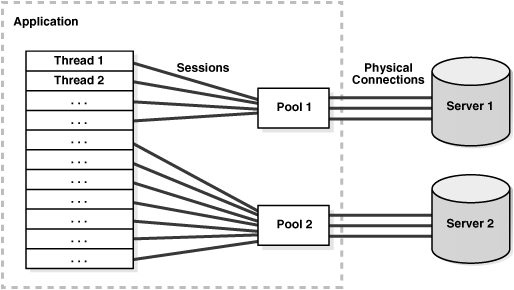

This chapter describes OCI session pooling and connection pooling features.

This chapter contains these topics:

- Session Pooling in OCI

- Database Resident Connection Pooling

- About Using Oracle Connection Manager in Traffic Director Mode

- Connection Pooling in OCI

- When to Use Connection Pooling, Session Pooling, or Neither

### 11.1 Session Pooling in OCI

Session pooling means that the application creates and maintains a group of stateless sessions to the database.

These sessions are provided to thin clients as requested. If no sessions are available, a new one may be created. When the client is done with the session, the client releases it to the pool. Thus, the number of sessions in the pool can increase dynamically.

Some of the sessions in the pool may be tagged with certain properties. For instance, a user may request a default session, set certain attributes on it, label it or tag it, and return it to the pool. That user, or some other user, can require a session with the same attributes, and thus request a session with the same tag. There may be several sessions in the pool with the same tag. The tag on a session can be changed or reset.

Proxy sessions, too, can be created and maintained through session pooling in OCI.

The behavior of the application when no free sessions are available and the pool has reached its maximum size depends on certain attributes. A new session may be created or an error returned, or the thread may just block and wait for a session to become free.

The main benefit of session pooling is performance. Making a connection to the database is a time-consuming activity, especially when the database is remote. Thus, instead of a client spending time connecting to the server, authenticating its credentials, and then receiving a valid session, it can just pick one from the pool.

This section includes the following topics:

- Functionality of OCI Session Pooling

- Homogeneous and Heterogeneous Session Pools

- About Using Tags in Session Pools

- OCI Handles for Session Pooling

- Using OCI Session Pooling

- OCI Calls for Session Pooling

- Example of OCI Session Pooling

**See Also:**

About Using Tags in Session Pools

#### 11.1.1 Functionality of OCI Session Pooling

Describes tasks that session pooling can perform.

Session pooling can perform the following tasks:

- Create, maintain, and manage a pool of stateless sessions transparently.

- Provide an interface for the application to create a pool and specify the minimum, increment, and maximum number of sessions in the pool.

- Provide an interface for the user to obtain and release a default or tagged session to the pool. A tagged session is one with certain client-defined properties.

- Allow the application to dynamically change the number of minimum and maximum number of sessions.

- Provide a mechanism to always maintain an optimum number of open sessions, by closing sessions that have been idle for a very long time, and creating sessions when required.

- Allow for session pooling with authentication.

#### 11.1.2 Homogeneous and Heterogeneous Session Pools

A session pool can be either homogeneous or heterogeneous.

Homogeneous session pooling means that sessions in the pool are alike for authentication (they have the same user name, password, and privileges). Heterogeneous session pooling means that you must provide authentication information because the sessions can have different security attributes and privileges.

#### 11.1.3 About Using Tags in Session Pools

Tags provide a way for users to customize sessions in the pool.

A client can get a default or untagged session from a pool, set certain attributes on the session (such as NLS settings), and return the session to the pool, labeling it with an appropriate tag in the `OCISessionRelease(`) call.

The original user, or some other user, can request a session with the same tags to have a session with the same attributes, and can do so by providing the same tag in the `OCISessionGet()` call.

This section includes the following topic: Multi-Property Tags.

**See Also:**

- [OCISessionRelease()](connect-authorize-and-initialize-functions.md)

- [OCISessionGet()](connect-authorize-and-initialize-functions.md)

##### 11.1.3.1 Multi-Property Tags

Beginning with 12c Release 2 (12.2), a tag can have multiple properties. This is referred to as a multi-property tag.

A multi-property tag is comprised of one or more \<property-name\>=\<property-value\> pairs separated by a semi-colon, where \<property-name\>=\<property-value\> are both strings.

During an `OCISessionGet()` call, in the `taginfo` parameter, the property name appearing first is given the highest property for finding a match and the property name appearing last is given the lowest priority. Therefore the ordering of the properties in the string is significant in determining a matching session in the pool. The example that follows below the list of restrictions illustrates this point.

This functionality also works with DRCP.

The following restrictions apply to property names and property values that can be passed in a multi-property tag:

- Both the property name and the property value are case sensitive.

- A property name can occur only once in a tag. In case the same property name is specified more than once, an error will be thrown.

- A non empty string should be specified for both the property name and the value.

- Leading and trailing spaces before and after a property name and leading and trailing space before and after a property value will be truncated. For example, “PDB = PDB1” is treated as “PDB=PDB1”.

- There should be no white spaces in the property name and the property value. For example, NLS \<space\> LANGUAGE=French will result in an error because of the space between NLS and LANGUAGE.

To explain the notion of multiple properties, assume that the application to be deployed in a CDB environment requires that the session get requests should be satisfied with sessions from the same pluggable database (for example, pdb1 ) as much as possible. Next, it also requires that the sessions belong to the same language (for example, FRENCH), but gives a higher priority to sessions to pdb1. The application can then provide a multi-property-tag as follows:

    char *props  = “PDB=pdb1;LANGUAGE=FRENCH”

Now, assume that there are two sessions in the pool with properties as shown:

    Session 1 = >  “PDB=pdb1;LANGUAGE=CHINESE”

    Session 2 = >  “PDB=pdb2;LANGUAGE=FRENCH”

In this situation, the session get request (`OCISessionGet()`) returns Session 1 because the `PDB` property implicitly carries a higher priority by being placed ahead of the `LANGUAGE` property.

**See Also:**

[OCISessionGet()](connect-authorize-and-initialize-functions.md) for a further discussion of tagging sessions

This section includes the following topic: PL/SQL Callback for Session State Fix Up.

###### 11.1.3.1.1 PL/SQL Callback for Session State Fix Up

When using multi-property tags, a PL/SQL based fix-up callback for the session state can be provided on the server.

This application-provided callback transforms a session checked out from the pool to the desired state requested by the application as indicated by the multi-property tag. This callback works with or without Database Resident Connection Pooling (DRCP).

Using this callback can improve the performance of your application because the fix-up logic is run for the session state on the server. So, this feature eliminates application round-trips to the database for the fix-up logic. The callback is supplied by the user who connects using `OCISessionGet()`. The callback must be provided as an attribute `OCI_ATTR_FIXUP_CALLBACK` on the authentication handle passed to `OCISessionGet()` for applications not using OCISessionPool or using custom pools. For applications using OCISessionPool this attribute must be set on the authentication handle, which in turn must be set on the session pool handle as the attribute `OCI_ATTR_SPOOL_AUTH`.

Example 11-1 Example of PL/SQL Fix-Up Callback

The following PL/SQL fix-up callback example code snippet handles tags whose `key=value` properties can be used directly in an ALTER SESSION statement, such as `TIME_ZONE=UTC;NLS_DATE_FORMAT=DD-MM-YYYY`:

    CREATE OR REPLACE PACKAGE myPackage AS
      TYPE property_t IS TABLE OF VARCHAR2(64) INDEX BY VARCHAR2(64);
      PROCEDURE buildTab(
        tag          IN  VARCHAR2,
        propertyTab  OUT property_t
      );
      PROCEDURE myPlsqlCallback (
        requestedTag IN  VARCHAR2,
        actualTag    IN  VARCHAR2
      );
    END;
    /

    CREATE OR REPLACE PACKAGE BODY myPackage AS

      -- Parse the "property=value" pairs in the tag
      PROCEDURE buildTab(tag IN VARCHAR2, propertyTab OUT property_t) IS
        property  VARCHAR2(64);
        propertyName  VARCHAR2(64);
        propertyValue VARCHAR2(64);
        propertyEndPos NUMBER := 1;
        propertyStartPos NUMBER := 1;
        propertyNameEndPos NUMBER := 1;
      begin
        WHILE (LENGTH(tag) > propertyEndPos)
        LOOP
          propertyEndPos := INSTR(tag, ';', propertyStartPos);
          IF (propertyEndPos = 0) THEN
            propertyEndPos := LENGTH(tag) + 1;
          END IF;
          propertyNameEndPos := INSTR(tag, '=', propertyStartPos);
          propertyName := SUBSTR(tag, propertyStartPos,
                       propertyNameEndPos - propertyStartPos);
          propertyValue := SUBSTR(tag, propertyNameEndPos + 1,
                        propertyEndPos - propertyNameEndPos - 1);
          propertyTab(propertyName) := propertyValue;
          propertyStartPos := propertyEndPos + 1;
        END LOOP;
      END;

      PROCEDURE myPlsqlCallback (
        requestedTag IN VARCHAR2,
        actualTag IN VARCHAR2
      ) IS
        reqPropTab property_t;
        actPropTab property_t;
        propertyName VARCHAR2(64);
      BEGIN
        buildTab(requestedTag, reqPropTab);
        buildTab(actualTag, actPropTab);

        -- Iterate over requested properties to set state when it's not
        -- currently set, or not set to the desired value
        propertyName := reqPropTab.FIRST;
        WHILE (propertyName IS NOT NULL)
        LOOP
          IF ((NOT actPropTab.exists(propertyName)) OR
             (actPropTab(propertyName) != reqPropTab(propertyName))) THEN
            EXECUTE IMMEDIATE 'ALTER SESSION SET ' || propertyName || '=''' || reqPropTab(propertyName) || '''';
          END IF;
          propertyName := reqPropTab.NEXT(propertyName);
        END LOOP;
        -- Could iterate over other actual props to reset any extra props to a default state
      END;
    END myPackage;
    /

**See Also:**

- [Authentication Information Handle Attributes](handle-and-descriptor-attributes.md) for more information about `OCI_ATTR_FIXUP_CALLBACK`

- [Session Pool Handle Attributes](handle-and-descriptor-attributes.md) for more information about `OCI_ATTR_SPOOL_AUTH`

#### 11.1.4 OCI Handles for Session Pooling

What are the handle types for session pooling.

The following handle types are for session pooling:

- OCISPool

- OCIAuthInfo

##### 11.1.4.1 OCISPool

This is the session pool handle.

It is allocated using `OCIHandleAlloc()`. It must be passed to `OCISessionPoolCreate()` and `OCISessionPoolDestroy()`. It has the attribute type `OCI_HTYPE_SPOOL`.

An example of the `OCIHandleAlloc()` call follows:

    OCISPool *spoolhp;
    OCIHandleAlloc((void *) envhp, (void **) &spoolhp, OCI_HTYPE_SPOOL,
                            (size_t) 0, (void **) 0));

For an environment handle, multiple session pools can be created.

**See Also:**

- [OCIHandleAlloc()](handle-and-descriptor-functions.md)

- [OCISessionPoolCreate()](connect-authorize-and-initialize-functions.md)

- [OCISessionPoolDestroy()](connect-authorize-and-initialize-functions.md)

##### 11.1.4.2 OCIAuthInfo

This is the authentication information handle.

It is allocated using `OCIHandleAlloc()`. It is passed to `OCISessionGet()`. It supports all the attributes that are supported for a user session handle. The authentication information handle has the attribute type `OCI_HTYPE_AUTHINFO` (see [Table 4-1](oci-programming-basics.md)).

An example of the `OCIHandleAlloc()` call follows:

    OCIAuthInfo *authp;
    OCIHandleAlloc((void *) envhp, (void **) &authp, OCI_HTYPE_AUTHINFO,
                          (size_t) 0, (void **) 0));

**See Also:**

- [OCIHandleAlloc()](handle-and-descriptor-functions.md)

- [User Session Handle Attributes](handle-and-descriptor-attributes.md) for the attributes that belong to the authentication information handle

- [Session Pool Handle Attributes](handle-and-descriptor-attributes.md) for more information about the session pooling attributes

- [Connect, Authorize, and Initialize Functions](connect-authorize-and-initialize-functions.md) for complete information about the functions used in session pooling

- See "[OCISessionGet()](connect-authorize-and-initialize-functions.md)" for details of the session handle attributes that you can use with this call

#### 11.1.5 Using OCI Session Pooling

Shows the steps to write a simple session pooling application that uses a user name and password.

The steps in writing a simple session pooling application that uses a user name and password are as follows:

1.  Allocate the session pool handle using `OCIHandleAlloc()` for an `OCISPool` handle. Multiple session pools can be created for an environment handle.

2.  Create the session pool using `OCISessionPoolCreate()` with `mode` set to `OCI_DEFAULT` (for a new session pool). See the function for a discussion of the other modes.

3.  Loop for each thread. Create the thread with a function that does the following:

    1.  Allocates an authentication information handle of type `OCIAuthInfo` using `OCIHandleAlloc()`

    2.  Sets the user name and password in the authentication information handle using `OCIAttrSet()`

    3.  Gets a pooled session using `OCISessionGet()` with `mode` set to `OCI_SESSGET_SPOOL`

    4.  Performs the transaction

    5.  Allocates the handle

    6.  Prepares the statement

        **Note:**

        When using service contexts obtained from OCI session pool, you are required to use the service context returned by `OCISessionGet()` (or `OCILogon2()`), and not create other service contexts outside of these calls.

        Any statement handle obtained using `OCIStmtPrepare2()` with the service context should be subsequently used only in conjunction with the same service context, and never with a different service context.

    7.  Executes the statement

    8.  Commits or rolls back the transactions

    9.  Releases the session (log off) with `OCISessionRelease()`

    10. Frees the authentication information handle with `OCIHandleFree()`

    11. Ends the loop for each thread

4.  Destroy the session pool using `OCISessionPoolDestroy()`.

**See Also:**

- [OCISessionPoolCreate()](connect-authorize-and-initialize-functions.md)

- [OCIHandleAlloc()](handle-and-descriptor-functions.md)

- [OCIAttrSet()](handle-and-descriptor-functions.md)

- [OCISessionGet()](connect-authorize-and-initialize-functions.md)

- [OCILogon2()](connect-authorize-and-initialize-functions.md)

- [OCIStmtPrepare2()](statement-functions.md)

- [OCISessionRelease()](connect-authorize-and-initialize-functions.md)

- [OCIHandleFree()](handle-and-descriptor-functions.md)

- [OCISessionPoolDestroy()](connect-authorize-and-initialize-functions.md)

#### 11.1.6 OCI Calls for Session Pooling

Describes the usages for OCI calls for session pooling.

OCI provides calls for session pooling to perform the following tasks:

- Allocate the Pool Handle

- Create the Connection Pool

- Log On to the Database

- Log Off from the Database

- Destroy the Connection Pool

- Free the Pool Handle

##### 11.1.6.1 Allocate the Pool Handle

Session pooling requires that the pool handle `OCI_HTYPE_SPOOL` be allocated by calling `OCIHandleAlloc()`.

Multiple pools can be created for a given environment handle. For a single session pool, here is an allocation example:

    OCISPool *poolhp;
    OCIHandleAlloc((void *) envhp, (void **) &poolhp, OCI_HTYPE_SPOOL, (size_t) 0,
                   (void **) 0));

**See Also:**

[OCIHandleAlloc()](handle-and-descriptor-functions.md)

##### 11.1.6.2 Create the Pool Session

You can use the function `OCISessionPoolCreate()` to create the session pool.

Here is an example of how to use this call:

    OCISessionPoolCreate(envhp, errhp, poolhp, (OraText **)&poolName,
                  (ub4 *)&poolNameLen, database,
                  (ub4)strlen((const signed char *)database),
                  sessMin, sessMax, sessIncr,
                  (OraText *)appusername,
                  (ub4)strlen((const signed char *)appusername),
                  (OraText *)apppassword,
                  (ub4)strlen((const signed char *)apppassword),
                  OCI_DEFAULT);

**See Also:**

[OCISessionPoolCreate()](connect-authorize-and-initialize-functions.md)

##### 11.1.6.3 Log On to the Database

You can use these calls to log on to the database in session pooling mode.

- `OCILogon2()`

  This is the simplest call. However, it does not give the user the option of using tagging. Here is an example of how to use `OCILogon2()` to log on to the database in session pooling mode:

      for (i = 0; i < MAXTHREADS; ++i)
      {
        OCILogon2(envhp, errhp, &svchp[i], "hr", 2, "hr", 2, poolName,
                  poolNameLen, OCI_LOGON2_SPOOL));
      }

- `OCISessionGet()`

  This is the recommended call to use. It gives the user the option of using tagging to label sessions in the pool, which makes it easier to retrieve specific sessions. An example of using `OCISessionGet()` follows. It is taken from `cdemosp.c` in the `demo` directory.

      OCISessionGet(envhp, errhp, &svchp, authInfop,
                   (OraText *)database,strlen(database), tag,
                   strlen(tag), &retTag, &retTagLen, &found,
                   OCI_SESSGET_SPOOL);

  When using service contexts obtained from an OCI session pool, you are required to use the service context returned by `OCISessionGet()` (or `OCILogon2()`), and not create other service contexts outside of these calls.

  Any statement handle obtained using `OCIStmtPrepare2()` with the service context should be subsequently used only in conjunction with the same service context, and never with a different service context.

**See Also:**

- [OCILogon2()](connect-authorize-and-initialize-functions.md)

- [OCISessionGet()](connect-authorize-and-initialize-functions.md)

- [OCIStmtPrepare2()](statement-functions.md)

##### 11.1.6.4 Log Off from the Database

Indicates two ways in which to log off from the database in session pooling mode depending on the logon call.

From the following calls, choose the one that corresponds to the logon call and use it to log off from the database in session pooling mode.

- `OCILogoff()`

  If you used `OCILogon2()` to make the connection, you must call `OCILogoff()` to log off.

- `OCISessionRelease()`

  If you used `OCISessionGet()` to make the connection, then you must call `OCISessionRelease()` to log off. Pending transactions are automatically committed.

**See Also:**

- [OCILogoff()](connect-authorize-and-initialize-functions.md)

- [OCILogon2()](connect-authorize-and-initialize-functions.md)

- [OCISessionRelease()](connect-authorize-and-initialize-functions.md)

- [OCISessionGet()](connect-authorize-and-initialize-functions.md)

##### 11.1.6.5 Destroy the Session Pool

Call `OCISessionPoolDestroy()` to destroy the session pool.

This is shown in the following example:

    OCISessionPoolDestroy(poolhp, errhp, OCI_DEFAULT);

**See Also:**

[OCISessionPoolDestroy()](connect-authorize-and-initialize-functions.md)

##### 11.1.6.6 Free the Pool Handle

Call `OCIHandleFree()` to free the session pool handle.

This is shown in the following example:

    OCIHandleFree((void *)poolhp, OCI_HTYPE_SPOOL);

**Note:**

Developers: You are advised to commit or roll back any open transaction before releasing the connection back to the pool. If this is not done, Oracle Database automatically commits any open transaction when the connection is released.

If an instance failure is detected while the session pool is being used, OCI tries to clean up the sessions to that instance.

**See Also:**

[OCIHandleFree()](handle-and-descriptor-functions.md)

#### 11.1.7 Example of OCI Session Pooling

Where to find an example of session pooling in a tested complete program.

For an example of session pooling in a tested complete program, see `cdemosp.c` in directory `demo`.

### 11.2 Database Resident Connection Pooling

Database resident connection pooling (DRCP) provides a connection pool in the database server for typical web application usage scenarios where the application acquires a database connection, works on it for a relatively short duration, and then releases it.

DRCP pools server processes, each of which is the equivalent of a dedicated server process and a database session combined. (Henceforth these "dedicated" server processes are referred to as pooled servers.)

DRCP complements middle-tier connection pools that share connections between threads in a middle-tier process. In addition, DRCP enables sharing of database connections across middle-tier processes on the same middle-tier host and even across middle-tier hosts. This results in significant reduction in key database resources needed to support a large number of client connections, thereby reducing the database tier memory footprint and boosting the scalability of both middle-tier and database tiers. Having a pool of readily available servers has the additional benefit of reducing the cost of creating and tearing down client connections.

DRCP is especially relevant for architectures with multiprocess single-threaded application servers (such as PHP/Apache) that cannot do middle-tier connection pooling. Using DRCP, the database can scale to tens of thousands of simultaneous connections.

**See Also:**

[Oracle Database Development Guide](../adfns/performance-and-scalability.md) for complete information about DRCP

### 11.3 About Using Oracle Connection Manager in Traffic Director Mode

Oracle Connection Manager in Traffic Director Mode is a proxy that is placed between supported database clients and database instances.

Supported clients from Oracle Database 11g Release 2 (11.2) and later can connect to Oracle Connection Manager in Traffic Director Mode. Oracle Connection Manager in Traffic Director Mode provides improved high availability (HA) for planned and unplanned database server outages, connection multiplexing support, and load balancing. Support for Oracle Connection Manager in Traffic Director Mode is described in more detail in the following sections

- Modes of Operation

- Key Features

#### Modes of Operation

Oracle Connection Manager in Traffic Director Mode supports the following modes of operation:

- In pooled connection mode, Oracle Connection Manager in Traffic Director Mode supports any application using the following database client releases:
  - OCI, OCCI, and Open Source Drivers (Oracle Database 11g release 2 (11.2.0.4) and later))

  - JDBC (Oracle Database 12c release 1 (12.1) and later)

  - ODP.NET (Oracle Database 12c release 2 (12.2) and later)

  In addition, applications must use DRCP. That is, the application must enable DRCP in the connect string (or in the `tnsnames.ora` alias).

- In non-pooled connection (or dedicated) mode, Oracle Connection Manager in Traffic Director Mode supports any application using database client releases Oracle Database 11g release 2 (11.2.0.4) and later. In this mode, some capabilities, such as connection multiplexing are not available.

#### Key Features

Oracle Connection Manager in Traffic Director Mode furnishes support for the following:

- Transparent performance enhancements and connection multiplexing, which includes:
  - Statement caching, rows prefetching, and result set caching are auto-enabled for all modes of operation.

  - Database session multiplexing (pooled mode only) using the proxy resident connection pool (PRCP), where PRCP is a proxy mode of Database Resident Connection Pooling (DRCP). Applications get transparent connect-time load balancing and run-time load balancing between Oracle Connection Manager in Traffic Director Mode and the database.

  - For multiple Oracle Connection Manager in Traffic Director Mode instances, applications get increased scalability through client-side connect time load balancing or with a load balancer (BIG-IP, NGINX, and others)
- Zero application downtime
  - Planned database maintenance or pluggable database (PDB) relocation
    - Pooled mode

      Oracle Connection Manager in Traffic Director Mode responds to Oracle Notification Service (ONS) events for planned outages and redirects work. Connections are drained from the pool on Oracle Connection Manager in Traffic Director Mode when the request completes. Service relocation is supported for Oracle Database 11g release 2 (11.2.0.4) and later.

      For PDB relocation, Oracle Connection Manager in Traffic Director Mode responds to in-band notifications when a PDB is relocated, that is even when ONS is not configured (for Oracle Database release 18c, version 18.1 and later server only) 

    - Non-pooled or dedicated mode

      When there is no request boundary information from the client, Oracle Connection Manager in Traffic Director Mode supports planned outage for many applications (as long as only simple session state and cursor state need to be preserved across the request/transaction boundaries). This support includes:
      - Stop service/PDB at the transaction boundary or it leverages Oracle Database release 18c continuous application availability to stop the service at the request boundary

      - Oracle Connection Manager in Traffic Director Mode leverages Transparent Application Failover (TAF) failover restore to reconnect and restore simple states.

  - Unplanned database outages for read-mostly workloads
- High Availability of Oracle Connection Manager in Traffic Director Mode to avoid a single point of failure. This is supported by:
  - Multiple instances of Oracle Connection Manager in Traffic Director Mode using a load balancer or client side load balancing/failover in the connect string

  - Rolling upgrade of Oracle Connection Manager in Traffic Director Mode instances

  - Graceful close of existing connections from client to Oracle Connection Manager in Traffic Director Mode for planned outages

  - In-band notifications to Oracle Database release 18c and later clients

  - For older clients, notifications are sent with the response of the current request
- For security and isolation, Oracle Connection Manager in Traffic Director Mode furnishes:
  - Database Proxy supporting transmission control protocol/transmission control protocol secure (TCP/TCPS) and protocol conversion

  - Firewall based on the IP address, service name, and secure socket layer/transport layer security (SSL/TLS) wallets

  - Tenant isolation in a multi-tenant environment

  - Protection against denial-of-service and fuzzing attacks

  - Secure tunneling of database traffic across Oracle Database on-premises and Oracle Cloud

**See Also:**

- [Oracle Database Net Services Administrator's Guide](../netag/configuring-oracle-connection-manager.md) for information about configuring `cman.ora` configuration file to set up Oracle Connection Manager in Traffic Director Mode

- [Oracle Database Net Services Administrator's Guide](../netag/configuring-oracle-connection-manager.md) for information about configuring databases for Oracle Connection Manager in Traffic Director Mode proxy authentication

- [Oracle Database Net Services Administrator's Guide](../netag/configuring-oracle-connection-manager.md) for information about configuring Oracle Connection Manager in Traffic Director Mode for unplanned down events

- [Oracle Database Net Services Administrator's Guide](../netag/configuring-oracle-connection-manager.md) for information about configuring Oracle Connection Manager in Traffic Director Mode for planned down events

- [Oracle Database Net Services Administrator's Guide](../netag/configuring-oracle-connection-manager.md) for information about configuring proxy resident connection pools for use by Oracle Connection Manager in Traffic Director Mode

- [Oracle Database Net Services Administrator's Guide](../netag/configuring-oracle-connection-manager.md) for information about functionality not supported for all drivers with Oracle Connection Manager in Traffic Director Mode

- [Oracle Database Net Services Reference](../netrf/index.md) for an overview of Oracle CMAN configuration file

### 11.4 Connection Pooling in OCI

Connection pooling is the use of a group (the pool) of reusable physical connections by several sessions to balance loads.

The pool is managed by OCI, not the application. Applications that can use connection pooling include middle-tier applications for web application servers and email servers.

One use of this feature is in a web application server connected to a back-end Oracle database. Suppose that a web application server gets several concurrent requests for data from the database server. The application can create a pool (or a set of pools) in each environment during application initialization.

This section includes the following topics:

- OCI Connection Pooling Concepts

- Using OCI Calls for Connection Pooling

- Examples of OCI Connection Pooling

#### 11.4.1 OCI Connection Pooling Concepts

Oracle Database has several transaction monitoring capabilities such as the fine-grained management of database sessions and connections. Fine-grained management of database sessions is done by separating the notion of database sessions (user handles) from connections (server handles). By using OCI calls for session switching and session migration, an application server or transaction monitor can multiplex several sessions over fewer physical connections, thus achieving a high degree of scalability by pooling connections and back-end Oracle server processes.

The connection pool itself is normally configured with a shared pool of physical connections, translating to a back-end server pool containing an identical number of dedicated server processes.

The number of physical connections is less than the number of database sessions in use by the application. The number of physical connections and back-end server processes are also reduced by using connection pooling. Thus many more database sessions can be multiplexed.

This section includes the following topics:

- Similarities and Differences from a Shared Server

- Stateless Sessions Versus Stateful Sessions

- Multiple Connection Pools

- Transparent Application Failover

##### 11.4.1.1 Similarities and Differences from a Shared Server

Connection pooling on the middletier is similar to what a shared server offers on the back end.

Connection pooling makes a dedicated server instance behave like a shared server instance by managing the session multiplexing logic on the middle tier.

The connection pool on the middle tier controls the pooling of dedicated server processes including incoming connections into the dedicated server processes. The main difference between connection pooling and a shared server is that in the latter case, the connection from the client is normally to a dispatcher in the database instance. The dispatcher is responsible for directing the client request to an appropriate shared server. However, the physical connection from the connection pool is established directly from the middletier to the dedicated server process in the back-end server pool.

Connection pooling is beneficial only if the middle tier is multithreaded. Each thread can maintain a session to the database. The actual connections to the database are maintained by the connection pool, and these connections (including the pool of dedicated database server processes) are shared among all the threads in the middle tier.

##### 11.4.1.2 Stateless Sessions Versus Stateful Sessions

Stateless sessions are serially reusable across mid-tier threads.

After a thread is done processing a database request on behalf of a three-tier user, the same database session can be reused for a completely different request on behalf of a completely different three-tier user.

Stateful sessions to the database, however, are not serially reusable across mid-tier threads because they may have some particular state associated with a particular three-tier user. Examples of such state may include open transactions, the fetch state from a statement, or a PL/SQL package state. So long as the state exists, the session is not reusable for a different request.

**Note:**

Stateless sessions too may have open transactions, open statement fetch state, and so on. However, such a state persists for a relatively short duration (only during the processing of a particular three-tier request by a mid-tier thread) that allows the session to be serially reused for a different three-tier user (when such state is cleaned up).

Stateless sessions are typically used in conjunction with statement caching.

What connection pooling offers is stateless connections and stateful sessions.

**See Also:**

Session Pooling in OCI if you must work with stateless sessions

##### 11.4.1.3 Multiple Connection Pools

You can use the advanced concept of multiple connection pools for different database connections.

Multiple connection pools can also be used when different priorities are assigned to users. Different service-level guarantees can be implemented using connection pooling.

Figure 11-1 illustrates OCI connection pooling.

Figure 11-1 OCI Connection Pooling

[Description of "Figure 11-1 OCI Connection Pooling"](img_text/lnoci043.md)

##### 11.4.1.4 Transparent Application Failover

Transaction application failover (TAF) is enabled for connection pooling.

The concepts of TAF apply equally well with connections in the connection pool except that the `BACKUP` and `PRECONNECT` clauses should not be used in the connect string and do not work with connection pooling and TAF.

When a connection in the connection pool fails over, it uses the primary connect string itself to connect. Sessions fail over when they use the pool for a database round-trip after their instance failure. The listener is configured to route the connection to a good instance if available, as is typical with service-based connect strings.

**See Also:**

[Oracle Database Net Services Administrator's Guide](../netag/enabling-advanced-features.md), the chapter about configuring transparent application failover

#### 11.4.2 Using OCI Calls for Connection Pooling

Lists the steps you must follow to use connection pooling in your application.

To use connection pooling in your application, you must:

1.  Allocate the Pool Handle
2.  Create the Connection Pool
3.  Log On to the Database
4.  Deal with SGA Limitations in Connection Pooling
5.  Log Off from the Database
6.  Destroy the Connection Pool
7.  Free the Pool Handle

##### 11.4.2.1 Allocate the Pool Handle

Connection pooling requires that the pool handle `OCI_HTYPE_CPOOL` be allocated by `OCIHandleAlloc()`.

Multiple pools can be created for a given environment handle.

For a single connection pool, here is an allocation example:

    OCICPool *poolhp;
    OCIHandleAlloc((void *) envhp, (void **) &poolhp, OCI_HTYPE_CPOOL,
                          (size_t) 0, (void **) 0));

**See Also:**

[OCIHandleAlloc()](handle-and-descriptor-functions.md)

##### 11.4.2.2 Create the Connection Pool

The function `OCIConnectionPoolCreate()` initializes the connection pool handle.

It has these `IN` parameters:

- `connMin`, the minimum number of connections to be opened when the pool is created.

- `connIncr`, the incremental number of connections to be opened when all the connections are busy and a call needs a connection. This increment is used only when the total number of open connections is less than the maximum number of connections that can be opened in that pool.

- `connMax`, the maximum number of connections that can be opened in the pool. When the maximum number of connections are open in the pool, and all the connections are busy, if a call needs a connection, it waits until it gets one. However, if the `OCI_ATTR_CONN_NOWAIT` attribute is set for the pool, an error is returned.

- A `poolUsername` and a `poolPassword`, to allow user sessions to transparently migrate between connections in the pool.

- In addition, an attribute `OCI_ATTR_CONN_TIMEOUT`, can be set to time out the connections in the pool. Connections idle for more than this time are terminated periodically to maintain an optimum number of open connections. If this attribute is not set, then the connections are never timed out.

**Note:**

Shrinkage of the pool only occurs when there is a network round-trip. If there are no operations, then the connections stay active.

Because all the preceding attributes can be configured dynamically, the application can read the current load (number of open connections and number of busy connections) and tune these attributes appropriately.

If the pool attributes (`connMax`, `connMin`, `connIncr`) are to be changed dynamically, `OCIConnectionPoolCreate()` must be called with `mode` set to `OCI_CPOOL_REINITIALIZE`.

The OUT parameters `poolName` and `poolNameLen` contain values to be used in subsequent `OCIServerAttach()` and `OCILogon2()` calls in place of the database name and the database name length arguments.

There is no limit on the number of pools that can be created by an application. Middle-tier applications can create multiple pools to connect to the same server or to different servers, to balance the load based on the specific needs of the application.

Here is an example of this call:

    OCIConnectionPoolCreate((OCIEnv *)envhp,
                       (OCIError *)errhp, (OCICPool *)poolhp,
                       &poolName, &poolNameLen,
                       (text *)database,strlen(database),
                       (ub4) connMin, (ub4) connMax, (ub4) connIncr,
                       (text *)poolUsername,strlen(poolUserLen),
                       (text *)poolPassword,strlen(poolPassLen),
                       OCI_DEFAULT));

**See Also:**

- [OCIConnectionPoolCreate()](connect-authorize-and-initialize-functions.md)

- [OCI_ATTR_CONN_TIMEOUT](handle-and-descriptor-attributes.md)

- [OCIServerAttach()](connect-authorize-and-initialize-functions.md)

- [OCILogon2()](connect-authorize-and-initialize-functions.md)

##### 11.4.2.3 Log On to the Database

The application can use one of several interfaces.

The application must log on to the database for each thread, using one of the following interfaces.

- `OCILogon2()`

  This is the simplest interface. Use this interface when you need a simple connection pool connection and do not need to alter any attributes of the session handle. This interface can also be used to make proxy connections to the database.

  Here is an example using `OCILogon2()`:

      for (i = 0; i < MAXTHREADS; ++i)
      {
         OCILogon2(envhp, errhp, &svchp[i], "hr", 2, "hr", 2, poolName,
                   poolNameLen, OCI_LOGON2_CPOOL));

      }

  To use this interface to get a proxy connection, set the password parameter to `NULL`.

- `OCISessionGet()`

  This is the recommended interface. It gives the user the additional option of using external authentication methods, such as certificates, distinguished name, and so on. `OCISessionGet()` is the recommended uniform function call to retrieve a session.

  Here is an example using `OCISessionGet()`:

      for (i = 0; i < MAXTHREADS; ++i)
      {
              OCISessionGet(envhp, errhp, &svchp, authp,
                            (OraText *) poolName,
                            strlen(poolName), NULL, 0, NULL, NULL, NULL,
                            OCI_SESSGET_CPOOL)
       }

- `OCIServerAttach()` and `OCISessionBegin()`

  You can use another interface if the application must set any special attributes on the user session handle and server handle. For such a requirement, applications must allocate all the handles (connection pool handle, server handles, session handles, and service context handles). You would follow this sequence:

  1.  Create the connection pool.

      Connection pooling does the multiplexing of a virtual server handle over physical connections transparently, eliminating the need for users to do so. The user gets the feeling of a session having a dedicated (virtual) connection. Because the multiplexing is done transparently to the user, users must not attempt to multiplex sessions over the virtual server handles themselves. The concepts of session migration and session switching, which require explicit multiplexing at the user level, are defunct for connection pooling and should not be used.

  2.  Call `OCIServerAttach()` with mode set to `OCI_CPOOL`.

      In an OCI program, the user should create (`OCIServerAttach()` with mode set to `OCI_CPOOL`), a unique virtual server handle for each session that is created using the connection pool. There should be a one-to-one mapping between virtual server handles and sessions.

  3.  Call `OCISessionBegin()` with mode set to `OCI_DEFAULT`.

      Credentials can be set to `OCI_CRED_RDBMS`, `OCI_CRED_EXT`, or `OCI_CRED_PROXY` using `OCISessionBegin()`. If the credentials are set to `OCI_CRED_EXT`, no user name and no password need to be set on the session handle. If the credentials are set to `OCI_CRED_PROXY`, only the user name must be set on the session handle. (no explicit primary session must be created and `OCI_ATTR_MIGSESSION` need not be set).

      The user should not set `OCI_MIGRATE` flag in the call to `OCISessionBegin()` when the virtual server handle points to a connection pool (`OCIServerAttach()` called with `mode` set to `OCI_CPOOL`). Oracle supports passing the `OCI_MIGRATE` flag only for compatibility reasons. Do not use the `OCI_MIGRATE` flag, because the perception that the user gets when using a connection pool is of sessions having their own dedicated (virtual) connections that are transparently multiplexed onto real connections.

**See Also:**

- [OCILogon2()](connect-authorize-and-initialize-functions.md)

- [OCISessionGet()](connect-authorize-and-initialize-functions.md)

- [OCIServerAttach()](connect-authorize-and-initialize-functions.md)

- [OCISessionBegin()](connect-authorize-and-initialize-functions.md)

##### 11.4.2.4 Deal with SGA Limitations in Connection Pooling

With `OCI_CPOOL` mode (connection pooling), the session memory (UGA) in the back-end database comes out of the SGA.

This may require some SGA tuning on the back-end database to have a larger SGA if your application consumes more session memory than the SGA can accommodate. The memory tuning requirements for the back-end database are similar to configuring the LARGE POOL in a shared server back end except that the instance is still in dedicated mode.

If you are still running into the SGA limitation, you must consider:

- Reducing the session memory consumption by having fewer open statements for each session

- Reducing the number of sessions in the back end by pooling sessions on the mid-tier

- Or otherwise, turning off connection pooling

The application must avoid using dedicated database links on the back end with connection pooling.

If the back end is a dedicated server, effective connection pooling is not possible because sessions using dedicated database links are tied to a physical connection rendering that same connection unusable by other sessions. If your application uses dedicated database links and you do not see effective sharing of back-end processes among your sessions, you must consider using shared database links.

**See Also:**

- [Oracle Database Performance Tuning Guide](../tgdba/tuning-shared-pool-and-large-pool.md), the section about configuring a shared server

- [Oracle Database Administrator’s Guide](../admin/distributed-database-concepts.md), the section on shared database links for more information about distributed databases

##### 11.4.2.5 Log Off from the Database

Choose the appropriate call to log off from the database in connection pooling mode.

From the following calls, choose the one that corresponds to the logon call and use it to log off from the database in connection pooling mode.

- `OCILogoff()`:

  If `OCILogon2()` was used to make the connection, `OCILogoff()` must be used to log off.

- `OCISessionRelease()`

  If OCISessionGet() was called to make the connection, then `OCISessionRelease()` must be called to log off.

- `OCISessionEnd()` and `OCIServerDetach()`

  If `OCIServerAttach()` and `OCISessionBegin()` were called to make the connection and start the session, then `OCISessionEnd()` must be called to end the session and `OCIServerDetach()` must be called to release the connection.

**See Also:**

- [OCILogoff()](connect-authorize-and-initialize-functions.md)

- [OCILogon2()](connect-authorize-and-initialize-functions.md)

- [OCISessionRelease()](connect-authorize-and-initialize-functions.md)

- [OCISessionEnd()](connect-authorize-and-initialize-functions.md)

- [OCIServerDetach()](connect-authorize-and-initialize-functions.md)

- [OCIServerAttach()](connect-authorize-and-initialize-functions.md)

- [OCISessionBegin()](connect-authorize-and-initialize-functions.md)

##### 11.4.2.6 Destroy the Connection Pool

`OCIConnectionPoolDestroy()` destroys it.

Use `OCIConnectionPoolDestroy()` to destroy the connection pool.

**See Also:**

[OCIConnectionPoolDestroy()](connect-authorize-and-initialize-functions.md)

##### 11.4.2.7 Free the Pool Handle

The pool handle is freed using `OCIHandleFree()`.

These last three actions are illustrated in this code fragment:

     for (i = 0; i < MAXTHREADS; ++i)
      {
        checkerr(errhp, OCILogoff((void *) svchp[i], errhp));
      }
      checkerr(errhp, OCIConnectionPoolDestroy(poolhp, errhp, OCI_DEFAULT));
      checkerr(errhp, OCIHandleFree((void *)poolhp, OCI_HTYPE_CPOOL));

**See Also:**

- [OCIHandleFree()](handle-and-descriptor-functions.md)

- [Connection Pool Handle Attributes](handle-and-descriptor-attributes.md)

- [OCIConnectionPoolCreate()](connect-authorize-and-initialize-functions.md), [OCILogon2()](connect-authorize-and-initialize-functions.md), and [OCIConnectionPoolDestroy()](connect-authorize-and-initialize-functions.md)

#### 11.4.3 Examples of OCI Connection Pooling

Where to find examples of connection pooling in tested complete programs.

Examples of connection pooling in tested complete programs can be found in `cdemocp.c and cdemocpproxy.c` in directory `demo`.

### 11.5 When to Use Connection Pooling, Session Pooling, or Neither

Indicates the circumstances in which to use them or not.

If database sessions are not reusable by mid-tier threads (that is, they are stateful) and the number of back-end server processes may cause scaling problems on the database, use OCI connection pooling.

If database sessions are reusable by mid-tier threads (that is, they are stateless) and the number of back-end server processes may cause scaling problems on the database, use OCI session pooling.

If database sessions are not reusable by mid-tier threads (that is, they are stateful) and the number of back-end server processes is never large enough to potentially cause any scaling issue on the database, there is no need to use any pooling mechanism.

**Note:**

Having nonpooled sessions or connections results in tearing down and re-creating the database session/connection for every mid-tier user request. This can cause severe scaling problems on the database side and excessive latency for the fulfillment of the request. Hence, Oracle strongly recommends that you adopt one of the pooling strategies for mid-tier applications based on whether the database session is stateful or stateless.

In connection pooling, the pool element is a connection and in session pooling, the pool element is a session.

As with any pool, the pooled resource is locked by the application thread for a certain duration until the thread has done its job on the database and the resource is released. The resource is unavailable to other threads during its period of use. Hence, application developers must be aware that any kind of pooling works effectively with relatively short tasks. However, if the application is performing a long-running transaction, it may deny the pooled resource to other sharers for long periods of time, leading to starvation. Hence, pooling should be used in conjunction with short tasks, and the size of the pool should be sufficiently large to maintain the desired concurrency of transactions.

Note the following additional information about connection pooling and session pooling:

- OCI Connection Pooling

  Connections to the database are pooled. Sessions are created and destroyed by the user. Each call to the database picks up an appropriate available connection from the pool.

  The application is multiplexing several sessions over fewer physical connections to the database. The users can tune the pool configuration to achieve required concurrency.

  The life-time of the application sessions is independent of the life-time of the cached pooled connections.

- OCI Session Pooling

  Sessions and connections are pooled by OCI. The application gets sessions from the pool and releases sessions back to the pool.

This section includes the following topics:

- Functions for Session Creation

- About Choosing Between Different Types of OCI Sessions

#### 11.5.1 Functions for Session Creation

There are a number of ways to create a session with varying functionality.

OCI offers the following functions for session creation:

- `OCILogin`

  OCILogon() is the simplest way to get an OCI session. The advantage is ease of obtaining an OCI service context. The disadvantage is that you cannot perform any advance OCI operations, such as session migration, proxy authentication, or using a connection pool or a session pool.

- `OCILogon2()`

  OCILogon2() includes the functionality of `OCILogon()` to get a session. This session may be a new one with a new underlying connection, or one that is started over a virtual connection from an existing connection pool, or one from an existing session pool. The `mode` parameter value that the function is called with determines its behavior.

  The user cannot modify the attributes (except `OCI_ATTR_``STMTCACHESIZE`) of the service context returned by OCI.

- `OCISessionBegin()`

  OCISessionBegin() supports all the various options of an OCI session, such as proxy authentication, getting a session from a connection pool or a session pool, external credentials, and migratable sessions. This is the lowest level call, where all handles must be explicitly allocated and all attributes set. `OCIServerAttach()` must be called before this call.

- `OCISessionGet()`

  OCISessionGet() is now the recommended method to get a session. This session may be a new one with a new underlying connection, or one that is started over a virtual connection from an existing connection pool, or one from an existing session pool. The `mode` parameter value that the function is called with determines its behavior. This works like `OCILogon2()` but additionally enables you to specify tags for obtaining specific sessions from the pool.

**See Also:**

- [OCILogon()](connect-authorize-and-initialize-functions.md)

- [Application Initialization, Connection, and Session Creation](oci-programming-basics.md)

- [OCILogon2()](connect-authorize-and-initialize-functions.md)

- [OCISessionBegin()](connect-authorize-and-initialize-functions.md)

- [OCISessionGet()](connect-authorize-and-initialize-functions.md)

#### 11.5.2 About Choosing Between Different Types of OCI Sessions

How to choose the type od session to use.

OCI includes the following types of sessions:

- Basic OCI sessions

  The basic OCI session works by using user name and password over a dedicated OCI server handle. This is the no-pool mechanism. See When to Use Connection Pooling, Session Pooling, or Neither for information of when to use it.

  If authentication is obtained through external credentials, then a user name or password is not required.

- Session pool sessions

  Session pool sessions are from the session pool cache. Some sessions may be tagged. These are stateless sessions. Each `OCISessionGet()` and `OCISessionRelease()` call gets and releases a session from the session cache. This saves the server from creating and destroying sessions.

  See When to Use Connection Pooling, Session Pooling, or Neither on connection pool sessions versus session pooling sessions versus no-pooling sessions.

- Connection pool sessions

  Connection pool sessions are created using `OCISessionGet()` and `OCISessionBegin()` calls from an OCI connection pool. There is no session cache as these are stateful sessions. Each call creates a new session, and the user is responsible for terminating these sessions.

  The sessions are automatically migratable between the server handles of the connection pool. Each session can have user name and password or be a proxy session. See When to Use Connection Pooling, Session Pooling, or Neither on connection pool sessions versus session pooling sessions versus no-pooling sessions.

- Sessions sharing a server handle

  You can multiplex several OCI sessions over a few physical connections. The application does this manually by having the same server handle for these multiple sessions. It is preferred to have the session multiplexing details be left to OCI by using the OCI connection pool APIs.

- Proxy sessions

  Proxy sessions are useful if the password of the client must be protected from the middle tier. Proxy sessions can also be part of an OCI connection pool or an OCI session pool.

- Migratable Sessions

With transaction handles being migratable, there should be no need for applications to use migratable sessions, instead use OCI connection pooling.

**See Also:**

- [OCISessionGet()](connect-authorize-and-initialize-functions.md)

- [OCISessionRelease()](connect-authorize-and-initialize-functions.md)

- [OCISessionBegin()](connect-authorize-and-initialize-functions.md)

- [Middle-Tier Applications in OCI](managing-scalable-platforms.md) for more information about proxy sessions

- [OCI Session Management](managing-scalable-platforms.md)
