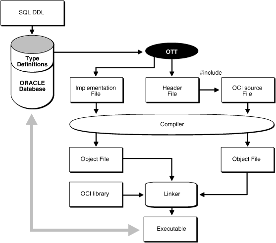

This chapter discusses the Object Type Translator (OTT), which is used to map database object types and named collection types to C structs for use in OCI applications.

This chapter contains these topics:

- What Is the Object Type Translator?

- OTT Command Line

- Intype File

- OTT Data Type Mappings

- Outtype File

- About Using OTT with OCI Applications

- OTT Reference

### 24.1 What Is the Object Type Translator?

The Object Type Translator (OTT) assists in the development of C language applications that make use of user-defined types in an Oracle database.

With SQL `CREATE TYPE` statements, you can create object types. The definitions of these types are stored in the database, and can be used in the creation of database tables. Once these tables are populated, an OCI programmer can access objects stored in the tables.

An application that accesses object data must be able to represent the data in a host language format. This is accomplished by representing object types as C structs. Although it is possible for a programmer to code struct declarations by hand to represent database object types, this can be very time-consuming and error-prone if many types are involved. OTT obviates the need for such manual coding by automatically generating appropriate struct declarations. In OCI, the application also must call an initialization function generated by OTT.

In addition to creating structs that represent stored data types, OTT generates parallel indicator structs that indicate whether an object type or its fields are `NULL`.

The Object Type Translator (OTT) converts database definitions of object types and named collection types into C struct declarations that can be included in an OCI application.

You must explicitly invoke OTT to translate database types to C representations.

On most operating systems, OTT is invoked on the command line. It takes as input an intype file, and it generates an outtype file and one or more C header files and an optional implementation file. The following is an example of a command that invokes OTT:

    ott userid=scott intype=demoin.typ outtype=demoout.typ code=c hfile=demo.h\
        initfile=demov.c

This command causes OTT to connect to the database with user name `scott`. The user is prompted for the password.

The implementation file (`demov.c`) contains the function to initialize the type version table with information about the user-defined types translated.

Later sections of this chapter describe each of these parameters in more detail.

Sample` demoin.typ` file:

    CASE=LOWER
    TYPE emptype

Sample `demoout.typ` file:

    CASE = LOWER
    TYPE SCOTT.EMPTYPE AS emptype
      VERSION = "$8.0"
      HFILE = demo.h

In this example, the `demoin.typ` file contains the type to be translated, preceded by `TYPE` (for example, `TYPE emptype`). The structure of the outtype file is similar to the intype file, with the addition of information obtained by OTT.

Once OTT has completed the translation, the header file contains a C struct representation of each type specified in the intype file, and a `NULL` indicator struct corresponding to each type. Suppose for example, that the employee type listed in the intype file was defined as shown in Example 24-1.

Then the header file generated by OTT (`demo.h`) includes, among other items, the declarations shown in Example 24-2.

Example 24-3 shows what a sample implementation file (`demov.c`) produced by this command contains.

Parameters in the intype file control the way generated structs are named. In this example, the struct name `emptype` matches the database type name` ``emptype`. The struct name is in lowercase because of the line `CASE=lower` in the intype file.

The data types that appear in the struct declarations (for example, `OCIString`, `OCIInd`) are special data types.

The remaining sections of this chapter discuss the use of OTT with OCI, followed by a reference section that describes command-line syntax, parameters, intype file structure, nested `#include` file generation, schema names usage, default name mapping, and restrictions.

Example 24-1 Definition of the Employee Object Type Listed in the Intype File

    CREATE TYPE emptype AS OBJECT
    (
        name       VARCHAR2(30),
        empno      NUMBER,
        deptno     NUMBER,
        hiredate   DATE,
        salary     NUMBER
    );

Example 24-2 Contents of the Generated Header File demo.h

    struct emptype
    {
        OCIString * name;
        OCINumber empno;
        OCINumber deptno;
        OCIDate   hiredate;
        OCINumber salary;
    };
    typedef struct emptype emptype;

    struct emptype_ind
    {
        OCIInd _atomic;
        OCIInd name;
        OCIInd empno;
        OCIInd deptno;
        OCIInd hiredate;
        OCIInd salary;
    };
    typedef struct employee_ind employee_ind;

Example 24-3 Contents of the demov.c File

    #ifndef OCI_ORACLE
    #include <oci.h>
    #endif

    sword demov(OCIEnv *env, OCIError *err)
    {
       sword status = OCITypeVTInit(env, err);
       if (status == OCI_SUCCESS)
           status = OCITypeVTInsert(env, err,
               "HR", 2,
               "EMPTYPE", 7,
               "$8.0", 4);
       return status;
    }

This section includes the following topics:

- About Creating Types in the Database

- About Invoking OTT

**See Also:**

OTT Data Type Mappings for more information about these types

#### 24.1.1 About Creating Types in the Database

The first step in using OTT is to create object types or named collection types and store them in the database.

This is accomplished through the use of the SQL `CREATE TYPE` statement.

**See Also:**

Oracle Database SQL Language Reference for information about the `CREATE` `TYPE` statement

#### 24.1.2 About Invoking OTT

The next step is to invoke OTT. OTT parameters can be specified on the command line, or in a file called a configuration file.

Certain parameters can also be specified in the intype file.

If a parameter is specified in more than one place, its value on the command line takes precedence over its value in the intype file, which takes precedence over its value in a user-defined configuration file, which takes precedence over its value in the default configuration file.

For global options — that is, options on the command line or options at the beginning of the intype file before any `TYPE` statements — the value on the command line overrides the value in the intype file. (The options that can be specified globally in the intype file are `CASE,` `CODE,` `INITFILE`, and `INITFUNC`, but not `HFILE`.) However, anything in the intype file in a `TYPE` specification applies to a particular type only, and overrides anything on the command line that would otherwise apply to the type. So if you enter `TYPE person HFILE=p.h`, it applies to `person` only and overrides the `HFILE` on the command line. The statement is not considered a command-line parameter.

This section includes the following topics:

- Command Line

- Configuration File

- INTYPE File

##### 24.1.2.1 Command Line

Parameters (also called options) set on the command line override any set elsewhere.

**See Also:**

OTT Command Line

##### 24.1.2.2 Configuration File

A configuration file is a text file that contains OTT parameters.

Each nonblank line in the file contains one parameter, with its associated value or values. If more than one parameter is put on a line, only the first one is used. Whitespace is not allowed on any nonblank line of a configuration file.

A configuration file can be named on the command line. In addition, a default configuration file is always read. This default configuration file must always exist, but can be empty. The name of the default configuration file is `ottcfg.cfg`, and the location of the file is system-specific. For example, on Solaris, the file specification is `$ORACLE_HOME/precomp/admin/ottcfg.cfg`. See your operating system-specific documentation for further information.

##### 24.1.2.3 INTYPE File

The intype file gives a list of user-defined types for OTT to translate.

The parameters `CASE, HFILE, INITFUNC`, and `INITFILE` can appear in the intype file.

**See Also:**

Intype File

### 24.2 OTT Command Line

On most operating systems, OTT is invoked on the command line.

You can specify the input and output files, and the database connection information, among other things. Consult your operating system-specific documentation to see how to invoke OTT.

This section includes the following topic: OTT Command-Line Invocation Example.

**See Also:**

[About Using the Object Type Translator for Windows](getting-started-with-oci-for-windows.md)

#### 24.2.1 OTT Command-Line Invocation Example

Shows how to invoke OTT from the command line.

Example 24-4 shows how to invoke OTT from the command line.

**Note:**

No spaces are permitted around the equal sign (=).

Example 24-4 Invoking OTT from the Command Line

    ott userid=bren intype=demoin.typ outtype=demoout.typ code=c \
        hfile=demo.h initfile=demov.c

The following sections describe the elements of the command line used in this example.

This section includes the following topics:

- OTT

- USERID

- INTYPE

- OUTTYPE

- CODE

- HFILE

- INITFILE

**See Also:**

OTT Reference for a detailed discussion of the various OTT command-line options

##### 24.2.1.1 OTT

Causes OTT to be invoked.

It must be the first item on the command line.

##### 24.2.1.2 USERID

Specifies the database connection information that OTT uses.

In Example 24-4, OTT attempts to connect with user name `bren` and is then prompted for the password.

##### 24.2.1.3 INTYPE

Specifies the name of the intype file that is used.

In Example 24-4, the name of the intype file is specified as `demoin.typ`.

##### 24.2.1.4 OUTTYPE

Specifies the name of the outtype file.

When OTT generates the C header file, it also writes information about the translated types into the outtype file. This file contains an entry for each of the types that is translated, including its version string, and the header file to which its C representation was written.

In Example 24-4, the name of the outtype file is specified as `demoout.typ`.

**Note:**

If the file specified by the outtype keyword exists, it is overwritten when OTT runs. If the name of the outtype file is the same as the name of the intype file, the outtype information overwrites the intype file.

##### 24.2.1.5 CODE

Specifies the target language for the translation.

The following options are available:

- C (equivalent to ANSI_C)

- ANSI_C (for ANSI C)

- KR_C (for Kernighan & Ritchie C)

There is currently no default option, so this parameter is required.

Struct declarations are identical in both C dialects. The style in the initialization function defined in the `INITFILE` file depends on whether `KR_C` is used. If the `INITFILE` option is not used, all three options are equivalent.

##### 24.2.1.6 HFILE

Specifies the name of the C header file to which the generated structs should be written.

In Example 24-4, the generated structs are stored in a file called `demo.h`.

**Note:**

If the file specified by the `hfile` keyword exists, it is overwritten when OTT runs, with one exception: if the contents of the file as generated by OTT are identical to the previous contents of the file, OTT does not actually write to the file. This preserves the modification time of the file so that Linux and UNIX `make` and similar facilities on other operating systems do not perform unnecessary recompilations.

##### 24.2.1.7 INITFILE

Specifies the name of the C source file into which the type initialization function is to be written.

**Note:**

If the file specified by the `initfile` keyword exists, it is overwritten when OTT runs, with one exception: if the contents of the file as generated by OTT are identical to the previous contents of the file, OTT does not actually write to the file. This preserves the modification time of the file so that Linux and UNIX `make `and similar facilities on other operating systems do not perform unnecessary recompilations.

### 24.3 Intype File

When OTT runs, the intype file tells OTT which database types should be translated.

It can also control the naming of the generated structs. The intype file can be a user-created file, or it can be the outtype file of a previous invocation of OTT. If the `intype` parameter is not used, all types in the schema to which OTT connects are translated.

Example 24-5 shows a simple user-created intype file.

Example 24-5 is further described as follows.

The first line, with the `CASE` keyword, indicates that generated C identifiers should be in lowercase. However, this `CASE` option is only applied to those identifiers that are not explicitly mentioned in the intype file. Thus, `employee` and `ADDRESS` would always result in C structures `employee` and `ADDRESS`, respectively. The members of these structures would be named in lowercase.

In the lines that begin with the `TYPE` keyword specify which types in the database should be translated: in this case, the `employee, ADDRESS, item, Person`, and `PURCHASE_ORDER` types.

The `TRANSLATE ... AS` keywords specify that the name of an object attribute should be changed when the type is translated into a C struct. In this case, the `SALARY$` attribute of the employee type is translated to `salary`.

The `AS` keyword in the final line specifies that the name of an object type should be changed when it is translated into a struct. In this case, the `PURCHASE_ORDER` database type is translated into a struct called `p_o`.

If `AS` is not used to translate a type or attribute name, the database name of the type or attribute is used as the C identifier name, except that the `CASE` option is observed, and any character that cannot be mapped to a legal C identifier character is replaced by an underscore. Reasons for translating a type or attribute name include the following:

- The name contains characters other than letters, digits, and underscores

- The name conflicts with a C keyword.

- The type name conflicts with another identifier in the same scope. This can happen, for example, if the program uses two types with the same name from different schemas.

- The programmer prefers a different name.

OTT may need to translate additional types that are not listed in the intype file. This is because OTT analyzes the types in the intype file for type dependencies before performing the translation, and translates other types as necessary. For example, if the `ADDRESS` type were not listed in the intype file, but the `"Person"` type had an attribute of type `ADDRESS`, OTT would still translate `ADDRESS` because it is required to define the `"Person"` type.

If you specify `FALSE` as the value of the `TRANSITIVE` parameter, then OTT does not generate types that are not specified in the intype file.

A normal case-insensitive SQL identifier can be spelled in any combination of uppercase and lowercase in the intype file, and is not enclosed within quotation marks.

Use quotation marks, such as `TYPE` `"Person"`, to reference SQL identifiers that have been created in a case-sensitive manner (for example, `CREATE TYPE "Person"`). A SQL identifier is case-sensitive if it was enclosed within quotation marks when it was declared. Quotation marks can also be used to refer to a SQL identifier that is an OTT-reserved word (for example, `TYPE "CASE"`). Therefore, when a name is enclosed within quotation marks, the name enclosed within quotation marks must be in uppercase if the SQL identifier was created in a case-insensitive manner (for example, `CREATE TYPE Case`). If an OTT-reserved word is used to refer to the name of a SQL identifier but is not enclosed within quotation marks, OTT reports a syntax error in the intype file.

Example 24-5 Contents of a User-Created Intype File

    CASE=LOWER
    TYPE employee
      TRANSLATE SALARY$ AS salary
                DEPTNO AS department
    TYPE ADDRESS
    TYPE item
    TYPE "Person"
    TYPE PURCHASE_ORDER AS p_o

####

**See Also:**

- CASE

- Structure of the Intype File for a more detailed specification of the structure of the intype file and the available options

### 24.4 OTT Data Type Mappings

When OTT generates a C struct from a database type, the struct contains one element corresponding to each attribute of the object type.

The data types of the attributes are mapped to types that are used in Oracle's object data types. The data types found in Oracle Database include a set of predefined, primitive types. These data types provide for the creation of user-defined types, such as object types and collections.

Oracle Database also includes a set of predefined types that are used to represent object type attributes in C structs. As an example, consider the object type definition in Example 24-6, and its corresponding OTT-generated struct declarations in Example 24-7.

The OTT output, assuming `CASE=LOWER` and no explicit mappings of type or attribute names, is shown in Example 24-7.

The data types in the struct declarations—`OCIString`, `OCINumber`, `OCIDate`, and `OCIInd`—are used here to map the data types of the object type attributes. The `NUMBER` data type of the `empno` attribute maps to the `OCINumber` data type, for example. These data types can also be used as the types of bind and define variables.

Example 24-6 Object Type Definition for Employee

    CREATE TYPE employee AS OBJECT
    (   name       VARCHAR2(30),
        empno      NUMBER,
        deptno     NUMBER,
        hiredate   DATE,
        salary$    NUMBER);

Example 24-7 OTT-Generated Struct Declarations

    struct employee
    {   OCIString * name;
        OCINumber empno;
        OCINumber deptno;
        OCIDate   hiredate;
        OCINumber salary_;
    };
    typedef struct emp_type emp_type;
    struct employee_ind
    {
        OCIInd _atomic;
        OCIInd name;
        OCIInd empno;
        OCIInd deptno;
        OCIInd hiredate;
        OCIInd salary_;
    }
    typedef struct employee_ind employee_ind;

This section includes the following topics:

- About Mapping Object Data Types to C

- OTT Type Mapping Example

- Null Indicator Structs

- OTT Support for Type Inheritance

**See Also:**

Null Indicator Structs for an explanation of the indicator struct (`struct employee_ind`)

#### 24.4.1 About Mapping Object Data Types to C

This section describes the mappings of Oracle object attribute types to C types generated by OTT.

The previous section OTT Type Mapping Example includes examples of many of these different mappings. Table 24-1 lists the mappings from types that you can use as attributes to object data types that are generated by OTT and the corresponding OCI type code values.

Table 24-1 Object Data Type Mappings for Object Type Attributes

| Object Attribute Types                                              | C Mapping                             | OCITypeCode Values                                                            |
|:--------------------------------------------------------------------|:--------------------------------------|:------------------------------------------------------------------------------|
| BFILE                                                               | OCIBFileLocator\*                     | OCI_TYPECODE_BFILE                                                            |
| BLOB                                                                | OCILobLocator \* or OCIBlobLocator \* | OCI_TYPECODE_BLOB                                                             |
| CHAR(N), CHARACTER(N), NCHAR(N)                                     | OCIString \*                          | OCI_TYPECODE_CHAR (n), OCI_TYPECODE_NCHAR                                     |
| CLOB, NCLOB                                                         | OCILobLocator \* or OCIClobLocator \* | OCI_TYPECODE_CLOB, OCI_TYPECODE_NCLOB                                         |
| DATE                                                                | OCIDate                               | OCI_TYPECODE_DATE                                                             |
| ANSI DATE                                                           | OCIDateTime \*                        | OCI_TYPECODE_TIMESTAMP                                                        |
| TIMESTAMP, TIMESTAMP WITH TIME ZONE, TIMESTAMP WITH LOCAL TIME ZONE | OCIDateTime \*                        | OCI_TYPECODE_TIMESTAMP, OCI_TYPECODE_TIMESTAMP_TZ, OCI_TYPECODE_TIMESTAMP_LTZ |
| INTERVAL YEAR TO MONTH, INTERVAL DAY TO SECOND                      | OCIInterval \*                        | OCI_TYPECODE_INTERVAL_YM, OCI_TYPECODE_INTERVAL_DS                            |
| DEC, DEC(N), DEC(N,N)                                               | OCINumber                             | OCI_TYPECODE_DECIMAL (p)                                                      |
| DECIMAL, DECIMAL(N), DECIMAL(N,N)                                   | OCINumber                             | OCI_TYPECODE_DECIMAL (p)                                                      |
| FLOAT, FLOAT(N), DOUBLE PRECISION                                   | OCINumber                             | OCI_TYPECODE_FLOAT (b)                                                        |
| BINARY_FLOAT                                                        | float                                 | OCI_TYPECODE_BFLOAT                                                           |
| BINARY_DOUBLE                                                       | double                                | OCI_TYPECODE_BDOUBLE                                                          |
| INT, INTEGER, SMALLINT                                              | OCINumber                             | OCI_TYPECODE_INTEGER, OCI_TYPECODE_SMALLINT                                   |
| Nested Object Type                                                  | C name of the nested object type      | OCI_TYPECODE_OBJECT                                                           |
| Nested Table                                                        | OCITable \*                           | OCI_TYPECODE_TABLE                                                            |
| NUMBER, NUMBER(N), NUMBER(N,N)                                      | OCINumber                             | OCI_TYPECODE_NUMBER (p, s)                                                    |
| NUMERIC, NUMERIC(N), NUMERIC(N,N)                                   | OCINumber                             | OCI_TYPECODE_NUMBER (p, s)                                                    |
| RAW(N)                                                              | OCIRaw \*                             | OCI_TYPECODE_RAW                                                              |
| REAL                                                                | OCINumber                             | OCI_TYPECODE_REAL                                                             |
| REF                                                                 | OCIRef \*                             | OCI_TYPECODE_REF                                                              |
| VARCHAR(N)                                                          | OCIString \*                          | OCI_TYPECODE_VARCHAR (n)                                                      |
| VARCHAR2(N), NVARCHAR2(N)                                           | OCIString \*                          | OCI_TYPECODE_VARCHAR2 (n), OCI_TYPECODE_NVARCHAR2                             |
| VARRAY                                                              | OCIArray \*                           | OCI_TYPECODE_VARRAY                                                           |
| collections                                                         | OCIColl \*                            | OCI_TYPECODE_NAMEDCOLLECTION                                                  |

**Note:**

For `REF`, `varray`, and `nested table` types, OTT generates a typedef. The type declared in the typedef is then used as the type of the data member in the struct declaration. For an example, see OTT Type Mapping Example.

If an object type includes an attribute of a `REF` or collection type, a typedef for the `REF` or collection type is first generated. Then the struct declaration corresponding to the object type is generated. The struct includes an element whose type is a pointer to the `REF` or collection type.

If an object type includes an attribute whose type is another object type, OTT first generates the nested type (if `TRANSITIVE=TRUE`). It then maps the object type attribute to a nested struct of the type of the nested object type.

The Oracle C data types to which OTT maps non-object database attribute types are structures, which, except for `OCIDate`, are opaque.

#### 24.4.2 OTT Type Mapping Example

Shows the various type mappings created by OTT when given the database types.

Example 24-9 demonstrates the various type mappings created by OTT when given the database types shown in Example 24-8.

The intype file includes the following:

    CASE = LOWER
    TYPE many_types

OTT generates the C structs shown in Example 24-9.

**Note:**

Comments are provided in Example 24-9 to help explain the structs. These comments are not part of actual OTT output.

Notice that although only one item was listed for translation in the intype file, two object types and two named collection types were translated. This is because the OTT parameter `TRANSITIVE` has the default value of `TRUE`. As described in that section, when `TRANSITIVE=TRUE`, OTT automatically translates any types that are used as attributes of a type being translated, to complete the translation of the listed type.

This is not the case for types that are only accessed by a pointer or `REF` in an object type attribute. For example, although the `many_types` type contains the attribute `another_ref REF other_type`, a declaration of struct `other_type` was not generated.

This example also illustrates how typedefs are used to declare `varray, nested table`, and `REF` types.

The typedefs occur near the beginning:

    typedef OCIRef many_types_ref;
    typedef OCIRef object_type_ref;
    typedef OCIArray my_varray;
    typedef OCITable my_table;
    typedef OCIRef other_type_ref;

In the struct `many_types`, the `varray, nested table`, and `REF` attributes are declared:

    struct many_types
    {  ...
       other_type_ref *   another_ref;
       many_types_ref *   the_ref;
       my_varray *        the_varray;
       my_table *         the_table;
       ...
    }

Example 24-8 Object Type Definitions for the OTT Type Mapping Example

    CREATE TYPE my_varray AS VARRAY(5) of integer;

    CREATE TYPE object_type AS OBJECT
    (object_name    VARCHAR2(20));

    CREATE TYPE my_table AS TABLE OF object_type;

    CREATE TYPE other_type AS OBJECT (object_number NUMBER);

    CREATE TYPE many_types AS OBJECT
    ( the_varchar    VARCHAR2(30),
      the_char       CHAR(3),
      the_blob       BLOB,
      the_clob       CLOB,
      the_object     object_type,
      another_ref    REF other_type,
      the_ref        REF many_types,
      the_varray     my_varray,
      the_table      my_table,
      the_date       DATE,
      the_num        NUMBER,
      the_raw        RAW(255));

Example 24-9 Various Type Mappings Created by OTT from Object Type Definitions

    #ifndef MYFILENAME_ORACLE
    #define MYFILENAME_ORACLE

    #ifndef OCI_ORACLE
    #include <oci.h>
    #endif

    typedef OCIRef many_types_ref;
    typedef OCIRef object_type_ref;
    typedef OCIArray my_varray;            /* used in many_types */
    typedef OCITable my_table;             /* used in many_types*/
    typedef OCIRef other_type_ref;
    struct object_type                     /* used in many_types */
    {
       OCIString * object_name;
    };
    typedef struct object_type object_type;

    struct object_type_ind               /*indicator struct for*/
    {                                            /*object_types*/
       OCIInd _atomic;
       OCIInd object_name;
    };
    typedef struct object_type_ind object_type_ind;

    struct many_types
    {
       OCIString *        the_varchar;
       OCIString *        the_char;
       OCIBlobLocator *   the_blob;
       OCIClobLocator *   the_clob;
       struct object_type the_object;
       other_type_ref *   another_ref;
       many_types_ref *   the_ref;
       my_varray *        the_varray;
       my_table *         the_table;
       OCIDate            the_date;
       OCINumber          the_num;
       OCIRaw *           the_raw;
    };
    typedef struct many_types many_types;

    struct many_types_ind                  /*indicator struct for*/
    {                                               /*many_types*/
       OCIInd _atomic;
       OCIInd the_varchar;
       OCIInd the_char;
       OCIInd the_blob;
       OCIInd the_clob;
       struct object_type_ind the_object;              /*nested*/
       OCIInd another_ref;
       OCIInd the_ref;
       OCIInd the_varray;
       OCIInd the_table;
       OCIInd the_date;
       OCIInd the_num;
       OCIInd the_raw;
    };
    typedef struct many_types_ind many_types_ind;

    #endif

**See Also:**

TRANSITIVE

#### 24.4.3 Null Indicator Structs

Each time OTT generates a C struct to represent a database object type, it also generates a corresponding `NULL` indicator struct.

When an object type is selected into a C struct, `NULL` indicator information may be selected into a parallel struct.

For example, the following `NULL` indicator struct was generated in Example 24-9.

    struct many_types_ind
    {
    OCIInd _atomic;
    OCIInd the_varchar;
    OCIInd the_char;
    OCIInd the_blob;
    OCIInd the_clob;
    struct object_type_ind the_object;
    OCIInd another_ref;
    OCIInd the_ref;
    OCIInd the_varray;
    OCIInd the_table;
    OCIInd the_date;
    OCIInd the_num;
    OCIInd the_raw;
    };
    typedef struct many_types_ind many_types_ind;

The layout of the `NULL` struct is important. The first element in the struct (`_atomic`) is the atomic null indicator. This value indicates the `NULL` status for the object type as a whole. The atomic null indicator is followed by an indicator element corresponding to each element in the OTT-generated struct representing the object type.

Notice that when an object type contains another object type as part of its definition (in the preceding example it is the `object_type `attribute), the indicator entry for that attribute is the `NULL` indicator struct (`object_type_ind`) corresponding to the nested object type (if `TRANSITIVE=TRUE`).

The `varrays` and `nested tables` contain the `NULL` information for their elements.

The data type for all other elements of a `NULL` indicator struct is `OCIInd`.

**See Also:**

[NULL Indicator Structure](oci-object-relational-programming.md) for more information about atomic nullity

#### 24.4.4 OTT Support for Type Inheritance

To support type inheritance of objects, OTT generates a C struct to represent an object subtype by declaring the inherited attributes in an encapsulated struct with the special name "`_super`", before declaring the new attributes.

Thus, for an object subtype that inherits from a supertype, the first element in the struct is named "`_super`", followed by elements corresponding to each attribute of the subtype. The type of the element named "`_super`" is the name of the supertype.

For example, suppose that you have a type `Person_t`, with subtype `Student_t` and subtype `Employee_t`, as shown in Example 24-10.

Suppose that you also have an intype file with the content shown in Example 24-11.

Then, OTT generates the C structs for `Person_t`, `Student_t`, and `Employee_t`, and their `NULL` indicator structs, as shown in Example 24-12.

The preceding C mapping convention allows simple upcasting from an instance of a subtype to an instance of a supertype in C to work properly. For example:

    STUDENT_T *stu_ptr = some_ptr;               /* some STUDENT_T instance  */
    PERSON_T  *pers_ptr = (PERSON_T *)stu_ptr;   /* upcasting */

The `NULL` indicator structs are generated similarly. Note that for the supertype `Person_t` `NULL` indicator struct, the first element is "`_atomic`", and that for the subtypes `Employee_t` and `Student_t` `NULL` indicator structs, the first element is "`_super`" (no atomic element is generated for subtypes).

Example 24-10 Object Type and Subtype Definitions

    CREATE TYPE Person_t AS OBJECT
    ( ssn     NUMBER,
      name    VARCHAR2(30),
      address VARCHAR2(100)) NOT FINAL;

    CREATE TYPE Student_t UNDER Person_t
    ( deptid NUMBER,
      major  VARCHAR2(30)) NOT FINAL;

    CREATE TYPE Employee_t UNDER Person_t
    ( empid NUMBER,
      mgr   VARCHAR2(30));

Example 24-11 Contents of the Intype File

    CASE=SAME
    TYPE EMPLOYEE_T
    TYPE STUDENT_T
    TYPE PERSON_T

Example 24-12 OTT Generates C Structs for the Types and Null Indicator Structs

    #ifndef MYFILENAME_ORACLE
    #define MYFILENAME_ORACLE

    #ifndef OCI_ORACLE
    #include <oci.h>
    #endif

    typedef OCIRef EMPLOYEE_T_ref;
    typedef OCIRef STUDENT_T_ref;
    typedef OCIRef PERSON_T_ref;

    struct PERSON_T
    {
       OCINumber SSN;
       OCIString * NAME;
       OCIString * ADDRESS;
    };
    typedef struct PERSON_T PERSON_T;

    struct PERSON_T_ind
    {
       OCIInd _atomic;
       OCIInd SSN;
       OCIInd NAME;
       OCIInd ADDRESS;
    };
    typedef struct PERSON_T_ind PERSON_T_ind;

    struct EMPLOYEE_T
    {
       PERSON_T_ind;
       OCINumber EMPID;
       OCIString * MGR;
    };
    typedef struct EMPLOYEE_T EMPLOYEE_T;

    struct EMPLOYEE_T_ind
    {
       PERSON_T _super;
       OCIInd EMPID;
       OCIInd MGR;
    };
    typedef struct EMPLOYEE_T_ind EMPLOYEE_T_ind;

    struct STUDENT_T
    {
       PERSON_T _super;
       OCINumber DEPTID;
       OCIString * MAJOR;
    };
    typedef struct STUDENT_T STUDENT_T;

    struct STUDENT_T_ind
    {
       PERSON_T _super;
       OCIInd DEPTID;
       OCIInd MAJOR;
    };
    typedef struct STUDENT_T_ind STUDENT_T_ind;

    #endif

This section includes the following topic: Substitutable Object Attributes.

##### 24.4.4.1 Substitutable Object Attributes

For attributes of `NOT FINAL` types (potentially substitutable), the embedded attribute is represented as a pointer.

Consider a type `Book_t` created as follows:

    CREATE TYPE Book_t AS OBJECT
    ( title   VARCHAR2(30),
      author  Person_t     /* substitutable */);

The corresponding C struct generated by OTT contains a pointer to `Person_t`:

    struct Book_t
    {
      OCIString  *title;
      Person_t   *author;    /* pointer to Person_t struct */
    }

The `NULL` indicator struct corresponding to the preceding type is as follows:

    struct Book_t_ind
    {
      OCIInd  _atomic;
      OCIInd  title;
      OCIInd  author;
    }

Note that the `NULL` indicator struct corresponding to the `author` attribute can be obtained from the `author` object itself. See `OCIObjectGetInd()`.

If a type is defined to be `FINAL`, it cannot have any subtypes. An attribute of a `FINAL` type is therefore not substitutable. In such cases, the mapping is as before: the attribute struct is inline. Now, if the type is altered and defined to be `NOT FINAL`, the mapping must change. The new mapping is generated by running OTT again.

**See Also:**

[OCIObjectGetInd()](oci-miscellaneous-object-functions.md)

### 24.5 Outtype File

The outtype file is named on the OTT command line.

When OTT generates the C header file, it also writes the results of the translation into the outtype file. This file contains an entry for each of the types that is translated, including its version string, and the header file to which its C representation was written.

The outtype file from one OTT run can be used as the intype file for a subsequent OTT invocation.

For example, suppose that you have a simple intype file, as shown in Example 24-13, which was used in Example 24-5.

The user has chosen to specify the case for the OTT-generated C identifiers, and has provided a list of types to be translated. In two of these types, naming conventions are specified.

Example 24-14 shows what the outtype file might look like after running OTT.

When examining the contents of the outtype file, you might discover types listed that were not included in the intype specification. For example, suppose that the intype file only specified that the `person` type was to be translated as follows:

    CASE = LOWER
    TYPE PERSON

However, because the definition of the `person` type includes an attribute of type `address`, the outtype file includes entries for both `PERSON` and `ADDRESS`. The `person` type cannot be translated completely without first translating `address`.

When the parameter `TRANSITIVE` has been set to `TRUE` (it is the default), OTT analyzes the types in the intype file for type dependencies before performing the translation, and translates other types as necessary.

Example 24-13 Contents of an Intype File

    CASE=LOWER
    TYPE employee
      TRANSLATE SALARY$ AS salary
                DEPTNO AS department
    TYPE ADDRESS
    TYPE item
    TYPE "Person"
    TYPE PURCHASE_ORDER AS p_o

Example 24-14 Contents of the Outtype File After Running OTT

    CASE = LOWER
    TYPE EMPLOYEE AS employee
      VERSION = "$8.0"
      HFILE = demo.h
      TRANSLATE SALARY$ AS salary
                 DEPTNO AS department
    TYPE ADDRESS AS ADDRESS
      VERSION = "$8.0"
      HFILE = demo.h
    TYPE ITEM AS item
      VERSION = "$8.0"
      HFILE = demo.h
    TYPE "Person" AS Person
      VERSION = "$8.0"
      HFILE = demo.h
    TYPE PURCHASE_ORDER AS p_o
      VERSION = "$8.0"
      HFILE = demo.h

### 24.6 About Using OTT with OCI Applications

An OCI application that accesses objects in an Oracle server can use C header and implementation files that have been generated by OTT.

The header file is incorporated into the OCI code with an `#include` statement.

Once the header file has been included, the OCI application can access and manipulate object data in the host language format.

Figure 24-1 shows the steps involved in using OTT with OCI for the simplest applications:

1.  SQL is used to create type definitions in the database.

2.  OTT generates a header file containing C representations of object types and named collection types. It also generates an implementation file, as named with the `INITFILE` option.

3.  The application is written. User-written code in the OCI application declares and calls the `INITFUNC` function.

4.  The header file is included in an OCI source code file.

5.  The OCI application, including the implementation file generated by OTT, is compiled and linked with the OCI libraries.

6.  The OCI executable is run against the Oracle database.

Figure 24-1 Using OTT with OCI

[Description of "Figure 24-1 Using OTT with OCI"](img_text/lnoci029.md)

This section includes the following topics:

- About Accessing and Manipulating Objects with OCI

- Calling the Initialization Function

- Tasks of the Initialization Function

#### 24.6.1 About Accessing and Manipulating Objects with OCI

Within the application, the OCI program can perform bind and define operations using program variables declared to be of types that appear in the OTT-generated header file.

For example, an application might fetch a `REF` to an object using a SQL `SELECT` statement and then pin that object using the appropriate OCI function. Once the object has been pinned, its attribute data can be accessed and manipulated with other OCI functions.

OCI includes a set of data type mapping and manipulation functions that are specifically designed to work on attributes of object types and named collection types.

The following are examples of the available functions:

- `OCIStringSize()` gets the size of an `OCIString` string.

- `OCINumberAdd()` adds two `OCINumber` numbers together.

- `OCILobIsEqual()` compares two LOB locators for equality.

- `OCIRawPtr()` gets a pointer to an `OCIRaw` raw data type.

- `OCICollAppend()` appends an element to a collection type (`OCIArray `or `OCITable`).

- `OCITableFirst()` returns the index for the first existing element of a nested table (`OCITable`).

- `OCIRefIsNull()` tests if a `REF` (`OCIRef`) is `NULL`.

These functions are described in detail in other chapters of this guide.

**See Also:**

- [OCIStringSize()](oci-string-functions.md)

- [OCINumberAdd()](oci-NUMBER-functions.md)

- [OCILobIsEqual()](lob-functions.md)

- [OCIRawPtr()](oci-raw-functions.md)

- [OCICollAppend()](oci-collection-and-iterator-functions.md)

- [OCITableFirst()](oci-table-functions.md)

- [OCIRefIsNull()](oci-REF-functions.md)

#### 24.6.2 Calling the Initialization Function

OTT generates a C initialization function if requested. The initialization function tells the environment, for each object type used in the program, which version of the type is used.

You can specify a name for the initialization function when you invoke OTT with the `INITFUNC` option, or you can allow OTT to select a default name based on the name of the implementation file (`INITFILE`) containing the function.

The initialization function takes two arguments; an environment handle pointer and an error handle pointer. There is typically a single initialization function, but this is not required. If a program has several separately compiled pieces requiring different types, you may want to execute OTT separately for each piece, requiring for each piece, one initialization file containing an initialization function.

After an environment handle is created by an explicit OCI object call (for example, by calling `OCIEnvCreate()`) you must also explicitly call the initialization functions. All the initialization functions must be called for each explicitly created environment handle. This gives each handle access to all the Oracle data types used in the entire program.

If an environment handle is implicitly created by embedded SQL statements, such as `EXEC SQL CONTEXT USE` and `EXEC SQL CONNECT`, the handle is initialized implicitly, and the initialization functions need not be called. This is only relevant when Pro\*C/C++ is being combined with OCI applications.

The following example shows an initialization function.

Suppose that you have an intype file, `ex2c.typ`, containing the content shown in Example 24-15.

Then you invoke OTT from the command line and specify the initialization function, as shown in Example 24-16.

OTT generates the `ex2cv.c` file with the contents shown in Example 24-17.

The function `ex2cv()` creates the type version table and inserts the types `BREN.PERSON` and `BREN.ADDRESS`.

If a program explicitly creates an environment handle, all the initialization functions must be generated, compiled, and linked, because they must be called for each explicitly created handle. If a program does not explicitly create any environment handles, initialization functions are not required.

A program that uses an OTT-generated header file must also use the initialization function generated at the same time. When a header file is generated by OTT and an environment handle is explicitly created in the program, then the implementation file must also be compiled and linked into the executable.

Example 24-15 Content of an Intype File Named ex2c.typ

    TYPE BREN.PERSON
    TYPE BREN.ADDRESS

Example 24-16 Invoking OTT and Specifying the Initialization Function

    ott userid=bren intype=ex2c outtype=ex2co hfile=ex2ch.h initfile=ex2cv.c

Example 24-17 Content of an OTT-Generated File Named ex2cv.c

    #ifndef OCI_ORACLE
    #include <oci.h>
    #endif

    sword ex2cv(OCIEnv *env, OCIError *err)
    {
       sword status = OCITypeVTInit(env, err);
       if (status == OCI_SUCCESS)
          status = OCITypeVTInsert(env, err,
              "BREN", 5,
              "PERSON", 6,
              "$8.0", 4);
        if (status == OCI_SUCCESS)
            status = OCITypeVTInsert(env, err,
               "BREN", 5,
               "ADDRESS", 7,
               "$8.0", 4);
        return status;
    }

**See Also:**

[OCIEnvCreate()](connect-authorize-and-initialize-functions.md)

#### 24.6.3 Tasks of the Initialization Function

The C initialization function supplies version information about the types processed by OTT. It adds to the type-version table the name and version identifier of every OTT-processed object data type.

The type-version table is used by the Oracle database type manager to determine which version of a type a particular program uses. Different initialization functions generated by OTT at different times can add some of the same types to the type version table. When a type is added more than once, Oracle Database ensures that the same version of the type is registered each time.

It is the OCI programmer's responsibility to declare a function prototype for the initialization function, and to call the function.

**Note:**

In the current release of Oracle Database, each type has only one version. Initialization of the type version table is required only for compatibility with future releases of Oracle Database.

### 24.7 OTT Reference

Parameters that can appear on the OTT command line or in a `CONFIG` file control the behavior of OTT. Certain parameters can also appear in the intype file.

This section provides detailed information about the following topics:

- OTT Command-Line Syntax

- OTT Parameters

- Where OTT Parameters Can Appear

- Structure of the Intype File

- Nested Included File Generation

- SCHEMA_NAMES Usage

- Default Name Mapping

- OTT Restriction on File Name Comparison

- OTT Command on Microsoft Windows

The following conventions are used in this section to describe OTT syntax:

- Italic strings are variables or parameters to be supplied by the user.

- Strings in UPPERCASE are entered as shown, except that case is not significant.

- OTT keywords are listed in a lowercase monospaced font in examples and headings, but are printed in uppercase in text to make them more distinctive.

- Square brackets \[...\] enclose optional items.

- An ellipsis (...) immediately following an item (or items enclosed in brackets) means that the item can be repeated any number of times.

- Punctuation symbols other than those described earlier are entered as shown. These include ".", "@", and so on.

#### 24.7.1 OTT Command-Line Syntax

The OTT command-line interface is used when explicitly invoking OTT to translate database types into C structs.

This is always required when you develop OCI applications that use objects.

An OTT command-line statement consists of the keyword `OTT`, followed by a list of OTT parameters.

The parameters that can appear on an OTT command-line statement are as follows:

    [userid=username/password[@db_name]]

    [intype=filename]

    outtype=filename

    code=C|ANSI_C|KR_C

    [hfile=filename]

    [errtype=filename]

    [config=filename]

    [initfile=filename]

    [initfunc=filename]

    [case=SAME|LOWER|UPPER|OPPOSITE]

    [schema_name=ALWAYS|IF_NEEDED|FROM_INTYPE]

    [transitive=TRUE|FALSE]

    [URL=url]

**Note:**

Generally, the order of the parameters following the `ott` command does not matter. Only the `OUTTYPE` and `CODE` parameters are always required.

The `HFILE` parameter is almost always used. If omitted from the command line, `HFILE` must be specified individually for each type in the intype file. If OTT determines that a type not listed in the intype file must be translated, an error is reported. Therefore, it is safe to omit the `HFILE` parameter only if the intype file was previously generated as an OTT outtype file.

If the intype file is omitted, the entire schema is translated. The OTT parameter descriptions are described in the sections that follow.

The following is an example of an OTT command-line statement (you are prompted for the password):

    ott userid=marc intype=in.typ outtype=out.typ code=c hfile=demo.h\
       errtype=demo.tls case=lower

The following sections describe each of the OTT command-line parameters.

**See Also:**

OTT Parameters

#### 24.7.2 OTT Parameters

Enter parameters on the OTT command line using the following format:

    parameter=value

In this format, `parameter` is the literal parameter string and `value` is a valid parameter setting. The literal parameter string is not case-sensitive.

Separate command-line parameters by using either spaces or tabs.

Parameters can also appear within a configuration file, but, in that case, no whitespace is permitted within a line, and each parameter must appear on a separate line. Additionally, the parameters `CASE,` `HFILE,INITFUNC`, and `INITFILE` can appear in the intype file.

This section includes the following OTT parameters:

- USERID

- INTYPE

- OUTTYPE

- CODE

- INITFILE

- INITFUNC

- HFILE

- CONFIG

- ERRTYPE

- CASE

- SCHEMA_NAMES

- TRANSITIVE

- URL

##### 24.7.2.1 USERID

The `USERID` parameter specifies the database user name, password, and optional database name (Oracle Net Services database specification string).

If the database name is omitted, the default database is assumed. The syntax of this parameter is:

    userid=username/password[@db_name]

The `USERID` parameter is optional. If it is omitted, OTT automatically attempts to connect to the default database as user `OPS$username`, where `username` is the user's operating system user name. If this is the first parameter, "`USERID=`" and the password and the database name can be omitted, as shown here:

    ott username ...

For security purposes, when you enter only the user name you are prompted for the rest of the entry.

The `username` and `db_name` (schema name) combination is appended and used as a key in the `OCIContextGetValue()` call, which supports a maximum length of 64 bytes in Oracle Database 12c Release 1 (12.1). In Oracle Database 12c Release 2 (12.2) this max length is extended to support 243 bytes, not including 1 character for the period (.).

##### 24.7.2.2 INTYPE

The `INTYPE` parameter specifies the name of the file from which to read the list of object type specifications. OTT translates each type in the list.

The syntax for this parameter is

    intype=filename

"`INTYPE=`" can be omitted if `USERID` and `INTYPE` are the first two parameters, in that order, and "`USERID=`" is omitted. If the `INTYPE` parameter is not specified, all types in the user's schema are translated.

    ott username filename...

The intype file can be thought of as a makefile for type declarations. It lists the types for which C struct declarations are needed.

If the file name on the command line or in the intype file does not include an extension, an operating system-specific extension such as "`TYP`" or "`.typ`" is added.

**See Also:**

Structure of the Intype File for a description of the format of the intype file

##### 24.7.2.3 OUTTYPE

The `OUTTYPE` parameter specifies the name of a file into which OTT writes type information for all the object data types it processes.

This includes all types explicitly named in the intype file, and can include additional types that are translated because they are used in the declarations of other types that must be translated (if `TRANSITIVE=TRUE`). This file must be used as an intype file in a future invocation of OTT.

    outtype=filename

If the `INTYPE` and `OUTTYPE` parameters refer to the same file, the new `INTYPE` parameter information replaces the old information in the intype file. This provides a convenient way for the same intype file to be used repeatedly in the cycle of altering types, generating type declarations, editing source code, precompiling, compiling, and debugging.

The parameter `OUTTYPE` must be specified.

If the file name on the command line or in the outtype file does not include an extension, an operating system-specific extension such as "`TYP`" or "`.typ`" is added.

##### 24.7.2.4 CODE

This is the desired host language for OTT output, which is specified as `CODE=C, CODE=KR_C,` or `CODE=ANSI_C`.

"`CODE=C`" is equivalent to "`CODE=ANSI_C`".

    CODE=C|KR_C|ANSI_C

There is no default value for this parameter; it must be supplied.

##### 24.7.2.5 INITFILE

The `INITFILE` parameter specifies the name of the file where the OTT-generated initialization file is to be written.

The initialization function is not generated if this parameter is omitted.

For Pro\*C/C++ programs, the `INITFILE` is not necessary, because the SQLLIB runtime library performs the necessary initializations. An OCI program user must compile and link the `INITFILE` files, and must call the initialization file functions when an environment handle is created.

If the file name of an `INITFILE` on the command line or in the intype file does not include an extension, an operating system-specific extension such as "`C`" or "`.c`" is added.

    initfile=filename

##### 24.7.2.6 INITFUNC

The `INITFUNC` parameter is only used in OCI programs.

It specifies the name of the initialization function generated by OTT. If this parameter is omitted, the name of the initialization function is derived from the name of the `INITFILE`.

    initfunc=filename

##### 24.7.2.7 HFILE

The `HFILE` parameter specifies the name of the include (`.h`) file to be generated by OTT for the declarations of types that are mentioned in the intype file but whose include files are not specified there.

This parameter is required unless the include file for each type is specified individually in the intype file. This parameter is also required if a type not mentioned in the intype file must be generated because other types require it, and these other types are declared in two or more different files, and `TRANSITIVE=TRUE`.

If the file name of an `HFILE` on the command line or in the intype file does not include an extension, an operating system-specific extension such as "`H`" or "`.h`" is added.

    hfile=filename

##### 24.7.2.8 CONFIG

The `CONFIG` parameter specifies the name of the OTT configuration file, which lists commonly used parameter specifications.

Parameter specifications are also read from a system configuration file in an operating system-dependent location. All remaining parameter specifications must appear on the command line, or in the intype file.

    config=filename

**Note:**

A `CONFIG` parameter is not allowed in the `CONFIG` file.

##### 24.7.2.9 ERRTYPE

If the `ERRTYPE` parameter is supplied, OTT writes a listing of the intype file to the `ERRTYPE` file, along with all informational and error messages.

Informational and error messages are sent to the standard output whether `ERRTYPE` parameter is specified or not.

Essentially, the `ERRTYPE` file is a copy of the intype file with error messages added. In most cases, an error message includes a pointer to the text that caused the error.

If the file name of an `ERRTYPE` on the command line or in the intype file does not include an extension, an operating system-specific extension such as "`TLS`" or "`.tls`" is added.

    errtype=filename

##### 24.7.2.10 CASE

This `CASE` parameter affects the case of certain C identifiers generated by OTT.

The possible values of `CASE` are `SAME, LOWER, UPPER`, and `OPPOSITE`. If `CASE = SAME`, the case of letters is not changed when converting database type and attribute names to C identifiers. If `CASE=LOWER`, all uppercase letters are converted to lowercase. If `CASE=UPPER`, all lowercase letters are converted to uppercase. If `CASE=OPPOSITE`, all uppercase letters are converted to lowercase, and vice versa.

    CASE=[SAME|LOWER|UPPER|OPPOSITE]

This option affects only those identifiers (attributes or types not explicitly listed) not mentioned in the intype file. Case conversion occurs after a legal identifier has been generated.

Note that the case of the C struct identifier for a type specifically mentioned in the `INTYPE` parameter option is the same as its case in the intype file. For example, if the intype file includes the following line:

    TYPE Worker

Then OTT generates the following line:

    struct Worker {...};

However, suppose that the intype file is written as follows:

    TYPE wOrKeR

Then OTT generates the following line, following the case specified in the intype file.

    struct wOrKeR {...};

Case-insensitive SQL identifiers not mentioned in the intype file appear in uppercase if `CASE=SAME`, and in lowercase if `CASE=OPPOSITE`. A SQL identifier is case-insensitive if it was not enclosed in quotation marks when it was declared.

##### 24.7.2.11 SCHEMA_NAMES

The `SCHEMA_NAMES` parameter offers control in qualifying the database name of a type from the default schema with a schema name in the outtype file.

The outtype file generated by OTT contains information about the types processed by OTT, including the type names.

**See Also:**

SCHEMA_NAMES Usage

##### 24.7.2.12 TRANSITIVE

The `TRANSITIVE` parameter takes the values `TRUE` (the default) or `FALSE`.

It indicates whether type dependencies not explicitly listed in the intype file are to be translated or not.

If `TRANSITIVE=TRUE` is specified, then types needed by other types but not mentioned in the intype file are generated.

If `TRANSITIVE=FALSE` is specified, then types not mentioned in the intype file are not generated, even if they were used as attribute types of other generated types.

##### 24.7.2.13 URL

For the `URL` parameter, OTT uses JDBC (Java Database Connectivity), the Java interface for connecting to the database.

The default value of parameter `URL` is:

    URL=jdbc:oracle:oci8:@

The OCI8 driver is for client-side use with an Oracle Database installation.

To specify the JDBC Thin driver (the Java driver for client-side use without an Oracle Database installation), use the following `URL` parameter syntax:

    URL=jdbc:oracle:thin:@host:port:sid

The `host` is the name of the host on which the database is running, `port` is the port number, and `sid` is the Oracle SID.

#### 24.7.3 Where OTT Parameters Can Appear

OTT parameters can appear on the command line, in a `CONFIG` file named on the command line, or both.

Some parameters are also allowed in the intype file.

OTT is invoked as follows:

    ott username/password parameters

If one of the parameters on the command line is the following, then additional parameters are read from the configuration file `filename`:

    config=filename

In addition, parameters are also read from a default configuration file in an operating system-dependent location. This file must exist, but can be empty. Parameters in a configuration file must appear one in each line, with no whitespace on the line.

If OTT is executed without any arguments, an online parameter reference is displayed.

The types for OTT to translate are named in the file specified by the `INTYPE` parameter. The parameters `CASE, INITFILE, INITFUNC`, and `HFILE` can also appear in the intype file. The outtype files generated by OTT include the `CASE` parameter, and include the `INITFILE`, and `INITFUNC` parameters if an initialization file was generated. The outtype file specifies the `HFILE` individually for each type.

The case of the OTT command is operating system-dependent.

#### 24.7.4 Structure of the Intype File

The intype and outtype files list the types translated by OTT, and provide all the information needed to determine how a type or attribute name is translated to a legal C identifier.

These files contain one or more type specifications. These files also can contain specifications of the following options:

- `CASE`

- `HFILE`

- `INITFILE`

- `INITFUNC`

If the `CASE, INITFILE`, or `INITFUNC` options are present, they must precede any type specifications. If these options appear both on the command line and in the intype file, the value on the command line is used.

This section includes the following topic: Intype File Type Specifications.

**See Also:**

Outtype File for an example of a simple user-defined intype file, and of the full outtype file that OTT generates from it

##### 24.7.4.1 Intype File Type Specifications

A type specification in the intype file names an object data type that is to be translated.

A type specification in the outtype file names an object data type that has been translated.

    TYPE employee
      TRANSLATE SALARY$ AS salary
                DEPTNO AS department
    TYPE ADDRESS
    TYPE PURCHASE_ORDER AS p_o

The structure of a type specification is as follows, where \[\] indicates optional inputs inside:

    TYPE type_name [AS type_identifier]
    [VERSION [=] version_string]
    [HFILE [=] hfile_name]
    [TRANSLATE{member_name [AS identifier]}...]

The syntax of `type_name` is:

    [schema_name.]type_name

The `schema_name` is the name of the schema that owns the given object data type, and `type_name` is the name of the type. The default schema is that of the user running OTT. The default database is the local database.

The components of a type specification are described as follows:

- `type_name` is the name of an Oracle Database object data type.

- `type_identifier` is the C identifier used to represent the type. If `type_identifier` is omitted, the default name mapping algorithm is used.

- `version_string` is the version string of the type that was used when the code was generated by a previous invocation of OTT. The version string is generated by OTT and written to the outtype file, which can be used as the intype file when OTT is executed later. The version string does not affect the operation of OTT, but is eventually used to select the version of the object data type that should be used in the running program.

<!-- -->

- `hfile_name` is the name of the header file in which the declarations of the corresponding struct or class appear. If `hfile_name` is omitted, the file named by the command-line `HFILE` parameter is used if a declaration is generated.

- `member_name` is the name of an attribute (data member) that is to be translated to the `identifier`.

- `identifier` is the C identifier used to represent the attribute in the user program. Identifiers can be specified in this way for any number of attributes. The default name mapping algorithm is used for the attributes that are not mentioned.

An object data type may need to be translated for one of two reasons:

- It appears in the intype file.

- It is required to declare another type that must be translated, and `TRANSITIVE=TRUE`.

If a type that is not mentioned explicitly is required by types declared in exactly one file, OTT writes the translation of the required type to the same file or files as the explicitly declared types that require it.

If a type that is not mentioned explicitly is required by types declared in two or more different files, OTT writes the translation of the required type to the global `HFILE` file.

**See Also:**

Default Name Mapping for more information about naming the intype file related to the `version_string` component.

#### 24.7.5 Nested Included File Generation

Every `HFILE` generated by OTT uses `#include` directives to include other necessary files and `#define` directives to define a symbol constructed from the name of the file, which can be used to determine if the `HFILE` has been included.

Consider, for example, a database with the types shown in Example 24-18.

The intype file content is shown in Example 24-19.

If you invoke OTT with the command shown in Example 24-20, then it generates the header files shown in Example 24-21 and Example 24-22.

The content of the header file `tott95b.h` is shown in Example 24-21.

The content of the header file tott95a.h is shown in Example 24-22.

In Example 24-21, the symbol `TOTT95B_ORACLE` is defined first so that the programmer can conditionally include `tott95b.h` without having to worry whether `tott95b.h` depends on the include file using the construct, as shown in Example 24-23.

Using this technique, the programmer can include `tott95b.h` from some file, say `foo.h`, without having to know whether some other file included by `foo.h` also includes `tott95b.h`.

After the definition of the symbol `TOTT95B_ORACLE`, the file `oci.h` is included. Every `HFILE` generated by OTT includes `oci.h`, which contains type and function declarations that the Pro\*C/C++ or OCI programmer can use. This is the only case in which OTT uses angle brackets in an `#include` directive.

Next, the file `tott95a.h` is included. This file is included because it contains the declaration of "`struct px1`", which` tott95b.h` requires. When the user's intype file requests that type declarations be written to more than one file, OTT determines which other files each `HFILE` must include, and generates the necessary `#includes` directives.

Note that OTT uses quotation marks in this `#include` directive. When a program including `tott95b.h` is compiled, the search for `tott95a.h` begins where the source program was found, and thereafter follows an implementation-defined search rule. If `tott95a.h` cannot be found in this way, a complete file name (for example, a Linux or UNIX absolute path name beginning with /) should be used in the intype file to specify the location of `tott95a.h`.

Example 24-18 Object Type Definition to Demonstrate How OTT Generates Include Files

    create type px1 AS OBJECT (col1 number, col2 integer);
    create type px2 AS OBJECT (col1 px1);
    create type px3 AS OBJECT (col1 px1);

Example 24-19 Content of the Intype File

    CASE=lower
    type pxl
      hfile tott95a.h
    type px3
      hfile tott95b.h

Example 24-20 Invoking OTT from the Command Line

    ott scott tott95i.typ outtype=tott95o.typ code=c

Example 24-21 Content of the Header File tott95b.h

    #ifndef TOTT95B_ORACLE
    #define TOTT95B_ORACLE
    #ifndef OCI_ORACLE
    #include <oci.h>
    #endif
    #ifndef TOTT95A_ORACLE
    #include "tott95a.h"
    #endif
    typedef OCIRef px3_ref;
    struct px3
    {
       struct px1 col1;
    };
    typedef struct px3 px3;
    struct px3_ind
    {
       OCIInd _atomic;
       struct px1_ind col1
    };
    typedef struct px3_ind px3_ind;
    #endif

Example 24-22 Content of the Header File tott95a.h

    #ifndef TOTT95A_ORACLE
    #define TOTT95A_ORACLE
    #ifndef OCI_ORACLE
    #include <oci.h>
    #endif
    typedef OCIRef px1_ref;
    struct px1
    {
       OCINumber col1;
       OCINumber col2;
    }
    typedef struct px1 px1;
    struct px1_ind
    {
       OCIInd _atomic;
       OCIInd col1;
       OCIInd col2;
    }
    typedef struct px1_ind px1_ind;
    #endif

Example 24-23 Construct to Use to Conditionally Include the Header File tott95b.h

    #ifndef TOTT95B_ORACLE
    #include "tott95b.h"
    #endif

#### 24.7.6 SCHEMA_NAMES Usage

The `SCHEMA_NAMES` parameter affects whether the name of a type from the default schema to which OTT is connected is qualified with a schema name in the outtype file.

This parameter affects whether the name of a type from the default schema to which OTT is connected is qualified with a schema name in the outtype file.

The name of a type from a schema other than the default schema is always qualified with a schema name in the outtype file.

The schema name, or its absence, determines in which schema the type is found during program execution.

There are three settings:

- `schema_names=ALWAYS `(default)

  All type names in the outtype file are qualified with a schema name.

- `schema_names=IF_NEEDED`

  The type names in the outtype file that belong to the default schema are not qualified with a schema name. As always, type names belonging to other schemas are qualified with the schema name.

- `schema_names=FROM_INTYPE`

  A type mentioned in the intype file is qualified with a schema name in the outtype file if, and only if, it was qualified with a schema name in the intype file. A type in the default schema that is not mentioned in the intype file but that must be generated because of type dependencies is written with a schema name only if the first type encountered by OTT that depends on it was written with a schema name. However, a type that is not in the default schema to which OTT is connected is always written with an explicit schema name.

The outtype file generated by OTT is an input parameter to Pro\*C/C++. From the point of view of Pro\*C/C++, it is the Pro\*C/C++ intype file. This file matches database type names to C struct names. This information is used at runtime to ensure that the correct database type is selected into the struct. If a type appears with a schema name in the outtype file (Pro\*C/C++ intype file), the type is found in the named schema during program execution. If the type appears without a schema name, the type is found in the default schema to which the program connects, which can be different from the default schema that OTT used.

This section includes the following topic: Example: Schema_Names Usage.

##### 24.7.6.1 Example: Schema_Names Usage

Shows examples of using `SCHEMA_NAMES` parameter.

Suppose that `SCHEMA_NAMES` is set to `FROM_INTYPE`, and the intype file reads as follows:

    TYPE Person
    TYPE david.Dept
    TYPE sam.Company

Then the Pro\*C/C++ application that uses the OTT-generated structs uses the types `sam.Company`, `david.Dept`, and `Person`. Using `Person` without a schema name refers to the `Person` type in the schema to which the application is connected.

If OTT and the application both connect to schema `david`, the application uses the same type (`david.Person`) that OTT used. If OTT connected to schema `david` but the application connects to schema `jana`, the application uses the type `jana.Person`. This behavior is appropriate only if the same "`CREATE TYPE Person`" statement has been executed in schema `david` and schema `jana`.

In contrast, the application uses type `david.Dept` regardless of to which schema the application is connected. If this is the behavior that you want, be sure to include schema names with your type names in the intype file.

In some cases, OTT translates a type that the user did not explicitly name. For example, consider the following SQL declarations:

    CREATE TYPE Address AS OBJECT
    ( street    VARCHAR2(40),
      city      VARCHAR(30),
      state     CHAR(2),
      zip_code  CHAR(10) );

    CREATE TYPE Person AS OBJECT
    ( name      CHAR(20),
      age       NUMBER,
      addr      ADDRESS );

Now suppose that OTT connects to schema `david`, `SCHEMA_NAMES=FROM_INTYPE` is specified, and the user's intype files include either TYPE `Person` or TYPE `david.Person`.

However, the intype file does not mention the type `david.Address`, which is used as a nested object type in type `david.Person`. If "`TYPE david.Person`" appeared in the intype file, then "`TYPE david.Person`" and "`TYPE david.Address`" appear in the outtype file. If "`Type Person`" appeared in the intype file, then "`TYPE Person`" and "`TYPE Address`" appear in the outtype file.

If the `david.Address` type is embedded in several types translated by OTT, but is not explicitly mentioned in the intype file, the decision of whether to use a schema name is made the first time OTT encounters the embedded `david.Address` type. If, for some reason, the user wants type `david.Address` to have a schema name but does not want type `Person` to have one, the user should explicitly specify the following in the intype file:

    TYPE      david.Address

In the usual case in which each type is declared in a single schema, it is safest for the user to qualify all type names with schema names in the intype file.

#### 24.7.7 Default Name Mapping

When OTT creates a C identifier name for an object type or attribute, it translates the name from the database character set to a legal C identifier.

First, the name is translated from the database character set to the character set used by OTT. Next, if a translation of the resulting name is supplied in the intype file, that translation is used. Otherwise, OTT translates the name character-by-character to the compiler character set, applying the `CASE` option. The following describes this process in more detail.

When OTT reads the name of a database entity, the name is automatically translated from the database character set to the character set used by OTT. In order for OTT to read the name of the database entity successfully, all the characters of the name must be found in the OTT character set, although a character can have different encodings in the two character sets.

The easiest way to guarantee that the character set used by OTT contains all the necessary characters is to make it the same as the database character set. Note, however, that the OTT character set must be a superset of the compiler character set. That is, if the compiler character set is 7-bit ASCII, the OTT character set must include 7-bit ASCII as a subset, and if the compiler character set is 7-bit EBCDIC, the OTT character set must include 7-bit EBCDIC as a subset. The user specifies the character set that OTT uses by setting the `NLS_LANG` environment variable, or by some other operating system-specific mechanism.

Once OTT has read the name of a database entity, it translates the name from the character set used by OTT to the compiler's character set. If a translation of the name appears in the intype file, OTT uses that translation.

Otherwise, OTT attempts to translate the name by using the following steps:

1.  If the OTT character set is a multibyte character set, all multibyte characters in the name that have single-byte equivalents are converted to those single-byte equivalents.

2.  The name is converted from the OTT character set to the compiler character set. The compiler character set is a single-byte character set such as US7ASCII.

3.  The case of letters is set according to the `CASE` option in effect, and any character that is not legal in a C identifier, or that has no translation in the compiler character set, is replaced by an underscore. If at least one character is replaced by an underscore, OTT gives a warning message. If all the characters in a name are replaced by underscores, OTT gives an error message.

Character-by-character name translation does not alter underscores, digits, or single-byte letters that appear in the compiler character set, so legal C identifiers are not altered.

Name translation can, for example, translate accented single-byte characters such as "o" with an umlaut or "a" with an accent grave to "o" or "a", and can translate a multibyte letter to its single-byte equivalent. Name translation typically fails if the name contains multibyte characters that lack single-byte equivalents. In this case, the user must specify name translations in the intype file.

OTT does not detect a naming clash caused by two or more database identifiers being mapped to the same C name, nor does it detect a naming problem where a database identifier is mapped to a C keyword.

#### 24.7.8 OTT Restriction on File Name Comparison

Currently, OTT determines if two files are the same by comparing the file names provided by the user on the command line or in the intype file.

But one potential problem can occur when OTT needs to know if two file names refer to the same file. For example, if the OTT-generated file `foo.h` requires a type declaration written to `foo1.h`, and another type declaration written to `/private/elias/foo1.h`, OTT should generate one `#include` directive if the two files are the same, and two `#includes` directives if the files are different. In practice, though, it would conclude that the two files are different, and would generate two `#includes` directives, as follows:

    #ifndef FOO1_ORACLE
    #include "foo1.h"
    #endif
    #ifndef FOO1_ORACLE
    #include "/private/elias/foo1.h"
    #endif

If `foo1.h` and `/private/elias/foo1.h` are different files, only the first one is included. If `foo1.h` and `/private/elias/foo1.h` are the same file, a redundant `#include` directive is written.

Therefore, if a file is mentioned several times on the command line or in the intype file, each mention of the file should use exactly the same file name.

#### 24.7.9 OTT Command on Microsoft Windows

OTT executable on Microsoft Windows in the current release is `ott.bat`, instead of `ott.exe` as in the earlier releases.

This may break Windows batch scripts, as the scripts exit immediately after executing ott. To fix this problem, OTT should be invoked as follows, in Windows batch scripts:

    call ott [arguments]

**Note:**

`ORACLE_HOME\precomp\admin\ott.exe` can be used until the scripts are fixed, as an intermediate solution. However, this intermediate solution will not be provided in future releases.
