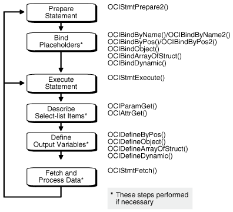

This chapter discusses the concepts and steps involved in processing SQL statements with Oracle Call Interface.

This chapter contains these topics:

- Overview of SQL Statement Processing

- About Preparing Statements

- About Binding Placeholders in OCI

- About Executing Statements

- About Describing Select-List Items

- About Defining Output Variables in OCI

- About Fetching Results

- About Using Scrollable Cursors in OCI

### 6.1 Overview of SQL Statement Processing

One of the most common tasks of an OCI program is to accept and process SQL statements.

Chapter 3 “OCI Programming Basics” discussed the basic steps involved in any OCI application. This chapter presents a more detailed look at the specific tasks involved in processing SQL statements in an OCI program.

This section outlines the specific steps involved in accepting and processing SQL statements.

Once you have allocated the necessary handles and connected to an Oracle database, follow the steps illustrated in Figure 6-1.

Figure 6-1 Steps in Processing SQL Statements

[Description of "Figure 6-1 Steps in Processing SQL Statements"](img_text/lnoci020.md)

1.  Prepare the statement. Define an application request using `OCIStmtPrepare2()`. `OCIStmtPrepare2()` is an enhanced version of `OCIStmtPrepare()` that was introduced to support statement caching. Beginning with Oracle Database 12`c` Release 2 (12.2), `OCIStmtPrepare()` is deprecated.

2.  Bind placeholders, if necessary. For DML statements and queries with input variables, perform one or more of the following bind calls to bind the address of each input variable (or PL/SQL output variable) or array to each placeholder in the statement.

    - `OCIBindByPos2()` or `OCIBindByPos()`

    - `OCIBindByName2()` or `OCIBindByName()`

    - `OCIBindObject()`

    - `OCIBindDynamic()`

    - `OCIBindArrayOfStruct()`

3.  Execute the statement by calling `OCIStmtExecute()`. For DDL statements, no further steps are necessary.

4.  Describe the select-list items, if necessary, using`OCIParamGet()` and `OCIAttrGet()`. This is optional step is not required if the number of select-list items and the attributes of each item (such as its length and data type) are known at compile time.

5.  Define output variables, if necessary. For queries, perform one or more define calls to `OCIDefineByPos2()` or `OCIDefineByPos()`, , `OCIDefineObject()`, `OCIDefineDynamic()`, or `OCIDefineArrayOfStruct()` to define an output variable for each select-list item in the SQL statement. Note that you do not use a define call to define the output variables in an anonymous PL/SQL block. You did this when you bound the data.

6.  Fetch the results of the query, if necessary, by calling `OCIStmtFetch2()`.

After these steps have been completed, the application can free allocated handles and then detach from the server, or it may process additional statements.

**Note:**

OCI programs no longer require an explicit parse step. If a statement must be parsed, that step occurs upon execution, meaning that release 8.0 or later applications must issue an execute command for both DML and DDL statements.

The following sections describe each step in detail.

**Note:**

Some variation in the order of steps is possible. For example, it is possible to do the define step before the execute step if the data types and lengths of returned values are known at compile time.

Additional steps beyond those listed earlier may be required if your application must do any of the following:

- Initiate and manage multiple transactions

- Manage multiple threads of execution

- Perform piecewise inserts, updates, or fetches

**See Also:**

- [Statement Caching in OCI](performance-topics.md)

- [OCI Programming Basics](oci-programming-basics.md)

- [OCIStmtPrepare2()](statement-functions.md) or [OCIStmtPrepare()](deprecated-oci-functions.md)

- [OCIBindByPos2()](bind-define-describe-functions.md) or [OCIBindByPos()](bind-define-describe-functions.md)

- [OCIBindByName2()](bind-define-describe-functions.md) or [OCIBindByName()](bind-define-describe-functions.md)

- [OCIBindObject()](bind-define-describe-functions.md)

- [OCIBindDynamic()](bind-define-describe-functions.md)

- [OCIBindArrayOfStruct()](bind-define-describe-functions.md)

- [OCIStmtExecute()](statement-functions.md)

- [OCIParamGet()](handle-and-descriptor-functions.md)

- [OCIAttrGet()](handle-and-descriptor-functions.md)

- [OCIDefineByPos2()](bind-define-describe-functions.md) or [OCIDefineByPos()](bind-define-describe-functions.md)

- [OCIDefineObject()](bind-define-describe-functions.md)

- [OCIDefineDynamic()](bind-define-describe-functions.md)

- [OCIDefineArrayOfStruct()](bind-define-describe-functions.md)

- [OCIStmtFetch2()](statement-functions.md)

### 6.2 About Preparing Statements

SQL and PL/SQL statements are prepared for execution by using the statement prepare call and any necessary bind calls.

In this phase, the application specifies a SQL or PL/SQL statement and binds associated placeholders in the statement to data for execution. The client-side library allocates storage to maintain the statement prepared for execution.

An application requests a SQL or PL/SQL statement to be prepared for execution using the `OCIStmtPrepare2()` call and passes to this call a previously allocated statement handle. This is a completely local call, requiring no round-trip to the server. No association is made between the statement and a particular server at this point.

Following the request call, an application can call `OCIAttrGet()` on the statement handle, passing `OCI_ATTR_STMT_TYPE` to the `attrtype` parameter, to determine what type of SQL statement was prepared. The possible attribute values and corresponding statement types are listed in Table 6-1.

Table 6-1 OCI_ATTR_STMT_TYPE Values and Statement Types

| Attribute Value    | Statement Type        |
|:-------------------|:----------------------|
| `OCI_STMT_SELECT`  | `SELECT` statement    |
| `OCI_STMT_UPDATE`  | `UPDATE` statement    |
| `OCI_STMT_DELETE`  | `DELETE` statement    |
| `OCI_STMT_INSERT`  | `INSERT` statement    |
| `OCI_STMT_CREATE`  | `CREATE` statement    |
| `OCI_STMT_DROP`    | `DROP` statement      |
| `OCI_STMT_ALTER`   | `ALTER` statement     |
| `OCI_STMT_BEGIN`   | `BEGIN`... (PL/SQL)   |
| `OCI_STMT_DECLARE` | `DECLARE`... (PL/SQL) |
| `OCI_STMT_CALL`    | `CALL`... (PL/SQL)    |
| `OCI_STMT_MERGE`   | `MERGE`... (PL/SQL)   |

This section includes the following topic: About Using Prepared Statements on Multiple Servers

**See Also:**

- [OCIStmtPrepare2()](statement-functions.md)

- [OCIAttrGet()](handle-and-descriptor-functions.md)

- [About Using PL/SQL in an OCI Program](oci-programming-basics.md)

#### 6.2.1 About Using Prepared Statements on Multiple Servers

A prepared application request can be executed on multiple servers at run time by reassociating the statement handle with the respective service context handles for the servers.

All information about the current service context and statement handle association is lost when a new association is made.

For example, consider an application such as a network manager, which manages multiple servers. In many cases, it is likely that the same `SELECT` statement must be executed against multiple servers to retrieve information for display. OCI allows the network manager application to prepare a `SELECT` statement once and execute it against multiple servers. It must fetch all of the required rows from each server before reassociating the prepared statement with the next server.

**Note:**

If a prepared statement must be reexecuted frequently on the same server, it is more efficient to prepare a new statement for another service context.

### 6.3 About Binding Placeholders in OCI

Most DML statements, and some queries (such as those with a `WHERE` clause), require a program to pass data to Oracle Database as part of a SQL or PL/SQL statement.

This data can be constant or literal, known when your program is compiled. For example, the following SQL statement, which adds an employee to a database, contains several literals, such as 'BESTRY' and 2365:

    INSERT INTO emp VALUES
        (2365, 'BESTRY', 'PROGRAMMER', 2000, 20)

Coding a statement like this into an application would severely limit its usefulness. You must change the statement and recompile the program each time you add a new employee to the database. To make the program more flexible, you can write the program so that a user can supply input data at run time.

When you prepare a SQL statement or PL/SQL block that contains input data to be supplied at run time, placeholders in the SQL statement or PL/SQL block mark where data must be supplied. For example, the following SQL statement contains five placeholders, indicated by the leading colons (`:ename`), that show where input data must be supplied by the program.

    INSERT INTO emp VALUES
        (:empno, :ename, :job, :sal, :deptno)

You can use placeholders for input variables in any `DELETE`, `INSERT`, `SELECT`, or `UPDATE` statement, or in a PL/SQL block, in any position in the statement where you can use an expression or a literal value. In PL/SQL, placeholders can also be used for output variables.

Placeholders cannot be used to represent other Oracle objects such as tables. For example, the following is not a valid use of the `emp` placeholder:

    INSERT INTO :emp VALUES
        (12345, 'OERTEL', 'WRITER', 50000, 30)

For each placeholder in a SQL statement or PL/SQL block, you must call an OCI routine that binds the address of a variable in your program to that placeholder. When the statement executes, the database gets the data that your program placed in the input variables or bind variables and passes it to the server with the SQL statement.

Binding is used for both input and output variables in nonquery operations. In Example 6-1, the variables `empno_out`, `ename_out`, `job_out`, `sal_out`, and `deptno_out` should be bound. These are outbinds (as opposed to regular inbinds).

Example 6-1 Binding Both Input and Output Variables in Nonquery Operations

    INSERT INTO emp VALUES
             (:empno, :ename, :job, :sal, :deptno)
          RETURNING
             (empno, ename, job, sal, deptno)
          INTO
             (:empno_out, :ename_out, :job_out, :sal_out, :deptno_out)

This section includes the following topic: Rules for Placeholders

**See Also:**

[Binding and Defining in OCI](binding-and-defining-in-oci.md) for detailed information about implementing bind operations

#### 6.3.1 Rules for Placeholders

Lists and describes the rules for forming placeholders.

The rules for forming placeholders are as follows:

- The first character is a colon (":").

- The colon is followed by a combination of underscore ("\_"), A to Z, a to z, or 0 to 9. However, the first character following the colon cannot be an underscore.

- The letters must be only from the English alphabet, and only the first 30 characters after the colon are significant. The name is case-insensitive.

- The placeholder can consist of only digits after the colon. If it is only digits, the placeholder must be less than 65536. If the name starts with a digit, then only digits are allowed.

- The hyphen ("-") is not allowed.

### 6.4 About Executing Statements

An OCI application executes prepared statements individually using `OCIStmtExecute()`.

When an OCI application executes a query, it receives from the Oracle database data that matches the query specifications. Within the database, the data is stored in Oracle-defined formats. When the results are returned, the OCI application can request that data be converted to a particular host language format, and stored in a particular output variable or buffer.

For each item in the select list of a query, the OCI application must define an output variable to receive the results of the query. The define step indicates the address of the buffer and the type of the data to be retrieved.

**Note:**

If output variables are defined for a `SELECT` statement before a call to `OCIStmtExecute()`, the number of rows specified by the `iters` parameter are fetched directly into the defined output buffers and additional rows equivalent to the prefetch count are prefetched. If there are no additional rows, then the fetch is complete without calling `OCIStmtFetch2()`.

For nonqueries, the number of times the statement is executed during array operations equals `iters - rowoff`, where `rowoff` is the offset in the bound array, and is also a parameter of the `OCIStmtExecute()` call.

For example, if an array of 10 items is bound to a placeholder for an `INSERT` statement, and `iters` is set to 10, all 10 items are inserted in a single execute call when `rowoff` is zero. If `rowoff` is set to 2, only 8 items are inserted.

This section includes the following topics:

- Execution Snapshots

- Execution Modes of OCIStmtExecute()

**See Also:**

- [OCIStmtExecute()](statement-functions.md)

- [OCIStmtFetch2()](statement-functions.md)

- About Defining Output Variables in OCI

#### 6.4.1 Execution Snapshots

The `OCIStmtExecute()` call provides the ability to ensure that multiple service contexts operate on the same consistent snapshot of the database's committed data.

This is achieved by taking the contents of the `snap_out` parameter of one `OCIStmtExecute()` call and passing that value as the `snap_in` parameter of the next `OCIStmtExecute()` call.

**Note:**

Uncommitted data in one service context is not visible to another context, even when both calls are using the same snapshot.

The data type of both the `snap_out` and `snap_in` parameter is `OCISnapshot`. OCISnapshot is an OCI snapshot descriptor that is allocated with the `OCIDescriptorAlloc()` function.

It is not necessary to specify a snapshot when calling `OCIStmtExecute()`. The following sample code shows a basic execution in which the `snapsho`t parameters are passed as `NULL`.

    checkerr(errhp, OCIStmtExecute(svchp, stmthp, errhp, (ub4) 1, (ub4) 0,
              (OCISnapshot *)NULL, (OCISnapshot *) NULL, OCI_DEFAULT));

**Note:**

The `checkerr()` function, which is user-developed, evaluates the return code from an OCI application.

**See Also:**

- [OCIStmtExecute()](statement-functions.md)

- [OCIDescriptorAlloc()](handle-and-descriptor-functions.md)

- [OCI Descriptors](oci-programming-basics.md)

#### 6.4.2 Execution Modes of OCIStmtExecute()

You can specify a number of modes for the `OCIStmtExecute()` call.

This section describes the OCIStmtExecute() call. See `OCIStmtExecute()` for other values of the parameter `mode`.

This section includes the following topics:

- Using Batch Error Mode

- Example of Batch Error Mode

**See Also:**

[OCIStmtExecute()](statement-functions.md)

##### 6.4.2.1 Using Batch Error Mode

OCI provides the ability to perform array DML operations.

For example, an application can process an array of `INSERT`, `UPDATE`, or `DELETE` statements with a single statement execution. If one of the operations fails due to an error from the server, such as a unique constraint violation, the array operation terminates, and OCI returns an error. Any rows remaining in the array are ignored. The application must then reexecute the remainder of the array, and go through the whole process again if it encounters more errors, which causes additional round-trips.

To facilitate processing of array DML operations, OCI provides the batch error mode (also called the enhanced DML array feature). This mode, which is specified in the `OCIStmtExecute()` call, simplifies DML array processing if there are one or more errors. In this mode, OCI attempts to insert, update, or delete all rows, and collects information about any errors that occurred. The application can then retrieve error information and reexecute any DML operations that failed during the first call. In this way, all DML operations in the array are attempted in the first call, and any failed operations can be reissued in a second call.

**Note:**

This feature is only available to applications linked with release 8.1 or later OCI libraries running against a release 8.1 or later server. Applications must also be recoded to account for the new program logic described in this section.

This mode is used as follows:

1.  The user specifies `OCI_BATCH_ERRORS` as the mode parameter of the `OCIStmtExecute()` call.
2.  After performing an array DML operation with `OCIStmtExecute()`, the application can retrieve the number of errors encountered during the operation by calling `OCIAttrGet()` on the statement handle to retrieve the `OCI_ATTR_NUM_DML_ERRORS` attribute, as shown in the following code example.
    Calling OCIAttrGet() to Retrieve the Number of Errors Encountered During an Array DML Operation

        ub4   num_errs;
        OCIAttrGet(stmtp, OCI_HTYPE_STMT, &num_errs, 0, OCI_ATTR_NUM_DML_ERRORS,
                   errhp);
3.  The application extracts each error using `OCIParamGet()`, along with its row information, from the error handle that was passed to the `OCIStmtExecute()` call. To retrieve the information, the application must allocate an additional new error handle for the `OCIParamGet()` call, populating the new error handle with batched error information. The application obtains the syntax of each error with `OCIErrorGet()`, and the row offset into the DML array at which the error occurred, by calling `OCIAttrGet()` on the new error handle.
    For example, after the `num_errs` amount has been retrieved, the application can issue the following calls shown in the following code example.

    Retrieving Information About Each Error Following an Array DML Operation

        OCIError errhndl, errhp2;
        for (i=0; i<num_errs; i++)
        {
           OCIParamGet(errhp, OCI_HTYPE_ERROR, errhp2, (void **)&errhndl, i);
           OCIAttrGet(errhndl, OCI_HTYPE_ERROR, &row_offset, 0,
               OCI_ATTR_DML_ROW_OFFSET, errhp2);
           OCIErrorGet(..., errhndl, ...);

    Following this operation, the application can correct the bind information for the appropriate entry in the array using the diagnostic information retrieved from the batched error. Once the appropriate bind buffers are corrected or updated, the application can reexecute the associated DML statements.

    Because it cannot be determined at compile time which rows in the first execution may cause errors, the binds for the subsequent DML should be done dynamically by passing in the appropriate buffers at run time. The bind buffers used in the array binds done on the first DML operation can be reused.

    **See Also:**

    - [OCIStmtExecute()](statement-functions.md)

    - [OCIAttrGet()](handle-and-descriptor-functions.md)

    - [OCIParamGet()](handle-and-descriptor-functions.md)

    - [OCIErrorGet()](miscellaneous-functions.md)

##### 6.4.2.2 Example of Batch Error Mode

Shows how the batch error execution mode might be used.

Example 6-2 shows an example of how the batch error execution mode might be used. In this example, assume that you have an application that inserts five rows (with two columns, of types `NUMBER` and `CHAR`) into a table. Furthermore, assume that only two rows (1 and 3) are successfully inserted in the initial DML operation. The user then proceeds to correct the data (wrong data was being inserted the first time) and to issue an update with the corrected data. The user uses statement handles `stmtp1` and `stmtp2` to issue the `INSERT` and `UPDATE` statements, respectively.

In Example 6-2, `OCIBindDynamic()` is used with a callback because the user does not know at compile time what rows may return with errors. With a callback, you can simply pass the erroneous row numbers, stored in `row_off`, through the callback context and send only those rows that must be updated or corrected. The same bind buffers can be shared between the `INSERT` and the `UPDATE` statement executions.

Example 6-2 Using Batch Error Execution Mode

    OCIBind *bindp1[2], *bindp2[2];
    ub4 num_errs, row_off[MAXROWS], number[MAXROWS] = {1,2,3,4,5};
    char grade[MAXROWS] = {'A','B','C','D','E'};
    OCIError *errhp2;
    OCIError *errhndl[MAXROWS];
    ...
    /* Array bind all the positions */
    OCIBindByPos (stmtp1,&bindp1[0],errhp,1,(void *)&number[0],
         sizeof(number[0]),SQLT_INT,(void *)0, (ub2 *)0,(ub2 *)0,
                0,(ub4 *)0,OCI_DEFAULT);
    OCIBindByPos (stmtp1,&bindp1[1],errhp,2,(void *)&grade[0],
         sizeof(grade[0]),SQLT_CHR,(void *)0, (ub2 *)0,(ub2 *)0,0,
                (ub4 *)0,OCI_DEFAULT);
    /* execute the array INSERT */
    OCIStmtExecute (svchp,stmtp1,errhp,5,0,0,0,OCI_BATCH_ERRORS);
    /* get the number of errors. A different error handler errhp2 is used so that
     * the state of errhp is not changed */
    OCIAttrGet (stmtp1, OCI_HTYPE_STMT, &num_errs, 0,
                OCI_ATTR_NUM_DML_ERRORS, errhp2);
    if (num_errs) {
       /* The user can do one of two things: 1) Allocate as many  */
       /* error handles as number of errors and free all handles  */
       /* at a later time; or 2) Allocate one err handle and reuse */
       /* the same handle for all the errors */
       for (i = 0; i < num_errs; i++) {
          OCIHandleAlloc( (void *)envhp, (void **)&errhndl[i],
          (ub4) OCI_HTYPE_ERROR, 0, (void *) 0);
          OCIParamGet(errhp, OCI_HTYPE_ERROR, errhp2, &errhndl[i], i);
          OCIAttrGet (errhndl[i], OCI_HTYPE_ERROR, &row_off[i], 0,
                      OCI_ATTR_DML_ROW_OFFSET, errhp2);
          /* get server diagnostics */
          OCIErrorGet (..., errhndl[i], ...);
          }
       }
    /* make corrections to bind data */
    OCIBindByPos (stmtp2,&bindp2[0],errhp,1,(void *)0,sizeof(grade[0]),SQLT_INT,
         (void *)0, (ub2 *)0,(ub2 *)0,0,(ub4 *)0,OCI_DATA_AT_EXEC);
    OCIBindByPos (stmtp2,&bindp2[1],errhp,2,(void *)0,sizeof(number[0]),SQLT_DAT,
         (void *)0, (ub2 *)0,(ub2 *)0,0,(ub4 *)0,OCI_DATA_AT_EXEC);
    /* register the callback for each bind handle, row_off and position
     * information can be passed to the callback function by means of context
     * pointers.
     */
    OCIBindDynamic (bindp2[0],errhp,ctxp1,my_callback,0,0);
    OCIBindDynamic (bindp2[1],errhp,ctxp2,my_callback,0,0);
    /* execute the UPDATE statement */
    OCIStmtExecute (svchp,stmtp2,errhp,num_errs,0,0,0,OCI_BATCH_ERRORS);
    ...

**See Also:**

[OCIBindDynamic()](bind-define-describe-functions.md)

### 6.5 About Describing Select-List Items

If your OCI application is processing a query, you may need to obtain more information about the items in the select list.

This is particularly true for dynamic queries whose contents are not known until run time. In this case, the program may need to obtain information about the data types and column lengths of the select-list items. This information is necessary to define output variables that may receive query results.

For example, consider a query where the program has no prior information about the columns in the `employees` table:

    SELECT * FROM employees

There are two types of describes available: implicit and explicit.

An implicit describe does not require any special calls to retrieve describe information from the server, although special calls are necessary to access the information. An implicit describe allows an application to obtain select-list information as an attribute of the statement handle after a statement has been executed without making a specific describe call. It is called implicit because no describe call is required. The describe information comes free with the statement execution.

An explicit describe requires the application to call a particular function to bring the describe information from the server. An application may describe a select list (query) either implicitly or explicitly. Other schema elements must be described explicitly.

You can describe a query explicitly before execution by specifying `OCI_DESCRIBE_ONLY` as the mode of `OCIStmtExecute()`, which does not execute the statement, but returns the select-list description. For performance reasons, Oracle recommends that applications use the implicit describe, which comes free with a standard statement execution.

An explicit describe with the `OCIDescribeAny()` call obtains information about schema objects rather than select lists.

In all cases, the specific information about columns and data types is retrieved by reading handle attributes.

This section includes the following topics:

- Implicit Describe

- Explicit Describe of Queries

**See Also:**

- [Describing Schema Metadata](describing-schema-metadata.md) for information about using [OCIDescribeAny()](bind-define-describe-functions.md) to obtain metadata pertaining to schema objects

- [OCIStmtExecute()](statement-functions.md)

- [OCIDescribeAny()](bind-define-describe-functions.md)

#### 6.5.1 Implicit Describe

After a SQL statement is executed, information about the select list is available as an attribute of the statement handle. No explicit describe call is needed.

To retrieve information about multiple select-list items, an application can call `OCIParamGet()` with the pos parameter set to 1 the first time, and then iterate the value of pos and repeat the `OCIParamGet()` call until `OCI_ERROR` with `ORA-24334` is returned. An application could also specify any position n to get a column at random.

Once a parameter descriptor has been allocated for a position in the select list, the application can retrieve specific information by calling `OCIAttrGet()` on the parameter descriptor. Information available from the parameter descriptor includes the data type and maximum size of the parameter.

The sample code in Example 6-3Example 6-3 shows a loop that retrieves the column names and data types corresponding to a query following query execution. The query was associated with the statement handle by a prior call to `OCIStmtPrepare2()`.

The `checkerr()` function in Example 6-3 is used for error handling. The complete listing can be found in the first sample application in [OCI Demonstration Programs](oci-demo-programs.md).

The calls to `OCIAttrGet()` and `OCIParamGet()` are local calls that do not require a network round-trip, because all of the select-list information is cached on the client side after the statement is executed.

Example 6-3 Implicit Describe - Select List Is Available as an Attribute of the Statement Handle

    ...
    OCIParam     *mypard = (OCIParam *) 0;
    ub2          dtype;
    text         *col_name;
    ub4          counter, col_name_len, char_semantics;
    ub2          col_width;
    sb4          parm_status;

    text *sqlstmt = (text *)"SELECT * FROM employees WHERE employee_id = 100";

    checkerr(errhp, OCIStmtPrepare2(svchp, &stmthp, errhp, (OraText *)sqlstmt,
                        (ub4)strlen((char *)sqlstmt), NULL, 0,
                        (ub4) OCI_NTV_SYNTAX, (ub4) OCI_DEFAULT));

    checkerr(errhp, OCIStmtExecute(svchp, stmthp, errhp, 0, 0, (OCISnapshot *)0, (OCISnapshot *)0, OCI_DEFAULT));

    /* Request a parameter descriptor for position 1 in the select list */
    counter = 1;
    parm_status = OCIParamGet((void *)stmthp, OCI_HTYPE_STMT, errhp,
                   (void **)&mypard, (ub4) counter);

    /* Loop only if a descriptor was successfully retrieved for
       current position, starting at 1 */

    while (parm_status == OCI_SUCCESS) {
       /* Retrieve the data type attribute */
       checkerr(errhp, OCIAttrGet((void*) mypard, (ub4) OCI_DTYPE_PARAM,
               (void*) &dtype,(ub4 *) 0, (ub4) OCI_ATTR_DATA_TYPE,
               (OCIError *) errhp  ));

       /* Retrieve the column name attribute */
       col_name_len = 0;
       checkerr(errhp, OCIAttrGet((void*) mypard, (ub4) OCI_DTYPE_PARAM,
               (void**) &col_name, (ub4 *) &col_name_len, (ub4) OCI_ATTR_NAME,
               (OCIError *) errhp ));

       /* Retrieve the length semantics for the column */
       char_semantics = 0;
       checkerr(errhp, OCIAttrGet((void*) mypard, (ub4) OCI_DTYPE_PARAM,
               (void*) &char_semantics,(ub4 *) 0, (ub4) OCI_ATTR_CHAR_USED,
               (OCIError *) errhp  ));
       col_width = 0;
       if (char_semantics)
           /* Retrieve the column width in characters */
           checkerr(errhp, OCIAttrGet((void*) mypard, (ub4) OCI_DTYPE_PARAM,
                   (void*) &col_width, (ub4 *) 0, (ub4) OCI_ATTR_CHAR_SIZE,
                   (OCIError *) errhp  ));
       else
           /* Retrieve the column width in bytes */
           checkerr(errhp, OCIAttrGet((void*) mypard, (ub4) OCI_DTYPE_PARAM,
                   (void*) &col_width,(ub4 *) 0, (ub4) OCI_ATTR_DATA_SIZE,
                   (OCIError *) errhp  ));

       /* increment counter and get next descriptor, if there is one */
       counter++;
       parm_status = OCIParamGet((void *)stmthp, OCI_HTYPE_STMT, errhp,
              (void **)&mypard, (ub4) counter);
    } /* while */
    ...

**See Also:**

- [OCIParamGet()](handle-and-descriptor-functions.md)

- [OCIAttrGet()](handle-and-descriptor-functions.md)

- [OCIStmtPrepare2()](statement-functions.md)

- [OCIArrayDescriptorAlloc()](handle-and-descriptor-functions.md)

- [Parameter Attributes](describing-schema-metadata.md) for a list of the specific attributes of the parameter descriptor that may be read by [OCIArrayDescriptorAlloc()](handle-and-descriptor-functions.md)

#### 6.5.2 Explicit Describe of Queries

You can describe a query explicitly before execution by specifying `OCI_DESCRIBE_ONLY` as the mode of `OCIStmtExecute()`

This does not execute the statement, but returns the select-list description.

**Note:**

To maximize performance, Oracle recommends that applications execute the statement in default mode and use the implicit describe that accompanies the execution.

The code in Example 6-4 demonstrates the use of explicit describe in a select list to return information about columns.

Example 6-4 Explicit Describe - Returning the Select-List Description for Each Column

    ...
    int i = 0;
    ub4 numcols = 0;
    ub2 type = 0;
    OCIParam *colhd = (OCIParam *) 0;   /* column handle */

    text *sqlstmt = (text *)"SELECT * FROM employees WHERE employee_id = 100";

    checkerr(errhp, OCIStmtPrepare2(svchp, &stmthp, errhp, (OraText *)sqlstmt,
                        (ub4)strlen((char *)sqlstmt), NULL, 0,
                        (ub4) OCI_NTV_SYNTAX, (ub4) OCI_DEFAULT));

    /* initialize svchp, stmthp, errhp, rowoff, iters, snap_in, snap_out */
    /* set the execution mode to OCI_DESCRIBE_ONLY. Note that setting the mode to
    OCI_DEFAULT does an implicit describe of the statement in addition to executing
    the statement */

    checkerr(errhp, OCIStmtExecute(svchp, stmthp, errhp, 0, 0,
            (OCISnapshot *) 0, (OCISnapshot *) 0, OCI_DESCRIBE_ONLY));

    /* Get the number of columns in the query */
    checkerr(errhp, OCIAttrGet((void *)stmthp, OCI_HTYPE_STMT, (void *)&numcols,
                          (ub4 *)0, OCI_ATTR_PARAM_COUNT, errhp));

    /* go through the column list and retrieve the data type of each column.
    Start from pos = 1 */
    for (i = 1; i <= numcols; i++)
    {
      /* get parameter for column i */
      checkerr(errhp, OCIParamGet((void *)stmthp, OCI_HTYPE_STMT, errhp, (void **)&colhd, i));

      /* get data-type of column i */
      type = 0;
      checkerr(errhp, OCIAttrGet((void *)colhd, OCI_DTYPE_PARAM,
              (void *)&type, (ub4 *)0, OCI_ATTR_DATA_TYPE, errhp));
    }
    ...

**See Also:**

[OCIStmtExecute()](statement-functions.md)

### 6.6 About Defining Output Variables in OCI

Query statements return data from the database to your application.

When processing a query, you must define an output variable or an array of output variables for each item in the select list from which to retrieve data. The define step creates an association that determines where returned results are stored, and in what format.

For example, to process the following statement you would normally define two output variables: one to receive the value returned from the `name` column, and one to receive the value returned from the `ssn` column:

    SELECT name, ssn FROM employees
        WHERE empno = :empnum

**See Also:**

[Binding and Defining in OCI](binding-and-defining-in-oci.md)

### 6.7 About Fetching Results

If an OCI application has processed a query, it is typically necessary to fetch the results with `OCIStmtFetch2()` after the statement has completed execution.

The `OCIStmtFetch2()` function supports scrollable cursors.

Fetched data is retrieved into output variables that have been specified by define operations.

**Note:**

If output variables are defined for a `SELECT` statement before a call to `OCIStmtExecute()`, the number of rows specified by the `iters` parameter is fetched directly into the defined output buffers

This section includes the following topics:

- About Fetching LOB Data

- About Setting Prefetch Count

**See Also:**

- About Using Scrollable Cursors in OCI

- [OCIStmtFetch2()](statement-functions.md)

- [OCIStmtExecute()](statement-functions.md)

- These statements mentioned previously fetch data associated with the sample code in [Steps Used in OCI Defining](binding-and-defining-in-oci.md). See that example for more information.

- [Overview of Defining in OCI](binding-and-defining-in-oci.md) for information about defining output variables

#### 6.7.1 About Fetching LOB Data

If LOB columns or attributes are part of a select list, they can be returned as LOB locators or actual LOB values, depending on how you define them.

If LOB locators are fetched, then the application can perform further operations on these locators through the `OCILobXXX` functions.

**See Also:**

- [LOB and BFILE Operations](lobs-and-bfile-operations.md) for more information about working with LOB locators in OCI

- [About Defining LOB Output Variables](binding-and-defining-in-oci.md) for usage and examples of selecting LOB data without the use of locators

#### 6.7.2 About Setting Prefetch Count

To minimize server round-trips and optimize performance, OCI can prefetch result set rows when executing a query.

You can customize this prefetching by setting either the `OCI_ATTR_PREFETCH_ROWS` or `OCI_ATTR_PREFETCH_MEMORY` attribute of the statement handle using the `OCIAttrSet()` function. These attributes are used as follows:

- `OCI_ATTR_PREFETCH_ROWS` sets the number of rows to be prefetched. If it is not set, then the default value is 1. If the `iters` parameter of `OCIStmtExecute()` is 0 and prefetching is enabled, the rows are buffered during calls to `OCIStmtFetch2()`. The prefetch value can be altered after execution and between fetches.

- `OCI_ATTR_PREFETCH_MEMORY` sets the memory allocated for rows to be prefetched. The application then fetches as many rows as can fit into that much memory.

When both of these attributes are set, OCI prefetches rows up to the `OCI_ATTR_PREFETCH_ROWS` limit unless the `OCI_ATTR_PREFETCH_MEMORY` limit is reached, in which case OCI returns as many rows as can fit in a buffer of size `OCI_ATTR_PREFETCH_MEMORY`.

By default, prefetching is turned on, and OCI fetches one extra row, except when prefetching cannot be supported for a query (see the note that follows). To turn prefetching off, set both the `OCI_ATTR_PREFETCH_ROWS` and `OCI_ATTR_PREFETCH_MEMORY` attributes to zero.

If both `OCI_ATTR_PREFETCH_ROWS` and `OCI_ATTR_PREFETCH_MEMORY` attributes are explicitly set, OCI uses the tighter of the two constraints to determine the number of rows to prefetch.

To prefetch exclusively based on the memory constraint, set the `OCI_ATTR_PREFETCH_MEMORY` attribute and be sure to disable the `OCI_ATTR_PREFETCH_ROWS` attribute by setting it to zero (to override the default setting of 1 row).

To prefetch exclusively based on the number of rows constraint, set the `OCI_ATTR_PREFETCH_ROWS` attribute and disable the `OCI_ATTR_PREFETCH_MEMORY` attribute by setting it to zero (if it was ever explicitly set to a non-zero value).

Prefetching is possible for `REF CURSOR`s and nested cursor columns. By default, prefetching is not turned on for `REF CURSOR`s. To turn on prefetching for `REF CURSOR`s, set the `OCI_ATTR_PREFETCH_ROWS` or `OCI_ATTR_PREFETCH_MEMORY` attribute before fetching rows from the `REF CURSOR`. When a `REF CURSOR` is passed multiple times between an OCI application and PL/SQL and fetches on the `REF CURSOR` are done in OCI and in PL/SQL, the rows prefetched by OCI (if enabled) cause the application to behave as if out-of-order rows are being fetched in PL/SQL. In such situations, OCI prefetch should not be enabled on `REF CURSOR`s.

**Note:**

Prefetching is not in effect if `LONG`, LOB or Opaque Type columns (such as `XMLType`) are part of the query.

**See Also:**

- [Statement Handle Attributes](handle-and-descriptor-attributes.md)

- [OCIAttrSet()](handle-and-descriptor-functions.md)

- [OCIStmtExecute()](statement-functions.md)

- [OCIStmtFetch2()](statement-functions.md)

### 6.8 About Using Scrollable Cursors in OCI

A cursor is a current position in a result set.

Execution of a cursor puts the results of the query into a set of rows called the result set that can be fetched either sequentially or nonsequentially. In the latter case, the cursor is known as a scrollable cursor.

A scrollable cursor supports forward and backward access into the result set from a given position, by using either absolute or relative row number offsets into the result set.

Rows are numbered starting at one. For a scrollable cursor, you can fetch previously fetched rows, the nth row in the result set, or the nth row from the current position. Client-side caching of either the partial or entire result set improves performance by limiting calls to the server.

Oracle Database does not support DML operations on scrollable cursors. A cursor cannot be made scrollable if the `LONG` data type is part of the select list.

Moreover, fetches from a scrollable statement handle are based on the snapshot at execution time. OCI client prefetching works with OCI scrollable cursors. The size of the client prefetch cache can be controlled by the existing OCI attributes `OCI_ATTR_PREFETCH_ROWS` and `OCI_ATTR_PREFETCH_MEMORY`.

**Note:**

Do not use scrollable cursors unless you require their functionality, because they use more server resources and can have greater response times than nonscrollable cursors.

The `OCIStmtExecute()` call has an execution mode for scrollable cursors, `OCI_STMT_SCROLLABLE_READONLY`. The default for statement handles is nonscrollable, forward sequential access only, where the mode is `OCI_FETCH_NEXT`. You must set this execution mode each time the statement handle is executed.

The statement handle attribute `OCI_ATTR_CURRENT_POSITION` can be retrieved only by using `OCIAttrGet()`. This attribute cannot be set by the application; it indicates the current position in the result set.

For nonscrollable cursors, `OCI_ATTR_ROW_COUNT` is the total number of rows fetched into the user buffers with the `OCIStmtFetch2()` calls since this statement handle was executed. Because nonscrollable cursors are forward sequential only, `OCI_ATTR_ROW_COUNT` also represents the highest row number detected by the application.

Beginning with Oracle Database Release 12.1, using the attribute `OCI_ATTR_UB8_ROW_COUNT` is preferred to using the attribute `OCI_ATTR_ROW_COUNT` if row count values can exceed the value of `UB4MAXVAL` for an OCI application.

For scrollable cursors, `OCI_ATTR_ROW_COUNT` represents the maximum (absolute) row number fetched into the user buffers. Because the application can arbitrarily position the fetches, this does not have to be the total number of rows fetched into the user's buffers since the (scrollable) statement was executed.

The attribute `OCI_ATTR_ROWS_FETCHED` on the statement handle represents the number of rows that were successfully fetched into the user's buffers in the last fetch call or execute. It works for both scrollable and nonscrollable cursors.

Use the `OCIStmtFetch2()` call, instead of the `OCIStmtFetch()` call, which is retained for backward compatibility. You are encouraged to use `OCIStmtFetch2()` for all new applications, even those not using scrollable cursors. This call also works for nonscrollable cursors, but can raise an error if any other orientation besides `OCI_DEFAULT` or `OCI_FETCH_NEXT` is passed.

Scrollable cursors are supported for remote mapped queries. Transparent application failover (TAF) is supported for scrollable cursors.

**Note:**

If you call `OCIStmtFetch2()` with the `nrows` parameter set to 0, the cursor is canceled.

This section includes the following topics:

- About Increasing Scrollable Cursor Performance

- Example of Access on a Scrollable Cursor

**See Also:**

- [OCIStmtExecute()](statement-functions.md)

- [OCIAttrGet()](handle-and-descriptor-functions.md)

- [OCIStmtFetch2()](statement-functions.md)

- About Setting Prefetch Count

#### 6.8.1 About Increasing Scrollable Cursor Performance

Response time is improved if you use OCI client-side prefetch buffers.

After calling `OCIStmtExecute()` for a scrollable cursor, call `OCIStmtFetch2()` using `OCI_FETCH_LAST` to obtain the size of the result set. Then set `OCI_ATTR_PREFETCH_ROWS` to about 20% of that size, and set `OCI_PREFETCH_MEMORY` if the result set uses a large amount of memory.

**See Also:**

- [OCIStmtExecute()](statement-functions.md)

- [OCIStmtFetch2()](statement-functions.md)

#### 6.8.2 Example of Access on a Scrollable Cursor

Shows the use of a scrollable cursor.

Assume that a result set is returned by the following SQL query, and that the table `EMP` has 14 rows:

    SELECT empno, ename FROM emp

One use of scrollable cursors is shown in Example 6-5.

Example 6-5 Access on a Scrollable Cursor

    ...
    /* execute the scrollable cursor in the scrollable mode */
    OCIStmtExecute(svchp, stmthp, errhp, (ub4)0, (ub4)0, (CONST OCISnapshot *)NULL,
                   (OCISnapshot *) NULL, OCI_STMT_SCROLLABLE_READONLY );

    /* Fetches rows with absolute row numbers 6, 7, 8. After this call,
     OCI_ATTR_CURRENT_POSITION = 8, OCI_ATTR_ROW_COUNT = 8 */
    checkprint(errhp, OCIStmtFetch2(stmthp, errhp, (ub4) 3,
                                   OCI_FETCH_ABSOLUTE, (sb4) 6, OCI_DEFAULT);

    /* Fetches rows with absolute row numbers 6, 7, 8. After this call,
     OCI_ATTR_CURRENT_POSITION = 8, OCI_ATTR_ROW_COUNT = 8 */
    checkprint(errhp, OCIStmtFetch2(stmthp, errhp, (ub4) 3,
                                   OCI_FETCH_RELATIVE, (sb4) -2, OCI_DEFAULT);

    /* Fetches rows with absolute row numbers 14. After this call,
     OCI_ATTR_CURRENT_POSITION = 14, OCI_ATTR_ROW_COUNT = 14 */
    checkprint(errhp, OCIStmtFetch2(stmthp, errhp, (ub4) 1,
                                   OCI_FETCH_LAST, (sb4) 0, OCI_DEFAULT);

    /* Fetches rows with absolute row number 1. After this call,
     OCI_ATTR_CURRENT_POSITION = 1, OCI_ATTR_ROW_COUNT = 14 */
    checkprint(errhp, OCIStmtFetch2(stmthp, errhp, (ub4) 1,
                                   OCI_FETCH_FIRST, (sb4) 0, OCI_DEFAULT);

    /* Fetches rows with absolute row numbers 2, 3, 4. After this call,
     OCI_ATTR_CURRENT_POSITION = 4, OCI_ATTR_ROW_COUNT = 14 */
    checkprint(errhp, OCIStmtFetch2(stmthp, errhp, (ub4) 3,
                                   OCI_FETCH_NEXT, (sb4) 0, OCI_DEFAULT);

    /* Fetches rows with absolute row numbers 3,4,5,6,7. After this call,
     OCI_ATTR_CURRENT_POSITION = 7, OCI_ATTR_ROW_COUNT = 14. It is assumed
    the user's define memory is allocated. */
    checkprint(errhp, OCIStmtFetch2(stmthp, errhp, (ub4) 5,
                                   OCI_FETCH_PRIOR, (sb4) 0, OCI_DEFAULT);
    ...
    }
    checkprint (errhp, status)
    {
     ub4 rows_fetched;
    /* This checks for any OCI errors before printing the results of the fetch call
       in the define buffers */
     checkerr (errhp, status);
     checkerr(errhp, OCIAttrGet((CONST void *) stmthp, OCI_HTYPE_STMT,
             (void *) &rows_fetched, (uint *) 0, OCI_ATTR_ROWS_FETCHED, errhp));
    }
    ...
