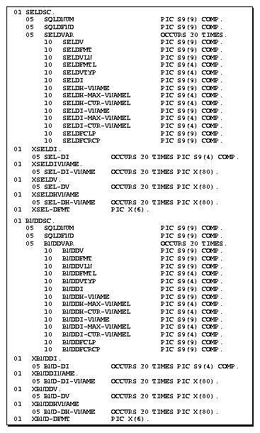
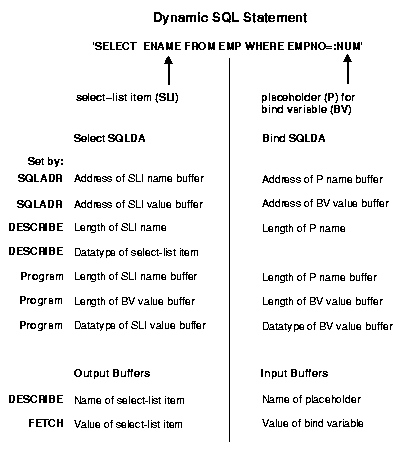
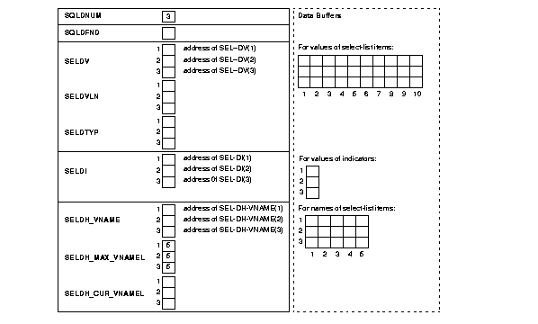
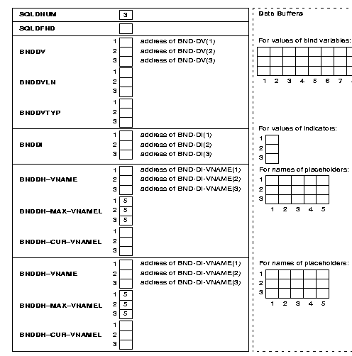
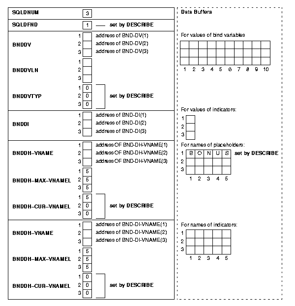
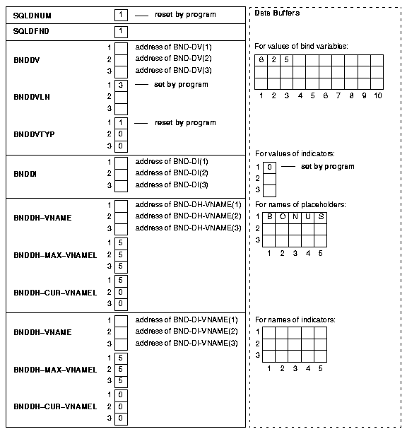
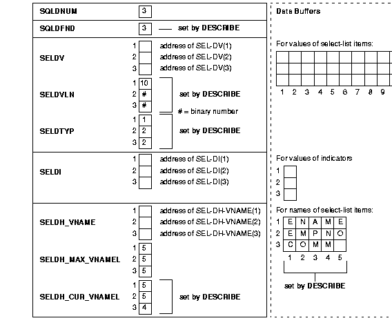
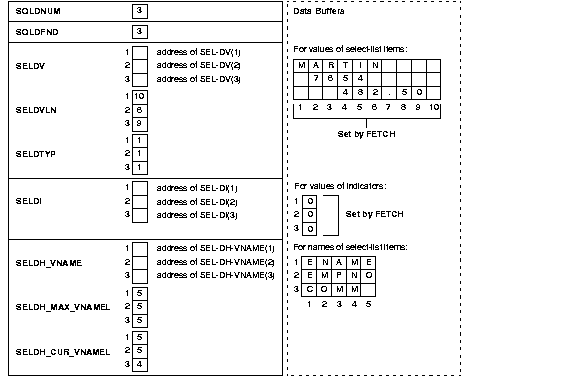

This chapter shows you how to implement Oracle dynamic SQL Method 4, which lets your program accept or build dynamic SQL statements that contain a varying number of host variables.

New applications should be developed using the newer ANSI SQL Method 4 described in “ANSI Dynamic SQL”. The ANSI Method 4 supports all Oracle types, while the older Oracle Method 4 does not support cursor variables, tables of group items, the DML returning clause, and LOBs.

Subjects discussed include the following:

- Meeting the Special Requirements of Method 4

- Understanding the SQL Descriptor Area (SQLDA)

- The SQLDA Variables

- Prerequisite Knowledge

- The Basic Steps

- A Closer Look at Each Step

- Using Host Tables with Method 4

- Sample Program 10: Dynamic SQL Method 4

**Note:**

For a discussion of dynamic SQL Methods 1, 2, and 3, and an overview of Oracle Method 4, see “Oracle Dynamic SQL”.

**Related Topics**

- [ANSI Dynamic SQL](ANSI-dynamic-SQL.md)
- [Oracle Dynamic SQL](Oracle-dynamic-SQL.md)

### 11.1 Meeting the Special Requirements of Method 4

Before looking into the requirements of Method 4, you should be familiar with the terms select-list item and place-holder. Select-list items are the columns or expressions following the keyword SELECT in a query. For example, the following dynamic query contains three select-list items:

    SELECT ENAME, JOB, SAL + COMM FROM EMP WHERE DEPTNO = 20

Place-holders are dummy bind (input) variables that hold places in a SQL statement for actual bind variables. You do not declare place-holders and can name them anything you like. Place-holders for bind variables are most often used in the SET, VALUES, and WHERE clauses. For example, the following dynamic SQL statements each contain two place-holders.

    INSERT INTO EMP (EMPNO, DEPTNO) VALUES (:E, :D)
    DELETE FROM DEPT WHERE DEPTNO = :DNUM AND LOC = :DLOC

Place-holders cannot reference table or column names.

#### 11.1.1 Advantages of Method 4

Unlike Methods 1, 2, and 3, dynamic SQL Method 4 lets your program:

- Accept or build dynamic SQL statements that contain an unknown number of select-list items or place-holders

- Take explicit control over datatype conversion between Oracle and COBOL types

To add this flexibility to your program, you must give the runtime library additional information.

#### 11.1.2 Information the Database Needs

Pro\*COBOL generates calls to Oracle for all executable dynamic SQL statements. If a dynamic SQL statement contains no select-list items or place-holders, the database needs no additional information to execute the statement. The following DELETE statement falls into this category:

    *    Dynamic SQL statement...
         MOVE 'DELETE FROM EMP WHERE DEPTNO = 30' TO STMT.

However, most dynamic SQL statements contain select-list items or place-holders for bind variables, as shown in the following UPDATE statement:

    *    Dynamic SQL statement with place-holders...
         MOVE 'UPDATE EMP SET COMM = :C WHERE EMPNO = :E' TO STMT.

To execute a dynamic SQL statement that contains select-list items or place-holders for bind variables, or both, the database needs information about the program variables that will hold output or input values. Specifically, the database needs the following information:

- The number of select-list items and the number of bind variables

- The length of each select-list item and bind variable

- The datatype of each select-list item and bind variable

- The memory address of each output variable that will store the value of a select-list item, and the address of each bind variable

For example, to write the value of a select-list item, the database needs the address of the corresponding output variable.

#### 11.1.3 Where the Information is Stored

All the information the database needs about select-list items or place-holders for bind variables, except their values, is stored in a program data structure called the SQL Descriptor Area (SQLDA).

Descriptions of select-list items are stored in a select SQLDA, and descriptions of place-holders for bind variables are stored in a bind SQLDA.

The values of select-list items are stored in output buffers; the values of bind variables are stored in input buffers. You use the library routine SQLADR to store the addresses of these data buffers in a select or bind SQLDA, so that the database knows where to write output values and read input values.

How do values get stored in these data variables? A FETCH generates output values using a cursor, and input values are filled in by your program, typically from information entered interactively by the user.

#### 11.1.4 How Information is Obtained

You use the DESCRIBE statement to help get the information the database needs. The DESCRIBE SELECT LIST statement examines each select-list item to determine its name, datatype, constraints, length, scale, and precision, then stores this information in the select SQLDA for your use. For example, you might use select-list names as column headings in a printout. DESCRIBE also stores the total number of select-list items in the SQLDA.

The DESCRIBE BIND VARIABLES statement examines each place-holder to determine its name and length, then stores this information in an input buffer and bind SQLDA for your use. For example, you might use place-holder names to prompt the user for the values of bind variables.

### 11.2 Understanding the SQL Descriptor Area (SQLDA)

This section describes the SQLDA data structure in detail. You learn how to declare it, what variables it contains, how to initialize them, and how to use them in your program.

#### 11.2.1 Purpose of the SQLDA

Method 4 is required for dynamic SQL statements that contain an unknown number of select-list items or place-holders for bind variables. To process this kind of dynamic SQL statement, your program must explicitly declare SQLDAs, also called descriptors. Each descriptor corresponds to a group item in your program.

A select descriptor stores descriptions of select-list items and the addresses of output buffers that hold the names and values of select-list items.

**Note:**

The name of a select-list item can be a column name, a column alias, or the text of an expression such as SAL + COMM.

A bind descriptor stores descriptions of bind variables and indicator variables and the addresses of input buffers where the names and values of bind variables and indicator variables are stored.

Remember, some descriptor variables contain addresses, not values. Therefore, you must declare data buffers to hold the values. You decide the sizes of the required input and output buffers. Because COBOL does not support pointers, you must use the library subroutine SQLADR to get the addresses of input and output buffers. You learn how to call SQLADR in the section “Using SQLADR”.

**Related Topics**

- Using SQLADR

#### 11.2.2 Multiple SQLDAs

If your program has more than one active dynamic SQL statement, each statement must have its own SQLDA. You can declare any number of SQLDAs with different names. For example, you might declare three select SQLDAs named SELDSC1, SELDSC2, and SELDSC3, so that you can FETCH from three concurrently open cursors. However, non-concurrent cursors can reuse SQLDAs.

#### 11.2.3 Declaring a SQLDA

To declare select and bind SQLDAs, you can code them into your program using the sample select and bind SQLDAs shown in Figure 11-1. You can modify the table dimensions to suit your needs.

**Note:**

For byte-swapped platforms, use COMP5 instead of COMP when declaring a SQLDA.

Figure 11-1 Sample Pro\*COBOL SQLDA Descriptors and Data Buffers (32 bit)

[Description of "Figure 11-1 Sample Pro\*COBOL SQLDA Descriptors and Data Buffers (32 bit)"](img_text/pco81005.md)

**Note:**

For 64-bit platforms, use PIC S9(18) declarations instead of PIC S9(9) when declaring a SQLDA.

You can store the SQLDAs in files (named SELDSC and BNDDSC, for example), and then copy the files into your program with the INCLUDE statement as follows:

         EXEC SQL INCLUDE SELDSC END-EXEC.
         EXEC SQL INCLUDE BNDDSC END-EXEC.

Figure 11-2 shows whether variables are set by SQLADR calls, DESCRIBE commands, FETCH commands, or program assignments.

Figure 11-2 How Variables Are Set

[Description of "Figure 11-2 How Variables Are Set"](img_text/pco81006.md)

### 11.3 The SQLDA Variables

This section explains the purpose and use of each variable in the SQLDA.

#### SQLDNUM

This variable specifies the maximum number of select-list items or place-holders that can be included in DESCRIBE. Thus, SQLDNUM determines the number of elements in the descriptor tables.

Before issuing a DESCRIBE command, you must set this variable to the dimension of the descriptor tables. After the DESCRIBE, you must reset it to the actual number of variables in the DESCRIBE, which is stored in SQLDFND.

#### SQLDFND

The SQLDFND variable is the actual number of select-list items or place-holders found by the DESCRIBE command.

SQLDFND is set by DESCRIBE. If SQLDFND is negative, the DESCRIBE command found too many select-list items or place-holders for the size of the descriptor. For example, if you set SQLDNUM to 10 but DESCRIBE finds 11 select-list items or place-holders, SQLDFND is set to -11. If this happens, you cannot process the SQL statement without reallocating the descriptor.

After the DESCRIBE, you must set SQLDNUM equal to SQLDFND.

#### SELDV \| BNDDV

The SELDV \| BNDDV table contains the addresses of data buffers that store select-list or bind-variable values.

You must set the elements of SELDV or BNDDV using SQLADR.

#### Select Descriptors

The following statement

         EXEC SQL FETCH ... USING DESCRIPTOR ...

directs the database to store FETCHed select-list values in the data buffers addressed by SELDV(1) through SELDV(SQLDNUM). Thus, the database stores the Jth select-list value in SEL-DV(J).

#### Bind Descriptors

You must set the bind descriptors before issuing the OPEN command. The following statement

         EXEC SQL OPEN ... USING DESCRIPTOR ...

directs Oracle to execute the dynamic SQL statement using the bind-variable values addressed by BNDDV(1) through BNDDV(SQLDNUM). (Typically, the values are entered by the user.) The database finds the Jth bind-variable value in BND-DV(J).

#### SELDFMT \| BNDDFMT

The SELDFMT \| BNDDFMT table contains the addresses of data buffers that store select-list or bind-variable conversion format strings. You can currently use it only for COBOL packed decimals. The format for the conversion string is PP.+SS or PP.-SS where PP is the precision and SS is the scale. For definitions of precision and scale, see "Extracting Precision and Scale" in Coercing Datatypes.

The use of format strings is optional. If you want a conversion format for the Jth select-list item or bind variable, set SELDFMT(J) or BNDDFMT(J) using SQLADR, then store the packed-decimal format (`07.+02` for example) in SEL-DFMT or BND-DFMT. Otherwise, set SELDFMT(J) or BNDDFMT(J) to zero.

#### SELDVLN \| BNDDVLN

The SELDVLN \| BNDDVLN table contains the lengths of select-list variables or bind-variable values stored in the data buffers.

#### Select Descriptors

DESCRIBE SELECT LIST sets the table of lengths to the maximum expected for each select-list item. However, you might want to reset some lengths before issuing a FETCH command. FETCH returns at most n characters, where n is the value of SELDVLN(J) before the FETCH command.

The format of the length differs among datatypes. For CHAR select-list items, DESCRIBE SELECT LIST sets SELDVLN(J) to the maximum length in bytes of the select-list item. For NUMBER select-list items, scale and precision are returned respectively in the low and next-higher bytes of the variable. You can use the library routine SQLPRC to extract precision and scale values from SELDVLN. See the section “Extracting Precision and Scale”.

You must reset SELDVLN(J) to the required length of the data buffer before the FETCH. For example, when coercing a NUMBER to a COBOL character string, set SELDVLN(J) to the precision of the number plus two for the sign and decimal point. When coercing a NUMBER to a COBOL floating point number, set SELDVLN(J) to the length of the appropriate floating point type on your system.

For more information about the lengths of coerced datatypes, see the section “Converting Data”.

#### Bind Descriptors

You must set the Bind Descriptor lengths before issuing the OPEN command. For example, you can use the following statements to set the lengths of bind-variable character strings entered by the user:

     PROCEDURE DIVISION.
         ...
         PERFORM GET-INPUT-VAR
             VARYING J FROM 1 BY 1 UNTIL J > SQLDNUM IN BNDDSC.
         ...
     GET-INPUT-VAR.
         DISPLAY "Enter value of ", BND-DH-VNAME(J).
         ACCEPT INPUT-STRING.
         UNSTRING INPUT-STRING DELIMITED BY "  "
             INTO BND-DV(J) COUNT IN BNDDVLN(J).

Because Oracle accesses a data buffer indirectly, using the address in SELDV(J) or BNDDV(J), it does not know the length of the value in that buffer. If you want to change the length Oracle uses for the Jth select-list or bind-variable value, reset SELDVLN(J) or BNDDVLN(J) to the length you need. Each input or output buffer can have a different length.

#### SELDFMTL \| BNDDFMTL

This is a table containing the lengths of select-list or bind-variable conversion format strings. Currently, you can use it only for COBOL packed decimal.

The use of format strings is optional. If you want a conversion format for the Jth select-list item or bind variable, set SELDFMTL(J) before the FETCH or BNDDFMTL(J) before the OPEN to the length of the packed-decimal format stored in SEL-DFMT or BND-DFMT. Otherwise, set SELDFMTL(J) or BNDDFMTL(J) to zero.

If the value of SELDFMTL(J) or BNDDFMTL(J) is zero, SELDFMT(J) or BNDDFMT(J) are not used.

#### SELDVTYP \| BNDDVTYP

The SELDVTYP \| BNDDVTYP table contains the datatype codes of select-list or bind-variable values. These codes determine how Oracle data is converted when stored in the data buffers addressed by elements of SELDV. The datatype descriptor table is further described in “Converting Data”.

#### Select Descriptors

DESCRIBE SELECT LIST sets the table of datatype codes to the internal datatype (for example, VARCHAR2, CHAR, NUMBER, or DATE) of the items in the select list.

Before a FETCH is executed, you might want to reset some datatypes because the internal format of datatypes can be difficult to handle. For display purposes, it is usually a good idea to coerce the datatype of select-list values to VARCHAR2. For calculations, you might want to coerce numbers from Oracle to COBOL format. See “Coercing Datatypes”.

The high bit of SELDVTYP(J) is set to indicate the NULL/not NULL status of the Jth select-list column. You must always clear this bit before issuing an OPEN or FETCH command. Use the library routine SQLNUL to retrieve the datatype code and clear the NULL/not NULL bit. For more information, see: “Handling NULL/Not NULL Datatypes”.

It is best to change the NUMBER internal datatype to an external datatype compatible with that of the COBOL data buffer addressed by SELDV(J).

#### Bind Descriptors

DESCRIBE BIND VARIABLES sets the table of datatype codes to zeros. You must reset the table of datatypes before issuing the OPEN command. The code represents the external (COBOL) datatype of the buffer addressed by BNDDV(J). Often, bind-variable values are stored in character strings, so the datatype table elements are set to 1 (the VARCHAR2 datatype code).

To change the datatype of the Jth select-list or bind-variable value, reset SELDVTYP(J) or BNDDVTYP(J) to the datatype you want.

#### SELDI \| BNDDI

The SELDI \| BNDDI table contains the addresses of data buffers that store indicator-variable values. You must set the elements of SELDI or BNDDI using SQLADR.

#### Select Descriptors

You must set this table before issuing the FETCH command. When Oracle executes the statement

         EXEC SQL FETCH ... USING DESCRIPTOR ...

if the Jth returned select-list value is NULL, the buffer addressed by SELDI(J) is set to -1. Otherwise, it is set to zero (the value is not NULL) or a positive integer (the value was truncated).

#### Bind Descriptors

You must initialize this table and set the associated indicator variables before issuing the OPEN command. When Oracle executes the statement

         EXEC SQL OPEN ... USING DESCRIPTOR ...

the buffer addressed by BNDDI(J) determines whether the Jth bind variable is NULL. If the value of an indicator variable is -1, its associated bind variable is NULL.

#### SELDH-VNAME \| BNDDH-VNAME

The SELDH-VNAME \| BNDDH-VNAME table contains the addresses of data buffers that store select-list or place-holder names as they appear in dynamic SQL statements. You must set the elements of SELDH-VNAME or BNDDH-VNAME using SQLADR before issuing the DESCRIBE command.

DESCRIBE directs Oracle to store the name of the Jth select-list item or place-holder in the data buffer addressed by SELDH-VNAME(J) or BNDDH-VNAME(J). Thus, Oracle stores the Jth select-list or place-holder name in SEL-DH-VNAME(J) or BND-DH-VNAME(J).

**Note:**

The SELDH-VNAME \| BNDDH-VNAME table contains only the name of the column, and not the table-qualifier.column name, even if you provide it in your SQL statement. If, for example, you were to do a describe of select-list in the SQL statement `select a.owner from all_tables` the software will return `not a.owner`, but instead, `owner`. If necessary, you should use column aliases to correctly identify a column in the select list.

#### SELDH-MAX-VNAMEL \| BNDDH-MAX-VNAMEL

The SELDH-MAX-VNAMEL \| BNDDH-MAX-VNAMEL table contains the maximum lengths of the data buffers that store select-list or place-holder names. The buffers are addressed by the elements of SELDH-VNAME or BNDDH-VNAME.

You must set the elements of SELDH-MAX-VNAMEL or BNDDH-MAX-VNAMEL before issuing the DESCRIBE command. Each select-list or place-holder name buffer can have a different length.

#### SELDH-CUR-VNAMEL \| BNDDH-CUR-VNAMEL

The SELDH-CUR-VNAMEL \| BNDDH-CUR-VNAMEL table contains the actual lengths of the names of the select-list or place-holder. DESCRIBE sets the table of actual lengths to the number of characters in each select-list or place-holder name.

#### SELDI-VNAME \| BNDDI-VNAME

The SELDI-VNAME \| BNDDI-VNAME table contains the addresses of data buffers that store indicator-variable names.

You can associate indicator-variable values with select-list items and bind variables. However, you can associate indicator-variable names only with bind variables. You can use this table only with bind descriptors. You must set the elements of BNDDI-VNAME using SQLADR before issuing the DESCRIBE command.

DESCRIBE BIND VARIABLES directs Oracle to store any indicator-variable names in the data buffers addressed by BNDDI-VNAME(1) through BNDDI-VNAME(SQLDNUM). Thus, Oracle stores the Jth indicator-variable name in BND-DI-VNAME(J).

#### SELDI-MAX-VNAMEL \| BNDDI-MAX-VNAMEL

The SELDI-MAX-VNAMEL \| BNDDI-MAX-VNAMEL table contains the maximum lengths of the data buffers that store indicator-variable names. The buffers are addressed by the elements of SELDI-VNAME or BNDDI-VNAME.

You can associate indicator-variable names only with bind variables. You can use this table only with bind descriptors.

You must set the elements BNDDI-MAX-VNAMEL(1) through BNDDI-MAX-VNAMEL(SQLDNUM) before issuing the DESCRIBE command. Each indicator-variable name buffer can have a different length.

#### SELDI-CUR-VNAMEL \| BNDDI-CUR-VNAMEL

The SELDI-CUR-VNAMEL \| BNDDI-CUR-VNAMEL table contains the actual lengths of the names of the indicator variables. You can associate indicator-variable names only with bind variables. You can use this table only with bind descriptors.

DESCRIBE BIND VARIABLES sets the table of actual lengths to the number of characters in each indicator-variable name.

#### SELDFCLP \| BNDDFCLP

The SELDFCLP \| BNDDFCLP table is reserved for future use. It must be present because Oracle expects the group item SELDSC or BNDDSC to be a certain size. You must currently set the elements of SELDFCLP and BNDDFCLP to zero.

#### SELDFCRCP \| BNDDFCRCP

The SELDFCRCP \| BNDDFCRCP table is reserved for future use. It must be present because Oracle expects the group item SELDSC or BNDDSC to be a certain size. You must set the elements of SELDFCRCP and BNDDFCRCP to zero.

**Related Topics**

- Converting Data
- Coercing Datatypes
- Handling NULL/Not NULL Datatypes

### 11.4 Prerequisite Knowledge

You need a working knowledge of the following subjects to implement dynamic SQL Method 4:

- Using the library routine SQLADR

- converting data

- coercing datatypes

- handling NULL/not NULL datatypes

#### 11.4.1 Using SQLADR

You must call the library subroutine SQLADR to get the addresses of data buffers that store input and output values. You store the addresses in a bind or select SQLDA so that Oracle knows where to read bind-variable values or write select-list values.

Call SQLADR using the syntax

         CALL "SQLADR" USING BUFFER, ADDRESS.

where:

BUFFER
Is a data buffer that stores the value or name of a select-list item, bind variable, or indicator variable.

ADDRESS
Is an integer variable that returns the address of the data buffer.

A call to SQLADR stores the address of BUFFER in ADDRESS. The next example uses SQLADR to initialize the select descriptor tables SELDV, SELDH-VNAME, and SELDI. Their elements address data buffers for select-list values, select-list names, and indicator values.

     PROCEDURE DIVISION.
         ...
         PERFORM INIT-SELDSC
             VARYING J FROM 1 BY 1 UNTIL J > SQLDNUM IN SELDSC.
         ...
     INIT-SELDSC.
         CALL "SQLADR" USING SEL-DV(J), SELDV(J).
         CALL "SQLADR" USING SEL-DH-VNAME(J), SELDH-VNAME(J).
         CALL "SQLADR" USING SEL-DI(J), SELDI(J).

#### 11.4.2 Converting Data

This section provides more detail about the datatype descriptor table. In host programs that use neither datatype equivalencing nor dynamic SQL Method 4, the conversion between internal and external datatypes is determined at precompile time. By default, Pro\*COBOL assigns a specific external datatype to each host variable. For example, Pro\*COBOL assigns the INTEGER external datatype to host variables of type PIC S9(n) COMP.

However, Method 4 lets you control data conversion and formatting. You specify conversions by setting datatype codes in the datatype descriptor table.

##### Internal Datatypes

Internal datatypes specify the formats used by Oracle to store column values in database tables to represent pseudocolumn values.

When you issue a DESCRIBE SELECT LIST command, Oracle returns the internal datatype code for each select-list item to the SELDVTYP (datatype) descriptor table. For example, the datatype code for the Jth select-list item is returned to SELDVTYP(J).

Table 11-1 shows the internal datatypes and their codes:

Table 11-1 Internal Datatypes and Related Codes

| Internal Datatype                                                      | Code                                      |
|:-----------------------------------------------------------------------|:------------------------------------------|
| VARCHAR2 NUMBER LONG ROWID DATE RAW LONG RAW CHAR | 1 2 8 11 12 23 24 96 |

##### External Datatypes

External datatypes specify the formats used to store values in input and output host variables.

The DESCRIBE BIND VARIABLES command sets the BNDDVTYP table of datatype codes to zeros. Therefore, you must reset the codes before issuing the OPEN command. The codes tell Oracle which external datatypes to expect for the various bind variables. For the Jth bind variable, reset BNDDVTYP(J) to the external datatype you want.

The following table shows the external datatypes and their codes, as well as the corresponding COBOL datatypes:

Table 11-2 Oracle External and Related COBOL Datatypes

| Name             | Code | COBOL Datatype                                                                                                                      |
|:-----------------|:-----|:------------------------------------------------------------------------------------------------------------------------------------|
| VARCHAR2         | 1    | PIC X(n) when MODE=ANSI                                                                                                             |
| NUMBER           | 2    | PIC X(n)                                                                                                                            |
| INTEGER          | 3    | PIC S9(n) COMP (Use COMP, not COMP5, on SPARC Solaris 64 bit platforms) PIC S9(n) COMP5 (COMP5 for byte-swapped platforms) |
| FLOAT            | 4    | COMP-1 COMP-2                                                                                                                    |
| STRING (1)       | 5    | PIC X(n)                                                                                                                            |
| VARNUM           | 6    | PIC X(n)                                                                                                                            |
| DECIMAL          | 7    | PIC S9(n)V9(n) COMP-3                                                                                                               |
| LONG             | 8    | PIC X(n)                                                                                                                            |
| VARCHAR (2)      | 9    | PIC X(n) VARYING PIC N(n) VARYING                                                                                                |
| ROWID            | 11   | PIC X(n)                                                                                                                            |
| DATE             | 12   | PIC X(n)                                                                                                                            |
| VARRAW (2)       | 15   | PIC X(n)                                                                                                                            |
| RAW              | 23   | PIC X(n)                                                                                                                            |
| LONG RAW         | 24   | PIC X(n)                                                                                                                            |
| UNSIGNED         | 68   | (not supported)                                                                                                                     |
| DISPLAY          | 91   | PIC S9...9V9...9 DISPLAY SIGN LEADING SEPARATE PIC S9(n)V9(n) DISPLAY SIGN LEADING SEPARATE                                      |
| LONG VARCHAR (2) | 94   | PIC X(n)                                                                                                                            |
| LONG VARRAW (2)  | 95   | PIC X(n)                                                                                                                            |
| CHARF            | 96   | PIC X(n) when MODE = ANSI PIC N(n) when MODE = ANSI                                                                              |
| CHARZ (1)        | 97   | PIC X(n)                                                                                                                            |
| CURSOR           | 102  | SQL-CURSOR                                                                                                                          |

Notes:

1.  For use in an EXEC SQL VAR statement only.

2.  Include the n-byte length field.

For more information about the datatypes and their formats, see “The Oracle Database Datatypes”.

##### PL/SQL Datatypes

PL/SQL provides a variety of predefined scalar and composite datatypes. A scalar type has no internal components. A composite type has internal components that can be manipulated individually. “Initialize the Descriptors” shows the predefined PL/SQL scalar datatypes and their internal datatype equivalence

Table 11-3 PL/SQL Datatype Equivalences with Internal Datatypes

| PL/SQL Datatype                                                                                                                                 | Oracle Internal Datatype |
|:------------------------------------------------------------------------------------------------------------------------------------------------|:-------------------------|
| VARCHAR VARCHAR2                                                                                                                             | VARCHAR2                 |
| BINARY_INTEGER DEC DECIMAL DOUBLE PRECISION FLOAT INT INTEGER NATURAL NUMBER NUMERIC POSITIVE REAL SMALLINT | NUMBER                   |
| LONG                                                                                                                                            | LONG                     |
| ROWID                                                                                                                                           | ROWID                    |
| DATE                                                                                                                                            | DATE                     |
| RAW                                                                                                                                             | RAW                      |
| LONG RAW                                                                                                                                        | LONG RAW                 |
| CHAR CHARACTER STRING                                                                                                                     | CHAR                     |

**Related Topics**

- [The Oracle Database Datatypes](datatypes-and-host-variables.md)
- Initialize the Descriptors

#### 11.4.3 Coercing Datatypes

For a select descriptor, DESCRIBE SELECT LIST can return any of the internal datatypes. Often, as in the case of character data, the internal datatype corresponds exactly to the external datatype you want to use. However, a few internal datatypes map to external datatypes that can be difficult to handle. Thus, you might want to reset some elements in the SELDVTYP descriptor table.

For example, you might want to reset NUMBER values to FLOAT values, which correspond to PIC S9(n)V9(n) COMP-1 values in COBOL. Oracle does any necessary conversion between internal and external datatypes at FETCH time. Be sure to reset the datatypes after the DESCRIBE SELECT LIST but before the FETCH.

For a bind descriptor, DESCRIBE BIND VARIABLES does not return the datatypes of bind variables, only their number and names. Therefore, you must explicitly set the BNDDVTYP table of datatype codes to tell Oracle the external datatype of each bind variable. Oracle does any necessary conversion between external and internal datatypes at OPEN time.

When you reset datatype codes in the SELDVTYP or BNDDVTYP descriptor table, you are "coercing datatypes." For example, to coerce the Jth select-list value to VARCHAR2, use the following statement:

    *    Coerce select-list value to VARCHAR2.
         MOVE 1 TO SELDVTYP(J).

When coercing a NUMBER select-list value to VARCHAR2 for display purposes, you must also extract the precision and scale bytes of the value and use them to compute a maximum display length. Then, before the FETCH, you must reset the appropriate element of the SELDVLN (length) descriptor table to tell Oracle the buffer length to use. To specify the length of the Jth select-list value, set SELDVLN(J) to the length you need.

For example, if DESCRIBE SELECT LIST finds that the Jth select-list item is of type NUMBER, and you want to store the returned value in a COBOL variable declared as PIC S9(n)V9(n) COMP-1, simply set SELDVTYP(J) to 4 and SELDVLN(J) to the length of COMP-1 numbers on your system.

##### Exceptions

In some cases, the internal datatypes that DESCRIBE SELECT LIST returns might not suit your purposes. Two examples of this are DATE and NUMBER. When you DESCRIBE a DATE select-list item, Oracle returns the datatype code 12 to the SELDVTYP table. Unless you reset the code before the FETCH, the date value is returned in its 7-byte internal format. To get the date in its default character format, you must change the datatype code from 12 to 1 (VARCHAR2) and increase the SELDVLN value from 7 to 9.

Similarly, when you DESCRIBE a NUMBER select-list item, Oracle returns the datatype code 2 to the SELDVTYP table. Unless you reset the code before the FETCH, the numeric value is returned in its internal format, which is probably not desired. Therefore, change the code from 2 to 1 (VARCHAR2), 3 (INTEGER), 4 (FLOAT), or some other appropriate datatype.

##### Extracting Precision and Scale

The library subroutine SQLPRC extracts precision and scale. Normally, it is used after the DESCRIBE SELECT LIST, and its first parameter is SELDVLN(J). To call SQLPRC, use the following syntax

         CALL "SQLPRC" USING LENGTH, PRECISION, SCALE.

where:

| Syntax    | Description                                                                                                                                                                                                                                                                                                    |
|:----------|:---------------------------------------------------------------------------------------------------------------------------------------------------------------------------------------------------------------------------------------------------------------------------------------------------------------|
| LENGTH    | Is an integer variable that stores the length of a NUMBER value. The scale and precision of the value are stored in the low and next-higher bytes, respectively.                                                                                                                                               |
| PRECISION | Is an integer variable that returns the precision of the NUMBER value. Precision is the number of significant digits. It is set to zero if the select-list item refers to a NUMBER of unspecified size. In this case, because the size is unspecified, assume the maximum precision, 38.                       |
| SCALE     | Is an integer variable that returns the scale of the NUMBER value. Scale specifies where rounding will occur. For example, a scale of 2 means the value is rounded to the nearest hundredth (3.456 becomes 3.46); a scale of -3 means that the number is rounded to the nearest thousand (3.456 becomes 3000). |

The following example shows how SQLPRC is used to compute maximum display lengths for NUMBER values that will be coerced to VARCHAR2:

     WORKING-STORAGE SECTION.
     01  PRECISION       PIC S9(9) COMP.
     01  SCALE           PIC S9(9) COMP.
     01  DISPLAY-LENGTH  PIC S9(9) COMP.
     01  MAX-LENGTH      PIC S9(9) COMP VALUE 80.
         ...
     PROCEDURE DIVISION.
         ...
         PERFORM ADJUST-LENGTH
             VARYING J FROM 1 BY 1 UNTIL J > SQLDNUM IN SELDSC.
     ADJUST-LENGTH.
    *    If datatype is NUMBER, extract precision and scale.
         IF SELDVTYP(J) = 2
             CALL "SQLPRC" USING SELDVLN(J), PRECISION, SCALE.
         MOVE 0 TO DISPLAY-LENGTH.
    *    Precision is set to zero if the select-list item
    *    refers to a NUMBER of unspecified size.  We allow for
    *    a maximum precision of 10.
         IF SELDVTYP(J) = 2 AND PRECISION = 0
             MOVE 10 TO DISPLAY-LENGTH.
    *    Allow for possible decimal point and sign.
         IF SELDVTYP(J) = 2 AND PRECISION > 0
             ADD 2 TO PRECISION
             MOVE PRECISION TO DISPLAY-LENGTH.
         ...

Notice that the first parameter in the subroutine call is the Jth element in the table of select-list lengths.

The SQLPRC procedure, defined in the SQLLIB runtime library, returns zero as the precision and scale values for certain SQL datatypes. The SQLPR2 procedure is similar to SQLPRC in that it has the same syntax and returns the same binary values, except for the datatypes shown in this table:

Table 11-4 Datatype Exceptions to the SQLPR2 Procedure

| SQL Datatype     | Binary Precision      | Binary Scale |
|:-----------------|:----------------------|:-------------|
| FLOAT            | 126                   | -127         |
| FLOAT(n)         | n (range is 1 .. 126) | -127         |
| REAL             | 63                    | -127         |
| DOUBLE PRECISION | 126                   | -127         |

#### 11.4.4 Handling NULL/Not NULL Datatypes

For every select-list column (not expression), DESCRIBE SELECT LIST returns a NULL/not NULL indication in the datatype table of the select descriptor. If the Jth select-list column is constrained to be not NULL, the high-order bit of SELDVTYP(J) datatype variable is clear; otherwise, it is set.

Before using the datatype in an OPEN or FETCH statement, if the NULL status bit is set, you must clear it. Never set the bit.

You can use the library routine SQLNUL to find out if a column allows NULL datatypes and to clear the datatype's NULL status bit. You call SQLNUL using the syntax

         CALL "SQLNUL" USING VALUE-TYPE, TYPE-CODE, NULL-STATUS.

where:

| Syntax      | Description                                                                                                                                    |
|:------------|:-----------------------------------------------------------------------------------------------------------------------------------------------|
| VALUE-TYPE  | Is a 2-byte integer variable that stores the datatype code of a select-list column.                                                            |
| TYPE-CODE   | Is a 2-byte integer variable that returns the datatype code of the select-list column with the high-order bit cleared.                         |
| NULL-STATUS | Is an integer variable that returns the NULL status of the select-list column. 1 means that the column allows NULLs; 0 means that it does not. |

The following example shows how to use SQLNUL:

     WORKING-STORAGE SECTION.
         ...
    *    Declare variable for subroutine call.
         01  NULL-STATUS  PIC S9(9) COMP.
         ...
     PROCEDURE DIVISION.
     MAIN.
         EXEC SQL WHENEVER SQLERROR GOTO SQL-ERROR END-EXEC.
         ...
         PERFORM HANDLE-NULLS
             VARYING J FROM 1 BY 1 UNTIL J > SQLDNUM IN SELDSC.
         ...
     HANDLE-NULLS.
    *    Find out if column is NOT NULL, and clear high-order bit.
         CALL "SQLNUL" USING SELDVTYP(J), SELDVTYP(J), NULL-STATUS.
    *    If NULL-STATUS = 1, NULLs are allowed.

Notice that the first and second parameters in the subroutine call are the same. Respectively, they are the datatype variable before and after its NULL status bit is cleared.

### 11.5 The Basic Steps

Method 4 can be used to process any dynamic SQL statement. In the example in “Using Host Tables with Method 4”, a query is processed so that you can see how both input and output host variables are handled.

To process the dynamic query, our example program takes the following steps:

1.  Declare a host string to hold the query text.
2.  Declare select and bind descriptors.
3.  Set the maximum number of select-list items and place-holders that can be DESCRIBEd.
4.  Initialize the select and bind descriptors.
5.  Store the query text in the host string.
6.  PREPARE the query from the host string.
7.  DECLARE a cursor FOR the query.
8.  DESCRIBE the bind variables INTO the bind descriptor.
9.  Reset the number of place-holders to the number actually found by DESCRIBE.
10. Get values for the bind variables found by DESCRIBE.
11. OPEN the cursor USING the bind descriptor.
12. DESCRIBE the select list INTO the select descriptor.
13. Reset the number of select-list items to the number actually found by DESCRIBE.
14. Reset the length and datatype of each select-list item for display purposes.
15. FETCH a row from the database INTO data buffers using the select descriptor.
16. Process the select-list values returned by FETCH.
17. CLOSE the cursor when there are no more rows to FETCH.

**Note:**

If the dynamic SQL statement is not a query or contains a known number of select-list items or place-holders, then some of the preceding steps are unnecessary.

**Related Topics**

- Using Host Tables with Method 4

### 11.6 A Closer Look at Each Step

This section discusses each step in more detail. A full-length example program illustrating Method 4 is seen at the end of this chapter. With Method 4, you use the following sequence of embedded SQL statements:

         EXEC SQL
             PREPARE <statement_name>
             FROM {:<host_string> | <string_literal>}
         END-EXEC.
         EXEC SQL
             DECLARE <cursor_name> CURSOR FOR <statement_name>
         END-EXEC.
         EXEC SQL
             DESCRIBE BIND VARIABLES FOR <statement_name>
             INTO <bind_descriptor_name>
         END-EXEC.
         EXEC SQL
             OPEN <cursor_name>
             [USING DESCRIPTOR <bind_descriptor_name>]
         END-EXEC.
         EXEC SQL
             DESCRIBE [SELECT LIST FOR] <statement_name>
             INTO <select_descriptor_name>
         END-EXEC.
         EXEC SQL
             FETCH <cursor_name> USING DESCRIPTOR <select_descriptor_name>
         END-EXEC.
         EXEC SQL
             CLOSE <cursor_name>
         END-EXEC.

If the number of select-list items in a dynamic query is known, you can omit DESCRIBE SELECT LIST and use the following Method 3 FETCH statement:

    EXEC SQL FETCH <cursor_name> INTO <host_variable_list> END-EXEC.

Alternatively, if the number of place-holders for bind variables in a dynamic SQL statement is known, you can omit DESCRIBE BIND VARIABLES and use the following Method 3 OPEN statement:

         EXEC SQL OPEN <cursor_name> [USING <host_variable_list>] END-EXEC.

The next section illustrates how these statements allow your host program to accept and process a dynamic SQL statement using descriptors.

**Note:**

Several figures accompany the following discussion. To avoid cluttering the figures, it was necessary to confine descriptor tables to 3 elements and to limit the maximum length of names and values to 5 and 10 characters, respectively.

#### 11.6.1 Declare a Host String

Your program needs a host variable to store the text of the dynamic SQL statement. The host variable (SELECTSTMT in our example) must be declared as a character string:

         EXEC SQL BEGIN DECLARE SECTION END-EXEC.
         ...
     01  SELECTSTMT  PIC X(120).
         EXEC SQL END DECLARE SECTION END-EXEC.

#### 11.6.2 Declare the SQLDAs

Because the query in our example might contain an unknown number of select-list items or place-holders, you must declare select and bind descriptors. Instead of hard-coding the SQLDAs, you use INCLUDE to copy them into your program, as follows:

         EXEC SQL INCLUDE SELDSC END-EXEC.
         EXEC SQL INCLUDE BNDDSC END-EXEC.

For reference, the INCLUDEd declaration of SELDSC follows:

     WORKING-STORAGE SECTION.
         ...
     01  SELDSC.
             05  SQLDNUM              PIC S9(9) COMP.
             05  SQLDFND              PIC S9(9) COMP.
             05  SELDVAR              OCCURS 3 TIMES.
                 10 SELDV             PIC S9(9) COMP.
                 10 SELDFMT           PIC S9(9) COMP.
                 10 SELDVLN           PIC S9(9) COMP.
                 10 SELDFMTL          PIC S9(4) COMP.
                 10 SELDVTYP          PIC S9(4) COMP.
                 10 SELDI             PIC S9(9) COMP.
                 10 SELDH-VNAME       PIC S9(9) COMP.
                 10 SELDH-MAX-VNAMEL  PIC S9(4) COMP.
                 10 SELDH-CUR-VNAMEL  PIC S9(4) COMP.
                 10 SELDI-VNAME       PIC S9(9) COMP.
                 10 SELDI-MAX-VNAMEL  PIC S9(4) COMP.
                 10 SELDI-CUR-VNAMEL  PIC S9(4) COMP.
                 10 SELDFCLP          PIC S9(9) COMP.
                 10 SELDFCRCP         PIC S9(9) COMP.

     01  XSELDI.
         05  SEL-DI        OCCURS 3 TIMES PIC S9(9) COMP.
     01  XSELDIVNAME.
             05  SEL-DI-VNAME  OCCURS 3 TIMES PIC X(5).
     01  XSELDV.
             05  SEL-DV        OCCURS 3 TIMES PIC X(10).
     01  XSELDHVNAME.
             05  SEL-DH-VNAME  OCCURS 3 TIMES PIC X(5).

#### 11.6.3 Set the Maximum Number to DESCRIBE

You next set the maximum number of select-list items or place-holders that can be described, as follows:

         MOVE 3 TO SQLDNUM IN SELDSC.
         MOVE 3 TO SQLDNUM IN BNDDSC.

#### 11.6.4 Initialize the Descriptors

You must initialize several descriptor variables. Some require the library subroutine SQLADR.

In our example, you store the maximum lengths of name buffers in the SELDH-MAX-VNAMEL, BNDDH-MAX-VNAMEL, and BNDDI-MAX-VNAMEL tables, and use SQLADR to store the addresses of value and name buffers in the SELDV, SELDI, BNDDV, BNDDI, SELDH-VNAME, BNDDH-VNAME, and BNDDI-VNAME tables.

     PROCEDURE DIVISION.
         ...
         PERFORM INIT-SELDSC
             VARYING J FROM 1 BY 1 UNTIL J > SQLDNUM IN SELDSC.
         PERFORM INIT-BNDDSC
             VARYING J FROM 1 BY 1 UNTIL J > SQLDNUM IN BNDDSC.
         ...
     INIT-SELDSC.
         MOVE SPACES TO SEL-DV(J).
         MOVE SPACES TO SEL-DH-VNAME(J).
         MOVE 5 TO SELDH-MAX-VNAMEL(J).
         CALL "SQLADR" USING SEL-DV(J), SELDV(J).
         CALL "SQLADR" USING SEL-DH-VNAME(J), SELDH-VNAME(J).
         CALL "SQLADR" USING SEL-DI(J), SELDI(J).
         ...
     INIT-BNDDSC.
         MOVE SPACES TO BND-DV(J).
         MOVE SPACES TO BND-DH-VNAME(J).
         MOVE SPACES TO BND-DI-VNAME(J).
         MOVE 5 TO BNDDH-MAX-VNAMEL(J).
         MOVE 5 TO BNDDI-MAX-VNAMEL(J).
         CALL "SQLADR" USING BND-DV(J), BNDDV(J).
         CALL "SQLADR" USING BND-DH-VNAME(J), BNDDH-VNAME(J).
         CALL "SQLADR" USING BND-DI(J), BNDDI(J).
         CALL "SQLADR" USING BND-DI-VNAME(J), BNDDI-VNAME(J).
         ...

Figure 11-3 and Figure 11-4 represent the resulting descriptors.

Figure 11-3 Initialized Select Descriptor

[Description of "Figure 11-3 Initialized Select Descriptor"](img_text/pco81007.md)

Figure 11-4 Initialized Bind Descriptor

[Description of "Figure 11-4 Initialized Bind Descriptor"](img_text/pco81008.md)

#### 11.6.5 Store the Query Text in the Host String

Next, you prompt the user for a SQL statement, then store the input string in SELECTSTMT as follows:

         DISPLAY "Enter a SELECT statement: " WITH NO ADVANCING.
         ACCEPT SELECTSTMT.

We assume the user entered the following string:

         SELECT ENAME, EMPNO, COMM FROM EMP WHERE COMM < :BONUS

#### 11.6.6 PREPARE the Query from the Host String

PREPARE parses the SQL statement and gives it a name. In our example, PREPARE parses the host string SELECTSTMT and gives it the name SQLSTMT, as follows:

         EXEC SQL PREPARE SQLSTMT FROM :SELECTSTMT END-EXEC.

#### 11.6.7 DECLARE a Cursor

DECLARE CURSOR defines a cursor by giving it a name and associating it with a specific SELECT statement.

To declare a cursor for static queries, use the following syntax:

         EXEC SQL DECLARE cursor_name CURSOR FOR SELECT ...

To declare a cursor for dynamic queries, the statement name given to the dynamic query by PREPARE replaces the static query. In our example, DECLARE CURSOR defines a cursor named EMPCURSOR and associates it with SQLSTMT, as follows:

         EXEC SQL DECLARE EMPCURSOR CURSOR FOR SQLSTMT END-EXEC.

**Note:**

You must declare a cursor for all dynamic SQL statements, not just queries. With non-queries, OPENing the cursor executes the dynamic SQL statement.

#### 11.6.8 DESCRIBE the Bind Variables

DESCRIBE BIND VARIABLES puts descriptions of bind variables into a bind descriptor. In our example, DESCRIBE readies BNDDSC as follows:

         EXEC SQL
             DESCRIBE BIND VARIABLES FOR SQLSTMT
             INTO BNDDSC
         END-EXEC.

Note that BNDDSC must not be prefixed with a colon.

The DESCRIBE BIND VARIABLES statement must follow the PREPARE statement but precede the OPEN statement.

Figure 11-5 shows the bind descriptor in our example after the DESCRIBE. Notice that DESCRIBE has set SQLDFND to the actual number of place-holders found in the processed SQL statement.

Figure 11-5 Bind Descriptor after the DESCRIBE

[Description of "Figure 11-5 Bind Descriptor after the DESCRIBE"](img_text/pco81009.md)

#### 11.6.9 Reset Number of Place-Holders

Next, you must reset the maximum number of place-holders to the number actually found by DESCRIBE, as follows:

         IF SQLDFND IN BNDDSC < 0
             DISPLAY "Too many bind variables"
             GOTO ROLL-BACK
         ELSE
             MOVE SQLDFND IN BNDDSC TO SQLDNUM IN BNDDSC
         END-IF.

#### 11.6.10 Get Values for Bind Variables

Your program must get values for the bind variables in the SQL statement. How the program gets the values is up to you. For example, they can be hard-coded, read from a file, or entered interactively.

In our example, a value must be assigned to the bind variable that replaces the place-holder BONUS in the query WHERE clause. Prompt the user for the value, then process it, as follows:

     PROCEDURE DIVISION.
         ...
         PERFORM GET-INPUT-VAR
             VARYING J FROM 1 BY 1 UNTIL J > SQLDNUM IN BNDDSC.
         ...
     GET-INPUT-VAR.
         ...
    *    Replace the 0 DESCRIBEd into the datatype table
    *    with a 1 to avoid an "invalid datatype" Oracle error.
         MOVE 1 TO BNDDVTYP(J).
    *    Get value of bind variable.
         DISPLAY "Enter value of ", BND-DH-VNAME(J).
         ACCEPT INPUT-STRING.
         UNSTRING INPUT-STRING DELIMITED BY "  "
             INTO BND-DV(J) COUNT IN BNDDVLN(J).

Assuming that the user supplied a value of 625 for BONUS, the next table shows the resulting bind descriptor.

Figure 11-6 Bind Descriptor after Assigning Values

[Description of "Figure 11-6 Bind Descriptor after Assigning Values"](img_text/pco81010.md)

#### 11.6.11 OPEN the Cursor

The OPEN statement for dynamic queries is similar to the one for static queries, except the cursor is associated with a bind descriptor. Values determined at run time and stored in buffers addressed by elements of the bind descriptor tables are used to evaluate the SQL statement. With queries, the values are also used to identify the active set.

In our example, OPEN associates EMPCURSOR with BNDDSC as follows:

         EXEC SQL
             OPEN EMPCUR USING DESCRIPTOR BNDDSC
         END-EXEC.

Remember, BNDDSC must not be prefixed with a colon.

Then, OPEN executes the SQL statement. With queries, OPEN also identifies the active set and positions the cursor at the first row.

#### 11.6.12 DESCRIBE the Select List

If the dynamic SQL statement is a query, the DESCRIBE SELECT LIST statement must follow the OPEN statement but precede the FETCH statement.

DESCRIBE SELECT LIST puts descriptions of select-list items into a select descriptor. In our example, DESCRIBE readies SELDSC as follows:

         EXEC SQL
             DESCRIBE SELECT LIST FOR SQLSTMT INTO SELDSC
         END-EXEC.

Accessing the data dictionary, DESCRIBE sets the length and datatype of each select-list value.

Figure 11-7 shows the select descriptor in our example after the DESCRIBE. Notice that DESCRIBE has set SQLDFND to the actual number of items found in the query select list. If the SQL statement is not a query, SQLDFND is set to zero. Also notice that the NUMBER lengths are not usable yet. For columns defined as NUMBER, you must use the library subroutine SQLPRC to extract precision and scale. See the section “Coercing Datatypes”.

Figure 11-7 Select Descriptor after the DESCR

[Description of "Figure 11-7 Select Descriptor after the DESCR"](img_text/pco81011.md)

**Related Topics**

- Coercing Datatypes

#### 11.6.13 Reset Number of Select-List Items

Next, you must reset the maximum number of select-list items to the number actually found by DESCRIBE, as follows:

         MOVE SQLDFND IN SELDSC TO SQLDNUM IN SELDSC.

#### 11.6.14 Reset Length/Datatype of Each Select-List Item

Before fetching the select-list values, the example resets some elements in the length and datatype tables for display purposes.

     PROCEDURE DIVISION.
         ...
         PERFORM COERCE-COLUMN-TYPE
             VARYING J FROM 1 BY 1 UNTIL J > SQLDNUM IN SELDSC.
         ...
     COERCE-COLUMN-TYPE.
    *    Clear NULL bit.
         CALL "SQLNUL" USING SELDVTYP(J), SELDVTYP(J), NULL-STATUS.

    *    If datatype is DATE, lengthen to 9 characters.
         IF SELDVTYP(J) = 12
             MOVE 9 TO SELDVLN(J).

    *    If datatype is NUMBER, extract precision and scale.
         MOVE 0 TO DISPLAY-LENGTH.
         IF SELDVTYP(J) = 2 AND PRECISION = 0
             MOVE 10 TO DISPLAY-LENGTH.
         IF SELDVTYP(J) = 2 AND PRECISION > 0
             ADD 2 TO PRECISION
             MOVE PRECISION TO DISPLAY-LENGTH.
         IF SELDVTYP(J) = 2
             IF DISPLAY-LENGTH > MAX-LENGTH
                 DISPLAY "Column value too large for data buffer."
                 GO TO END-PROGRAM
             ELSE
                 MOVE DISPLAY-LENGTH TO SELDVLN(J).

    *    Coerce datatypes to VARCHAR2.
         MOVE 1 TO SELDVTYP(J).

Figure 11-8 shows the resulting select descriptor. Notice that the NUMBER lengths are now usable and that all the datatypes are VARCHAR2. The lengths in SELDVLN(2) and SELDVLN(3) are 6 and 9 because we increased the DESCRIBEd lengths of 4 and 7 by 2 to allow for a possible sign and decimal point.

Figure 11-8 Select Descriptor before the FETCH

[Description of "Figure 11-8 Select Descriptor before the FETCH"](img_text/pco81011.md)

#### 11.6.15 FETCH Rows from the Active Set

FETCH returns a row from the active set, stores select-list values in the data buffers, and advances the cursor to the next row in the active set. If there are no more rows, FETCH sets SQLCODE in the SQLCA, the SQLCODE variable, or the SQLSTATE variable to the "no data found" error code. In the following example, FETCH returns the values of columns ENAME, EMPNO, and COMM to SELDSC:

         EXEC SQL
             FETCH EMPCURSOR USING DESCRIPTOR SELDSC
         END-EXEC.

“Select Descriptor after the FETCH” shows the select descriptor in our example after the FETCH. Notice that Oracle has stored the select-list and indicator values in the data buffers addressed by the elements of SELDV and SELDI.

For output buffers of datatype 1, Oracle, using the lengths stored in SELDVLN, left-justifies CHAR or VARCHAR2 data, and right-justifies NUMBER data.

The value `MARTIN` was retrieved from a VARCHAR2(10) column in the EMP table. Using the length in SELDVLN(1), Oracle left-justifies the value in a 10-byte field, filling the buffer.

The value 7654 was retrieved from a NUMBER(4) column and coerced to `7654`. However, the length in SELDVLN(2) was increased by two to allow for a possible sign and decimal point, so Oracle right-justifies the value in a 6-byte field.

The value 482.50 was retrieved from a NUMBER(7,2) column and coerced to 482.50. Again, the length in SELDVLN(3) was increased by two, so Oracle right-justifies the value in a 9-byte field.

#### 11.6.16 Get and Process Select-List Values

After the FETCH, your program can process the select-list values returned by FETCH. In our example, values for columns ENAME, EMPNO, and COMM are processed.

#### 11.6.17 CLOSE the Cursor

CLOSE disables the cursor. In our example, CLOSE disables EMPCURSOR as follows:

         EXEC SQL CLOSE EMPCURSOR END-EXEC

Figure 11-9 Select Descriptor after the FETCH

[Description of "Figure 11-9 Select Descriptor after the FETCH"](img_text/pco81013.md)

### 11.7 Using Host Tables with Method 4

To use input or output host tables with Method 4, you must use the optional FOR clause to tell Oracle the size of your host table. For more information about the FOR clause, see “Host Tables”.

Set descriptor entries for the Jth select-list item or bind variable, but instead of addressing a single data buffer, SELDVLN(J) or BNDDVLN(J) addresses a table of data buffers. Then use a FOR clause in the EXECUTE or FETCH statement, as appropriate, to tell Oracle the number of table elements you want to process.

This procedure is necessary because Oracle has no other way of knowing the size of your host table.

In the following example (32 bit only), two input host tables are used to insert 8 pairs of values of EMPNO and DEPTNO into the table EMP. Note that EXECUTE can be used for non-queries with Method 4.

     IDENTIFICATION DIVISION.
     PROGRAM-ID. DYN4INS.
     ENVIRONMENT DIVISION.
     DATA DIVISION.
     WORKING-STORAGE SECTION.
     01  BNDDSC.
         02  SQLDNUM              PIC S9(9) COMP VALUE 2.
         02  SQLDFND              PIC S9(9) COMP.
         02  BNDDVAR              OCCURS 2 TIMES.
             03 BNDDV             PIC S9(9) COMP.
             03 BNDDFMT           PIC S9(9) COMP.
             03 BNDDVLN           PIC S9(9) COMP.
             03 BNDDFMTL          PIC S9(4) COMP.
             03 BNDDVTYP          PIC S9(4) COMP.
             03 BNDDI             PIC S9(9) COMP.
             03 BNDDH-VNAME       PIC S9(9) COMP.
             03 BNDDH-MAX-VNAMEL  PIC S9(4) COMP.
             03 BNDDH-CUR-VNAMEL  PIC S9(4) COMP.
             03 BNDDI-VNAME       PIC S9(9) COMP.
             03 BNDDI-MAX-VNAMEL  PIC S9(4) COMP.
             03 BNDDI-CUR-VNAMEL  PIC S9(4) COMP.
             03 BNDDFCLP          PIC S9(9) COMP.
             03 BNDDFCRCP         PIC S9(9) COMP.
     01  XBNDDI.
         03  BND-DI               OCCURS 2 TIMES PIC S9(4) COMP.
     01  XBNDDIVNAME.
         03  BND-DI-VNAME         OCCURS 2 TIMES PIC X(80).
     01  XBNDDV.
    *    Since you know what the SQL statement will be, you can set
    *    up a two-dimensional table with a maximum of 2 columns and
    *    8 rows.  Each element can be up to 10 characters long.  (You
    *    can alter these values according to your needs.)
         03  BND-COLUMN           OCCURS 2 TIMES.
             05  BND-ELEMENT      OCCURS 8 TIMES PIC X(10).
     01  XBNDDHVNAME.
         03  BND-DH-VNAME         OCCURS 2 TIMES PIC X(80).
     01  COLUMN-INDEX             PIC 999.
     01  ROW-INDEX                PIC 999.
     01  DUMMY-INTEGER            PIC 9999.
         EXEC SQL BEGIN DECLARE SECTION END-EXEC.
             01  USERNAME         PIC X(20).
             01  PASSWD           PIC X(20).
             01  DYN-STATEMENT    PIC X(80).
             01  NUMBER-OF-ROWS   PIC S9(4) COMP.
         EXEC SQL END DECLARE SECTION END-EXEC.

         EXEC SQL INCLUDE SQLCA END-EXEC.

     PROCEDURE DIVISION.
     START-MAIN.

         EXEC SQL WHENEVER SQLERROR GOTO SQL-ERROR END-EXEC.

         MOVE "SCOTT" TO USERNAME.
         MOVE "TIGER" TO PASSWD.
         EXEC SQL
             CONNECT :USERNAME IDENTIFIED BY :PASSWD
         END-EXEC.
         DISPLAY "Connected to Oracle".

    *    Initialize bind and select descriptors.
         PERFORM INIT-BNDDSC THRU INIT-BNDDSC-EXIT
             VARYING COLUMN-INDEX FROM 1 BY 1
             UNTIL COLUMN-INDEX > 2.

    *    Set up the SQL statement.
         MOVE SPACES TO DYN-STATEMENT.
         MOVE "INSERT INTO EMP(EMPNO, DEPTNO) VALUES(:EMPNO,:DEPTNO)"
             TO DYN-STATEMENT.
         DISPLAY DYN-STATEMENT.

    *    Prepare the SQL statement.
         EXEC SQL
             PREPARE S1 FROM :DYN-STATEMENT
         END-EXEC.

    *    Describe the bind variables.
         EXEC SQL
             DESCRIBE BIND VARIABLES FOR S1 INTO BNDDSC
         END-EXEC.

         PERFORM Z-BIND-TYPE THRU Z-BIND-TYPE-EXIT
             VARYING COLUMN-INDEX FROM 1 BY 1
             UNTIL COLUMN-INDEX > 2.

         IF SQLDFND IN BNDDSC < 0
             DISPLAY "TOO MANY BIND VARIABLES."
             GO TO SQL-ERROR
         ELSE
             DISPLAY "BIND VARS = " WITH NO ADVANCING
             MOVE SQLDFND IN BNDDSC TO DUMMY-INTEGER
             DISPLAY DUMMY-INTEGER
             MOVE SQLDFND IN BNDDSC TO SQLDNUM IN BNDDSC.

             MOVE 8 TO NUMBER-OF-ROWS.
             PERFORM GET-ALL-VALUES THRU GET-ALL-VALUES-EXIT
                 VARYING ROW-INDEX FROM 1 BY 1
                 UNTIL ROW-INDEX > NUMBER-OF-ROWS.

    *    Execute the SQL statement.
         EXEC SQL FOR :NUMBER-OF-ROWS
             EXECUTE S1 USING DESCRIPTOR BNDDSC
         END-EXEC.

         DISPLAY "INSERTED " WITH NO ADVANCING.
         MOVE SQLERRD(3) TO DUMMY-INTEGER.
         DISPLAY DUMMY-INTEGER WITH NO ADVANCING.
         DISPLAY " ROWS.".
         GO TO END-SQL.

     SQL-ERROR.
    *    Display any SQL error message and code.
         DISPLAY SQLERRMC.
         EXEC SQL ROLLBACK WORK RELEASE END-EXEC.
         STOP RUN.

     END-SQL.
         EXEC SQL WHENEVER SQLERROR CONTINUE END-EXEC.
         EXEC SQL COMMIT WORK RELEASE END-EXEC.
         STOP RUN.

     INIT-BNDDSC.
    *    Start of COBOL PERFORM procedures, initialize the bind
    *    descriptor.
         MOVE 80 TO BNDDH-MAX-VNAMEL(COLUMN-INDEX).
         CALL "SQLADR" USING
             BND-DH-VNAME(COLUMN-INDEX)
             BNDDH-VNAME(COLUMN-INDEX).
         MOVE 80 TO BNDDI-MAX-VNAMEL(COLUMN-INDEX).
         CALL "SQLADR" USING
             BND-DI-VNAME(COLUMN-INDEX)
             BNDDI-VNAME (COLUMN-INDEX).
         MOVE 10 TO BNDDVLN(COLUMN-INDEX).
         CALL "SQLADR" USING
             BND-ELEMENT(COLUMN-INDEX,1)
             BNDDV(COLUMN-INDEX).
         MOVE ZERO TO BNDDI(COLUMN-INDEX).
         CALL "SQLADR" USING
             BND-DI(COLUMN-INDEX)
             BNDDI(COLUMN-INDEX).
         MOVE ZERO TO BNDDFMT(COLUMN-INDEX).
         MOVE ZERO TO BNDDFMTL(COLUMN-INDEX).
         MOVE ZERO TO BNDDFCLP(COLUMN-INDEX).
         MOVE ZERO TO BNDDFCRCP(COLUMN-INDEX).
     INIT-BNDDSC-EXIT.
         EXIT.

     Z-BIND-TYPE.
    *    Replace the 0s DESCRIBEd into the datatype table with 1s to
    *    avoid an "invalid datatype" Oracle error.
         MOVE 1 TO BNDDVTYP(COLUMN-INDEX).

     Z-BIND-TYPE-EXIT.
         EXIT.

     GET-ALL-VALUES.
    *    Get the bind variables for each row.
         DISPLAY "ENTER VALUES FOR ROW NUMBER ",ROW-INDEX.
         PERFORM GET-BIND-VARS
             VARYING COLUMN-INDEX FROM 1 BY 1
             UNTIL COLUMN-INDEX > SQLDFND IN BNDDSC.
     GET-ALL-VALUES-EXIT.
         EXIT.

     GET-BIND-VARS.
    *    Get the value of each bind variable.
         DISPLAY "    ENTER VALUE FOR ",BND-DH-VNAME(COLUMN-INDEX)
             WITH NO ADVANCING.
         ACCEPT BND-ELEMENT(COLUMN-INDEX,ROW-INDEX).
     GET-BIND-VARS-EXIT.
         EXIT.

**Related Topics**

- [Host Tables](host-tables.md)

### 11.8 Sample Program 10: Dynamic SQL Method 4

This program shows the basic steps required to use dynamic SQL Method 4.

**Note:**

The following example is 32 bit only. To avoid problems, please use the example from `$ORACLE_HOME/precomp/demo/procob2/sample10.pco` and include the correct version of the variable declaration file.

`bndsel.cob` 64 bit version in `precomp/public` (64 bit computer)

`bndsel.cob_32` 32 bit version in `precomp/public32` (64 bit computer)

After logging on, the program prompts the user for a SQL statement, prepares statement, declares a cursor, checks for any bind variables using DESCRIBE BIND, opens the cursor, and describes any select-list variables. If the input SQL statement is a query, the program fetches each row of data, then closes the cursor.

          ***************************************************************
          * Sample Program 10: Dynamic SQL Method 4                     *
          *                                                             *
          * This program shows the basic steps required to use dynamic  *
          * SQL Method 4.  After logging on to ORACLE, the program      *
          * prompts the user for a SQL statement, PREPAREs the          *
          * statement, DECLAREs a cursor, checks for any bind variables *
          * using DESCRIBE BIND, OPENs the cursor, and DESCRIBEs any    *
          * select-list variables.  If the input SQL statement is a     *
          * query, the program FETCHes each row of data, then CLOSEs    *
          * the cursor.                                                 *
          ***************************************************************

           IDENTIFICATION DIVISION.
           PROGRAM-ID.  DYNSQL4.
           ENVIRONMENT DIVISION.
           DATA DIVISION.
           WORKING-STORAGE SECTION.

           01  BNDDSC.

               02  SQLDNUM               PIC S9(9) COMP VALUE 20.
               02  SQLDFND               PIC S9(9) COMP.
               02  BNDDVAR               OCCURS 20 TIMES.
                   03  BNDDV             PIC S9(9) COMP.
                   03  BNDDFMT           PIC S9(9) COMP.
                   03  BNDDVLN           PIC S9(9) COMP.
                   03  BNDDFMTL          PIC S9(4) COMP.
                   03  BNDDVTYP          PIC S9(4) COMP.
                   03  BNDDI             PIC S9(9) COMP.
                   03  BNDDH-VNAME       PIC S9(9) COMP.
                   03  BNDDH-MAX-VNAMEL  PIC S9(4) COMP.
                   03  BNDDH-CUR-VNAMEL  PIC S9(4) COMP.
                   03  BNDDI-VNAME       PIC S9(9) COMP.
                   03  BNDDI-MAX-VNAMEL  PIC S9(4) COMP.
                   03  BNDDI-CUR-VNAMEL  PIC S9(4) COMP.
                   03  BNDDFCLP          PIC S9(9) COMP.
                   03  BNDDFCRCP         PIC S9(9) COMP.

           01  XBNDDI.

               03  BND-DI                OCCURS 20 TIMES PIC S9(4) COMP.

           01  XBNDDIVNAME.
               03  BND-DI-VNAME          OCCURS 20 TIMES PIC X(80).
           01  XBNDDV.
               03  BND-DV                OCCURS 20 TIMES PIC X(80).
           01  XBNDDHVNAME.
               03  BND-DH-VNAME          OCCURS 20 TIMES PIC X(80).

           01  SELDSC.

               02  SQLDNUM               PIC S9(9) COMP VALUE 20.
               02  SQLDFND               PIC S9(9) COMP.
               02  SELDVAR               OCCURS 20 TIMES.
                   03  SELDV             PIC S9(9) COMP.
                   03  SELDFMT           PIC S9(9) COMP.
                   03  SELDVLN           PIC S9(9) COMP.
                   03  SELDFMTL          PIC S9(4) COMP.
                   03  SELDVTYP          PIC S9(4) COMP.
                   03  SELDI             PIC S9(9) COMP.
                   03  SELDH-VNAME       PIC S9(9) COMP.
                   03  SELDH-MAX-VNAMEL  PIC S9(4) COMP.
                   03  SELDH-CUR-VNAMEL  PIC S9(4) COMP.
                   03  SELDI-VNAME       PIC S9(9) COMP.
                   03  SELDI-MAX-VNAMEL  PIC S9(4) COMP.
                   03  SELDI-CUR-VNAMEL  PIC S9(4) COMP.
                   03  SELDFCLP          PIC S9(9) COMP.
                   03  SELDFCRCP         PIC S9(9) COMP.

           01  XSELDI.

               03  SEL-DI                OCCURS 20 TIMES PIC S9(4) COMP.

           01  XSELDIVNAME.
               03  SEL-DI-VNAME          OCCURS 20 TIMES PIC X(80).
           01  XSELDV.
               03  SEL-DV                OCCURS 20 TIMES PIC X(80).
           01  XSELDHVNAME.
               03  SEL-DH-VNAME          OCCURS 20 TIMES PIC X(80).

           01  TABLE-INDEX               PIC 9(3).
           01  VAR-COUNT                 PIC 9(2).
           01  ROW-COUNT                 PIC 9(4).
           01  NO-MORE-DATA              PIC X(1) VALUE "N".
           01  NULLS-ALLOWED             PIC S9(9) COMP.

           01  PRECISION                 PIC S9(9) COMP.
           01  SCALE                     PIC S9(9) COMP.

           01  DISPLAY-LENGTH            PIC S9(9) COMP.
           01  MAX-LENGTH                PIC S9(9) COMP VALUE 80.
           01  COLUMN-NAME               PIC X(30).
           01  NULL-VAL                  PIC X(80) VALUE SPACES.
               EXEC SQL BEGIN DECLARE SECTION END-EXEC.
           01  USERNAME       PIC X(20).
           01  PASSWD         PIC X(20).
           01  DYN-STATEMENT  PIC X(80).
               EXEC SQL END DECLARE SECTION   END-EXEC.
               EXEC SQL INCLUDE SQLCA         END-EXEC.

           PROCEDURE DIVISION.
           START-MAIN.

               EXEC SQL WHENEVER SQLERROR GOTO SQL-ERROR END-EXEC.

               DISPLAY "USERNAME: " WITH NO ADVANCING.

               ACCEPT USERNAME.

               DISPLAY "PASSWORD: " WITH NO ADVANCING.

               ACCEPT PASSWD.

               EXEC SQL CONNECT :USERNAME IDENTIFIED BY :PASSWD END-EXEC.
               DISPLAY "CONNECTED TO ORACLE AS USER: ", USERNAME.

          *    INITIALIZE THE BIND AND SELECT DESCRIPTORS.

               PERFORM INIT-BNDDSC
                   VARYING TABLE-INDEX FROM 1 BY 1
                   UNTIL TABLE-INDEX > 20.

               PERFORM INIT-SELDSC
                   VARYING TABLE-INDEX FROM 1 BY 1
                   UNTIL TABLE-INDEX > 20.

          *    GET A SQL STATEMENT FROM THE OPERATOR.

               DISPLAY "ENTER SQL STATEMENT WITHOUT TERMINATOR:".
               DISPLAY ">" WITH NO ADVANCING.

               ACCEPT DYN-STATEMENT.

               DISPLAY " ".

          *    PREPARE THE SQL STATEMENT AND DECLARE A CURSOR.

               EXEC SQL  PREPARE S1 FROM :DYN-STATEMENT  END-EXEC.
               EXEC SQL  DECLARE C1 CURSOR FOR S1        END-EXEC.

          *    DESCRIBE ANY BIND VARIABLES.

               EXEC SQL  DESCRIBE BIND VARIABLES FOR S1 INTO BNDDSC
               END-EXEC.

               IF SQLDFND IN BNDDSC < 0
                   DISPLAY "TOO MANY BIND VARIABLES."
                   GO TO END-SQL
               ELSE
                   DISPLAY "NUMBER OF BIND VARIABLES: " WITH NO ADVANCING
                   MOVE SQLDFND IN BNDDSC TO VAR-COUNT
                   DISPLAY VAR-COUNT
                   MOVE SQLDFND IN BNDDSC TO SQLDNUM IN BNDDSC
               END-IF.

          *    REPLACE THE 0S DESCRIBED INTO THE DATATYPE FIELDS OF THE
          *    BIND DESCRIPTOR WITH 1S TO AVOID AN "INVALID DATATYPE"
          *    ORACLE ERROR

               MOVE 1 TO TABLE-INDEX.
           FIX-BIND-TYPE.
                   MOVE 1 TO BNDDVTYP(TABLE-INDEX)
                   ADD 1 TO TABLE-INDEX
                   IF TABLE-INDEX <= 20
                       GO TO FIX-BIND-TYPE.

          *    LET THE USER FILL IN THE BIND VARIABLES.

               IF SQLDFND IN BNDDSC = 0
                   GO TO DESCRIBE-ITEMS.
               MOVE 1 TO TABLE-INDEX.
           GET-BIND-VAR.
                   DISPLAY "ENTER VALUE FOR ", BND-DH-VNAME(TABLE-INDEX).

                   ACCEPT BND-DV(TABLE-INDEX).

                   ADD 1 TO TABLE-INDEX
                   IF TABLE-INDEX <= SQLDFND IN BNDDSC
                       GO TO GET-BIND-VAR.

          *    OPEN THE CURSOR AND DESCRIBE THE SELECT-LIST ITEMS.

           DESCRIBE-ITEMS.

               EXEC SQL  OPEN C1 USING DESCRIPTOR BNDDSC          END-EXEC.
               EXEC SQL  DESCRIBE SELECT LIST FOR S1 INTO SELDSC  END-EXEC.

               IF SQLDFND IN SELDSC < 0
                   DISPLAY "TOO MANY SELECT-LIST ITEMS."
                   GO TO END-SQL
               ELSE
                   DISPLAY "NUMBER OF SELECT-LIST ITEMS: "
                       WITH NO ADVANCING
                   MOVE SQLDFND IN SELDSC TO VAR-COUNT
                   DISPLAY VAR-COUNT
                   DISPLAY " "
                   MOVE SQLDFND IN SELDSC TO SQLDNUM IN SELDSC
               END-IF.

          *    COERCE THE DATATYPE OF ALL SELECT-LIST ITEMS TO VARCHAR2.

               IF SQLDNUM IN SELDSC > 0
                   PERFORM COERCE-COLUMN-TYPE
                       VARYING TABLE-INDEX FROM 1 BY 1
                       UNTIL TABLE-INDEX > SQLDNUM IN SELDSC
                   DISPLAY " ".

          *    FETCH EACH ROW AND PRINT EACH SELECT-LIST VALUE.

               IF SQLDNUM IN SELDSC > 0
                   PERFORM FETCH-ROWS UNTIL NO-MORE-DATA = "Y".

               DISPLAY " "
               DISPLAY "NUMBER OF ROWS PROCESSED: " WITH NO ADVANCING.
               MOVE SQLERRD(3) TO ROW-COUNT.
               DISPLAY ROW-COUNT.

          *    CLEAN UP AND TERMINATE.

               EXEC SQL  CLOSE C1             END-EXEC.
               EXEC SQL  COMMIT WORK RELEASE  END-EXEC.
               DISPLAY " ".
               DISPLAY "HAVE A GOOD DAY!".
               DISPLAY " ".
               STOP RUN.

          *    DISPLAY ORACLE ERROR MESSAGE AND CODE.

           SQL-ERROR.
               DISPLAY " ".
               DISPLAY SQLERRMC.
           END-SQL.
               EXEC SQL WHENEVER SQLERROR CONTINUE END-EXEC.
               EXEC SQL ROLLBACK WORK RELEASE END-EXEC.
               STOP RUN.

          *    PERFORMED SUBROUTINES BEGIN HERE:

          *    INIT-BNDDSC: INITIALIZE THE BIND DESCRIPTOR.

           INIT-BNDDSC.

               MOVE SPACES TO BND-DH-VNAME(TABLE-INDEX).
               MOVE 80 TO BNDDH-MAX-VNAMEL(TABLE-INDEX).
               CALL "SQLADR" USING
                   BND-DH-VNAME(TABLE-INDEX)
                   BNDDH-VNAME(TABLE-INDEX).

               MOVE SPACES TO BND-DI-VNAME(TABLE-INDEX).
               MOVE 80 TO BNDDI-MAX-VNAMEL(TABLE-INDEX).
               CALL "SQLADR" USING
                   BND-DI-VNAME(TABLE-INDEX)
                   BNDDI-VNAME (TABLE-INDEX).

               MOVE SPACES TO BND-DV(TABLE-INDEX).
               MOVE 80 TO BNDDVLN(TABLE-INDEX).
               CALL "SQLADR" USING
                   BND-DV(TABLE-INDEX)
                   BNDDV(TABLE-INDEX).
               MOVE ZERO TO BND-DI(TABLE-INDEX).
               CALL "SQLADR" USING
                   BND-DI(TABLE-INDEX)
                   BNDDI(TABLE-INDEX).

               MOVE ZERO TO BNDDFMT(TABLE-INDEX).
               MOVE ZERO TO BNDDFMTL(TABLE-INDEX).
               MOVE ZERO TO BNDDFCLP(TABLE-INDEX).
               MOVE ZERO TO BNDDFCRCP(TABLE-INDEX).

          *    INIT-SELDSC: INITIALIZE THE SELECT DESCRIPTOR.

           INIT-SELDSC.

               MOVE SPACES TO SEL-DH-VNAME(TABLE-INDEX).
               MOVE 80 TO SELDH-MAX-VNAMEL(TABLE-INDEX).
               CALL "SQLADR" USING
                   SEL-DH-VNAME(TABLE-INDEX)
                   SELDH-VNAME(TABLE-INDEX).

               MOVE SPACES TO SEL-DI-VNAME(TABLE-INDEX).
               MOVE 80 TO SELDI-MAX-VNAMEL(TABLE-INDEX).
               CALL "SQLADR" USING
                   SEL-DI-VNAME(TABLE-INDEX)
                   SELDI-VNAME (TABLE-INDEX).

               MOVE SPACES TO SEL-DV(TABLE-INDEX).
               MOVE 80 TO SELDVLN(TABLE-INDEX).
               CALL "SQLADR" USING
                   SEL-DV(TABLE-INDEX)
                   SELDV(TABLE-INDEX).

               MOVE ZERO TO SEL-DI(TABLE-INDEX).
               CALL "SQLADR" USING
                   SEL-DI(TABLE-INDEX)
                   SELDI(TABLE-INDEX).

               MOVE ZERO TO SELDFMT(TABLE-INDEX).
               MOVE ZERO TO SELDFMTL(TABLE-INDEX).
               MOVE ZERO TO SELDFCLP(TABLE-INDEX).
               MOVE ZERO TO SELDFCRCP(TABLE-INDEX).

          *    COERCE SELECT-LIST DATATYPES TO VARCHAR2.

           COERCE-COLUMN-TYPE.
               CALL "SQLNUL" USING
                   SELDVTYP(TABLE-INDEX)
                   SELDVTYP(TABLE-INDEX)
                   NULLS-ALLOWED.

          *    IF DATATYPE IS DATE, LENGTHEN TO 9 CHARACTERS.
               IF SELDVTYP(TABLE-INDEX) = 12
                   MOVE 9 TO SELDVLN(TABLE-INDEX).

          *    IF DATATYPE IS NUMBER, SET LENGTH TO PRECISION.
               IF SELDVTYP(TABLE-INDEX) = 2
                   CALL "SQLPRC" USING
                       SELDVLN(TABLE-INDEX)
                       PRECISION
                       SCALE.
               MOVE 0 TO DISPLAY-LENGTH.
               IF SELDVTYP(TABLE-INDEX) = 2 AND PRECISION = 0
                   MOVE 40 TO DISPLAY-LENGTH.
               IF SELDVTYP(TABLE-INDEX) = 2 AND PRECISION > 0
                   ADD 2 TO PRECISION
                   MOVE PRECISION TO DISPLAY-LENGTH.

               IF SELDVTYP(TABLE-INDEX) = 2
                   IF DISPLAY-LENGTH > MAX-LENGTH
                       DISPLAY "COLUMN VALUE TOO LARGE FOR DATA BUFFER."
                       GO TO END-SQL
                   ELSE
                       MOVE DISPLAY-LENGTH TO SELDVLN(TABLE-INDEX).

          *    COERCE DATATYPES TO VARCHAR2.
               MOVE 1 TO SELDVTYP(TABLE-INDEX).

          *    DISPLAY COLUMN HEADING.
               MOVE SEL-DH-VNAME(TABLE-INDEX) TO COLUMN-NAME.
               DISPLAY COLUMN-NAME(1:SELDVLN(TABLE-INDEX)), " "
                   WITH NO ADVANCING.

          *FETCH A ROW AND PRINT THE SELECT-LIST VALUE.

           FETCH-ROWS.
               EXEC SQL  FETCH C1 USING DESCRIPTOR SELDSC  END-EXEC.
               IF SQLCODE NOT = 0
                   MOVE "Y" TO NO-MORE-DATA.
               IF SQLCODE = 0
                   PERFORM PRINT-COLUMN-VALUES
                       VARYING TABLE-INDEX FROM 1 BY 1
                       UNTIL TABLE-INDEX > SQLDNUM IN SELDSC
                   DISPLAY " ".

          *PRINT A SELECT-LIST VALUE.

           PRINT-COLUMN-VALUES.
               IF SEL-DI(TABLE-INDEX) = -1
                 DISPLAY NULL-VAL(1:SELDVLN(TABLE-INDEX)), " "
                     WITH NO ADVANCING
               ELSE
                 DISPLAY SEL-DV(TABLE-INDEX)(1:SELDVLN(TABLE-INDEX)), " "
                     WITH NO ADVANCING
               END-IF.
