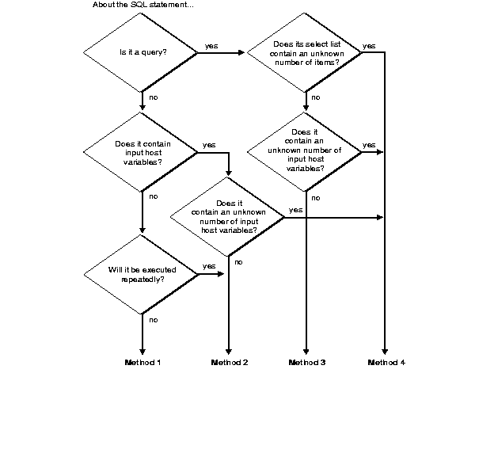

This chapter shows you how to use dynamic SQL, an advanced programming technique that adds flexibility and functionality to your applications. After weighing the advantages and disadvantages of dynamic SQL, you learn four methods—from simple to complex—for writing programs that accept and process SQL statements "on the fly" at run time. You learn the requirements and limitations of each method and how to choose the right method for a given job.

Topics are:

- Dynamic SQL

- Advantages and Disadvantages of Dynamic SQL

- When to Use Dynamic SQL

- Requirements for Dynamic SQL Statements

- How Dynamic SQL Statements Are Processed

- Methods for Using Dynamic SQL

- Using Method 1

- Sample Program 6: Dynamic SQL Method 1

- Using Method 2

- Sample Program 7: Dynamic SQL Method 2

- Using Method 3

- Sample Program 8: Dynamic SQL Method 3

- Using Oracle Method 4

- Using the DECLARE STATEMENT Statement

- Using Host Tables

- Using PL/SQL

- Dynamic SQL Statement Caching

### 9.1 Dynamic SQL

Most database applications do a specific job. For example, a simple program might prompt the user for an employee number, then update rows in the EMP and DEPT tables. In this case, you know the makeup of the UPDATE statement at precompile time. That is, you know which tables might be changed, the constraints defined for each table and column, which columns might be updated, and the datatype of each column.

However, some applications must accept (or build) and process a variety of SQL statements at run time. For example, a general-purpose report writer must build different SELECT statements for the various reports it generates. In this case, the statement's makeup is unknown until run time. Such statements can, and probably will, change from execution to execution. They are aptly called dynamic SQL statements.

Unlike static SQL statements, dynamic SQL statements are not embedded in your source program. Instead, they are stored in character strings input to or built by the program at run time. They can be entered interactively or read from a file.

### 9.2 Advantages and Disadvantages of Dynamic SQL

Host programs that accept and process dynamically defined SQL statements are more versatile than plain embedded SQL programs. Dynamic SQL statements can be built interactively with input from users having little or no knowledge of SQL.

For example, your program might simply prompt users for a search condition to be used in the WHERE clause of a SELECT, UPDATE, or DELETE statement. A more complex program might allow users to choose from menus listing SQL operations, table and view names, column names, and so on. Thus, dynamic SQL lets you write highly flexible applications.

However, some dynamic queries require complex coding, the use of special data structures, and more runtime processing. While you might not notice the added processing time, you might find the coding difficult unless you fully understand dynamic SQL concepts and methods.

### 9.3 When to Use Dynamic SQL

In practice, static SQL will meet nearly all your programming needs. Use dynamic SQL only if you need its open-ended flexibility. Its use is suggested when one or more of the following items is unknown at precompile time:

- Text of the SQL statement (commands, clauses, and so on)

- The number of host variables

- The datatypes of host variables

- References to database objects such as columns, indexes, sequences, tables, usernames, and views

### 9.4 Requirements for Dynamic SQL Statements

To represent a dynamic SQL statement, a character string must contain the text of a valid DML or DDL SQL statement, but not contain the EXEC SQL clause, host-language delimiter or statement terminator.

In most cases, the character string can contain dummy host variables. They hold places in the SQL statement for actual host variables. Because dummy host variables are just place-holders, you do not declare them and can name them anything you like (hyphens are not allowed). For example, Oracle makes no distinction between the following two strings

    'DELETE FROM EMP WHERE MGR = :MGRNUMBER AND JOB = :JOBTITLE'
    'DELETE FROM EMP WHERE MGR = :M AND JOB = :J'

### 9.5 How Dynamic SQL Statements Are Processed

Typically, an application program prompts the user for the text of a SQL statement and the values of host variables used in the statement. Then Oracle parses the SQL statement. That is, Oracle examines the SQL statement to make sure it follows syntax rules and refers to valid database objects. Parsing also involves checking database access rights, reserving needed resources, and finding the optimal access path.

Next, Oracle binds the host variables to the SQL statement. That is, Oracle gets the addresses of the host variables so that it can read or write their values.

If the statement is a query, you define the SELECT variables and then Oracle FETCHes them until all rows are retrieved. The cursor is then closed.

Then Oracle executes the SQL statement. That is, Oracle does what the SQL statement requested, such as deleting rows from a table.

The SQL statement can be executed repeatedly using new values for the host variables.

### 9.6 Methods for Using Dynamic SQL

This section introduces the four methods you can use to define dynamic SQL statements. It briefly describes the capabilities and limitations of each method, then offers guidelines for choosing the right method. Later sections show you how to use the methods.

The four methods are increasingly general. That is, Method 2 encompasses Method 1, Method 3 encompasses Methods 1 and 2, and so on. However, each method is most useful for handling a certain kind of SQL statement, as Appropriate Method to Use shows:

Table 9-1 Appropriate Method to Use

| Method | Kind of SQL Statement                                                   |
|:-------|:------------------------------------------------------------------------|
| 1      | Non-query without input host variables.                                 |
| 2      | Non-query with known number of input host variables.                    |
| 3      | Query with known number of select-list items and input host variables.  |
| 4      | Query with unknown number of select-list items or input host variables. |

The term select-list item includes column names and expressions.

#### 9.6.1 Method 1

This method lets your program accept or build a dynamic SQL statement, then immediately execute it using the EXECUTE IMMEDIATE command. The SQL statement must not be a query (SELECT statement) and must not contain any place-holders for input host variables. For example, the following host strings qualify:

    'DELETE FROM EMP WHERE DEPTNO = 20'

    'GRANT SELECT ON EMP TO SCOTT'

With Method 1, the SQL statement is parsed every time it is executed (regardless of whether you have set HOLD_CURSOR=YES).

#### 9.6.2 Method 2

This method lets your program accept or build a dynamic SQL statement, then process it using the PREPARE and EXECUTE commands. The SQL statement must not be a query. The number of place-holders for input host variables and the datatypes of the input host variables must be known at precompile time. For example, the following host strings fall into this category:

    'INSERT INTO EMP (ENAME, JOB) VALUES (:EMPNAME, :JOBTITLE)'
    'DELETE FROM EMP WHERE EMPNO = :EMPNUMBER'

With Method 2, the SQL statement can be parsed just once by calling PREPARE once, and executed many times with different values for the host variables. This is not true when RELEASE_CURSOR=YES is also specified, because the statement has to be prepared again before each execution.

**Note:**

SQL data definition statements such as CREATE are executed once the PREPARE is completed.

#### 9.6.3 Method 3

This method lets your program accept or build a dynamic query then process it using the PREPARE command with the DECLARE, OPEN, FETCH, and CLOSE cursor commands. The number of select-list items, the number of place-holders for input host variables, and the datatypes of the input host variables must be known at precompile time. For example, the following host strings qualify:

    'SELECT DEPTNO, MIN(SAL), MAX(SAL) FROM EMP GROUP BY DEPTNO'
    'SELECT ENAME, EMPNO FROM EMP WHERE DEPTNO = :DEPTNUMBER'

#### 9.6.4 Method 4

This method lets your program accept or build a dynamic SQL statement, then process it using descriptors (discussed in "Using Oracle Method 4"). The number of select-list items, the number of place-holders for input host variables, and the datatypes of the input host variables can be unknown until run time. For example, the following host strings fall into this category:

    'INSERT INTO EMP (unknown) VALUES (unknown)'

    'SELECT unknown FROM EMP WHERE DEPTNO = 20'

Method 4 is required for dynamic SQL statements that contain an unknown number of select-list items or input host variables.

#### 9.6.5 Guidelines

With all four methods, you must store the dynamic SQL statement in a character string, which must be a host variable or quoted literal. When you store the SQL statement in the string, omit the keywords EXEC SQL and the statement terminator.

With Methods 2 and 3, the number of place-holders for input host variables and the datatypes of the input host variables must be known at precompile time.

Each succeeding method imposes fewer constraints on your application, but is more difficult to code. As a rule, use the simplest method you can. However, if a dynamic SQL statement will be executed repeatedly by Method 1, use Method 2 instead to avoid re-parsing for each execution.

Method 4 provides maximum flexibility, but requires complex coding and a full understanding of dynamic SQL concepts. In general, use Method 4 only if you cannot use Methods 1, 2, or 3.

The decision logic in Figure 9-1, will help you choose the correct method.

##### 9.6.5.1 Avoiding Common Errors

If you use a character array to store the dynamic SQL statement, blank-pad the array before storing the SQL statement. That way, you clear extraneous characters. This is especially important when you reuse the array for different SQL statements. As a rule, always initialize (or re-initialize) the host string before storing the SQL statement.

Do not null-terminate the host string. Oracle does not recognize the null terminator as an end-of-string marker. Instead, Oracle treats it as part of the SQL statement.

If you use a VARCHAR variable to store the dynamic SQL statement, make sure the length of the VARCHAR is set (or reset) correctly before you execute the PREPARE or EXECUTE IMMEDIATE statement.

EXECUTE resets the SQLWARN warning flags in the SQLCA. So, to catch mistakes such as an unconditional update (caused by omitting a WHERE clause), check the SQLWARN flags after executing the PREPARE statement but before executing the EXECUTE statement.

Figure 9-1 shows how to choose the right method.

Figure 9-1 Choosing the Right Method

[Description of "Figure 9-1 Choosing the Right Method"](img_text/pco81058.md)

### 9.7 Using Method 1

The simplest kind of dynamic SQL statement results only in "success" or "failure" and uses no host variables. Some examples follow:

    'DELETE FROM table_name WHERE column_name = constant'
    'CREATE TABLE table_name ...'
    'DROP INDEX index_name'
    'UPDATE table_name SET column_name = constant'
    'GRANT SELECT ON table_name TO username'

#### 9.7.1 The EXECUTE IMMEDIATE Statement

Method 1 parses, then immediately executes the SQL statement using the EXECUTE IMMEDIATE command. The command is followed by a character string (host variable or literal) containing the SQL statement to be executed, which cannot be a query.

The syntax of the EXECUTE IMMEDIATE statement follows:

    EXEC SQL EXECUTE IMMEDIATE { :HOST-STRING | STRING-LITERAL }END-EXEC.

In the following example, you use the host variable SQL-STMT to store SQL statements input by the user:

         EXEC SQL BEGIN DECLARE SECTION END-EXEC.
         ...
     01   SQL-STMT  PIC X(120);
          EXEC SQL END DECLARE SECTION END-EXEC.
         ...
     LOOP.
         DISPLAY 'Enter SQL statement: ' WITH NO ADVANCING.
         ACCEPT SQL-STMT END-EXEC.
    * --  sql_stmt now contains the text of a SQL statement
        EXEC SQL EXECUTE IMMEDIATE :SQL-STMT END-EXEC.
     NEXT.
         ...

Because EXECUTE IMMEDIATE parses the input SQL statement before every execution, Method 1 is best for statements that are executed only once. Data definition statements usually fall into this category.

#### 9.7.2 An Example

The following fragment of a program prompts the user for a search condition to be used in the WHERE clause of an UPDATE statement, then executes the statement using Method 1:

         ...
    *    THE RELEASE_CURSOR=YES OPTION INSTRUCTS PRO*COBOL TO
    *    RELEASE IMPLICIT CURSORS ASSOCIATED WITH EMBEDDED SQL
    *    STATEMENTS.  THIS ENSURES THAT Oracle DOES NOT KEEP PARSE
    *    LOCKS ON TABLES, SO THAT SUBSEQUENT DATA MANIPULATION
    *    OPERATIONS ON THOSE TABLES DO NOT RESULT IN PARSE-LOCK
    *    ERRORS.

         EXEC ORACLE OPTION (RELEASE_CURSOR=YES) END-EXEC.

    *
         EXEC SQL BEGIN DECLARE SECTION END-EXEC.
     01  USERNAME  PIC X(10) VALUE "SCOTT".
     01  PASSWD    PIC X(10) VALUE "TIGER".
     01  DYNSTMT   PIC X(80).
         EXEC SQL END DECLARE SECTION END-EXEC.
     01  UPDATESTMT PIC X(40).
     01  SEARCH-COND PIC X(40).
         ...
         DISPLAY "ENTER A SEARCH CONDITION FOR STATEMENT:".
         MOVE "UPDATE EMP SET COMM = 500 WHERE " TO UPDATESTMT.
         DISPLAY UPDATESTMT.
         ACCEPT SEARCH-COND.
    *    Concatenate SEARCH-COND to UPDATESTMT and store result
    *    in DYNSTMT.
         STRING UPDATESTMT DELIMITED BY SIZE
             SEARCH-COND DELIMITED BY SIZE INTO DYNSTMT.
         EXEC SQL EXECUTE IMMEDIATE :DYNSTMT END-EXEC.

### 9.8 Sample Program 6: Dynamic SQL Method 1

This program uses dynamic SQL Method 1 to create a table, insert a row, commit the insert, then drop the table.

          *****************************************************************
          * Sample Program 6:  Dynamic SQL Method 1                       *
          *                                                               *
          * This program uses dynamic SQL Method 1 to create a table,     *
          * insert a row, commit the insert, then drop the table.         *
          *****************************************************************

           IDENTIFICATION DIVISION.
           PROGRAM-ID.  DYNSQL1.
           ENVIRONMENT DIVISION.
           DATA DIVISION.
           WORKING-STORAGE SECTION.

          *    INCLUDE THE ORACLE COMMUNICATIONS AREA, A STRUCTURE
          *    THROUGH WHICH ORACLE MAKES ADDITIONAL RUNTIME STATUS
          *    INFORMATION AVAILABLE TO THE PROGRAM.

               EXEC SQL INCLUDE SQLCA END-EXEC.

          *    INCLUDE THE ORACLE COMMUNICATIONS AREA, A STRUCTURE
          *    THROUGH WHICH ORACLE MAKES ADDITIONAL RUNTIME STATUS
          *    INFORMATION AVAILABLE TO THE PROGRAM.

               EXEC SQL INCLUDE ORACA END-EXEC.

          *    THE OPTION ORACA=YES MUST BE SPECIFIED TO ENABLE USE OF
          *    THE ORACA.

               EXEC ORACLE OPTION (ORACA=YES) END-EXEC.

          *    THE RELEASE_CURSOR=YES OPTION INSTRUCTS PRO*COBOL TO
          *    RELEASE IMPLICIT CURSORS ASSOCIATED WITH EMBEDDED SQL
          *    STATEMENTS.  THIS ENSURES THAT ORACLE DOES NOT KEEP PARSE
          *    LOCKS ON TABLES, SO THAT SUBSEQUENT DATA MANIPULATION
          *    OPERATIONS ON THOSE TABLES DO NOT RESULT IN PARSE-LOCK
          *    ERRORS.

               EXEC ORACLE OPTION (RELEASE_CURSOR=YES) END-EXEC.

               EXEC SQL BEGIN DECLARE SECTION END-EXEC.
           01  USERNAME  PIC X(10) VALUE "SCOTT".
           01  PASSWD    PIC X(10) VALUE "TIGER".
           01  DYNSTMT   PIC X(80) VARYING.
               EXEC SQL END DECLARE SECTION END-EXEC.

          *    DECLARE VARIABLES NEEDED TO DISPLAY COMPUTATIONALS.
           01  ORASLNRD  PIC 9(9).

           PROCEDURE DIVISION.

           MAIN.

          *    BRANCH TO PARAGRAPH SQLERROR IF AN ORACLE ERROR OCCURS.
               EXEC SQL WHENEVER SQLERROR GOTO SQLERROR END-EXEC.

          *    SAVE TEXT OF CURRENT SQL STATEMENT IN THE ORACA IF AN ERROR
          *    OCCURS.
               MOVE 1 TO ORASTXTF.

          *    CONNECT TO ORACLE.
               EXEC SQL
                   CONNECT :USERNAME IDENTIFIED BY :PASSWD
               END-EXEC.
               DISPLAY " ".
               DISPLAY "CONNECTED TO ORACLE AS USER:  " WITH NO ADVANCING.
               DISPLAY USERNAME.
               DISPLAY " ".

          *    EXECUTE A STRING LITERAL TO CREATE THE TABLE.  HERE, YOU
          *    GENERALLY USE A STRING VARIABLE INSTEAD OF A LITERAL, AS IS
          *    DONE LATER IN THIS PROGRAM.  BUT, YOU CAN USE A LITERAL IF
          *    YOU WISH.
               DISPLAY "CREATE TABLE DYN1 (COL1 CHAR(4))".
               DISPLAY " ".
               EXEC SQL EXECUTE IMMEDIATE
                   "CREATE TABLE DYN1 (COL1 CHAR(4))"
               END-EXEC.

          *    ASSIGN A SQL STATEMENT TO THE VARYING STRING DYNSTMT.
          *    SET THE -LEN PART TO THE LENGTH OF THE -ARR PART.
               MOVE "INSERT INTO DYN1 VALUES ('TEST')" TO DYNSTMT-ARR.
               MOVE 36 TO DYNSTMT-LEN.
               DISPLAY DYNSTMT-ARR.
               DISPLAY " ".

          *    EXECUTE DYNSTMT TO INSERT A ROW.  THE SQL STATEMENT IS A
          *    STRING VARIABLE WHOSE CONTENTS THE PROGRAM MAY DETERMINE
          *    AT RUN TIME.
               EXEC SQL EXECUTE IMMEDIATE :DYNSTMT END-EXEC.

          *    COMMIT THE INSERT.
               EXEC SQL COMMIT WORK END-EXEC.

          *    CHANGE DYNSTMT AND EXECUTE IT TO DROP THE TABLE.
               MOVE "DROP TABLE DYN1" TO DYNSTMT-ARR.
               MOVE 19 TO DYNSTMT-LEN.
               DISPLAY DYNSTMT-ARR.
               DISPLAY " ".
               EXEC SQL EXECUTE IMMEDIATE :DYNSTMT END-EXEC.

          *    COMMIT ANY PENDING CHANGES AND DISCONNECT FROM ORACLE.
               EXEC SQL COMMIT RELEASE END-EXEC.
               DISPLAY "HAVE A GOOD DAY!".
               DISPLAY " ".
               STOP RUN.

           SQLERROR.

          *    ORACLE ERROR HANDLER.  PRINT DIAGNOSTIC TEXT CONTAINING
          *    ERROR MESSAGE, CURRENT SQL STATEMENT, AND LOCATION OF ERROR.
               DISPLAY SQLERRMC.
               DISPLAY "IN ", ORASTXTC.
               MOVE ORASLNR TO ORASLNRD.
               DISPLAY "ON LINE ", ORASLNRD, " OF ", ORASFNMC.

          *    DISABLE ORACLE ERROR CHECKING TO AVOID AN INFINITE LOOP
          *    SHOULD ANOTHER ERROR OCCUR WITHIN THIS PARAGRAPH.
               EXEC SQL WHENEVER SQLERROR CONTINUE END-EXEC.

          *    ROLL BACK ANY PENDING CHANGES AND DISCONNECT FROM ORACLE.
               EXEC SQL ROLLBACK RELEASE END-EXEC.
               STOP RUN.

### 9.9 Using Method 2

What Method 1 does in one step, Method 2 does in two. The dynamic SQL statement, which cannot be a query, is first prepared (named and parsed), then executed.

With Method 2, the SQL statement can contain place-holders for input host variables and indicator variables. You can PREPARE the SQL statement once, then EXECUTE it repeatedly using different values of the host variables. Also, if you have not specified MODE=ANSI, you need not re-prepare the SQL statement after a COMMIT or ROLLBACK (unless you log off and reconnect).

The syntax of the PREPARE statement follows:

         EXEC SQL PREPARE STATEMENT-NAME
             FROM { :HOST-STRING | STRING-LITERAL }
         END-EXEC.

PREPARE parses the SQL statement and gives it a name.

STATEMENT-NAME is an identifier used by the precompiler, not a host or program variable, and should not be declared in a COBOL statement. It simply designates the prepared statement you want to EXECUTE.

The syntax of the EXECUTE statement is

         EXEC SQL
             EXECUTE STATEMENT-NAME [USING HOST-VARIABLE-LIST]
         END-EXEC.

where HOST-VARIABLE-LIST stands for the following syntax:

    :HOST-VAR1[:INDICATOR1] [, HOST-VAR2[:INDICATOR2], ...]

EXECUTE executes the parsed SQL statement, using the values supplied for each input host variable. In the following example, the input SQL statement contains the place-holder n:

         EXEC SQL BEGIN DECLARE SECTION END-EXEC.
         ...
     01  EMP-NUMBER   PIC S9(4) COMP VALUE ZERO.
         ...
     01  DELETE-STMT   PIC X(120) VALUE SPACES.
         ...
         EXEC SQL END DECLARE SECTION END-EXEC.
     01  WHERE-STMT    PIC X(40).
     01  SEARCH-COND   PIC X(40).
         ...
         MOVE 'DELETE FROM EMP WHERE EMPNO = :N AND ' TO WHERE-STMT.
         DISPLAY 'Complete this statement's search condition:'.
         DISPLAY WHERE-STMT.
         ACCEPT SEARCH-COND.
    *    Concatenate SEARCH-COND to WHERE-STMT and store in DELETE-STMT
         STRING WHERE-STMT DELIMITED BY SIZE
             SEARCH-COND DELIMITED BY SIZE INTO
             DELETE-STMT.
         EXEC SQL PREPARE SQLSTMT FROM :DELETE-STMT END-EXEC.
     LOOP.
         DISPLAY 'Enter employee number: ' WITH NO ADVANCING.
         ACCEPT EMP-NUMBER.
         IF EMP-NUMBER = 0
            GO TO NEXT.
         EXEC SQL EXECUTE SQLSTMT USING :EMP-NUMBER END-EXEC.
     NEXT.

With Method 2, you must know the datatypes of input host variables at precompile time. In the last example, EMP-NUMBER was declared as type PIC S9(4) COMP. It could also have been declared as type PIC X(4) or COMP-1, because Oracle supports all these datatype conversions to the NUMBER internal datatype.

#### 9.9.1 The USING Clause

When the SQL statement EXECUTE is completed, input host variables in the USING clause replace corresponding place-holders in the prepared dynamic SQL statement.

Every place-holder in the dynamic SQL statement after PREPARE must correspond to a host variable in the USING clause. So, if the same place-holder appears two or more times in the statement after PREPARE, each appearance must correspond to a host variable in the USING clause. If one of the host variables in the USING clause is an array, all must be arrays. Otherwise, only one record is then processed.

The names of the place-holders need not match the names of the host variables. However, the order of the place-holders in the dynamic SQL statement after PREPARE must match the order of corresponding host variables in the USING clause.

To specify NULLs, you can associate indicator variables with host variables in the USING clause.

**Related Topics**

- [Using Indicator Variables](embedded-SQL.md)

### 9.10 Sample Program 7: Dynamic SQL Method 2

This program uses dynamic SQL Method 2 to insert two rows into the EMP table and then delete them.

          *****************************************************************
          * Sample Program 7:  Dynamic SQL Method 2                       *
          *                                                               *
          * This program uses dynamic SQL Method 2 to insert two rows     *
          * into the EMP table, then delete them.                         *
          *****************************************************************

           IDENTIFICATION DIVISION.
           PROGRAM-ID.  DYNSQL2.
           ENVIRONMENT DIVISION.
           DATA DIVISION.
           WORKING-STORAGE SECTION.

          *    INCLUDE THE SQL COMMUNICATIONS AREA, A STRUCTURE THROUGH
          *    WHICH ORACLE MAKES RUNTIME STATUS INFORMATION (SUCH AS ERROR
          *    CODES, WARNING FLAGS, AND DIAGNOSTIC TEXT) AVAILABLE TO THE
          *    PROGRAM.
               EXEC SQL INCLUDE SQLCA END-EXEC.

          *    INCLUDE THE ORACLE COMMUNICATIONS AREA, A STRUCTURE THROUGH
          *    WHICH ORACLE MAKES ADDITIONAL RUNTIME STATUS INFORMATION
          *    AVAILABLE TO THE PROGRAM.
               EXEC SQL INCLUDE ORACA END-EXEC.

          *    THE OPTION ORACA=YES MUST BE SPECIFIED TO ENABLE USE OF
          *    THE ORACA.
               EXEC ORACLE OPTION (ORACA=YES) END-EXEC.

               EXEC SQL BEGIN DECLARE SECTION END-EXEC.
           01  USERNAME  PIC X(10) VALUE "SCOTT".
           01  PASSWD    PIC X(10) VALUE "TIGER".
           01  DYNSTMT   PIC X(80) VARYING.
           01  EMPNO     PIC S9(4) COMPUTATIONAL VALUE 1234.
           01  DEPTNO1   PIC S9(4) COMPUTATIONAL VALUE 10.
           01  DEPTNO2   PIC S9(4) COMPUTATIONAL VALUE 20.
               EXEC SQL END DECLARE SECTION END-EXEC.

          *    DECLARE VARIABLES NEEDED TO DISPLAY COMPUTATIONALS.
           01  EMPNOD    PIC 9(4).
           01  DEPTNO1D  PIC 9(2).
           01  DEPTNO2D  PIC 9(2).
           01  ORASLNRD  PIC 9(9).

           PROCEDURE DIVISION.
           MAIN.

          *    BRANCH TO PARAGRAPH SQLERROR IF AN ORACLE ERROR OCCURS.
               EXEC SQL WHENEVER SQLERROR GOTO SQLERROR END-EXEC.

          *    SAVE TEXT OF CURRENT SQL STATEMENT IN THE ORACA IF AN ERROR
          *    OCCURS.
               MOVE 1 TO ORASTXTF.

          *    CONNECT TO ORACLE.
               EXEC SQL
                   CONNECT :USERNAME IDENTIFIED BY :PASSWD
               END-EXEC.
               DISPLAY " ".
               DISPLAY "CONNECTED TO ORACLE.".
               DISPLAY " ".

          *    ASSIGN A SQL STATEMENT TO THE VARYING STRING DYNSTMT.  BOTH
          *    THE ARRAY AND THE LENGTH PARTS MUST BE SET PROPERLY.  NOTE
          *    THAT THE STATEMENT CONTAINS TWO HOST VARIABLE PLACEHOLDERS,
          *    V1 AND V2, FOR WHICH ACTUAL INPUT HOST VARIABLES MUST BE
          *    SUPPLIED AT EXECUTE TIME.
               MOVE "INSERT INTO EMP (EMPNO, DEPTNO) VALUES (:V1, :V2)"
                   TO DYNSTMT-ARR.
               MOVE 49 TO DYNSTMT-LEN.

          *    DISPLAY THE SQL STATEMENT AND ITS CURRENT INPUT HOST
          *    VARIABLES.
               DISPLAY DYNSTMT-ARR.
               MOVE EMPNO TO EMPNOD.
               MOVE DEPTNO1 TO DEPTNO1D.
               DISPLAY "    V1 = ", EMPNOD, "    V2 = ", DEPTNO1D.

          *    THE PREPARE STATEMENT ASSOCIATES A STATEMENT NAME WITH A
          *    STRING CONTAINING A SQL STATEMENT.  THE STATEMENT NAME IS
          *    A SQL IDENTIFIER, NOT A HOST VARIABLE, AND THEREFORE DOES
          *    NOT APPEAR IN THE DECLARE SECTION.

          *    A SINGLE STATEMENT NAME MAY BE PREPARED MORE THAN ONCE,
          *    OPTIONALLY FROM A DIFFERENT STRING VARIABLE.
               EXEC SQL PREPARE S FROM :DYNSTMT END-EXEC.

          *    THE EXECUTE STATEMENT EXECUTES A PREPARED SQL STATEMENT
          *    USING THE SPECIFIED INPUT HOST VARIABLES, WHICH ARE
          *    SUBSTITUTED POSITIONALLY FOR PLACEHOLDERS IN THE PREPARED
          *    STATEMENT.  FOR EACH OCCURRENCE OF A PLACEHOLDER IN THE
          *    STATEMENT THERE MUST BE A VARIABLE IN THE USING CLAUSE.
          *    THAT IS, IF A PLACEHOLDER OCCURS MULTIPLE TIMES IN THE
          *    STATEMENT, THE CORRESPONDING VARIABLE MUST APPEAR
          *    MULTIPLE TIMES IN THE USING CLAUSE.  THE USING CLAUSE MAY
          *    BE OMITTED ONLY IF THE STATEMENT CONTAINS NO PLACEHOLDERS.
          *    A SINGLE PREPARED STATEMENT MAY BE EXECUTED MORE THAN ONCE,
          *    OPTIONALLY USING DIFFERENT INPUT HOST VARIABLES.
               EXEC SQL EXECUTE S USING :EMPNO, :DEPTNO1 END-EXEC.

          *    INCREMENT EMPNO AND DISPLAY NEW INPUT HOST VARIABLES.
               ADD 1 TO EMPNO.
               MOVE EMPNO TO EMPNOD.
               MOVE DEPTNO2 TO DEPTNO2D.
               DISPLAY "    V1 = ", EMPNOD, "    V2 = ", DEPTNO2D.

          *    REEXECUTE S TO INSERT THE NEW VALUE OF EMPNO AND A
          *    DIFFERENT INPUT HOST VARIABLE, DEPTNO2.  A REPREPARE IS NOT
          *    NECESSARY.
               EXEC SQL EXECUTE S USING :EMPNO, :DEPTNO2 END-EXEC.

          *    ASSIGN A NEW VALUE TO DYNSTMT.
               MOVE "DELETE FROM EMP WHERE DEPTNO = :V1 OR DEPTNO = :V2"
                   TO DYNSTMT-ARR.
               MOVE 50 TO DYNSTMT-LEN.

          *    DISPLAY THE NEW SQL STATEMENT AND ITS CURRENT INPUT HOST
          *    VARIABLES.
               DISPLAY DYNSTMT-ARR.
               DISPLAY "    V1 = ", DEPTNO1D, "      V2 = ", DEPTNO2D.

          *    REPREPARE S FROM THE NEW DYNSTMT.
               EXEC SQL PREPARE S FROM :DYNSTMT END-EXEC.

          *    EXECUTE THE NEW S TO DELETE THE TWO ROWS PREVIOUSLY
          *    INSERTED.
               EXEC SQL EXECUTE S USING :DEPTNO1, :DEPTNO2 END-EXEC.

          *    ROLLBACK ANY PENDING CHANGES AND DISCONNECT FROM ORACLE.
               EXEC SQL ROLLBACK RELEASE END-EXEC.
               DISPLAY " ".
               DISPLAY "HAVE A GOOD DAY!".
               DISPLAY " ".
               STOP RUN.

            SQLERROR.
          *    ORACLE ERROR HANDLER.  PRINT DIAGNOSTIC TEXT CONTAINING
          *    ERROR MESSAGE, CURRENT SQL STATEMENT, AND LOCATION OF ERROR.
               DISPLAY SQLERRMC.
               DISPLAY "IN ", ORASTXTC.
               MOVE ORASLNR TO ORASLNRD.
               DISPLAY "ON LINE ", ORASLNRD, " OF ", ORASFNMC.

          *    DISABLE ORACLE ERROR CHECKING TO AVOID AN INFINITE LOOP
          *    SHOULD ANOTHER ERROR OCCUR WITHIN THIS PARAGRAPH.
               EXEC SQL WHENEVER SQLERROR CONTINUE END-EXEC.

          *    ROLL BACK ANY PENDING CHANGES AND DISCONNECT FROM ORACLE.
               EXEC SQL ROLLBACK RELEASE END-EXEC.
               STOP RUN.

### 9.11  Using Method 3

Method 3 is similar to Method 2 but combines the PREPARE statement with the statements needed to define and manipulate a cursor. This allows your program to accept and process queries. In fact, if the dynamic SQL statement is a query, you must use Method 3 or 4.

For Method 3, the number of columns in the query select list and the number of place-holders for input host variables must be known at precompile time. However, the names of database objects such as tables and columns need not be specified until run time (they cannot duplicate the names of host variables). Clauses that limit, group, and sort query results (such as WHERE, GROUP BY, and ORDER BY) can also be specified at run time.

With Method 3, you use the following sequence of embedded SQL statements:

         EXEC SQL
             PREPARE STATEMENTNAME FROM { :HOST-STRING | STRING-LITERAL }
         END-EXEC.
         EXEC SQL DECLARE CURSORNAME CURSOR FOR STATEMENTNAME END-EXEC.
         EXEC SQL OPEN CURSORNAME [USING HOST-VARIABLE-LIST] END-EXEC.
         EXEC SQL FETCH CURSORNAME INTO HOST-VARIABLE-LIST END-EXEC.
         EXEC SQL CLOSE CURSORNAME END-EXEC.

Now let us look at what each statement does.

#### 9.11.1 PREPARE

The PREPARE statement parses the dynamic SQL statement and gives it a name. In the following example, PREPARE parses the query stored in the character string SELECT-STMT and gives it the name SQLSTMT:

         MOVE 'SELECT MGR, JOB FROM EMP WHERE SAL < :SALARY'
             TO SELECT-STMT.
         EXEC SQL PREPARE SQLSTMT FROM :SELECT-STMT END-EXEC.

Commonly, the query WHERE clause is input from a terminal at run time or is generated by the application.

The identifier SQLSTMT is not a host or program variable, but must be unique. It designates a particular dynamic SQL statement.

The following statement is correct also:

         EXEC SQL
             PREPARE SQLSTMT FROM 'SELECT MGR, JOB FROM EMP WHERE SAL < :SALARY'
         END-EXEC.

The following PREPARE statement, which uses the '%' wildcard, is also correct:

         MOVE "SELECT ENAME FROM TEST WHERE ENAME LIKE 'SMIT%'" TO MY-STMT.
         EXEC SQL
             PREPARE S FROM MY-STMT
         END-EXEC.

#### 9.11.2 DECLARE

The DECLARE statement defines a cursor by giving it a name and associating it with a specific query. The cursor declaration is local to its precompilation unit. Continuing our example, DECLARE defines a cursor named EMPCURSOR and associates it with SQLSTMT, as follows:

         EXEC SQL DECLARE EMPCURSOR CURSOR FOR SQLSTMT END-EXEC.

The identifiers SQLSTMT and EMPCURSOR are not host or program variables, but must be unique. If you declare two cursors using the same statement name, Pro\*COBOL considers the two cursor names synonymous. For example, if you execute the statements

         EXEC SQL PREPARE SQLSTMT FROM :SELECT-STMT END-EXEC.
         EXEC SQL DECLARE EMPCURSOR FOR SQLSTMT END-EXEC.
         EXEC SQL PREPARE SQLSTMT FROM :DELETE-STMT END-EXEC.
         EXEC SQL DECLARE DEPCURSOR FOR SQLSTMT END-EXEC.

when you OPEN EMPCURSOR, you will process the dynamic SQL statement stored in DELETE-STMT, not the one stored in SELECT-STMT.

#### 9.11.3 OPEN

The OPEN statement allocates a cursor, binds input host variables, and executes the query, identifying its active set. OPEN also positions the cursor on the first row in the active set and zeroes the rows-processed count kept by the third element of SQLERRD in the SQLCA. Input host variables in the USING clause replace corresponding place-holders in the PREPAREd dynamic SQL statement.

In our example, OPEN allocates EMPCURSOR and assigns the host variable SALARY to the WHERE clause, as follows:

         EXEC SQL OPEN EMPCURSOR USING :SALARY END-EXEC.

#### 9.11.4 FETCH

The FETCH statement returns a row from the active set, assigns column values in the select list to corresponding host variables in the INTO clause, and advances the cursor to the next row. When no more rows are found, FETCH returns the "no data found" error code to SQLCODE in the SQLCA.

In our example, FETCH returns a row from the active set and assigns the values of columns MGR and JOB to host variables MGR-NUMBER and JOB-TITLE, as follows:

         EXEC SQL FETCH EMPCURSOR INTO :MGR-NUMBER,:JOB-TITLE END-EXEC.

Host tables can be used with Method 3.

#### 9.11.5 CLOSE

The CLOSE statement disables the cursor. Once you CLOSE a cursor, you can no longer FETCH from it. In our example, the CLOSE statement disables EMPCURSOR, as follows:

         EXEC SQL CLOSE EMPCURSOR END-EXEC.

### 9.12 Sample Program 8: Dynamic SQL Method 3

This program uses dynamic SQL Method 3 to retrieve the names of all employees in a given department from the EMP table.

          *****************************************************************
          * Sample Program 8:  Dynamic SQL Method 3                       *
          *                                                               *
          * This program uses dynamic SQL Method 3 to retrieve the names  *
          * of all employees in a given department from the EMP table.    *
          *****************************************************************

           IDENTIFICATION DIVISION.
           PROGRAM-ID.  DYNSQL3.
           ENVIRONMENT DIVISION.
           DATA DIVISION.
           WORKING-STORAGE SECTION.

          *    INCLUDE THE SQL COMMUNICATIONS AREA, A STRUCTURE THROUGH
          *    WHICH ORACLE MAKES RUNTIME STATUS INFORMATION (SUCH AS ERROR
          *    CODES, WARNING FLAGS, AND DIAGNOSTIC TEXT) AVAILABLE TO THE
          *    PROGRAM.
               EXEC SQL INCLUDE SQLCA END-EXEC.

          *    INCLUDE THE ORACLE COMMUNICATIONS AREA, A STRUCTURE THROUGH
          *    WHICH ORACLE MAKES ADDITIONAL RUNTIME STATUS INFORMATION
          *    AVAILABLE TO THE PROGRAM.
               EXEC SQL INCLUDE ORACA END-EXEC.

          *    THE ORACA=YES OPTION MUST BE SPECIFIED TO ENABLE USE OF
          *    THE ORACA.
               EXEC ORACLE OPTION (ORACA=YES) END-EXEC.

               EXEC SQL BEGIN DECLARE SECTION END-EXEC.
           01  USERNAME  PIC X(10) VALUE "SCOTT".
           01  PASSWD    PIC X(10) VALUE "TIGER".
           01  DYNSTMT   PIC X(80) VARYING.
           01  ENAME     PIC X(10).
           01  DEPTNO    PIC S9999 COMPUTATIONAL VALUE 10.
               EXEC SQL END DECLARE SECTION END-EXEC.

          *    DECLARE VARIABLES NEEDED TO DISPLAY COMPUTATIONALS.
           01  DEPTNOD   PIC 9(2).
           01  ENAMED    PIC X(10).
           01  SQLERRD3  PIC 9(2).
           01  ORASLNRD  PIC 9(4).

           PROCEDURE DIVISION.
           MAIN.

          *    BRANCH TO PARAGRAPH SQLERROR IF AN ORACLE ERROR OCCURS.
               EXEC SQL WHENEVER SQLERROR GO TO SQLERROR END-EXEC.

          *    SAVE TEXT OF CURRENT SQL STATEMENT IN THE ORACA IF AN ERROR
          *    OCCURS.
               MOVE 1 TO ORASTXTF.

          *    CONNECT TO ORACLE.
               EXEC SQL
                   CONNECT :USERNAME IDENTIFIED BY :PASSWD
               END-EXEC.
               DISPLAY " ".
               DISPLAY "CONNECTED TO ORACLE.".
               DISPLAY " ".

          *    ASSIGN A SQL QUERY TO THE VARYING STRING DYNSTMT.  BOTH THE
          *    ARRAY AND THE LENGTH PARTS MUST BE SET PROPERLY.  NOTE THAT
          *    THE STATEMENT CONTAINS ONE HOST VARIABLE PLACEHOLDER, V1,
          *    FOR WHICH AN ACTUAL INPUT HOST VARIABLE MUST BE SUPPLIED
          *    AT OPEN TIME.
               MOVE "SELECT ENAME FROM EMP WHERE DEPTNO = :V1"
                   TO DYNSTMT-ARR.
               MOVE 40 TO DYNSTMT-LEN.

          *    DISPLAY THE SQL STATEMENT AND ITS CURRENT INPUT HOST
          *    VARIABLE.
               DISPLAY DYNSTMT-ARR.
               MOVE DEPTNO TO DEPTNOD.
               DISPLAY "    V1 = ", DEPTNOD.
               DISPLAY " ".
               DISPLAY "EMPLOYEE".
               DISPLAY "--------".

          *    THE PREPARE STATEMENT ASSOCIATES A STATEMENT NAME WITH A
          *    STRING CONTAINING A SELECT STATEMENT.  THE STATEMENT NAME,
          *    WHICH MUST BE UNIQUE, IS A SQL IDENTIFIER, NOT A HOST
          *    VARIABLE, AND SO DOES NOT APPEAR IN THE DECLARE SECTION.
               EXEC SQL PREPARE S FROM :DYNSTMT END-EXEC.

          *    THE DECLARE STATEMENT ASSOCIATES A CURSOR WITH A PREPARED
          *    STATEMENT.  THE CURSOR NAME, LIKE THE STATEMENT NAME, DOES
          *    NOT APPEAR IN THE DECLARE SECTION.
               EXEC SQL DECLARE C CURSOR FOR S END-EXEC.

          *    THE OPEN STATEMENT EVALUATES THE ACTIVE SET OF THE PREPARED
          *    QUERY USING THE SPECIFIED INPUT HOST VARIABLES, WHICH ARE
          *    SUBSTITUTED POSITIONALLY FOR PLACEHOLDERS IN THE PREPARED
          *    QUERY.  FOR EACH OCCURRENCE OF A PLACEHOLDER IN THE
          *    STATEMENT THERE MUST BE A VARIABLE IN THE USING CLAUSE.
          *    THAT IS, IF A PLACEHOLDER OCCURS MULTIPLE TIMES IN THE
          *    STATEMENT, THE CORRESPONDING VARIABLE MUST APPEAR MULTIPLE
          *    TIMES IN THE USING CLAUSE.  THE USING CLAUSE MAY BE
          *    OMITTED ONLY IF THE STATEMENT CONTAINS NO PLACEHOLDERS.
          *    OPEN PLACES THE CURSOR AT THE FIRST ROW OF THE ACTIVE SET
          *    IN PREPARATION FOR A FETCH.

          *    A SINGLE DECLARED CURSOR MAY BE OPENED MORE THAN ONCE,
          *    OPTIONALLY USING DIFFERENT INPUT HOST VARIABLES.
               EXEC SQL OPEN C USING :DEPTNO END-EXEC.

          *    BRANCH TO PARAGRAPH NOTFOUND WHEN ALL ROWS HAVE BEEN
          *    RETRIEVED.
               EXEC SQL WHENEVER NOT FOUND GO TO NOTFOUND END-EXEC.

           GETROWS.

          *    THE FETCH STATEMENT PLACES THE SELECT LIST OF THE CURRENT
          *    ROW INTO THE VARIABLES SPECIFIED BY THE INTO CLAUSE, THEN
          *    ADVANCES THE CURSOR TO THE NEXT ROW.  IF THERE ARE MORE
          *    SELECT-LIST FIELDS THAN OUTPUT HOST VARIABLES, THE EXTRA
          *    FIELDS ARE NOT RETURNED.  SPECIFYING MORE OUTPUT HOST
          *    VARIABLES THAN SELECT-LIST FIELDS RESULTS IN AN ORACLE ERROR.
               EXEC SQL FETCH C INTO :ENAME END-EXEC.
               MOVE ENAME TO ENAMED.
               DISPLAY ENAMED.

          *    LOOP UNTIL NOT FOUND CONDITION IS DETECTED.
               GO TO GETROWS.

           NOTFOUND.
               MOVE SQLERRD(3) TO SQLERRD3.
               DISPLAY " ".
               DISPLAY "QUERY RETURNED ", SQLERRD3, " ROW(S).".

          *    THE CLOSE STATEMENT RELEASES RESOURCES ASSOCIATED WITH THE
          *    CURSOR.
               EXEC SQL CLOSE C END-EXEC.

          *    COMMIT ANY PENDING CHANGES AND DISCONNECT FROM ORACLE.
               EXEC SQL COMMIT RELEASE END-EXEC.
               DISPLAY " ".
               DISPLAY "HAVE A GOOD DAY!".
               DISPLAY " ".
               STOP RUN.

           SQLERROR.

          *    ORACLE ERROR HANDLER.  PRINT DIAGNOSTIC TEXT CONTAINING
          *    ERROR MESSAGE, CURRENT SQL STATEMENT, AND LOCATION OF ERROR.
               DISPLAY SQLERRMC.
               DISPLAY "IN ", ORASTXTC.
               MOVE ORASLNR TO ORASLNRD.
               DISPLAY "ON LINE ", ORASLNRD, " OF ", ORASFNMC.

          *    DISABLE ORACLE ERROR CHECKING TO AVOID AN INFINITE LOOP
          *    SHOULD ANOTHER ERROR OCCUR WITHIN THIS PARAGRAPH.
               EXEC SQL WHENEVER SQLERROR CONTINUE END-EXEC.

          *    RELEASE RESOURCES ASSOCIATED WITH THE CURSOR.
               EXEC SQL CLOSE C END-EXEC.

          *    ROLL BACK ANY PENDING CHANGES AND DISCONNECT FROM ORACLE.
               EXEC SQL ROLLBACK RELEASE END-EXEC.
               STOP RUN.

### 9.13 Using Oracle Method 4

This section gives only an overview. For details, see [Oracle Dynamic SQL: Method 4](Oracle-dynamic-SQL-method-4.md).

LOBs are not supported in Oracle Method 4. Use ANSI dynamic SQL for LOB applications and all other new applications.

There is a kind of dynamic SQL statement that your program cannot process using Method 3. When the number of select-list items or place-holders for input host variables is unknown until run time, your program must use a descriptor. A descriptor is an area of memory used by your program and Oracle to hold a complete description of the variables in a dynamic SQL statement.

Recall that for a multi-row query, you FETCH selected column values INTO a list of declared output host variables. If the select list is unknown, the host-variable list cannot be established at precompile time by the INTO clause. For example, you know the following query returns two column values:

         EXEC SQL
             SELECT ENAME, EMPNO FROM EMP WHERE DEPTNO = :DEPT-NUMBER
         END-EXEC.

However, if you let the user define the select list, you might not know how many column values the query will return.

#### 9.13.1 Need for the SQLDA

To process this kind of dynamic query, your program must issue the DESCRIBE SELECT LIST command and declare a data structure called the SQL Descriptor Area (SQLDA). Because it holds descriptions of columns in the query select list, this structure is also called a select descriptor.

Likewise, if a dynamic SQL statement contains an unknown number of place-holders for input host variables, the host-variable list cannot be established at precompile time by the USING clause.

To process the dynamic SQL statement, your program must issue the DESCRIBE BIND VARIABLES command and declare another kind of SQLDA called a bind descriptor to hold descriptions of the place-holders for the input host variables. (Input host variables are also called bind variables.)

If your program has more than one active SQL statement (it might have used OPEN for two or more cursors, for example), each statement must have its own SQLDAs statement. However, non-concurrent cursors can reuse SQLDAs. There is no set limit on the number of SQLDAs in a program.

#### 9.13.2 The DESCRIBE Statement

DESCRIBE initializes a descriptor to hold descriptions of select-list items or input host variables.

If you supply a select descriptor, the DESCRIBE SELECT LIST statement examines each select-list item in a prepared dynamic query to determine its name, datatype, constraints, length, scale, and precision. It then stores this information in the select descriptor.

If you supply a bind descriptor, the DESCRIBE BIND VARIABLES statement examines each place-holder in a prepared dynamic SQL statement to determine its name, length, and the datatype of its associated input host variable. It then stores this information in the bind descriptor for your use. For example, you might use place-holder names to prompt the user for the values of input host variables.

#### 9.13.3 SQLDA Contents

A SQLDA is a host-program data structure that holds descriptions of select-list items or input host variables.

Though SQLDAs differ among host languages, a generic select SQLDA contains the following information about a query select list:

- Maximum number of columns that can be DESCRIBEd

- Actual number of columns found by DESCRIBE

- Addresses of buffers to store column values

- Lengths of column values

- Datatypes of column values

- Addresses of indicator-variable values

- Addresses of buffers to store column names

- Sizes of buffers to store column names

- Current lengths of column names

A generic bind SQLDA contains the following information about the input host variables in a SQL statement:

- Maximum number of place-holders that can be DESCRIBEd

- Actual number of place-holders found by DESCRIBE

- Addresses of input host variables

- Lengths of input host variables

- Datatypes of input host variables

- Addresses of indicator variables

- Addresses of buffers to store place-holder names

- Sizes of buffers to store place-holder names

- Current lengths of place-holder names

- Addresses of buffers to store indicator-variable names

- Sizes of buffers to store indicator-variable names

- Current lengths of indicator-variable names

#### 9.13.4 Implementing Method 4

With Method 4, you generally use the following sequence of embedded SQL statements:

         EXEC SQL
             PREPARE STATEMENT-NAME
             FROM { :HOST-STRING | STRING-LITERAL }
         END-EXE
         EXEC SQL
             DECLARE CURSOR-NAME CURSOR FOR STATEMENT-NAME
         END-EXEC.
         EXEC SQL
             DESCRIBE BIND VARIABLES FOR STATEMENT-NAME
             INTO BIND-DESCRIPTOR-NAME
         END-EXEC.
         EXEC SQL
             OPEN CURSOR-NAME
             [USING DESCRIPTOR BIND-DESCRIPTOR-NAME]
         END-EXEC.
         EXEC SQL
             DESCRIBE [SELECT LIST FOR] STATEMENT-NAME
             INTO SELECT-DESCRIPTOR-NAME
         END-EXEC.
         EXEC SQL
             FETCH CURSOR-NAME
             USING DESCRIPTOR SELECT-DESCRIPTOR-NAME
         END-EXEC.
         EXEC SQL CLOSE CURSOR-NAME END-EXEC.

Select and bind descriptors need not work in tandem. If the number of columns in a query select list is known, but the number of place-holders for input host variables is unknown, you can use the Method 4 OPEN statement with the following Method 3 FETCH statement:

         EXEC SQL FETCH EMPCURSOR INTO :HOST-VARIABLE-LIST END-EXEC.

Conversely, if the number of place-holders for input host variables is known, but the number of columns in the select list is unknown, you can use the following Method 3 OPEN statement with the Method 4 FETCH statement:

         EXEC SQL OPEN CURSORNAME [USING HOST-VARIABLE-LIST] END-EXEC.

Note that EXECUTE can be used for non-queries with Method 4.

### 9.14 Using the DECLARE STATEMENT Statement

With Methods 2, 3, and 4, you might need to use the statement

          EXEC SQL [AT dbname] DECLARE statementname STATEMENT END-EXEC.

where dbname and statementname are identifiers used by Pro\*COBOL, not host or program variables.

DECLARE STATEMENT declares the name of a dynamic SQL statement so that the statement can be referenced by PREPARE, EXECUTE, DECLARE CURSOR, and DESCRIBE. It is required if you want to execute the dynamic SQL statement at a nondefault database. An example using Method 2 follows:

         EXEC SQL AT remotedb DECLARE sqlstmt STATEMENT END-EXEC.
         EXEC SQL PREPARE sqltmt FROM :sqlstring END-EXEC.
         EXEC SQL EXECUTE sqlstmt END-EXEC.

In the example, remotedb tells Oracle where to EXECUTE the SQL statement.

With Methods 3 and 4, DECLARE STATEMENT is also required if the DECLARE CURSOR statement precedes the PREPARE statement, as shown in the following example:

         EXEC SQL DECLARE sqlstmt STATEMENT END-EXEC.
         EXEC SQL DECLARE empcursor CURSOR FOR sqlstmt END-EXEC.
         EXEC SQL PREPARE sqlstmt FROM :sqlstring END-EXEC.

The usual sequence of statements is

         EXEC SQL PREPARE sqlstmt FROM :sqlstring END-EXEC.
         EXEC SQL DECLARE empcursor CURSOR FOR sqlstmt END-EXEC.

### 9.15 Using Host Tables

Usage of host tables in static and dynamic SQL is similar. For example, to use input host tables with dynamic SQL Method 2, use the syntax

         EXEC SQL EXECUTE statementname USING :HOST-TABLE-LIST END-EXEC.

where HOST-TABLE-LIST contains one or more host tables. With Method 3, use the following syntax:

         OPEN cursorname USING :HOST-TABLE-LIST END-EXEC.

To use output host tables with Method 3, use the following syntax:

         FETCH cursorname INTO :HOST-TABLE-LIST END-EXEC.

With Method 4, you must use the optional FOR clause to tell Oracle the size of your input or output host table. To learn how this is done, see your host-language supplement.

### 9.16 Using PL/SQL

Pro\*COBOL treats a PL/SQL block like a single SQL statement. So, like a SQL statement, a PL/SQL block can be stored in a string host variable or literal. When you store the PL/SQL block in the string, omit the keywords EXEC SQL EXECUTE, the keyword END-EXEC, and the statement terminator.

However, there are two differences in the way Pro\*COBOL handles SQL and PL/SQL:

- All PL/SQL host variables should be treated in the same way as input host variables regardless of whether they are input or output host variables (or both).

- You cannot FETCH from a PL/SQL block because it might contain any number of SQL statements. However, you can implement similar functionality by using cursor variables.

#### 9.16.1 With Method 1

If the PL/SQL block contains no host variables, you can use Method 1 to EXECUTE the PL/SQL string in the usual way.

#### 9.16.2 With Method 2

If the PL/SQL block contains a known number of input and output host variables, you can use Method 2 to PREPARE and EXECUTE the PL/SQL string in the usual way.

You must put all host variables in the USING clause. Once the PL/SQL string EXECUTE is completed, host variables in the USING clause replace corresponding place-holders in the string after PREPARE. Though Pro\*COBOL treats all PL/SQL host variables as input host variables, values are assigned correctly. Input (program) values are assigned to input host variables, and output (column) values are assigned to output host variables.

Every place-holder in the PL/SQL string after PREPARE must correspond to a host variable in the USING clause. So, if the same place-holder appears two or more times in the PREPAREd string, each appearance must correspond to a host variable in the USING clause.

#### 9.16.3 With Method 3

Methods 2 and 3 are the same except that Method 3 allows completion of a FETCH. Since you cannot FETCH from a PL/SQL block, use Method 2 instead.

#### 9.16.4 With Method 4

If the PL/SQL block contains an unknown number of input or output host variables, you must use Method 4.

To use Method 4, you set up one bind descriptor for all the input and output host variables. Executing DESCRIBE BIND VARIABLES stores information about input and output host variables in the bind descriptor. Because you refer to all PL/SQL host variables with the methods associated with input host variables, executing DESCRIBE SELECT LIST has no effect.

The use of bind descriptors with Method 4 is detailed in your host-language supplement.

Note that in dynamic SQL Method 4, a host array cannot be bound to a PL/SQL procedure with a parameter of type "table."

#### 9.16.5 Caution

Do not use ANSI-style Comments (- - ...) in a PL/SQL block that will be processed dynamically because end-of-line characters are ignored. As a result, ANSI-style Comments extend to the end of the block, not just to the end of a line. Instead, use C-style Comments (/\* ... \*/).

### 9.17 Dynamic SQL Statement Caching

Statement caching refers to the feature that provides and manages a cache of statements for each session. In the server, it means that cursors are ready to be used without the need to parse the statement again. Statement caching can be enabled in the precompiler applications, which will help in the performance improvement of all applications that rely on the dynamic SQL statements. The performance improvement is achieved by removing the overhead of parsing the dynamic statements on reuse. The precompiler application user can obtain this performance improvement using a new command line option, stmt_cache (for the statement cache size), which will enable the statement caching of the dynamic statements. By enabling the new option, the statement cache will be created at session creation time. The caching is only applicable for the dynamic statements and the cursor cache for the static statements co-exists with the new feature.

The command line option `stmt_cache` can be given any value in the range of 0 to 65535. Statement caching is disabled by default (value 0). The `stmt_cache` option can be set to hold the anticipated number of distinct dynamic SQL statements in the application.

Example 9-1 Using the stmt_cache Option

This example demonstrates the use of the `stmt_cache` option. In this program, you insert rows into a table and select the inserted rows by using the cursor in the loop. When the stmt_cache option is used to precompile this program, the performance increases compared to a normal precompilation.

     *****************************************************************
          * stmtcache:                                                    *
          *                                                               *
          * NOTE:                                                         *
          * When this program is used to measure the performance with and *
          * without stmt_cache option, do the following changes in the    *
          * program,                                                      *
          * 1. Increase ROWSCNT to high value, say 10000.                 *
          * 2. Remove all the DISPLAY statements, usually which comsumes  *
          * significant portion of the total program execution time.      *
          *****************************************************************

           IDENTIFICATION DIVISION.
           PROGRAM-ID.  stmtcache.
           ENVIRONMENT DIVISION.
           CONFIGURATION SECTION.
           DATA DIVISION.
           WORKING-STORAGE SECTION.

          * EMBEDDED COBOL (file "STMTCACHE.PCO")

               EXEC SQL BEGIN DECLARE SECTION END-EXEC.
           01  USERNAME          PIC X(10) VARYING.
           01  PASSWD            PIC X(10) VARYING.
           01  DYNSTMT   PIC X(100) VARYING.
           01  DYNSTMT2   PIC X(100) VARYING.

           01  ENAME PIC X(10).
           01  COMM PIC X(9).

               EXEC SQL END DECLARE SECTION END-EXEC.

           01  ROWSCNT  PIC 9(4) COMP VALUE 10.
           01  LOOPNO PIC  9(4).

           01  STRINGFIELDS.
               02 STR PIC X(18) VARYING.

               EXEC SQL INCLUDE SQLCA END-EXEC.

           PROCEDURE DIVISION.
           BEGIN-PGM.
               EXEC SQL WHENEVER SQLERROR DO PERFORM SQL-ERROR END-EXEC.

               PERFORM LOGON.

               MOVE "INSERT INTO BONUS (ENAME, COMM) VALUES (:A,:B)"
                    TO DYNSTMT-ARR.
               MOVE 53 TO DYNSTMT-LEN.

               DISPLAY "Inserts ", ROWSCNT, " rows into BONUS table.".
               PERFORM INSDATA VARYING LOOPNO FROM 1 BY 1
                       UNTIL LOOPNO > ROWSCNT.

               DISPLAY " ".

               DISPLAY "Fetches the inserted rows from BONUS.".
               DISPLAY "  ENAME COMM".

               MOVE "SELECT ENAME, COMM FROM BONUS WHERE COMM=:A"
                    TO DYNSTMT2-ARR.
               MOVE 43 TO DYNSTMT2-LEN.

               MOVE 1 TO LOOPNO.

          * Loops for preparing and fetching ROWSCNT number of times
           FETCHDATA.
          * Do the prepare in the loop so that the advantage of
          * stmt_caching is visible
               EXEC SQL PREPARE S2 FROM :DYNSTMT2 END-EXEC.

               EXEC SQL DECLARE C1 CURSOR FOR S2
               END-EXEC.

               EXEC SQL OPEN C1 USING :LOOPNO END-EXEC.

               EXEC SQL WHENEVER NOT FOUND GO TO NOTFOUND END-EXEC.

           GETROWS.
          * Close the cursor so that the reparsing is not required for
          * stmt_cache
               EXEC SQL FETCH C1 INTO :ENAME, :COMM
               END-EXEC.
               DISPLAY ENAME, COMM.
               GO TO GETROWS.

           NOTFOUND.
               EXEC SQL CLOSE C1 END-EXEC.
               COMPUTE LOOPNO = LOOPNO + 1.

               IF LOOPNO <= ROWSCNT THEN
                 GO TO FETCHDATA
               END-IF.

               EXEC SQL ROLLBACK WORK RELEASE END-EXEC.
               STOP RUN.

           LOGON.
               MOVE "scott" TO USERNAME-ARR.
               MOVE 5 TO USERNAME-LEN.
               MOVE "tiger" TO PASSWD-ARR.
               MOVE 5 TO PASSWD-LEN.
               EXEC SQL
                   CONNECT :USERNAME IDENTIFIED BY :PASSWD
               END-EXEC.

          * Populates the host variable and insert into the table
           INSDATA.
               EXEC SQL PREPARE S1 FROM :DYNSTMT END-EXEC.
               MOVE " " TO STR.
               STRING "EMP_", LOOPNO INTO STR
               END-STRING.
               MOVE STR TO ENAME.
               MOVE LOOPNO TO COMM.

               EXEC SQL EXECUTE S1 USING :ENAME, :COMM END-EXEC.

          * HANDLES SQL ERROR CONDITIONS
           SQL-ERROR.
               EXEC SQL WHENEVER SQLERROR CONTINUE END-EXEC.
               DISPLAY " ".
               DISPLAY "ORACLE ERROR DETECTED:".
               DISPLAY " ".
               DISPLAY SQLERRMC.
               EXEC SQL ROLLBACK WORK RELEASE END-EXEC.
               STOP RUN.
