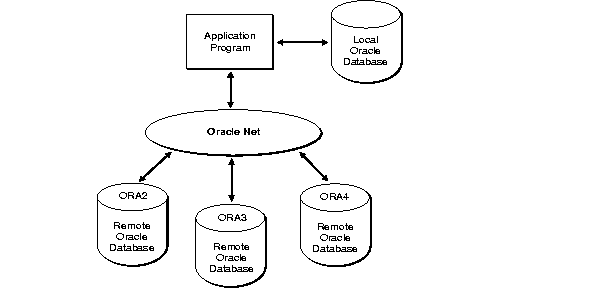

This chapter explains the CONNECT statement and its options, Oracle Net Services, and related network connection statements. Transaction processing is presented. You learn the basic techniques that safeguard the consistency of your database, including how to control whether changes to Oracle data are made permanent or undone.

- Connecting to Oracle

- Default Databases and Connections

- Key Terms

- How Transactions Guard a Database

- Beginning and Ending Transactions

- Using the COMMIT Statement

- Using the ROLLBACK Statement

- Using the SAVEPOINT Statement

- Using the RELEASE Option

- Using the SET TRANSACTION Statement

- Overriding Default Locking

- Fetching Across Commits

- Handling Distributed Transactions

- Guidelines for Transaction Processing

### 3.1 Connecting to Oracle

Your Pro\*COBOL program must log on to Oracle before querying or manipulating data. To log on, you use the CONNECT statement, as in

         EXEC SQL
             CONNECT :USERNAME IDENTIFIED BY :PASSWD
         END-EXEC.

where USERNAME and PASSWD are PIC X(n) or PIC X(n) VARYING host variables. Alternatively, you can use the statement:

         EXEC SQL
             CONNECT :USR-PWD
         END-EXEC.

where the host variable USR-PWD contains your username and password separated by a slash (/) followed by an optional tnsnames.ora alias (@TNSALIAS).

The syntax for the CONNECT statement has an optional ALTER AUTHORIZATION clause. The complete syntax for CONNECT is shown here:

         EXEC SQL
            CONNECT { :user IDENTIFIED BY :oldpswd | :usr_psw }
            [[AT { dbname | :host_variable }] USING :connect_string ]
            [ {ALTER AUTHORIZATION :newpswd  | IN {SYSDBA | SYSOPER} MODE} ]
         END-EXEC.

The CONNECT statement must be the first SQL statement executed by the program. That is, other executable SQL statements can positionally, but not logically, precede the CONNECT statement. If the precompiler option AUTO_CONNECT=YES, a CONNECT statement is not needed.)

To supply the username and password separately, you define two host variables as character strings or VARCHAR variables. If you supply a userid containing both username and password, only one host variable is needed.

Make sure to set the username and password variables before the CONNECT is executed or it will fail. Your program can prompt for the values or you can hard-code them, as follows:

     WORKING STORAGE SECTION.
         ...
     01  USERNAME  PIC X(10).
     01  PASSWD    PIC X(10).
             ...
         ...
     PROCEDURE DIVISION.
     LOGON.
         EXEC SQL WHENEVER SQLERROR GOTO LOGON-ERROR END-EXEC.
         MOVE "SCOTT" TO USERNAME.
         MOVE "TIGER" TO PASSWD.
         EXEC SQL
             CONNECT :USERNAME IDENTIFIED BY :PASSWD
         END-EXEC.

However, you cannot hard-code a username and password into the CONNECT statement or use quoted literals. For example, the following statements are invalid:

         EXEC SQL
             CONNECT SCOTT IDENTIFIED BY TIGER
         END-EXEC.

         EXEC SQL
             CONNECT "SCOTT" IDENTIFIED BY "TIGER"
         END-EXEC.

**See Also:**

- "Changing Passwords at Runtime" for more information about ALTER AUTHORIZATION clause.

- "SYSDBA or SYSOPER Privileges" for more information about SYSDBA and SYSOPER.

### 3.2 Default Databases and Connections

It is possible within a Pro\*COBOL program to maintain more than one database connection at the same time.

#### 3.2.1 Concurrent Logons

Pro\*COBOL supports distributed processing through Oracle Net Services. Your application can concurrently access any combination of local and remote databases or make multiple connections to the same database. In Figure 3-1, an application program communicates with one local and three remote Oracle databases. ORA2, ORA3, and ORA4 are logical names used in CONNECT statements.

Figure 3-1 Connecting Through Oracle

[Description of "Figure 3-1 Connecting Through Oracle"](img_text/pco81045.md)

By eliminating the boundaries in a network between different machines and operating systems, Oracle Net Services provides a distributed processing environment for Oracle tools. This section shows you how the Pro\*COBOL supports distributed processing through Oracle Net Services. You learn how your application can

- Access other databases directly or indirectly

- Concurrently access any combination of local and remote databases

- Make multiple connections to the same database

Normally you would need only a single connection, achieved by `EXEC SQL CONNECT :USR-PWD END-EXEC`. The database that is connected to is determined by what USR-PWD contains. If it contains the username and password for the default database, it will connect to the database defined as the default for the session. If it contains username/password@REMDB" it will connect through Oracle Net Services to the REMDB database as defined by your Oracle Net Services configuration. (An alternative is to use the USING clause to specify the Oracle Net Services connection string.) This is the default connection.

To make further concurrent connections to either the same or different databases you make use of the AT clause, that is, `EXEC SQL AT DB1 CONNECT :USR-PWD END-EXEC`. The name after the AT clause uniquely identifies a "nondefault" connection, and any SQL statements with the same name after the AT clause are executed against that connection. If the AT clause is omitted in an SQL statement then the statement is executed against the default connection.

All database names must be unique, but two or more database names can specify the same connection. That is, you can have multiple connections to any database on any node.

#### 3.2.2 Using Username/Password

Usually, you establish a connection to Oracle as follows:

         EXEC SQL CONNECT :USERNAME IDENTIFIED BY :PASSWORD END-EXEC.

Or you can use:

         EXEC SQL CONNECT :USR-PWD END-EXEC.

where USR-PWD contains any valid Oracle connect string.

These are simplified subsets of the CONNECT statement. For all details, read the next sections in this chapter.

**Related Topics**

- Automatic Logons
- [CONNECT (Executable Embedded SQL Extension)](embedded-SQL-statements-and-precompiler-directives.md)

##### 3.2.2.1 Named Database Connections

In the following example, you connect to a named database. Normally you use a named database connection only for multiple concurrent connections. The following example shows the syntax for a single connection:

    * --  Declare necessary host variables
     WORKING-STORAGE SECTION.
         ...
         EXEC SQL BEGIN DECLARE SECTION END-EXEC.
     01  USERNAME  PIC X(10) .
     01  PASSWORD  PIC X(10) .
     01  DB-STRING PIC X(20) .
            ...
         EXEC SQL END DECLARE SECTION END-EXEC.
         ...
     PROCEDURE DIVISION.
         MOVE "scott" TO USERNAME.
         MOVE "tiger" TO PASSSWORD.
         MOVE "nyremote" TO DB-STRING.
          ...
    * --  Assign a unique name to the database connection.
         EXEC SQL DECLARE DBNAME DATABASEEND-EXEC.
    * --  Connect to the nondefault database
         EXEC SQL
         CONNECT :USERNAME IDENTIFIED BY :PASSWORD
         AT DBNAME USING :DB-STRING
         END-EXEC.

The identifiers in this example serve the following purposes:

- The host variables USERNAME and PASSWORD identify a valid user.

- The host variable DB-STRING contains the Oracle Net Services syntax for logging on to a nondefault database at a remote node.

- The undeclared identifier DBNAME names a nondefault connection; it is an identifier used by Oracle, not a host or program variable.

The USING clause specifies the network, machine, and database to be associated with DBNAME. Later, SQL statements using the AT clause (with DBNAME) are executed at the database specified by DB-STRING.

Alternatively, you can use a character host variable in the AT clause, as the following example shows:

    * --  Declare necessary host variables
     WORKING-STORAGE SECTION.
         ...
         EXEC SQL BEGIN DECLARE SECTION END-EXEC.
     01  USERNAME  PIC X(10).
     01  PASSWORD  PIC X(10).
     01  DB-NAME   PIC X(10).
     01  DB-STRING PIC X(20).
            ...
         EXEC SQL END DECLARE SECTION END-EXEC.
         ...
     PROCEDURE DIVISION.
         MOVE "scott" TO USERNAME.
         MOVE "tiger" TO PASSSWORD.
         MOVE "oracle1" TO DB-NAME.
         MOVE "nyremote" TO DB-STRING.
         ...
    * --  Connect to the nondefault database
         EXEC SQL
         CONNECT :USERNAME IDENTIFIED BY :PASSWORD
         AT :DB-NAME USING :DB-STRING
         END-EXEC.

If DB-NAME is a host variable, the DECLARE DATABASE statement is not needed. Only if DBNAME is an undeclared identifier must you execute a DECLARE DBNAME DATABASE statement before executing a CONNECT ... AT DBNAME statement.

SQL Operations. If granted the privilege, you can execute any SQL data manipulation statement at the nondefault connection. For example, you might execute the following sequence of statements:

         EXEC SQL AT DBNAME SELECT ...
         EXEC SQL AT DBNAME INSERT ...
         EXEC SQL AT DBNAME UPDATE ...

In the next example, DB-NAME is a host variable:

         EXEC SQL AT :DB-NAME DELETE ...

Cursor Control. Cursor control statements such as OPEN, FETCH, and CLOSE are exceptions—they never use an AT clause. If you want to associate a cursor with an explicitly identified database, use the AT clause in the DECLARE CURSOR statement, as follows:

         EXEC SQL AT :DB-NAME DECLARE emp_cursor CURSOR FOR ...
         EXEC SQL OPEN emp_cursor ...
         EXEC SQL FETCH emp_cursor ...
         EXEC SQL CLOSE emp_cursor END-EXEC.

If DB-NAME is a host variable, its declaration must be within the scope of all SQL statements that refer to the declared cursor. For example, if you open the cursor in one subprogram, then fetch from it in another, you must declare DB-NAME globally or pass it to each subprogram.

When opening, closing, or fetching from the cursor, you do not use the AT clause. The SQL statements are executed at the database named in the AT clause of the DECLARE CURSOR statement or at the default database if no AT clause is used in the cursor declaration.

The AT :host-variable clause enables you to change the connection associated with a cursor. However, you cannot change the association while the cursor is open. Consider the following example:

         EXEC SQL AT :DB-NAME DECLARE emp_cursor CURSOR FOR ...
         MOVE "oracle1" TO DB-NAME.
         EXEC SQL OPEN emp_cursor END-EXEC.
         EXEC SQL FETCH emp_cursor INTO ...
         MOVE "oracle2" TO DB-NAME.
    * -- illegal, cursor still open
         EXEC SQL OPEN emp_cursor END-EXEC.
         EXEC SQL FETCH emp_cursor INTO ...

This is illegal because emp_cursor is still open when you try to execute the second OPEN statement. Separate cursors are not maintained for different connections; there is only one emp_cursor, which must be closed before it can be reopened for another connection. To debug the last example, simply close the cursor before reopening it, as follows:

    * -- close cursor first
         EXEC SQL CLOSE emp_cursor END-EXEC.
         MOVE "oracle2" TO DB-NAME.
         EXEC SQL OPEN EMP-CUROR END-EXEC.
         EXEC SQL FETCH emp_cursor INTO ...

Dynamic SQL. Dynamic SQL statements are similar to cursor control statements in that some never use the AT clause. For dynamic SQL Method 1, you must use the AT clause if you want to execute the statement at a nondefault connection. An example follows:

         EXEC SQL AT :DB-NAME EXECUTE IMMEDIATE :SQL-STMT END-EXEC.

For Methods 2, 3, and 4, you use the AT clause only in the DECLARE STATEMENT statement if you want to execute the statement at a nondefault connection. All other dynamic SQL statements such as PREPARE, DESCRIBE, OPEN, FETCH, and CLOSE never use the AT clause. The next example shows Method 2:

         EXEC SQL AT :DB-NAME DECLARE SQL-STMT STATEMENT END-EXEC.
         EXEC SQL PREPARE SQL-STMT FROM :SQL-STRING END-EXEC.
         EXEC SQL EXECUTE SQL-STMT END-EXEC.

The following example shows Method 3:

         EXEC SQL AT :DB-NAME DECLARE SQL-STMT STATEMENT END-EXEC.
         EXEC SQL PREPARE SQL-STMT FROM :SQL-STRING END-EXEC.
         EXEC SQL DECLARE emp_cursor CURSOR FOR SQL-STMT END-EXEC.
         EXEC SQL OPEN emp_cursor ...
         EXEC SQL FETCH emp_cursor INTO ...
         EXEC SQL CLOSE emp_cursor END-EXEC.

You need not use the AT clause when connecting to a remote database unless you open two or more connections simultaneously (in which case the AT clause is needed to identify the active connection). To make the default connection to a remote database, use the following syntax:

         EXEC SQL
            CONNECT :USERNAME IDENTIFIED BY :PASSWORD USING :DB-STRING
         END-EXEC.

#### 3.2.3 Automatic Logons

You can log on to Oracle automatically with the userid:

    <prefix><username>

where prefix is the value of the Oracle initialization parameter OS_AUTHENT_PREFIX (the default value is OPS\$) and username is your operating system user or task name. For example, if the prefix is OPS\$, your user name is TBARNES, and OPS\$TBARNES is a valid Oracle userid, then you log on to Oracle as user OPS\$TBARNES.

To take advantage of the automatic logon feature, you simply pass a slash (/) character to Pro\*COBOL, as follows:

         EXEC SQL BEGIN DECLARE SECTION END-EXEC.
     01 ORACLEID   PIC X.
         ...
         EXEC SQL END DECLARE SECTION END-EXEC.
         ...
         MOVE '/' TO ORACLEID.
         EXEC SQL CONNECT :ORACLEID END-EXEC.

This automatically connects you as user OPS\$username. For example, if your operating system username is RHILL, and OPS\$RHILL is a valid Oracle username, connecting with a slash (/) automatically logs you on to Oracle as user OPS\$RHILL.

You can also pass a character string to Pro\*COBOL. However, the string cannot contain trailing blanks. For example, the following CONNECT statement will fail:

         EXEC SQL BEGIN DECLARE SECTION END-EXEC.
               01 ORACLEID   PIC X(5).
         ...
         EXEC SQL END DECLARE SECTION END-EXEC.
         ...
         MOVE '/    ' TO ORACLEID.
         EXEC SQL CONNECT :ORACLEID END-EXEC.

##### 3.2.3.1 The AUTO_CONNECT Precompiler Option

Pro\*COBOL lets your program log on to the default database without using the CONNECT statement. Simply specify the precompiler option AUTO_CONNECT on the command line.

Assume that the default value of OS_AUTHENT_PREFIX is OPS\$, your username is TBARNES, and OPS\$TBARNES is a valid Oracle userid. When AUTO_CONNECT=YES, as soon as Pro\*COBOL encounters an executable SQL statement, your program logs on to Oracle automatically with the userid OPS\$TBARNES.

When AUTO_CONNECT=NO (the default), you must use the CONNECT statement to log on to Oracle.

#### 3.2.4 Changing Passwords at Runtime

Pro\*COBOL provides client applications with a convenient way to change a user password at runtime through the optional ALTER AUTHORIZATION clause.

The syntax for the ALTER AUTHORIZATION clause is shown here:

         EXEC SQL CONNECT .. ALTER AUTHORIZATION :NEWPSWD END-EXEC.

Using this clause indicates that you want to change the account password to the value indicated by NEWPSWD. After the change is made, an attempt is made to connect as `USER`/`NEWPSWD`. This can have the following results:

- The application will connect without issue.

- The application will fail to connect. This could be due to either of the following:

  - Password verification failed for some reason. In this case the password remains unchanged.

  - The account is locked. Changes to the password are not permitted.

#### 3.2.5 Connect Without Alter Authorization

This section describes the possible outcomes of different variations of the CONNECT statement.

##### 3.2.5.1 Standard CONNECT

If an application issues the following statement:

          EXEC SQL CONNECT ...   /* No ALTER AUTHORIZATION clause */

it performs a normal connection attempt. The possible results include the following:

- The application will connect without issue.

- The application will connect, but will receive a password warning. The warning indicates that the password has expired but is in a grace period which will allow logons. At this point, the user is encouraged to change the password before the account becomes locked.

- The application will fail to connect. Possible causes include the following:

  - The password is incorrect.

  - The account has expired, and is possibly in a locked state.

##### 3.2.5.2 SYSDBA or SYSOPER Privileges

Before Oracle release 8.1 you did not have to use this clause to have the SYSOPER or SYSDBA system privilege, but now you must.

Append the following optional string to the CONNECT statement after all other clauses if you want to log on with either SYSDBA or SYSOPER system privileges:

    IN { SYSDBA | SYSOPER } MODE

For example:

    EXEC SQL CONNECT ... IN SYSDBA MODE END-EXEC.

Here are the restrictions that apply to this option:

- This option is not supported when using the AUTO_CONNECT=YES precompiler option setting.

- The option is not permitted when using the ALTER AUTHORIZATION keywords in the CONNECT statement.

#### 3.2.6 Using Links

Database links are supported through the Oracle distributed database option. For example, a distributed query allows a single SELECT statement to access data on one or more nondefault databases.

The distributed query facility depends on database links, which assign a name to a CONNECT statement rather than to the connection itself. At runtime, the embedded SELECT statement is executed by the specified database server, which connects implicitly to the nondefault database(s) to get the required data.

**Related Topics**

- [Connecting to a Database Service](../netag/identifying-and-accessing-database.md)

### 3.3 Key Terms

Before delving into the subject of transactions, you should know the terms defined in this section.

The jobs or tasks that the database manages are called sessions. A user session is started when you run an application program or a tool such as Oracle Forms and connect to the database. Oracle enables user sessions to work simultaneously and share computer resources. To do this, Oracle must control concurrence, the accessing of the same data by many users. Without adequate concurrence controls, there might be a loss of data integrity. That is, changes to data or structures might be made in the wrong order.

Oracle uses locks to control concurrent access to data. A lock gives you temporary ownership of a database resource such as a table or row of data. Thus, data cannot be changed by other users until you finish with it. You need never explicitly lock a resource, because default locking mechanisms protect table data and structures. However, you can request data locks on tables or rows when it is to your advantage to override default locking. You can choose from several modes of locking such as row share and exclusive.

A deadlock can occur when two or more users try to access the same database object. For example, two users updating the same table might wait if each tries to update a row currently locked by the other. Because each user is waiting for resources held by another user, neither can continue until the server breaks the deadlock. The server signals an error to the participating transaction that had completed the least amount of work, and the "deadlock detected while waiting for resource" error code is returned to SQLCODE in the SQLCA.

When a table is queried by one user and updated by another at the same time, the database generates a read consistent view of the table's data for the query. That is, once a query begins (and proceeds), the data read by the query does not change. As update activity continues, the database takes snapshots of the table's data and records changes in a rollback segment. The database uses information in the rollback segment to build read consistent query results and to undo changes if necessary.

### 3.4 How Transactions Guard a Database

The database is transaction oriented; it uses transactions to ensure data integrity. A transaction is a series of one or more logically related SQL statements you define to accomplish some task. The database treats the series of SQL statements as a unit so that all the changes brought about by the statements are either committed (made permanent) or rolled back (undone) at the same time. If your application program fails in the middle of a transaction, the database is automatically restored to its former (pre-transaction) state.

The coming sections show you how to define and control transactions. Specifically, it shows how to:

- Begin and end transactions

- Use the COMMIT statement to make transactions permanent

- Use the SAVEPOINT statement with the ROLLBACK TO statement to undo parts of transactions

- Use the ROLLBACK statement to undo whole transactions

- Specify the RELEASE option to free resources and log off the database

- Use the SET TRANSACTION statement to set read-only transactions

- Use the FOR UPDATE clause or LOCK TABLE statement to override default locking

**See Also:**

[Oracle Database SQL Language Reference](../sqlrf/index.md) for details about the SQL statements.

### 3.5 Beginning and Ending Transactions

You begin a transaction with the first executable SQL statement (other than CONNECT) in your program. When one transaction ends, the next executable SQL statement automatically begins another transaction. Thus, every executable statement is part of a transaction. Because they cannot be rolled back and need not be committed, declarative SQL statements are not considered part of a transaction.

You end a transaction in one of the following ways:

- Code a COMMIT or ROLLBACK statement, with or without the RELEASE option. This explicitly makes permanent or undoes changes to the database.

- Code a data definition statement (ALTER, CREATE, or GRANT, for example) that issues an automatic commit before and after executing. This implicitly makes permanent changes to the database.

A transaction also ends when there is a system failure or your user session stops unexpectedly because of software problems, hardware problems, or a forced interrupt.

If your program fails in the middle of a transaction, Oracle detects the error and rolls back the transaction. If your operating system fails, Oracle restores the database to its former (pre-transaction) state.

### 3.6 Using the COMMIT Statement

The COMMIT statement is used to make changes to the database permanent. Until changes are committed, other users cannot access the changed data; they see it as it was before your transaction began. The COMMIT statement has no effect on the values of host variables or on the flow of control in your program. Specifically, the COMMIT statement:

- Makes permanent all changes made to the database during the current transaction.

- Makes these changes visible to other users.

- Erases all savepoints (see the next section).

- Releases all row and table locks, but not parse locks.

- Closes cursors declared using the FOR UPDATE clause or referenced elsewhere in the code with the CURRENT OF clause. If MODE=ANSI \| ANSI14 or CLOSE_ON_COMMIT=YES is used, then all explicit cursors are closed.

- Ends the transaction.

When MODE={ANSI13 \| ORACLE}, explicit cursors not referenced in a CURRENT OF clause remain open across commits. This can boost performance. For an example, see "Fetching Across Commits".

Because they are part of normal processing, COMMIT statements should be placed inline, on the main path through your program. Before your program terminates, it must explicitly commit pending changes. Otherwise, Oracle rolls them back. In the following example, you commit your transaction and disconnect:

        EXEC SQL COMMIT WORK RELEASE END-EXEC.

The optional keyword WORK provides ANSI compatibility. The RELEASE option frees all resources (locks and cursors) held by your program and logs off the database.

You need not follow a data definition statement with a COMMIT statement because data definition statements issue an automatic commit before and after executing. So, whether they succeed or fail, the prior transaction is committed.

#### 3.6.1 WITH HOLD Clause in DECLARE CURSOR Statements

Any cursor that has been declared with the clause WITH HOLD after the word CURSOR remains open after a COMMIT. The following example shows how to use this clause:

         EXEC SQL
             DECLARE C1 CURSOR WITH HOLD
             FOR SELECT ENAME FROM EMP
             WHERE EMPNO BETWEEN 7600 AND 7700
         END-EXEC.

The cursor must not be declared for UPDATE. The WITH HOLD clause is used in DB2 to override the default, which is to close all cursors on commit. Pro\*COBOL provides this clause in order to ease migrations of applications from DB2 to Oracle. When MODE=ANSI, Oracle uses the DB2 default, but all host variables must be declared in a Declare Section. To avoid having a Declare Section, use the precompiler option CLOSE_ON_COMMIT described next.

**Related Topics**

- [DECLARE CURSOR (Embedded SQL Directive)](embedded-SQL-statements-and-precompiler-directives.md)

#### 3.6.2 CLOSE_ON_COMMIT Precompiler Option

The precompiler option CLOSE_ON_COMMITis available to override the default behavior of MODE=ANSI (if you specify MODE=ANSI on the command line, any cursors not declared with the WITH HOLD clause are closed on commit):

    CLOSE_ON_COMMIT = {YES | NO}

The default is NO. This option must be entered only on the command line or in a configuration file.

**Note:**

Use this option carefully; applications may be slowed if cursors are opened and closed many times because of the need to re-parse for each OPEN statement. See "[CLOSE_ON_COMMIT](precompiler-options.md)".

### 3.7 Using the ROLLBACK Statement

You use the ROLLBACK statement to undo pending changes made to the database. For example, if you make a mistake, such as deleting the wrong row from a table, you can use ROLLBACK to restore the original data. The ROLLBACK statement has no effect on the values of host variables or on the flow of control in your program. Specifically, the ROLLBACK statement

- Undoes all changes made to the database during the current transaction

- Erases all savepoints

- Ends the transaction

- Releases all row and table locks, but not parse locks

- Closes cursors declared using the FOR UPDATE clause or referenced elsewhere in the code with the CURRENT OF clause. If MODE={ANSI \| ANSI14}, then all explicit cursors are closed.

When MODE={ANSI13 \| ORACLE}, explicit cursors not referenced in a CURRENT OF clause remain open across rollbacks.

Because they are part of exception processing, ROLLBACK statements should be placed in error handling routines, off the main path through your program. In the following example, you roll back your transaction and disconnect:

        EXEC SQL ROLLBACK WORK RELEASE END-EXEC.

The optional keyword WORK provides ANSI compatibility. The RELEASE option frees all resources held by your program and logs off the database.

If a WHENEVER SQLERROR GOTO statement branches to an error handling routine that includes a ROLLBACK statement, your program might enter an infinite loop if the rollback fails with an error. You can avoid this by coding WHENEVER SQLERROR CONTINUE before the ROLLBACK statement.

For example, consider the following:

         EXEC SQL
             WHENEVER SQLERROR GOTO SQL-ERROR
         END-EXEC.
         ...
         DISPLAY 'Employee number? '.
         ACCEPT EMP-NUMBER.
         DISPLAY 'Employee name? '.
         ACCEPT EMP-NAME.
         EXEC SQL INSERT INTO EMP (EMPNO, ENAME)
            VALUES (:EMP-NUMBER, :EMP-NAME)
         END-EXEC.
         ...
     SQL-ERROR.
         EXEC SQL WHENEVER SQLERROR CONTINUE END-EXEC.
         DISPLAY 'PROCESSING ERROR.'.
         DISPLAY 'ERROR CODE : ', SQLCODE.
         DISPLAY 'MESSAGE :', SQLERRMC.
         EXEC SQL ROLLBACK WORK RELEASE END-EXEC.
         STOP RUN.

Oracle rolls back transactions if your program terminates abnormally.

#### 3.7.1 Statement-Level Rollbacks

Before executing any SQL statement, Oracle marks an implicit savepoint (not available to you). Then, if the statement fails, Oracle rolls it back automatically and returns the applicable error code to SQLCODE in the SQLCA. For example, if an INSERT statement causes an error by trying to insert a duplicate value in a unique index, the statement is rolled back.

Only work started by the failed SQL statement is lost; work done before that statement in the current transaction is kept. Thus, if a data definition statement fails, the automatic commit that precedes it is not undone.

**Note:**

Before executing a SQL statement, Oracle must parse it, that is, examine it to make sure it follows syntax rules and refers to valid database objects. Errors detected while executing a SQL statement cause a rollback, but errors detected while parsing the statement do not.

Oracle can also roll back single SQL statements to break deadlocks. Oracle signals an error to one of the participating transactions and rolls back the current statement in that transaction.

### 3.8 Using the SAVEPOINT Statement

The SAVEPOINT embedded SQL statement marks and names the current point in processing a transaction. Each marked point is called a savepoint. For example, the following statement marks a savepoint named start_delete:

        EXEC SQL SAVEPOINT start_delete END-EXEC.

Savepoints let you divide long transactions, giving you more control over complex procedures. For example, if a transaction performs several functions, you can mark a savepoint before each function. Then, if a function fails, you can easily restore the data to its former state, recover, and then reexecute the function.

To undo part of a transaction, you can use savepoints with the ROLLBACK statement and its TO SAVEPOINT clause. The TO SAVEPOINT clause lets you roll back to an intermediate statement in the current transaction. With it, you do not have to undo all your changes. Specifically, the ROLLBACK TO SAVEPOINT statement:

- Undoes changes made to the database since the specified savepoint was marked

- Erases all savepoints marked after the specified savepoint

- Releases all row and table locks acquired since the specified savepoint was marked

In the following example, you access the table MAIL_LIST to insert new listings, update old listings, and delete (a few) inactive listings. After the delete, you check SQLERRD(3) in the SQLCA for the number of rows deleted. If the number is unexpectedly large, you roll back to the savepoint start_delete, undoing just the delete.

    * -- For each new customer
         DISPLAY 'New customer number? '.
         ACCEPT CUST-NUMBER.
         IF CUST-NUMBER = 0
              GO TO REV-STATUS
         END-IF.
         DISPLAY 'New customer name? '.
              ACCEPT  CUST-NAME.
         EXEC SQL INSERT INTO MAIL-LIST (CUSTNO, CNAME, STAT)
             VALUES (:CUST-NUMBER, :CUST-NAME, 'ACTIVE').
         END-EXEC.
         ...
    * -- For each revised status
     REV-STATUS.
         DISPLAY 'Customer number to revise status? '.
         ACCEPT CUST-NUMBER.
         IF CUST-NUMBER = 0
             GO TO SAVE-POINT
         END-IF.
         DISPLAY 'New status? '.
         ACCEPT NEW-STATUS.
         EXEC SQL UPDATE MAIL-LIST
            SET STAT = :NEW-STATUS WHERE CUSTNO = :CUST-NUMBER
         END-EXEC.
         ...
    * -- mark savepoint
     SAVE-POINT.
         EXEC SQL SAVEPOINT START-DELETE END-EXEC.
         EXEC SQL DELETE FROM MAIL-LIST WHERE STAT = 'INACTIVE'
         END-EXEC.
         IF SQLERRD(3) < 25
    * -- check number of rows deleted
             DISPLAY 'Number of rows deleted is ', SQLERRD(3)
         ELSE
             DISPLAY 'Undoing deletion of ', SQLERRD(3), ' rows'
             EXEC SQL
                 WHENEVER SQLERROR GOTO SQL-ERROR
             END-EXEC
             EXEC SQL
                 ROLLBACK TO SAVEPOINT START-DELETE
             END-EXEC
         END-IF.
         EXEC SQL WHENEVER SQLERROR CONTINUE END-EXEC.
         EXEC SQL COMMIT WORK RELEASE END-EXEC.
         STOP RUN.
    * -- exit program.
         ...
     SQL-ERROR.
         EXEC SQL WHENEVER SQLERROR CONTINUE END-EXEC.
         EXEC SQL ROLLBACK WORK RELEASE END-EXEC.
         DISPLAY 'Processing error'.
    * -- exit program with an error.
         STOP RUN.

Note that you cannot specify the RELEASE option in a ROLLBACK TO SAVEPOINT statement.

Rolling back to a savepoint erases any savepoints marked after that savepoint. The savepoint to which you roll back, however, is not erased. For example, if you mark five savepoints, then roll back to the third, only the fourth and fifth are erased. A COMMIT or ROLLBACK statement erases all savepoints.

### 3.9 Using the RELEASE Option

Oracle rolls back changes automatically if your program terminates abnormally. Abnormal termination occurs when your program does not explicitly commit or roll back work and disconnect using the RELEASE embedded SQL statement.

Normal termination occurs when your program runs its course, closes open cursors, explicitly commits or rolls back work, disconnects, and returns control to the user. Your program will exit gracefully if the last SQL statement it executes is either

         EXEC SQL COMMIT WORK RELEASE END-EXEC.

or

         EXEC SQL ROLLBACK WORK RELEASE END-EXEC.

where the token WORK is optional. Otherwise, locks and cursors acquired by your user session are held after program termination until Oracle recognizes that the user session is no longer active. This might cause other users in a multiuser environment to wait longer than necessary for the locked resources.

### 3.10 Using the SET TRANSACTION Statement

You can use the SET TRANSACTION statement to begin a read-only or read/write transaction, or to assign your current transaction to a specified rollback segment. A COMMIT, ROLLBACK, or data definition statement ends a read-only transaction.

Because they allow "repeatable reads," read-only transactions are useful for running multiple queries against one or more tables while other users update the same tables. During a read-only transaction, all queries refer to the same snapshot of the database, providing a multitable, multiquery, read-consistent view. Other users can continue to query or update data as usual. An example of the SET TRANSACTION statement follows:

         EXEC SQL SET TRANSACTION READ ONLY END-EXEC.

The SET TRANSACTION statement must be the first SQL statement in a read-only transaction and can appear only once in a transaction. The READ ONLY parameter is required. Its use does not affect other transactions. Only the SELECT (without FOR UPDATE), LOCK TABLE, SET ROLE, ALTER SESSION, ALTER SYSTEM, COMMIT, and ROLLBACK statements are allowed in a read-only transaction.

In the following example, a store manager checks sales activity for the day, the past week, and the past month by using a read-only transaction to generate a summary report. The report is unaffected by other users updating the database during the transaction.

         EXEC SQL SET TRANSACTION READ ONLY END-EXEC.
         EXEC SQL SELECT SUM(SALEAMT) INTO :DAILY FROM SALES
             WHERE SALEDATE = SYSDATE END-EXEC.
         EXEC SQL SELECT SUM(SALEAMT) INTO :WEEKLY FROM SALES
             WHERE SALEDATE > SYSDATE - 7 END-EXEC.
         EXEC SQL SELECT SUM(SALEAMT) INTO :MONTHLY FROM SALES
             WHERE SALEDATE > SYSDATE - 30 END-EXEC.
         EXEC SQL COMMIT WORK END-EXEC.
    * --  simply ends the transaction since there are no changes
    * --  to make permanent
    * --  format and print report

### 3.11 Overriding Default Locking

By default, Oracle implicitly (automatically) locks many data structures for you. However, you can request specific data locks on rows or tables when it is to your advantage to override default locking. Explicit locking lets you share or deny access to a table for the duration of a transaction or ensure multitable and multiquery read consistency.

With the SELECT FOR UPDATE OF statement, you can explicitly lock specific rows of a table to make sure they do not change before an update or delete is executed. However, Oracle automatically obtains row-level locks at update or delete time. So, use the FOR UPDATE OF clause only if you want to lock the rows before the update or delete.

You can explicitly lock entire tables using the LOCK TABLE statement.

#### 3.11.1 Using the FOR UPDATE OF Clause

When you DECLARE a cursor, you can meanwhile optionally specify the FOR UPDATE clause, which has the effect of acquiring an exclusive lock on all rows defined by the cursor. This is useful, for example, when you want to base an update on existing rows in a table and want to ensure that they are not meanwhile changed by anyone else.

Note that if you refer to a cursor with the CURRENT OF clause, that the precompiler will automatically add the FOR UPDATE clause to the cursor definition and the word OF is optional. For instance, instead of:

         EXEC SQL DECLARE emp_cursor CURSOR FOR
             SELECT ENAME, JOB, SAL FROM EMP WHERE DEPTNO = 20
                FOR UPDATE OF SAL
         END-EXEC.

you can drop the OF part of the clause and simply code:

        EXEC SQL DECLARE emp_cursor CURSOR FOR
            SELECT ENAME, JOB, SAL FROM EMP WHERE DEPTNO = 20
               FOR UPDATE
        END-EXEC.

**See Also:**

"[Using the CURRENT OF Clause](embedded-SQL.md) " for an example.

##### 3.11.1.1 Restrictions

You cannot use FOR UPDATE with multiple tables, but you must use FOR UPDATE OF to identify a column in the table that you want locked. Row locks obtained by a FOR UPDATE statement are cleared by a COMMIT, which explains why the cursor is closed for you. If you try to fetch from a FOR UPDATE cursor after a commit, Oracle generates a Fetch out of Sequence error.

### 3.12 Fetching Across Commits

If you want to mix commits and fetches, do not use the CURRENT OF clause. Instead, select the ROWID of each row, and then use that value to identify the current row during the update or delete. Consider the following example:

         EXEC SQL DECLARE emp_cursor CURSOR FOR
             SELECT ENAME, SAL, ROWID FROM EMP WHERE JOB = 'CLERK'
         END-EXEC.
         ...
         EXEC SQL OPEN emp_cursor END-EXEC.
         EXEC SQL WHENEVER NOT FOUND GOTO ...
         PERFORM
         EXEC SQL
             FETCH emp_cursor INTO :EMP_NAME, :SALARY, :ROW-ID
         END-EXEC
         ...
             EXEC SQL UPDATE EMP SET SAL = :NEW-SALARY
                 WHERE ROWID = :ROW-ID
             END-EXEC
             EXEC SQL COMMIT END-EXEC
         END-PERFORM.

Note, however, that the fetched rows are not locked. So, you can receive inconsistent results if another user modifies a row after you read it but before you update or delete it.

#### 3.12.1 Using the LOCK TABLE Statement

Use the LOCK TABLE statement locks one or more tables in a specified lock mode. For example, the following statement locks the EMP table in row share mode. Row share locks allow concurrent access to a table. They prevent other users from locking the entire table for exclusive use.

         EXEC SQL
             LOCK TABLE EMP IN ROW SHARE MODE NOWAIT
         END-EXEC.

The lock mode determines what other locks can be placed on the table. For example, many users can acquire row share locks on a table at the same time, but only one user at a time can acquire an exclusive lock. While one user has an exclusive lock on a table, no other users can insert, update, or delete rows in that table.

The optional keyword NOWAIT tells Oracle not to wait for a table if it has been locked by another user. Control is immediately returned to your program so that it can do other work before trying again to acquire the lock. (You can check SQLCODE in the SQLCA to see if the table lock failed.) If you omit NOWAIT, Oracle waits until the table is available; the wait has no set limit.

A table lock never keeps other users from querying a table, and a query never acquires a table lock. Consequently, a query never blocks another query or an update, and an update never blocks a query. Only if two different transactions try to update the same row will one transaction wait for the other to complete. Table locks are released when your transaction issues a COMMIT or ROLLBACK.

**See Also:**

[Using Oracle Lock Management Services](../adfns/sql-processing-for-application-developers.md) for more information about lock modes.

### 3.13 Handling Distributed Transactions

A distributed database is a single logical database comprising multiple physical databases at different nodes. A distributed statement is any SQL statement that accesses a remote node using a database link. A distributed transaction includes at least one distributed statement that updates data at multiple nodes of a distributed database. If the update affects only one node, the transaction is non-distributed.

When you issue a commit, changes to each database affected by the distributed transaction are made permanent. If instead you issue a rollback, all the changes are undone. However, if a network or machine fails during the commit or rollback, the state of the distributed transaction might be unknown or in doubt. In such cases, if you have FORCE TRANSACTION system privileges, you can manually commit or roll back the transaction at your local database by using the FORCE clause. The transaction must be identified by a quoted literal containing the transaction ID, which can be found in the data dictionary view DBA_2PC_PENDING. Some examples follow:

         EXEC SQL COMMIT FORCE '22.31.83' END-EXEC.
         ...
         EXEC SQL ROLLBACK FORCE '25.33.86'END-EXEC.

FORCE commits or rolls back only the specified transaction and does not affect your current transaction. Note that you cannot manually roll back in-doubt transactions to a savepoint.

The COMMENT clause in the COMMIT statement lets you specify a Comment to be associated with a distributed transaction. If ever the transaction is in doubt, the server stores the text specified by COMMENT in the data dictionary view DBA_2PC_PENDING along with the transaction ID. The text must be a quoted literal of no more than  50 characters in length. An example follows:

         EXEC SQL
             COMMIT COMMENT 'In-doubt trans; notify Order Entry'
         END-EXEC.

**See Also:**

[Oracle Database Concepts.](../cncpt/transactions.md) for more information about distributed transactions.

### 3.14 Guidelines for Transaction Processing

The following guidelines will help you avoid some common problems.

#### 3.14.1 Designing Applications

When designing your application, group logically related actions together in one transaction. A well-designed transaction includes all the steps necessary to accomplish a given task—no more and no less.

Data in the tables you reference must be left in a consistent state. Thus, the SQL statements in a transaction should change the data in a consistent way. For example, a transfer of funds between two bank accounts should include a debit to one account and a credit to another. Both updates should either succeed or fail together. An unrelated update, such as a new deposit to one account, should not be included in the transaction.

#### 3.14.2 Obtaining Locks

If your application programs include SQL locking statements, make sure the users requesting locks have the privileges needed to obtain the locks. Your DBA can lock any table. Other users can lock tables they own or tables for which they have a privilege, such as ALTER, SELECT, INSERT, UPDATE, or DELETE.

#### 3.14.3 Using PL/SQL

If a PL/SQL block is part of a transaction, commits and rollback operations inside the block affect the whole transaction. In the following example, the rollback operation undoes changes made by the update and the insert:

         EXEC SQL INSERT INTO EMP ...
         EXEC SQL EXECUTE
         BEGIN        UPDATE emp
         ...
             ...
         EXCEPTION
             WHEN DUP_VAL_ON_INDEX THEN
                 ROLLBACK;
         END;
         END-EXEC.
         ...

#### 3.14.4 X/Open Applications

For instructions on using the XA interface in X/Open applications, see [X/Open Distributed Transaction Processing (DTP)](../adfns/xa.md).
