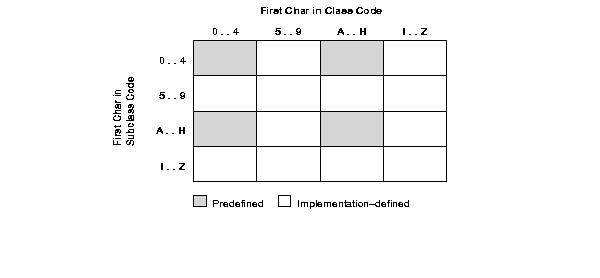
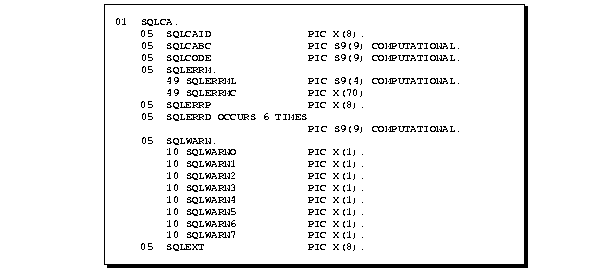
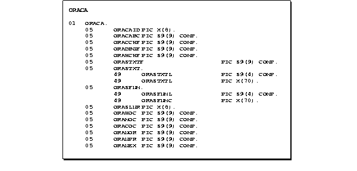

An application program must anticipate runtime errors and attempt to recover from them. This chapter provides an in-depth discussion of error reporting and recovery. You learn how to handle warnings and errors using the ANSI status variables SQLCODE and SQLSTATE, or the Oracle SQLCA (SQL Communications Area) structure. You also learn how to use the WHENEVER statement and how to diagnose problems using the Oracle ORACA (Oracle Communications Area) structure.

The following topics are discussed:

- Why Error Handling is Needed

- Error Handling Alternatives

- Using the SQL Communications Area

- Using the Oracle Communications Area

- How Errors Map to SQLSTATE Codes

### 8.1 Why Error Handling is Needed

A significant part of every application program must be devoted to error handling. The main benefit of error handling is that it enables your program to continue operating in the presence of errors. Errors arise from design faults, coding mistakes, hardware failures, invalid user input, and many other sources

You cannot anticipate all possible errors, but you can plan to handle certain kinds of errors meaningful to your program. For Pro\*COBOL, error handling means detecting and recovering from SQL statement execution errors. You must trap errors because the precompiler will continue regardless of the errors encountered unless you halt processing.

You can also prepare to handle warnings such as "value truncated" and status changes such as "end of data." It is especially important to check for error and warning conditions after every data manipulation statement because an INSERT, UPDATE, or DELETE statement might fail before processing all eligible rows in a table.

### 8.2 Error Handling Alternatives

Pro\*COBOL supports two general methods of error handling:

- The Oracle-specific method with SQLCA and optional ORACA.

- The SQL standard method with SQLSTATE status variable.

The precompiler MODE option governs compliance with the SQL standard. When MODE={ANSI \| ANSI14}, you declare the SQLSTATE status variable as PIC X(5). Additionally, the ANSI SQL-89 SQLCODE status variable is still supported, but it is not recommended for new programs because it has been removed from the SQL standard. When MODE={ORACLE \| ANSI13}, you must include the SQLCA through an EXEC SQL INCLUDE statement. It is possible to use both methods in one program but usually not necessary.

**See Also:**

Status Variable Combinations for detailed information on mixing methods.

#### 8.2.1 SQLCA

The SQLCA is a record-like, host-language data structure which includes Oracle warnings, error numbers and error text. Oracle updates the SQLCA after every executable SQL or PL/SQL statement. (SQLCA values are undefined after a declarative statement.) By checking return codes stored in the SQLCA, your program can determine the outcome of a SQL statement. This can be done in two ways:

- Implicit checking with the WHENEVER statement

- Explicit checking of SQLCA variables

When you use the WHENEVER statement to implicitly check the status of your SQL statements, Pro\*COBOL automatically inserts error checking code after each executable statement. Alternatively, you can explicitly write your own code to test the value of the SQLCODE member of the SQLCA structure. Include SQLCA by using the embedded SQL INCLUDE statement:

    EXEC SQL INCLUDE SQLCA END-EXEC.

#### 8.2.2 ORACA

When more information is needed about runtime errors than the SQLCA provides, you can use the ORACA, which contains cursor statistics, SQL statement text, certain option settings and system statistics. Include ORACA by using the embedded SQL INCLUDE statement:

    EXEC SQL INCLUDE ORACA END-EXEC.

The ORACA is optional and can be declared regardless of the MODE setting.

**See Also:**

Using the Oracle Communications Area for more information about the ORACA status variable.

#### 8.2.3 ANSI SQLSTATE Variable

When MODE=ANSI, you can declare the ANSI SQLSTATE variable inside the Declare Section for implicit or explicit error checking. If the option DECLARE_SECTION is set to NO, then you can also declare it outside of the Declare Section.

**Note:**

When MODE=ANSI, you can also declare the SQLCODE variable with a picture S9(9) COMP. While it can be used instead of or with the SQLSTATE variable, this is not recommended for new programs. You can also use the SQLCA with the SQLSTATE variable. When MODE=ANSI14, then SQLSTATE is not supported and you must declare either SQLCODE or include SQLCA. You cannot declare both SQLCODE and SQLCA for any setting of mode.

#### 8.2.4 Declaring SQLSTATE

This section describes how to declare SQLSTATE. SQLSTATE must be declared as a five-character alphanumeric string as in the following example:

    *    Declare the SQLSTATE status variable.
         EXEC SQL BEGIN DECLARE SECTION END-EXEC.
           ...
     01 SQLSTATE PIC X(5).
           ...
         EXEC SQL END DECLARE SECTION END-EXEC.

##### 8.2.4.1 SQLSTATE Values

SQLSTATE status codes consist of a two-character class code followed by a three-character subclass code. Aside from class code 00 (successful completion), the class code denotes a category of exceptions. Aside from subclass code 000 (not applicable), the subclass code denotes a specific exception within that category. For example, the SQLSTATE value '22012' consists of class code 22 (data exception) and subclass code 012 (division by zero).

Each of the five characters in a SQLSTATE value is a digit (0..9) or an uppercase Latin letter (A..Z). Class codes that begin with a digit in the range 0..4 or a letter in the range A..H are reserved for predefined conditions (those defined in the SQL standard). All other class codes are reserved for implementation-defined conditions. Within predefined classes, subclass codes that begin with a digit in the range 0..4 or a letter in the range A..H are reserved for predefined sub-conditions. All other subclass codes are reserved for implementation-defined sub-conditions. Figure 8-1 shows the coding scheme:

Figure 8-1 SQLSTATE Coding Scheme

[Description of "Figure 8-1 SQLSTATE Coding Scheme"](img_text/pco81055.md)

Table 8-1 shows the classes predefined by the SQL standard.

Table 8-1 Predefined Classes

| Class | Condition                                                 |
|:------|:----------------------------------------------------------|
| 00    | successful completion                                     |
| 01    | warning                                                   |
| 02    | no data                                                   |
| 07    | dynamic SQL error                                         |
| 08    | connection exception                                      |
| 09    | triggered action exception                                |
| 0A    | feature not supported                                     |
| 0A    | feature not supported                                     |
| 0D    | invalid target type specification                         |
| 0E    | invalid schema name list specification                    |
| 0F    | locator exception                                         |
| 0L    | invalid grantor                                           |
| 0M    | invalid SQL-invoked procedure reference                   |
| 0P    | invalid role specification                                |
| 0S    | invalid transform group name specification                |
| 0T    | target table disagrees with cursor specification          |
| 0U    | attempt to assign to non-updatable column                 |
| 0V    | attempt to assign to ordering column                      |
| 0W    | prohibited statement encountered during trigger execution |
| 0Z    | diagnostics exception                                     |
| 21    | cardinality violation                                     |
| 22    | data exception                                            |
| 23    | integrity constraint violation                            |
| 24    | invalid cursor state                                      |
| 25    | invalid transaction state                                 |
| 26    | invalid SQL statement name                                |
| 27    | triggered data change violation                           |
| 28    | invalid authorization specification                       |
| 2A    | direct SQL syntax error or access rule violation          |
| 2B    | dependent privilege descriptors still exist               |
| 2C    | invalid character set name                                |
| 2D    | invalid transaction termination                           |
| 2E    | invalid connection name                                   |
| 2F    | SQL routine exception                                     |
| 2H    | invalid collation name                                    |
| 30    | invalid SQL statement identifier                          |
| 33    | invalid SQL descriptor name                               |
| 34    | invalid cursor name                                       |
| 35    | invalid condition number                                  |
| 36    | cursor sensitivity exception                              |
| 37    | dynamic SQL syntax error or access rule violation         |
| 38    | external routine exception                                |
| 39    | external routine invocation exception                     |
| 3B    | savepoint exception                                       |
| 3C    | ambiguous cursor name                                     |
| 3D    | invalid catalog name                                      |
| 3F    | invalid schema name                                       |
| 40    | transaction rollback                                      |
| 42    | syntax error or access rule violation                     |
| 44    | with check option violation                               |
| HZ    | remote database access                                    |

**Note:**

The class code HZ is reserved for conditions defined in International Standard ISO/IEC DIS 9579-2, Remote Database Access.

Table 8-4 shows how errors map to SQLSTATE status codes. In some cases, several errors map to the status code. In other cases, no error maps to the status code (so the last column is empty). Status codes in the range 60000..99999 are implementation-defined.

### 8.3 Using the SQL Communications Area

Oracle uses the SQL Communications Area (SQLCA) to store status information passed to your program at run time. The SQLCA is a record-like, COBOL data structure that is a updated after each executable SQL statement, so it always reflects the outcome of the most recent SQL operation. Its fields contain error, warning, and status information updated by Oracle whenever a SQL statement is executed. To determine that outcome, you can check variables in the SQLCA explicitly with your own COBOL code or implicitly with the WHENEVER statement.

When MODE={ORACLE \| ANSI13}, the SQLCA is required; if the SQLCA is not declared, compile-time errors will occur. The SQLCA is optional when MODE={ANSI \| ANSI14}, but if you want to use the WHENEVER SQLWARNING statement, you must declare the SQLCA. The SQLCA must also be included when using multibyte NCHAR host variables.

**Note:**

When your application uses Oracle Net Services to access a combination of local and remote databases concurrently, all the databases write to one SQLCA. There is not a different SQLCA for each database. For more information, see "[Concurrent Logons](database-concepts.md)".

#### 8.3.1 Contents of the SQLCA

The SQLCA contains runtime information about the execution of SQL statements, such as error codes, warning flags, event information, rows-processed count, and diagnostics.

Figure 8-2 shows all the variables in the SQLCA.

Figure 8-2 SQLCA Variable Declarations for Pro\*COBOL

[Description of "Figure 8-2 SQLCA Variable Declarations for Pro\*COBOL"](img_text/pco81002.md)

#### 8.3.2 Declaring the SQLCA

To declare the SQLCA, simply include it (using an EXEC SQL INCLUDE statement) in your Pro\*COBOL source file outside the Declare Section as follows:

    *    Include the SQL Communications Area (SQLCA).
         EXEC SQL INCLUDE SQLCA END-EXEC.

The SQLCA must be declared outside the Declare Section.

**WARNING:**

 Do not declare SQLCODE if SQLCA is declared. Likewise, do not declare SQLCA if SQLCODE is declared. The status variable declared by the SQLCA structure is also called SQLCODE, so errors will occur if both error-reporting mechanisms are used.

When you precompile your program, the INCLUDE SQLCA statement is replaced by several variable declarations that allow Oracle to communicate with the program.

#### 8.3.3 Key Components of Error Reporting

The key components of Pro\*COBOL error reporting depend on several fields in the SQLCA.

##### 8.3.3.1 Status Codes

Every executable SQL statement returns a status code in the SQLCA variable SQLCODE, which you can check implicitly with WHENEVER SQLERROR or explicitly with your own COBOL code.

##### 8.3.3.2 Warning Flags

Warning flags are returned in the SQLCA variables SQLWARN0 through SQLWARN7, which you can check with WHENEVER SQLWARNING or with your own COBOL code. These warning flags are useful for detecting runtime conditions that are not considered errors.

##### 8.3.3.3 Rows-Processed Count

The number of rows processed by the most recently executed SQL statement is returned in the SQLCA variable SQLERRD(3). For repeated FETCHes on an OPEN cursor, SQLERRD(3) keeps a running total of the number of rows fetched.

##### 8.3.3.4 Parse Error Offset

Before executing a SQL statement, Oracle must parse it; that is, examine it to make sure it follows syntax rules and refers to valid database objects. If Oracle finds an error, an offset is stored in the SQLCA variable SQLERRD(5), which you can check explicitly. The offset specifies the character position in the SQL statement at which the parse error begins. The first character occupies position zero. For example, if the offset is 9, the parse error begins at the tenth character.

If your SQL statement does not cause a parse error, Oracle sets SQLERRD(5) to zero. Oracle also sets SQLERRD(5) to zero if a parse error begins at the first character (which occupies position zero). So, check SQLERRD(5) only if SQLCODE is negative, which means that an error has occurred.

##### 8.3.3.5 Error Message Text

The error code and message for errors are available in the SQLCA variable SQLERRMC. For example, you might place the following statements in an error-handling routine:

    *    Handle SQL execution errors.
         MOVE SQLERRMC TO ERROR-MESSAGE.
         DISPLAY ERROR-MESSAGE.

At most, the first 70 characters of message text are stored. For messages longer than 70 characters, you must call the SQLGLM subroutine, which is discussed in "Getting the Full Text of Error Messages".

#### 8.3.4 SQLCA Structure

This section describes the structure of the SQLCA, its fields, and the values they can store.

##### 8.3.4.1 SQLCAID

This string field is initialized to "SQLCA" to identify the SQL Communications Area.

##### 8.3.4.2 SQLCABC

This integer field holds the length, in bytes, of the SQLCA structure.

##### 8.3.4.3 SQLCODE

This integer field holds the status code of the most recently executed SQL statement. The status code, which indicates the outcome of the SQL operation, can be any of the following numbers:

| Status Code | Description                                                                                                                                                                                                                                                                                                                                                                                                                                                                                  |
|:------------|:---------------------------------------------------------------------------------------------------------------------------------------------------------------------------------------------------------------------------------------------------------------------------------------------------------------------------------------------------------------------------------------------------------------------------------------------------------------------------------------------|
| 0           | Oracle executed the statement without detecting an error or exception.                                                                                                                                                                                                                                                                                                                                                                                                                       |
| \> 0        | Oracle executed the statement but detected an exception. This occurs when Oracle cannot find a row that meets your WHERE-clause search condition or when a SELECT INTO or FETCH returns no rows.                                                                                                                                                                                                                                                                                             |
| \< 0        | When MODE={ANSI \| ANSI14 \| ANSI113}, +100 is returned to SQLCODE after an INSERT of no rows. This can happen when a subquery returns no rows to process. Oracle did not execute the statement because of a database, system, network, or application error. Such errors can be fatal. When they occur, the current transaction should, in most cases, be rolled back. Negative return codes correspond to error codes listed in [Oracle Database Error Messages](../errmg/index.md). |

##### 8.3.4.4 SQLERRM

This sub-record contains the following two fields:

| Fields   | Description                                                                                                                                                                                                                                                                                                                                                                     |
|:---------|:--------------------------------------------------------------------------------------------------------------------------------------------------------------------------------------------------------------------------------------------------------------------------------------------------------------------------------------------------------------------------------|
| SQLERRML | This integer field holds the length of the message text stored in SQLERRMC.                                                                                                                                                                                                                                                                                                     |
| SQLERRMC | This string field holds the message text for the error code stored in SQLCODE and can store up to 70 characters. For the full text of messages longer than 70 characters, use the SQLGLM function. Verify SQLCODE is negative before you reference SQLERRMC. If you reference SQLERRMC when SQLCODE is zero, you get the message text associated with a prior SQL statement. |

##### SQLERRP

This string field is reserved for future use.

##### 8.3.4.5 SQLERRD

This table of binary integers has six elements. Descriptions of the fields in SQLERRD follow:

| Fields     | Description                                                                                                                                                                                                                                                                                                                                                                                                                                                                                                                                                                                                                                                                                                                                                                                                                                                                               |
|:-----------|:------------------------------------------------------------------------------------------------------------------------------------------------------------------------------------------------------------------------------------------------------------------------------------------------------------------------------------------------------------------------------------------------------------------------------------------------------------------------------------------------------------------------------------------------------------------------------------------------------------------------------------------------------------------------------------------------------------------------------------------------------------------------------------------------------------------------------------------------------------------------------------------|
| SQLERRD(1) | This field is reserved for future use.                                                                                                                                                                                                                                                                                                                                                                                                                                                                                                                                                                                                                                                                                                                                                                                                                                                    |
| SQLERRD(2) | This field is reserved for future use.                                                                                                                                                                                                                                                                                                                                                                                                                                                                                                                                                                                                                                                                                                                                                                                                                                                    |
| SQLERRD(3) | This field holds the number of rows processed by the most recently executed SQL statement. However, if the SQL statement failed, the value of SQLERRD(3) is undefined, with one exception. If the error occurred during a table operation, processing stops at the row that caused the error, so SQLERRD(3) gives the number of rows processed successfully. The rows-processed count is zeroed after an OPEN statement and incremented after a FETCH statement. For the EXECUTE, INSERT, UPDATE, DELETE, and SELECT INTO statements, the count reflects the number of rows processed successfully. The count does not include rows processed by an update or delete cascade. For example, if 20 rows are deleted because they meet WHERE-clause criteria, and 5 more rows are deleted because they now (after the primary delete) violate column constraints, the count is 20 not 25. |
| SQLERRD(4) | This field is reserved for future use.                                                                                                                                                                                                                                                                                                                                                                                                                                                                                                                                                                                                                                                                                                                                                                                                                                                    |
| SQLERRD(5) | This field holds an offset that specifies the character position at which a parse error begins in the most recently executed SQL statement. The first character occupies position zero.                                                                                                                                                                                                                                                                                                                                                                                                                                                                                                                                                                                                                                                                                                   |
| SQLERRD(6) | This field is reserved for future use.                                                                                                                                                                                                                                                                                                                                                                                                                                                                                                                                                                                                                                                                                                                                                                                                                                                    |

##### 8.3.4.6 SQLWARN

This table of single characters has eight elements. They are used as warning flags. Oracle sets a flag by assigning it a 'W' (for warning) character value. The flags warn of exceptional conditions.

For example, a warning flag is set when Oracle assigns a truncated column value to an output host character variable.

**Note:**

Figure 8-2 illustrates SQLWARN implementation in Pro\*COBOL as a group item with elementary PIC X items named SQLWARN0 through SQLWARN7.

Descriptions of the fields in SQLWARN follow:

| Fields   | Description                                                                                                                                                                                                                                                                                                                                                                                                                                                                                                                                 |
|:---------|:--------------------------------------------------------------------------------------------------------------------------------------------------------------------------------------------------------------------------------------------------------------------------------------------------------------------------------------------------------------------------------------------------------------------------------------------------------------------------------------------------------------------------------------------|
| SQLWARN0 | This flag is set if another warning flag is set.                                                                                                                                                                                                                                                                                                                                                                                                                                                                                            |
| SQLWARN1 | This flag is set if a truncated column value was assigned to an output host variable. This applies only to character data. Oracle truncates certain numeric data without setting a warning or returning a negative SQLCODE value. To find out if a column value was truncated and by how much, check the indicator variable associated with the output host variable. The (positive) integer returned by an indicator variable is the original length of the column value. You can increase the length of the host variable accordingly. |
| SQLWARN2 | This flag is set if one or more NULLs were ignored in the evaluation of a SQL group function such as AVG, COUNT, or MAX. This behavior is expected because, except for COUNT(\*), all group functions ignore NULLs. If necessary, you can use the SQL function NVL to temporarily assign values (zeros, for example) to the NULL column entries.                                                                                                                                                                                            |
| SQLWARN3 | This flag is set if the number of columns in a query select list does not equal the number of host variables in the INTO clause of the SELECT or FETCH statement. The number of items returned is the lesser of the two.                                                                                                                                                                                                                                                                                                                    |
| SQLWARN4 | This flag is no longer in use.                                                                                                                                                                                                                                                                                                                                                                                                                                                                                                              |
| SQLWARN5 | This flag is set when an EXEC SQL CREATE {PROCEDURE \| FUNCTION \| PACKAGE \| PACKAGE BODY} statement fails because of a PL/SQL compilation error.                                                                                                                                                                                                                                                                                                                                                                                          |
| SQLWARN6 | This flag is no longer in use.                                                                                                                                                                                                                                                                                                                                                                                                                                                                                                              |
| SQLWARN7 | This flag is no longer in use.                                                                                                                                                                                                                                                                                                                                                                                                                                                                                                              |

##### 8.3.4.7 SQLEXT

This string field is reserved for future use.

#### 8.3.5 PL/SQL Considerations

When your Pro\*COBOL program executes an embedded PL/SQL block, not all fields in the SQLCA are set. For example, if the block fetches several rows, the rows-processed count, SQLERRD(3), is set to 1, not the actual number of rows fetched. So, you should rely only on the SQLCODE and SQLERRM fields in the SQLCA after executing a PL/SQL block.

#### 8.3.6 Getting the Full Text of Error Messages

Regardless of the setting of MODE, you can use SQLGLM to get the full text of error messages if you have explicitly declared SQLCODE and not included SQLCA. The SQLCA can accommodate error messages up to 70 characters long. To get the full text of longer (or nested) error messages, you need the SQLGLM subroutine.

If connected to a database, you can call SQLGLM using the syntax

         CALL "SQLGLM" USING MSG-TEXT, MAX-SIZE, MSG-LENGTH

where the parameters are:

| Parameter  | Datatype       | Parameter Definition                                                                         |
|:-----------|:---------------|:---------------------------------------------------------------------------------------------|
| MSG-TEXT   | PIC X(n)       | The field in which to store the error message. (Oracle blank-pads to the end of this field.) |
| MAX-SIZE   | PIC S9(9) COMP | An integer that specifies the maximum size of the MSG-TEXT field in bytes.                   |
| MSG-LENGTH | PIC S9(9) COMP | An integer variable in which Oracle stores the actual length of the error message.           |

All parameters must be passed by reference. This is usually the default parameter passing convention; you need not take special action.

The maximum length of an error message is 512 characters including the error code, nested messages, and message inserts such as table and column names. The maximum length of an error message returned by SQLGLM depends on the value specified for MAX-SIZE.

The following example uses SQLGLM to get an error message of up to 200 characters in length:

         ...
    *    Declare variables for the SQL-ERROR subroutine call.
     01  MSG-TEXT    PIC X(200).
     01  MAX-SIZE    PIC S9(9) COMP VALUE 200.
     01  MSG-LENGTH  PIC S9(9) COMP.
         ...
     PROCEDURE DIVISION.
     MAIN.
         EXEC SQL WHENEVER SQLERROR GOTO SQL-ERROR END-EXEC.
         ...
     SQL-ERROR.
    *    Clear the previous message text.
         MOVE SPACES TO MSG-TEXT.
    *    Get the full text of the error message.
         CALL "SQLGLM" USING MSG-TEXT, MAX-SIZE, MSG-LENGTH.
         DISPLAY MSG-TEXT.

In the example, SQLGLM is called only when a SQL error has occurred. Always make sure SQLCODE is negative before calling SQLGLM. If you call SQLGLM when SQLCODE is zero, you get the message text associated with a prior SQL statement.

**Note:**

If your application calls SQLGLM to get message text, the message length must be passed. Do not use the SQLCA variable SQLERRML. SQLERRML is a PIC S9(4) COMP integer while SQLGLM and SQLIEM expect a PIC S9(9) COMP integer. Instead, use another variable declared as PIC S9(9) COMP.

#### 8.3.7 DSNTIAR

DB2 provides an assembler routine called DSNTIAR to obtain a form of the SQLCA that can be displayed. For users migrating to Oracle from DB2, Pro\*COBOL provides DSNTIAR. The DSNTIAR implementation is a wrapper around SQLGLM. The DSNTIAR interface is as follows

         CALL 'DSNTIAR' USING SQLCA MESSAGE LRECL

where MESSAGE is the output message area, in VARCHAR form of size greater than or equal to 240, and LRECL is a full word containing the length of the output messages, between 72 and 240. The first half-word of the MESSAGE argument contains the length of the remaining area. The possible error codes returned by DSNTIAR are listed in the following table.

Table 8-2 DSNTIAR Error Codes and Their Meanings

| Error Codes | Description                                                      |
|:------------|:-----------------------------------------------------------------|
| 0           | Successful execution                                             |
| 4           | More data was available than could fit into the provided message |
| 8           | The logical record length (LRECL) was not between 72 and 240     |
| 12          | The message area was not large enough (greater than 240)         |

#### 8.3.8 WHENEVER Directive

By default, Pro\*COBOL ignores error and warning conditions and continues processing, if possible. To do automatic condition checking and error handling, you need the WHENEVER statement.

With the WHENEVER statement you can specify actions to be taken when Oracle detects an error, warning condition, or "not found" condition. These actions include continuing with the next statement, PERFORMing a paragraph, branching to a paragraph, or stopping.

##### 8.3.8.1 Conditions

You can have Oracle automatically check the SQLCA for any of the following conditions.

##### 8.3.8.2 SQLWARNING

SQLWARN(0) is set because Oracle returned a warning (one of the warning flags, SQLWARN(1) through SQLWARN(7), is also set) or SQLCODE has a positive value other than +1403. For example, SQLWARN(1) is set when Oracle assigns a truncated column value to an output host variable.

Declaring the SQLCA is optional when MODE={ANSI \| ANSI14}. To use WHENEVER SQLWARNING, however, you must declare the SQLCA.

**Note:**

You have to have included SQLCA for this to work.

##### 8.3.8.3 SQLERROR

SQLCODE has a negative value if Oracle returns an error.

##### 8.3.8.4 NOT FOUND or NOTFOUND

SQLCODE has a value of +1403 (or +100 when MODE={ANSI \| ANSI14 \| ANSI13} or when END_OF_FETCH=100) when the end of fetch has been reached. This can happen when all the rows that meet the search criteria have been fetched or no rows meet that criteria.

You may use the END_OF_FETCH option to override the value use by the MODE macro option.

    END_OF_FETCH = 100 | 1403 (default 1403)

**Related Topics**

- [END_OF_FETCH](precompiler-options.md)

##### 8.3.8.5 Actions

You can use the WHENEVER statement to specify the following actions.

##### 8.3.8.6 CONTINUE

Your program continues to run with the next statement if possible. This is the default action, equivalent to not using the WHENEVER statement. You can use it to "turn off" condition checking.

##### 8.3.8.7 DO CALL

Your program calls a nested subprogram. When the end of the subprogram is reached, control transfers to the statement that follows the failed SQL statement.

##### 8.3.8.8 DO PERFORM

Your program transfers control to a COBOL section or paragraph. When the end of the section is reached, control transfers to the statement that follows the failed SQL statement.

         EXEC SQL
             WHENEVER <condition> DO PERFORM <section_name>
         END-EXEC.

##### 8.3.8.9 GOTO or GO TO

Your program branches to the specified paragraph or section.

##### 8.3.8.10 STOP

Your program stops running and uncommitted work is rolled back.

Be careful. The STOP action displays no messages before logging off.

**Note:**

Though in the generated code EXEC SQL WHENEVER SQLERROR STOP is converted to IF SQLCODE IN SQLCA IS EQUAL TO 1403 THEN STOP RUN END-IF, Oracle server will take care of rolling back uncommitted data.

#### 8.3.9 Coding the WHENEVER Statement

Code the WHENEVER statement using the following syntax:

         EXEC SQL
             WHENEVER <condition> <action>
         END-EXEC.

##### 8.3.9.1 DO PERFORM

When using the WHENEVER ... DO PERFORM statement, the usual rules for PERFORMing a paragraph or section apply. However, you cannot use the THRU, TIMES, UNTIL, or VARYING clauses.

For example, the following WHENEVER ... DO statement is invalid:

     PROCEDURE DIVISION.
    *    Invalid statement
         EXEC SQL WHENEVER SQLERROR DO
             PERFORM DISPLAY-ERROR THRU LOG-OFF
         END-EXEC.
         ...
     DISPLAY-ERROR.
         ...
     LOG-OFF.
         ...

In the following example, WHENEVER SQLERROR DO PERFORM statements are used to handle specific errors:

     PROCEDURE DIVISION.
     MAIN SECTION.
     MSTART.
         ...
         EXEC SQL
             WHENEVER SQLERROR DO PERFORM INS-ERROR
         END-EXEC.
         EXEC SQL
             INSERT INTO EMP (EMPNO, ENAME, DEPTNO)
             VALUES (:EMP-NUMBER, :EMP-NAME, :DEPT-NUMBER)
         END-EXEC.
         EXEC SQL
             WHENEVER SQLERROR DO PERFORM DEL-ERROR
         END-EXEC.
         EXEC SQL
             DELETE FROM DEPT
             WHERE DEPTNO = :DEPT-NUMBER
         END-EXEC.
         ...
     MEXIT.
         STOP RUN.
     INS-ERROR SECTION.
     INSSTART.
    *    Check for "duplicate key value" Oracle error
         IF SQLCA.SQLCODE = -1
         ...
    *    Check for "value too large" Oracle error
         ELSE IF SQLCA.SQLCODE = -1401
         ...
         ELSE
         ...
         END-IF.
         ...
     INSEXIT.
         EXIT.
    *
     DEL-ERROR SECTION.
     DSTART.
    *    Check for the number of rows processed.
         IF SQLCA.SQLERRD(3) = 0
         ...
         ELSE
         ...
         END-IF.
         ...
     DEXIT.
         EXIT.

Notice how the paragraphs check variables in the SQLCA to determine a course of action.

##### 8.3.9.2 DO CALL

This clause calls an action subprogram. Here is the syntax of this clause:

         EXEC SQL
             WHENEVER <condition> DO CALL <subprogram_name>
             [USING <param1> ...]
         END-EXEC.

The following restrictions or rules apply:

- You cannot use the RETURNING, ON_EXCEPTION, or OVER_FLOW phrases in the USING clause.

- You may have to enter the subprogram name followed by the keyword COMMON in the PROGRAM-ID statement of your COBOL source code.

- You must use a WHENEVER CONTINUE statement in the action subprogram.

- The action subprogram name may have to be in double quotes in the DO CALL clause of the WHENEVER directive.

Here is an example of a program that can call the error subprogram SQL-ERROR from inside the subprogram LOGON, or inside the MAIN program, without having to repeat code in two places, as when using the DO PERFORM clause:

    IDENTIFICATION DIVISION.
                PROGRAM-ID. MAIN.
                ENVIRONMENT DIVISION.
            ...
                PROCEDURE DIVISION.
                BEGIN-PGM.
                    EXEC SQL
                        WHENEVER SQLERROR DO CALL "SQL-ERROR"
                    END-EXEC.
                    CALL "LOGON".
            ...
                IDENTIFICATION DIVISION.
                PROGRAM-ID. LOGON.
                DATA DIVISION.
                WORKING-STORAGE SECTION.
                01  USERNAME          PIC X(15) VARYING.
                01  PASSWD            PIC X(15) VARYING.
                PROCEDURE DIVISION.
                    MOVE "SCOTT" TO USERNAME-ARR.
                    MOVE 5 TO USERNAME-LEN.
                    MOVE "TIGER" TO PASSWD-ARR.
                    MOVE 5 TO PASSWD-LEN.
                    EXEC SQL
                       CONNECT :USERNAME IDENTIFIED BY :PASSWD
                    END-EXEC.
                    DISPLAY " ".
                    DISPLAY "CONNECTED TO ORACLE AS USER:  ", USERNAME-ARR.
                END PROGRAM LOGON.
            ...
                IDENTIFICATION DIVISION.
                PROGRAM-ID. SQL-ERROR COMMON.
                PROCEDURE DIVISION.
                    EXEC SQL
                        WHENEVER SQLERROR CONTINUE
                    END-EXEC.
                    DISPLAY " ".
                    DISPLAY SQLERRMC.
                    EXEC SQL
                        ROLLBACK WORK RELEASE
                    END-EXEC.
                    END PROGRAM SQL-ERROR.
                END PROGRAM MAIN.

##### 8.3.9.3 Scope

Because WHENEVER is a declarative statement, its scope is positional, not logical. It tests all executable SQL statements that follow it in the source file, not in the flow of program logic. So, code the WHENEVER statement before the first executable SQL statement you want to test.

A WHENEVER statement stays in effect until superseded by another WHENEVER statement checking for the same condition. 

Suggestion: You can place WHENEVER statements at the beginning of each program unit that contains SQL statements. That way, SQL statements in one program unit will not reference WHENEVER actions in another program unit, causing errors at compile or run time.

##### 8.3.9.4 Careless Usage: Examples

Careless use of the WHENEVER statement can cause problems. For example, the following code enters an infinite loop if the DELETE statement sets the NOT FOUND condition, because no rows meet the search condition:

    *    Improper use of WHENEVER.
         EXEC SQL
             WHENEVER NOT FOUND GOTO NO-MORE
         END-EXEC.
         PERFORM GET-ROWS UNTIL DONE = "YES".
         ...
     GET-ROWS.
         EXEC SQL
             FETCH emp_cursor INTO :EMP-NAME, :SALARY
         END-EXEC.
         ...
     NO-MORE.
         MOVE "YES" TO DONE.
         EXEC SQL
             DELETE FROM EMP WHERE EMPNO = :EMP-NUMBER
         END-EXEC.
         ...

In the next example, the NOT FOUND condition is properly handled by resetting the GOTO target:

    *    Proper use of WHENEVER.
         EXEC SQL WHENEVER NOT FOUND GOTO NO-MORE END-EXEC.
         PERFORM GET-ROWS UNTIL DONE = "YES".
         ...
     GET-ROWS.
         EXEC SQL
             FETCH emp_cursor INTO :EMP-NAME, :SALARY
         END-EXEC.
         ...
     NO-MORE.
         MOVE "YES" TO DONE.
         EXEC SQL WHENEVER NOT FOUND GOTO NONE-FOUND END-EXEC.
         EXEC SQL
            DELETE FROM EMP WHERE EMPNO = :EMP-NUMBER
         END-EXEC.
         ...
     NONE-FOUND.
         ...

#### 8.3.10 Getting the Text of SQL Statements

In many Pro\*COBOL applications, it is convenient to know the text of the statement being processed, its length, and the SQL command (such as INSERT or SELECT) that it contains. This is especially true for applications that use dynamic SQL.

The routine SQLGLS, which is part of the SQLLIB runtime library, returns the following information:

- The text of the most recently parsed SQL statement

- The length of the statement

- A function code

You can call SQLGLS after issuing a static SQL statement. With dynamic SQL Method 1, you can call SQLGLS after the SQL statement is executed. With dynamic SQL Method 2, 3, or 4, you can call SQLGLS after the statement is prepared.

To call SQLGLS, you use the following syntax:

         CALL "SQLGLS" USING SQLSTM STMLEN SQLFC.

Table 8-3 shows the host-language datatypes available for the parameters in the SQLGLS argument list.tt

Table 8-3 Parameter Datatypes

| Parameter | Datatype       |
|:----------|:---------------|
| SQLSTM    | PIC X(n)       |
| STMLEN    | PIC S9(9) COMP |
| SQLFC     | PIC S9(9) COMP |

All parameters must be passed by reference. This is usually the default parameter passing convention; you need not take special action.

The parameter SQLSTM is a blank-padded (not null-terminated) character buffer that holds the returned text of the SQL statement. Your program must statically declare the buffer or dynamically allocate memory for it.

The length parameter STMLEN is a four-byte integer. Before calling SQLGLS, set this parameter to the actual size (in bytes) of the SQLSTM buffer. When SQLGLS returns, the SQLSTM buffer contains the SQL statement text blank padded to the length of the buffer. STMLEN returns the actual number of bytes in the returned statement text, not counting the blank padding. However, STMLEN returns a zero if an error occurred.

Some possible errors follow:

- No SQL statement was parsed.

- You passed an invalid parameter (for example, a negative length value).

- An internal exception occurred in SQLLIB.

The parameter SQLFC is a four-byte integer that returns the SQL function code for the SQL command in the statement. A complete table of the function code for each SQL command is found in [Oracle Call Interface Programmer's Guide](../lnoci/index.md).

There are no SQL function codes for these statements:

- CONNECT

- COMMIT

- FETCH

- ROLLBACK

- RELEASE

### 8.4 Using the Oracle Communications Area

The SQLCA handles standard SQL communications. The Oracle Communications Area (ORACA) is a similar structure that you can include in your program to handle Oracle-specific communications. When you need more runtime information than the SQLCA provides, use the ORACA.

Besides helping you to diagnose problems, the ORACA lets you monitor your program's use of resources such as the SQL Statement Executor and the cursor cache, an area of memory reserved for cursor management.

#### 8.4.1 Contents of the ORACA

The ORACA contains option settings, system statistics, and extended diagnostics. Figure 8-3 shows all the variables in the ORACA:

Figure 8-3 ORACA Variable Declarations for Pro\*COBOL

[Description of "Figure 8-3 ORACA Variable Declarations for Pro\*COBOL"](img_text/pco81003.md)

#### 8.4.2 Declaring the ORACA

To declare the ORACA, simply include it (using an EXEC SQL INCLUDE statement) in your Pro\*COBOL source file outside the Declare Section as follows:

    *    Include the Oracle Communications Area (ORACA).
         EXEC SQL INCLUDE ORACA END-EXEC.

#### 8.4.3 Enabling the ORACA

To enable the ORACA, you must set the ORACA precompiler option to YES on the command line or in a configuration file with:

    ORACA=YES

or inline with:

         EXEC Oracle OPTION (ORACA=YES) END-EXEC.

Then, you must choose appropriate runtime options by setting flags in the ORACA. Enabling the ORACA is optional because it adds to runtime overhead. The default setting is ORACA=NO.

#### 8.4.4 Choosing Runtime Options

The ORACA includes several option flags. Setting these flags by assigning them nonzero values enables you to:

- Save the text of SQL statements

- Enable DEBUG operations

- Check cursor cache consistency (the cursor cache is a continuously updated area of memory used for cursor management)

- Check heap consistency (the heap is an area of memory reserved for dynamic variables)

- Gather cursor statistics

The following descriptions will help you choose the options you need.

#### 8.4.5 ORACA Structure

This section describes the structure of the ORACA, its fields, and the values they can store.

##### 8.4.5.1 ORACAID

This string field is initialized to `ORACA` to identify the Oracle Communications Area.

##### 8.4.5.2 ORACABC

This integer field holds the length, expressed in bytes, of the ORACA data structure.

##### 8.4.5.3 ORACCHF

If the master DEBUG flag (ORADBGF) is set, this flag lets you check the cursor cache for consistency before every cursor operation.

The runtime library does the consistency checking and can issue error messages, which are listed in[ Oracle Database Error Messages](../errmg/index.md).

This flag has the following settings:

| Settings | Description                                       |
|:---------|:--------------------------------------------------|
| 0        | Disable cache consistency checking (the default). |
| 1        | Enable cache consistency checking.                |

##### 8.4.5.4 ORADBGF

This master flag lets you choose all the DEBUG options. It has the following settings:

| Settings | Description                                 |
|:---------|:--------------------------------------------|
| 0        | Disable all DEBUG operations (the default). |
| 1        | Allow DEBUG operations to be enabled.       |

##### 8.4.5.5 ORAHCHF

If the master DEBUG flag (ORADBGF) is set, this flag tells the runtime library to check the heap for consistency every time Pro\*COBOL dynamically allocates or frees memory. This is useful for detecting program bugs that upset memory.

This flag must be set before the CONNECT command is issued and, once set, cannot be cleared; subsequent change requests are ignored. It has the following settings:

| Settings | Description                                     |
|:---------|:------------------------------------------------|
| 0        | Enable heap consistency checking (the default). |
| 1        | Disable heap consistency checking.              |

##### 8.4.5.6 ORASTXTF

This flag lets you specify when the text of the current SQL statement is saved. It has the following settings:

| Settings | Description                                            |
|:---------|:-------------------------------------------------------|
| 0        | Never save the SQL statement text (the default).       |
| 1        | Save the SQL statement text on SQLERROR only.          |
| 2        | Save the SQL statement text on SQLERROR or SQLWARNING. |
| 3        | Always save the SQL statement text.                    |

The SQL statement text is saved in the ORACA sub-record named ORASTXT.

##### 8.4.5.7 Diagnostics

The ORACA provides an enhanced set of diagnostics; the following variables help you to locate errors quickly.

##### 8.4.5.8 ORASTXT

This sub-record helps you find faulty SQL statements. It lets you save the text of the last SQL statement parsed by Oracle. It contains the following two fields:

| Settings | Description                                                                                                        |
|:---------|:-------------------------------------------------------------------------------------------------------------------|
| ORASTXTL | This integer field holds the length of the current SQL statement.                                                  |
| ORASTXTC | This string field holds the text of the current SQL statement. At most, the first 70 characters of text are saved. |

Statements parsed by Pro\*COBOL, such as CONNECT, FETCH, and COMMIT, are not saved in the ORACA.

##### 8.4.5.9 ORASFNM

This sub-record identifies the file containing the current SQL statement and so helps you find errors when multiple files are precompiled for one application. It contains the following two fields:

| Settings | Description                                                                        |
|:---------|:-----------------------------------------------------------------------------------|
| ORASFNML | This integer field holds the length of the filename stored in ORASFNMC.            |
| ORASFNMC | This string field holds the filename. At most, the first 70 characters are stored. |

##### 8.4.5.10 ORASLNR

This integer field identifies the line at (or near) which the current SQL statement can be found.

##### 8.4.5.11 Cursor Cache Statistics

The following variables let you gather cursor cache statistics. They are automatically set by every COMMIT or ROLLBACK statement your program issues. Internally, there is a set of these variables for each CONNECTed database. The current values in the ORACA pertain to the database against which the last commit or rollback was executed.

##### 8.4.5.12 ORAHOC

This integer field records the highest value to which MAXOPENCURSORS was set during program execution.

##### 8.4.5.13 ORAMOC

This integer field records the maximum number of open cursors required by your program. This number can be higher than ORAHOC if MAXOPENCURSORS was set too low, which forced Pro\*COBOL to extend the cursor cache.

##### 8.4.5.14 ORACOC

This integer field records the current number of open cursors required by your program.

##### 8.4.5.15 ORANOR

This integer field records the number of cursor cache reassignments required by your program. This number shows the degree of "thrashing" in the cursor cache and should be kept as low as possible.

##### 8.4.5.16 ORANPR

This integer field records the number of SQL statement parses required by your program.

##### 8.4.5.17 ORANEX

This integer field records the number of SQL statement executions required by your program. The ratio of this number to the ORANPR number should be kept as high as possible. In other words, avoid unnecessary re-parsing.

**Related Topics**

- [Performance Tuning](performance-tuning.md)

#### 8.4.6 ORACA Example Program

The following program prompts for a department number, inserts the name and salary of each employee in that department into one of two tables, and then displays diagnostic information from the ORACA:

     IDENTIFICATION DIVISION.
     PROGRAM-ID. ORACAEX.
     ENVIRONMENT DIVISION.
     DATA DIVISION.
     WORKING-STORAGE SECTION.
         EXEC SQL INCLUDE SQLCA END-EXEC.
         EXEC SQL INCLUDE ORACA END-EXEC.

         EXEC ORACLE OPTION (ORACA=YES) END-EXEC.

         EXEC SQL BEGIN DECLARE SECTION END-EXEC.
     01 USERNAME       PIC X(20).
     01 PASSWORD       PIC X(20).
     01 EMP-NAME       PIC X(10) VARYING.
     01 DEPT-NUMBER    PIC S9(4) COMP.
     01 SALARY         PIC S9(6)V99
                              DISPLAY SIGN LEADING SEPARATE.
         EXEC SQL END DECLARE SECTION END-EXEC.

     PROCEDURE DIVISION.
         DISPLAY "Username? " WITH NO ADVANCING.
         ACCEPT USERNAME.
         DISPLAY "Password? " WITH NO ADVANCING.
         ACCEPT PASSWORD.
         EXEC SQL
             WHENEVER SQLERROR GOTO SQL-ERROR
         END-EXEC.
         EXEC SQL
             CONNECT :USERNAME IDENTIFIED BY :PASSWORD
         END-EXEC.
         DISPLAY "Connected to Oracle".

    * -- set flags in the ORACA
    * -- enable debug operations
         MOVE 1 TO ORADBGF.
    * -- enable cursor cache consistency check
         MOVE 1 TO ORACCHF.
    * -- always save the SQL statement
         MOVE 3 TO ORASTXTF.
         DISPLAY "Department number? " WITH NO ADVANCING.
         ACCEPT DEPT-NUMBER.
         EXEC SQL DECLARE EMPCURSOR CURSOR FOR
             SELECT ENAME, SAL + NVL(COMM,0)
             FROM EMP
             WHERE DEPTNO = :DEPT-NUMBER
         END-EXEC.
         EXEC SQL OPEN EMPCURSOR END-EXEC.
         EXEC SQL
             WHENEVER NOT FOUND GOTO NO-MORE
         END-EXEC.
     LOOP.
         EXEC SQL
             FETCH EMPCURSOR INTO :EMP-NAME, :SALARY
         END-EXEC.
         IF SALARY < 2500
             EXEC SQL
                 INSERT INTO PAY1 VALUES (:EMP-NAME, :SALARY)
             END-EXEC
         ELSE
             EXEC SQL
                 INSERT INTO PAY2 VALUES (:EMP-NAME, :SALARY)
             END-EXEC
         END-IF.
         GO TO LOOP.

     NO-MORE.
         EXEC SQL CLOSE EMPCURSOR END-EXEC.
         EXEC SQL WHENEVER SQLERROR CONTINUE END-EXEC.
         EXEC SQL COMMIT WORK RELEASE END-EXEC.
         DISPLAY "(NO-MORE.) Last SQL statement: ", ORASTXTC.
         DISPLAY "... at or near line number:  ", ORASLNR.
         DISPLAY  " ".
         DISPLAY "          Cursor Cache Statistics".
         DISPLAY "-------------------------------------------".
         DISPLAY "Maximum value of MAXOPENCURSORS     ", ORAHOC.
         DISPLAY "Maximum open cursors required:      ", ORAMOC.
         DISPLAY "Current number of open cursors:     ", ORACOC.
         DISPLAY "Number of cache reassignments:      ", ORANOR.
         DISPLAY "Number of SQL statement parses:     ", ORANPR.
         DISPLAY "Number of SQL statement executions: ", ORANEX.
         STOP RUN.

     SQL-ERROR.
         EXEC SQL WHENEVER SQLERROR CONTINUE END-EXEC.
         EXEC SQL ROLLBACK WORK RELEASE END-EXEC.
         DISPLAY "(SQL-ERROR.) Last SQL statement: ", ORASTXTC.
         DISPLAY "... at or near line number:  ", ORASLNR.
         DISPLAY " ".
         DISPLAY "          Cursor Cache Statistics".
         DISPLAY "-------------------------------------------".
         DISPLAY "MAXIMUM VALUE OF MAXOPENCURSORS     ", ORAHOC.
         DISPLAY "Maximum open cursors required:      ", ORAMOC.
         DISPLAY "Current number of open cursors:     ", ORACOC.
         DISPLAY "Number of cache reassignments:      ", ORANOR.
         DISPLAY "Number of SQL statement parses:     ", ORANPR.
         DISPLAY "Number of SQL statement executions: ", ORANEX.
         STOP RUN.

### 8.5 How Errors Map to SQLSTATE Codes

The following table describes SQLSTATE the codes, what they signify, and the returned errors.

Table 8-4 SQLSTATE Codes

| Code  | Condition                                                                                | Oracle Error                                                                                                                                                                                                                                                    |
|:------|:-----------------------------------------------------------------------------------------|:----------------------------------------------------------------------------------------------------------------------------------------------------------------------------------------------------------------------------------------------------------------|
| 00000 | successful completion                                                                    | ORA-00000                                                                                                                                                                                                                                                       |
| 01000 | warning                                                                                  |                                                                                                                                                                                                                                                                 |
| 01001 | cursor operation conflict                                                                |                                                                                                                                                                                                                                                                 |
| 01002 | disconnect error                                                                         |                                                                                                                                                                                                                                                                 |
| 01003 | null value eliminated in set function                                                    |                                                                                                                                                                                                                                                                 |
| 01004 | string data - right truncation                                                           |                                                                                                                                                                                                                                                                 |
| 01005 | insufficient item descriptor areas                                                       |                                                                                                                                                                                                                                                                 |
| 01006 | privilege not revoked                                                                    |                                                                                                                                                                                                                                                                 |
| 01007 | privilege not granted                                                                    |                                                                                                                                                                                                                                                                 |
| 01008 | implicit zero-bit padding                                                                |                                                                                                                                                                                                                                                                 |
| 01009 | search condition too long for info schema                                                |                                                                                                                                                                                                                                                                 |
| 0100A | query expression too long for info schema                                                |                                                                                                                                                                                                                                                                 |
| 02000 | no data                                                                                  | ORA-01095 ORA-01403                                                                                                                                                                                                                                          |
| 07000 | dynamic SQL error                                                                        |                                                                                                                                                                                                                                                                 |
| 07001 | using clause does not match parameter specs                                              |                                                                                                                                                                                                                                                                 |
| 07002 | using clause does not match target specs                                                 |                                                                                                                                                                                                                                                                 |
| 07003 | cursor specification cannot be executed                                                  |                                                                                                                                                                                                                                                                 |
| 07004 | using clause required for dynamic parameters                                             |                                                                                                                                                                                                                                                                 |
| 07005 | prepared statement not a cursor specification                                            |                                                                                                                                                                                                                                                                 |
| 07006 | restricted datatype attribute violation                                                  |                                                                                                                                                                                                                                                                 |
| 07007 | using clause required for result fields                                                  |                                                                                                                                                                                                                                                                 |
| 07008 | invalid descriptor count                                                                 | SQL-02126                                                                                                                                                                                                                                                       |
| 07009 | invalid descriptor index                                                                 |                                                                                                                                                                                                                                                                 |
| 08000 | connection exception                                                                     |                                                                                                                                                                                                                                                                 |
| 08001 | SQL client unable to establish SQL connection                                            |                                                                                                                                                                                                                                                                 |
| 08002 | connection name in use                                                                   |                                                                                                                                                                                                                                                                 |
| 08003 | connection does not exist                                                                | SQL-02121                                                                                                                                                                                                                                                       |
| 08004 | SQL server rejected SQL connection                                                       |                                                                                                                                                                                                                                                                 |
| 08006 | connection failure                                                                       |                                                                                                                                                                                                                                                                 |
| 08007 | transaction resolution unknown                                                           |                                                                                                                                                                                                                                                                 |
| 0A000 | feature not supported                                                                    | ORA-03000 .. 03099                                                                                                                                                                                                                                              |
| 0A001 | multiple server transactions                                                             |                                                                                                                                                                                                                                                                 |
| 21000 | cardinality violation                                                                    | ORA-01427 SQL-02112                                                                                                                                                                                                                                          |
| 22000 | data exception                                                                           |                                                                                                                                                                                                                                                                 |
| 22001 | string data - right truncation                                                           | ORA-01401 ORA-01406                                                                                                                                                                                                                                          |
| 22002 | null value - no indicator parameter                                                      | ORA-01405 SQL-02124                                                                                                                                                                                                                                          |
| 22003 | numeric value out of range                                                               | ORA-01426 ORA-01438 ORA-01455 ORA-01457                                                                                                                                                                                                                |
| 22005 | error in assignment                                                                      |                                                                                                                                                                                                                                                                 |
| 22007 | invalid datetime format                                                                  |                                                                                                                                                                                                                                                                 |
| 22008 | datetime field overflow                                                                  | ORA-01800 .. 01899                                                                                                                                                                                                                                              |
| 22009 | invalid time zone displacement value                                                     |                                                                                                                                                                                                                                                                 |
| 22011 | substring error                                                                          |                                                                                                                                                                                                                                                                 |
| 22012 | division by zero                                                                         | ORA-01476                                                                                                                                                                                                                                                       |
| 22015 | interval field overflow                                                                  |                                                                                                                                                                                                                                                                 |
| 22018 | invalid character value for cast                                                         |                                                                                                                                                                                                                                                                 |
| 22019 | invalid escape character                                                                 | ORA-00911 ORA-01425                                                                                                                                                                                                                                          |
| 22021 | character not in repertoire                                                              |                                                                                                                                                                                                                                                                 |
| 22022 | indicator overflow                                                                       | ORA-01411                                                                                                                                                                                                                                                       |
| 22023 | invalid parameter value                                                                  | ORA-01025 ORA-01488 ORA-04000 .. 04019                                                                                                                                                                                                                    |
| 22024 | unterminated C string                                                                    | ORA-01479 .. 01480                                                                                                                                                                                                                                              |
| 22025 | invalid escape sequence                                                                  | ORA-01424                                                                                                                                                                                                                                                       |
| 22026 | string data - length mismatch                                                            |                                                                                                                                                                                                                                                                 |
| 22027 | trim error                                                                               |                                                                                                                                                                                                                                                                 |
| 23000 | integrity constraint violation                                                           | ORA-1400, ORA-00001 ORA-02290 .. 02299                                                                                                                                                                                                                       |
| 24000 | invalid cursor state                                                                     | ORA-01001 .. 01003 ORA-01410 ORA-08006 SQL-02114 SQL-02117 SQL-02118 SQL-02122                                                                                                                                                                |
| 25000 | invalid transaction state                                                                |                                                                                                                                                                                                                                                                 |
| 26000 | invalid SQL statement name                                                               |                                                                                                                                                                                                                                                                 |
| 27000 | triggered data change violation                                                          |                                                                                                                                                                                                                                                                 |
| 28000 | invalid authorization specification                                                      |                                                                                                                                                                                                                                                                 |
| 2A000 | direct SQL syntax error or access rule violation                                         |                                                                                                                                                                                                                                                                 |
| 2B000 | dependent privilege descriptors still exist                                              |                                                                                                                                                                                                                                                                 |
| 2C000 | invalid character set name                                                               |                                                                                                                                                                                                                                                                 |
| 2D000 | invalid transaction termination                                                          |                                                                                                                                                                                                                                                                 |
| 2E000 | invalid connection name                                                                  |                                                                                                                                                                                                                                                                 |
| 33000 | invalid SQL descriptor name                                                              |                                                                                                                                                                                                                                                                 |
| 34000 | invalid cursor name                                                                      |                                                                                                                                                                                                                                                                 |
| 35000 | invalid condition number                                                                 |                                                                                                                                                                                                                                                                 |
| 37000 | dynamic SQL syntax error or access rule violation                                        |                                                                                                                                                                                                                                                                 |
| 3C000 | ambiguous cursor name                                                                    |                                                                                                                                                                                                                                                                 |
| 3D000 | invalid catalog name                                                                     |                                                                                                                                                                                                                                                                 |
| 3F000 | invalid schema name                                                                      |                                                                                                                                                                                                                                                                 |
| 40000 | transaction rollback                                                                     | ORA-02091 .. 02092                                                                                                                                                                                                                                              |
| 40001 | serialization failure                                                                    |                                                                                                                                                                                                                                                                 |
| 40002 | integrity constraint violation                                                           |                                                                                                                                                                                                                                                                 |
| 40003 | statement completion unknown                                                             |                                                                                                                                                                                                                                                                 |
| 42000 | syntax error or access rule violation                                                    | ORA-00022 ORA-00251 ORA-00900 .. 00999 ORA-01031 ORA-01490 .. 01493 ORA-01700 .. 01799 ORA-01900 .. 02099 ORA-02140 .. 02289 ORA-02420 .. 02424 ORA-02450 .. 02499 ORA-03276 .. 03299 ORA-04040 .. 04059 ORA-04070 .. 04099 |
| 44000 | with check option violation                                                              | ORA-01402                                                                                                                                                                                                                                                       |
| 60000 | system errors                                                                            | ORA-00370 .. 00429 ORA-00600 .. 00899 ORA-06430 .. 06449 ORA-07200 .. 07999 ORA-09700 .. 09999                                                                                                                                                      |
| 61000 | resource error                                                                           | ORA-00018 .. 00035 ORA-00050 .. 00068 ORA-02376 .. 02399 ORA-04020 .. 04039                                                                                                                                                                            |
| 62000 | multithreaded server and detached process errors                                         | ORA-00100 .. 00120 ORA-00440 .. 00569                                                                                                                                                                                                                        |
| 63000 | Oracle XA and two-task interface errors                                                  | ORA-00150 .. 00159 SQL-02128 ORA-02700 .. 02899 ORA-03100 .. 03199 ORA-06200 .. 06249 SQL-02128                                                                                                                                                     |
| 64000 | control file, database file, and redo file errors; archival and media recovery errors | ORA-00200 .. 00369 ORA-01100 .. 01250                                                                                                                                                                                                                        |
| 65000 | PL/SQL errors                                                                            | ORA-06500 .. 06599                                                                                                                                                                                                                                              |
| 66000 | Oracle Net Services driver errors                                                        | ORA-06000 .. 06149 ORA-06250 .. 06429 ORA-06600 .. 06999 ORA-12100 .. 12299 ORA-12500 .. 12599                                                                                                                                                      |
| 67000 | licensing errors                                                                         | ORA-00430 .. 00439                                                                                                                                                                                                                                              |
| 69000 | SQL\*Connect errors                                                                      | ORA-00570 .. 00599 ORA-07000 .. 07199                                                                                                                                                                                                                        |
| 72000 | SQL execute phase errors                                                                 | ORA-01000 .. 01099 ORA-01401 .. 01489 ORA-01495 .. 01499 ORA-01500 .. 01699 ORA-02400 .. 02419 ORA-02425 .. 02449 ORA-04060 .. 04069 ORA-08000 .. 08190 ORA-12000 .. 12019 ORA-12300 .. 12499 ORA-12700 .. 21999                  |
| 82100 | out of memory (could not allocate)                                                       | SQL-02100                                                                                                                                                                                                                                                       |
| 82101 | inconsistent cursor cache: unit cursor/global cursor mismatch                            | SQL-02101                                                                                                                                                                                                                                                       |
| 82102 | inconsistent cursor cache: no global cursor entry                                        | SQL-02102                                                                                                                                                                                                                                                       |
| 82103 | inconsistent cursor cache: out of range cursor cache reference                           | SQL-02103                                                                                                                                                                                                                                                       |
| 82104 | inconsistent host cache: no cursor cache available                                       | SQL-02104                                                                                                                                                                                                                                                       |
| 82105 | inconsistent cursor cache: global cursor not found                                       | SQL-02105                                                                                                                                                                                                                                                       |
| 82106 | inconsistent cursor cache: invalid cursor number                                         | SQL-02106                                                                                                                                                                                                                                                       |
| 82107 | program too old for runtime library                                                      | SQL-02107                                                                                                                                                                                                                                                       |
| 82108 | invalid descriptor passed to runtime library                                             | SQL-02108                                                                                                                                                                                                                                                       |
| 82109 | inconsistent host cache: host reference is out of range                                  | SQL-02109                                                                                                                                                                                                                                                       |
| 82110 | inconsistent host cache: invalid host cache entry type                                   | SQL-02110                                                                                                                                                                                                                                                       |
| 82111 | heap consistency error                                                                   | SQL-02111                                                                                                                                                                                                                                                       |
| 82112 | unable to open message file                                                              | SQL-02113                                                                                                                                                                                                                                                       |
| 82113 | code generation internal consistency failed                                              | SQL-02115                                                                                                                                                                                                                                                       |
| 82114 | reentrant code generator gave invalid context                                            | SQL-02116                                                                                                                                                                                                                                                       |
| 82115 | invalid hstdef argument                                                                  | SQL-02119                                                                                                                                                                                                                                                       |
| 82116 | first and second arguments to sqlrcn both null                                           | SQL-02120                                                                                                                                                                                                                                                       |
| 82117 | invalid OPEN or PREPARE for this connection                                              | SQL-02122                                                                                                                                                                                                                                                       |
| 82118 | application context not found                                                            | SQL-02123                                                                                                                                                                                                                                                       |
| 82119 | connect error; can't get error text                                                      | SQL-02125                                                                                                                                                                                                                                                       |
| 82120 | precompiler/SQLLIB version mismatch.                                                     | SQL-02127                                                                                                                                                                                                                                                       |
| 82121 | FETCHed number of bytes is odd                                                           | SQL-02129                                                                                                                                                                                                                                                       |
| 82122 | EXEC TOOLS interface is not available                                                    | SQL-02130                                                                                                                                                                                                                                                       |
| 82123 | runtime context in use                                                                   | SQL-02131                                                                                                                                                                                                                                                       |
| 82124 | unable to allocate runtime context                                                       | SQL-02131                                                                                                                                                                                                                                                       |
| 82125 | unable to initialize process for use with threads                                        | SQL-02133                                                                                                                                                                                                                                                       |
| 82126 | invalid runtime context                                                                  | SQL-02134                                                                                                                                                                                                                                                       |
| 90000 | debug events                                                                             | ORA-10000 .. 10999                                                                                                                                                                                                                                              |
| 99999 | catch all                                                                                | all others                                                                                                                                                                                                                                                      |
| HZ000 | remote database access                                                                   |                                                                                                                                                                                                                                                                 |

#### 8.5.1 Status Variable Combinations

When MODE={ANSI \| ANSI14}, the behavior of the status variables depends on the following:

- Which variables are declared.

- Declaration placement (inside or outside the Declare Section).

- The ASSUME_SQLCODE setting.

Table 8-5 and Table 8-6 describe the resulting behavior of each status variable combination when ASSUME_SQLCODE=NO and when ASSUME_SQLCODE=YES, respectively.

For both Tables: when DECLARE_SECTION=NO, any declaration of a status variable is treated as IN as far as these tables are concerned.

Do not use ASSUME_SQLCODE=YES with DECLARE_SECTION=NO.

Table 8-5 Status Variable Behavior with ASSUME_SQLCODE=NO and MODE=ANSI \| ANSI14 and DECLARE_SECTION=YES

| SQLCODE | SQLSTATE | SQLCA | Behavior                                                                                                                          |
|:--------|:---------|:------|:----------------------------------------------------------------------------------------------------------------------------------|
| OUT     | —        | —     | SQLCODE is declared and is presumed to be a status variable.                                                                      |
| OUT     | —        | OUT   | This status variable configuration is not supported.                                                                              |
| OUT     | —        | IN    | This status variable configuration is not supported.                                                                              |
| OUT     | OUT      | —     | SQLCODE is declared and is presumed to be a status variable, and SQLSTATE is declared but is not recognized as a status variable. |
| OUT     | OUT      | OUT   | This status variable configuration is not supported.                                                                              |
| OUT     | OUT      | IN    | This status variable configuration is not supported.                                                                              |
| OUT     | IN       | —     | SQLSTATE is declared as a status variable, and SQLCODE is declared but is not recognized as a status variable.                    |
| OUT     | IN       | OUT   | This status variable configuration is not supported.                                                                              |
| OUT     | IN       | IN    | This status variable configuration is not supported.                                                                              |
| IN      | —        | —     | SQLCODE is declared as a status variable.                                                                                         |
| IN      | —        | OUT   | This status variable configuration is not supported.                                                                              |
| IN      | —        | IN    | This status variable configuration is not supported.                                                                              |
| IN      | OUT      | —     | SQLCODE is declared as a status variable, and SQLSTATE is declared but is not recognized as a status variable.                    |
| IN      | OUT      | OUT   | This status variable configuration is not supported.                                                                              |
| IN      | OUT      | IN    | This status variable configuration is not supported.                                                                              |
| IN      | IN       | —     | SQLCODE and SQLSTATE are declared as a status variables.                                                                          |
| IN      | IN       | OUT   | This status variable configuration is not supported.                                                                              |
| IN      | IN       | IN    | This status variable configuration is not supported.                                                                              |
| —       | —        | —     | This status variable configuration is not supported.                                                                              |
| —       | —        | OUT   | SQLCA is declared as a status variable.                                                                                           |
| —       | —        | IN    | SQLCA is declared as a status host variable.                                                                                      |
| —       | OUT      | —     | This status variable configuration is not supported.                                                                              |
| —       | OUT      | OUT   | SQLCA is declared as a status variable, and SQLSTATE is declared but is not recognized as a status variable.                      |
| —       | OUT      | IN    | SQLCA is declared as a status host variable, and SQLSTATE is declared but is not recognized as a status variable.                 |
| —       | IN       | —     | SQLSTATE is declared as a status variable.                                                                                        |
| —       | IN       | OUT   | SQLSTATE and SQLCA are declared as status variables.                                                                              |
| —       | IN       | IN    | SQLSTATE and SQLCA are declared as status host variables.                                                                         |

Table 8-6 Status Variable Behavior with ASSUME_SQLCODE=YES and MODE=ANSI \| ANSI14 and DECLARE_SECTION=YES

| SQLCODE                                   | SQLSTATE                                           | SQLCA                                              | Behavior                                                                                                                          |
|:------------------------------------------|:---------------------------------------------------|:---------------------------------------------------|:----------------------------------------------------------------------------------------------------------------------------------|
| OUT                                       | —                                                  | —                                                  | SQLCODE is declared and is presumed to be a status variable.                                                                      |
| OUT                                       | —                                                  | OUT                                                | This status variable configuration is not supported.                                                                              |
| OUT                                       | —                                                  | IN                                                 | This status variable configuration is not supported.                                                                              |
| OUT                                       | OUT                                                | —                                                  | SQLCODE is declared and is presumed to be a status variable, and SQLSTATE is declared but is not recognized as a status variable. |
| OUT                                       | OUT                                                | OUT                                                | This status variable configuration is not supported.                                                                              |
| OUT                                       | OUT                                                | IN                                                 | This status variable configuration is not supported.                                                                              |
| OUT                                       | IN                                                 | —                                                  | SQLSTATE is declared as a status variable, and SQLCODE is declared and is presumed to be a status variable.                       |
| OUT                                       | IN                                                 | OUT                                                | This status variable configuration is not supported.                                                                              |
| OUT                                       | IN                                                 | IN                                                 | This status variable configuration is not supported.                                                                              |
| IN                                        | —                                                  | —                                                  | SQLCODE is declared as a status variable.                                                                                         |
| IN                                        | —                                                  | OUT                                                | This status variable configuration is not supported.                                                                              |
| IN                                        | —                                                  | IN                                                 | This status variable configuration is not supported.                                                                              |
| IN                                        | OUT                                                | —                                                  | SQLCODE is declared as a status variable, and SQLSTATE is declared but not as a status variable.                                  |
| IN                                        | OUT                                                | OUT                                                | This status variable configuration is not supported.                                                                              |
| IN                                        | OUT                                                | IN                                                 | This status variable configuration is not supported.                                                                              |
| IN                                        | IN                                                 | —                                                  | SQLCODE and SQLSTATE are declared as a status variables.                                                                          |
| IN                                        | IN                                                 | OUT                                                | This status variable configuration is not supported.                                                                              |
| IN                                        | IN                                                 | IN                                                 | This status variable configuration is not supported.                                                                              |
| — — — — — — — — — | — — — OUT OUT OUT IN IN IN | — OUT IN — OUT IN — OUT IN | These status variable configurations are not supported. SQLCODE must be declared when ASSUME_SQLCODE=YES.                         |
