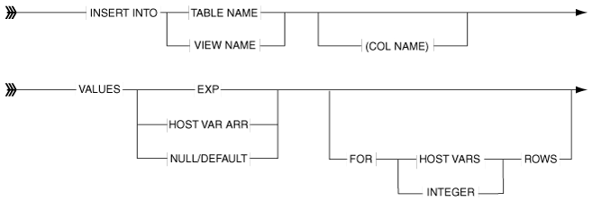
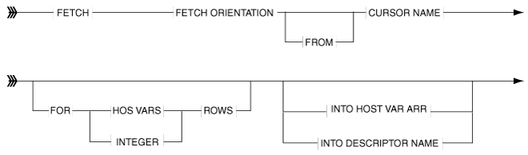

This chapter looks at using host tables to simplify coding and improve program performance. You learn how to manipulate Oracle data using host tables, how to operate on all the elements of a host table with a single SQL statement, how to limit the number of table elements processed, and how to use tables of group items.

The main sections are:

- Host Tables

- Advantages of Host Tables

- Selecting into Tables

- Selecting into Tables

- Inserting with Tables

- Updating with Tables

- Deleting with Tables

- Using Indicator Tables

- The FOR Clause

- The WHERE Clause

- Mimicking the CURRENT OF Clause

- Tables of Group Items as Host Variables

- Additional Array Insert/Select Syntax

- Using Implicit Buffered Insert

### 7.1 Host Tables

A host table (also known as an array)is a set of related data items, called elements, associated with a single variable. An indicator variable defined as a table is called an indicator table. An indicator table can be associated with any host table that is NULLABLE.

### 7.2 Advantages of Host Tables

Host tables can ease programming and can offer greatly improved performance. When writing an application, you are usually faced with the problem of storing and manipulating large amounts of data. Host tables simplify the task of accessing multiple return values.

Host tables let you manipulate multiple rows with a single SQL statement. Thus, communications overhead is reduced markedly, especially in a networked environment. For example, suppose you want to insert information about 300 employees into the EMP table. Without host tables your program must do 300 individual INSERTs—one for each employee. With host tables, only one INSERT need be done.

### 7.3 Tables in Data Manipulation Statements

Pro\*COBOL allows the use of host tables in data manipulation statements. You can use host tables as input variables in the INSERT, UPDATE, and DELETE statements and as output variables in the INTO clause of SELECT and FETCH statements.

The syntax used for host tables and for simple host variables is nearly the same. One difference is the optional FOR clause, which lets you control table processing. Also, there are restrictions on mixing host tables and simple host variables in a SQL statement.

#### 7.3.1 Declaring Host Tables

You declare and dimension host tables in the Data Division. In the following example, three host tables are declared, each dimensioned with 50 elements:

         ....
     01  EMP-TABLES.
         05  EMP-NUMBER  OCCURS 50 TIMES PIC S9(4) COMP.
         05  EMP-NAME    OCCURS 50 TIMES PIC X(10.
         05  SALARY      OCCURS 50 TIMES PIC S9(5)V99 COMP-3.
         ....

You can use the INDEXED BY phrase in the OCCURS clause to specify an index, as the next example shows:

         ...
     01  EMP-TABLES.
         05  EMP-NUMBER  PIC X(10) OCCURS 50 TIMES
             INDEXED BY EMP-INDX.
                 ...
         ...

The INDEXED BY phrase implicitly declares the index item EMP-INDX.

##### 7.3.1.1 Restrictions

Multi-dimensional host tables are not allowed. Thus, the two-dimensional host table declared in the following example is invalid:

         ...
     01  NATION.
         05  STATE                OCCURS 50 TIMES.
             10  STATE-NAME       PIC X(25).
             10  COUNTY           OCCURS 25 TIMES.
                 15  COUNTY-NAME  PIX X(25).
         ...

Variable-length host tables are not allowed either. For example, the following declaration of EMP-REC is invalid for a host variable:

         ...
     01  EMP-FILE.
         05  REC-COUNT  PIC S9(3) COMP.
         05  EMP-REC    OCCURS 0 TO 250 TIMES
             DEPENDING ON REC-COUNT.
         ...

The maximum number of host table elements in a SQL statement that is accessible in one fetch is 32K (or possibly greater, depending on your platform and the available memory). If you try to access a number that exceeds the maximum, you get a "parameter out of range" runtime error. If the statement is an anonymous PL/SQL block, the number of elements accessible is limited to 32512 divided by the size of the datatype.

#### 7.3.2 Referencing Host Tables

If you use multiple host tables in a single SQL statement, their dimensions should be the same. This is not a requirement, however, because Pro\*COBOL always uses the smallest dimension for the SQL operation. In the following example, only 25 rows are inserted

     WORKING-STORAGE SECTION.
         EXEC SQL BEGIN DECLARE SECTION END-EXEC.
     01  EMP-TABLES.
         05  EMP-NUMBER   PIC S9(4) COMP OCCURS 50 TIMES.
         05  EMP-NAME     PIC X(10) OCCURS 50 TIMES.
         05  DEPT-NUMBER  PIC S9(4) COMP OCCURS 25 TIMES.
         EXEC SQL END DECLARE SECTION END-EXEC.
         ...
     PROCEDURE DIVISION.
         ...
    *    Populate host tables here.
         ...
         EXEC SQL INSERT INTO EMP (EMPNO, ENAME, DEPTNO)
             VALUES (:EMP-NUMBER, :EMP-NAME, :DEPT-NUMBER)
         END-EXEC.

Host tables must not be subscripted in SQL statements. For example, the following INSERT statement is invalid:

     WORKING-STORAGE SECTION.
         EXEC SQL BEGIN DECLARE SECTION END-EXEC.
     01  EMP-TABLES.
         05  EMP-NUMBER   PIC S9(4) COMP OCCURS 50 TIMES.
         05  EMP-NAME     PIC X(10) OCCURS 50 TIMES.
         05  DEPT-NUMBER  PIC S9(4) COMP OCCURS 50 TIMES.
         EXEC SQL END DECLARE SECTION END-EXEC.
         ...
     PROCEDURE DIVISION.
         ...
         PERFORM LOAD-EMP VARYING J FROM 1 BY 1 UNTIL J > 50.
         ...
     LOAD-EMP.
         EXEC SQL INSERT INTO EMP (EMPNO, ENAME, DEPTNO)
             VALUES (:EMP-NUMBER(J), :EMP-NAME(J),
                 :DEPT-NUMBER(J))
         END-EXEC.

You need not process host tables in a PERFORM VARYING statement. Instead, use the un-subscripted table names in your SQL statement. Pro\*COBOL treats a SQL statement containing host tables of dimension n like the same statement executed n times with n different scalar host variables, but more efficiently.

#### 7.3.3 Using Indicator Tables

You can use indicator tables to assign NULLs to elements in input host tables and to detect NULLs or truncated values (of character columns only) in output host tables. The following example shows how to conduct an INSERT with indicator tables:

     WORKING-STORAGE SECTION.
         EXEC SQL BEGIN DECLARE SECTION END-EXEC.
     01  EMP-TABLES.
         05  EMP-NUMBER   PIC S9(4) COMP OCCURS 50 TIMES.
         05  DEPT-NUMBER  PIC S9(4) COMP OCCURS 50 TIMES.
         05  COMMISSION   PIC S9(5)V99 COMP-3 OCCURS 50 TIMES.
         05  COMM-IND     PIC S9(4) COMP OCCURS 50 TIMES.
         EXEC SQL END DECLARE SECTION END-EXEC.
         ...
     PROCEDURE DIVISION.
         ...
    *    Populate the host and indicator tables.
    *    Set indicator table to all zeros.
         ...
         EXEC SQL INSERT INTO EMP (EMPNO, DEPTNO, COMM)
             VALUES (:EMP-NUMBER, :DEPT-NUMBER,
                 :COMMISSION:COMM-IND)
         END-EXEC.

The dimension of the indicator table must be greater than or equal to the dimension of the host table.

When using host table SELECT and FETCH, it is recommended that you use indicator variables. That way you can test for NULLs in the associated output host table.

If a NULL is selected or fetched into a host variable that has no associated indicator variable, your program stops processing, sets sqlca.sqlerrd(3) to the number of rows processed, and returns an error.

NULL is selected by default, but you can switch it off by using the UNSAFE_NULL = YES option.

When DBMS=V7 or V8, your program does not consider truncation to be an error.

#### 7.3.4 Host Group Item Containing Tables

Note: If you have a host group item containing tables, then you must use a corresponding group item of tables for an indicator. For example, if your group item is the following:

     01  DEPARTURE.
         05 HOUR    PIC X(2) OCCURS 3 TIMES.
         05 MINUTE  PIC X(2) OCCURS 3 TIMES.

the following indicator variable cannot be used:

     01  DEPARTURE-IND PIC S9(4) COMP OCCURS 6 TIMES.

The indicator variable you use with the group item of tables must itself be a group item of tables such as the following:

      01  DEPARTURE-IND.
          05 HOUR-IND   PIC S9(4) COMP OCCURS 3 TIMES.
          05 MINUTE-IND PIC S9(4) COMP OCCURS 3 TIMES.

#### 7.3.5 Oracle Restrictions

Mixing scalar host variables with host tables in the VALUES, SET, INTO, or WHERE clause is not allowed. If any of the host variables is a host table, all must be host tables.

You cannot use host tables with the CURRENT OF clause in an UPDATE or DELETE statement.

#### 7.3.6 ANSI Restriction and Requirements

The array interface is an Oracle extension to the ANSI/ISO embedded SQL standard. However, when you precompile with MODE=ANSI, array SELECTs and FETCHes are still allowed. The use of arrays can be flagged using the FIPS flagger precompiler option, if desired.

### 7.4 Selecting into Tables

You can use host tables as output variables in the SELECT statement. If you know the maximum number of rows the select will return, simply define the host tables with that number of elements. In the following example, you select directly into three host tables. The table was defined with 50 rows, with the knowledge that the select will return no more than 50 rows.

         01  EMP-REC-TABLES.
             05  EMP-NUMBER   OCCURS 50 TIMES PIC S9(4) COMP.
             05  EMP-NAME     OCCURS 50 TIMES PIC X(10) VARYING.
             05  SALARY       OCCURS 50 TIMES PIC S9(6)V99
                              DISPLAY SIGN LEADING SEPARATE.
         ...
         EXEC SQL SELECT ENAME, EMPNO, SAL
             INTO :EMP-NAME, :EMP-NUMBER, :SALARY
             FROM EMP
             WHERE SAL > 1000
         END-EXEC.

In this example, the SELECT statement returns up to 50 rows. If there are fewer than 50 eligible rows or you want to retrieve only 50 rows, this method will suffice. However, if there are more than 50 eligible rows, you cannot retrieve all of them this way. If you reexecute the SELECT statement, it just returns the first 50 rows again, even if more are eligible. You must either define a larger table or declare a cursor for use with the FETCH statement.

If a SELECT INTO statement returns more rows than the size of the table you defined, Oracle issues an error message unless you specify SELECT_ERROR=NO.

**Related Topics**

- [SELECT_ERROR](precompiler-options.md)

#### 7.4.1 Batch Fetches

Use batch fetches when the size of data you are processing is large (greater than about 100 rows) as well as when you do not know how many rows will be returned.

If you do not know the maximum number of rows a select will return, you can declare and open a cursor, and then fetch from it in "batches." Batch fetches within a loop let you retrieve a large number of rows with ease. Each fetch returns the next batch of rows from the current active set. In the following example, you fetch in 20-row batches:

     ...
     01  EMP-REC-TABLES.
         05  EMP-NUMBER    OCCURS 20 TIMES PIC S9(4) COMP.
         05  EMP-NAME      OCCURS 20 TIMES PIC X(10) VARYING.
         05  SALARY        OCCURS 20 TIMES PIC S9(6)V99
                           DISPLAY SIGN LEADING SEPARATE.
         ...
         EXEC SQL DECLARE EMPCURSOR CURSOR FOR
         SELECT EMPNO, SAL FROM EMP
         END-EXEC.
         ...
         EXEC SQL OPEN EMPCURSOR END-EXEC.
         ...
         EXEC SQL WHENEVER NOT FOUND DO PERFORM END-IT.
     LOOP.
         EXEC SQL FETCH EMPCURSOR INTO :EMP-NUMBER, :SALARY END-EXEC.
    * --  process batch of rows
         ...
         GO TO LOOP.
     END-IT.
    ...

Do not forget to check how many rows were actually returned in the last fetch and to process them.

**Related Topics**

- Sample Program 3: Fetching in Batches

#### 7.4.2 Using SQLERRD(3)

For INSERT, UPDATE, and DELETE statements, SQLERRD(3) records the number of rows processed.

SQLERRD(3) is also useful when an error occurs during a table operation. Processing stops at the row that caused the error, so SQLERRD(3) gives the number of rows processed successfully.

#### 7.4.3 Number of Rows Fetched

Each fetch returns, at most, the number of entries in the table. Fewer rows are returned in the following cases:

- The end of the active set is reached. The "no data found" warning code is returned to SQLCODE in the SQLCA. For example, this happens if you fetch into a table of number of entries 100, but only 20 rows are returned.

- Fewer than a full batch of rows remain to be fetched. For example, this happens if you fetch 70 rows into a table of number of entries 20 because after the third fetch, only 10 rows remain to be fetched.

- An error is detected while processing a row. The fetch fails and the applicable error code is returned to SQLCODE.

The cumulative number of rows returned can be found in the third element of SQLERRD in the SQLCA, called SQLERRD(3) in this guide. This applies to each open cursor. In the following example, notice how the status of each cursor is maintained separately:

         EXEC SQL OPEN CURSOR1 END-EXEC.
         EXEC SQL OPEN CURSOR2 END-EXEC.
         EXEC SQL FETCH CURSOR1 INTO :TABLE-OF-20 END-EXEC.
    * --  now running total in SQLERRD(3) is 20
         EXEC SQL FETCH CURSOR2 INTO :TABLE-OF-30 END-EXEC.
    * --  now running total in SQLERRD(3) is 30, not 50
         EXEC SQL FETCH CURSOR1 INTO :TABLE-OF-20 END-EXEC.
    * --  now running total in SQLERRD(3) is 40 (20 + 20)
         EXEC SQL FETCH CURSOR2 INTO :TABLE-OF-30 END-EXEC.
    * --  now running total in SQLERRD(3) is 60 (30 + 30)

#### 7.4.4 Restrictions on Using Host Tables

Using host tables in the WHERE clause of a SELECT statement is allowed only in a sub-query. Also, since Pro\*COBOL always takes the smallest dimension of table, do not mix simple host variables with host tables in the INTO clause of a SELECT or FETCH statement because only one row will be retrieved. If any of the host variables is a table, then all must be tables.

Host Tables Valid in SELECT INTO shows which uses of host tables are valid in a SELECT INTO statement.

Table 7-1 Host Tables Valid in SELECT INTO

| INTO Clause | WHERE Clause | Valid? |
|:------------|:-------------|:-------|
| table       | table        | no     |
| scalar      | scalar       | yes    |
| table       | scalar       | yes    |
| scalar      | table        | no     |

**Related Topics**

- The WHERE Clause

#### 7.4.5 Fetching NULLs

When UNSAFE_NULL=YES, if you select or fetch a NULL into a host table that lacks an indicator table, no error is generated. So, when doing table selects and fetches, Oracle recommends that you use indicator tables. This is because this makes it NULLs easier to find in the associated output host table.

When UNSAFE_NULL=NO, if you select or fetch a NULL into a host table that lacks an indicator table, Oracle stops processing, sets SQLERRD(3) to the number of rows processed, and issues an error message:

**See Also:**

[Using Indicator Variables](embedded-SQL.md) to learn how to find NULLs and truncated values.

#### 7.4.6 Fetching Truncated Values

If you select or fetch a truncated column value into a host table that lacks an indicator table, Oracle sets SQLWARN(2).

You can check SQLERRD(3) for the number of rows processed before the truncation occurred. The rows-processed count includes the row that caused the truncation error.

When doing table selects and fetches, you can use indicator tables. That way, if Oracle assigns one or more truncated column values to an output host table, you can find the original lengths of the column values in the associated indicator table.

#### 7.4.7 Sample Program 3: Fetching in Batches

The following host table sample program can be found in the demo directory.

          *****************************************************************
          * Sample Program 3:  Host Tables                                *
          *                                                               *
          * This program logs on to ORACLE, declares and opens a cursor,  *
          * fetches in batches using host tables, and prints the results. *
          *****************************************************************

           IDENTIFICATION DIVISION.
           PROGRAM-ID. HOST-TABLES.
           ENVIRONMENT DIVISION.
           DATA DIVISION.
           WORKING-STORAGE SECTION.

               EXEC SQL BEGIN DECLARE SECTION END-EXEC.
           01  USERNAME          PIC X(15) VARYING.
           01  PASSWD            PIC X(15) VARYING.
           01  EMP-REC-TABLES.
               05  EMP-NUMBER    OCCURS 5 TIMES PIC S9(4) COMP.
               05  EMP-NAME      OCCURS 5 TIMES PIC X(10) VARYING.
               05  SALARY        OCCURS 5 TIMES PIC S9(6)V99
                                 DISPLAY SIGN LEADING SEPARATE.
               EXEC SQL VAR SALARY IS DISPLAY(8,2) END-EXEC.
               EXEC SQL END DECLARE SECTION END-EXEC.
               EXEC SQL INCLUDE SQLCA END-EXEC.
           01  NUM-RET           PIC S9(9) COMP VALUE ZERO.
           01  PRINT-NUM         PIC S9(9) COMP VALUE ZERO.
           01  COUNTER           PIC S9(9) COMP.
           01  DISPLAY-VARIABLES.
               05  D-EMP-NAME    PIC X(10).
               05  D-EMP-NUMBER  PIC 9(4).
               05  D-SALARY      PIC Z(4)9.99.

           PROCEDURE DIVISION.

           BEGIN-PGM.
               EXEC SQL
                   WHENEVER SQLERROR DO PERFORM SQL-ERROR
               END-EXEC.
               PERFORM LOGON.
               EXEC SQL
                   DECLARE C1 CURSOR FOR
                   SELECT EMPNO, SAL, ENAME
                   FROM EMP
               END-EXEC.
               EXEC SQL
                   OPEN C1
               END-EXEC.

           FETCH-LOOP.
               EXEC SQL
                   WHENEVER NOT FOUND DO PERFORM SIGN-OFF
               END-EXEC.
               EXEC SQL
                   FETCH C1
                   INTO :EMP-NUMBER, :SALARY, :EMP-NAME
               END-EXEC.
               SUBTRACT NUM-RET FROM SQLERRD(3) GIVING PRINT-NUM.
               PERFORM PRINT-IT.
               MOVE SQLERRD(3) TO NUM-RET.
               GO TO FETCH-LOOP.

           LOGON.
               MOVE "SCOTT" TO USERNAME-ARR.
               MOVE 5 TO USERNAME-LEN.
               MOVE "TIGER" TO PASSWD-ARR.
               MOVE 5 TO PASSWD-LEN.
               EXEC SQL
                  CONNECT :USERNAME IDENTIFIED BY :PASSWD
               END-EXEC.
               DISPLAY " ".
               DISPLAY "CONNECTED TO ORACLE AS USER:  ", USERNAME-ARR.

           PRINT-IT.
               DISPLAY " ".
               DISPLAY "EMPLOYEE NUMBER  SALARY   EMPLOYEE NAME".
               DISPLAY "---------------  -------  -------------".
               PERFORM PRINT-ROWS
                   VARYING COUNTER FROM 1 BY 1
                   UNTIL COUNTER > PRINT-NUM.

           PRINT-ROWS.
               MOVE EMP-NUMBER(COUNTER) TO D-EMP-NUMBER.
               MOVE SALARY(COUNTER) TO D-SALARY.
               DISPLAY "           ", D-EMP-NUMBER, " ", D-SALARY, "  ",
                   EMP-NAME-ARR IN EMP-NAME(COUNTER).
               MOVE SPACES TO EMP-NAME-ARR IN EMP-NAME(COUNTER).

           SIGN-OFF.
               SUBTRACT NUM-RET FROM SQLERRD(3) GIVING PRINT-NUM.
               IF (PRINT-NUM > 0) PERFORM PRINT-IT.
               EXEC SQL
                   CLOSE C1
               END-EXEC.
               EXEC SQL
                   COMMIT WORK RELEASE
               END-EXEC.
               DISPLAY " ".
               DISPLAY "HAVE A GOOD DAY.".
               DISPLAY " ".
               STOP RUN.

           SQL-ERROR.
               EXEC SQL
                   WHENEVER SQLERROR CONTINUE
               END-EXEC.
               DISPLAY " ".
               DISPLAY "ORACLE ERROR DETECTED:".
               DISPLAY " ".
               DISPLAY SQLERRMC.
               EXEC SQL
                   ROLLBACK WORK RELEASE
               END-EXEC.
               STOP RUN.

### 7.5 Inserting with Tables

You can use host tables as input variables in an INSERT statement. Just make sure your program populates the tables with data before executing the INSERT statement. If some elements in the tables are irrelevant, you can use the FOR clause to control the number of rows inserted.

An example of inserting with host tables follows:

     01  EMP-REC-TABLES.
         05  EMP-NUMBER    OCCURS 50 TIMES PIC S9(4) COMP.
         05  EMP-NAME      OCCURS 50 TIMES PIC X(10) VARYING.
         05  SALARY        OCCURS 50 TIMES PIC S9(6)V99
                           DISPLAY SIGN LEADING SEPARATE.
    * -- populate the host tables
         EXEC SQL INSERT INTO EMP (ENAME, EMPNO, SAL)
             VALUES (:EMP-NAME, :EMP-NUMBER, :SALARY)
         END-EXEC.

The number of rows inserted will be available in SQLERRD(3).

Host tables must not be subscripted in SQL statements. For example the following INSERT statement is invalid:

         PERFORM VARYING I FROM 1 BY 1 UNTIL I = TABLE-DIMENSION.
            EXEC SQL INSERT INTO EMP (ENAME, EMPNO, SAL)
                VALUES (:EMP-NAME(I), :EMP-NUMBER(I), :SALARY(I))
            END_EXEC
         END-PERFORM.

**Related Topics**

- The FOR Clause

#### 7.5.1 Restrictions on Host Tables

Mixing simple host variables with host tables in the VALUES clause of an INSERT, UPDATE, or DELETE statement causes only the first element of any host table to be processed because simple host variables are treated as host tables of dimension one and Pro\*COBOL always uses the smallest declared dimension. You receive a warning when this occurs.

### 7.6 Updating with Tables

You can also use host tables as input variables in an UPDATE statement, as the following example shows:

     01  EMP-REC-TABLES.
         05  EMP-NUMBER    OCCURS 50 TIMES PIC S9(4) COMP.
         05  SALARY        OCCURS 50 TIMES PIC S9(6)V99
                               DISPLAY SIGN LEADING SEPARATE.
     ...
    * --  populate the host tables
         EXEC SQL
             UPDATE EMP SET SAL = :SALARY WHERE EMPNO = :EMP-NUMBER
         END-EXEC.

The number of rows updated by issuing this statement is available in SQLERRD(3). This is not necessarily the number of rows in the host table. The number does not include rows processed by an update cascade (which causes subsequent updates.)

If some elements in the tables are irrelevant, you can use the FOR clause to limit the number of rows updated.

The last example showed a typical update using a unique key (EMP-NUMBER). Each table element qualified just one row for updating. In the following example, each table element qualifies multiple rows:

         EXEC SQL BEGIN DECLARE SECTION END-EXEC.
         ...
                05  JOB-TITLE      OCCURS 10 TIMES PIC X(10) VARYING.
                05  COMMISSION     OCCURS 50 TIMES PIC S9(6)V99
                                  DISPLAY SIGN LEADING SEPARATE.
         EXEC SQL END DECLARE SECTION END-EXEC.
    * --  populate the host tables
         EXEC SQL
             UPDATE EMP SET COMM = :COMMISSION WHERE JOB = :JOB-TITLE
         END-EXEC.

#### 7.6.1 Restrictions in UPDATE

You cannot use host tables with the CURRENT OF clause in an UPDATE statement. For an alternative, see "Mimicking the CURRENT OF Clause".

Table 7-2 shows which uses of host tables are valid in an UPDATE statement:

Table 7-2 Host Tables Valid in UPDATE

| SET Clause | WHERE Clause | Valid? |
|:-----------|:-------------|:-------|
| table      | table        | yes    |
| scalar     | scalar       | yes    |
| table      | scalar       | no     |
| scalar     | table        | no     |

### 7.7 Deleting with Tables

You can also use host tables as input variables in a DELETE statement. Doing so is like executing the DELETE statement repeatedly using successive elements of the host table in the WHERE clause. Thus, each execution might delete zero, one, or more rows from the table. An example of deleting with host tables follows:

         EXEC SQL BEGIN DECLARE SECTION END-EXEC.
         ...
             05  EMP-NUMBER    OCCURS 50 TIMES PIC S9(4) COMP.
         EXEC SQL END DECLARE SECTION END-EXEC.
    * --  populate the host table
         EXEC SQL
             DELETE FROM EMP WHERE EMPNO = :EMP-NUMBER
         END-EXEC.

The cumulative number of rows deleted can be found in SQLERRD(3). That number does not include rows processed by a delete cascade.

The last example showed a typical delete using a unique key (EMP-NUMBER). Each table element qualified just one row for deletion. In the following example, each table element qualifies multiple rows:

         EXEC SQL BEGIN DECLARE SECTION END-EXEC.
         ...
                05  JOB-TITLE    OCCURS 10 TIMES PIC X(10) VARYING.
         EXEC SQL END DECLARE SECTION END-EXEC.
    * --  populate the host table
         EXEC SQL
            DELETE FROM EMP WHERE JOB = :JOB-TITLE
         END-EXEC.

#### 7.7.1 Restrictions in DELETE

You cannot use host tables with the CURRENT OF clause in a DELETE statement. For an alternative, see "Mimicking the CURRENT OF Clause".

### 7.8 Using Indicator Tables

You use indicator tables to assign NULLs to input host tables and to detect NULL or truncated values in output host tables. The following example shows how to insert with indicator tables:

     01  EMP-REC-VARS.
         05  EMP-NUMBER  OCCURS 50 TIMES PIC S9(4) COMP.
         05  DEPT-NUMBER OCCURS 50 TIMES PIC S9(4) COMP.
         05  COMMISSION  OCCURS 50 TIMES  PIC S9(6)V99
                                DISPLAY SIGN LEADING SEPARATE.
    * -- indicator table:
         05  COMM-IND    OCCURS 50 TIMES  PIC S9(4) COMP.
    * --  populate the host tables
    * --  populate the indicator table; to insert a NULL into
    * --  the COMM column, assign -1 to the appropriate element in
    * --  the indicator table
         EXEC SQL
             INSERT INTO EMP (EMPNO, DEPTNO, COMM)
             VALUES (:EMP_NUMBER, :DEPT-NUMBER, :COMMISSION:COMM-IND)
         END-EXEC.

The number of entries of the indicator table cannot be smaller than the number of entries of the host table.

### 7.9 The FOR Clause

You can use the optional FOR clause to set the number of table elements processed by any of the following SQL statements:

- DELETE

- EXECUTE (See information on Oracle dynamic SQL in [Oracle Dynamic SQL: Method 4](Oracle-dynamic-SQL-method-4.md).

- FETCH

- INSERT

- OPEN

- UPDATE

The FOR clause is especially useful in UPDATE, INSERT, and DELETE statements. With these statements you might not want to use the entire table. The FOR clause lets you limit the elements used to just the number you need, as the following example shows:

         EXEC SQL BEGIN DECLARE SECTION END-EXEC.
     01  EMP-REC-VARS.
         05  EMP-NAME  OCCURS 1000 TIMES  PIC X(20) VARYING.
         05  SALARY    OCCURS 100  TIMES  PIC S9(6)V99
                       DISPLAY SIGN LEADING SEPARATE.
     01 ROWS-TO-INSERT PIC S9(4) COMP.
         EXEC SQL END DECLARE SECTION END-EXEC.
    * --  populate the host tables
         MOVE 25 TO ROWS-TO-INSERT.
    * -- set FOR-clause variable
    * -- will process only 25 rows
         EXEC SQL FOR :ROWS-TO-INSERT
             INSERT INTO EMP (ENAME, SAL)
             VALUES (:EMP-NAME, :SALARY)
         END-EXEC.

The FOR clause must use an integer host variable to count table elements. For example, the following statement is illegal:

    * -- illegal
         EXEC SQL FOR 25
         INSERT INTO EMP (ENAME, EMPNO, SAL)
             VALUES (:EMP-NAME, :EMP-NUMBER, :SALARY)
         END-EXEC.

The FOR clause variable specifies the number of table elements to be processed. Make sure the number does not exceed the smallest table dimension. Internally, the value is treated as an unsigned quantity. An attempt to pass a negative value through the use of a signed host variable will result in unpredictable behavior.

#### 7.9.1 Restrictions

Two restrictions keep FOR clause semantics clear: you cannot use the FOR clause in a SELECT statement or with the CURRENT OF clause.

##### 7.9.1.1 In a SELECT Statement

If you use the FOR clause in a SELECT statement, you receive an error message.

The FOR clause is not allowed in SELECT statements because its meaning is unclear. Does it mean "execute this SELECT statement n times"? Or, does it mean "execute this SELECT statement once, but return n rows"? The problem in the former case is that each execution might return multiple rows. In the latter case, it is better to declare a cursor and use the FOR clause in a FETCH statement, as follows:

         EXEC SQL FOR :LIMIT FETCH EMPCURSOR INTO ...

##### 7.9.1.2 With the CURRENT OF Clause

You can use the CURRENT OF clause in an UPDATE or DELETE statement to refer to the latest row returned by a FETCH statement, as the following example shows:

         EXEC SQL DECLARE EMPCURSOR CURSOR FOR
             SELECT ENAME, SAL FROM EMP WHERE EMPNO = :EMP-NUMBER
         END-EXEC.
         ...
         EXEC SQL OPEN EMPCURSOR END-EXEC.
         ...
         EXEC SQL FETCH emp_cursor INTO :EM-NAME, :SALARY END-EXEC.
         ...
         EXEC SQL UPDATE EMP SET SAL = :NEW-SALARY
             WHERE CURRENT OF EMPCURSOR
         END-EXEC.

However, you cannot use the FOR clause with the CURRENT OF clause. The following statements are invalid because the only logical value of LIMIT is 1 (you can only update or delete the current row once):

         EXEC SQL FOR :LIMIT UPDA-CURSOR END-EXEC.
         ...
         EXEC SQL FOR :LIMIT DELETE FROM EMP
             WHERE CURRENT OF emp_cursor
         END-EXEC.

### 7.10 The WHERE Clause

Pro\*COBOL treats a SQL statement containing host tables of number of entries n like the same SQL statement executed n times with n different scalar variables (the individual table elements). The precompiler issues an error message only when such treatment is ambiguous:

For example, assuming the declarations:

         EXEC SQL BEGIN DECLARE SECTION END-EXEC.
         ...
         05  MGRP-NUMBER  OCCURS 50 TIMES  PIC S9(4) COMP.
         05  JOB-TITLE    OCCURS 50 TIMES  PIC X(20) VARYING.
     01  I PIC S9(4) COMP.
         EXEC SQL END DECLARE SECTION END-EXEC.

it would be ambiguous if the statement:

         EXEC SQL SELECT MGR INTO :MGR-NUMBER FROM EMP
             WHERE JOB = :JOB-TITLE
         END-EXEC.

were treated like the following statement

         PERFORM VARYING I FROM 1 BY 1 UNTIL I = 50
         SELECT MGR INTO :MGR-NUMBER(I) FROM EMP
             WHERE JOB = :JOB_TITLE(I)
         END-EXEC
         END-PERFORM.

because multiple rows might meet the WHERE-clause search condition, but only one output variable is available to receive data. Therefore, an error message is issued.

On the other hand, it would not be ambiguous if the statement

          EXEC SQL
             UPDATE EMP SET MGR = :MGR_NUMBER
             WHERE EMPNO IN (SELECT EMPNO FROM EMP WHERE
             JOB = :JOB-TITLE)
         END-EXEC.

were treated like the following statement

         PERFORM VARYING I FROM 1 BY 1 UNTIL I = 50
    UPDATE EMP SET MGR = :MGR_NUMBER(I)
                 WHERE EMPNO IN
                 (SELECT EMPNO FROM EMP WHERE JOB = :JOB-TITLE(I))
             END-EXEC
         END-PERFORM.

because there is a MGR-NUMBER in the SET clause for each row matching JOB-TITLE in the WHERE clause, even if each JOB-TITLE matches multiple rows. All rows matching each JOB-TITLE can be SET to the same MGR-NUMBER, so no error message is issued.

### 7.11 Mimicking the CURRENT OF Clause

The CURRENT OF clause enables you to do UPDATEs or DELETEs of the most recent row in the cursor. Use of the CURRENT OF clause causes the FOR UPDATE clause to be added to the cursor. Adding this clause has the effect of locking all rows identified by the cursor in exclusive mode. Note that you cannot use CURRENT OF with host tables. Instead, append FOR UPDATE to the definition of the cursor and explicitly select the ROWID column, then use that value to identify the current row during the update or delete. An example follows:

             05  EMP-NAME    OCCURS 25 TIMES PIC X(20) VARYING.
             05  JOB-TITLE   OCCURS 25 TIMES PIC X(15) VARYING.
             05  OLD-TITLE   OCCURS 25 TIMES PIC X(15) VARYING.
             05  ROW-ID      OCCURS 25 TIMES PIC X(18) VARYING.
         ...
         EXEC SQL DECLARE EMPCURSOR CURSOR FOR
             SELECT ENAME, JOB, ROWID FROM EMP
             FOR UPDATE
         END-EXEC.
         ...
         EXEC SQL OPEN EMPCURSOR END-EXEC.
         ...
         EXEC SQL WHENEVER NOT FOUND GOTO ...
         ...
         PERFORM
            EXEC SQL
                 FETCH EMPCURSOR
                 INTO :EMP-NAME, :JOB-TITLE, :ROW-ID
             END-EXEC
             ...
             EXEC SQL
                 DELETE FROM EMP
                 WHERE JOB = :OLD-TITLE AND ROWID = :ROW-ID
             END-EXEC
             EXEC SQL COMMIT WORK END-EXEC
          END-PERFORM.

### 7.12 Tables of Group Items as Host Variables

Pro\*COBOL allows the use of tables of group items (also called records) in embedded SQL statements. The tables of group items can be referenced in the INTO clause of a SELECT or a FETCH statement, and in the VALUES list of an INSERT statement.

For example, given the following declaration:

     01    TABLES.
           05   EMP-TABLE           OCCURS 20 TIMES.
                10    EMP-NUMBER    PIC S9(4) COMP.
                10    EMP-NAME      PIC X(10).
                10    DEPT-NUMBER   PIC S9(4) COMP.

the following statement is valid:

           EXEC SQL INSERT INTO EMP(EMPNO, ENAME, DEPTNO)
                VALUES(:EMP-TABLE)
           END-EXEC.

Assuming that the group item has been filled with data already, the statement bulk inserts 20 rows consisting of the employee number, employee name, and department number into the EMP table.

Make sure that the order of the group items corresponds to the order in the SQL statement.

To use an indicator variable, set up a second table of a group item that contains an indicator variable for each variable in the group item:

     01     TABLES-IND.
            05   EMP-TABLE-IND  OCCURS 20 TIMES.
                 10   EMP-NUMBER-IND       PIC S9(4) COMP.
                 10   EMP-NAME-IND         PIC S9(4) COMP.
                 10   DEPT-NUMBER_IND      PIC S9(4) COMP.

The host indicator table of a group item can be used as follows:

            EXEC SQL INSERT INTO EMP (EMPNO, ENAME, DEPTNO)
                VALUES (:EMP-TABLE:EMP-TABLE-IND)
            END-EXEC.

If the exact characteristics of the data are known, it is convenient to specify an elementary item indicator for a group item:

            05    EMP-TABLE-IND     PIC S9(4) COMP
                                    OCCURS 20 TIMES.

Host tables of group items cannot have group items that are tables. For example:

     01   TABLES.
          05   EMP-TABLE               OCCURS 20 TIMES.
               10  EMP-NUMBER          PIC S9(4) COMP OCCURS 10 TIMES.
               10  EMP-NAME            PIC X(10).
               10  DEPT-NUMBER         PIC S9(4) COMP.

`EMP-TABLE` cannot be used as a host variable because` EMP-NUMBER` is a table.

Host tables of nested group items are not allowed. For example:

     01   TABLES.
          05   TEAM-TABLE                   OCCURS 20 TIMES
               10   EMP-TABLE
                    15   EMP-NUMBER         PIC S9(4) COMP.
                    15   EMP-NAME           PIC X(10).
               10   DEPT-TABLE.
                    15   DEPT-NUMBER        PIC S9(4) COMP.
                    15   DEPT-NAME          PIC X(10).

`TEAM-TABLE `cannot be used as a host variable because its members (`EMP-TABLE` and `DEPT-TABLE`) are group items themselves.

Finally, the restrictions that apply to host tables in Pro\*COBOL also apply to tables of group items:

- Multi-dimensional and variable-length tables are not allowed.

- If multiple tables are used in a single SQL statement, their dimensions should be the same.

- Host tables in SQL statements must not be subscripted.

### 7.13 Sample Program 14: Tables of Group Items

This program logs on, declares and opens a cursor, fetches in batches using a table of group items. Read the initial comments for details.

          *****************************************************************
          * Sample Program 14:  Tables of group items                     *
          *                                                               *
          * This program logs on to ORACLE, declares and opens a cursor,  *
          * fetches in batches using a table of group items , and prints  *
          * the results.  This sample is identical to sample3 except that *
          * instead of using three separate host tables of five elements  *
          * each, it uses a five-element table of three group items.      *
          * The output should be identical.                               *
          *****************************************************************

           IDENTIFICATION DIVISION.
           PROGRAM-ID. TABLE-OF-GROUP-ITEMS.
           ENVIRONMENT DIVISION.
           DATA DIVISION.
           WORKING-STORAGE SECTION.

               EXEC SQL BEGIN DECLARE SECTION END-EXEC.
           01  USERNAME          PIC X(15) VARYING.
           01  PASSWD            PIC X(15) VARYING.
           01  EMP-REC-TABLE OCCURS 5 TIMES.
               05  EMP-NUMBER    PIC S9(4) COMP.
               05  SALARY        PIC S9(6)V99
                                 DISPLAY SIGN LEADING SEPARATE.
               05  EMP-NAME      PIC X(10) VARYING.
               EXEC SQL VAR SALARY IS DISPLAY(8,2) END-EXEC.
               EXEC SQL END DECLARE SECTION END-EXEC.
               EXEC SQL INCLUDE SQLCA END-EXEC.
           01  NUM-RET           PIC S9(9) COMP VALUE ZERO.
           01  PRINT-NUM         PIC S9(9) COMP VALUE ZERO.
           01  COUNTER           PIC S9(9) COMP.
           01  DISPLAY-VARIABLES.
               05  D-EMP-NAME    PIC X(10).
               05  D-EMP-NUMBER  PIC 9(4).
               05  D-SALARY      PIC Z(4)9.99.

           PROCEDURE DIVISION.

           BEGIN-PGM.
               EXEC SQL
                   WHENEVER SQLERROR DO PERFORM SQL-ERROR
               END-EXEC.
               PERFORM LOGON.
               EXEC SQL
                   DECLARE C1 CURSOR FOR
                   SELECT EMPNO, SAL, ENAME
                   FROM EMP
               END-EXEC.
               EXEC SQL
                   OPEN C1
               END-EXEC.

           FETCH-LOOP.
               EXEC SQL
                   WHENEVER NOT FOUND DO PERFORM SIGN-OFF
               END-EXEC.
               EXEC SQL
                   FETCH C1
                   INTO :EMP-REC-TABLE
               END-EXEC.
               SUBTRACT NUM-RET FROM SQLERRD(3) GIVING PRINT-NUM.
               PERFORM PRINT-IT.
               MOVE SQLERRD(3) TO NUM-RET.
               GO TO FETCH-LOOP.

           LOGON.
               MOVE "SCOTT" TO USERNAME-ARR.
               MOVE 5 TO USERNAME-LEN.
               MOVE "TIGER" TO PASSWD-ARR.
               MOVE 5 TO PASSWD-LEN.
               EXEC SQL
                  CONNECT :USERNAME IDENTIFIED BY :PASSWD
               END-EXEC.
               DISPLAY " ".
               DISPLAY "CONNECTED TO ORACLE AS USER:  ", USERNAME-ARR.

           PRINT-IT.
               DISPLAY " ".
               DISPLAY "EMPLOYEE NUMBER  SALARY   EMPLOYEE NAME".
               DISPLAY "---------------  -------  -------------".
               PERFORM PRINT-ROWS
                   VARYING COUNTER FROM 1 BY 1
                   UNTIL COUNTER > PRINT-NUM.

           PRINT-ROWS.
               MOVE EMP-NUMBER(COUNTER) TO D-EMP-NUMBER.
               MOVE SALARY(COUNTER) TO D-SALARY.
               DISPLAY "           ", D-EMP-NUMBER, " ", D-SALARY, "  ",
                   EMP-NAME-ARR IN EMP-NAME(COUNTER).
               MOVE SPACES TO EMP-NAME-ARR IN EMP-NAME(COUNTER).

           SIGN-OFF.
               SUBTRACT NUM-RET FROM SQLERRD(3) GIVING PRINT-NUM.
               IF (PRINT-NUM > 0) PERFORM PRINT-IT.
               EXEC SQL
                   CLOSE C1
               END-EXEC.
               EXEC SQL
                   COMMIT WORK RELEASE
               END-EXEC.
               DISPLAY " ".
               DISPLAY "HAVE A GOOD DAY.".
               DISPLAY " ".
               STOP RUN.

           SQL-ERROR.
               EXEC SQL
                   WHENEVER SQLERROR CONTINUE
               END-EXEC.
               DISPLAY " ".
               DISPLAY "ORACLE ERROR DETECTED:".
               DISPLAY " ".
               DISPLAY SQLERRMC.
               EXEC SQL
                   ROLLBACK WORK RELEASE
               END-EXEC.
               STOP RUN.

### 7.14 Additional Array Insert/Select Syntax

The Oracle precompiler also supports the DB2 insert and fetch syntax for the host tables. The supported additional array insert and fetch syntax are shown in the following images, respectively.

Figure 7-1 Additional Insert Syntax

[Description of "Figure 7-1 Additional Insert Syntax"](img_text/insert2.md)

Figure 7-2 Additional Fetch Syntax

[Description of "Figure 7-2 Additional Fetch Syntax"](img_text/fetch2.md)

The optional ROWSET and ROWSET STARTING AT clauses are used in the fetch-orientation (FIRST, PRIOR, NEXT, LAST, CURRENT, RELATIVE and ABSOLUTE). Consider the following examples:

- FIRST ROWSET

- PRIOR ROWSET

- NEXT ROWSET

- LAST ROWSET

- CURRENT ROWSET

- ROWSET STARTING AT RELATIVEn

- ROWSET STARTING AT ABSOLUTEn

Examples of the DB2 array insert/fetch syntax and their comparison with the corresponding Oracle precompiler syntax are shown in Table 7-3:

Table 7-3 DB2 Array Syntax vs. Oracle Precompiler Syntax

| DB2 Array Syntax                                                                                                                                           | Oracle Precompiler Syntax                                                                                                                  |
|:-----------------------------------------------------------------------------------------------------------------------------------------------------------|:-------------------------------------------------------------------------------------------------------------------------------------------|
| `EXEC SQL` `  INSERT INTO DSN8810.ACT ` `  (ACTNO, ACTKWD, ACTDESC) ` `  VALUES (:HVA1, :HVA2, :HVA3)` `  FOR :NUM_ROWS ROWS  ` `END-EXEC.` | `EXEC SQL FOR :NUM_ROWS` `  INSERT INTO DSN8810.ACT` `  (ACTNO, ACTKWD, ACTDESC)` `  VALUES (:HVA1, :HVA2, :HVA3)` `END-EXEC.` |
| `EXEC SQL` `  FETCH NEXT ROWSET FROM C1 ` `  FOR 20 ROWS ` `  INTO :HVA_EMPNO, :HVA_LASTNAME, ` `       :HVA_SALARY ` `END-EXEC.`           | `EXEC SQL` `   FOR :TWENTY` `   FETCH c1 ` `   INTO :HVA_EMPNO, :HVA_LASTNAME,` `        :HVA_SALARY` `END-EXEC.`           |

In DB2 syntax, a row-set positioned cursor should be first declared before retrieving row sets of data. To enable a cursor to fetch row sets, 'WITH ROWSET POSITIONING' clause has to be used in the DECLARE CURSOR statement, which is not required and relevant in the Oracle precompiler syntax, as shown in the following table.

| DB2 Array Syntax                                                                                                                                       | Oracle Precompiler Syntax                                                                                                    |
|:-------------------------------------------------------------------------------------------------------------------------------------------------------|:-----------------------------------------------------------------------------------------------------------------------------|
| `EXEC SQL` ` DECLARE C1 CURSOR` `  WITH ROWSET POSITIONING FOR` `  SELECT EMPNO, LASTNAME, SALARY` `      FROM DSN8810.EMP` `END-EXEC.` | `EXEC SQL` `   DECLARE C1 CURSOR FOR` `   SELECT EMPNO, LASTNAME, SALARY` `        FROM DSN8810.EMP` `END-EXEC.` |

This additional array syntax support can be enabled with the precompiler option "db2_array", whose default option is "no". The DB2 array syntax support cannot be used together with the Oracle precompiler syntax; only one of the syntax, either Oracle precompiler, or DB2 syntax, will be supported at a time.

Example 7-1 Inserting and Fetching Rows by Using the DB2 Array Syntax

This program inserts INSCNT rows into the EMP table by using the DB2 array insert syntax, and then fetches the inserted rows by using the DB2 array fetch syntax.

          *****************************************************************
          * db2arrdemo:                                                   *
          *****************************************************************

           IDENTIFICATION DIVISION.
           PROGRAM-ID.  db2arrdemo.
           ENVIRONMENT DIVISION.
           CONFIGURATION SECTION.
           DATA DIVISION.
           WORKING-STORAGE SECTION.

          * EMBEDDED COBOL (file "DB2ARRDEMO.PCO")

               EXEC SQL BEGIN DECLARE SECTION END-EXEC.
           01  USERNAME          PIC X(10) VARYING.
           01  PASSWD            PIC X(10) VARYING.
           01  EMPINDATA.
               02  EMPIN OCCURS 25 TIMES.
                  03  EMPNO PIC  9(4) COMP.
                  03  ENAME PIC  X(10).
                  03  JOB PIC  X(9).
                  03  MGR PIC 9(4).
                  03  HIREDATE PIC  X(9).
                  03  SAL PIC  X(6).
                  03  COMM PIC  X(6).
                  03  DEPTNO PIC  9(2).

           01  EMPOUTDATA.
               02  EMPOUT OCCURS 5 TIMES.
                  03  EMPNO1 PIC  9(4) COMP.
                  03  ENAME1 PIC  X(10).
                  03  JOB1 PIC  X(9).
                  03  MGR1 PIC 9(4).
                  03  HIREDATE1 PIC  X(9).
                  03  SAL1 PIC  X(6).
                  03  COMM1 PIC  X(6).
                  03  DEPTNO1 PIC  9(2).

               EXEC SQL END DECLARE SECTION END-EXEC.

           01  INSCNT PIC  9(3) COMP VALUE 25.
           01  FETCHCNT PIC  9(3) COMP VALUE 5.
           01  CNT PIC  9(4).
           01  CNT2 PIC  9(2).

           01  STRINGFIELDS.
               02 STR PIC X(18) VARYING.

               EXEC SQL INCLUDE SQLCA END-EXEC.

           PROCEDURE DIVISION.
           BEGIN-PGM.
               EXEC SQL WHENEVER SQLERROR DO PERFORM SQL-ERROR END-EXEC.

               PERFORM LOGON.

          * Fill the array elements to insert.
       PERFORM FILL-DATA VARYING CNT FROM 1 BY 1
               UNTIL CNT > INSCNT.

          * Inserting data using DB2 array insert syntax.
       DISPLAY "Inserting data using DB2 array insert syntax".
       EXEC SQL INSERT INTO EMP (EMPNO, ENAME, JOB, MGR, HIREDATE,
                SAL, COMM, DEPTNO) VALUES (:EMPIN)
        FOR :INSCNT ROWS
       END-EXEC.

       EXEC SQL SELECT COUNT(*) INTO :CNT FROM EMP
                WHERE ENAME LIKE 'EMP_%'
       END-EXEC.
       DISPLAY "Number of rows successfully inserted into EMP "
               "table:", CNT.

       DISPLAY " ".
          * Declares scrollable cursor to fetch data.
               EXEC SQL DECLARE C1 SCROLL CURSOR FOR
                        SELECT EMPNO, ENAME, JOB, MGR, HIREDATE, SAL,
        COMM, DEPTNO
        FROM EMP
                WHERE ENAME LIKE 'EMP_%'
        ORDER BY EMPNO
       END-EXEC.

               EXEC SQL OPEN C1 END-EXEC.

       DISPLAY "Fetching data using DB2 array fetch syntax ".
             PERFORM FETCH-TAB.
           ENDFETCH-TAB.

       EXEC SQL CLOSE C1 END-EXEC.

               EXEC SQL ROLLBACK WORK RELEASE END-EXEC.
               STOP RUN.

           LOGON.
               MOVE "scott" TO USERNAME-ARR.
               MOVE 5 TO USERNAME-LEN.
               MOVE "tiger" TO PASSWD-ARR.
               MOVE 5 TO PASSWD-LEN.
               EXEC SQL
                   CONNECT :USERNAME IDENTIFIED BY :PASSWD
               END-EXEC.

          * FILLS ARRAY TO INSERT INTO EMP TABLE
           FILL-DATA.
               MOVE CNT TO EMPNO(CNT).

       MOVE " " TO STR.
       STRING "EMP_", CNT INTO STR
       END-STRING.
       MOVE STR TO ENAME(CNT).

       MOVE " " TO STR.
       STRING "JOB_", CNT INTO STR
       END-STRING.
       MOVE STR TO JOB(CNT).

       MOVE 100 TO MGR(CNT).

       IF CNT > 30 THEN
           COMPUTE CNT2 = 30
       ELSE
           MOVE CNT TO CNT2
       END-IF

       MOVE " " TO STR.
       STRING CNT2, "-JAN-06" INTO STR
       END-STRING.
       MOVE STR TO HIREDATE(CNT).

       MOVE " " TO STR.
       STRING CNT2, "000" INTO STR
       END-STRING.
       MOVE STR TO SAL(CNT).

       MOVE 1000 TO COMM(CNT).

       MOVE 10 TO DEPTNO(CNT).

          * FETCHES DATA FROM EMP TABLE
           FETCH-TAB.
               EXEC SQL WHENEVER NOT FOUND GOTO ENDFETCH-TAB END-EXEC.
       DISPLAY "Fetch using FETCH FIRST ROWSET".
               EXEC SQL FETCH FIRST ROWSET FROM C1 FOR :FETCHCNT ROWS
                INTO :EMPOUT
       END-EXEC.
       PERFORM PRINTDATA.

       DISPLAY " ".
       DISPLAY "Fetch using FETCH NEXT ROWSET".
               EXEC SQL FETCH NEXT ROWSET FROM C1 FOR 5 ROWS
                INTO :EMPOUT END-EXEC.
       PERFORM PRINTDATA.

       DISPLAY " ".
       DISPLAY "Fetch using FETCH CURRENT ROWSET".
               EXEC SQL FETCH CURRENT ROWSET FROM C1 FOR :FETCHCNT ROWS
                INTO :EMPOUT
       END-EXEC.
       PERFORM PRINTDATA.

       DISPLAY " ".
       DISPLAY "Fetch using FETCH LAST ROWSET".
               EXEC SQL FETCH LAST ROWSET FROM C1 FOR :FETCHCNT ROWS
                INTO :EMPOUT
       END-EXEC.
       PERFORM PRINTDATA.

       DISPLAY " ".
       DISPLAY "Fetch using FETCH ROWSET STARTING AT ABSOLUTE".
       COMPUTE CNT = 4 * FETCHCNT.
               EXEC SQL FETCH ROWSET STARTING AT ABSOLUTE :CNT FROM C1
                FOR 5 ROWS INTO :EMPOUT
       END-EXEC.
       PERFORM PRINTDATA.

       DISPLAY " ".
       DISPLAY "Fetch using FETCH ROWSET STARTING AT RELATIVE".
               EXEC SQL FETCH ROWSET STARTING AT RELATIVE -3 FROM C1
                FOR :FETCHCNT ROWS INTO :EMPOUT
       END-EXEC.
       PERFORM PRINTDATA.

       DISPLAY " ".
       DISPLAY "Fetch using FETCH PRIOR ROWSET ".
               EXEC SQL FETCH PRIOR ROWSET FROM C1 FOR :FETCHCNT ROWS
                INTO :EMPOUT
       END-EXEC.
       PERFORM PRINTDATA.

          * Prints fetched data
           PRINTDATA.
       PERFORM VARYING CNT FROM 1 BY 1 UNTIL CNT > FETCHCNT
                 DISPLAY "Empno=", EMPNO1(CNT), ", Ename=", ENAME1(CNT),
                 ", Job=", JOB1(CNT), ", Mgr=", MGR1(CNT),
                         ", Hiredate=", HIREDATE1(CNT)
                 DISPLAY "Sal=", SAL1(CNT), ", Comm=", COMM1(CNT),
                 ", Deptno=", DEPTNO1(CNT)
               END-PERFORM.

          * HANDLES SQL ERROR CONDITIONS
           SQL-ERROR.
               EXEC SQL WHENEVER SQLERROR CONTINUE END-EXEC.
               DISPLAY " ".
               DISPLAY "ORACLE ERROR DETECTED:".
               DISPLAY " ".
               DISPLAY SQLERRMC.
               EXEC SQL ROLLBACK WORK RELEASE END-EXEC.
               STOP RUN.

### 7.15 Using Implicit Buffered Insert

For improved performance, Pro\*Cobol application developers can reference host arrays in their embedded SQL statements. This provides a means to execute an array of SQL statements with a single round-trip to the database. Despite the significant performance improvements afforded by array execution, some developers choose not to use this capability because it is not ANSI standard. For example, an application written to exploit array execution in Oracle cannot be precompiled using IBM's precompiler.

One workaround is to use buffered INSERT statements, which enable you to gain performance benefits while retaining ANSI standard embedded SQL syntax.

The command line option "max_row_insert" controls the number of rows to be buffered before executing the INSERT statement. By default it is zero and the feature is disabled. To enable this feature, specify any number greater than zero.

If insert bufering is enabled, precompiler runtime will flag the corresponding cursor and:

- Allocate or re-allocate extra memory to hold bind values (first execute only).

- Copy bind values from program host variables to internal runtime bind structures.

- Increment the rows buffered count.

- Flush the buffered INSERT statements if MAX_INSERT_ROWS has been buffered.

- If MAX_INSERT_ROWS has not been hit, then return after copying the values to the internal bind buffers without flushing.

If you are executing a new embedded SQL statement that results in a flush of the buffered insert statements:

- Flush the buffers.

- Continue with the call that prompted the flush

The application is informed of the error through the standard precompiler error mechanisms such as SQLCODE or SQLSTATE in Pro\*Cobol.

The "implicit_svpt" option controls whether an implicit savepoint is taken prior to the start of a new batched insert.

- If yes, a savepoint is taken prior to the start of a new batch of rows. If an error occurs on the insert, an implicit "rollback to savepoint" is executed.

- If no, there is no implicit savepoint taken. If an error occurs on the buffered insert, then it is reported back to the application, but no rollback is executed. Errors are reported asynchronously for buffer inserts. Errors for inserted rows are not reported when the INSERT statement is executed in the application.

  - Some errors for inserted rows are reported later, when the first statement other than the INSERT is executed. This may include DELETE, UPDATE, INSERT (into different tables), COMMIT, and ROLLBACK. Any statement that closes the buffered insert statement can report an error. In such cases, the statement that reports the error is not executed. You need to first handle the error and also reexecute the statement on which the buffered insert error is reported. Otherwise, you may rollback the transaction and reexecute it.

    For example, consider using a COMMIT statement to close a buffered insert loop. COMMIT can report an error because of a duplicate key from an earlier insert. In this scenario, the commit is not executed. You should first handle the error and then reexecute COMMIT. Otherwise, you can rollback the transaction and reexecute it.

  - Some errors are reported on the insert itself, and may reflect an error of a previously inserted row. In such cases, no further inserts are executed. You need to handle the errors of the previously inserted row and continue inserting the current insert, which is a long process. Instead, you may rollback and reexecute the transaction.

    For example, consider that the limit of internal buffer is 10 rows and the application is inserting 15 rows in a loop. Suppose there is an error on the 8th row. The error is reported when the 11th row insert happens and the insert is no more executed further.

The following are some of the possible errors that you might face during buffered insert:

- ORA-00001: duplicate key in index

- ORA-01400: mandatory (not null) column is missing or Null during insert

- ORA-01401: inserted value too large for column

- ORA-01438: value larger than specified precision allows for this column

Example 7-2 inserting Buffered Rows into a Table

This program inserts LOOPCNT number of rows into the EMP table. At loop counter=5, this program attempts to insert an invalid empno. Without the max_row_insert option, the program inserts all rows except the invalid row. When the max_row_insert option is set to LOOPCNT, only the first four rows are inserted.

Using the max_row_insert option, when the erroneous statement is removed, the program performs the same way an array insert program would.

     *****************************************************************
          * bufinsdemo:                                                   *
          *                                                               *
          * This program inserts LOOPCNT number of rows into EMP table.   *
          * At loop counter=5, this program attempts to insert an invalid *
          * empno. Without max_row_insert option, this program inserts    *
          * all rows except this invalid row. When max_row_insert option  *
          * is set to LOOPCNT, only the first 4 rows are inserted.        *
          *                                                               *
          * With max_row_insert option, when this errorneous statement    *
          * is removed, the performance of this program is similar to     *
          * having an array insert in this program.                       *
          *****************************************************************

           IDENTIFICATION DIVISION.
           PROGRAM-ID.  bufinsdemo.
           ENVIRONMENT DIVISION.
           CONFIGURATION SECTION.
           DATA DIVISION.
           WORKING-STORAGE SECTION.

          * EMBEDDED COBOL (file "BUFINSDEMO.PCO")

               EXEC SQL BEGIN DECLARE SECTION END-EXEC.
           01  USERNAME          PIC X(10) VARYING.
           01  PASSWD            PIC X(10) VARYING.

           01  EMPIN.
               02  EMPNO PIC  9(6) COMP.
               02  ENAME PIC  X(10).
               02 JOB PIC  X(9).
               02  MGR PIC 9(4).
               02  HIREDATE PIC  X(9).
               02  SAL PIC  X(6).
               02  COMM PIC  X(6).
               02  DEPTNO PIC  9(2).

           01  EMPOUT.
               02  EMPNO1 PIC  9(4) COMP.
               02  ENAME1 PIC  X(10).
               02  JOB1 PIC  X(9).
               02  MGR1 PIC 9(4).
               02  HIREDATE1 PIC  X(9).
               02  SAL1 PIC  X(6).
               02  COMM1 PIC  X(6).
               02  DEPTNO1 PIC  9(2).

               EXEC SQL END DECLARE SECTION END-EXEC.

           01  LOOPCNT PIC  9(4) COMP VALUE 100.
           01  CNT PIC  9(4).
           01  CNT2 PIC  9(2).

           01  STRINGFIELDS.
               02 STR PIC X(18) VARYING.

               EXEC SQL INCLUDE SQLCA END-EXEC.

           PROCEDURE DIVISION.
           BEGIN-PGM.
               EXEC SQL WHENEVER SQLERROR DO PERFORM SQL-ERROR END-EXEC.

               PERFORM LOGON.

          * When max_row_insert option is set to LOOPCNT and when the errorneous
          * statement is removed, all the rows will be inserted into the database
          * in one stretch and hence maximum performance gain will be achieved.
       DISPLAY "Inserting ", LOOPCNT, " rows into EMP table".
       PERFORM INS-TAB VARYING CNT FROM 1 BY 1
               UNTIL CNT > LOOPCNT.

       EXEc SQL COMMIT END-EXEC.

       EXEC SQL SELECT COUNT(*) INTO :CNT FROM EMP
                WHERE ENAME LIKE 'EMP_%'
       END-EXEC.
       DISPLAY "Number of rows successfully inserted into EMP "
               "table:", CNT.

       DISPLAY " ".
               EXEC SQL DECLARE C1 CURSOR FOR
                        SELECT EMPNO, ENAME, JOB, MGR, HIREDATE, SAL,
        COMM, DEPTNO
        FROM EMP
                WHERE ENAME LIKE 'EMP_%'
        ORDER BY EMPNO
       END-EXEC.

               EXEC SQL OPEN C1 END-EXEC.

       DISPLAY "Fetching inserted rows from EMP table".
               PERFORM FETCH-TAB.
           ENDFETCH-TAB.

       EXEC SQL CLOSE C1 END-EXEC.

       EXEC SQL DELETE FROM EMP WHERE EMPNO < 1000 END-EXEC.

               EXEC SQL COMMIT WORK RELEASE END-EXEC.
               STOP RUN.

           LOGON.
               MOVE "scott" TO USERNAME-ARR.
               MOVE 5 TO USERNAME-LEN.
               MOVE "tiger" TO PASSWD-ARR.
               MOVE 5 TO PASSWD-LEN.
               EXEC SQL
                   CONNECT :USERNAME IDENTIFIED BY :PASSWD
               END-EXEC.

          * INSERTS DATA INTO EMP TABLE
           INS-TAB.
       IF CNT = 5 THEN
         MOVE 10000 TO EMPNO
       ELSE
                 MOVE CNT TO EMPNO
       END-IF

       MOVE " " TO STR.
       STRING "EMP_", CNT INTO STR
       END-STRING.
       MOVE STR TO ENAME.

       MOVE " " TO STR.
       STRING "JOB_", CNT INTO STR
       END-STRING.
       MOVE STR TO JOB.

       MOVE 100 TO MGR.

       IF CNT > 30 THEN
           COMPUTE CNT2 = 30
       ELSE
           MOVE CNT TO CNT2
       END-IF

       MOVE " " TO STR.
       STRING CNT2, "-JAN-06" INTO STR
       END-STRING.
       MOVE STR TO HIREDATE.

       MOVE " " TO STR.
       STRING CNT2, "000" INTO STR
       END-STRING.
       MOVE STR TO SAL.

       MOVE 1000 TO COMM.

       MOVE 10 TO DEPTNO.

       EXEC SQL INSERT INTO EMP (EMPNO, ENAME, JOB, MGR, HIREDATE,
                SAL, COMM, DEPTNO) VALUES (:EMPIN)
       END-EXEC.

          * FETCHES DATA FROM EMP TABLE
           FETCH-TAB.
               EXEC SQL WHENEVER NOT FOUND GOTO ENDFETCH-TAB END-EXEC.
               EXEC SQL FETCH C1 INTO :EMPOUT END-EXEC.
               DISPLAY "Empno=", EMPNO1, ", Ename=", ENAME1,
     ", Job=", JOB1, ", Mgr=", MGR1,
                       ", Hiredate=", HIREDATE1.
               DISPLAY "Sal=", SAL1, ", Comm=", COMM1, ", Deptno=", DEPTNO1.
     GO TO FETCH-TAB.

          * HANDLES SQL ERROR CONDITIONS
           SQL-ERROR.
               DISPLAY "ORACLE ERROR DETECTED:".
               DISPLAY SQLERRMC.
