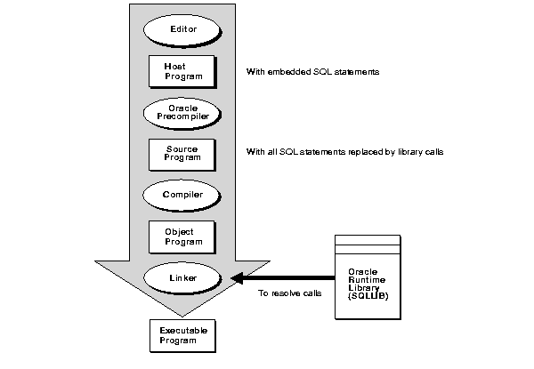
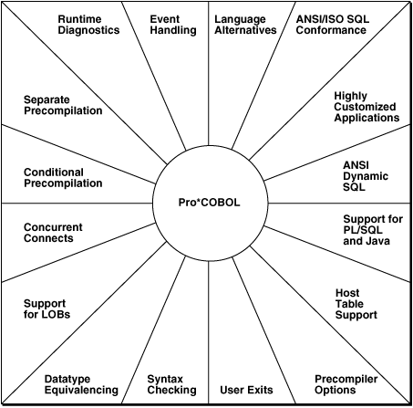

This chapter introduces you to the Pro\*COBOL Precompiler. You look at its role in developing application programs that manipulate Oracle data and find out what it enables your applications to do. The following questions are answered:

- What is Pro\*COBOL?

- The Pro\*COBOL Precompiler

- Advantages of the Pro\*COBOL Precompiler

- The SQL Language

- The PL/SQL Language

- Pro\*COBOL Features and Benefits

- Directory Structure

### 1.1 What is Pro\*COBOL?

To access an Oracle database, you use a high-level query language called Structured Query Language (SQL). You often use SQL through an interactive interface, such as SQL\*Plus.

Pro\*COBOL is a programming tool that enables you to embed SQL statements in a COBOL program. The Pro\*COBOL precompiler converts the SQL statements in the COBOL program into standard Oracle run-time library calls. The generated output file can then be compiled, linked, and run in the usual manner.

Use the Pro\*COBOL precompiler when rapid development and compatibility with other systems are your priorities.

### 1.2 The Pro\*COBOL Precompiler

The Pro\*COBOL Precompiler is a programming tool that enables you to embed SQL statements in a host COBOL program. As Figure 1-1 shows, the precompiler accepts the host program as input, translates the embedded SQL statements into standard Oracle run-time library calls, and generates a source program that you can compile, link, and execute in the usual way.

Figure 1-1 Embedded SQL Program Development

[Description of "Figure 1-1 Embedded SQL Program Development"](img_text/pco81047.md)

**Note:**

Pro\*COBOL supports the MERANT Micro Focus NetExpress version 5.0 for 32-bit Windows 2000.

**Note:**

Pro\*COBOL does not support Object Oriented COBOL (OOCOBOL) specifications.

#### 1.2.1 Language Alternatives

Oracle Precompilers are available (but not on all systems) for the following high-level languages:

- C/C++

- COBOL

- FORTRAN

### 1.3 Advantages of the Pro\*COBOL Precompiler

The Pro\*COBOL Precompiler lets you pack the power and flexibility of SQL into your application programs. You can embed SQL statements in COBOL. A convenient, easy to use interface lets your application access Oracle directly.

Unlike many application development tools, Pro\*COBOL lets you create highly customized applications. For example, you can create user interfaces that incorporate the latest windowing and mouse technology. You can also create applications that run in the background without the need for user interaction.

Furthermore, with Pro\*COBOL you can fine-tune your applications. It enables close monitoring of resource usage, SQL statement execution, and various run-time indicators. With this information, you can adjust program parameters for maximum performance.

### 1.4 The SQL Language

If you want to access and manipulate Oracle data, you need SQL. Whether you use SQL interactively or embedded in an application program depends on the job at hand. If the job requires the procedural processing power of COBOL, or must be done on a regular basis, use embedded SQL.

SQL has become the database language of choice because it is flexible, powerful, and easy to learn. Being non-procedural, it lets you specify what you want done without specifying how to do it. A few English-like statements make it easy to manipulate Oracle data one row or many rows at a time.

You can execute any SQL (not SQL\*Plus) statement from an application program. For example, you can:

- CREATE, ALTER, and DROP database tables dynamically.

- SELECT, INSERT, UPDATE, and DELETE rows of data.

- COMMIT or ROLLBACK transactions.

Before embedding SQL statements in an application program, you can test them interactively using SQL\*Plus. Usually, only minor changes are required to switch from interactive to embedded SQL.

### 1.5 The PL/SQL Language

An extension to SQL, PL/SQL is a transaction processing language that supports procedural constructs, variable declarations, and robust error handling. Within the same PL/SQL block, you can use SQL and all the PL/SQL extensions.

The main advantage of embedded PL/SQL is better performance. Unlike SQL, PL/SQL enables you to group SQL statements logically and send them to Oracle in a block rather than one by one. This reduces network traffic and processing overhead.

**Related Topics**

- [Embedded PL/SQL](embedded-PLSQL.md)

### 1.6 Pro\*COBOL Features and Benefits

As Figure 1-2 shows, Pro\*COBOL offers many features and benefits that help you to develop effective, reliable applications.

Figure 1-2 Pro\*COBOL Features and Benefits

[Description of "Figure 1-2 Pro\*COBOL Features and Benefits"](img_text/lnpcb048.md)

For example, the Pro\*COBOL Precompiler enables you to:

- Write your application in COBOL.

- Conform to the ANSI/ISO embedded SQL standard.

- Take advantage of ANSI Dynamic SQL Method 4, an advanced programming technique that lets your program accept or build any valid SQL statement at run-time in a COBOL program.

- Design and develop highly customized applications.

- Convert automatically between Oracle internal datatypes and COBOL datatypes.

- Improve performance by embedding PL/SQL transaction processing blocks in your COBOL application program.

- Specify useful precompiler options and change their values during precompilation.

- Use datatype equivalencing to control the way Oracle interprets input data and formats output data.

- Precompile several program modules separately, and then link them into one executable program.

- Check the syntax and semantics of embedded SQL data manipulation statements and PL/SQL blocks.

- Access Oracle databases on multiple nodes concurrently, using Oracle Net Services.

- Use arrays as input and output program variables.

- Precompile sections of code conditionally so that your host program can run in different environments.

- Interface with tools, such as Oracle Forms and Oracle Reports, through user exits written in a high-level language.

- Handle errors and warnings with the ANSI-approved status variables SQLSTATE and SQLCODE, or the SQL Communications Area (SQLCA) and WHENEVER statement. Or both SQLSTATE and SQLCODE, and the SQL Communications Area (SQLCA) and WHENEVER statement.

- Use an enhanced set of diagnostics provided by the Oracle Communications Area (ORACA).

- Access Large Object (LOB) database types.

### 1.7 Directory Structure

When you install Pro\*COBOL, Oracle Universal Installer creates a directory called `\precomp` in your `ORACLE_BASE\ORACLE_HOME` directory.

**Note:**

The `\precomp` directory can contain files for other products, such as Pro\*C/C++.

The `\precomp` directory contains the directories listed in Table 1-1.

Table 1-1 Directories

| Directory Name  | Contents                        |
|:----------------|:--------------------------------|
| `\admin`        | Configuration files             |
| `\demo\procob2` | Sample programs for Pro\*COBOL  |
| `\demo\sql`     | SQL scripts for sample programs |
| `\doc\procob2`  | Readme files for Pro\*COBOL     |
| `\lib`          | Library files                   |
| `\mesg`         | Message files                   |
| `\public`       | Header files                    |

#### 1.7.1 Header Files

The `ORACLE_BASE\ORACLE_HOME``\precomp\public` directory contains the Pro\*COBOL header files listed in Table 1-2.

Table 1-2 Header Files

| Header File  | Description                                                                                                                                                |
|:-------------|:-----------------------------------------------------------------------------------------------------------------------------------------------------------|
| `oraca.cob`  | Contains the Oracle Communications Area (ORACA), which helps you to diagnose runtime errors and to monitor your program's use of various Oracle resources. |
| `oraca5.cob` | ORACA5 is the COMP-5 version of ORACA.                                                                                                                     |
| `sqlca.cob`  | Contains the SQL Communications Area (SQLCA), which helps you to diagnose runtime errors. The SQLCA is updated after every executable SQL statement.       |
| `sqlca5.cob` | SQLCA5 is the COMP-5 version of SQLCA.                                                                                                                     |
| `sqlda.cob`  | Contains the SQL Descriptor Area (SQLDA), which is a data structure required for programs that use dynamic SQL Method 4.                                   |
| `sqlda5.cob` | This is the COMP-5 version of SQLDA.                                                                                                                       |

#### 1.7.2 Library File

The `ORACLE_BASE\ORACLE_HOME` `\precomp\lib` directory contains the library file that you use when linking Pro\*COBOL applications. The library file is called `orasql12.lib`.

Is orasql11.lib correct?

#### 1.7.3 Known Problems, Restrictions, and Workarounds

1.  Although all Windows operating systems allow spaces in filenames and directory names, the Oracle Pro\*COBOL precompilers do not precompile files that include spaces in the file name or directory name. For example, do not use the following formats:

    - `proc iname=test one.pc`

    - `proc iname=d:\dir1\second dir\sample1.pc`

2.  Users running PROCOB application that are not linked using /LITLINK option and failing at runtime with the error,

        Load error: file 'ORASQL8'

    need to copy `orasql9.dll` to `orasql8.dll` in the same directory where `orasql9.dll` exists.

    Is this still an issue? What is the error and what are the lib file names?

3.  The COMP5 precompiler option is not available on SPARC Solaris 64 bit computers. User the COMP option instead.

### 1.8 Compatibility, Upgrading, and Migration

The additional "array insert" and "array select" syntax will help migrating DB2 precompiler applications to the Pro\*Cobol application. This is because you will not need to change DB2 array INSERT and SELECT syntax to that of Oracle Pro\*Cobol.

The ""Implicit Buffered Insert" feature supported by Pro\*Cobol helps you to migrate DB2 precompiler applications to Pro\*Cobol applications without using the array syntax of Pro\*Cobol for better performance.
