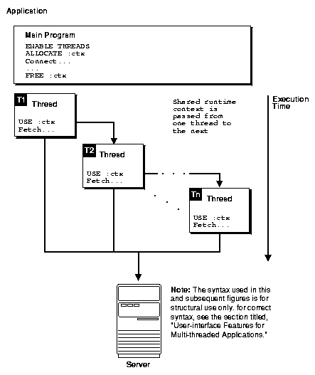
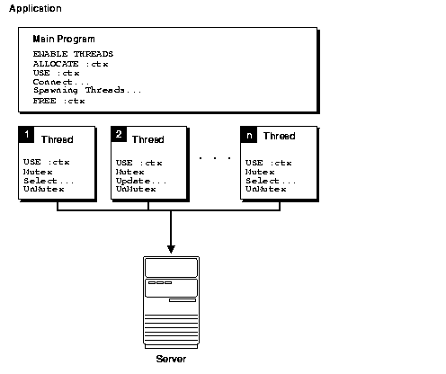
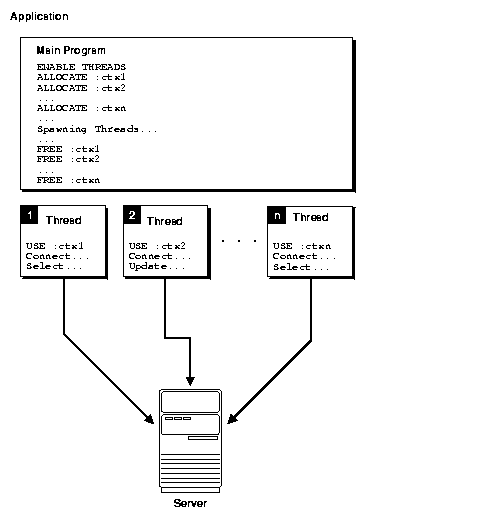

If your development platform does not support threads, you can ignore this chapter.

The sections of this chapter are:

- Introduction to Threads

- Runtime Contexts in Pro\*COBOL

- Runtime Context Usage Models

- User Interface Features for Multithreaded Applications

- Multithreaded Example

### 12.1 Introduction to Threads

Multithreaded applications have multiple threads executing in a shared address space. Threads are "lightweight" subprocesses that execute within a process. They share code and data segments, but have their own program counters, machine registers, and stack. Variables declared without the thread-local attribute in working storage (as opposed to local-storage or thread-local storage) are common to all threads, and a mutual exclusivity mechanism is often required to manage access to these variables from multiple threads within an application. Mutexes are the synchronization mechanism to insure that data integrity is preserved.

For further discussion of mutexes, see texts on multithreading. For more detailed information about multithreaded applications, see the documentation of your threads functions.

Pro\*COBOL supports development of multithreaded Oracle Server applications (on platforms that support multithreaded applications) using the following:

- A command-line option to generate thread-safe code.

- Embedded SQL statements and directives to support multithreading.

- Thread-safe SQLLIB and other client-side Oracle libraries.

**Note:**

While your platform may support a particular thread package, see your platform-specific Oracle documentation to determine whether Oracle supports it.

The chapter's topics discuss how to use the preceding features to develop multithreaded Pro\*COBOL applications:

- Runtime contexts for multithreaded applications.

- Two models for using runtime contexts.

- User-interface features for multithreaded applications.

- Programming considerations for writing multithreaded applications with Pro\*COBOL.

- Sample multithreaded Pro\*COBOL applications.

### 12.2 Runtime Contexts in Pro\*COBOL

To loosely couple a thread and a connection, in Pro\*COBOL we introduce the concept of a runtime context. The runtime context includes the following resources and their current states:

- Zero or more connections to one or more Oracle servers.

- Zero or more cursors used for the server connections.

- Inline options, such as MODE, HOLD_CURSOR, RELEASE_CURSOR, and SELECT_ERROR.

Rather than simply supporting a loose coupling between threads and connections, Pro\*COBOL enables you to loosely couple threads with runtime contexts. Pro\*COBOL enables your application to define a handle to a runtime context, and pass that handle from one thread to another.

For example, an interactive application spawns a thread, T1, to execute a query and return the first 10 rows to the application. T1 then terminates. After obtaining the necessary user input, another thread, T2, is spawned (or an existing thread is used) and the runtime context for T1 is passed to T2 so it can fetch the next 10 rows by processing the same cursor.This is shown in Figure 12-1:

Figure 12-1 Loosely Coupling Connections and Threads

[Description of "Figure 12-1 Loosely Coupling Connections and Threads"](img_text/pc_81021.md)

### 12.3 Runtime Context Usage Models

Two possible models for using runtime contexts in multithreaded applications are shown here:

- Multiple threads sharing a single runtime context.

- Multiple threads using separate runtime contexts.

Regardless of the model you use for runtime contexts, you cannot share a runtime context between multiple threads at the same time. If two or more threads attempt to use the same runtime context simultaneously, a runtime error occurs

#### 12.3.1 Multiple Threads Sharing a Single Runtime Context

“Context Sharing Among Threads” shows an application running in a multithreaded environment. The various threads share a single runtime context to process one or more SQL statements. Again, runtime contexts cannot be shared by multiple threads at the same time. The mutexes in “Context Sharing Among Threads” show how to prevent concurrent usage.

Figure 12-2 Context Sharing Among Threads

[Description of "Figure 12-2 Context Sharing Among Threads"](img_text/pc_81023.md)

#### 12.3.2 Multiple Threads Sharing Multiple Runtime Contexts

Figure 12-3 shows an application that executes multiple threads using multiple runtime contexts. In this situation, the application does not require mutexes, because each thread has a dedicated runtime context.

Figure 12-3 No Context Sharing Among Threads

[Description of "Figure 12-3 No Context Sharing Among Threads"](img_text/pc_81022.md)

### 12.4 User Interface Features for Multithreaded Applications

Pro\*COBOL provides the following user-interface features to support multithreaded applications:

- Host variables can be declared in the LOCAL-STORAGE and the THREAD-LOCAL-STORAGE sections.

- The command-line option THREADS=YES \| NO.

- Embedded SQL statements and directives.

- Thread-safe SQLLIB public functions.

#### 12.4.1 THREADS Option

With THREADS=YES specified on the command line, Pro\*COBOL ensures that the generated code is thread-safe, given that you follow the guidelines described in “Multithreading Programming Considerations”. With THREADS=YES specified, Pro\*COBOL verifies that all SQL statements execute within the scope of a user-defined runtime context. If your program does not meet this requirement, a precompiler error is returned.

**Related Topics**

- Multithreading Programming Considerations

#### 12.4.2 Embedded SQL Statements and Directives for Runtime Contexts

The following embedded SQL statements and directives support the definition and usage of runtime contexts and threads:

- EXEC SQL ENABLE THREADS END-EXEC.

- EXEC SQL CONTEXT ALLOCATE :context_var END-EXEC.

- EXEC SQL CONTEXT USE { :context_var \| DEFAULT} END-EXEC.

- EXEC SQL CONTEXT FREE :context_var END-EXEC.

For these EXEC SQL statements, context_var is the handle to the runtime context and must be declared of type SQL-CONTEXT as follows:

     01  SQL-CONTEXT context_var END-EXEC.

Using DEFAULT means that the default (global) runtime context will be used in all embedded SQL statements that lexically follow until another CONTEXT USE statement overrides it.

Examples illustrating the various uses of context statements are shown.

##### 12.4.2.1 Host Tables of SQL-CONTEXT Are Not Allowed

You cannot declare host tables of SQL-CONTEXT. Instead, declare a host table of S9(9) COMP variables and then pass them to the subprogram one at a time after redeclaring them in the subprogram as SQL-CONTEXT.

##### 12.4.2.2 EXEC SQL ENABLE THREADS

This executable SQL statement initializes a process that supports multiple threads. This must be the first executable SQL statement in a program that contains a multithreaded application. There can only be one ENABLE THREADS statement in all files of an application, or an error results. For more detailed information, see “ENABLE THREADS (Executable Embedded SQL Extension)”.

**Related Topics**

- [ENABLE THREADS (Executable Embedded SQL Extension)](embedded-SQL-statements-and-precompiler-directives.md)

##### 12.4.2.3 EXEC SQL CONTEXT ALLOCATE

This executable SQL statement allocates and initializes memory for the specified runtime context; the runtime-context variable must be declared of type SQL_CONTEXT. For more detailed information, see “CONTEXT ALLOCATE (Executable Embedded SQL Extension)”.

**Related Topics**

- [CONTEXT ALLOCATE (Executable Embedded SQL Extension)](embedded-SQL-statements-and-precompiler-directives.md)

##### 12.4.2.4 EXEC SQL CONTEXT USE

The EXEC SQL CONTEXT USE directive instructs the precompiler to use the specified runtime context for subsequent executable SQL statements. The runtime context specified must be previously allocated using an EXEC SQL CONTEXT ALLOCATE statement.

The EXEC SQL CONTEXT USE directive works similarly to the EXEC SQL WHENEVER directive in that it affects all executable SQL statements which positionally follow it in a given source file without regard to standard COBOL scope rules.

For more detailed information, see “CONTEXT USE (Oracle Embedded SQL Directive)”, and “CONTEXT ALLOCATE (Executable Embedded SQL Extension)”.

**Related Topics**

- [CONTEXT USE (Oracle Embedded SQL Directive)](embedded-SQL-statements-and-precompiler-directives.md)
- [CONTEXT ALLOCATE (Executable Embedded SQL Extension)](embedded-SQL-statements-and-precompiler-directives.md)

##### 12.4.2.5 EXEC SQL CONTEXT FREE

The EXEC SQL CONTEXT FREE executable SQL statement frees the memory associated with the specified runtime context and places a null pointer in the host program variable. For more detailed information, see “CONTEXT FREE (Executable Embedded SQL Extension)”.

**Related Topics**

- [CONTEXT FREE (Executable Embedded SQL Extension)](embedded-SQL-statements-and-precompiler-directives.md)

#### 12.4.3 Communication with Pro\*C/C++ Programs

Runtime contexts can be passed using arguments defined in the Linkage Section. Multithreaded Pro\*C/C++ programs can call Pro\*COBOL subprograms and Pro\*COBOL programs can call subprograms written in Pro\*C/C++.

#### 12.4.4 Multithreading Programming Considerations

While Oracle ensures that the SQLLIB code is thread-safe, you are responsible for ensuring that your source code is designed to work properly with threads. For example, carefully consider the scope of the variables you use.

In addition, multithreading requires design decisions regarding the following:

- Including one SQLCA for each runtime context.

- Declaring the SQLDA as a thread-safe group item, like the SQLCA, typically an auto variable, one for each runtime context.

- Declaring host variables in a thread-safe fashion, in other words, carefully consider your use of static and global host variables.

- Avoiding simultaneous use of a runtime context in multiple threads.

- Whether or not to use default database connections or to explicitly define them using the AT clause.

No more than one executable embedded SQL statement, for example, EXEC SQL UPDATE, may be outstanding on a runtime context at a given time.

Existing requirements for precompiled applications also apply. For example, all references to a given cursor must appear in the same source file.

##### 12.4.4.1 Restrictions on Multithreading

The following restrictions be in effect when using threads:

- You cannot use an array of datatype SQL-CONTEXT.

- Concurrent threads should each have its own SQLCA.

- Concurrent threads should each have its own context areas.

#### 12.4.5 Multiple Context Examples

The code fragments in this section show how to use multiple contexts, and demonstrate the scope of the context use statement.

##### 12.4.5.1 Example 1

In the first example, the precompiler option setting THREADS=YES is not needed, because we are not generating threads:

     IDENTIFICATION DIVISION.
     PROGRAM-ID. MAIN.
     ...
    * declare a context area
     01  CTX1  SQL-CONTEXT.
     01  UID1  PIC X(11) VALUE "SCOTT/TIGER".
     01  UID2  PIC X(10) VALUE "MARY/LION"

     PROCEDURE DIVISION.
    ...
    * allocate context area
         EXEC SQL CONTEXT ALLOCATE :CTX1 END-EXEC.
         EXEC SQL CONTEXT USE :CTX1 END-EXEC.
    * all statements until the next context use will use CTX1
         EXEC SQL CONNECT :UID1 END-EXEC.
         EXEC SQL SELECT ....
         EXEC SQL CONTEXT USE DEFAULT END-EXEC.
    * all statements physically after the preceding lines will use the default context
         EXEC SQL CONNECT :UID2 END-EXEC.
         EXEC SQL INSERT ...
     ...

##### 12.4.5.2 Example 2

This next example shows multiple contexts. One context is used by the generated thread while the other is used by the main program. The started thread, SUBPRGM1, will use context CTX1, which is passed to it through the LINKAGE SECTION. This example also demonstrates the scope of the CONTEXT USE statement.

**Note:**

You must precompile the main program file, and the main program of every subsequent example in this section, with the option THREADS=YES.

     IDENTIFICATION DIVISION.
     PROGRAM-ID. MAIN.
     ...
    * declare two context areas
     01  CTX1  SQL-CONTEXT.
     01  CTX2  SQL-CONTEXT.

     PROCEDURE DIVISION.

    * enable threading
         EXEC SQL ENABLE THREADS END-EXEC.

    * allocate context areas
         EXEC SQL CONTEXT ALLOCATE :CTX1 END-EXEC.
         EXEC SQL CONTEXT ALLOCATE :CTX2 END-EXEC.

    * include your code to start thread "SUBPGM1" using CTX1 here.

         EXEC SQL CONTEXT USE :CTX2 END-EXEC.
    * all statement physically after the preceding lines will use CTX2

         EXEC SQL CONNECT :USERID END-EXEC.
         EXEC SQL INSERT .....
     ...

The thread `SUBPRGM1` is in a another file:

     PROGRAM-ID. SUBPRGM1.
     ...
     01  USERID PIC X(11) VALUE "SCOTT/TIGER".
     LINKAGE SECTION.
     01  CTX1 SQL-CONTEXT.
     PROCEDURE DIVISION USING CTX1.

         EXEC SQL CONTEXT USE :CTX1 END-EXEC.
         EXEC SQL CONNECT :USERID END-EXEC.
         EXEC SQL SELECT ...
     ...

##### 12.4.5.3 Example 3

The following example uses multiple threads. Each thread has its own context. If the threads are to be executed concurrently, each thread must have its own context. Contexts are passed to the thread with the USING CLAUSE of the START statement and are declared in the LINKAGE SECTION of the threaded subprogram.

     IDENTIFICATION DIVISION.
     PROGRAM-ID. MAIN.
     ...
     DATA DIVISION.

     01  CTX1 SQL-CONTEXT.
     01  CTX2 SQL-CONTEXT.

     PROCEDURE DIVISION.
     ...
         EXEC SQL ENABLE THREADS END-EXEC.
         EXEC SQL CONTEXT ALLOCATE :CTX1 END-EXEC.
         EXEC SQL CONTEXT ALLOCATE :CTX2 END-EXEC.

    * include your code to start thread "SUBPGM" using CTX1 here.
    * include your code to start thread "SUBPGM" using CTX2 here.
     ...

The thread SUBPGM is placed in another file:

    PROGRAM-ID. SUBPGM.
     ...
     DATA DIVISION.
     ...
     01  USERID PIC X(11) VALUE "SCOTT/TIGER".
     ...
     LINKAGE SECTION.
     01  CTX SQL-CONTEXT.
     PROCEDURE DIVISION USING CTX.
         EXEC SQL CONTEXT USE :CTX END-EXEC.
         EXEC SQL CONNECT :USERID END-EXEC.
         EXEC SQL SELECT ....
     ...

##### 12.4.5.4 Example 4

The next example is based on the previous example, but does the connection in the top level program and passes the connection with the context to the threaded subprogram.

     IDENTIFICATION DIVISION.
     PROGRAM-ID. MAIN.
     ...
     DATA DIVISION.

     01  CTX1 SQL-CONTEXT.
     01  CTX2 SQL-CONTEXT.
     01  USERID PIC X(11) VALUE "SCOTT/TIGER".

     ROCEDURE DIVISION.

         EXEC SQL ENABLE THREADS END-EXEC.
         EXEC SQL CONTEXT ALLOCATE :CTX1 END-EXEC.
         EXEC SQL CONTEXT ALLOCATE :CTX2 END-EXEC.
         EXEC SQL CONTEXT USE :CTX1 END-EXEC.
         EXEC SQL CONNECT :USERID END-EXEC.
         EXEC SQL CONTEXT USE :CTX2 END-EXEC.
         EXEC SQL CONNECT :USERID END-EXEC.

    * include your code to start thread "SUBPGM" using CTX1 here.
    * include your code to start thread "SUBPGM" using CTX2 here.
     ...

The thread `SUBPRGM` is in another file:

     PROGRAM-ID. SUBPGM.
     ...
     LINKAGE SECTION.
     01  CTX SQL-CONTEXT.
     PROCEDURE DIVISION USING CTX.
         EXEC SQL CONTEXT USE :CTX END-EXEC.
         EXEC SQL SELECT ....
     ...

##### 12.4.5.5 Example 5

The following example shows multiple threads which share a context. Note that in this case, the threads must be serialized.

     IDENTIFICATION DIVISION.
     PROGRAM-ID. MAIN.
     ...
     DATA DIVISION.

     01  CTX1 SQL-CONTEXT.

     PROCEDURE DIVISION.

         EXEC SQL ENABLE THREADS END-EXEC.
         EXEC SQL CONTEXT ALLOCATE :CTX1 END-EXEC.

    * include your code to start thread1 "SUBPGM1" using CTX1 here.
    * include your code to wait for thread1 here.
    * include your code to start thread2 "SUBPGM2" using CTX1 here.
     ...

There are two separate files for the two threads. First there is:

     PROGRAM-ID. SUBPGM1.
     ...
     DATA DIVISION.
     ..
     01  USERID PIC X(11) VALUE "SCOTT/TIGER".
     ...
     LINKAGE SECTION.
     01  CTX SQL-CONTEXT.
     PROCEDURE DIVISION USING CTX.
         EXEC SQL CONTEXT USE :CTX END-EXEC.
     ...
         EXEC SQL CONNECT :USERID END-EXEC.

Another file contains SUBPGM2:

     PROGRAM-ID. SUBPGM2.
     ...
     DATA DIVISION.
     ...
     LINKAGE SECTION.
     01  CTX SQL-CONTEXT.
     PROCEDURE DIVISION USING CTX.
         EXEC SQL CONTEXT USE :CTX END-EXEC.
         EXEC SELECT ....
     ...

### 12.5 Multithreaded Example

This multi-file application demonstrates one way to use the SQLLIB runtime context area (SQL-CONTEXT) to support multiple threads. Precompile with THREADS=YES.

The main program, orathrd2, declares an array of S9(9) COMP variables to be used to hold the sqllib contexts. It enables threading through the

    EXEC SQL ENABLE THREADS END-EXEC.

statement and then calls the subprogram oracon (in file `oracon.pco`) to allocate the threads. oracon also establishes a connection for each allocated context.

Next, ORTHRD2 passes the context to one of the threaded entry points, THREAD-1 or THREAD-2. THREAD-1 simply selects and displays the salary for an employee. THREAD-2 selects and updates the salary for that employee. Since THREAD-2 issues a commit, the update is visible to threads that do the SELECT after it has committed. (But not those which run concurrently with the update.) Note that the output will vary from run to run because the timing of the update and commit is non-determinant.

It is important to remember that concurrent threads must each have their own contexts. Contexts may be passed to and used by subsequent threads, but threads may not use the same context concurrently. This model could be used for connection pooling, where the maximum number of connections are created initially and passed to threads as available, to execute user's requests.

An array of S9(9) COMP variables is used because you cannot currently declare an array of SQL-CONTEXT.

Note: This program was developed specifically for a Sun workstation running Solaris and MicroFocus ServerExpress compiler and uses vendor-specific directives and functionality.

See your platform-specific documentation for the specific COBOL statements that support multithreading.

The main program is in file `orathrd2.pco`:

          $SET REENTRANT MF
           IDENTIFICATION DIVISION.
           PROGRAM-ID. ORATHRD2.
           ENVIRONMENT DIVISION.
           DATA DIVISION.
           WORKING-STORAGE SECTION.
           78 MAX-LOOPS            VALUE 10.
           01 THREAD-ID            USAGE POINTER.
           01 TP-1                 USAGE THREAD-POINTER OCCURS MAX-LOOPS.
           01 IDEN-4               PIC 9(4).
           01 LOOP-COUNTER         PIC 9(2)  COMP-X EXTERNAL.
           01 PEMPNO               PIC S9(4) COMP EXTERNAL.
           01 ISAL                 PIC S9(4) COMP   VALUE ZERO.
               EXEC SQL
                    INCLUDE SQLCA
               END-EXEC.
           THREAD-LOCAL-STORAGE SECTION.
           01  CONTEXT-AREA          PIC S9(9) COMP OCCURS MAX-LOOPS.
           PROCEDURE DIVISION.
           MAIN SECTION.

               PERFORM INITIALISATION
               PERFORM ORACLE-CONNECTIONS VARYING LOOP-COUNTER
                       FROM 1 BY 1 UNTIL LOOP-COUNTER > MAX-LOOPS
               PERFORM  VARYING LOOP-COUNTER FROM 1 BY 1
                  UNTIL LOOP-COUNTER > MAX-LOOPS
                   PERFORM START-THREAD
               END-PERFORM
               STOP RUN.

          *---------------------------------------------------------------
          * CHECK THAT WE ARE RUNNING UNDER A MULTI THREADED RTS.
          *---------------------------------------------------------------
           INITIALISATION SECTION.

               CALL "CBL_THREAD_SELF" USING THREAD-ID ON EXCEPTION
                    DISPLAY "NO THREAD SUPPORT IN THIS RTS"
                    STOP RUN
               END-CALL
               IF RETURN-CODE = 1008
                    DISPLAY "CANNOT RUN THIS TEST ON SINGLE THREADED RTS"
                    STOP RUN
               END-IF
               DISPLAY "MULTI-THREAD RTS"

          * ENABLING THREADS MUST BE DONE ONCE BEFORE ANY CONTEXT USEAGE
               EXEC SQL ENABLE THREADS END-EXEC.
               IF SQLCODE NOT = ZERO
                  DISPLAY 'ERROR ENABLING ORACLE THREAD SUPPORT '
                          ' - ABORTING : ' SQLERRMC
                  STOP RUN
               END-IF

          *  SET A VALUE FOR THE EMPLOYEE NUMBER.  BECAUSE THIS IS AN
          *  EXTERNAL VARIABLE, A COPY OF ITS VALUE IS VISIBLE TO THE
          *  OTHER MODULES IN THIS APPLICATION
               MOVE 7566 TO PEMPNO
               EXIT SECTION.

          *-----------------------------------------------------------------
          * CREATE THREADS AND START WITH EITHER THREAD-1 OR THREAD-2
          *-----------------------------------------------------------------
           START-THREAD SECTION.

               IF LOOP-COUNTER = 2 OR LOOP-COUNTER = 5
                  START "THREAD-2 "
                     USING CONTEXT-AREA(LOOP-COUNTER)
                     IDENTIFIED BY TP-1(LOOP-COUNTER)
                     STATUS IS IDEN-4
                     ON EXCEPTION DISPLAY "THREAD CREATE FAILED"
                  END-START
                  IF IDEN-4 NOT = ZERO
                    DISPLAY "THREAD CREATE FAILED RETURNED " IDEN-4
                  END-IF
               ELSE
                  START "THREAD-1 "
                     USING CONTEXT-AREA(LOOP-COUNTER)
                     IDENTIFIED BY TP-1(LOOP-COUNTER)
                     STATUS IS IDEN-4
                     ON EXCEPTION DISPLAY "THREAD CREATE FAILED"
                  END-START
                  IF IDEN-4 NOT = ZERO
                    DISPLAY "THREAD CREATE FAILED RETURNED " IDEN-4
                  END-IF
               END-IF.

           START-THREAD-END.
               EXIT SECTION.

          *-----------------------------------------------------------------
          * ALLOCATE CONTEXT AREAS ESTABLISH CONNECTION WITH EACH AREA.
          *-----------------------------------------------------------------
           ORACLE-CONNECTIONS SECTION.

               CALL "ORACON" USING CONTEXT-AREA(LOOP-COUNTER).
           ORACLE-CONNECTIONS-END.
               EXIT SECTION.

Here is the file `thread-1.pco`:

          * This is Thread 1.  It selects and displays the data for
          * the employee. The context area upon which a connection
          * has been established is passed to the thread through the
          * linkage section. In a multi-file application, you
          * can pass the context through the linkage section.
          * Precompile with THREADS=YES.
          *
          $SET REENTRANT MF
           IDENTIFICATION DIVISION.
           PROGRAM-ID. THREAD-1.
           ENVIRONMENT DIVISION.
           DATA DIVISION.
           WORKING-STORAGE SECTION.
           01 PEMPNO               PIC S9(4) COMP EXTERNAL.

           LOCAL-STORAGE SECTION.
           01 DEMPNO               PIC Z(4) VALUE ZERO.
           01 PEMP-NAME1           PIC X(15) VARYING  VALUE SPACES.
           01 PSAL-VALUE1          PIC S9(7)V99 COMP-3 VALUE ZERO.
           01 ISAL1                PIC S9(4)   COMP   VALUE ZERO.
           01 DSAL-VALUE           PIC +(7).99 VALUE ZERO.
               EXEC SQL
                    INCLUDE SQLCA
               END-EXEC.

           LINKAGE SECTION.
           01 CONTEXT-AREA1         SQL-CONTEXT.

          *---------------------------------------------------------------
          * USING THE PASSED IN CONTEXT, SELECT AND DISPLAY THE
          * DATA FOR EMPLOYEE.
          *---------------------------------------------------------------
           PROCEDURE DIVISION USING CONTEXT-AREA1.
           MAIN SECTION.

               EXEC SQL WHENEVER SQLERROR GOTO SELECT-ERROR END-EXEC
               EXEC SQL CONTEXT USE :CONTEXT-AREA1 END-EXEC
               EXEC SQL
                    SELECT  ENAME, SAL
                      INTO  :PEMP-NAME1, :PSAL-VALUE1:ISAL1
                      FROM  EMP
                     WHERE  EMPNO = :PEMPNO
               END-EXEC
               IF ISAL1 < ZERO
                  MOVE ZERO     TO PSAL-VALUE1
               END-IF
               MOVE PEMPNO      TO DEMPNO
               MOVE PSAL-VALUE1 TO DSAL-VALUE
               DISPLAY "FOR EMP ", DEMPNO, " NAME ",
                       PEMP-NAME1-ARR(1:PEMP-NAME1-LEN),
                       " THE CURRENT SALARY IS ", DSAL-VALUE
               EXIT PROGRAM.

          *---------------------------------------------------------------
          * THERE HAS BEEN AN ERROR WHEN SELECTING FROM THE EMP TABLE
          *---------------------------------------------------------------
           SELECT-ERROR SECTION.

               EXEC SQL WHENEVER SQLERROR CONTINUE END-EXEC
               DISPLAY "HIT AN ORACLE ERROR SELECTING EMPNO 7566"
               DISPLAY "SQLCODE = ", SQLCODE
               DISPLAY "ERROR TEXT ", SQLERRMC(1:SQLERRML)
               GOBACK
               EXIT SECTION.

Here is the file` thread-2.pco`:

          * This is Thread 2.  The program will select, then update,
          * increment, and then commit the salary.  It uses the passed-in
          * context upon which a connection has previously been established.
          * Precompile with THREADS=YES.
          *
          $SET REENTRANT MF
           IDENTIFICATION DIVISION.
           PROGRAM-ID. THREAD-2.
           ENVIRONMENT DIVISION.
           DATA DIVISION.
           WORKING-STORAGE SECTION.
           01 PEMPNO               PIC S9(4)   COMP EXTERNAL.

           LOCAL-STORAGE SECTION.
           01 DEMPNO               PIC Z(4) VALUE ZERO.
           01 PEMP-NAME2           PIC X(15) VARYING  VALUE SPACES.
           01 PSAL-VALUE2          PIC S9(7)V99 COMP-3 VALUE 100.
           01 ISAL2                PIC S9(4)   COMP   VALUE ZERO.
           01 DSAL-VALUE           PIC +(7).99 VALUE ZERO.
               EXEC SQL
                    INCLUDE SQLCA
               END-EXEC.

           LINKAGE SECTION.
           01 CONTEXT-AREA2         SQL-CONTEXT.

          *---------------------------------------------------------------
          * USING THE PASSED IN CONTEXT AREA, FIRST SELECT TO GET INITIAL
          * VALUES, INCREMENT THE SALARY, UPDATE AND COMMIT.
          *---------------------------------------------------------------
           PROCEDURE DIVISION USING CONTEXT-AREA2.
           MAIN SECTION.

               EXEC SQL WHENEVER SQLERROR GOTO UPDATE-ERROR END-EXEC
               EXEC SQL CONTEXT USE     :CONTEXT-AREA2 END-EXEC
               EXEC SQL
                    SELECT  ENAME, SAL
                      INTO  :PEMP-NAME2, :PSAL-VALUE2:ISAL2
                      FROM  EMP
                     WHERE  EMPNO = :PEMPNO
               END-EXEC
               ADD  10  TO PSAL-VALUE2
               EXEC SQL
                       UPDATE  EMP
                          SET  SAL   = :PSAL-VALUE2
                        WHERE  EMPNO = :PEMPNO
               END-EXEC
               MOVE PEMPNO      TO DEMPNO
               MOVE PSAL-VALUE2 TO DSAL-VALUE
               DISPLAY "FOR EMP ", DEMPNO, " NAME ",
                       PEMP-NAME2-ARR(1:PEMP-NAME2-LEN),
                       " THE UPDATED SALARY IS ", DSAL-VALUE
          *    THIS COMMIT IS REQUIRED, OTHERWISE THE DATABASE
          *    WILL BLOCK SINCE THE UPDATES ARE TO THE SAME ROW
               EXEC SQL COMMIT WORK END-EXEC
               EXIT PROGRAM.

          *---------------------------------------------------------------
          * THERE HAS BEEN AN ERROR WHEN UPDATING THE SAL IN THE EMP TABLE
          *---------------------------------------------------------------
           UPDATE-ERROR SECTION.

               EXEC SQL WHENEVER SQLERROR CONTINUE END-EXEC
               DISPLAY "HIT AN ORACLE ERROR UPDATING EMPNO 7566"
               DISPLAY "SQLCODE = ", SQLCODE
               DISPLAY "ERROR TEXT ", SQLERRMC(1:SQLERRML)
               GOBACK
               EXIT SECTION.

The file `oracon.pco` follows:

          * This program allocates SQLLIB runtime contexts, stores
          * a pointer to the context in the variable which was
          * passed in from the main program through the linkage section,
          * and establishes a connection on the allocated context.
          *
          * This program is written for Merant MicroFocus COBOL and uses
          * vendor-specific directives and functionality. Precompile
          * with THREADS=YES.
          *
          $SET REENTRANT MF
           IDENTIFICATION DIVISION.
           PROGRAM-ID. ORACON.
           ENVIRONMENT DIVISION.
           DATA DIVISION.
           WORKING-STORAGE SECTION.
           01 LOGON-STRING         PIC X(40)          VALUE SPACES.
               EXEC SQL
                    INCLUDE SQLCA
               END-EXEC.
           LINKAGE SECTION.
           01  CONTEXT          SQL-CONTEXT.

           PROCEDURE DIVISION USING CONTEXT.
           MAIN SECTION.

          *-----------------------------------------------------------------
          * ALLOCATE CONTEXT AREAS ESTABLISH CONNECTION WITH EACH AREA.
          *-----------------------------------------------------------------
           ORACLE-CONNECTION SECTION.

               MOVE "SCOTT/TIGER"  TO LOGON-STRING
               EXEC SQL CONTEXT ALLOCATE :CONTEXT END-EXEC
               IF SQLCODE NOT = ZERO
                  DISPLAY 'ERROR ALLOCATING CONTEXT '
                          '- ABORTING : ' SQLERRMC
                  GOBACK
               ELSE
                  DISPLAY 'CONTEXT ALLOCATED'
               END-IF

               EXEC SQL CONTEXT USE :CONTEXT END-EXEC
               EXEC SQL  CONNECT    :LOGON-STRING  END-EXEC
               IF SQLCODE NOT = ZERO
                  DISPLAY 'ERROR CONNECTING SECOND THREAD TO THE DATABASE '
                          '- ABORT TEST : ' SQLERRMC
                  GOBACK
               ELSE
                  DISPLAY 'CONNECTION ESTABLISHED'
               END-IF
               EXIT SECTION.
