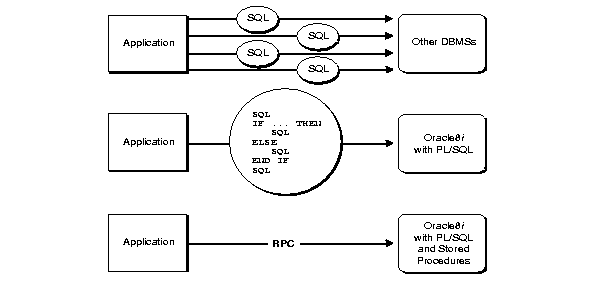
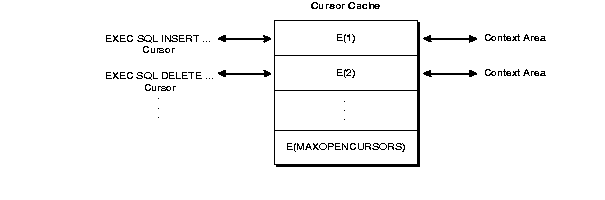

This appendix shows you some simple, easy-to-apply methods for improving the performance of your applications. Using these methods, you can often reduce processing time by 25 percent or more. Topics are:

- Causes of Poor Performance

- Improving Performance

- Using Host Tables

- Using PL/SQL and Java

- Optimizing SQL Statements

- Using Indexes

- Taking Advantage of Row-Level Locking

- Eliminating Unnecessary Parsing

- About Using Oracle Connection Manager in Traffic Director Mode

### C.1 Causes of Poor Performance

One cause of poor performance is high Oracle communication overhead. Oracle must process SQL statements one at a time. Thus, each statement results in another call to Oracle and higher overhead. In a networked environment, SQL statements must be sent over the network, adding to network traffic. Heavy network traffic can slow down your application significantly.

Another cause of poor performance is inefficient SQL statements. Because SQL is so flexible, you can get the same result using two different statements. Using one statement might be less efficient. For example, the following two SELECT statements return the same rows (the name and number of every department having at least one employee):

         EXEC SQL SELECT DNAME, DEPTNO
             FROM DEPT
             WHERE DEPTNO IN (SELECT DEPTNO FROM EMP)
         END-EXEC.

Contrasted with:

         EXEC SQL SELECT DNAME, DEPTNO
             FROM DEPT
             WHERE EXISTS
             (SELECT DEPTNO FROM EMP WHERE DEPT.DEPTNO = EMP.DEPTNO)
         END-EXEC.

The first statement is slower because it does a time-consuming full scan of the EMP table for every department number in the DEPT table. Even if the DEPTNO column in EMP is indexed, the index is not used because the subquery lacks a WHERE clause naming DEPTNO.

Another cause of poor performance is unnecessary parsing and binding. Recall that before executing a SQL statement, Oracle must parse and bind it. Parsing means examining the SQL statement to make sure it follows syntax rules and refers to valid database objects. Binding means associating host variables in the SQL statement with their addresses so that Oracle can read or write their values.

Many applications manage cursors poorly. This results in unnecessary parsing and binding, which adds noticeably to processing overhead.

### C.2 Improving Performance

If you are unhappy with the performance of your precompiled programs, there are several ways you can reduce overhead.

You can greatly reduce Oracle communication overhead, especially in networked environments, by

- Using host tables

- Using embedded PL/SQL

You can reduce processing overhead—sometimes dramatically—by

- Optimizing SQL statements

- SQL Statement Caching

- Using indexes

- Taking advantage of row-level locking

- Eliminating unnecessary parsing

- Avoiding unnecessary reparsing

The following sections look at each of these ways to cut overhead.

### C.3 Using Host Tables

Host tables can boost performance because they let you manipulate an entire collection of data with a single SQL statement. For example, suppose you want to insert salaries for 300 employees into the EMP table. Without tables your program must do 300 individual inserts—one for each employee. With arrays, only one INSERT is necessary. Consider the following statement:

         EXEC SQL INSERT INTO EMP (SAL) VALUES (:SALARY) END-EXEC.

If SALARY is a simple host variable, Oracle executes the INSERT statement once, inserting a single row into the EMP table. In that row, the SAL column has the value of SALARY. To insert 300 rows this way, you must execute the INSERT statement 300 times.

However, if SALARY is a host table of size 300, Oracle inserts all 300 rows into the EMP table at once. In each row, the SAL column has the value of an element in the SALARY table.

For more information, see [Host Tables](host-tables.md)

### C.4 Using PL/SQL and Java

As Figure C-1 shows, if your application is database-intensive, you can use control structures to group SQL statements in a PL/SQL block, then send the entire block to Oracle. This can drastically reduce communication between your application and the database.

Also, you can use PL/SQL and Java subprograms to reduce calls from your application to the database. For example, to execute ten individual SQL statements, ten calls are required, but to execute a subprogram containing ten SQL statements, only one call is required.

Unlike anonymous blocks, PL/SQL and Java subprograms can be compiled separately and stored in a database. When called, they are passed to the PL/SQL engine immediately. Moreover, only one copy of a subprogram need be loaded into memory for execution by multiple users.

Figure C-1 PL/SQL Boosts Performance

[Description of "Figure C-1 PL/SQL Boosts Performance"](img_text/pco81060.md)

### C.5 Optimizing SQL Statements

For every SQL statement, the optimizer generates an execution plan, which is a series of steps that Oracle takes to execute the statement. These steps are determined by rules given in the [Oracle Database Advanced Application Developer's Guide](../adfns/index.md). Following these rules will help you write optimal SQL statements.

#### C.5.1 Optimizer Hints

For every SQL statement, the optimizer generates an execution plan, which is a series of steps that Oracle takes to execute the statement. In some cases, you can suggest the way to optimize a SQL statement. These suggestions, called hints, let you influence decisions made by the optimizer.

Hints are not directives; they merely help the optimizer do its job. Some hints limit the scope of information used to optimize a SQL statement, while others suggest overall strategies. You can use hints to specify the:

- Optimization approach for a SQL statement

- Access path for each referenced table

- Join order for a join

- Method used to join tables

##### C.5.1.1 Giving Hints

You give hints to the optimizer by placing them in a C-style Comment immediately after the verb in a SELECT, UPDATE, or DELETE statement. You can choose rule-based or cost-based optimization. With cost-based optimization, hints help maximize throughput or response time. In the following example, the ALL_ROWS hint helps maximize query throughput:

         EXEC SQL SELECT /*+ ALL_ROWS (cost-based) */ EMPNO, ENAME, SAL
             INTO :EMP-NUMBER, :EMP-NAME, :SALARY
             FROM EMP
             WHERE DEPTNO = :DEPT-NUMBER
         END-EXEC.

The plus sign (+), which must immediately follow the Comment opener, indicates that the Comment contains one or more hints. Notice that the Comment can contain remarks as well as hints.

For more information about optimizer hints, see [Performance and Scalability](../adfns/performance-and-scalability.md).

Trace Facility

You can use the SQL trace facility and the EXPLAIN PLAN statement to identify SQL statements that might be slowing down your application. The trace facility generates statistics for every SQL statement executed by Oracle. From these statistics, you can determine which statements take the most time to process. You can then concentrate your tuning efforts on those statements.

The EXPLAIN PLAN statement shows the execution plan for each SQL statement in your application. You can use the execution plan to identify inefficient SQL statements.

See Also: [Tools for Performance](../adfns/performance-and-scalability.md) for instructions on using trace tools and analyzing their output.

### C.6 SQL Statement Caching

Performance improvement is achieved in precompiler applications using statement caching. Any program using dynamic SQL statements, where the cursors have to be used with reparsing of the statements will have performance gain with statement caching. With this new feature, the overall execution time will be decreased.

The stmt_cache option can be set to hold the anticipated number of distinct dynamic SQL statements in the application. The customer can set the stmt_cache size with the new precompiler command line option. An optimal value of stmt_cache can not be set, as it depends on the input program behavior.

The performance can be measured with the change in the execution time (with and without statement caching).

### C.7 Using Indexes

Using rowids, an index associates each distinct value in a table column with the rows containing that value. An index is created with the CREATE INDEX statement. For details, see [CREATE INDEX](../sqlrf/CREATE-INDEX.md).

You can use indexes to boost the performance of queries that return less than 15% of the rows in a table. A query that returns 15% or more of the rows in a table is executed faster by a full scan, that is, by reading all rows sequentially. Any query that names an indexed column in its WHERE clause can use the index. For guidelines that help you choose which columns to index, see [Using Indexes in Database Applications](../adfns/indexes.md).

### C.8 Taking Advantage of Row-Level Locking

By default, Oracle locks data at the row level rather than the table level. Row-level locking allows multiple users to access different rows in the same table concurrently. The resulting performance gain is significant.

You can specify table-level locking, but it lessens the effectiveness of the transaction processing option. For more information about table locking, see "Using the LOCK TABLE Statement" on "[Using the LOCK TABLE Statement](database-concepts.md)".

Applications that do online transaction processing benefit most from row-level locking. If your application relies on table-level locking, modify it to take advantage of row-level locking. In general, avoid explicit table-level locking.

### C.9 Eliminating Unnecessary Parsing

Eliminating unnecessary parsing requires correct handling of cursors and selective use of the following cursor management options:

- MAXOPENCURSORS

- HOLD_CURSOR

- RELEASE_CURSOR

These options affect implicit and explicit cursors, the cursor cache, and private SQL areas.

Note: You can use the ORACA to get cursor cache statistics. See "[Using the Oracle Communications Area](error-handling-and-diagnostics.md)".

#### C.9.1 Handling Explicit Cursors

Recall that there are two types of cursors: implicit and explicit (see "[Errors and Warnings](precompiler-concepts.md) "). Oracle implicitly declares a cursor for all data definition and data manipulation statements. However, for queries that return more than one row, you should explicitly declare a cursor and fetch in batches rather than select into a host table. You use the DECLARE CURSOR statement to declare an explicit cursor. How you handle the opening and closing of explicit cursors affects performance.

If you need to reevaluate the active set, simply reopen the cursor. The OPEN statement will use any new host-variable values. You can save processing time if you do not close the cursor first.

Only CLOSE a cursor when you want to free the resources (memory and locks) acquired by OPENing the cursor. For example, your program should close all cursors before exiting.

Note: To make performance tuning easier, the precompiler lets you reopen an already open cursor. However, this is an Oracle extension to the ANSI/ISO embedded SQL standard. So, when MODE=ANSI, you must close a cursor before reopening it.

##### C.9.1.1 Cursor Control

In general, there are three factors that affect the control of an explicitly declared cursor:

- Using the DECLARE, OPEN, FETCH, and CLOSE statements.

- Using the PREPARE, DECLARE, OPEN, FETCH, and CLOSE statements

- COMMIT closes the cursor when MODE=ANSI

With the first way, beware of unnecessary parsing. The OPEN statement does the parsing, but only if the parsed statement is unavailable because the cursor was closed or never opened. Your program should declare the cursor, re-open it every time the value of a host variable changes, and close it only when the SQL statement is no longer needed.

With the second way, which is used in dynamic SQL Methods 3 and 4, the PREPARE statement does the parsing, and the parsed statement is available until a CLOSE statement is executed. Your program should prepare the SQL statement and declare the cursor, re-open the cursor every time the value of a host variable changes, re-prepare the SQL statement and re-open the cursor if the SQL statement changes, and close the cursor only when the SQL statement is no longer needed.

When possible, avoid placing OPEN and CLOSE statements in a loop; this is a potential cause of unnecessary re-parsing of the SQL statement. In the next example, both the OPEN and CLOSE statements are inside the outer loop. When MODE=ANSI, the CLOSE statement must be positioned as shown, because ANSI requires a cursor to be closed before being re-opened.

         EXEC SQL DECLARE emp_cursor CURSOR FOR
             SELECT ENAME, SAL FROM EMP
             WHERE SAL >  :SALARY
             AND SAL <= :SALARY + 1000
         END-EXEC.
         MOVE 0 TO SALARY.
     TOP.
         EXEC SQL OPEN emp_cursor END-EXEC.
     LOOP.
         EXEC SQL FETCH emp_cursor INTO ....
         ...
             IF SQLCODE = 0
                  GO TO LOOP
              ELSE
                  ADD 1000 TO SALARY
              END-IF.
         EXEC SQL CLOSE emp_cursor END-EXEC.
         IF SALARY < 5000
             GO TO TOP.

With MODE=ORACLE, however, by placing the CLOSE statement outside the outer loop, you can avoid possible re-parsing at each iteration of the OPEN statement.

     TOP.
         EXEC SQL OPEN emp_cursor END-EXEC.
     LOOP.
         EXEC SQL FETCH emp_cursor INTO ....
         ...
             IF SQLCODE = 0
                  GO TO LOOP
              ELSE
                  ADD 1000 TO SALARY
              END-IF.
         IF SALARY < 5000
             GO TO TOP.
         EXEC SQL CLOSE emp_cursor END-EXEC.

#### C.9.2 Using the Cursor Management Options

A SQL statement need be parsed only once unless you change its makeup. For example, you change the makeup of a query by adding a column to its select list or WHERE clause. The HOLD_CURSOR, RELEASE_CURSOR, and MAXOPENCURSORS options give you some control over how Oracle manages the parsing and re-parsing of SQL statements. Declaring an explicit cursor gives you maximum control over parsing.

##### C.9.2.1 Private SQL Areas and Cursor Cache

When any statement is executed, its associated cursor is linked to an entry in the cursor cache. The cursor cache is a continuously updated area of memory used for cursor management. The cursor cache entry is in turn linked to a private SQL area.

The private SQL area, a work area created dynamically at run time by Oracle, contains the parsed SQL statement, the addresses of host variables, and other information needed to process the statement. Dynamic Method 3 lets you name a SQL statement, access the information in its private SQL area, and, to some extent, control its processing.

Figure C-2 represents the cursor cache after your program has done an insert and a delete.

Figure C-2 Cursors Linked through the Cursor Cache

[Description of "Figure C-2 Cursors Linked through the Cursor Cache"](img_text/pco81062.md)

##### C.9.2.2 Resource Use

The maximum number of open cursors for each user session is set by the initialization parameter OPEN_CURSORS.

MAXOPENCURSORS specifies the initial size of the cursor cache. If a new cursor is needed and there are no free cache entries, Oracle tries to reuse an entry. Its success depends on the values of HOLD_CURSOR and RELEASE_CURSOR and, for explicit cursors, on the status of the cursor itself.

If the value of MAXOPENCURSORS is less than the number of statements that need to be cached during the execution of the program, Oracle will search for cursor cache entries to reuse once MAXOPENCURSORS cache entries have been exhausted. For example, suppose the cache entry E(1) for an INSERT statement is marked as reusable, and the number of cache entries already equals MAXOPENCURSORS. If the program executes a new statement, cache entry E(1) and its private SQL area might be reassigned to the new statement. To reexecute the INSERT statement, Oracle would have to re-parse it and reassign another cache entry.

Oracle allocates an additional cache entry if it cannot find one to reuse. For example, if MAXOPENCURSORS=8 and all eight entries are active, a ninth is created. If necessary, Oracle keeps allocating additional cache entries until it runs out of memory or reaches the limit set by OPEN_CURSORS. This dynamic allocation adds to processing overhead.

Thus, specifying a low value for MAXOPENCURSORS with HOLD_CURSOR=NO (the default) saves memory but causes potentially expensive dynamic allocations and de-allocations of new cache entries. Specifying a high value for MAXOPENCURSORS assures speedy execution but uses more memory.

##### C.9.2.3 Infrequent Execution

Sometimes, the link between an infrequently executed SQL statement and its private SQL area should be temporary.

When HOLD_CURSOR=NO (the default), after Oracle executes the SQL statement and the cursor is closed, the precompiler marks the link between the cursor and cursor cache as reusable. The link is reused as soon as the cursor cache entry to which it points is needed for another SQL statement. This frees memory allocated to the private SQL area and releases parse locks. However, because a prepared cursor must remain active, its link is maintained even when HOLD_CURSOR=NO.

When RELEASE_CURSOR=YES, after Oracle executes the SQL statement and the cursor is closed, the private SQL area is automatically freed and the parsed statement lost. This might be necessary if, for example, you wish to conserve memory.

When RELEASE_CURSOR=YES, the link between the private SQL area and the cache entry is immediately removed and the private SQL area freed. Even if you tried to specify HOLD_CURSOR=YES, Oracle must still reallocate memory for a private SQL area and re-parse the SQL statement before executing it. Therefore, specifying RELEASE_CURSOR=YES overrides HOLD_CURSOR=YES.

##### C.9.2.4 Frequent Execution

The links between a frequently executed SQL statement and its private SQL area should be maintained, because the private SQL area contains all the information needed to execute the statement. Maintaining access to this information makes subsequent execution of the statement much faster.

When HOLD_CURSOR=YES, the link between the cursor and cursor cache is maintained after Oracle executes the SQL statement. Thus, the parsed statement and allocated memory remain available. This is useful for SQL statements that you want to keep active because it avoids unnecessary re-parsing.

##### C.9.2.5 Effect on the Shared SQL Area

Oracle caches the parsed representations of SQL statements and PL/SQL in its Shared SQL Cache. These representations are maintained until aged out by the need for the space to be used for other statements. For more information, see the [Oracle Database Concepts](../cncpt/memory-architecture.md) manual. The behavior of the Oracle server in this respect is unaffected by the Precompiler's cursor management settings and so can have the following effects:

- When RELEASE_CURSOR=YES and a statement is re executed, a request will be sent to the server to parse the statement but a full parse may not be necessary since the statement may still be cached.

- When using HOLD_CURSOR=YES no locks are held on any objects referred to in the statement and so a redefinition of one of the objects in the statement will force the cached statement to become invalid and for the server to automatically reparse the statement. This may cause unexpected results.

- Nonetheless, when RELEASE_CURSOR=YES, the re-parse might not require extra processing because Oracle caches the parsed representations of SQL statements and PL/SQL blocks in its Shared SQL Cache. Even if its cursor is closed, the parsed representation remains available until it is aged out of the cache.

##### C.9.2.6 Embedded PL/SQL Considerations

For the purposes of cursor management, an embedded PL/SQL block is treated just like a SQL statement. When an embedded PL/SQL block is executed, a parent cursor is associated with the entire block and a link is created between the cache entry and the private SQL area in the PGA for the embedded PL/SQL block. Be aware that each SQL statement inside the embedded block also requires a private SQL area in the PGA. These SQL statements use child cursors that PL/SQL manages itself. The disposition of the child cursors is determined through its associated parent cursor. That is, the private SQL areas used by the child cursors are freed after the private SQL area for its parent cursor is freed.

Note:

Using the defaults, HOLD_CURSOR=YES and RELEASE_CURSOR=NO, after executing a SQL statement with an earlier Oracle version, its parsed representation remains available. With Oracle, under similar conditions, the parsed representation remains available only until it is aged out of the Shared SQL Cache. Normally, this is not a problem, but you might get unexpected results if the definition of a referenced object changes before the SQL statement is re-parsed.

##### C.9.2.7 Parameter Interactions

HOLD_CURSOR and RELEASE \_CURSOR Interactions shows how HOLD_CURSOR and RELEASE_CURSOR interact. Notice that HOLD_CURSOR=NO overrides RELEASE_CURSOR=NO and that RELEASE_CURSOR=YES overrides HOLD_CURSOR=YES.

Table C-1 HOLD_CURSOR and RELEASE \_CURSOR Interactions

| HOLD_CURSOR | RELEASE_CURSOR | Links are...        |
|:------------|:---------------|:--------------------|
| NO          | NO             | marked as reusable  |
| YES         | NO             | maintained          |
| NO          | YES            | removed immediately |
| YES         | YES            | removed immediately |

### C.10  Avoiding Unnecessary Reparsing

When an embedded SQL statement is executed in a loop, it gets parsed only once. However, the execute phase of the SQL statement can result in errors, and statements are reparsed, with the following exceptions:

- ORA-1403 (not found)

- ORA-1405 (truncation)

- ORA-1406 (null value)

By correcting the errors, you can eliminate this unnecessary reparsing.

### C.11 About Using Oracle Connection Manager in Traffic Director Mode

Oracle Connection Manager in Traffic Director Mode is a proxy that is placed between supported database clients and database instances.

Supported clients from Oracle Database 11g Release 2 (11.2) and later can connect to Oracle Connection Manager in Traffic Director Mode. Oracle Connection Manager in Traffic Director Mode provides improved high availability (HA) for planned and unplanned database server outages, connection multiplexing support, and load balancing. Support for Oracle Connection Manager in Traffic Director Mode is described in more detail in the following sections

- Modes of Operation

- Key Features

#### Modes of Operation

Oracle Connection Manager in Traffic Director Mode supports the following modes of operation:

- In pooled connection mode, Oracle Connection Manager in Traffic Director Mode supports any application using the following database client releases:
  - OCI, OCCI, and Open Source Drivers (Oracle Database 11g release 2 (11.2.0.4) and later))

  - JDBC (Oracle Database 12c release 1 (12.1) and later)

  - ODP.NET (Oracle Database 12c release 2 (12.2) and later)

  In addition, applications must use DRCP. That is, the application must enable DRCP in the connect string (or in the `tnsnames.ora` alias).

- In non-pooled connection (or dedicated) mode, Oracle Connection Manager in Traffic Director Mode supports any application using database client releases Oracle Database 11g release 2 (11.2.0.4) and later. In this mode, some capabilities, such as connection multiplexing are not available.

#### Key Features

Oracle Connection Manager in Traffic Director Mode furnishes support for the following:

- Transparent performance enhancements and connection multiplexing, which includes:
  - Statement caching, rows prefetching, and result set caching are auto-enabled for all modes of operation.

  - Database session multiplexing (pooled mode only) using the proxy resident connection pool (PRCP), where PRCP is a proxy mode of Database Resident Connection Pooling (DRCP). Applications get transparent connect-time load balancing and run-time load balancing between Oracle Connection Manager in Traffic Director Mode and the database.

  - For multiple Oracle Connection Manager in Traffic Director Mode instances, applications get increased scalability through client-side connect time load balancing or with a load balancer (BIG-IP, NGINX, and others)
- Zero application downtime
  - Planned database maintenance or pluggable database (PDB) relocation
    - Pooled mode

      Oracle Connection Manager in Traffic Director Mode responds to Oracle Notification Service (ONS) events for planned outages and redirects work. Connections are drained from the pool on Oracle Connection Manager in Traffic Director Mode when the request completes. Service relocation is supported for Oracle Database 11g release 2 (11.2.0.4) and later.

      For PDB relocation, Oracle Connection Manager in Traffic Director Mode responds to in-band notifications when a PDB is relocated, that is even when ONS is not configured (for Oracle Database release 18c, version 18.1 and later server only) 

    - Non-pooled or dedicated mode

      When there is no request boundary information from the client, Oracle Connection Manager in Traffic Director Mode supports planned outage for many applications (as long as only simple session state and cursor state need to be preserved across the request/transaction boundaries). This support includes:
      - Stop service/PDB at the transaction boundary or it leverages Oracle Database release 18c continuous application availability to stop the service at the request boundary

      - Oracle Connection Manager in Traffic Director Mode leverages Transparent Application Failover (TAF) failover restore to reconnect and restore simple states.

  - Unplanned database outages for read-mostly workloads
- High Availability of Oracle Connection Manager in Traffic Director Mode to avoid a single point of failure. This is supported by:
  - Multiple instances of Oracle Connection Manager in Traffic Director Mode using a load balancer or client side load balancing/failover in the connect string

  - Rolling upgrade of Oracle Connection Manager in Traffic Director Mode instances

  - Graceful close of existing connections from client to Oracle Connection Manager in Traffic Director Mode for planned outages

  - In-band notifications to Oracle Database release 18c and later clients

  - For older clients, notifications are sent with the response of the current request
- For security and isolation, Oracle Connection Manager in Traffic Director Mode furnishes:
  - Database Proxy supporting transmission control protocol/transmission control protocol secure (TCP/TCPS) and protocol conversion

  - Firewall based on the IP address, service name, and secure socket layer/transport layer security (SSL/TLS) wallets

  - Tenant isolation in a multi-tenant environment

  - Protection against denial-of-service and fuzzing attacks

  - Secure tunneling of database traffic across Oracle Database on-premises and Oracle Cloud

**See Also:**

- [Oracle Database Net Services Administrator's Guide](../netag/configuring-oracle-connection-manager.md) for information about configuring `cman.ora` configuration file to set up Oracle Connection Manager in Traffic Director Mode

- [Oracle Database Net Services Administrator's Guide](../netag/configuring-oracle-connection-manager.md) for information about configuring databases for Oracle Connection Manager in Traffic Director Mode proxy authentication

- [Oracle Database Net Services Administrator's Guide](../netag/configuring-oracle-connection-manager.md) for information about configuring Oracle Connection Manager in Traffic Director Mode for unplanned down events

- [Oracle Database Net Services Administrator's Guide](../netag/configuring-oracle-connection-manager.md) for information about configuring Oracle Connection Manager in Traffic Director Mode for planned down events

- [Oracle Database Net Services Administrator's Guide](../netag/configuring-oracle-connection-manager.md) for information about configuring proxy resident connection pools for use by Oracle Connection Manager in Traffic Director Mode

- [Oracle Database Net Services Administrator's Guide](../netag/configuring-oracle-connection-manager.md) for information about functionality not supported for all drivers with Oracle Connection Manager in Traffic Director Mode

- [Oracle Database Net Services Reference](../netrf/index.md) for an overview of Oracle CMAN configuration file
