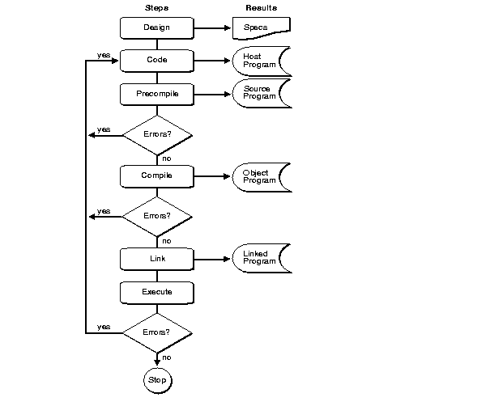
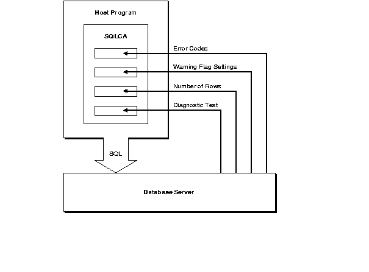

This chapter explains how embedded SQL programs do their work. It presents definitions of important words, explanations of basic concepts, and key rules.

Topics covered are:

- Key Concepts of Embedded SQL Programming

- Programming Guidelines

- The Declare Section

- Nested Programs

- Conditional Precompilations

- Separate Precompilations

- Compiling and Linking

- Sample DEPT and EMP Tables

- Sample EMP Program: SAMPLE1.PCO

### 2.1 Key Concepts of Embedded SQL Programming

This section lays the conceptual foundation on which later chapters build.

#### 2.1.1 Steps in Developing an Embedded SQL Application

Precompiling results in a source file that can be compiled normally. Although precompiling adds a step to the traditional development process, that step is well worth taking because it lets you write very flexible applications.

Figure 2-1 walks you through the embedded SQL application development process:

Figure 2-1 Application Development Process

[Description of "Figure 2-1 Application Development Process"](img_text/pco81050.md)

#### 2.1.2 Embedded SQL Statements

The term embedded SQL refers to SQL statements placed within an application program. Because the application program houses the SQL statements, it is called a host program, and the language in which it is written is called the host language. For example, with Pro\*COBOL you can embed SQL statements in a COBOL host program.

To manipulate and query Oracle data, you use the INSERT, UPDATE, DELETE, and SELECT statements. INSERT adds rows of data to database tables, UPDATE modifies rows, DELETE removes unwanted rows, and SELECT retrieves rows that meet your search criteria.

Only SQL statements—not SQL\*Plus statements—are valid in an application program. (SQL\*Plus has additional statements for setting environment parameters, editing, and report formatting.)

##### 2.1.2.1 Executable versus Declarative Statements

Embedded SQL includes all the interactive SQL statements plus others that allow you to transfer data between Oracle and a host program. There are two types of embedded SQL statements: executable statements and directives.

Executable SQL statements generate calls to the database. They include almost all queries, Data Manipulation Language (DML), data definition language (DDL), and Data Control Language (DCL) statements.

Directives, on the other hand, do not result in calls to SQLLIB and do not operate on Oracle data.

You use directives to declare Oracle objects, communications areas, and SQL variables. They can be placed wherever COBOL declarations can be placed.

Table 2-1 groups some examples of embedded SQL statements (not a complete list.)

Table 2-1 Embedded SQL Statements — Directives

| STATEMENT                                        | PURPOSE                        |
|:-------------------------------------------------|:-------------------------------|
| ARRAYLEN\*                                       | To use host tables with PL/SQL |
| BEGIN DECLARE SECTION\* END DECLARE SECTION\* | To declare host variables      |
| DECLARE\*                                        | To name Oracle objects         |
| INCLUDE\*                                        | To copy in files               |
| VAR\*                                            | To equivalence variables       |
| WHENEVER\*                                       | To handle runtime errors       |

Table 2-2 Embedded SQL Statements — Executable SQL

| STATEMENT                                                                                              | PURPOSE                             |
|:-------------------------------------------------------------------------------------------------------|:------------------------------------|
| ALLOCATE\* ALTER CONNECT\* CREATE DROP GRANT NOAUDIT RENAME REVOKE TRUNCATE | To define and control Oracle data   |
| CLOSE\* DELETE EXPLAIN PLAN FETCH\* INSERT LOCK TABLE OPEN\* SELECT UPDATE     | To query and manipulate Oracle data |
| COMMIT ROLLBACK SAVEPOINT SET TRANSACTION                                                     | To process transactions             |
| DESCRIBE\* EXECUTE\* PREPARE\*                                                                   | To use dynamic SQL                  |
| ALTER SESSION SET ROLE                                                                              | To control sessions                 |

\* Has no interactive counterpart

**See Also:**

[Embedded SQL Statements and Precompiler Directives](embedded-SQL-statements-and-precompiler-directives.md) contains a presentation of the most important statements and directives.

#### 2.1.3 Embedded SQL Syntax

In your application program, you can freely intermix SQL statements with host-language statements and use host-language variables in SQL statements. The only special requirement for building SQL statements into your host program is that you begin them with the words EXEC SQL and end them with the token END-EXEC. Pro\*COBOL translates all executable EXEC SQL statements into calls to the runtime library SQLLIB.

Most embedded SQL statements differ from their interactive counterparts only through the addition of a new clause or the use of program variables. Compare the following interactive and embedded ROLLBACK statements:

    ROLLBACK WORK;           -- interactive

    * embedded
         EXEC SQL
             ROLLBACK WORK
         END-EXEC.

A period or any other terminator can follow a SQL statement. Either of the following is allowed:

         EXEC SQL ... END-EXEC,
         EXEC SQL ... END-EXEC.

#### 2.1.4 Static Versus Dynamic SQL Statements

Most application programs are designed to process static SQLstatements and fixed transactions. In this case, you know the makeup of each SQL statement and transaction before run time. That is, you know which SQL commands will be issued, which database tables might be changed, which columns will be updated, and so on.

However, some applications are required to accept and process any valid SQL statement at run time. In this case you might not know until run time all the SQL commands, database tables, and columns involved.

Dynamic SQL is an advanced programming technique that lets your program accept or build SQL statements at run time and take explicit control over datatype conversion.

**Related Topics**

- [Embedded SQL](embedded-SQL.md)
- [Oracle Dynamic SQL](Oracle-dynamic-SQL.md)
- [ANSI Dynamic SQL](ANSI-dynamic-SQL.md)
- [Oracle Dynamic SQL: Method 4](Oracle-dynamic-SQL-method-4.md)

#### 2.1.5 Embedded PL/SQL Blocks

Pro\*COBOL treats a PL/SQL block like a single embedded SQL statement, so you can place a PL/SQL block anywhere in an application program that you can place a SQL statement. To embed PL/SQL in your host program, you simply declare the variables to be shared with PL/SQL and bracket the PL/SQL block with the keywords EXEC SQL EXECUTE and END-EXEC.

From embedded PL/SQL blocks, you can manipulate Oracle data flexibly and safely because PL/SQL supports all SQL data manipulation and transaction processing commands.

**Related Topics**

- [Embedded PL/SQL](embedded-PLSQL.md)

#### 2.1.6 Host Variables and Indicator Variables

A host variable is a scalar or table variable or group item declared in the COBOL language and shared with Oracle, meaning that both your program and Oracle can reference its value. Host variables are the key to communication between Oracle and your program.

You use input host variables to pass data to the database. You use output host variables to pass data and status information from the database to your program.

Host variables can be used anywhere an expression can be used. In SQL statements, host variables must be prefixed with a colon ':' to set them apart from database schema names.

You can associate any host variable with an optional indicator variable. An indicator variable is an integer variable that indicates the value or condition of its host variable. A NULL is a missing, an unknown, or an inapplicable value. You use indicator variables to assign NULLs to input host variables and to detect NULLs in output variables or truncated values in output character host variables.

A host variable must not be:

- prefixed with a colon in COBOL statements

- used in data definition (DDL) statements such as ALTER and CREATE

In SQL statements, an indicator variable must be prefixed with a colon and appended to its associated host variable (to improve readability, you can precede the indicator variable with the optional keyword INDICATOR).

Every program variable used in a SQL statement must be declared according to the rules of the COBOL language. Normal rules of scope apply. COBOL variable names can be any length, but only the first 30 characters are significant for Pro\*COBOL. Any valid COBOL identifier can be used as a host variable identifier, including those beginning with digits.

The external datatype of a host variable and the internal datatype of its source or target database column need not be the same, but they must be compatible.

**See Also:**

[Datatype Conversion](datatypes-and-host-variables.md) for list of compatible datatypes between which Oracle converts automatically when necessary.

#### 2.1.7 Oracle Datatypes

Typically, a host program inputs data to the database, and the database outputs data to the program. Oracle inserts input data into database tables and selects output data into program host variables. To store a data item, Oracle must know its datatype, which specifies a storage format and valid range of values.

Oracle recognizes two kinds of datatypes: internal and external. Internal datatypes specify how Oracle stores data in database columns. Oracle also uses internal datatypes to represent database pseudo-columns, which return specific data items but are not actual columns in a table.

External datatypes specify how data is stored in host variables. When your host program inputs data to Oracle, it does any conversion between the external datatype of the input host variable and the internal datatype of the database column. When Oracle outputs data to your host program, if necessary, Oracle converts between the internal datatype of the database column and the external datatype of the output host variable.

**Note:**

You can override default datatype conversions by using dynamic SQL Method 4 or datatype equivalencing. For information about datatype equivalencing, see "[Explicit Control Over DATE String Format](datatypes-and-host-variables.md)".

#### 2.1.8 Tables

Pro\*COBOL lets you define table host variables (called host tables) and operate on them with a single SQL statement. Using the SELECT, FETCH, DELETE, INSERT, and UPDATE statements, you can query and manipulate large volumes of data with ease.

**See Also:**

[Host Tables](host-tables.md) for a complete discussion of host tables.

#### 2.1.9 Errors and Warnings

When you execute an embedded SQL statement, it either succeeds or fails, and might result in an error or warning. You need a way to handle these results. Pro\*COBOL provides the following error handling mechanisms:

- SQLCODE status variable

- SQLSTATE status variable

- SQL Communications Area (SQLCA)

- WHENEVER statement

- Oracle Communications Area (ORACA)

##### 2.1.9.1 SQLCODE/SQLSTATE Status Variables

After executing a SQL statement, the Oracle Server returns a status code to a variable named SQLCODE or SQLSTATE. The status code indicates whether the SQL statement executed successfully or caused an error or warning condition.

##### 2.1.9.2 SQLCA Status Variable

The SQLCA is a data structure that defines program variables used by Oracle to pass runtime status information to the program. With the SQLCA, you can take different actions based on feedback from Oracle about work just attempted. For example, you can check to see if a DELETE statement succeeded and, if so, how many rows were deleted.

The SQLCA provides for diagnostic checking and event handling. At runtime, the SQLCA holds status information passed to your program by Oracle. After executing a SQL statement, Oracle sets SQLCA variables to indicate the outcome, as illustrated in Figure 2-2.

Figure 2-2 Updating the SQLCA

[Description of "Figure 2-2 Updating the SQLCA"](img_text/pco81051.md)

You can check to see if an INSERT, UPDATE, or DELETE statement succeeded and if it did, how many rows were affected. Or, if the statement failed, you can get more information about what happened.

When MODE={ANSI13 \| ORACLE}, you must declare the SQLCA by hard-coding it or by copying it into your program with the INCLUDE statement.

**See Also:**

"[Using the SQL Communications Area](error-handling-and-diagnostics.md)" for more information about how to declare and use the SQLCA.

##### 2.1.9.3 WHENEVER Statement

With the WHENEVER statement, you can specify actions to be taken automatically when Oracle detects an error or warning condition. These actions include continuing with the next statement, calling a subprogram, branching to a labeled statement, performing a paragraph, or stopping.

##### 2.1.9.4 ORACA

When more information is needed about runtime errors than the SQLCA provides, you can use the ORACA. The ORACA is a data structure that handles Oracle communication. It contains cursor statistics, information about the current SQL statement, option settings, and system statistics.

##### 2.1.9.5 Precompiler Options and Error Handling

Oracle returns the success or failure of SQL statements in status variables, SQLSTATE and SQLCODE. With precompiler option MODE=ORACLE, you use SQLCODE, declared by including SQLCA. With MODE=ANSI, either SQLSTATE or SQLCODE must be declared, but SQLCA is not necessary.

**Related Topics**

- [Error Handling and Diagnostics](error-handling-and-diagnostics.md)

#### 2.1.10 SQL99 Syntax Support

The SQL standard enables the portability of SQL applications across all conforming software products. Oracle features are compliant with the ANSI/ISO SQL99 standard, including ANSI compliant joins. Pro\*Cobol supports all SQL99 features that are supported by Oracle database, which means that the SQL99 syntax for the SELECT, INSERT, DELETE, and UPDATE statements and the body of the cursor in a DECLARE CURSOR statement are supported.

### 2.2 Programming Guidelines

This section deals with embedded SQL syntax, coding conventions, and Pro\*COBOL-specific features and restrictions. Topics are arranged alphabetically for quick reference.

#### 2.2.1 Abbreviations

You can use the standard COBOL abbreviations, such as PIC for PICTURE IS and COMP for USAGE IS COMPUTATIONAL.

#### 2.2.2 Case-Insensitivity

Pro\*COBOL precompiler options and values as well as all EXEC SQL statements, inline commands, and COBOL statements are case-insensitive. The precompiler accepts both upper- and lower-case tokens.

#### 2.2.3 COBOL Versions Supported

­­Pro\*COBOL supports the standard implementation of COBOL for your operating system (usually COBOL-85 or COBOL-74). Some platforms may support both COBOL implementations. For more information, see your Oracle system-specific documentation.

#### 2.2.4 Coding Areas

The precompiler option FORMAT, specifies the format of your source code. If you specify FORMAT=ANSI (the default), you are conforming as much as possible to the ANSI standard. In this format, columns 1 through 6 can contain an optional sequence number, and column 7 (indicator area) can indicate comments or continuation lines.

Division headers, section headers, paragraph names, FD and 01 statements begin in columns 8 through 11 (area A). Other statements, including EXEC SQL and EXEC ORACLE statements, must be placed in area B (columns 12 through 72). These guidelines for source code format can be overridden by your compiler's rules.

If you specify FORMAT=TERMINAL, COBOL statements can begin in column 1 (the left-most column), or column 1 can be the indicator area. This format is also subject to the rules of your compiler.

You can specify FORMAT=VARIABLE to allow Flexible B Area Length.

Consult your COBOL compiler documentation for your own platform to determine the actual acceptable formats for COBOL statements.

**Note:**

In this manual, COBOL code examples use the FORMAT=TERMINAL setting. The online sample programs in the demo directory use FORMAT=ANSI.

#### 2.2.5 Commas

In SQL, you must use commas to separate list items, as the following example shows:

         EXEC SQL SELECT ENAME, JOB, SAL
             INTO :EMP-NAME, :JOB-TITLE, :SALARY
             FROM EMP
             WHERE EMPNO = :EMP-NUMBER
         END-EXEC.

In COBOL, you can use commas or blanks to separate list items. For example, the following two statements are equivalent:

         ADD AMT1, AMT2, AMT3 TO TOTAL-AMT.
         ADD AMT1 AMT2 AMT3 TO TOTAL-AMT.

#### 2.2.6 Comments

You can place COBOL comment lines within SQL statements. COBOL comment lines start with an asterisk (\*) in the indicator area.

You can also place ANSI SQL-style comments starting with "- - " within SQL statements at the end of a line (but not after the last line of the SQL statement).

COBOL comments continue for the rest of the line after these two characters: "\*\>".

You can place C-style comments (/\* ... \*/) in SQL statements.

The following example shows all four styles of comments:

         MOVE 12 TO DEPT-NUMBER. *> This is the software development group.
         EXEC SQL SELECT ENAME, SAL
    *    assign column values to output host variables
             INTO :EMP-NAME, :SALARY    -- output host variables
         /*  column values assigned to output host variables */
             FROM EMP
             WHERE DEPTNO = :DEPT-NUMBER
         END-EXEC.    -- illegal Comment

You cannot nest comments or place them on the last line of a SQL statement after the terminator END-EXEC.

#### 2.2.7 Continuation Lines

You can continue SQL statements from one line to the next, according to the rules of COBOL, as this example shows:

         EXEC SQL SELECT ENAME, SAL INTO :EMP-NAME, :SALARY FROM EMP
             WHERE DEPTNO = :DEPT-NUMBER
         END-EXEC.

No continuation indicator is needed.

To continue a string literal from one line to the next, code the literal through column 72. On the next line, code a hyphen (-) in column 7, a quote in column 12 or beyond, and then the rest of the literal. An example follows:

     WORKING STORAGE SECTION.
         ...
         EXEC SQL BEGIN DECLARE SECTION END-EXEC.
             ...
     01  UPDATE-STATEMENT  PIC X(80) VALUE "UPDATE EMP SET BON
    -               "US = 500 WHERE DEPTNO = 20".
         EXEC SQL END DECLARE SECTION END-EXEC.

#### 2.2.8 Copy Statements

Copy statements are not parsed by Pro\*COBOL. Therefore, files included with the COPY command should not contain definitions of Host variables or contain embedded SQL statements. Instead, use the INCLUDE precompiler statement which is documented in "Using the INCLUDE Statement". Be careful when using INCLUDE and also using DECLARE_SECTION=YES. Group items should be either placed all inside or all outside of a Declare Section.

#### 2.2.9 Decimal-Point is Comma

Pro\*COBOL supports the DECIMAL-POINT IS COMMA clause in the ENVIRONMENT DIVISION. If the DECIMAL-POINT IS COMMA clause appears in the source file, then the comma will be allowed as the symbol beginning the decimal part of any numeric literals in the VALUE clauses.

For example, the following is allowed:

                IDENTIFICATION DIVISION.
                PROGRAM-ID.  FOO
                ENVIRONMENT DIVISION.
                CONFIGURATION   SECTION.
                SPECIAL-NAMES.
                    DECIMAL-POINT IS COMMA.                *>  <-- **
                DATA DIVISION.
                WORKING-STORAGE SECTION.
            ...
                01  WDATA1          PIC      S9V999 VALUE  +,567. *>  <--- **
                01  WDATA2          PIC      S9V999 VALUE  -,234. *>  <--- **
            ...

#### 2.2.10 Delimiters

The LITDELIM option specifies the delimiters for COBOL string constants and literals. If you specify LITDELIM=APOST, Pro\*COBOL uses apostrophes when generating COBOL code. If you specify LITDELIM=QUOTE (default), quotation marks are used, as in

         CALL "SQLROL" USING SQL-TMP0.

In SQL statements, you must use quotation marks to delimit identifiers containing special or lowercase characters, as in

         EXEC SQL CREATE TABLE "Emp2" END-EXEC.

However, you must use apostrophes to delimit string constants, as in

         EXEC SQL SELECT ENAME FROM EMP WHERE JOB = 'CLERK' END-EXEC.

Regardless of which delimiter is used in the Pro\*COBOL source file, Pro\*COBOL generates the delimiter specified by the LITDELIM value.

#### 2.2.11 Division Headers that are Optional

The following division headers are optional:

- IDENTIFICATION DIVISION

- ENVIRONMENT DIVISION

- DATA DIVISION

Note that the PROCEDURE DIVISION header is not optional. The following source can be precompiled:

    *IDENTIFICATION DIVISION header is optional
     PROGRAM-ID.     HELLO.
    *ENVIRONMENT DIVISION header is optional
     CONFIGURATION SECTION.
    *DATA DIVISION header is optional
     WORKING-STORAGE SECTION.
     PROCEDURE       DIVISION.
         DISPLAY "Hello World!".
         STOP RUN.

#### 2.2.12 Embedded SQL Syntax

To use a SQL statement in your Pro\*COBOL program, precede the SQL statement with the EXEC SQL clause, and end the statement with the END-EXEC keyword.

**See Also:**

[Oracle Database SQL Language Reference.](../sqlrf/index.md) for more information about Embedded SQL syntax.

#### 2.2.13 Figurative Constants

Figurative constants, such as HIGH-VALUE, ZERO, and SPACE, cannot be used in SQL statements. For example, the following is invalid:

         EXEC SQL DELETE FROM EMP WHERE COMM = ZERO END-EXEC.

Instead, use the following:

         EXEC SQL DELETE FROM EMP WHERE COMM = 0 END-EXEC.

#### 2.2.14 File Length

Pro\*COBOL cannot process arbitrarily long source files. Some of the variables used internally limit the size of the generated file. There is no absolute limit to the number of lines allowed, but the following aspects of the source file are contributing factors to the file-size constraint:

- Complexity of the embedded SQL statements (for example, the number of bind and define variables)

- Whether a database name is used (for example, connecting to a database with an AT clause)

- Number of embedded SQL statements

To prevent problems related to this limitation, use multiple program units to sufficiently reduce the size of the source files.

#### 2.2.15 FILLER is Allowed

The word FILLER is allowed in host variable declarations. The word FILLER is used to specify an elementary item of a group that cannot be referred to explicitly. The following declaration is valid:

     01  STOCK.
         05  DIVIDEND     PIC X(5).
         05  FILLER       PIC X.
         05  PRICE        PIC X(6).

#### 2.2.16 Host Variable Names

Any valid standard COBOL identifier can be used as a host variable. Variable names can be any length, but only the first 30 characters are significant. The maximum number of significant characters recognized by COBOL compilers is 30.

For portability, you may wish to restrict the length of host variable names to 18 or fewer characters (the length mandated by the SQL standard).

**See Also:**

[Reserved Words\_ Keywords\_ and Namespaces](reserved-words-keywords-and-namespaces.md) for a list of words that have restrictions on their use in applications.

#### 2.2.17 Hyphenated Names

You can use hyphenated host-variable names in static SQL statements but not in dynamic SQL. For example, the following usage is invalid:

         MOVE "DELETE FROM EMP WHERE EMPNO = :EMP-NUMBER" TO SQLSTMT.
         EXEC SQL PREPARE STMT1 FROM SQLSTMT END-EXEC.

#### 2.2.18 Level Numbers

When declaring host variables, you can use level numbers 01 through 49, and 77. Pro\*COBOL does not allow variables containing the VARYING clause or pseudo-type variables (these datatypes are prefixed with "SQL- ") to be declared level 49 or 77.

#### 2.2.19 MAXLITERAL Default

With the MAXLITERAL option, you can specify the maximum length of string literals generated by Pro\*COBOL, so that compiler limits are not exceeded. For Pro\*COBOL, the default value is 256, but you might have to specify a lower value. On IBM-proprietary S370 operating systems it is 120.

#### 2.2.20 Multibyte Datatypes

ANSI standard National Character Set datatypes are supported for handling multibyte character data. The PIC N or PIC G clause, if supported by your compiler, defines variables that store fixed-length NCHAR strings. You can store variable-length, multibyte National Character Set strings using COBOL group items consisting of a length field and a string field.

The environmental variable NLS_NCHAR is available to specify a client-side Globalization Support National Character Set.

**Related Topics**

- [VARCHAR Variables](datatypes-and-host-variables.md)

#### 2.2.21 NULLs in SQL

In SQL, a NULL represents a missing, unknown, or inapplicable column value; it equates neither to zero nor to a blank. Use the NVL function to convert NULLs to non-NULL values, use the IS \[NOT\] NULL comparison operator to search for NULLs, and use indicator variables to insert and test for NULLs.

#### 2.2.22 Paragraph and Section Names

You can associate standard COBOL paragraph and section names with SQL statements, as shown in the following example:

     LOAD-DATA.
         EXEC SQL
             INSERT INTO EMP (EMPNO, ENAME, DEPTNO)
                 VALUES (:EMP-NUMBER, :EMP-NAME, :DEPT-NUMBER)
         END-EXEC.

Also, you can reference paragraph and section names in a WHENEVER ... DO or WHENEVER ... GOTO statement, as the next example shows:

     PROCEDURE DIVISION.
     MAIN.
         EXEC SQL WHENEVER SQLERROR DO PERFORM SQL-ERROR END-EXEC.
         ...
     SQL-ERROR SECTION.
         ...

You must begin all paragraph names in area A.

#### 2.2.23 REDEFINES Clause

You can use the COBOL REDEFINES clause to redefine group or elementary items. For example, the following declarations are valid:

         EXEC SQL BEGIN DECLARE SECTION END-EXEC.
     01  REC-ID   PIC X(4).
     01  REC-NUM  REDEFINES  REC-ID  PIC S9(4) COMP.
         EXEC SQL END DECLARE SECTION END-EXEC.

And:

         EXEC SQL BEGIN DECLARE SECTION END-EXEC.
      01  STOCK.
           05  DIVIDEND     PIC X(5).
           05  PRICE        PIC X(6).
       01  BOND  REDEFINES  STOCK.
           05  COUPON-RATE  PIC X(4).
           05  PRICE        PIC X(7).
         EXEC SQL END DECLARE SECTION END-EXEC.

Pro\*COBOL issues no warning or error if a single INTO clause uses items from both a group item host variable and from its re-definition.

#### 2.2.24 Relational Operators

COBOL relational operators differ from their SQL equivalents, as shown in Relational Operators. Furthermore, COBOL enables the use of words instead of symbols, whereas SQL does not.

Table 2-3 Relational Operators

| SQL Operators | COBOL Operators               |
|:--------------|:------------------------------|
| =             | =, EQUAL TO                   |
| \< \>, !=, ^= | NOT=, NOT EQUAL TO            |
| \>            | \>, GREATER THAN              |
| \<            | \<, LESS THAN                 |
| \>=           | \>=, GREATER THAN OR EQUAL TO |
| \<=           | \<=, LESS THAN OR EQUAL TO    |

#### 2.2.25 Sentence Terminator

A COBOL sentence includes one or more COBOL or SQL statements, or both of them, and ends with a period. In conditional sentences, only the last statement must end with a period, as the following example shows.

         IF EMP-NUMBER = ZERO
             MOVE FALSE TO VALID-DATA
             PERFORM GET-EMP-NUM UNTIL VALID-DATA = TRUE
         ELSE
             EXEC SQL DELETE FROM EMP
                 WHERE EMPNO = :EMP-NUMBER
             END-EXEC
             ADD 1 TO DELETE-TOTAL.
         END-IF.

SQL statements may be ended by a comma, a period, or another COBOL statement.

### 2.3 The Declare Section

Passing data between the database server and your application program requires host variables and error handling. This section shows you how to meet these requirements.

#### 2.3.1 Contents of a Declare Section

A Declare Section begins with the statement:

         EXEC SQL BEGIN DECLARE SECTION END-EXEC.

and ends with the statement:

         EXEC SQL END DECLARE SECTION END-EXEC.

Between these two statements only the following are allowed:

- Host-variable and indicator-variable declarations

- Non-host COBOL variables

- EXEC SQL DECLARE statements

- EXEC SQL INCLUDE statements

- EXEC SQL VAR statements

- EXEC ORACLE statements

- COBOL comments

##### 2.3.1.1 An Example

In the following example, you declare four host variables for use later in your program.

     WORKING-STORAGE SECTION.
       ...
         EXEC SQL BEGIN DECLARE SECTION END-EXEC.
             ...
     01  EMP-NUMBER     PIC 9(4)  COMP VALUE ZERO.
     01  EMP-NAME       PIC X(10) VARYING.
     01  SALARY         PIC S9(5)V99 COMP-3 VALUE ZERO.
     01  COMMISSION     PIC S9(5)V99 COMP-3 VALUE ZERO.
         EXEC SQL END DECLARE SECTION END-EXEC.

#### 2.3.2 Precompiler Option DECLARE_SECTION

The Declare Section is optional. For backward compatibility with releases prior to 8.0, for which it was required, Pro\*COBOL provides a command-line precompiler option for explicit control over whether only declarations in the Declare Section are allowed as host variables. This option is:

DECLARE_SECTION={YES \| NO} (default is NO)

You must use the DECLARE_SECTION option on the command line or in a configuration file.

When MODE=ORACLE and DECLARE_SECTION=YES, only variables declared inside the Declare Section are allowed as host variables. When MODE=ANSI then DECLARE_SECTION is implicitly set to YES.

If DECLARE_SECTION is set to YES, then you must declare all program variables used in SQL statements inside the Declare Section. If DECLARE_SECTION is set to NO, then it is optional to use a Declare Section. In this case, declarations of host variables and indicator variables can be made either inside or outside a Declare Section. This optional behavior is a change from Release 8.0 and earlier releases.

Multiple Declare Sections are allowed for each precompiled unit. Furthermore, a host program can contain several independently precompiled units.

**See Also:**

- "[Macro and Micro Options](precompiler-options.md)" for more information about macro and micro options.

- "[DECLARE_SECTION](precompiler-options.md)" for more details of the option.

#### 2.3.3 Using the INCLUDE Statement

The INCLUDE statement lets you copy files into your host program, as the following example shows:

    *    Copy in the SQL Communications Area (SQLCA)
         EXEC SQL INCLUDE SQLCA END-EXEC.
    *    Copy in the Oracle Communications Area (ORACA)
         EXEC SQL INCLUDE ORACA END-EXEC.

You can INCLUDE any file. When you precompile your Pro\*COBOL program, each EXEC SQL INCLUDE statement is replaced by a copy of the file named in the statement.

##### 2.3.3.1 Filename Extensions

If your system uses file extensions but you do not specify one, Pro\*COBOL assumes the default extension for source files (usually COB). For more information, see your Oracle system-specific documentation.

##### 2.3.3.2 Search Paths

If your system uses directories, you can set a search path for included files using the INCLUDE option, as follows:

    INCLUDE=path

where path defaults to the current directory.

Pro\*COBOL first searches the current directory, then the directory specified by the INCLUDE option, and finally the directory for standard INCLUDE files. You need not specify a path for standard files such as the SQLCA and ORACA. However, a path is required for nonstandard files unless they are stored in the current directory.

You can also specify multiple paths on the command line, as follows:

    ... INCLUDE=<path1> INCLUDE=<path2> ...

When multiple paths are specified, Pro\*COBOL searches the current directory first, then the path1 directory, then the path2 directory, and so on. The directory containing standard INCLUDE files is searched last. The path syntax is system specific. For more information, see your Oracle system-specific documentation.

Remember that Pro\*COBOL searches for a file in the current directory first even if you specify a search path. If the file you want to INCLUDE is in another directory, make sure no file with the same name is in the current directory or any other directory that precedes it in the search path. If your operating system is case sensitive, be sure to specify the same upper/lowercase filename under which the file is stored.

### 2.4 Nested Programs

Nesting programs in COBOL means that you place one program inside another. The contained programs may reference some of the resources of the programs that contain them. The names within the higher-level program and the nested program can be the same, and describe different data items without conflict, because the names are known only within the programs. However, names described in the Configuration Section of the higher-level program can be referenced in the nested program.

Some compilers do not support the GLOBAL clause. Pro\*COBOL supports nested programs by generating code that contains GLOBAL clauses. To avoid generating GLOBAL clauses unconditionally, specify the precompiler option NESTED=NO. NESTED (=YES or NO) defaults to YES and can be used in configuration files, or on the command line, but not inline (EXEC ORACLE statement).

The higher-level program can contain several nested programs. Likewise, nested programs can have programs nested within them. You must place the nested program directly before the END PROGRAM header of the program in which it is nested.

You can call a nested program only by a program in which it is either directly or indirectly nested. If you want a nested program to be called by any program, even one on a different branch of the nested tree structure, you code the COMMON clause in the PROGRAM-ID paragraph of the nested program. You can code COMMON only for nested programs:

     PROGRAM-ID.  <nested-program-name> COMMON.

You can code the GLOBAL phrase for File Definitions and level 01 data items (any subordinate items automatically become global). This enables them to be referenced in all subprograms directly or indirectly contained within them. You code GLOBAL on the higher-level program. If the nested program defines the same name as one declared GLOBAL in a higher-level program, COBOL uses the declaration within the nested program. If the data item contains a REDEFINES clause, GLOBAL must follow it.

     FD file-name GLOBAL ...
     01 data-name1 GLOBAL ...
     01 data-name2 REDEFINES data-name3 GLOBAL ...

**Related Topics**

- [NESTED](precompiler-options.md)

#### 2.4.1 Support for Nested Programs

Pro\*COBOL enables you to store nested programs with embedded SQL within a single source file. All 01 level items, which are marked as global in a containing program and are valid host variables at the containing program level, are usable as valid host variables in any programs directly or indirectly contained by the containing program. Consider the following example:

     IDENTIFICATION DIVISION.
     PROGRAM-ID. MAINPROG.
     ENVIRONMENT DIVISION.
     DATA DIVISION.
     WORKING-STORAGE SECTION.

         EXEC SQL BEGIN DECLARE SECTION END-EXEC.
     01 REC1  GLOBAL.
               05    VAR1   PIC X(10).
               05    VAR2   PIC X(10).
     01 VAR1  PIC X(10) GLOBAL.
         EXEC SQL END DECLARE SECTION END-EXEC.

     PROCEDURE DIVISION.
         ...
         <main program statements>
         ...
     IDENTIFICATION DIVISION.
        PROGRAM-ID. NESTEDPROG.
     ENVIRONMENT DIVISION.
     DATA DIVISION.
     WORKING-STORAGE SECTION.

     01 VAR1   PIC S9(4).

     PROCEDURE DIVISION.
         ...
         EXEC SQL SELECT X, Y INTO :REC1 FROM ... END-EXEC.

         EXEC SQL SELECT X INTO :VAR1 FROM ... END-EXEC.

         EXEC SQL SELECT X INTO :REC1.VAR1 FROM ... END-EXEC.
         ...
     END PROGRAM NESTEDPROG.
     END PROGRAM MAINPROG.

The main program declares the host variable REC1 as global, and thus the nested program can use REC1 in the first select statement without having to declare it. Since VAR1 is declared as a global variable and also as a local variable in the nested program, the second select statement will use the VAR1 declared as S9(4), overriding the global declaration. In the third select statement, the global VAR1 of REC1 declared as PIC X(10) is used.

The previous paragraph describes the results when DECLARE_SECTION=NO is used. When DECLARE_SECTION=YES, Pro\*COBOL will not recognize host variables unless they are declared inside a Declare Section. If the preceding program is precompiled with DECLARE_SECTION=YES, then the second select statement would result in an ambiguous host variable error. The first and third select statements would function the same.

Note: Recursive nested programs are not supported

##### 2.4.1.1 Declaring the SQLCA

For information on declaring the SQLCA for nested programs, the included SQLCA definition provided will be declared as global, so the declaration of SQLCA is only required in the higher-level program. The SQLCA can change each time a new SQL statement is executed. The SQLCA provided can always be modified to remove the global specification if you want to declare additional SQLCA areas in the nested programs. This also applies to SQLDA and ORACA.

**Related Topics**

- SQLCA Status Variable

##### 2.4.1.2 Nested Program Example

See SAMPLE13.PCO in the demo directory.

### 2.5 Conditional Precompilations

Conditional precompilation includes (or excludes) sections of code in your host program based on certain conditions. For example, you might want to include one section of code when precompiling under UNIX and another section when precompiling under VMS. Conditional precompilation lets you write programs that can run in different environments.

Conditional sections of code are marked by statements that define the environment and actions to take. You can code host-language statements as well as EXEC SQL statements in these sections. The following statements let you exercise conditional control over precompilation:

    *   -- define a symbol
         EXEC ORACLE DEFINE symbol END-EXEC.
    *    -- if symbol is defined
         EXEC ORACLE IFDEF symbol  END-EXEC.
    *   -- if symbol is not defined
         EXEC ORACLE IFNDEF symbol END-EXEC.
    *            -- otherwise
         EXEC ORACLE ELSE END-EXEC.
    *           -- end this control block
         EXEC ORACLE ENDIF END-EXEC.

A conditional statement must be terminated with` END-EXEC`.

**Note:**

The conditional compilation feature of your compiler may not be supported by Pro\*COBOL.

#### 2.5.1 An Example

In the following example, the SELECT statement is precompiled only when the symbol SITE2 is defined:

         EXEC ORACLE IFDEF SITE2 END-EXEC.
         EXEC SQL SELECT DNAME
            INTO :DEPT-NAME
            FROM DEPT
            WHERE DEPTNO = :DEPT-NUMBER
         EXEC ORACLE ENDIF END-EXEC.

Blocks of conditions can be nested as shown in the following example:

         EXEC ORACLE IFDEF OUTER END-EXEC.
         EXEC ORACLE IFDEF INNER END-EXEC.
         ...
         EXEC ORACLE ENDIF END-EXEC.
         EXEC ORACLE ENDIF END-EXEC.

You can "Comment out" host-language or embedded SQL code by placing it between IFDEF and ENDIF and not defining the symbol.

#### 2.5.2 Defining Symbols

You can define a symbol in two ways. Either include the statement

         EXEC ORACLE DEFINE symbol END-EXEC.

in your host program or define the symbol on the command line using the syntax

    ... INAME=filename ... DEFINE=symbol

where symbol is not case-sensitive.

Some port-specific symbols are predefined for you when Pro\*COBOL is installed on your system. For example, predefined operating system symbols include CMS, MVS, UNIX, and VMS.

**Note:**

A DEFINE SYMBOL name beginning with a number, or that includes a dash, causes an unrecoverable error during precompilation. You can use underscores, and you can use numbers other than at the beginning of a DEFINE SYMBOL name.

### 2.6 Separate Precompilations

You can precompile several COBOL program modules separately and then link them into one executable program. This supports modular programming, which is required when the functional components of a program are written and debugged by different programmers. The individual program modules need not be written in the same language.

#### 2.6.1 Guidelines

The following guidelines will help you avoid some common problems.

##### 2.6.1.1 Referencing Cursors

Cursor names are SQL identifiers, whose scope is the precompilation unit. Hence, cursor operations cannot span precompilation units (files). That is, you cannot declare a cursor in one file and open or fetch from it in another file, so when doing a separate precompilation, make sure all definitions and references to a given cursor are in one file.

##### 2.6.1.2 Specifying MAXOPENCURSORS

When you precompile the program module that connects to Oracle, specify a value for MAXOPENCURSORS that is high enough for any of the program modules. If you use it for another program module, MAXOPENCURSORS is ignored. Only the value in effect for the connect is used at run time.

##### 2.6.1.3 Using a Single SQLCA

If you want to use just one memory area for the SQLCA, the process for doing so depends on which version of Pro\*COBOL you are using.

###### 2.6.1.3.1 Version 1.8 and Lower

You must declare the SQLCA globally. You can do this by modifying the SQLCA.COB file, changing the line

     01  SQLCA.

to

     01  SQLCA EXTERNAL.

Alternatively, you can include a hard-coded definition for SQLCA, copied from SQLCA.cob and make the aforementioned change. Note that you still have to include a definition of SQLCA in each precompiled unit.

###### 2.6.1.3.2 Version 2 and Later

In later versions of Pro\*COBOL, the SQLCA is not copied from the file system. It is generated by the precompiler. If you need to share the SQLCA structure in these versions, instead of this statement:

    EXEC SQL INCLUDE SQLCA END-EXEC

you should use the following code:

    EXEC SQL INCLUDE SQLCA.ANX END-EXEC

This causes the precompiler to generate the SQLCA structure with the EXTERNAL keyword added automatically.

##### 2.6.1.4 Using a Single DATE_FORMAT

You must use the same format string for DATE in each program module.

#### 2.6.2 Restrictions

All references to an explicit cursor must be in the same program file. You cannot perform operations on a cursor that was declared in a different module. See Chapter 4 for more information about cursors.

Also, any program file that contains SQL statements must have a SQLCA that is in the scope of the local SQL statements.

### 2.7 Compiling and Linking

To get an executable program, you must compile the source file(s) produced by Pro\*COBOL, then link the resulting object module with any modules needed from SQLLIB and system-specific Oracle libraries.

The linker resolves symbolic references in the object modules. If these references conflict, the link fails. Such conflicts can happen when you try to link third party software into a precompiled program. Not all third-party software is compatible with Oracle, so you might have problems. Check with Oracle Support Services to see if the software is supported.

Compiling and linking are system-dependent. For example, on some systems, you must turn off compiler optimization when compiling a host language program. For instructions, see your system-specific Oracle manual.

### 2.8 Sample DEPT and EMP Tables

Most of the complete program examples in this guide use two sample database tables: DEPT and EMP. If they do not exist in your demo directory, create them before running the sample programs. Their definitions follow:

    CREATE TABLE DEPT (DEPTNO NUMBER(2), DNAME VARCHAR2(14), LOC VARCHAR2(13));

    CREATE TABLE EMP (EMPNO NUMBER(4) primary key, ENAME VARCHAR2(10), JOB VARCHAR2(9), MGR NUMBER(4), HIREDATE DATE, SAL NUMBER(7,2), COMM NUMBER(7,2), DEPTNO NUMBER(2));

#### 2.8.1 Sample DEPT and EMP Data

Respectively, the DEPT and EMP tables contain the following rows of data:

    DEPTNO  DNAME      LOC
    ------- ---------- ---------
    10      ACCOUNTING NEW YORK
    20      RESEARCH   DALLAS
    30      SALES      CHICAGO
    40      OPERATIONS BOSTON

    EMPNO ENAME   JOB          MGR  HIREDATE    SAL   COMM  DEPTNO
    ----- ------- --------- ------ --------- ------ ------ -------
     7369 SMITH   CLERK       7902 17-DEC-80    800             20
     7499 ALLEN   SALESMAN    7698 20-FEB-81   1600    300      30
     7521 WARD    SALESMAN    7698 22-FEB-81   1250    500      30
     7566 JONES   MANAGER     7839 02-APR-81   2975             20
     7654 MARTIN  SALESMAN    7698 28-SEP-81   1250   1400      30
     7698 BLAKE   MANAGER     7839 01-MAY-81   2850             30
     7782 CLARK   MANAGER     7839 09-JUN-81   2450             10
     7788 SCOTT   ANALYST     7566 19-APR-87   3000             20
     7839 KING    PRESIDENT        17-NOV-81   5000             10
     7844 TURNER  SALESMAN    7698 08-SEP-81   1500             30
     7876 ADAMS   CLERK       7788 23-MAY-87   1100             20
     7900 JAMES   CLERK       7698 03-DEC-81    950             30
     7902 FORD    ANALYST     7566 03-DEC-81   3000             20
     7934 MILLER  CLERK       7782 23-JAN-82   1300             10

### 2.9 Sample EMP Program: SAMPLE1.PCO

A good way to get acquainted with embedded SQL is to look at a program example. This program is SAMPLE1.PCO in the` demo `directory.

The program logs on to the database, prompts the user for an employee number, queries the database table EMP for the employee's name, salary, and commission. The selected results are stored in host variables EMP-NAME, SALARY, and COMMISSION. The program uses the host indicator variable, COMM-IND to detect NULL values in column COMMISSION.

The paragraph DISPLAY-INFO then displays the result.

Bug 7225844 - Following para - substituted EMP-NAME for EMP-NUMBER

The COBOL variables USERNAME, PASSWD, and EMP-NAME are declared using the VARYING clause, which enables you to use a variable-length string external Oracle datatype called VARCHAR.

The SQLCA Communications Area is included to handle errors. If an error occurs, paragraph SQL-ERROR is performed.

The BEGIN DECLARE SECTION and END DECLARE SECTION statements used are optional, unless you set the precompiler option DECLARE_SECTION to YES, or option MODE to ANSI.

The WHENEVER statement is used to handle errors.

The program ends when the user enters a zero employee number.

**Note:**

For simplicity in demonstrating this feature, this example does not perform the password management techniques that a deployed system normally uses. In a production environment, follow the Oracle Database password management guidelines, and disable any sample accounts. See [Oracle Database Security Guide](../dbseg/managing-security-for-application-developers.md) for password management guidelines and other security recommendations.

    * This program logs on to ORACLE, prompts the user for an employee number,
    * queries the database for the employee's name, salary, and commission, then
    * displays the result. The program terminates when the user enters a 0.              *
           ID DIVISION.

           PROGRAM-ID. QUERY.
           ENVIRONMENT DIVISION.
           DATA DIVISION.
           WORKING-STORAGE SECTION.

               EXEC SQL BEGIN DECLARE SECTION END-EXEC.
           01  USERNAME          PIC X(10) VARYING.
           01  PASSWD            PIC X(10) VARYING.
           01  EMP-REC-VARS.
               05  EMP-NAME      PIC X(10) VARYING.
               05  EMP-NUMBER    PIC S9(4) COMP VALUE ZERO.
               05  SALARY        PIC S9(5)V99 COMP-3 VALUE ZERO.
               05  COMMISSION    PIC S9(5)V99 COMP-3 VALUE ZERO.
               05  COMM-IND      PIC S9(4) COMP VALUE ZERO.
               EXEC SQL END DECLARE SECTION END-EXEC.

               EXEC SQL INCLUDE SQLCA END-EXEC.

           01  DISPLAY-VARIABLES.
               05  D-EMP-NAME    PIC X(10).
               05  D-SALARY      PIC Z(4)9.99.
               05  D-COMMISSION  PIC Z(4)9.99.
               05  D-EMP-NUMBER  PIC 9(4).

           01 D-TOTAL-QUERIED   PIC 9(4) VALUE ZERO.

           PROCEDURE DIVISION.
           BEGIN-PGM.
               EXEC SQL WHENEVER SQLERROR
                  DO PERFORM SQL-ERROR END-EXEC.

               PERFORM LOGON.

           QUERY-LOOP.
               DISPLAY " ".
               DISPLAY "ENTER EMP NUMBER (0 TO QUIT): "
                   WITH NO ADVANCING.

               ACCEPT D-EMP-NUMBER.

               MOVE D-EMP-NUMBER TO EMP-NUMBER.
               IF (EMP-NUMBER = 0)
                   PERFORM SIGN-OFF.
               MOVE SPACES TO EMP-NAME-ARR.
               EXEC SQL WHENEVER NOT FOUND GOTO NO-EMP END-EXEC.
               EXEC SQL SELECT ENAME, SAL, NVL(COMM, 0)
                   INTO :EMP-NAME, :SALARY, :COMMISSION:COMM-IND
                   FROM EMP
                   WHERE EMPNO = :EMP-NUMBER
               END-EXEC.
               PERFORM DISPLAY-INFO.
               ADD 1 TO D-TOTAL-QUERIED.
               GO TO QUERY-LOOP.

           NO-EMP.
               DISPLAY "NOT A VALID EMPLOYEE NUMBER - TRY AGAIN.".
               GO TO QUERY-LOOP.

           LOGON.
               MOVE "SCOTT" TO USERNAME-ARR.
               MOVE 5 TO USERNAME-LEN.
               MOVE "TIGER" TO PASSWD-ARR.
               MOVE 5 TO PASSWD-LEN.
               EXEC SQL
                   CONNECT :USERNAME IDENTIFIED BY :PASSWD
               END-EXEC.
               DISPLAY " ".
               DISPLAY "CONNECTED TO ORACLE AS USER: ", USERNAME-ARR.

           DISPLAY-INFO.
               DISPLAY " ".
               DISPLAY "EMPLOYEE    SALARY    COMMISSION".
               DISPLAY "--------    ------    ----------".
               MOVE EMP-NAME-ARR TO D-EMP-NAME.
               MOVE SALARY TO D-SALARY.
               IF COMM-IND = -1
                   DISPLAY D-EMP-NAME, D-SALARY, "          NULL"
               ELSE
                   MOVE COMMISSION TO D-COMMISSION
                   DISPLAY D-EMP-NAME, D-SALARY, "      ", D-COMMISSION
               END-IF.

           SIGN-OFF.
               DISPLAY " ".
               DISPLAY "TOTAL NUMBER QUERIED WAS ",
                   D-TOTAL-QUERIED, ".".
               DISPLAY " ".
               DISPLAY "HAVE A GOOD DAY.".
               DISPLAY " ".
               EXEC SQL COMMIT WORK RELEASE END-EXEC.
               STOP RUN.

           SQL-ERROR.
               EXEC SQL WHENEVER SQLERROR CONTINUE END-EXEC.
               DISPLAY " ".
               DISPLAY "ORACLE ERROR DETECTED:".
               DISPLAY " ".
               DISPLAY SQLERRMC.
               EXEC SQL ROLLBACK WORK RELEASE END-EXEC.
               STOP RUN.

**Related Topics**

- [Using the SQL Communications Area](error-handling-and-diagnostics.md)
- [MODE](precompiler-options.md)
- [WHENEVER Directive](error-handling-and-diagnostics.md)
